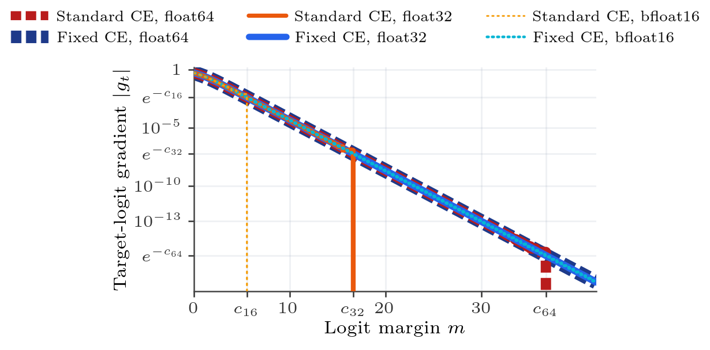
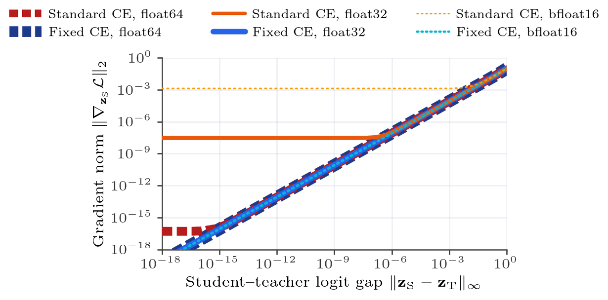
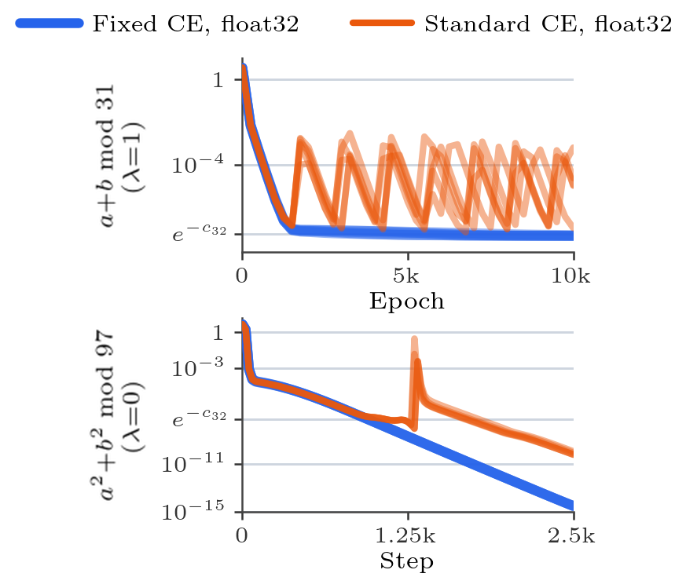

# Paper精读｜A Fix for Softmax and Cross-Entropy

> [!abstract] 一句话结论
> 论文发现标准 softmax / cross-entropy 的常见稳定化写法仍有两种浮点误差：高置信度时正确类别梯度被舍入为零、蒸馏中师生输出接近时相减放大误差。作者通过改写 log-space 计算，避免“先把两个几乎相等的量算出来再相减”，在不提高内部精度的条件下恢复梯度的一致性；实验证明这能消除特定 grokking 设置中的 Slingshot 震荡，并避免初始化相同的学生模型在蒸馏时被数值噪声推离教师。

> [!cite]- 论文信息（点开折叠）
> - **论文标题**：A Fix for Softmax and Cross-Entropy
> - **arXiv**：2610.31642v1
> - **链接**：[https://arxiv.org/abs/2610.31642](https://arxiv.org/abs/2610.31642)
> - **作者**：Jonathan T. Barron, Dan Gnanapragasam, Michael Tschannen
> - **机构**：Google DeepMind
> - **日期**：2026-10-22
> - **论文类型**：数值分析 / 优化方法论文；提出 softmax、log-softmax、交叉熵的稳定实现，并用 grokking 与知识蒸馏实验验证

---

## 1️⃣ 论文想解决什么问题

softmax 为 logits 生成概率，交叉熵以概率与目标分布衡量预测误差。工程上通常先减去最大 logit，防止指数溢出；但“防溢出”不等于“所有梯度都数值正确”。当预测极度确信，或师生 logits 极接近时，浮点加减的有效精度可能让损失和梯度与数学上的值不一致。

问题的分量在这里：优化器看到的从来是数值梯度，不是实数域的公式。Adam/AdamW 会按梯度历史幅值归一化，微小的不对称残差可能被放大成参数更新；在 grokking 实验里，它会表现为损失尖峰，在蒸馏里则可能让原本已与教师完全相同的学生继续漂移。

本文聚焦于两种特定条件下的数值病态，不是在主张所有训练任务、所有框架实现或所有大模型训练都普遍受损。论文的主要实验是小规模合成任务；真实大规模训练中的频率与影响程度仍需独立测量。

---

## 2️⃣ 核心洞察

> [!important] 核心洞察
> 1. **误差来自表达式的计算路径，而非交叉熵的数学定义。** 数学上目标类梯度可写成两个等价形式；浮点下 `1/(1+小数)-1` 会先把分母舍入为 1，再相减得到 0，而 `-小数/(1+小数)` 保留了小量。
>
> 2. 概率域相减会损失“两个 logits 之间”的微小差异。 蒸馏梯度是 `q-p`；若先分别计算并舍入 `q`、`p`，再相减，差异可能消失，也可能因前向与反向使用不同计算序列而留下虚假残差。
>
> 3. Adam 的 epsilon 不只是防止除零的数值保险。 在 weight decay 存在时，它与权重衰减共同决定训练后期 logit margin 的平衡点，近似为 `log(1/epsilon)`；这个平衡位置可能刚好跨过标准 softmax 的精度断崖。
>
> 4. **修复不靠升精度，而是用代数重写保留小量。** hard target 路径使用 margin + softplus；soft target 路径用 `expm1` / `log1p` 直接计算 log-ratio 与概率差。

*图 1(a)：目标 logit margin 增大时，真实目标梯度应平滑趋近于零；标准实现却在浮点精度断崖处突然归零，而修正版保留该小梯度。*

---

## 3️⃣ 方法解读

### 组件 1：Softmax Collapse——从 margin 直接计算损失与梯度

作者先造一个度量「模型有多确信」的量：设 logits 为 `z∈R^K`，正确类别为 `t`，其他类别 logits 为 `z_j`，定义目标类相对其他类的 logit margin：

`m = z_t - logsumexp_{j≠t}(z_j)`。

置信度越高，`m` 越大。有了 `m`，hard-label 交叉熵不再依赖 K 个 logits，只剩这一个变量：

`L = log(1 + exp(-m)) = softplus(-m)`。

其目标类梯度为：

`g_t = -exp(-m)/(1 + exp(-m))`，

非目标类梯度为：

`g_j = exp(z_j-z_t)/(1+exp(-m))`，`j≠t`。

关键是目标梯度不要按 `q_t - 1` 算。标准路径会先得到 `q_t=1/(1+exp(-m))`，当 `exp(-m)` 加到 1 上被舍入丢弃时，`q_t` 就变成精确的 1，再减 1 得到零。修正版直接在分子保留 `exp(-m)`，所以目标梯度可以一直保留到指数下溢；同时把最大 logit 槽位设为常数 0，再对其余 logits 做 log-sum-exp，使 autodiff 得到目标梯度等于其余梯度之和的负值，保持梯度和为零。

论文测得的 precision cliff 约为 bf16 的 5.5、fp32 的 16.6、fp64 的 36.7（以 margin 计）。这些值说明误差不是“概率已经小到数学上等于零”，而是小量加到 1 时被舍入掉。

### 组件 2：Softmax Cancellation——在 logit 差异上稳定计算蒸馏梯度

教师概率 `p=softmax(z_T)`，学生概率 `q=softmax(z_S)`，通常蒸馏梯度为 `g=q-p`。修正版绕开概率域的这步相减，全程只在 logit 差 `δ=z_S-z_T` 上做文章。先在教师概率 `p` 下中心化：

`d_k = δ_k - Σ_i p_i δ_i`，

再计算概率比的对数：

`s_k = d_k - log1p(Σ_i p_i expm1(d_i))`，

最后把 log-ratio 变回概率差：

`u_k = p_k expm1(s_k)`。

这里 `expm1(x)=exp(x)-1` 在 `x≈0` 时比直接 `exp(x)-1` 更能保留小差异，`log1p(x)=log(1+x)` 同理。为了抵消最后有限精度运算导致的微小总和漂移，再令 `g_k=u_k-q_k Σ_i u_i`，从而数值上恢复零和梯度。前向仍返回原交叉熵，反向使用自定义的稳定梯度（JAX 中通过 `stop_gradient` 实现）。

*图 1(b)：当学生 logits 趋近教师 logits 时，真实梯度应趋近零；标准实现因概率相减而出现非零误差底，修正版避免该误差。*

### 组件 3：解释 Slingshot 与 margin 平衡

论文把 softmax 数值断崖与 grokking 的 Slingshot 现象连成因果链：标准交叉熵跨过精度 cliff 后目标梯度突然归零，Adam 二阶矩估计继续衰减；当参数变化又使样本跌回 cliff 以下，梯度突然恢复，此时很小的二阶矩分母会造成大步更新，引发损失尖峰。

修正版使梯度随 margin 平滑衰减，因而没有这种“关掉—重新打开”的跳变。进一步地，在 AdamW 的稳态近似下，若 `m_hat≈g`、`v_hat≈g²`，单坐标的更新平衡近似满足：

`g/(|g|+epsilon) + λθ ≈ 0`。

当梯度幅值远小于 `epsilon` 时，归一化梯度约为 `g/epsilon`；它与 weight decay 平衡后，对应 margin 近似 `m*(epsilon)≈log(1/epsilon)`。这是一个基于稳态近似的解释，不是对任意网络与训练轨迹的普适定理。

*图 2(b)：在论文给定的 grokking 配置中，标准交叉熵于精度 cliff 附近出现 Slingshot 波动；修正版越过 cliff 后训练更平滑。*

---

## 4️⃣ 实验部分怎么读

### 实验设置

| **实验** | **设置** | **目的** |
| --- | --- | --- |
| 数值行为 | bf16、fp32、fp64；比较标准与修正版 softmax / CE | 检查梯度断崖与 cancellation 噪声 |
| Grokking 主实验 | 1 层、宽度 64 的 ReLU Transformer；`a+b mod 31`；50% 训练集；全批量 AdamW；10,000 epochs；`lr=1e-3, β1=0.9, β2=0.98, λ=1`；变化 epsilon、精度及 loss | 比较泛化与 Slingshot |
| 跨任务验证 | 4 个既有 grokking 基准：模数加法 Transformer 与两个多项式模运算 MLP；3–5 个随机种子 | 检查现象是否只出现在单一任务 |
| 软目标蒸馏 | 学生从教师权重初始化；教师在 `a+b mod 53` 达 100% 准确率；Adam 2,000 步；`lr=2e-3, λ=0, epsilon=1e-8, T=4` | 检查相同 logits 是否产生非零虚假梯度并导致漂移 |

### 核心结果

| **比较** | **标准交叉熵** | **修正版** | **解读** |
| --- | --- | --- | --- |
| `a+b mod 31`，fp32，epsilon=1e-8，5 seeds | 94.3±5.4% | 100.0±0.0% | 标准实现的平均 margin 约 13.0；修正版约 17.9，跨过 fp32 cliff 后到达预期平衡区 |
| 同任务，fp32，epsilon=1e-12 | 96.4±5.1% | 99.6±0.7% | 修正版在更高 margin 区仍保持高准确率 |
| 同任务，fp32，epsilon=1e-16 | 96.5±4.3% | 99.0±2.3% | 标准 CE 平均 margin 仅 12.7；修正版约 36.8 |
| bf16，epsilon=1e-8 | 93.3±7.4% | 100.0±0.1% | 标准实现停在约 5.1 margin；修正版绕过 bf16 cliff |
| fp64，epsilon=1e-16 | 97.2±3.2% | 99.0±2.0% | 即使 fp64，在 epsilon 使稳态 margin 超过 fp64 cliff 时也会出问题 |
| 蒸馏：学生初始权重等于教师 | bf16 残差梯度约 1e-3，可令学生漂移；fp32 约 1e-8，出现短暂 KL 尖峰 | 初始梯度为零，KL 保持约 0，三种精度均维持 100% 准确率 | 自洽性测试：相同输入 logits 不应产生更新 |

论文也报告：无 weight decay 的 `a²+b² mod 97` 设置中，标准 CE 的测试准确率在约第 1,250 步从 61% 跌到 23%，修正版继续平滑训练至 85%。在四个 grokking 基准上，fp32 修正版接近 fp64 标准 CE 的表现。与零和梯度投影及 StableMax 的比较显示，在作者测试配置下，修正版准确率更稳，StableMax 的 margin 甚至达到数千至数万。

### 结果应该怎样解读

- 论文最有说服力的不是单个最终准确率，而是**数值预测、优化器行为和训练曲线互相吻合**：cliff 与骤发梯度变化对应 Slingshot，改写后 cliff 消失，训练过程也平滑。

- epsilon 扫描是关键：理论平衡 margin `log(1/epsilon)` 会随着 epsilon 变小而增大；若高于格式精度 cliff，标准算法可能在达到平衡前先出故障。此解释与多个 epsilon 的实测 margin 相符。

- 蒸馏实验是精确的 sanity check：学生与教师参数相同，真实梯度应为零。标准实现的数值残差经 Adam 归一化后能造成更新，说明“误差很小”不代表对优化轨迹无影响。

- 但这些实验主要是玩具 grokking 基准及教师初始化蒸馏，不足以证明大规模 LLM 预训练里该问题普遍发生、带来多大收益，或修正版在所有硬件/框架内核上都无成本。

---

## 5️⃣ 学术评价

**优点：**

1. 抓住了公式等价但浮点行为不等价这一关键点，解释简洁、可检验，也给出可直接复用的 JAX 代码。

2. 从数值错误连到优化器动力学：不是只展示误差曲线，还解释 Adam 的二阶矩与 weight decay 如何把局部误差转成训练尖峰。

3. 多种精度、多个 grokking 任务、蒸馏场景交叉验证；并给出均值、方差与种子数，证据链比单一示例完整。

4. 提供了可作为回归测试的性质：梯度和应为零；学生等于教师时蒸馏梯度应为零；极高置信度时目标梯度应平滑趋近零。

> [!ed-warning] 局限（风险与不确定性）
> 1. 应用规模有限。 主要训练实验是小模型、模运算与少量 seeds；大型 Transformer 的真实发生率、吞吐/内存影响及端到端收益未实测。
>
> 2. 实现与硬件覆盖有限。 论文提供 JAX 代码并讨论常见框架实现，但没有展示 PyTorch、TensorFlow、 fused GPU kernels、不同编译器及混合精度训练栈上的全面基准；部署前需在目标 kernel 上验证。
>
> 3. “简单替换”仍有集成语义问题。 soft-target 方案通过自定义反向梯度保留原 forward loss；与 temperature scaling、label smoothing、ignore mask、分布式归约、非有限值处理等组合时需要额外测试。
>
> 4. 稳定计算的边界并非无限。 `expm1` / `log1p` 能减少近零消减误差，但指数下溢仍存在；当目标 logit 并非最大值、存在 NaN/Inf、极端类别数或特殊量化格式时，需要额外考虑边界行为。
>
> 5. 论文所称“可能无显著减速”是作者对简单实现的判断；文中没有充分的硬件级性能表来证明所有常见生产实现都零成本。

---

## 6️⃣ 局限与可扩展方向

- 在 PyTorch、JAX、TensorFlow 及 fused softmax-cross-entropy kernel 中复现数值测试，尤其检查自动微分与手写 backward 是否一致。

- 用真实语言模型 logits 分布统计 margin 超过 dtype precision cliff 的 token 比例，并按训练阶段、词表大小和混合精度配置拆分。

- 对比标准实现、修正版、提高累加精度、loss scaling 等方案的端到端吞吐、显存、训练稳定性与最终质量。

- 把零和梯度、对数概率与熵约束等不变量加进数值回归测试，覆盖 hard labels、soft labels、temperature、label smoothing 和 batch masking。

- 研究在低精度 fused kernels 中能否通过补偿求和或专门的 softplus/log1p 近似实现同等精度且不损失吞吐。

---

## 7️⃣ 最后总结

这篇论文的核心是提醒：数值稳定不能只看 forward loss 是否有限，还要看梯度是否保留了正确的符号、尺度与守恒关系。作者用 margin 形式避免目标概率舍入为 1 后再减 1，用 `expm1` 与 `log1p` 避免师生概率直接相减，并展示这些改动能解释并缓解特定 grokking 与蒸馏实验中的异常。它的数学与代码贡献清楚，适合作为训练栈数值正确性的检查清单；但“在现代大模型训练里收益多大”仍是开放问题，需要在真实训练分布和实际 fused kernels 上测量。

---

## 8️⃣ 三句速记

> [!summary]- 点开展开
> 1. 标准 CE 的 `q_t-1` 在高置信度下可能把正确类别梯度舍入成零，导致梯度不再和为零。
>
> 2. 稳定版用 margin + softplus，并用 `expm1/log1p` 从 logits 差异直接计算蒸馏梯度。
>
> 3. 小规模 grokking 与蒸馏结果支持方法有效，但尚不能据此推断大模型训练的普遍收益；需在生产 kernel 上复现验证。
