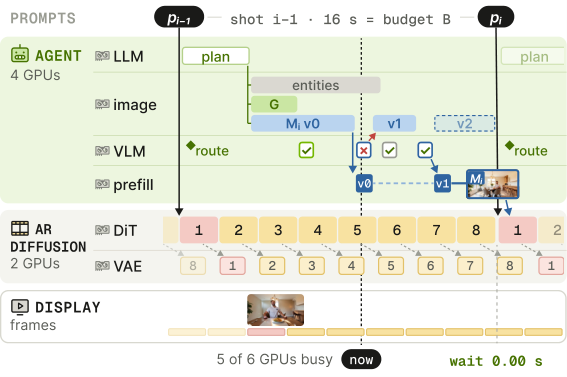
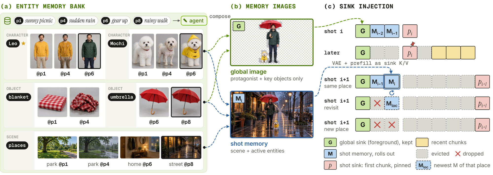
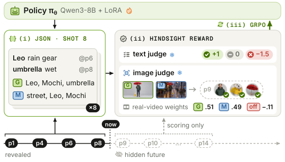
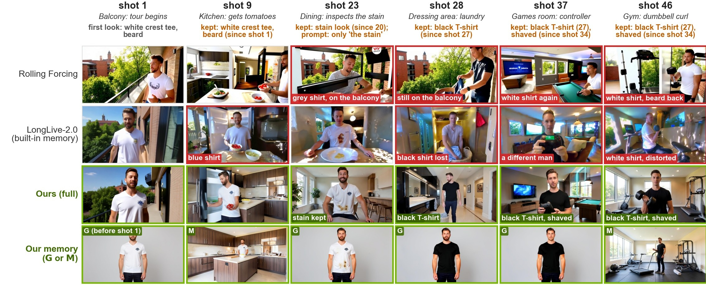
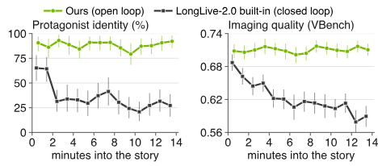

# Paper精读｜Agentic LongLive: Asynchronous Agentic Memory for Long Video Generation

> [!abstract] 一句话结论
> 给实时自回归视频生成器外挂一个**跑在独立 GPU 上的记忆 agent**：它只读已揭示的 prompt、提前一个 shot 把实体记忆写好并预填充进生成器的 attention sink，让视频**从不等记忆**。在 LongStory-Online（25 故事 857 shot，逐 shot 揭示）上，State +26.3 / Identity +44.9 / Revisit +40.4，代价约 1% 生成时间；全套系统在单台 8×B200 上 34.3 FPS 快于实时。第一个带 LLM agent 文本+图像记忆的实时视频生成器。

> [!cite]- 论文信息（点开折叠）
> - 论文标题：Agentic LongLive: Asynchronous Agentic Memory for Long Video Generation
> - arXiv：[2611.34907](https://arxiv.org/abs/2611.34907)（v1，2026-11-25，cs.CV）
> - 作者：Shaoteng Liu, Shuai Yang, Wei Huang, Luozhou Wang, Song Han, Yukang Chen
> - 机构：NVIDIA / MIT / CUHK
> - 代码：github.com/NVlabs/LongLive/tree/main/Agentic-LongLive；项目页 nvlabs.github.io/LongLive/Agentic-LongLive/
> - 阅读范围：正文 §1–§4 + 附录 A–I 全读（HTML 全文），参考文献浏览，无来源缺口
> - 论文类型：方法/实验论文（agent 记忆系统 + RL 记忆规划器 + 新基准 LongStory-Online）

---

## 1️⃣ 论文想解决什么问题

这一节要回答：实时视频生成和离线 agent 叙事之间的断层到底断在哪四条约束上。

直播、游戏、世界模型需要的生成器是**自回归（AR）少步模型**：分钟级连续流、边播边换 prompt。这类模型（LongLive-2.0、Rolling Forcing 一族）的全部记忆就是 KV cache——一个钉住开头的 attention sink 加一小窗最近帧。窗口外的东西被遗忘，而窗口里留着的是**模型自己的输出**：画错的脸会被原样复制到后续每一帧。

另一边，StoryEngine、ViMax 这类 agent 系统能记人、记物、记场，但它们依赖三样直播给不了的东西：先读完整本剧本、每个 shot 生成前停下来等规划、失败了重画。作者把直播的处境压成四条硬约束（这是我见过对这个设计空间最干净的表述）：

- **C1 未来未知**：第 $i$ 个 shot 的记忆必须在该 prompt 到达之前备好；
- **C2 无长度上限**：GPU 显存必须与故事长度无关；
- **C3 硬截止**：视频永远不能等记忆——规划、画图、预填充全部要藏在生成后面；
- **C4 不可回滚**：播出去的 shot 不能修。

拿论文里贯穿的例子过一遍：一个 48-shot 的 home tour，主持人在前 20 个 shot 里弄脏了衬衫，第 27 shot 换上黑 T 恤，第 34 shot 剃了须——之后的 prompt 只说 "the stain" 或直呼其名，**从不复述**这些变化。LongLive-2.0 的 KV 窗口在第 2 分钟后就把旧形象冲掉了，观众看到的是另一个人穿着别的衣服在健身房里晃（Fig. 5 的红标行）。这个例子后面会跟着方法走一遍，再看实验怎么对上。

---

## 2️⃣ 核心洞察

Figure 2 是全文的施工图，先看它再看下面的条目。

*图注：Figure 2——一个 shot 生命周期内的系统总览（六张 H100，agent 步骤按时间示意）。生成第 $i-1$ 个 shot 的同时，agent 在为第 $i$ 个 shot 备记忆：$\mathbf{M}_i$ 的 v0 一画完立即提交并预填充；此后如果 redraw 通过检查就用新版本整体换掉（还没画完的 v2 直接丢弃），DiT 在边界处永远不等。*

**1. 把"等 agent"倒过来变成"agent 提前一个 shot 干活"。** 同步 agent（prompt 到了才开始建记忆）每 shot 卡住视频 9.4 秒（Tab. 2）。作者的解法不是加速 agent，而是改变提交时刻：记忆在 $p_{i-1}$ 到 $p_i$ 之间这一整个 shot 的时间里准备，$p_i$ 到达时只剩"从已预填充的版本里选一个"这个零成本动作。这个对应后面的速度测量（§3.3）。

**2. 开环记忆：只从 prompt 写，绝不从生成的视频读。** 直觉上读视频才能记住"实际画成了什么样"，但读视频等于把生成错误写进记忆再放大——论文用 carried-K/V 基线给出了反例：跨 shot 继承像素让严重伪影沿故事爬升（RAVEN 在第 20 shot 后达 14.9%），而 agent 写的记忆保持平稳（3–6%）。这条选择同时解决了 C4：播出的错误无法污染未来。

**3. 记忆不是给 agent 看的数据库，是给冻结生成器看的两张图。** 生成器读不了结构化状态，所以实体库最终要压成两张图——全局图 $\mathbf{G}$（主角+长线关键物）和 shot 图 $\mathbf{M}_i$（当前场景+活跃实体），用冻结的 VAE 编码后作为 sink K/V 预填充，外加几行实体文本卡。生成器一行代码不改。这是它能在两个 MiniMax-H3 生成器和机器人视频模型上直接复用的原因。

**4. "记什么"是一个必须提前做的决策，值得用 RL 学。** 下一个 prompt 未知（C1）、图像槽位有限，"现在画谁、留给谁"就是个押注。关键的一步是 reward 的图像项不用人工拍脑袋定权重，而是拿真实视频回归校准——第 3️⃣ 节组件 3 会展开这条我认为全文最聪明的一步。

> [!ed-quote] 我最佩服的一步是开环
> 这篇论文技术上最反直觉的决定是"agent 永远不看自己生成出来的视频"。它换来的是错误不回写、延迟可预算、还能白嫖任何冻结生成器——代价只是接受"记忆反映的是剧本相信的故事，而不是屏幕上实际的故事"。

---

## 3️⃣ 方法解读

方法主体分三个组件：异步执行骨架、两层记忆、RL 记忆规划器。先看把三者钉在一起的契约：

$$v_i=\mathcal{F}\big(p_i,\,\mathrm{KV}_i,\,m_i\big),\qquad m_i=\mathcal{A}\big(p_{1:i-1},\,m_{1:i-1}\big)$$

> 人话：视频 $v_i$ 由冻结生成器 $\mathcal{F}$ 从当前 prompt、KV 缓存、记忆 $m_i$ 生成；记忆由 agent $\mathcal{A}$ 只从**已揭示的 prompt** $p_{1:i-1}$ 和历史记忆推出——既不含 $p_i$（所以必须提前完成），也绝不含任何 $v$（所以开环）。整个系统的全部设计都是为了在 $p_i$ 到来之前让 $m_i$ 处于"已提交且已预填充"状态；如果没来得及，就用最近一次提交的 $m_{i-k}$（$k$ 记作 memory lag）。

### 组件 1：异步执行骨架（ranks + commit/swap）

**是什么。** 一套 GPU 分工和版本提交协议，让 agent 的全部工作隐藏在生成的影子时间里（one-way data flow）。

**为什么需要。** C3 说视频不能等。agent 画一张记忆图要 1.2–2 秒、检查 0.85 秒、规划 3.5 秒，任何一步进了关键路径都会撕破实时承诺。反事实直接给在 Tab. 2：同步 agent 把每 shot 拖到 +60.4% 时间、平均卡 9.4 秒；等 refined 版本 +2.3%；在 DiT GPU 上预填充（不设辅助 rank）+6.9%。

**怎么做。** 四类角色：DiT rank 生成视频；auxiliary rank 两张卡分别跑流式 VAE 解码和预填充 worker（后者持有一份 DiT 权重，负责把记忆图编码成 sink K/V）；agent rank 三张卡分别跑 VLM（Qwen3.6-35B-A3B，检查 0.85 s、路由 0.06 s）、画图（FLUX.2-klein-4B，1.2–2 s）和 RL 规划器（Qwen3-8B+LoRA 配 EAGLE-3，3.5 s/update）。数据单向流：agent → prefill worker → DiT → 解码，agent 永不反向等解码。

版本协议是骨架里最精巧的部分：$\mathbf{M}_i$ 的 **v0 一画完就提交**，无论检查过没过——检查不产生 lag；剩余时间里画 v1/v2（最多三轮，v1 用重画的实体图或把检查意见追加进画图 prompt），**只有通过检查且分数不降才替换**已提交版本。每个提交版本立刻预填充，新版本替换队列里还没轮到的旧版本；边界处 DiT 整体换入"最新的完整预填充版本"，绝不混用两版。$\mathbf{G}$ 更严格：只有通过的版本才能换，因为每个后续 shot 都读它。实测（Tab. B5）：87–94% 的 shot 用的是 v0，lag 为零的 shot 占 97–99%。

**代价。** 多出 4 张卡（1 prefill + 3 agent），以及一个被接受的降级：检查失败的记忆可能被用一 shot（refined 版本常被下一个 prompt 截断）。

### 组件 2：两层记忆（实体库 → $\mathbf{G}$/$\mathbf{M}$ → sink 注入 → 路由 → 卡片）

*图注：Figure 3——两层记忆在 $i=8$ 的示例故事（晴野餐转雨）上展开。(a) 实体库，每张图标注引发它的 prompt；(b) 从活跃实体的最新图组合出 $\mathbf{G}$ 与 $\mathbf{M}_i$；(c) 三种场景路由下 DiT 的 KV 窗口布局。*

**是什么。** 一套"agent 可读的实体状态"与"生成器可读的记忆图像"之间的翻译层。

**为什么需要。** 生成器读不了数据库；而实体级别的持久状态（谁、穿什么、伤在哪、装到哪一步）恰恰是 terse prompt 不复述、KV 窗口装不下的东西。home tour 例子里"污渍+黑 T+剃须"这三条状态，任何一条丢掉都会在 40 shot 后穿帮。

**怎么做。** 分五步，前两步是记忆内容，后三步是注入方式：

1. **实体库**：每个人/物/场景一个实体。人和物有两视图（正面+四分之三，后者以前者为参考画，保证同人），场景是空场景"底板"。图像只画**跨 shot 持久的属性**（身份、衣着、污渍、损坏、组装进度），姿态动作留给下一个 prompt——因为下一个 prompt 还未知。每个状态记录来源 shot 和"明说/推断"，后来的矛盾 prompt 可以撤销它并触发重画。
2. **组合两张图**：$\mathbf{G}$（主角+≤3 个长线关键物，灰底棚拍式）只在成员变化时刷新；$\mathbf{M}_i$（当前场景底板+≤4 个活跃实体）每 shot 一张。两者都用实体图作参考组合，而非从文字重画——这样物体跨 shot 保持长相。
3. **Sink 注入**：冻结 VAE 编码，预填充为 sink K/V。shot $i$ 从窗口 $[\mathbf{G},\mathbf{M}_{i-2},\mathbf{M}_{i-1}]$ 开始，接 8 帧空隙后以"The scene transitions."前缀生成首块，首块钉为本 shot 的 sink，窗口滚动为 $[\mathbf{G}$, 首块, 近期块$]$——$\mathbf{M}$ 只在开头定外貌，然后退场，让视频跟 prompt 而不是照抄记忆图版式。每个 $\mathbf{M}$ 预填充时 attend 到 $\mathbf{G}$ 和更早的 $\mathbf{M}$，K/V 里带着记忆史；$\mathbf{G}$ 一变，所有 $\mathbf{M}$ 在新 $\mathbf{G}$ 下重填充。
4. **场景路由**：$p_i$ 到达时，agent 的 LLM 从已知地点名单里选"延续 / 回访某地 / 新地方"（解码约束到这几个选项，0.06–0.12 s）。回访时注入 $[\mathbf{G},\mathbf{M}_{\text{loc}}]$，新地方只注入 $\mathbf{G}$。辅助 rank 为每个已知地点（≤8）都常备着预填充块，回访只是换块——**这是 LongLive-2.0 上唯一在关键路径上的模型调用**。
5. **实体卡**：prompt 里出现的实体名（整词字符串匹配，<1 ms）追加一行卡片，写明身份描述+当前持久状态。卡片提前写好，事后只做匹配——C3 依然成立。

一个隐蔽但被实验证明重要的细节：**$\mathbf{G}$ 要做前景化**。$\mathbf{G}$ 的灰底占 70% 的 token，MiniMax-H3 每个 chunk 都 attend 所有 sink token，会把灰底当成"场所"抄进新场景（judge 在 36–52% 的新地方 shot 里看到摄影棚灰墙）。作者用显著性 matte + 颜色键抠掉背景、只保留前景 token（平均 30%），LongLive-H3 上 location 立刻回升 +20.1 点、RAVEN +26.4（Tab. C3）。而 LongLive-2.0 因为把新 shot 首块钉成 shot sink，反而不抄背景，保留整张 $\mathbf{G}$ 更好。

**代价。** 记忆图整体是"中等/全景视角"，会拉扯生成器偏离特写——这是 App. H 里 framing 退步的来源（第 5️⃣ 节展开）。另外卡片只能在 prompt 之后追加，所以当前 shot 里发生的变化从下一个 shot 才进记忆。

### 组件 3：学习记什么（RL 规划器 + 视频校准 reward）

*图注：Figure 4——学习记什么。(i) LoRA 策略从已揭示 prompt 每 shot 写一份 JSON 记忆更新；(ii) 隐藏的未来剧本只用于评分——text judge 和 image judge，其中图像项权重用真实视频结果校准；(iii) GRPO 更新策略。*

**是什么。** 一个 8B LLM（Qwen3-8B + LoRA）每 shot 输出一整个 JSON 记忆更新——实体状态更新、画图 prompt、$\mathbf{G}$ 成员（≤3）、$\mathbf{M}$ 成员（≤4）、sink 标题——其余模型全部冻结。

**为什么需要。** C1 把"记什么"变成押注：下一个 prompt 未知而图像槽位有限，画错人=浪费槽位，不画=下一 shot 裸奔。35B 大模型能靠 prompt 硬撑（62.4% recall），但要让 8B 小模型也做对、并且**明确为视频质量而非文本召回优化**，就需要训练信号。

**怎么做。** reward 是个事后裁判（hindsight reward）——训练时能看到藏起来的未来剧本，但只用于打分：

$$r=0.35\,r_{\text{text}}+0.3\,r_{\text{img}}+0.15\,r_{\text{prec}}+0.05\,r_{\text{ret}}-r_{\text{pen}}$$

> 人话：五个成分在拉扯——文本项问"接下来六个 shot 需要但 terse prompt 不会复述的状态，记对了没"（对 +1 / 缺 0 / 错 −1.5）；图像项问"下一个 shot 出场的实体，在 $\mathbf{G}$ 或 $\mathbf{M}$ 里画对了没"；精确项和保留项奖励精确、留住回归实体；惩罚项管篇幅和编造。妙处不在结构而在 $r_{\text{img}}$ 的权重来源——下一层。

**权重校准是全文我认为最硬的一步。** 在 RL 循环里真生成视频太慢，作者改在**已有视频**上回归：3,867 个被裁判过的实体属性，对记忆组合作回归（控制故事和规划器固定效应），得到"实体进 $\mathbf{G}$ 带来 +9.0 点状态准确率（95% CI [4.7, 13.8]），进最新 $\mathbf{M}$ 带 +8.7 [4.6, 12.4]，$\mathbf{M}$ 里画了但下个 shot 没出现的每个 −1.9 [−3.7, 0.0]"。归一化后就是 0.51 / 0.49 / 0.11 三个权重——记忆槽位的价值按它对视频的边际贡献定价，而不是按召回多少事实定价。

**训练配方。** 教师模型先在线玩 56 个训练故事（24–32 shot），拒绝采样微调（RFT，2,865 例）热启动；然后 GRPO 把每个 shot 当一个决策，80 步、每步 8 状态 × 8 采样，DAPO token 级损失、无 KL 项、温度 0.9、lr $2\times10^{-5}$；三个种子在 2 台 8×H100 节点上并行只要 2–2.5 小时。训练裁判（Qwen3.6-35B）与测试裁判（Gemini 3.8 Flash）在 79–83% 的条目上一致。

**反事实（Tab. 4 给得很干净）。** 用纯文本 reward 训出的规划器文本召回全场最高（64.3%）、实体保留率最高（92.1%），**视频却是全场最差：identity 比 35B 规划器低 14.1 点**——因为它把 $\mathbf{M}$ 的槽位全塞了文字上"重要"的实体，下一个 shot 实际出场的实体只有 19.2% 被画进 $\mathbf{M}$。换上视频校准的图像项后这个占比升到 67.4%，视频 identity 反超 35B +7.0。"记了更多"和"视频更好"不是一回事，这张表就是这个 claim 的全部证据。

**代价。** RL 规划器相对 35B 的领先在加上实体卡之后基本消失（+0.5 state / +1.8 identity / +3.2 revisit，均不显著）——也就是说在完整系统里，RL 的实际贡献是**用 8B 模型顶替 35B** 省一张卡，而不是超越它。

### 组件之间怎么连

一个 prompt $p_i$ 揭示后的完整流水线（端到端数据流）：规划器（8B LoRA，3.5 s）读实体库文本+最近四个 prompt，写 JSON 更新 → 画图模型（FLUX.2-klein-4B，1.2–2 s）画/改实体图 → VLM（Qwen3.6-35B，0.85 s）检查 → 组合 $\mathbf{M}_i$、必要时 $\mathbf{G}$ → VLM 检查组合图 → v0 立即提交 → prefill worker 用冻结 VAE 编码、算 sink K/V（每张 $\mathbf{M}$ attend 到 $\mathbf{G}$ 和前作）→ 边界处 DiT 换块 → 生成期间解码 rank 流式出画面。与此同时规划器已经在读 $p_{i+1}$ 之前的状态准备下一 shot。全程单向：agent 三卡并行，视频侧的六卡布局（DiT 1 + 辅助 2 + agent 3）里没有任何一次跨向等待。

---

## 4️⃣ 实验部分怎么读

### 实验设置

- **协议**：所有方法一次只看一个 shot 的 prompt、每 shot 只生成一次、禁止重生成和 best-of-$N$；基线保留各自的闭环机制。
- **基准**：LongStory-Online，25 故事 / 857 shot / 约 150 分钟。9 个手写故事（211 shot）+ 16 个 LongStory-Hard 故事（646 shot，Gemini 3.8 Flash 写、代码累积状态、与训练主题不相交、manifest 带哈希冻结）。Hard 故事平均 13.8 个实体、每故事 7–36 次缺席 5+ shot 后的回归。prompt 刻意 terse（全量 164 词 → terse 93 词），新地点不复述外貌。
- **基线**：同 backbone 的 LongLive-2.0 内建记忆（关键对照）；Wan2.1-1.3B 上的 Self-Forcing / CausVid / Causal-Forcing / Rolling Forcing；MiniMax-H3 上蒸馏出的 RAVEN 与 LongLive-H3（本文自蒸馏：DMD、rank-128 LoRA、8 chunk 块因果注意力，32 GB300 训练）；非实时的 StoryMem / StoryEngine / SkyReels-V2 与本文离线变体。
- **指标**：VLM 裁判（Gemini 3.8 Flash，四帧/shot）打 State / Identity / Location；同主角对比方法首个镜头；Revisit 只统计双方都在计划场所的回归。复判一致率 92–96%；换族裁判（GPT-5.5）重判 14 个 run，94 个达到统计显著性的比较里 87 个保号、零翻号（κ 0.69–0.80；唯一例外是 artifacts κ=0.28）。
- **实现**：LongLive-2.0（Wan2.2-5B，BF16，4 步，10.5 s shot）全系统六卡 H100；记忆流由真 agent 对等效速度的替身生成器实时生成后重放，97–99% 的 shot 零 lag。Wan 行 3 个视频种子 × 3 个规划器种子，H3 行 2 个视频种子。

### 核心结果

先看最干净的同 backbone 对照（生成器、prompt、种子全同，唯一变量是记忆）：

| 指标 | LongLive-2.0 内建记忆 | Ours 全系统 | 差值 | 原文位置 |
|---|---|---|---|---|
| State | 38.2 | **64.5** | +26.3 | Tab. 1 |
| Identity | 44.1 | **89.0** | +44.9 | Tab. 1 |
| Same prot. | 18.1 | **46.8** | +28.7 | Tab. 1 |
| Location | 68.8 | **98.0** | +29.2 | Tab. 1 |
| Revisit | 15.0 | **55.4** | +40.4 | Tab. 1 |
| Imaging（VBench） | 0.667 | **0.729** | +0.062 | Tab. 1 |
| Artifacts ↓ | 7.8% | **6.0%** | −1.8（κ=0.28，不作结论） | Tab. 1 |
| 时间/shot | 15.8 s | **16.0 s** | **+0.9%** | Tab. 1 |

条件都是：25 故事 857 shot、terse prompt、3 种子。Revisit 从 15.0 到 55.4 是幅度最大的一列，因为它是这套系统最"押中"的能力：路由器在 832 个边界上只有 19 次注错地方（关键词门控 84 次），回访时 94% 的回归地点被正确召回。

Wan2.1 四基线是更小 backbone（1.3B、低分辨率），所以那组对比**混合了 backbone 与记忆两个变量**——不写记忆时 LongLive-2.0 在 identity 上反而输 Causal-Forcing（44.1 vs 59.8），加上记忆后五列全胜。这组数字适合看"带记忆的实时系统横扫同类实时系统"，不适合归因记忆本身。

MiniMax-H3 两行的故事更有信息量：不加记忆时每个 shot 从噪声独立起画，identity 只有 58–61%；**继承 K/V**（LongLive-2.0 的做法）能把 identity 抬到 76–91，但 location 崩到 20–26%、伪影沿故事累积（第 20 shot 后 14.9% / 17.5%）；本文全系统 identity 96.8–98.0 且 location 保住 87–89、伪影平稳 3–6%。这张三方对照是"闭环像素记忆 vs 开环 agent 记忆"最直接的证据。

*图注：Figure 5——48-shot home tour 的定性对比（terse prompt、10.5 s shot、seed 0）。四行分别是 Rolling Forcing、LongLive-2.0、本文全系统、以及本文的 $\mathbf{G}$/$\mathbf{M}$ 记忆图本身。第 23 shot 的污渍、第 27 shot 的黑 T、第 34 shot 之后的剃须，只有本文一行的主持人全程没换人没换衣。*

home tour 的例子在这里对上了：基线第 2 分钟后身份漂移，本文方法在第 14 分钟仍然保持。长时程定量在 Figure 6——9 个手写故事扩到 80 shot（14 分钟、2 种子、按分钟打点、95% 区间）：identity 全程压在 80–90% 平线，成像质量 0.69–0.71 平线；LongLive-2.0 的 identity 第 2 分钟后掉到 30% 一线、成像一路衰减（Δdrift −0.089 vs 本文 −0.011）。

*图注：Figure 6——9 个手写故事扩到 80 shot（14 分钟）、两种子、按分钟打点（95% 区间）。左：主角身份；右：VBench 成像质量。绿线（本文开环）全程平稳，灰线（LongLive-2.0 内建闭环）双指标随时间衰减。*

非实时参照系（Tab. F2，同协议单种子）：StoryEngine state 69.2 / revisit 70.7，每秒视频花 432 s 生成；本文**离线**变体（API agent + 同步精修）state 78.5（+9.3）但仍输 revisit 15.7——StoryEngine 把每个回归场所锚在全景图上并从上一 shot 末帧续画，而本文每地一张底板、每帧重画。实时全系统 state 64.5，达到 StoryEngine 的 93%，时间是其 1/47。这个 trade-off 说得很诚实：实时版的全部折损都花在"不许等"上。

用户研究（32 人）：state 投票 98.8% 压内建记忆，identity/location 94–100%。但 H3 上的视觉质量投票独立 shot 55.1% vs 本文 43.6%（CI 跨零、过半是平票）——作者自己承认加记忆不改善 H3 的单 shot 画质，那本来就该是基座模型的事。

### 速度：视频到底等没等

| 配置 | FPS | 每 shot 等待 | 开销 | GPUs（DiT/辅/agent） |
|---|---|---|---|---|
| LongLive-2.0 H100 发布推理 | 16.0 | 0 | – | 1/1/0 |
| 同步 agent | 10.0 | 9.4 s（max 16.6） | **+60.4%** | 1/2/3 |
| 本文（H100） | 15.9 | **0.00** | **+0.9%** | 1/2/3 |
| LongLive-2.0 B200 快核 | 34.1 | 0 | – | 1/1/0 |
| 本文 B200 快核 | **34.3** | 0.00 | −0.7%（噪声内） | 1/2/3 |
| LongLive-H3 B200 快核 | **34.7** | 0.00 | +10.4% | 4/1/3 |

（Tab. 2，含解码与记忆，播放 24 FPS；快核路径经盲评成对裁判确认不掉质量。）B200 直播实测：v0 平均 5.7 s 就绪（p95 7.8 s，预算 10.54 s），40/40 全部准时。LongLive-H3 是唯一破例：H3 的文本在序列开头，选中的记忆图编码+一次前向必须落在关键路径上（优化后 0.5 s），规划与画图仍然隐藏。

### 消融与公平性

记忆设计（Tab. 3，35B 规划器重放同一记忆流、只换进入生成器的部分）：内建记忆 38.2/44.1/68.8/15.0 → 只加静态身份图几乎不涨（38.8/49.8）；$\mathbf{G}$ only 40.1/46.1；$\mathbf{G}$+最新 $\mathbf{M}$ 到 45.6/57.9——**增益大头在 $\mathbf{M}$**；场景路由是 location 之魂：永远保留上个 $\mathbf{M}$ 则 location 从 96.4 崩到 65.9，关键词门控（只会丢、不会召回）到 78.7；纯卡片能恢复 state/identity（59.1/86.5）但 location/revisit 贴地（64.8/19.9）——图像管空间，文本管状态，二者互补且都不可省。卡片只给 prompt 点名的实体（2.4 张/shot）优于给全部注入成员（3.9 张/shot，长文本稀释场所词），还赢过"朴素历史文本"基线 5.0 state——证明卡片的价值在**当前状态**而非更多字。

规划器（Tab. 4）：冻结 8B → SFT → 文本 reward RL → 校准不渲染 RL → 视频校准 RL 的五级阶梯里，增益确实来自 RL 而非 SFT（SFT 只与 35B 打平），且不渲染图像也能保住大半（+2.5/+5.0）。此外 RL 规划器在实体库层面完胜：缺席 8+ shot 后仍留在库里的实体 83.9% vs 35B 的 7.1%——35B 会"退休"离开故事的实体，RL 学会了等它们回来。

公平性核对：同 backbone 对照是严的（同种子、按故事配对、cluster bootstrap）；Wan2.1 组混合 backbone 变量（作者明说）；非实时系统单种子且 shot 时长不同（5–10.5 s）；裁判 Gemini 3.8 Flash 同时写了 Hard 故事和 terse prompt——循环性风险由 GPT-5.5 复判兜住（87/94 保号），但手写故事子集的裁判独立性仍未单独报告。

### 训练细节

复现要件：Qwen3-8B + LoRA（$r{=}32$、$\alpha{=}64$、全线性层）、系统内同款 JSON schema；56 训练故事 + 8 开发故事（Qwen3.6 写、代码累积状态）；RFT 2,865 例热启动；GRPO 80 步 × 8 状态 × 8 采样、DAPO token 损失、无 KL、温度 0.9、组标准差下限 0.1；三种子 2–2.5 小时。部署侧 Qwen3.6-35B-A3B-FP8 走 SGLang 多 token 预测。未披露：RFT 教师状态的具体筛选细节、开发故事与训练故事的比例影响。

---

## 5️⃣ 学术评价

**优点：**

1. **同 backbone 隔离做得干净。** LongLive-2.0 与全系统共享生成器、prompt、种子与解码路径，按故事配对加 cluster bootstrap——Tab. 1 的五列差值能直接归因记忆，这是全文可信度的地基。
2. **开环 vs 闭环有对照实验而不只是口号。** carried-K/V 基线（identity 升但 location 崩、伪影沿故事累积）与 MIM 下降的如实报告（内建记忆靠复制像素在 MIR 上得分），把两种记忆观的代价摆到了明面上。
3. **reward 校准是方法论级别的贡献。** "用下游视频结果回归出记忆槽位的边际价值"这一步，把 RL 目标对齐到了真正的终点指标，Tab. 4 的五级阶梯（纯文本 reward 视频最差）是这个问题存在的直接证明。凡是"代理指标 ≠ 最终指标"的 agent 训练场景都能抄这个思路。
4. **测量纪律好。** 计时与质量分开跑、快核路径用盲评成对裁判确认不掉质量、manifest 冻结带哈希、第二裁判跨族复判、速度表连 ±2% 噪声带都标了。

**局限：**

1. **C3 的固有税：framing。** 记忆图在 prompt 之前画好，只能用中/全景——计划特写镜头的 framing 从 75.5% 掉到 63.7%，78% 的失手被渲染成中景（App. H）。这是约束的代价而非工程失误，但消费者会感知到。
2. **当前 shot 的变化天生慢一拍。** 本 shot 首次声明的持久变化（例子里的剃须）当 shot 不在记忆图里，靠卡片文字兜底；回访地点带的是**上次到访**的图——人物若已变化，未点名的属性跟着旧图走。
3. **硬件成本不小。** 相对两卡的基线，全系统六卡；H3 要五张 B200 才实时；H100 上的 agent 在 H3 节奏下 2/3 的更新迟到（Tab. B3）。"1% 开销"的表述成立但容易读漏：那是**时间**开销，GPU 预算是三倍。
4. **MIR 上开环记忆反而下降**（0.334→0.191）：该指标奖励跨 shot 重复近同帧，内建记忆的像素搬运恰好讨好它。作者改用 same-protagonist 有道理，但读起来要知道这是指标选边。
5. **用户研究的视觉质量列没有赢。** H3 上独立 shot 得票 55.1 vs 43.6（CI 跨零）——记忆买一致性，不买单帧画质，与作者自述一致，值得当结论记下而不是藏起来。

> [!ed-warning] 一个容易被标题掩盖的边界
> 这套系统的所有增益都作用于**跨 shot 一致性**。单 shot 的成像质量、伪影率、指令跟随全部留给基座模型——换更好的记忆 agent 不会让画面更好看，就像例子里的污渍记得再牢，画污渍的手还是 FLUX.2-klein 和 Wan2.2。

---

## 6️⃣ 局限与可扩展方向

1. **记忆图画在 prompt 之前 → framing/构图税。** 假设：把 prompt 揭示后的 0.5 s 关键路径预算（H3 已有先例）让给"按新 prompt 快速重构图"；看 framing 恢复 75%+ 时 identity/revisit 是否保持。若 framing 仍上不去，说明中景偏置来自 sink 机制本身而非时间预算，可推翻"纯预算归因"。
2. **开环假设"剧本=真实"。** 换成故事更曲折的基准（剧本与画面的分歧率高，如细小物件常画丢）→ 看 agent 记忆与画面分歧的累积率。若分歧随故事长度线性放大，开环的"错误不回写"优势会被"记忆与画面脱钩"抵消，闭环/半闭环（低频、离关键路径的视频读取）就有必要。
3. **图像模型质量是 identity 上限。** FLUX.2-klein-4B 比 GPT Image 快十倍但更差（作者自述）。把画图模型换档，看 Tab. 1 的 identity 89.0 上探空间；若换强模型后 identity 不动，则上限在 sink 注入而非作画质量——两个归因结果对后续工程指向完全不同。
4. **校准分布漂移。** 图像权重是在"旧版 $\mathbf{G}$（带当前场景）"的开发视频上回归的，部署版 $\mathbf{G}$ 是棚拍灰底。作者补测了部署 $\mathbf{G}$ 下的回归（+7.9 vs +8.2，校准仍成立），但只在 16 个 Hard 故事上。换 backbone（如 RAVEN vs LongLive-H3 的 sink 读取差异更大）重跑校准，看权重是否需要按生成器重估。
5. **机器人变体已经给出半闭环的雏形。** App. G 的观察型记忆（存相机已见过的帧+裁剪）在 return moments 上 3.98→5.59，说明"帧来源"与"文本来源"的记忆可以混用；把两层的比例做成可学参数，可能是从"剧本记忆"走向"世界状态记忆"的桥。

---

## 7️⃣ 最后总结

这篇论文真正交付的不是"更长的视频"，而是一个**执行契约**：记忆 agent 与实时生成器之间以式 (1) 约定——你只管播，我在你看不见的地方提前一个 shot 把"该记住的世界"写好、画好、预填充好。四个约束（C1–C4）被逐条翻译成系统设计（提前提交、固定窗口、单向流、开环），没有一条靠"更快"硬扛。实验里最值得记住的两张表：Tab. 1 的同 backbone 五列 +26~+45，和 Tab. 4 的"纯文本 reward 视频最差"——前者证明契约可行，后者证明训练记忆 agent 必须对着视频结果校准。它的边界同样清楚：framing 税、慢一拍的当前 shot、三倍的 GPU 预算，以及单 shot 画质完全交给基座。对做 agent 记忆的人，这套"外部记忆 + 冻结生成器 + 视频校准 reward"的配方迁移成本很低；对做视频生成的人，它是把 agent 引入实时管线而不破坏实时的第一份完整工程图纸。与我们库里 MemHarness 的"记忆是重建而非回放"在精神上同源，但落在了实时多模态流这个极端得多的时间约束下。

---

## 8️⃣ 三句速记

> [!summary]- 点开展开
> 1. **异步契约**：记忆 agent 在独立 GPU 上提前一个 shot 提交记忆、预填充进冻结生成器的 sink，视频零等待（+0.9% H100，34.3 FPS 于 8×B200），同步方案的代价是 +60%。
> 2. **开环两层记忆**：实体库压成 $\mathbf{G}$/$\mathbf{M}$ 两张图 + 点名实体卡，只从 prompt 写、从不读视频——错误不回写，LongStory-Online 上 State/Identity/Revisit +26.3/+44.9/+40.4。
> 3. **记什么用 RL 学、拿视频校准**：纯文本 reward 的规划器视频 identity 反而 −14.1；图像项权重由真实视频回归（+9.0 G / +8.7 M / −1.9 空槽）定价后，8B 规划器反超 35B +7.0 identity。
