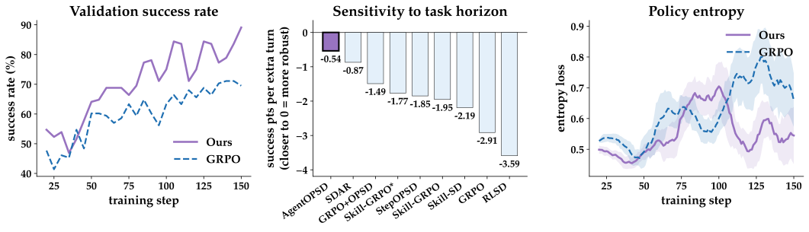
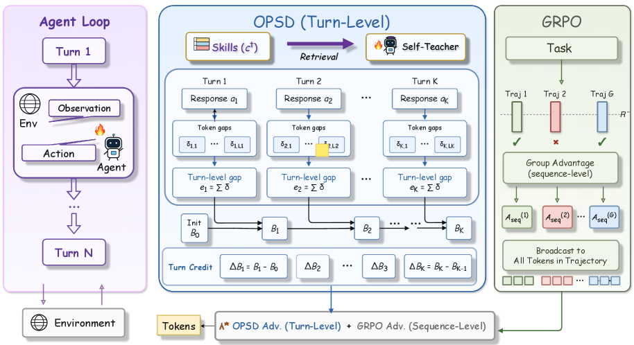

# Paper精读｜AgentOPSD: Recursive Self-Distillation for Agentic Reinforcement Learning

> [!abstract] 一句话结论
> 提出 **AgentOPSD**：不给 agentic RL 加 critic，用<span class="mark-strong">**递归的轮级信用分配**</span>解决"轨迹级稀疏奖励无法给关键决策正确赋分"的问题。核心动作是把 token 级师生对数概率差（self-distillation gap）聚合成**轮级证据**，在 <span class="mark-strong">**log-odds 空间递归更新"轨迹最终会成功"的贝叶斯信念**</span>——一个轮次关键不关键，看它让信念挪动了多少（pivotal turns），再把 GRPO 的单一序列级优势重分配成轮级优势。ALFWorld（Qwen2.5-7B）到 **89.1%**，压过 GRPO 和一排强自蒸馏基线；任务轮数变长时最稳——每多一轮只掉 0.54 点，GRPO 掉 2.91、RLSD 掉 3.59。

> [!cite]- 论文信息（点开折叠）
> - **论文标题**：AgentOPSD: Recursive Self-Distillation for Agentic Reinforcement Learning
> - **arXiv**：2608.05987
> - **链接**：[https://arxiv.org/abs/2608.05987](https://arxiv.org/abs/2608.05987)
> - **作者**：Zi-Han Wang, Zhengxi Lu, Zhiyuan Yao, Jinyang Wu, Jie Wu, Zhengzhou Cai, Yueqing Sun, Ziang Ye, Linji Hao, Qi Gu, Xunliang Cai, Yongliang Shen, Yujiu Yang
> - **机构**：清华大学 / 浙江大学 / 美团
> - **日期**：2026-08-06
> - **代码**：[https://github.com/ZethWang/AgentOPSD](https://github.com/ZethWang/AgentOPSD)

---

## 1️⃣ 论文想解决什么问题

长时程多轮 agentic RL 有个先天别扭之处：**可验证奖励只在轨迹结束后给一个 0/1**，中间几十轮决策的贡献，全靠训练算法事后从这一个比特里抠。而轨迹内各个决策的角色差别巨大：

- **成功轨迹里也可能混着虚假、冗余、误导性的动作**——GRPO 把同一个正优势广播给所有 token，冗余动作跟着沾光被放大

- **失败轨迹里也可能藏着有用的推理**——GRPO 把同一个负优势广播给所有 token，有价值的探索被一并压制

症结就在这儿：**轨迹级优势（sequence-level advantage）天生接不住轮级信用（turn-level credit）**。最近的自蒸馏方法（OPSD、RLSD、SDAR 等）想靠特权自蒸馏给 RL 补稠密监督，但**"局部信号怎么表达时序信用"这一步始终没说清**——某一轮的 gap 大不代表这一轮关键，它压根没考虑前面轮次已经攒下的贡献。

---

## 2️⃣ 核心洞察

> [!important] 核心洞察
> 1. <span class="mark-strong">**关键轮次 = 信念的边际修正量，不是局部信号强度**</span>：token 级 gap 只能说明"这条动作像不像成功行为"，但同一条证据，在"前面已经攒了一堆证据"时是冗余的，在"信念还悬着"时才是关键的。AgentOPSD 用 `ΔB_k = B_k − B_{k−1}`（相邻信念状态之差）称关键性——**信念更新幅度天然被当前不确定性加权**（B(1−B) 在 0.5 附近最大，饱和时趋零）。
>
> 2. **贝叶斯证据视角给了理论根基**：把"动作支不支持成功"形式化为似然比 `log p(a|s,C)/p(a|s,¬C)`（Bayes factor）。反事实贡献直接测是测不了的，作者的做法是用"技能条件化分支 vs 无条件分支"的师生对比当可计算的替身——**hindsight 证据估计**。
>
> 3. **递归信念更新才是"时序信用"的正确表达**：证据衰减累积 `c_k = γc_{k−1} + e_k`，γ 让久远的证据不再钉死当前信念。这一步顺手实现了"边际贡献"——**同一个动作，前面积累不足时是关键的，前面积累充分时就是冗余的**。
>
> 4. **与标准策略优化完全兼容**：不加 rollout、不要 critic——只是把 GRPO 的 `A_seq` 乘上一个由信念修正导出的**有界乘子** `[1−λ+λ·w_k]`（w_k 由标准化后的 q_k 截断得到）。乘子恒正，方向永不反转，λ 管重塑强度——**给验证器信号"塑形"，而不是替换它**。
>
> 5. **信号方向必须对齐验证器结果**：`q_k = sign(A_seq)·ΔB_k`——信念修正的**方向**跟最终结果一致才被放大；模型对某一轮自信满满、但它实际指向失败，这一轮拿不到奖励。

---

## 3️⃣ 方法解读

### 组件1：问题设置与 GRPO 基线

先把舞台和 GRPO 的病灶一起摆出来：

- 任务 x + 初始观测 o₀，agent 在 turn k 采样动作 a_k ~ π_θ(·|s_k)，观测后历史变为 s_{k+1}=(s_k, a_k, o_k)

- K 轮 episode τ 获得二元结果奖励 R(τ)

- GRPO 的序列级优势：`A_seq(i) = (R(i) − R̄)/(σ̂_R + ε₀)`——同一轨迹所有 token 共享同一个数，**轮级信用没人管**

### 组件2：从结果贡献到贝叶斯轮级证据

- **理想形式**：`logit p(C|s_k,a_k) − logit p(C|s_k) = log [p(a_k|s_k,C) / p(a_k|s_k,¬C)]`——贝叶斯因子，符号说明这一轮是给成功加码还是减码。但"成功世界线里的动作分布"直接算不出来，于是换成师生对比当替身：教师和学生共享参数 θ，给同一条学生生成的动作打分，两个分支唯一的差别是要不要注入训练专用技能 c⁺：

```
h_{k,t} = (s_k, y_{k,<t})          # 无条件分支（背景似然）
h⁺_{k,t} = (s_k, c⁺, y_{k,<t})     # 技能条件化分支（近似成功关联行为）
δ_{k,t} = log π_θ(y_{k,t}|h⁺) − log π_θ(y_{k,t}|h)   # token 级对比
e_k = Σ_t δ_{k,t} = log [π_θ(a_k|s_k,c⁺) / π_θ(a_k|s_k)]   # 轮级证据
```

- c⁺ 是**训练专用**的检索技能（SkillBank of SkillRL），描述有用子目标与动作模式；**推理时不带任何外部技能**——这是与 Skill-GRPO* 拉开差距的关键一处

### 组件3：递归信念更新（Eq. 8-9）

有了轮级证据，信念就能一轮一轮往前滚。滚法上有两个讲究：证据要衰减，先验要锚在组成功率上：

```
B₀ = clip(R̄, ε₀, 1−ε₀)          # 先验 = 组内成功率（GRPO 组均值）
c_k = γc_{k−1} + e_k              # 衰减证据累积器
ℓ_k = logit(B₀) + c_k             # log-odds 空间的信念
B_k = σ(ℓ_k)                      # 信念状态（相对支持度）
ΔB_k = B_k − B_{k−1} ≈ B_{k−1}(1−B_{k−1})·(e_k − (1−γ)c_{k−1})
```

- **γ 的意义**：γ=1 退回序贯检验的未折扣对数似然比累积（Wald 1945）；γ<1 给证据加近因权重——久远的证据不再钉死信念

- **边际修正的直觉**：`e_k − (1−γ)c_{k−1}` 是"新证据减掉衰减掉的旧证据"，再被当前状态灵敏度 `B(1−B)` 加权——**不确定性最高时证据说话最响，信念饱和时自动收声**

- 信念更新放在**轮边界**（turn boundaries）——与环境反馈对齐；token 级只作为消融变体存在

### 组件4：有界优势重塑（Eq. 10-11）

信念修正好之后，剩下的是把它安全地折回 GRPO 的优势。所谓安全：只调音量，不改方向：

- **结果对齐的递归信用**：`q_k = sign(A_seq)·ΔB_k`——量级记信念被挪动多少，符号记这个挪动与验证器结果是否同向

- **轨迹内标准化**：`z_k = (q_k − μ_q)/(σ_q + ε₀)`，乘子 `w_k = clip(1 + b·z_k, 1−b, 1+b)`

- **最终优势**：`Ã_k = A_seq · [(1−λ) + λ·w_k]`——λ∈[0,1] 管重塑强度；乘子恒正（锁在 `1±b` 界内），所以**永不反转 GRPO 的更新方向**，只做放大/衰减

- 超参数：λ=0.5（重塑权重）、b（乘子带宽）、γ（证据衰减），跨环境/规模共享同一套

### 优势估计

- **无额外 rollout、无 critic**——训练成本与 GRPO 持平，只多了训练时的技能条件化前向

- **推理零开销**：推理时不注技能，部署形态与基线一模一样

- **理论可解释**：Bayes factor → self-teacher contrast 的近似条件在附录 A.1，重塑的性质（不反转方向、有界）有理论保证

- **跨环境通用**：单套超参数在 ALFWorld（50 轮）、WebShop（15 轮）、Search-QA（4 轮）都有效——Search-QA 这种短轮数环境也有收益，说明方法不是只吃长轨迹红利

---

## 4️⃣ 实验部分怎么读

### 实验设置

- **基准**：ALFWorld（具身家务，6 类）、Search-QA（单跳 NQ/TriviaQA/PopQA + 多跳 HotpotQA/2Wiki/MuSiQue/Bamboogle，检索用 E5）、WebShop（128 固定验证任务）

- **模型**：Qwen2.5-3B/7B-Instruct，8×H800 训练

- **技能**：从 SkillRL 的 SkillBank 按关键词匹配检索，**仅训练时使用**

- **基线三组**：训练-free（Vanilla、Skill-Prompt*）、组相对 RL（GRPO、Skill-GRPO、Skill-GRPO*）、自蒸馏 RL（OPSD、GRPO+OPSD、Skill-SD、RLSD、SDAR、StepOPSD）——全部同 backbone、同数据、同预算

### 核心结果（Table 1，7B）

| **方法** | **ALFWorld Avg** | **Search-QA Avg** | **WebShop Score** | **WebShop Acc** |
| --- | --- | --- | --- | --- |
| GRPO | 81.2 | 42.0 | 80.9 | 72.6 |
| Skill-GRPO* | 88.3 | 47.5 | 87.0 | 81.2 |
| RLSD | 82.0 | 49.0 | 87.4 | 77.3 |
| SDAR | 85.9 | 49.0 | 89.4 | 82.8 |
| StepOPSD | 88.4 | 48.2 | 87.2 | 78.1 |
| **AgentOPSD** | **89.1** | **49.2** | **90.2** | **79.7** |

- **关键解读 1（信用构建 > 特权访问）**：AgentOPSD 与特权基线用的是**同一批检索技能**，差别只在师生差距怎么进学习信号——8 项聚合对比全胜 GRPO+OPSD/Skill-SD/RLSD，6/8 胜 SDAR。**局部师生差距本身不是可靠的信用信号，把差距攒成信念状态、按信念修正分配信用才是关键**。

- **关键解读 2（优势随交互轮数增长）**：Figure 1(b)——每额外一轮丢失的成功点数：AgentOPSD **−0.54** vs GRPO −2.91 vs RLSD −3.59。轨迹越长，一条广播优势要罩的决策越多，历史依赖的修正就越值钱——**这正是轮级信用设计时瞄准的场景**。

- **关键解读 3（无技能推理）**：AgentOPSD 推理时不带技能仍有 89.1%，而 Skill-GRPO*（推理时也带技能）88.3%——**训练期的技能是教模型分信用的"特权教材"，考试不用带**。自蒸馏这条路的划算之处就在这儿。

- **3B 同样成立**：3B 上 AgentOPSD 84.4%（ALFWorld），与 SDAR 84.4 打平、把 StepOPSD 73.4 和 GRPO 75.0 甩开一大截；Search-QA 46.7 vs GRPO 36.4——规模无关。

### 机制消融（Table 2，ALFWorld 7B，完整方法 89.1）

| **消融** | **变体** | **ALFWorld** |
| --- | --- | --- |
| AgentOPSD (full) | turn-level, bounded, λ=0.5 | **89.1** |
| Turn-level granularity | per-token 累积 | 85.9 |
| Recursive state revision | 用 raw gap e_k 替代 ΔB_k | 82.8 |
| Signed direction | 只用 \|ΔB_k\|（丢结果符号） | 80.5 |
| State prior B₀ | 去掉经验率锚定 | 78.9 |

- **轮级 > token 级**（89.1 vs 85.9）：环境反馈回应的是完整动作，不是单个 token——token 级累积把动作语义拆碎了

- **递归修正 > 原始 gap**（89.1 vs 82.8）：−6.3 点，"历史依赖的信念修正"这条机制是真金白银

- **方向符号最关键**（89.1 vs 80.5）：−8.6 点——只奖励"幅度"不校验"与结果同向"，等于给误导性自信发奖金

- **先验锚定也重要**（89.1 vs 78.9）：−10.2 点，组成功率先验是 log-odds 累积的合理起点

### 超参数敏感性（Figure 3）与训练动态（Figure 4/5）

- λ/γ/ε_high 三个旋钮在 3 个设置上扫过——曲线平，AgentOPSD 对精确取值不敏感（单套超参跨环境才立得住）

- 训练中师生 gap δ̄ 与奖励曲线的动态见附录——gap 信号随训练演变，与奖励上升同步走



*Figure 1（核心结果图）：(a) 训练中验证成功率，AgentOPSD 领先；(b) 轮数敏感性——AgentOPSD 每额外一轮仅掉 0.54 点，GRPO 2.91、RLSD 3.59（越平越鲁棒）；(c) 策略熵——AgentOPSD 保持更高探索熵。*



*Figure 2（方法总览）：左：agent 与环境交互 K 轮；中：AgentOPSD 把 GRPO 的单一序列级优势转换为轮级重塑优势的三步——(1) 聚合 token 级师生对数概率差为轮级证据；(2) 递归更新 log-odds 空间的贝叶斯信念状态；(3) 用相邻信念边际修正定义轮级信用并重塑优势。*

---

## 5️⃣ 学术评价

**优点：**

1. **理论根基是真材实料**：轮级信用不是拍脑袋的启发式，是从贝叶斯因子（Kass & Raftery）与序贯检验（Wald）一路推下来的——log-odds 空间更新、边际修正、证据衰减在经典统计里都有对应物

2. **"信念修正"是给自蒸馏信用分配找对的那层抽象**：OPSD/SDAR/RLSD/StepOPSD 把师生 gap 当门控/幅度/辅助损失用，但局部 gap 表达不了时序信用；消融 −6.3 点坐实了"<span class="mark-strong">历史依赖的递归信念修正</span>"才是关键

3. **工程上轻得少见**：无 critic、无额外 rollout、推理零开销、单套超参跨环境——成本与 GRPO 持平，效果系统性更好，对生产训练管线这是决定性的一票

4. **消融切得干净**：五个机制逐一切除（轮级 vs token 级、递归 vs raw、有符号 vs 幅度、先验锚定），每个都有独立贡献且方向一致——"方向符号"和"先验锚定"的贡献比递归本身还大，说明这套设计环环相扣，不靠单点魔法

5. **与 W2S-OPD 是一家人**：同为"on-policy 自蒸馏 + 信任区域"思想，AgentOPSD 的"信念状态"与 W2S-OPD 的"信任区域"是同一哲学（在 log-odds/概率空间里管蒸馏信号）的两种实现——OPD 家族已经成谱系

> [!ed-warning] 局限（风险与不确定性）
> 先替作者说一句：要在"无 critic、无外部信号"的约束下造轮级信用，能借的外部资源本来就不多，拿现成 SkillBank 起步是最务实的一条路。但问题还是要摆出来：
> 1. **技能来源依赖 SkillRL**：特权技能 c⁺ 从现成 SkillBank（关键词匹配）检索——技能的覆盖质量直接决定证据质量；没有 SkillBank 的领域怎么获得 c⁺，论文没讨论（自举？）
>
> 2. **二元奖励假设**：所有实验都是 0/1 可验证奖励；连续奖励/部分可验证场景（比如代码执行部分通过）下这套 Bayes 框架的适配没验证过
>
> 3. **信念状态的"校准"问题**：论文自己承认 B_k 是"相对支持度"而非校准概率（自蒸馏估计的 e_k 未校准）——信念的绝对数值意义有限，只有相对比较有效
>
> 4. **对比的近期性**：SDAR/StepOPSD 是 2026 年的新基线，且表格里 SDAR 在 WebShop Acc（82.8）上压过 AgentOPSD（79.7）——不是全面碾压，机制归因还需要更细的拆解
>
> 5. **环境规模有限**：仍是 ALFWorld/WebShop/Search-QA 三个经典文本环境；真实世界长程 agent（浏览器、代码仓库）上的验证缺失

---

## 6️⃣ 局限与可扩展方向

- **技能自举**：没有外部 SkillBank 时，能不能用模型自身轨迹蒸馏出 c⁺（技能库随训练自举生成）？

- **连续/部分奖励**：把贝叶斯框架扩到连续结果（如部分 credit）、多目标场景

- **信念校准**：用温度/校准层让 B_k 成为真正的成功概率而非相对支持度——可能解锁"提前终止/置信度路由"

- **与 critic 方法结合**：critic-free 是卖点，但混合方案（critic 给先验、OPSD 给轮级修正）可能更强

- **更大模型与真实环境**：7B 之外再往上扩，并在真实 agent 任务（Web 自动化、代码）上验证

---

## 与其他论文的对话

| **相关工作** | **关系** | **差异** |
| --- | --- | --- |
| **GRPO (DeepSeek 2025)** | 训练框架基础 | GRPO 广播同一序列级优势给所有 token；AgentOPSD 把它重塑为轮级优势 |
| **W2S-OPD (2607.26246)** | 同为 on-policy 自蒸馏家族 | W2S-OPD 用对比对构造 proxy teacher + 信任区域；AgentOPSD 用技能条件化师生 gap + 递归信念——"信任/信念空间"管理蒸馏信号是共同哲学 |
| **OPSD (Zhao 2026)** | 直接把 gap 当信号 | OPSD 在 WebShop 上几乎崩溃（3B：0.1 分）——局部 gap 不是可靠信用；AgentOPSD 的信念累积修复了这一点 |
| **RLSD / SDAR / StepOPSD** | 自蒸馏 RL 基线 | 都用 gap 作门控/幅度/辅助损失，无历史依赖；AgentOPSD 用递归信念修正，8/8 超 RLSD、6/8 超 SDAR |
| **SkillRL (Xia 2026)** | 技能来源 | AgentOPSD 借用其 SkillBank 作为训练专用特权信息（推理时不用） |
| **MemHarness（2607.28272）** | 同为 agentic RL 方法 | MemHarness 重构记忆做决策引导；AgentOPSD 用技能做信用分配——一个管"用什么决策"，一个管"怎么给决策赋分" |

---

## 7️⃣ 最后总结

AgentOPSD 处理的是 agentic RL 里最微妙的一件事——**稀疏结果奖励下，轨迹里真正关键的那几步怎么认出来、怎么给分**。它没去硬测反事实贡献（测不了），而是让"技能条件化师生 gap"充当贝叶斯证据，在 log-odds 空间滚动"这条轨迹会成功"的信念，拿**信念的边际修正**当轮级信用。这层"信念修正"的抽象把它和所有把局部 gap 当信号的同类方法区分开（消融 −6.3 点），代价又几乎为零：无 critic、无额外 rollout、推理零开销、单套超参。放进 W2S-OPD、OPSD、StepOPSD 这条思想谱系看，**"在概率空间里管蒸馏信号"正在变成 agentic RL 信用分配的一条主线**。做 RL 后训练或 agent 训练的人，这篇该进必读堆。

---

## 8️⃣ 三句速记

> [!summary]- 点开展开
> 1. **关键轮次 = 信念修正量**：不是局部信号强就关键，是"这一轮把'轨迹会成功'的信念挪动了多少"——ΔB_k 才是轮级信用。
>
> 2. **贝叶斯证据 + 递归更新**：师生对数概率差攒成轮级证据，log-odds 空间衰减累积，GRPO 的序列级优势被有界乘子重塑成轮级优势——无 critic、无额外 rollout、推理零开销。
>
> 3. **轮数越长赚得越多**：每多一轮只掉 0.54 点（GRPO 2.91、RLSD 3.59）——长时程 agent 训练的首选；ALFWorld 7B 到 89.1%。
