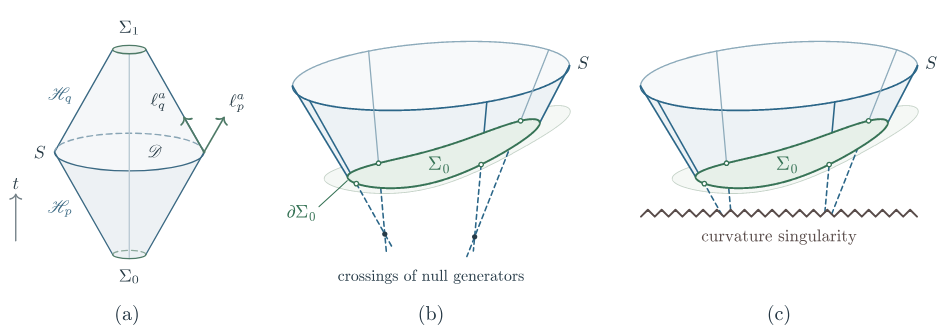
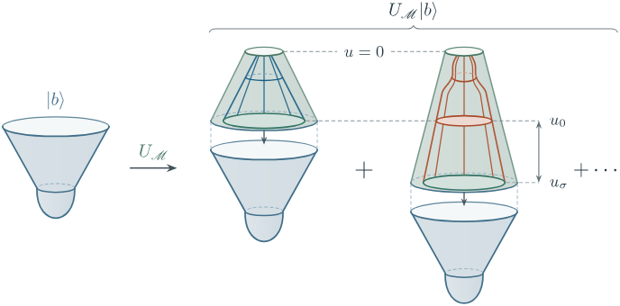
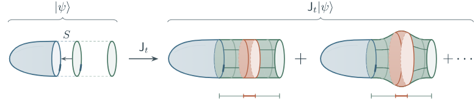
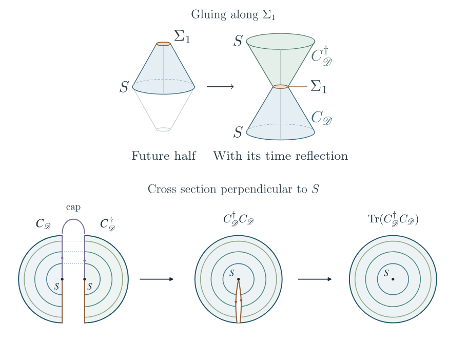

# Paper精读｜An algebraic quantization of gravity from the null cone

> [!abstract] 一句话结论
> 这篇论文在**四维真空广义相对论**里走通了一条别的路线没走通的链路：从零锥（null cone，光线构成的锥面）上的特征数据解出引力约束、拿到有限 $G_N$ 的约化相空间，把它量子化成算符代数，并证明在选定的高斯表示下该代数是 I 型因子（type I factor）、路径积分对中间态的求和绝对收敛；随后用钟读数有界这一个条件证明宏观因果菱形的希尔伯特空间有限维，从而面积算符离散、黑洞熵给出 Bekenstein–Hawking 项 $\mathscr{A}/(4G_N\hbar)$ 加对数修正——固定质量、角动量求和时系数为 106/45（乘在 $\log s_b$ 上，$s_b=\mathscr{A}/(4G_N\hbar)$），折算到线性尺度即 Sen 用 Euclidean 方法得到的 212/45，条件是大 Schwarzschild 黑洞、一圈精度。

> [!cite]- 论文信息（点开折叠）
> - **论文标题**：An algebraic quantization of gravity from the null cone
> - **arXiv**：[https://arxiv.org/abs/2611.34924](https://arxiv.org/abs/2611.34924)（v1，hep-th）
> - **作者**：Venkatesa Chandrasekaran
> - **机构**：Stanford University（Leinweber Institute for Theoretical Physics）
> - **日期**：2026-11-25（正文标注 November 23, 2026）
> - **阅读范围**：正文 §1–§6 与附录 A–E 全部逐段读到；References 按需抽核（[27][41][65][78][82] 等）；LaTeXML 内联 tikz 乱码段（小示意图的提取残片）跳过，不影响公式完整性。致谢部分一并读到（其中含对本文验证状态的重要信息，见学术评价）。

---

## 1️⃣ 论文想解决什么问题

要理解这篇论文的动机，先看它攻击的三条现有路线各在哪一步卡住。

微扰量子引力选一个固定背景时空、量子化度规的小涨落。纯广义相对论的两圈散射振幅需要一个三阶 Riemann 张量的抵消项（论文引 [41]），微扰意义上不可重整。修补办法要么换理论（弦论用弦的分裂联结替代点相互作用，但弦耦合展开不给出非微扰答案），要么换问题。

圈量子引力（LQG）从空间切片上的密度化三足架出发，切片内微分同胚不变性可以靠群平均解决，但 Hamiltonian 约束——时间演化方向的约束——至今没有令人满意的解，物理内积如何与切片选择无关、半经典极限如何恢复爱因斯坦方程，都是开放问题（论文引 [82]）。失败机制很具体：把全部约束留给一个以空间度规为宗量的波函数，等于要求理论先知道整个 Cauchy 切片，而背景独立的量子引力里"整个切片"本身没有先验意义。

AdS/CFT 把引力的可观测量编码成边界共形场论，但这条路的非微扰定义权在边界 CFT 手里，对不渐近 AdS 的有限子区域给不出自治的代数结构。

论文要做的，是把这三条路各自缺的那个东西——有限子区域自身的、非微扰的、可求迹的算符代数——直接从子区域边界上的引力数据构造出来。贯穿全文的例子在这里出场：取一个宏观因果菱形 $\mathscr{D}$，尺寸为黑洞外部的量级，角点面积 $\mathscr{A}=4\pi b^2$，$b\gg\ell_P$；把它两个尖顶用小类空帽 $\Sigma_0,\Sigma_1$ 切掉，两条零锥 $\mathscr{H}_p,\mathscr{H}_q$ 在角点 $S$ 相交（这个例子的后几次出场分别在方法解读的组件 2、验证性计算的黑洞熵小节、以及局限与可扩展方向）。输入只有：零锥上自由指定的两个辐射偏振、帽上的兼容数据、以及角点的边缘模。输出是整个量子理论。旧方法在这个例子上的失败点在于：没有任何固定背景可以让涨落绕着展开，也没有整个 Cauchy 切片可供写波函数。

---

## 2️⃣ 核心洞察

三个洞察撑起全文，每一个都对应后文一段具体机制。

> [!important] 三条核心洞察
> 1. **把时钟和参考系纳入同一个量子系统。** 背景独立理论里没有外部时钟可借用，论文把"沿入射零母线从帽 $\Sigma_0$ 走到角点 $S$ 的仿射参数读数"定义为引力钟：在 $\Sigma_0$ 上固定局部 Lorentz 标架、把仿射参数归零并定标，它在 $S$ 处的值就是钟读数 $u_*$（§2.1，式 (2.4c)；4D 版本为式 (3.27)）。参考系同理：观测在哪里、在哪个标架里取分量，都由边界数据 $\mathfrak h$ 决定，$\mathfrak h$ 的位置与取向自由度作为**边缘模（edge modes，子区域边界上携带独立自由度的参考系数据）**进入相空间（§3.3）。对应机制是组件 3：角点面积生成 boost，把钟与参考系变成可运算的相空间变量。
> 2. **在零锥上解约束，而不是在空间切片上强加约束。** 用第一阶（Plebański）变量把简单性约束解成显式关系（§3.2）。关键选择是：简单性约束（simplicity constraint，把拓扑 BF 理论压回广义相对论的代数条件）**不含导数**，对作用量变分时不产生边界项，边界数据可以原封不动地拿去胶合（组件 1）。LQG 卡死的那一步——Hamiltonian 约束——在这里被绕开：时间演化方向的约束在零锥上是沿母线的常微分方程，逐条解掉。
> 3. **4D 的剪切-聚焦链把"钟有界"变成"辐射受限"——这是 4D 与 JT 的分水岭。** 序章用二维 JT 引力演示：钟读数只依赖菱形宽度，物质场的任何态都能配同一个钟波函数，代数是 $\mathrm{I}_\infty$ 型、迹发散——JT 在这里是一个**有计划的反例**。4D 的区别藏在 Raychaudhuri 方程里：剪切平方压低扩张，走同样面积增长需要更长仿射参数，钟读数里的延迟因子 $e^{\Xi_y(v)}$ 是剪切的不减泛函（组件 2）。于是钟读数的投影在 4D 里同时压缩 graviton 态与角点面积（§5.2）——JT 想要而拿不到的"有限维"，在这里拿到了。

*图注：原文 Figure 7（同一 SVG 同时覆盖 Figure 8 的面板）：(a) 因果菱形 $\mathscr{D}$，小类空帽 $\Sigma_0,\Sigma_1$ 替换两个顶点，区域成为 cobordism $\mathscr{D}:\Sigma_0\to\Sigma_1$；零锥 $\mathscr{H}_p,\mathscr{H}_q$ 从各自帽上伸出、在角点 $S$ 相交。(b)(c) 展示零母线提前交叉或在曲率奇点终止的退化情形——这类点用第二个因果菱形覆盖。*

---

## 3️⃣ 方法解读

这一节按构造顺序拆六个组件，每个回答四个问题：是什么、为什么需要（含反事实）、怎么做（落到公式）、代价。

### 组件 1：第一阶引力与简单性约束

- **是什么**：用 Lorentz 标架语言改写广义相对论：标架 1-形式 $e^\mu$ 决定度规 $g_{ab}=\eta_{\mu\nu}e^\mu{}_ae^\nu{}_b$ 并定义局部 Lorentz 标架，自旋联络 $\omega^{\mu\nu}$ 描述标架的平行输运。作用量（式 (3.2)，Plebański 形式）：

$$I[B,\omega,\Phi]=\frac{1}{16\pi G_N}\int_{\mathscr{M}}\left(B_{\mu\nu}\curlywedge F^{\mu\nu}-\frac{1}{2}\Phi_{\mu\nu\rho\sigma}B^{\mu\nu}\curlywedge B^{\rho\sigma}\right)+I_{\partial\mathscr{M}},$$

  其中 $B^{\mu\nu}$ 是反对称时空二形式（无约束时理论是拓扑场论 BF，没有局域传播自由度），$F^{\mu\nu}$ 是自旋联络的曲率二形式（式 (3.1)），$\Phi_{\mu\nu\rho\sigma}$ 是拉氏乘子，其迹部分由宇宙学常数 $\Lambda$ 固定。
- **怎么做**：对 $\Phi$ 的无迹部分变分得到**简单性约束**（式 (3.3)），在可逆标架下解出（式 (3.4)）$B^{\mu\nu}=\tfrac12\epsilon^{\mu\nu}{}_{\rho\sigma}e^\rho\curlywedge e^\sigma$；对 $\omega$ 变分得 $\nabla_{[a}B^{\mu\nu}{}_{bc]}=0$（无挠），对 $B$ 变分得 $F^{\mu\nu}=\Phi^{\mu\nu}{}_{\rho\sigma}B^{\rho\sigma}$，两者合起来正是 $R_{ab}=\Lambda g_{ab}$。而 Weyl 张量——两个局域辐射自由度——不受约束，是后面要量子化的东西。

> 人话：把引力写成"曲率耦合到一个二形式"的理论，再要求这个二形式恰好是标架自己的楔积。代价是引入冗余的 Lorentz 自由度，换来的是约束不含导数、边界项干净、胶合可以逐字进行。

- **为什么需要、反事实**：这一步补的洞在边界上。变分 $\omega$ 会产生一个边界项 $\int_{\partial\mathscr M}B_{\mu\nu}\curlywedge\delta\omega^{\mu\nu}$（式 (3.9)），要靠边界作用量（式 (3.15a)：帽上的 GHY 项、三个 joint 上的对数项、零边界上的非仿射项）逐项抵消。若改用二阶度规变量，Einstein–Hilbert 作用量含二阶导数，抵消后的边界剩余项结构杂乱，两个子区域的边界数据无法用同一格式配对。
- **代价**：可逆标架假设是全局条件；$\Lambda\neq0$ 时主结果（黑洞熵）取 $\Lambda=0$ 的 Schwarzschild 背景，宇宙学常数只在附录 D.3 的横向约束里作为小修正出现。

### 组件 2：零锥初始数据与零约束求解

- **是什么**：在入射零锥 $\mathscr{H}_p$ 上，把横向度规 $q_{AB}$ 拆成面积部分与**共形度规**（conformal metric，去掉整体面积缩放、只剩形状的二维度规）$\bar q_{AB}$（单位行列式，式 (3.17c–d)）。**特征数据**（characteristic data，沿特征面即零锥给定的初值）的自由部分就是 $\bar q_{AB}$ 沿母线的变化——两个辐射偏振——加上帽处的初始面积元。
- **怎么做**：剪切与扩张由 $K_{AB}=E_{B\mu}\nabla_A\ell^\mu$（式 (3.20)）分解：迹为扩张 $\Theta_{(\ell)}$、无迹部分为剪切 $\sigma_{ab}$（式 (3.22)）。真空场方程 $R_{ab}\ell^a\ell^b=0$ 把面积半径 $\varrho$ 的方程压成 Raychaudhuri 方程（零母线上扩张沿仿射参数的演化方程）（式 (3.25e–f)）：

$$\mathfrak C_\ell\equiv\pounds_\ell\Theta_{(\ell)}+\frac{1}{2}\Theta_{(\ell)}^2+\sigma_{ab}\sigma^{ab}=0,\qquad \frac{\mathrm d^2\varrho}{\mathrm du^2}+\frac{\varrho}{8}(\partial_u\bar q)^{AB}\,\partial_u\bar q_{AB}=0.$$

  符号：$\ell^a$ 仿射参数化的未来指向零法向，$u$ 仿射参数，$\pounds_\ell$ 沿母线的导数。第二式把 $\varrho$ 完全交给 $\bar q$ 与初值 $\varrho(0),\partial_u\varrho(0)$，于是面积不再是独立数据——这正是"剪切决定面积"的代数形式。解出后，论文定义钟（式 (3.27)）：

$$u_*(y)=p_{\epsilon,y}\,[u(1,y)-u(\epsilon,y)]=\varrho_S(y)\int_{\epsilon}^{1}e^{\Xi_y(v)}\,\mathrm dv,\qquad \Xi_y(v)=\frac{1}{8}\int_{\epsilon}^{v}s\,(\partial_s\bar q)^{AB}\,\partial_s\bar q_{AB}\,\mathrm ds\ \geq\ 0,$$

  其中 $v=\varrho/\varrho_S(y)$ 是面积坐标（$\partial\Sigma_i$ 在 $v=\epsilon$、角点在 $v=1$），$\varrho_S(y)$ 是角点每单位立体角的面积半径，$p_{\epsilon,y}$ 是帽处的仿射斜率。乘积 $p_{\epsilon,y}[u(1,y)-u(\epsilon,y)]$ 与仿射归一化无关，所以是一个好定义的钟。

> 人话：把一条光线从帽走到角点要"花掉"多少仿射参数，由两件事决定——角点面积多大（$\varrho_S$），以及路上遇到多少剪切。$\Xi_y(v)$ 是剪切的累积量，永远非负：剪过的锥面更"瘦"，走完同样面积增长要多花时间。零剪切时 $e^{\Xi}=1$，钟读数最小值 $(1-\epsilon)\varrho_S(y)$。

*图注：原文 Figure 17：粘上 cobordism $\mathscr M$ 后，出射态 $U_{\mathscr M}|b\rangle$ 可以是不同引力钟读数的叠加。初始面积元与扩张固定的条件下，无剪切的零母线（蓝）在 $u_0$ 到达 $S$，被剪切的零母线（红）在更大的读数 $u_\sigma>u_0$ 才到达同一角点面积元——钟读数的分布里直接读出辐射含量。*

- **为什么需要、反事实**：拿掉 $\Xi_y\geq0$ 会怎样：钟读数与辐射脱钩，4D 退回 JT 的行为——固定面积与钟上限后仍可塞进无穷多正交态（§2 的 (2.14) 构造），第 5 节的有限维结论整体失效。这一条非负性后来被量子化成算符不等式 (4.22)，是全文承重墙。
- **代价**：特征数据只在 $\partial_u\varrho>0$ 且母线未聚焦的区间上有效；母线交叉或触到曲率奇点时，嵌入零锥失效。论文的处理是覆盖式修复：在每个光滑点附近另取一个足够小的因果菱形、其母线在正则区内，重叠区匹配标架与联络（式 (3.29)–(3.31)，Čech 式的 $L_{ij}$ 拼接），任何光滑全局双曲真空时空都能这样覆盖。这个修复只对光滑时空成立——曲率奇点邻域不在覆盖能力之内（论文明确不覆盖的情形之一）。

对贯穿例子（宏观因果菱形）走一遍这一组件：给一簇入射引力波，即给 $\bar q_{AB}(v,y)$ 的两偏振轮廓；Raychaudhuri 方程解出 $\varrho(v,y)$；式 (3.27) 给出每条母线的钟读数，角点平均（式 (3.28)）$\bar u_*=\int_S\varrho_Su_*\boldsymbol\epsilon_0/\int_S\varrho_S\boldsymbol\epsilon_0$ 是这个解自己的钟读数。辐射越强、钟走得越慢——这条物理直觉在后面变成一个算符不等式。

### 组件 3：带边缘模的辛形式与匹配

- **是什么**：约束解完，作用量只剩边界场与边缘模，其变分给出辛形式。零边界部分（式 (3.39)）：

$$\Theta_{\mathscr H}=\frac{1}{16\pi G_N}\int_{\mathscr H}\boldsymbol\eta\left[\sigma^{AB}\,\delta q_{AB}-(2\kappa+\Theta_{(\ell)})\,\delta\log\varrho^2\right]+\Theta_{\partial},$$

  角点部分（式 (3.41)）：$\Theta_S=\frac{1}{8\pi G_N}\int_S\boldsymbol\mu\left(\delta\Gamma+\frac{\ell_a\delta n^a-n_a\delta\ell^a}{2(-\ell\cdot n)}\right)$。boost 生成元是面积本身（式 (3.43)）：

$$\mathscr{K}(y)=\frac{\varrho_S(y)^2}{8\pi G_N},\qquad \mathscr K=\int_S\boldsymbol\epsilon_0\,\mathscr K(y)=\frac{\mathscr A}{8\pi G_N}.$$

  符号：$\boldsymbol\eta=\mathrm du\curlywedge\boldsymbol\mu$ 是零边界体积形式，$\kappa$ 是非仿射性，$\Gamma$ 是边界标架的 boost 角，$\boldsymbol\mu$ 是角点面积形式。

> 人话：零锥上，剪切共轭于共形度规（辐射的数据对）；角点上，面积共轭于 boost 角——面积每单位 $8\pi G_N$ 生成一次参考系之间的 boost。边缘模不是加进来的装饰，而是这两个共轭对的"另一半"。

- **怎么做（匹配与胶合）**：两个子区域在共享角点 $S$ 上匹配：面积元相等（$\Delta\mathscr K(y)=0$）、诱导度规与法向导数按相对 boost 角 $\gamma=\Gamma_R-\Gamma_L$ 对齐（式 (3.61)–(3.62)），于是（式 (3.64)）$\mathscr K_+(y)\delta\Gamma_R-\mathscr K_-(y)\delta\Gamma_L=\mathscr K(y)\,\delta\gamma$。两侧同向 boost 的荷相消、成为规范；剩下的物理变量是相对 boost $\gamma$，共轭于平均荷 $\mathscr K(y)$。空间方向上把两个子区域拼起来用的是**纠缠积**（entangling product）：张量积里只保留被两侧角点荷之和零化的态。零方向上，时间组合按式 (4.29) 对中间态求和。
- **为什么需要、反事实**：边缘模补的洞是参考系本身：不把 $\Sigma$ 的位置与 boost 角当相空间变量，缀饰可观测量（在哪、哪个标架里测）就没有载体，面荷（组件 4）也无从生成时间演化。拿掉角点项，辛形式退化为纯辐射的，boost 变成纯规范——那正是把子区域嵌回外部时空后角点不再属于边界的情形；论文要的恰是独立子区域的代数，角点必须留。
- **代价**：边缘模引入的边界作用量项（式 (3.15a) 的三个 joint 对数项）是让变分良定义的额外结构，也带来"内部边界项胶合后必须相消"的一致性负担；附录 B 整个篇幅在逐项核对这批边界项。

*图注：原文 Figure 18：内部不同的空间度规可以满足 $S$ 上同一组匹配条件。$\mathsf J_t|\psi\rangle$ 把每一对按其在 $|\psi\rangle$ 中的振幅拼接；固定 proper width $w$ 与两侧诱导度规时，更大的中间面积让第二个 collar 包住更大体积——空间方向的纠缠积里，边界数据定了，内部体积仍是叠加中的自由度。*

### 组件 4：约化哈密顿量＝面荷

- **是什么**：把作用量写成 $I=\int(\Theta_t(\dot{\mathfrak h})-H)\mathrm dt$ 的正则形式后，约束（式 (3.48)）使体哈密顿量消失，$H_\Sigma$ 约化为纯边界项（式 (3.47)→(3.54)）：

$$H_\Sigma=\frac{1}{16\pi G_N}\left[\int_C\boldsymbol\epsilon_0\left\{v^2\varrho_S^2\left(\mu_c+\frac{\partial_v F}{2N}\right)-V^A\Pi_A\right\}\right]_{v_-}^{v_+},$$

  在面积坐标 $v$ 里，它是两个切口上的差：横向联络 $\mu_c$ 带权面积元、lapse $N$ 与角动量对 $(V^A,\Pi_A)$ 的贡献。真正微妙的是 lapse 的场依赖（式 (3.55)）：

$$N(v,y)=N(1,y)\,\exp[\Xi_y(v)-\Xi_y(1)].$$

  符号：$N$ 是每单位坐标时间沿横向零法向的位移量，$\mu_c$ 是横向自旋联络分量，$F$ 是度规系数（式 (B.1) 的 $g_{tt}$ 位置）。

> 人话：钟延迟因子 $\Xi_y$ 出现了第二次——不只是钟慢，时间演化的速率本身在剪切过的锥面上逐点打折。所以平移帽这个"纯时间平移"的面荷依赖辐射数据，约化哈密顿量通过泊松括号真的在推着引力子走，而不是一个外挂的背景时间。

- **为什么需要、反事实**：约束解掉后哈密顿量若不落成面荷，边界代数就不含时间平移，"边界数据决定子区域全部动力学"这句话塌一半。反事实：没有式 (3.55) 的 $\Xi$ 依赖，$H_c$ 只依赖角点数据，辐射模的时间演化就无从生成，第 6 节的半经典极限也接不出来。
- **代价**：$H_c$（式 (3.53b)）包含 $-\Theta_t(\partial_t\iota_t)$ 位移项与 $B_S$ 边界项，正则结构比"一个函数"复杂得多；这是换来"演化＝面荷"的账单。

### 组件 5：高斯波函数表示与 I 型因子代数

- **是什么**：代数结构先行：形变作用量 $I\to I+F$ 生成源算符 $S_I(F)=U_I^\dagger U_{I+F}$（式 (4.1)），两条关系——变量平移不变性 (4.2d) 与因果分解 (4.2e)——把有限乘积的线性组合造成一个 C\* 代数 $\mathcal A$。然后才选态：固定角点面积 $\mathscr A$，对每个可数正则对 $(q_j,p_j)$ 选高斯波函数（式 (4.7)）：

$$\langle q_j|\Omega_j\rangle=\frac{1}{[2\pi(\Delta q_j)^2]^{1/4}}\exp\left[-\frac{(q_j-q_j^0)^2}{4(\Delta q_j)^2}+\frac{i}{\hbar}p_j^0(q_j-q_j^0)\right],$$

  中心 $(q_j^0,p_j^0)$ 与宽度 $\Delta q_j$ 固定全部矩。占据数态张成 Fock 空间 $\mathcal K_{\mathscr A}\simeq\bigoplus_m\operatorname{Sym}^m\ell^2(\mathbb N)$（式 (4.10c)），入射代数是全算符代数 $\mathcal M_{\mathscr A}=\mathcal B(\mathcal K_{\mathscr A})$（式 (4.11)）。
- **怎么做**：引力子插入可以改变面积：boost 相位 $e^{i\eta\widehat{\mathscr A}/(8\pi G_N\hbar)}$ 把面积差编码进矩阵元的相位（式 (4.12a)），于是 boost 频率 $k$ 的插入把面积移动 $8\pi G_N\hbar k$（式 (4.12b)）。为给跨面积的插入定内积，把高斯态纯地扩张成 $\mathcal A$ 上的态 $\omega$，用 **GNS 构造**（Gelfand–Naimark–Segal construction，从代数态造出希尔伯特空间表示的标准程序）得到 $\mathcal H_\omega$ 与（式 (4.17)）：

$$\pi_\omega(\mathcal A)''=\mathcal B(\mathcal H_\omega).$$

  双交换子等于全算符代数，这正是 I 型因子（冯·诺依曼代数分类中最规整的一类：整个代数就是某个希尔伯特空间上的全部有界算子，有通常的求迹与子空间分解）的定义性性质。时间演化 $U_{\mathscr M}=S_{I_0}(V_{\mathscr M})$ 在这个表示里严格幺正（式 (4.18)）。

> 人话：先写清算符之间所有该满足的关系，再挑一个态把"态的空间"造出来。挑的是一个无挤压的高斯态，它给出的表示里代数像有限维系统一样老实——有迹、有谱投影、态可用概率读出。代价是这个"老实"是选择的结果，不是引力普遍性质（见学术评价）。

- **为什么需要、反事实**：不选纯态扩张，跨面积的插入没有内积，第 5 节的面积谱投影无从定义；选混合态则表示可约，$\pi_\omega(\mathcal A)''$ 一般不再是 $\mathcal B(\mathcal H_\omega)$，I 型结论即刻丢失。
- **代价**：论文自己推迟的问题（§5.1 末）：不同 $\omega$ 是否给出幺正等价的表示，未决。

### 组件 6：路径积分与绝对收敛

- **是什么**：幺正演化元写成路径积分（式 (4.5)），$\langle q_f|U_{\mathscr M}|q_i\rangle=\int\mathcal Dq\,\mathcal Dp\,e^{\frac i\hbar\int(p_k\dot q^k-H_c)\mathrm dt}$，Liouville 测度含角点正则对，中点格式实现 Weyl 排序。子区域胶合后幅度按式 (4.29) 组合：$\langle\phi|U_{\mathscr M_2}U_{\mathscr M_1}|\psi\rangle=\sum_\alpha\langle\phi|U_{\mathscr M_2}|e_\alpha\rangle\langle e_\alpha|U_{\mathscr M_1}|\psi\rangle$。
- **怎么做**：绝对收敛的证明只有一行不等式（式 (4.30)）：两项分别是 $U_{\mathscr M_2}^\dagger|\phi\rangle$ 与 $U_{\mathscr M_1}|\psi\rangle$ 在同一基上的分量，幺正性保模长，Cauchy–Schwarz：

$$\sum_\alpha\big|\langle\phi|U_{\mathscr M_2}|e_\alpha\rangle\langle e_\alpha|U_{\mathscr M_1}|\psi\rangle\big|\leq\sqrt{\langle\phi|\phi\rangle\langle\psi|\psi\rangle}.$$

  多切口的版本（式 (4.31)）按"补回被投影掉的态只会减小误差"逐层恢复。每个有限 $G_N$ 的中间态求和——包括任意短波长的 graviton——都收敛。
- **为什么需要、反事实**：路径积分的分解无关性是微分同胚不变性的直接用法；若求和只条件收敛，切分方式的选择就会在幅度里留指纹，第 5 节的反证法（它要求"切口与不切给出同一幅度"）整体失去支点。
- **代价**：收敛性是对**求和**声明的，对**按 $G_N$ 的展开**不成立——这正是下一节对产生计算展示的裂缝。

### 组件之间怎么连

一个宏观因果菱形的完整数据流：特征数据 $\bar q_{AB},\varrho(0),\partial_u\varrho(0)$（组件 2）→ Raychaudhuri 解出面积与钟 $u_*,\bar u_*$、以及横向数据由相交锥 $\mathscr H_q$ 补齐（组件 2、§3.5）→ 辛形式把 $(\bar q,\sigma)$、$(\gamma,\mathscr K(y))$、角向对 $(Y^i,p_i)$ 造成正则对（组件 3，附录 A 的完整版）→ 面荷哈密顿量 $H_c$ 推时间（组件 4）→ 高斯表示 + GNS 给出 I 型因子（组件 5）→ 幅度组合成绝对收敛的 Lorentzian 路径积分（组件 6）→ 钟投影 $P_{\mathscr D}$（下一节）压出有限维 $\mathcal H_{\mathscr D}$ 与熵。六个组件没有一个是孤立修补：钟的 $\Xi_y$ 同时出现在 lapse（组件 4）与谱界（验证性计算），这种一物三用是论文结构上的紧凑处。

---

## 4️⃣ 关键公式与推导

这一节把承重的公式集中做符号级解读，并写清从哪一式到哪一式用了什么假设。

**（1）钟读数与延迟因子（式 (3.26c)–(3.27)）。** 已在组件 2 给出全式。推导链：Raychaudhuri (3.25f)（真空假设 $R_{ab}\ell^a\ell^b=0$ 用在 (3.24)）沿母线积分一次得 $\partial_u\varrho=p_{\epsilon,y}e^{-\Xi_y(v)}$（式 (3.26b)），再积分一次得 (3.27)。假设清单：仿射参数化、$\partial_u\varrho>0$（$v$ 是好坐标）、母线在 $[\epsilon,1]$ 内未聚焦。$\Xi_y\geq0$ 从被积函数是度规 $\mathsf g_{\alpha\beta}$（式 (4.21b–c)，正定）下的平方和读出——量子化后（式 (4.22)）这个"平方和"结构保持，正定性成为算符不等式。

> 人话：钟慢多少，只取决于路上剪了多少次、剪多狠；这段路的剪切记在账上，之后哪怕剪切归零，账不消。

**（2）boost 荷与面积（式 (3.43)、(3.64)）。** 角点面积 $\mathscr A$ 除以 $8\pi G_N$ 生成 boost；两侧面积匹配后共同 boost 成规范、相对 boost $\gamma$ 共轭 $\mathscr K(y)$。推导链：式 (3.41) 的角点势 → 变分得式 (3.51) 的 Noether 荷 $\boldsymbol Q_\xi=\boldsymbol\mu/(8\pi G_N)$（单位 boost）→ (3.64) 的匹配恒等式。假设：无挠（(3.50c) 用到）、两侧诱导度规按 $Y$ 认同。

> 人话：面积就是这台"boost 发动机"的油量表；把两边面积对上，公共 boost 白做，只有相对 boost 是真自由度。

**（3）钟算符与面积界（式 (4.26)–(4.27)、(5.21)）。** Weyl 排序下的钟算符

$$\widehat{\bar u}_*=\widehat{\mathsf a}^{-1/2}\left[\int_S\boldsymbol\epsilon_0(y)\int_\epsilon^1\mathrm dv\,\widehat\varrho_S(y)\,e^{\widehat\Xi_y(v)}\,\widehat\varrho_S(y)\right]\widehat{\mathsf a}^{-1/2},\qquad \widehat{\mathsf a}=\int_S\widehat\varrho_S(y)\,\boldsymbol\epsilon_0,$$

  保持角点面积（每个因子都作用在 $\mathcal K_{\mathscr A}$ 内）；自伴性由闭二次型（式 (4.27)）定义，附录 C 论证。由 $\widehat\Xi_y\geq0$ 与角点上的 Cauchy–Schwarz（式 (5.21a–b)）得（式 (5.21c–d)）：

$$\widehat{\bar u}_*\ \geq\ (1-\epsilon)\left(\widehat{\mathscr A}/4\pi\right)^{1/2},\qquad 0\leq P_{\mathscr D}\,\widehat{\mathscr A}\,P_{\mathscr D}\leq\frac{4\pi\,\ell(\mathscr D)^2}{(1-\epsilon)^2}\,P_{\mathscr D}.$$

  符号：$P_{\mathscr D}=\mathbf 1_{[0,\ell(\mathscr D)]}(\widehat{\bar u}_*)$（式 (5.2)），$\ell(\mathscr D)$ 是钟读数上限即菱形最大尺寸，$\widehat{\mathsf a}$ 是角点面积密度的归一化算符。

> 人话：面积越大、钟最少要走 $(1-\epsilon)\sqrt{\mathscr A/4\pi}$ 这么多。钟有上限就把面积摁住了，上限正比 $\ell(\mathscr D)^2$。

**（4）面积谱的 boost 间距（式 (4.12a–b)）。** $\widehat{\mathscr A}\,a|i\rangle=(\mathscr A_i+8\pi G_N\hbar k)\,a|i\rangle$：boost 频率 $k$ 的插入把面积移动 8πG_N ℏ×k。符号：$a$ 是相对 $S$ 矩阵及其伴的有限乘积，$|i\rangle$ 面积为 $\mathscr A_i$ 的边界态。这一式来自式 (4.12a) 的相位关系，是被 (5.41)（存在连接两个面积本征态的插入）激活的谱结构信息，但论文并未声明面积谱的完整间距定律（未给出全部本征值的显式列表），只给出离散性与上界。

> 人话：boost 的相位一次转 $8\pi G_N\hbar$ 面积的份；能转出的面积值是分立的。间距定律本身未报告。

**（5）–（8）对产生振幅、熵的两级公式、ER=EPR 恒等式、半经典爱因斯坦方程。** 逐项见下一节。

---

## 5️⃣ 验证性计算与证明审计

理论构造论文没有实验可读，这一节替代实验部分：四组可核验计算 + 一次假设清单式的审计。

### 引力子对产生振幅（§4.4）

要检验的问题：绝对收敛的求和，与按 $G_N$ 展开的微扰计算，对同一个物理量给出不同的答案吗？

对照设计：单条入射零锥上放两个二次插入 $\widehat q_k^{\,2}$（第 k 个径向模），第一个从高斯态里产生一对径向模 $k$ 的引力子，第二个以选定的相位湮灭它。方差取短波长行为（式 (4.32)）：$(\Delta q_k)^2=\frac{1}{2sk}$，$s=\mathscr A/(4G_N\hbar)$ 是无量纲角点面积——方差按 $1/k$ 缩小，正比 Planck 面积与角点面积之比。边界幺正把湮灭源推进 $1/(s\omega_1)$，给每个模配相位 $e^{-2ik/s}$。

结果（式 (4.33)）：先求和（$N\to\infty$）、后展开——

$$\lim_{N\to\infty}2\sum_{k=1}^{N}(\Delta q_k)^4\,e^{-2ik/s}=\frac{\operatorname{Li}_2(e^{-2i/s})}{2s^2},$$

对每个 $s>0$ 绝对收敛、有限闭式（$\operatorname{Li}_2$ 为二重对数）。反过来，先取三阶 $G_N$ 展开、后送 $N\to\infty$（式 (4.34)）：

$$\frac{G_N^3}{3!}\left.\frac{\partial^3}{\partial G_N^3}\left[\frac{1}{2s^2}\sum_{k=1}^N\frac{e^{-2ik/s}}{k^2}\right]\right|_{G_N=0}=-\frac{i}{s^3}\sum_{k=1}^N\frac1k=-\frac{i}{s^3}\bigl[\log N+O(1)\bigr].$$

> [!ed-quote] 运算顺序改变物理答案
> 先求和后展开，得到有限闭式 $\operatorname{Li}_2(e^{-2i/s})/(2s^2)$；先展开后求和，得到对数发散 $\log N$。差异不是计算失误：固定 $G_N$ 时，$k\sim s$ 的模相位为 $O(1)$，求和把它们完整计入再展开，$\log N$ 被换成有限项；先 $G_N\to0$ 则每个固定模相位趋于零，三阶项收敛到谐波级数，暴露 $\log N$。这与两圈 $2\to2$ 散射需要 Riemann³ 抵消项（引 [41]）同一根源：虚对可以带任意大近乎相反的动量。

不能得出的结论：这一计算只覆盖单锥上的连通二点函数；它展示非微扰有限性在原则上成立，不等于所有散射幅度都有有限闭式（论文未声称）。

### 因果菱形有限维与黑洞熵（§5）

要检验的问题：钟上限 $\ell(\mathscr D)$ 能否锁死宏观因果菱形（贯穿例子的又一次出场：$\mathscr A=4\pi b^2$、$b\gg\ell_P$）的态数，并给出正确的黑洞熵？

对照设计（反证法主线）。先由 (5.21d) 面积被摁在 $[0,4\pi\ell(\mathscr D)^2/(1-\epsilon)^2]$ 内。假设 $\dim\mathcal H_{\mathscr D}=\infty$：把允许面积切成有限个窄区间，至少一个区间 $I$ 的谱子空间维数等于全空间。窄区间里 boost 几乎是单一相位（式 (5.32) 的不等式，附录 D 用 $|e^{ix}-1|\le|x|$ 证）。另一方面，真空中跨角点的引力子二点函数在 boost 下必然改变（式 (5.28d)、(5.29)）：

$$\mathcal G_{\sigma,0}(u,u')=-\frac{c_\perp}{(u-u')^2}\ \Rightarrow\ \frac{e^\eta\,\mathcal G_{\sigma,0}(-d,e^\eta d)}{\mathcal G_{\sigma,0}(-d,d)}=\frac{4e^\eta}{(1+e^\eta)^2}=1-\tanh^2(\eta/2),$$

条件 $\ell_P\ll\Delta u\ll d\ll b\ll R_c$（式 (5.26)，$R_c$ 为背景曲率半径）。于是构造可观测 $\widehat{\mathcal O}=\sin(j_L\widehat\sigma_{f_L})\sin(j_R\widehat\sigma_{f_R})$（式 (5.33)），其真空期望在 boost 下改变 $\delta_\eta\neq0$。把中间态按置换 $V$ 编成长度 $r$ 的循环、每循环至多放一个区间外向量（式 (5.30c) 的权重界保证区间外权重任意小），切口上的部分和给出 $Z_P[X]\leq0$（式 (5.38)），而微分同胚不变性要求部分和趋于不切时的 $Z[X]>0$（式 (5.37)）——矛盾。附录 D.2 把每一步严格化。

结论链：$\dim\mathcal H_{\mathscr D}<\infty$ → 面积算符至多 $d_{\mathscr D}$ 个本征值、谱离散（式 (5.40)）→ 闭切口的迹给出密度算符（式 (5.39a)）$\rho_{\mathscr D}=e^{-\widehat{\mathscr A}/(4G_N\hbar)}/Z_{\mathscr D,1}$，其 von Neumann 熵（式 (5.50)）：

$$S(\rho_{\mathscr D})=\frac{\langle\widehat{\mathscr A}\rangle}{4G_N\hbar}+\log Z_{\mathscr D,1}.$$

> 人话：第一项是 Bekenstein–Hawking：每个态按 $e^{-\mathscr A/4G\hbar}$ 加权——boost 转半圈（解析延拓 $i\pi$）的权重，两个半圈拼成整圈。第二项数还剩多少态，对数小。

对数修正的条件算术（§5.3，式 (5.58)–(5.69)）。$S$ 取在**边缘俘获面**（marginally trapped surface，出向扩张为零、内向扩张为负的局域黑洞判据）上（式 (5.51)）——不用事件视界，因为后者取决于未来粘上去的外界。Schwarzschild 背景上钟读数（式 (5.52b)）$\bar u_*=(1-\epsilon)\sqrt{\mathscr A/4\pi}$；比较平均钟与上限 $\ell(\mathscr D)$ 得比例 $q$ 的夹逼（式 (5.54)–(5.55)、(5.61)：$q=2x^2/(1+x^2)$），积分恒等式（式 (5.56)）把 $\log Z_{\mathscr D,1}$ 换成 $[q/(1-q)]\log\ell$。一圈确定 $q$（式 (5.66)–(5.68)）：Gauss–Bonnet（球截面 $\int_S R[q]\mathrm dA=8\pi$）+ 4D Euler 密度积分的角点项给

$$\log\operatorname{Tr}(C_b^\dagger C_b)=\frac{106}{45}\log s_b+O(1),\qquad q=\frac{257}{302}.$$

固定质量、角动量求和的换变量（$s_b=4\pi G_NM^2/\hbar$，$\mathrm ds_b/\sqrt{s_b}\propto\mathrm dM$，旋转涨落 $O(1)$）给熵系数（式 (5.69)）：

$$\frac{q}{2(1-q)}-\frac12=\frac{257}{90}-\frac12=\frac{106}{45}\ \text{（乘在 }\log s_b\text{ 上）},$$

与 Sen 的 Euclidean 非极值黑洞结果（引 [78]）一致。核对注记：$s_b=\mathscr A/(4G_N\hbar)\propto(\text{尺寸})^2$，故 106/45 乘 $\log s_b$ 等价于 Sen 的 $C_{\rm local}=$ 212/45 乘线性尺寸对数；Sen 原文明确指出该宏观结果与当时的 LQG 计数（$-2\ln a$ 或 $-3\ln a$ 型）不一致——本论文给出的 Lorentzian 重算站在 Euclidean 一边。条件五件套缺一不可：大 Schwarzschild（$r_h/\ell_P\to\infty$）、固定 $\ell(\mathscr D)/r_h$ 比例、固定质量、角动量求和、一圈精度；少一条系数就换成 $\frac{q}{2(1-q)}=\frac{257}{90}$（固定钟上限版本）而不是 $\frac{106}{45}$。

*图注：原文 Figure 26：把 $\mathscr D$ 的未来半区（蓝）沿 $\Sigma_1$ 与其时间反演（绿）胶合成 $C_{\mathscr D}^\dagger C_{\mathscr D}$；垂直于 $S$ 的截面里切口保持敞开，直到取 $\operatorname{Tr}(C_{\mathscr D}^\dagger C_{\mathscr D})$ 才把两份 $S$ 认同——熵就从这个迹里读出。*

不能得出的结论：有限维定理锁死的是钟投影后的 $\mathcal H_{\mathscr D}$；$d_{\mathscr D}$ 的数值论文未给（只有 $O((sQ_*)^{3/4})$ 型的模数上界，附录 D）。面积谱的全部本征值结构未报告。

### 半经典爱因斯坦方程（§6 + 附录 D.1）

要检验的问题：低能极限下，这套理论恢复爱因斯坦方程吗？

经典层（§6.1）：相干入射态的期望值沿 $H_c$ 的经典轨迹走（式 (6.1)）；对内部场平移的幅度不变性 (4.2d) 求导，得 $\delta_s I[\phi]=0$（式 (6.3)），在 $\mathfrak S=\mathfrak T=0$ 上正是场方程，代回 $B=\tfrac12\epsilon e\curlywedge e$ 给（式 (6.4)）$R_{ab}-\tfrac12Rg_{ab}+\Lambda g_{ab}=0$。这一步的机制值得点破：爱因斯坦方程在这里不是假设，而是"幅度不依赖你如何在体内部重标签"的直接推论——与"动量守恒来自平移不变性"同一逻辑。

一圈层（§6.2）：初态涨落 $\Sigma^{IJ}=O(\hbar)$（式 (6.6)）经经典演化传播成度规涨落二点函数 $\mathcal G$（式 (6.9)–(6.10)），二次 Einstein 张量以 $\mathcal G$ 为源（式 (6.13)）：

$$E_{ab}[\bar g]+\big\langle E^{(2)}_{ab}[h,h]\big\rangle_{\mathcal G}=O(\hbar^2),$$

源的守恒 $\nabla^aE^{(2)}_{ab}=0$ 由缩并 Bianchi 恒等式在 $E[g_0]=E^{(1)}[h]=0$ 上自动成立（式 (6.15)），推迟解（式 (6.16)）$\Delta g=\Delta g_0-\mathcal G_R\langle E^{(2)}[h,h]\rangle_{\mathcal G}+O(\hbar^2)$。独立核对：附录 D.1 在 Schwinger–Keldysh 围道上算的一圈生成泛函与约束广义相对论（引 [32]）的约化测度版本一致（式 (D.7) 的 Faddeev–Popov 型测度、行列式与测度 Jacobian 相消）。这一核对把"第一阶变量没偷换物理内容"钉住了。

### ER=EPR 判据（§5.4）

要检验的问题：连通切片上的态，能否表成两个断开空间分量的纠缠叠加？

计算：边界源生成 $\mathcal B(\mathcal H_\Sigma)$，取乘积基 $|q_{ij}\rangle=u_i\sqcup u_j^\dagger$；连通填充 $\mathscr M$ 的重叠矩阵 $N_{\mathscr M}$ 满足（式 (5.73)）：

$$\bigl\||\mathscr M\rangle-\sum_{i,j}(N_{\mathscr M})_{ij}\,|q_{ij}\rangle\bigr\|^2=\operatorname{Tr}(N_{\mathscr M}^\dagger N_{\mathscr M})-\sum_{i,j}|(N_{\mathscr M})_{ij}|^2=0.$$

范数差恰为零，不是近似：连通填充与乘积态叠加只差一个零态。加上 (5.70)（rank $\mathsf G\leq d_{\mathscr D}$，多于 $d_{\mathscr D}$ 个填充必有零叠加），空间拓扑不构成超选择扇区——这正是引 [65]（McNamara–Wang 2026）代数化 ER=EPR 判据的实现。

几何内容核对（式 (5.75)–(5.77)）：两侧 Schwarzschild 热态 $|\Psi_\omega\rangle\propto\sum_n e^{-nb\omega}|n\rangle_L|n^*\rangle_R$，$\langle\mathfrak a_L\mathfrak a_R\rangle=1/(2\sinh b\omega)$；断开帽上的剪切二点函数（式 (5.76)）$\mathcal G_\sigma(-u_L,u_R)=-c_\perp/(u_L+u_R)^2$ 与单条视界母线上的依赖同式；Raychaudhuri 给面积涨落 $\partial_u^2\widehat{\mathscr A}^{(2)}=-\int\mathrm dA_0:\widehat\sigma^{(1)}_{AB}\widehat\sigma_{(1)}^{AB}:$（式 (5.77a)），连通关联（式 (5.77b)）$\langle\partial_{u_L}^2\widehat{\mathscr A}_L\,\partial_{u_R}^2\widehat{\mathscr A}_R\rangle_c=2c_\perp^2/(u_L+u_R)^4$。断开描述重现连通描述的全部可观测相关器——纠缠不仅"允许"，而且唯一地补齐了面积关联。

### 证明审计：假设清单与边界

按出现顺序列核心假设，每条注明在构造的哪一步承重、拿掉会先崩在哪里。

1. **零锥特征数据的正则性**（式 (3.18) 的 $\mathscr B_\epsilon$：帽处面积 $\epsilon^2$ 倍缩、$\varrho>0$、母线不交叉）。承重位置：约化相空间 (3.19)、覆盖拼接 (3.31)、钟坐标 $v$ 的合法性。拿掉：母线聚焦后零锥不再是嵌入面，全部第 3 节失效；论文的修复（换第二个菱形覆盖）只对光滑时空成立，曲率奇点邻域与高能引力波碰撞的焦散本身不在描述范围内。
2. **标架可逆**。承重：简单性约束解 (3.4)→度规存在。拿掉：$B$ 不定标架，度规无从定义；论文未处理退化标架。
3. **简单性约束无导数**。承重：变分不加边界项，组件 3 的胶合格式成立。拿掉：边界项污染匹配条件，纠缠积的荷相消 (3.64) 断开。
4. **边缘模与完整边界作用量**（式 (3.15a) 的帽项、joint 对数项、零边界 $\kappa$ 项）。承重：辛形式 (3.42)、面荷哈密顿量 (3.54)、胶合相消 (3.66)。拿掉：boost 角 $\Gamma$ 无共轭荷，I 型表示的谱投影 (4.13)–(4.14) 无从构造。
5. **高斯纯态选择 $\omega$**。承重：GNS 表示 + 纯态→不可约→I 型 (4.17)。拿掉（换混合态）：表示可约，I 型结论丢失；论文未给出其他 $\omega$ 的分类——这是构造选择性最强的假设，且不同 $\omega$ 的幺正等价性是作者明示未决的问题。
6. **$\widehat\Xi_y(v)$ 的算符非负性**（Weyl 排序 (4.22)）。承重：钟投影压缩面积 (5.21)、乃至第 5 节全部。拿掉：4D 退回 JT 行为（有界钟仍无穷维，$\mathrm{I}_\infty$、迹发散——§2 的 (2.17b) 就是这个退化情形的显式演示）。这条正是 4D 有限维而 JT 无穷维的分水岭，论文在 §2 末两次强调。
7. **第 5.1 节的态存在性**。承重：有限维反证法需要一个归一化的 $|\psi\rangle\in\mathcal H_{\mathscr D}$。现状：零阶（Wigner 函数平均）与逐阶 $\hbar$ 展开是严格的（式 (5.9)–(5.14)、附录 C），但把非对易算符的矩阵元 (5.16) 用经典积分估计替代的那一步，作者自己标注为启发式（原文"a heuristic for the noncommuting operators"；脚注 18 "provides strong evidence"）。整条链最软的一环。
8. **微扰区二点函数**（式 (5.28)、(5.29)，条件 (5.26) 的四层尺度分离 $\ell_P\ll\Delta u\ll d\ll b\ll R_c$）。承重：有限维反证法里 boost 必改关联的输入。拿掉：反证法需要重新找别的 boost 敏感可观测；论文在 D.21 用反证核查过"若 boost 不改关联会与 Raychaudhuri 聚焦矛盾"，说明该输入与聚焦方程深度耦合。
9. **绝对收敛声明**（式 (4.30) 的 Cauchy–Schwarz）。依赖 (4.18) 的幺正性在 GNS 表示内成立——严格；但只对"每个中间切口逐个求和"声明，对切口的无穷分割或散射式渐近区未声明。

论文明确不覆盖的情形：物质场（4D 主构造是真空 GR；JT 序章的标量场只用于演示）；非光滑时空（奇点、碰撞后的焦散面）；不同表示 $\omega$ 的等价性；$d_{\mathscr D}$ 的实际数值与完整面积谱；以及与 spin-foam/spin-network 体系（LQG 的协变版本）的任何定量对比——论文只在引言里承认 LQG 的 Hamiltonian 约束困难，未做两边面积谱的对表（LQG 的 $\sqrt{j(j+1)}$ 型谱与本文 boost 间距 $8\pi G_N\hbar$ 的关系，原文未讨论）。

---

## 6️⃣ 学术评价

**优点：**

1. **可独立验算的硬核**。对产生振幅 (4.33)–(4.34) 是全文最扎实的交付：一个无歧义的模型（单锥、单偏振、选定相位）、闭式结果、和对发散机制的清楚归因（虚对动量 $p\sim\hbar/\ell_P$ 处 $G_Np^2/\hbar\sim1$）。任何人可在一下午内核验 $\operatorname{Li}_2$ 求和。
2. **反证法的设计质量**。第 5.2 节把"钟有界⇒态有限"从一个合理直觉改造成与微分同胚不变性的正面冲突（切口与不切必须同幅度），循环置换论证把无穷维假设逼进死角；附录 D.2 的严格化没有跳步。
3. **跨方法一致性核对**。Sen 系数用 Lorentzian 迹重算并与 Euclidean 结果对表（两套完全不同的中间构造——钟+聚焦 vs 热圆鞍点），106/45 的匹配是非平凡的；一圈生成泛函与约束 GR [32] 的一致（D.7 的测度核对）是第二处独立一致性。
4. **公理化收口**。附录 E 把整套构造放进五条 Lorentzian 公理并与 [27] 的 Euclidean 公理证等价（柱有限迹时），使"这是不是一个自治的量子理论"变成可公理检验的问题，而不是风格之争。

**局限（作者承认的）：** 第 5.1 节态存在性在有限 $\hbar$ 处是"strong evidence"级；不同 $\omega$ 的表示等价性推迟到后续工作；微扰区计算依赖四层尺度分离 (5.26)。

**局限（由本文证据暴露的）：**

1. **链条的强度等于最弱一环**。有限维、离散谱、BH 熵、Sen 匹配全部站在 5.1 的态存在性上，而那一步被作者自评为启发式。整篇论文"宣布"层面的结论（有限维、熵公式）与"证明"层面的现状（条件于态存在性引理的补全）之间有一道缝，论文没有回避它，但也没有补上它。
2. **I 型因子的来源是选择而非推导**。纯态扩张是人为挑选；渐近 AdS 与黑洞视界子区域的引力代数在半经典分析里常呈 III 型（本文作者自己参与的 Chandrasekaran–Flanagan–Witten 系列即在此传统内）。论文对"为什么这里的子区域代数是 I 型、而那里是 III 型"没有正面讨论。I 型与钟投影的搭配在逻辑上自洽（投影后的有限维空间当然是 I 型），但未投影前的 $\mathcal H_\omega$ 为 I 型这一点与主流子区域代数直觉的张力，需要一篇后续文章专门回答。
3. **验证的社会学缺口**。致谢写明：多个计算与证明经与 GPT-6 Astra 数月往返协作开发、耗用约 4 亿 token、由 OpenAI 提供算力，并感谢 Altman 与 Bubeck。这不是瑕疵本身——但一篇百余页、单作者、重构量子引力纲领、关键步骤尚带"strong evidence"标签的论文，其证明人工核验状态在发表时点上是未知的。对任何一处关键估计（尤其附录 C 的逐阶控制与 D.2 的不等式链）的独立复核，都应视为该结论的验证前提。
4. **面积谱只到离散性**。(4.12b) 的 boost 间距 $8\pi G_N\hbar k$ 与 (5.41) 的"存在连接不同面积的插入"给了谱的骨架，但完整本征值集合、简并度、与 LQG 谱的关系全部未报告——"面积量子化"的声明强度要相应打折。

**局限（分析者的待验证疑问）：**

1. 式 (5.56)–(5.58) 把 $Z(\ell)$ 当作钟读数谱上的阶梯函数处理，隐含 $\widehat{\bar u}_*$ 与 $\widehat{\mathscr A}$ 的联合本征态结构良好；两者对易 (5.21a) 有证明，但联合谱的完备性没有独立讨论，我没能从文中找到这一步的独立依据。
2. 反证法的可观测 $\widehat{\mathcal O}$ 在微扰真空里算，而反证法需要它区分任意窄面积区间里的态；对远离微扰区的态，boost 敏感性的下界 (5.36a) 依赖法向排序平方积分——这一估计在强涨落态上的稳健性文中未直接展示，我想看到强涨落微态的显式算例。
3. 宇宙学常数只在横向约束（D.38）里作为小修正出现，$\Lambda\neq0$ 的黑洞（Schwarzschild–de Sitter 类）是否落入同一构造，原文未触及。

> [!ed-warning] 整条链最软的一环：§5.1 的态存在性
> 有限维、面积谱离散、Bekenstein–Hawking 熵、Sen 系数匹配——第 5 节的四个招牌结论全部经由反证法经过 5.1 的归一化态 $|\psi\rangle\in\mathcal H_{\mathscr D}$。作者在正文与脚注里两次诚实标注：矩阵元估计"provides strong evidence"、是"非对易算符的启发式"。在这条引理补全之前，把它们读作定理坯子，而不是定案。

> [!ed-warning] I 型因子的边界
> "子区域代数是 I 型"是这个高斯纯态表示的性质，不是引力的普适定理。换混合态表示可约、I 型即刻丢失；不同表示的幺正等价性作者明示未决。它与半经典引力代数常呈 III 型的主流直觉之间的张力，论文未正面接战——这是留给后续工作的最大空位。

---

## 7️⃣ 局限与可扩展方向

按"假设 → 改变哪个变量 → 看什么 → 什么结果推翻"的格式：

1. **态存在性启发式**（假设 7）→ 把 (5.16) 的经典积分估计换成非对易算符的严格谱分析 → 看 $P_{\mathscr D}|\Omega_{\mathscr A}\rangle$ 的模长下界 → 若存在 $b\gg\ell_P$ 的构造使投影模长可任意小，有限维与熵链条全部失效；若严格化成功，本文升级为完整定理。
2. **纯态表示选择**（假设 5）→ 系统列举满足 (4.2d,e) 的其他态 $\omega$ → 比较各表示中钟投影后空间的维数与熵 → 若某混合表示给出不同的 $d_{\mathscr D}$ 或代数类型，"子区域代数为 I 型"就要改写为表示依赖的叙述；若全部等价，则 I 型成为真正的物理声明。
3. **真空限定**→ 在 4D 构造中加入最小耦合物质（仿 JT 序章的 (2.5)）→ 看 Raychaudhuri 方程 (3.25e) 多出的 $8\pi G_NT_{ab}\ell^a\ell^b$ 项是否保住 $\Xi\geq0$ 型的延迟单调性 → 若剪切-聚焦链在物质应力下仍单调，熵公式应推广到带物质塌缩黑洞并可对照其微观态计数；若不单调，本文的"钟锁面积"机制是真空专用的。
4. **与 LQG/spin-foam 的对表**→ 把 (4.12b) 的面积间距 $8\pi G_N\hbar$ 与 LQG 的 $\ell_P^2\sqrt{j(j+1)}$ 谱在同一套匹配条件下比较 → 看 boost 生成元 $\mathscr A/(8\pi G_N)$ 在两边代数中的嵌入 → 若两边谱结构可互相翻译，本文给出 LQG 长期缺的"时间演化+迹"；若不可翻译，两套"面积量子化"中至少有一套的边缘模定义有实质差异，那本身就是一个可判定的分歧。
5. **贯穿例子的最终检验**：宏观因果菱形取到黑洞外尺寸并粘上塌缩物质的外界——论文的熵取在边缘俘获面而非事件视界（式 (5.51) 的动机正是外界未定），这个选择把"黑洞熵"声明成局域声明。→ 把塌缩外界显式粘上、比较两种切口的选择 → 若熵依赖外界选择，局域性主张被推翻；论文的理论结构（迹来自角点 boost 而非全局）预测它不依赖。

---

## 8️⃣ 最后总结与三句速记

这篇论文的真正交付不是某个数字，而是一条被打通的管线：零锥特征数据 → 含边缘模的约化相空间 → I 型代数表示 → 绝对收敛的 Lorentzian 路径积分 → 钟投影下的有限维因果菱形 → 熵。管线里每个环节都有公式级的实现，两处一致性核对（Sen 系数、约束 GR 一圈泛函）和一处可手算的闭式（$\operatorname{Li}_2$ 对产生）是它比多数构造性方案更硬的地方；JT 序章作为受控反例，诚实划出了"钟有界"结论的适用边界。最该盯的软点是 5.1 的态存在性启发式与纯态选择的唯一性——它们没被证明前，有限维与熵是"强证据级"的定理坯子，而非定案；I 型因子与主流子区域代数直觉（III 型）之间的张力，论文未正面接战，这是它给后续工作留下的最大空位。

> [!summary]- 三句速记（点开展开）
> 1. 在零锥上解引力约束、把钟与参考系当量子系统，4D 真空 GR 就有一个有限 $G_N$ 的非微扰代数量子化，其子区域代数在高斯纯态下是 I 型因子、路径积分绝对收敛。
> 2. 剪切经 Raychaudhuri 聚焦拖慢引力钟（$e^{\Xi}\geq1$），所以"钟读数有界"在 4D 锁死面积与 graviton 态——宏观因果菱形有限维、面积谱离散；JT 引力里同一操作只得到无穷维，这条对照是全文的分水岭。
> 3. 有限维空间的 boost 迹给出 Bekenstein–Hawking 熵加对数修正：固定质量、角动量求和时系数 106/45（乘 $\log s_b$，$s_b=\mathscr A/4G_N\hbar$），折算线性尺寸即 Sen Euclidean 值 212/45——但整条链站在一个作者自评"strong evidence"级的态存在性论证上，补齐它是这套纲领的下一块硬骨头。
