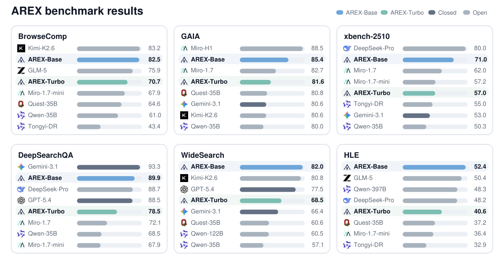
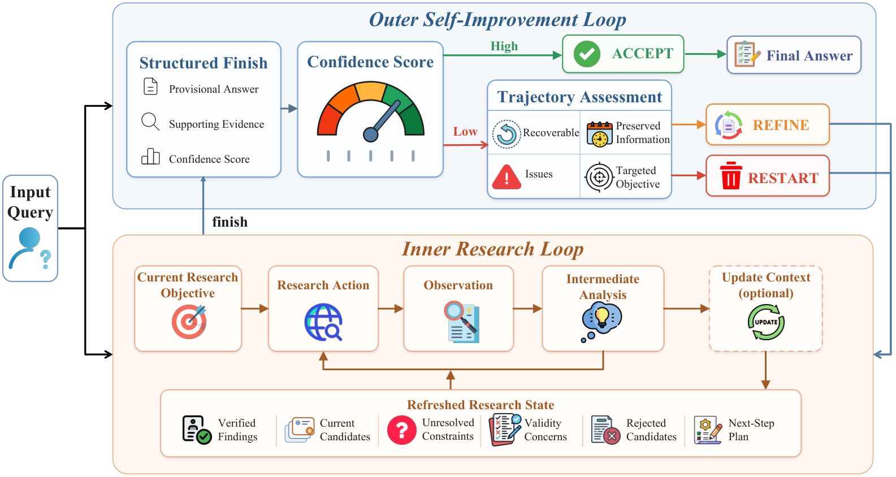
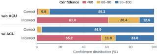
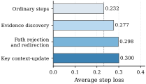

# Paper精读｜AREX: Towards a Recursively Self-Improving Agent for Deep Research

> [!abstract] 一句话结论
> 深度研究里有个发现-验证不对称：找到满足全部耦合约束的答案很贵，逐条约束去查证却便宜。AREX 整套架构就搭在这个差价上——双层递归自改进（RSI）：内循环研究攒证据、出候选答案，外循环逐约束审计、定向修正，配上自主的上下文更新工具，4B 和 10B 激活参数的模型打出了能和 frontier model 掰手腕的 deep research 能力。

> [!cite]- 论文信息（点开折叠）
> - **论文标题**：AREX: Towards a Recursively Self-Improving Agent for Deep Research
> - **arXiv**：2607.21461
> - **链接**：[https://arxiv.org/abs/2607.21461](https://arxiv.org/abs/2607.21461)
> - **作者**：AREX Team
> - **机构**：Beijing Academy of Artificial Intelligence (BAAI)
> - **日期**：2026-07-23

---

## 1️⃣ 论文想解决什么问题

Deep research 任务的难点不只在找到相关证据，在让答案同时满足一串耦合约束。现有系统靠单一长程搜索轨迹硬啃：推理步骤和工具调用堆上去，探索范围是大了，但进展不成体系——早期错误一路带到尾、已经榨干的方向被反复翻、半对的候选过早拍板。

真正的挑战不是搜更久，而是诊断出哪些约束还没解决，再拿这个诊断去构造更有针对性的下一轮研究问题。

---

## 2️⃣ 核心洞察

> [!important] 三条核心洞察
> 1. 发现-验证不对称性（Discovery-Verification Asymmetry）：找到一个满足所有约束的答案，要在大而稀疏的空间里导航；验证一个候选却能拆成一串逐约束的小检查。验证不只回答对错，还顺带告诉你哪些声明被支持、哪些没着落、哪些证据在打架。
>
> 2. 验证还能定义轮次之间的转换：已有工作拿验证来给候选轨迹排序、或在轨迹内细化决策。AREX 多走一步——验证充当研究轮次之间的状态转换：临时答案转成部分验证的状态，确认过的进度存下来，剩余的不确定性圈起来，下一轮的研究问题直接从诊断里长出来。
>
> 3. **自主上下文更新是 RSI 的地基**：长程研究里交互历史只增不减——已验证证据、失败查询、被拒候选、过时计划。全留着会搅浑后续推理，随手截断又可能扔掉后面验证要用的东西。AREX 让模型自己学什么时候调 `update_context`，把交互历史压成紧凑的"改进状态"（improvement state）。

*图注：AREX 在 BrowseComp、GAIA、xbench-DeepSearch-2510、DeepSearchQA、WideSearch-en、HLE with tools 六个基准上的性能对比。AREX-Base（10B 激活参数）在 BrowseComp 82.5、GAIA 85.4、WideSearch-en 82.0，超越 Qwen3.5-397B 并匹敌 frontier model。*

---

## 3️⃣ 方法解读

### 组件1：双层循环架构

架构就是不对称性的直接落地：发现交给内循环，验证和调度交给外循环。

**内循环（Research Loop）**：

- 目标 $q^{(k)}$ 由原始问题 $x$（第一轮）或外循环提供（后续轮次）

- 策略 $\pi_\theta$ 执行搜索/浏览工具 $\mathcal{T}$，收集证据，构建候选答案

- 目标被充分研究后，调用 `finish` 输出结构化结果：临时答案 $y^{(k)}$、支持证据 $\mathcal{E}^{(k)}$、置信度 $s^{(k)} \in [0, 100]$

**外循环（Self-Improvement Loop）**：

- 接收内循环的结构化结果 $r^{(k)}$

- 置信度阈值 $\tau$ 控制终止：$s^{(k)} \geq \tau$ 则接受答案

- 否则评估当前轨迹还有没有救：

  - Refine：留住有用发现，把未解决问题转成目标 $q^{(k+1)}$

  - Restart：丢掉噪声轨迹，从原始问题重来

*图注：AREX 的递归自改进框架。内循环维护研究状态并输出带证据和置信度的临时答案，外循环基于置信度和轨迹评估决定接受、修正还是重启。*

### 组件2：自主上下文更新工具（update_context）

- 自己决定什么时候调（解决完一个有意义的子问题后、排除一个主要候选后、调和完冲突证据后）

- 构建刷新状态 $z_t^{(k)} = f_\theta(h_t^{(k)})$，保留：已验证发现及来源、当前候选、未解决约束、有效性担忧、被拒绝候选、下一步计划

- 删掉冗余观察、过时结论、过时计划

- 有效上下文 $\bar{h}_t^{(k)}$ = 最近一次更新状态 + 更新后的交互

### 组件3：多阶段训练框架

**渐进式多轮能力训练**：

- 第一阶段：browse-intensive 多轮轨迹（搜索、阅读、证据收集、查询重构）

- 第二阶段：expert-level 推理数据（长程思维、多步演绎、假设验证）

- 第三阶段：混合能力巩固 + 验证驱动的研究状态转换

**关键步骤聚焦监督（Key-Step Focused Supervision）**：

- 规则检测器挑出候选关键步骤：

  - 多次探索后首次发现答案相关实体的工具调用

  - 拒绝错误实体/假设、重定向搜索的第一步

  - 关键上下文更新步骤

- 损失只压在成功轨迹的关键步骤上（prefix-conditioned, step-only loss）

**步骤感知强化学习（Step-Aware RL）**：

- Turn-level policy optimization + hierarchical step-balanced normalization

- 关键步骤额外奖励：$A_{i,j} = A^{\text{out}}_i + \lambda_{\text{key}} \widetilde{B}_{i,j}$

### 优势估计

- 参数效率：10B 激活参数的 AREX-Base 超越 Qwen3.5-397B（397B 参数）

- 系统性进展：靠验证驱动的状态转换往前推，不是靠暴力堆搜索

- 证据保留：已验证发现被显式存着，不重复探索

- 不确定性隔离：未解决约束被显式追踪，后续搜索有方向

---

## 4️⃣ 实验部分怎么读

### 实验设置

**模型规格**：

| **模型** | **类型** | **参数** |
| --- | --- | --- |
| AREX-Turbo | Dense | 4B |
| AREX-Base | MoE | 122B total, 10B activated |

**基准测试**：

| **基准** | **核心考察** |
| --- | --- |
| BrowseComp | 深度研究：多步检索、查询重构、证据聚合 |
| WideSearch | 大范围检索与合成 |
| DeepSearchQA | 深度研究：多步检索、查询重构 |
| HLE (with tools) | 高级推理 + 网络搜索和计算工具 |
| GAIA | Agent 任务完成：信息寻求 + 规划 + 工具使用 |
| xbench-2510 | Agent 任务完成 |

评估协议：最多 300 轮内循环 + 5 轮外循环

### 核心结果

**整体性能**：

| **模型** | **BrowseComp** | **GAIA** | **xbench** | **DeepSearchQA** | **WideSearch** | **HLE** |
| --- | --- | --- | --- | --- | --- | --- |
| GPT-5.4 | 82.7 | — | — | 88.5 | 77.5 | 52.1* |
| Opus-4.6 | 83.7 | — | — | 91.3 | 77.5 | 53.0* |
| Gemini-3.1-Pro | 85.9 | 80.6 | 53.0 | 93.3 | 66.4 | 51.4* |
| Qwen3.5-397B | 78.6 | 83.5 | 61.0 | 82.1 | 74.0 | 48.3 |
| MiroThinker-H1 | 88.2 | 88.5 | 72.0 | 80.6 | — | 47.7 |
| **AREX-Turbo (4B)** | 70.7 | 81.6 | 57.0 | 78.5 | 68.5 | 40.6 |
| **AREX-Base (10B)** | **82.5** | **85.4** | **71.0** | **89.9** | **82.0** | **52.4** |

*AREX-Base 在 BrowseComp 超越 Qwen3.5-397B (78.6)，在 WideSearch 达到最佳 (82.0)，在 DeepSearchQA 超越 DeepSeek-V4-Pro (88.7)。*

### 消融研究

**训练消融**（BrowseComp）：

| **设置** | **Accuracy** |
| --- | --- |
| Replace multi-round capability training by mixed training | 77.5 |
| Replace key-step focused supervision by random-step replay | 74.1 |
| Replace step-aware RL by standard GRPO | 79.4 |
| **Full AREX** | **82.5** |

*关键步骤聚焦监督贡献最大（-8.4 点），其次是多轮能力训练（-5.0 点），步骤感知 RL 进一步改进（-3.1 点）。*

**推理框架分析**（BrowseComp）：

| **配置** | **Accuracy** |
| --- | --- |
| AREX w/o ACU, w/o outer loop | 59.6 |
| AREX w/o ACU, w/ outer loop | 69.8 |
| AREX w/ ACU, w/o outer loop | 71.4 |
| **AREX w/ ACU, w/ outer loop** | **82.5** |

*ACU 单独贡献 +11.8 点，外循环单独贡献 +10.2 点，两者结合达到 82.5（+22.9 点）。*

*图注：正确与错误输出的置信度分布。正确输出集中在 90-100 区间（ACU 下 95.9%），错误输出保留大量低置信度质量（55.2% 低于 60），支持基于置信度的决策程序。*

*图注：全轨迹 mid-training 后的平均步骤损失。普通步骤损失 0.232，关键步骤损失明显更高：证据发现 0.277（+19%）、路径拒绝重定向 0.298（+28%）、关键上下文更新 0.300（+29%），模型在决策关键步骤上还有不小的改进空间。*

**上下文更新行为**：

- 80.3% 的 BrowseComp 案例调用了 update_context

- 平均在 25,721 tokens 时调用（128K 上限的 20%）

- 触发原因：搜索策略修订（66.9%）、候选拒绝（13.6%）、识别新线索（7.2%）

- 保留内容：未解决约束（95.5%）、下一步计划（96.4%）、已验证发现（72.1%）、被拒绝候选（81.5%）

---

## 5️⃣ 学术评价

**优点：**

1. 问题重构立得住：deep research 不是"搜索更长"，是"验证驱动的递归自改进"——后面整套架构都从这一个换法里推出来

2. 架构没有多余的零件：双层循环 + 一个 `update_context` 工具，每个部件都有消融数字撑腰

3. 训练链条一环扣一环：渐进式 mid-training → 关键步骤聚焦 → 步骤感知 RL，拆开测过：多轮能力训练 -5.0、关键步骤聚焦 -8.4、步骤感知 RL -3.1

4. 参数效率摆在那儿：10B 激活参数打 397B 密集的 Qwen3.5，MoE 这笔账算得划算

5. 行为数据让方法可信：80.3% 的案例主动调 update_context，平均 25,721 tokens 就动手——远没等到 128K 上限，模型是真学会了管理自己的上下文

> [!ed-warning] 局限（风险与不确定性）
> 先说处境：把火力集中在 deep research 一个点上打透，泛化的账以后再算，这个打法我理解。但有几条必须记着：
> 1. 只验了搜索密集型任务：六个基准全是信息检索/研究导向，数学推理、代码生成这些非搜索任务上泛不泛化，一个字没有
>
> 2. MoE 架构的特殊性没掰开：AREX-Base 用的是 Qwen3.5-122B-A10B，MoE 的训练动态对 RSI 是帮忙还是添乱，不清楚
>
> 3. 缺人类评估：只有自动指标，答案质量、证据可靠性没有人类判断背书
>
> 4. 训练数据靠强教师：高质量轨迹从强 teacher model 来，可复现性受限
>
> 5. 没和最先进的专有系统正面碰：OpenAI Deep Research、Google Gemini Deep Research 这些都缺席

---

## 6️⃣ 局限与可扩展方向

- 扩展到非搜索领域（数学推理、代码生成、创意写作）

- 研究 MoE 架构对 RSI 的影响

- 开发更精确的上下文更新策略（当前基于学习，无显式优化目标）

- 探索与 parameter-based self-improvement 的结合（当前仅做 state-level improvement）

- 研究上下文更新的理论最优（何时更新、保留什么、丢弃什么）

- 开发更轻量的 teacher-free 训练方法

---

## 7️⃣ 最后总结

AREX 给出的答案不是搜更久，是用验证驱动的状态转换做递归自改进：每轮结束盘点一遍哪些约束站住了、哪些还悬着，下一轮的问题从诊断里长出来。这和 test-time compute scaling 是一个方向的两种说法——与其在 training time 堆 computation，不如在 inference time 聪明地分配。全文最硬的数字是关键步骤聚焦那 -8.4 点：长程轨迹里真正决定成败的就那么几步，监督就该花在那儿。我拿不准的是这套验证驱动的循环出了搜索密集区还转不转——六个基准全是检索导向，数学和代码上还没有任何证据。

---

## 8️⃣ 三句速记

> [!summary]- 点开展开
> 1. 发现-验证不对称是 deep research 的核心特征：验证比发现便宜，AREX 靠这个差价驱动轮次间的状态转换。
>
> 2. 双层递归架构（内循环研究 + 外循环自改进）+ 自主上下文更新：临时答案转成部分验证状态，已确认进度存住、未解决问题圈出来，研究进展从此成体系。
>
> 3. 关键步骤聚焦 + 步骤感知 RL：长程轨迹里少数决策步骤定成败，对这些步骤加码监督，消融里是贡献最大的一块（-8.4 点）。
