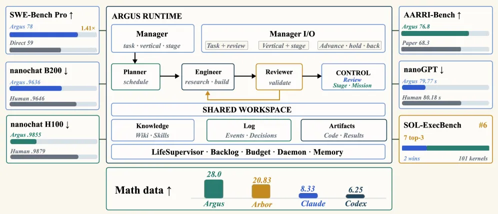
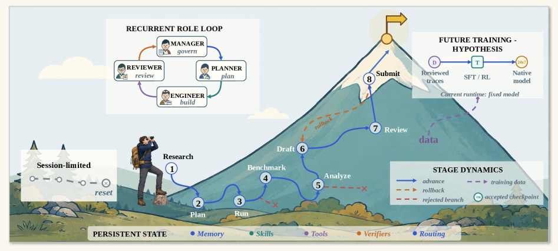
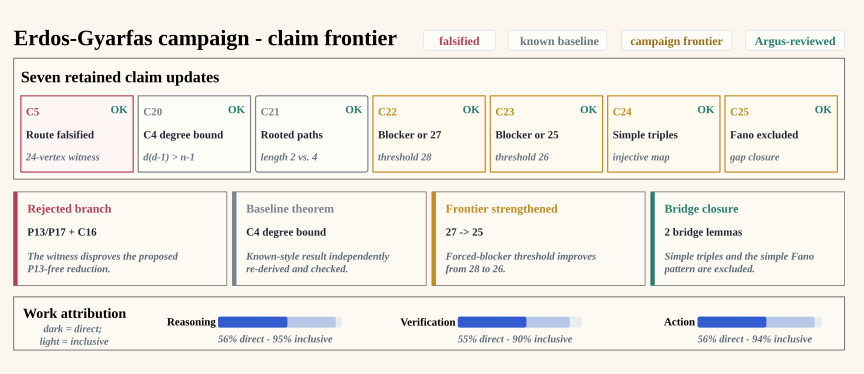

# Paper精读｜Argus: A General-Purpose Agentic Runtime for Long-Horizon Reasoning

> [!abstract] 一句话结论
> 提出 **Argus**：一个**持久、自进化的通用 agentic runtime**，冲着长时程推理（性能工程、安全研究、科学探索、数学研究）去设计。四个模型角色（**Manager / Planner / Engineer / Reviewer**）在持久化项目状态上执行有界任务（mission），核心机制是**<span class="mark-strong">验证门控的持久化、转向与运行时自进化</span>**：稳定的用户意图（standing intent）与可被证据精化的操作目标/约束/验证标准分开；任何实质性变更必须**证据支撑、角色门控、被记录**——"<span class="mark-strong">无限制转向 = 合理化失败</span>"，所以每个变更都要过评审。模型权重不动，自进化发生在**持久运行时状态与控制策略**上。战绩：SWE-Bench Pro <span class="mark-number">~78%</span>（vs Direct Copilot <span class="mark-number">59%</span>）、AARRI-Bench <span class="mark-number">76.8%</span>、SWE-Bench Waves 成熟后单任务省 <span class="mark-number">21%</span> token 与 <span class="mark-number">15%</span> 时间。

> [!cite]- 论文信息（点开折叠）
> - **论文标题**：Argus: A General-Purpose Agentic Runtime for Long-Horizon Reasoning — Verification-Guided Persistence, Pivoting, and Runtime Self-Evolution
> - **arXiv**：2608.05144
> - **链接**：[https://arxiv.org/abs/2608.05144](https://arxiv.org/abs/2608.05144)
> - **作者**：Boxiu Li, Zimo Wen, Yijia Fan 等 20+ 人（Co-first: 3 人；Corresponding: Xian Zhang (Microsoft), Zhijie Deng (SJTU)）
> - **机构**：Microsoft / 上海交通大学 / 复旦大学 / 南京大学 / 清华大学 / 香港大学 / 北京大学 / 港中深 / 东华大学
> - **日期**：2026-08-05（Technical Report, Aug 2026）
> - **项目**：argusbot.cn / [github.com/lbx154/Argus](https://github.com/lbx154/Argus)

---

## 1️⃣ 论文想解决什么问题

长时程研究不是"沿固定路线推得更远"。现实中：

- **稳定意图可以不变，但操作目标/约束/验证标准会变得更精确**——数学战役很少终结于最初想证的定理；软件请求在候选实现暴露缺失前常常欠定义；系统验证中 spec 和实现可能都错

- **"允许目标修订"在外部与"失败"不可区分**——系统放弃既定目标，可能是发现了目标被错误定义，也可能是失败后合理化。最终产物无法区分两者

- 允许无约束的目标修订 = **目标漂移**（objective degrades toward whatever the executor can finish）

标准回应是**移除选择**（固定目标、优化执行）——ReAct、SWE-agent、OpenHands 都这么做。但论文认为这不够：长时程研究恰恰需要"**受约束的修订**"能力——既不能固定死（会困在错误路径上），也不能自由改（会漂移）。

Argus 的答案：**验证门控的转向（verified pivoting）**——"stand intent 稳定，operational objective 可精化，但每次材料性变更都要证据 + 角色门控 + 记录"。区分"发现的失败"与"合理化的失败"靠的是：**变更必须由任务原生验证器（task-native verifier）证据支撑，并经过独立 Reviewer 审查**。

---

## 2️⃣ 核心洞察

> [!important] 核心洞察
> 1. **"受约束的转向"是长时程推理的核心能力**：不是"固定目标硬推"也不是"自由漂移"，而是**证据驱动的目标精化**——中间界、反例、重构都是正常产出且携带真实价值。Argus 把"何时该坚持、何时该转向"从模型直觉变成**可审计的运行时机制**。
>
> 2. **三平面分离（控制/执行/记录）**：control plane 管调度、execution plane 做有界任务、record plane 只记录"发生了什么"而不裁决"是否科学完成"——**<span class="mark-strong">记录与裁决分离</span>**，防止自我合理化污染记录。
>
> 3. **验证门控 = 累积而非临时的进化**：候选记忆、技能、流程、验证器、路由决策、被拒路线，只有在**角色拥有的评审 + 任务原生验证器证据**通过后才成为可复用资源——被拒分支也保留为"已验证排除项"（verified exclusions），后续 mission 可引用其失败证据避免重蹈覆辙。
>
> 4. **自进化在运行时，不在权重**：模型权重固定，进化发生在**持久状态与控制策略**——admitted mission 改变后续工作的起点、可用流程、验证义务、路由策略。这是"固定模型 + 可变 harness"路线的又一强证据（呼应 harness engineering 主题）。
>
> 5. **转向需要"角色门控"**：不是任何角色都能转向——Manager 承诺目标/生命周期/路线/阶段，Planner 分解任务，Engineer 执行（低风险有界工作可自审），**独立 Reviewer 才裁决"done/continue/blocked"**——利益分离从结构上防止自欺。



*Figure 1（系统总览）：中心图显示 Manager 对任务、研究垂直方向与 Stage 转换的权威；Planner/Engineer/Reviewer 在共享工作区上操作，其知识、事件日志、工件、积压、预算、守护进程与记忆跨有界任务持久化。周围卡片报告 7 个任务原生评估结果（独立刻度，广度证据而非单一归一化榜单）。*

---

## 3️⃣ 方法解读

### 组件1：问题形式化——Dense-Intelligence Tasks 与 Campaign

- **密集智能任务三条件**：T1 发明性（答案不可检索，须搜索+反馈发现）、T2 长时程（单遍不够，需数小时/天的依赖迭代）、T3 可验证性（任务原生评估器能区分真实改进与有说服力的错误主张）——定义排除无评估器的开放头脑风暴与"只需时间无新决策"的固定流程

- **Campaign 建模**：目标 o、初始工件 y₀、评估过程 f、资源预算 B；分为有界 mission τ_t = ((s, a, y, e, r))——**连续性属于持久 campaign 状态而非无界模型会话**

- **契约模型 K_t = (ι, o_t, c_t, v_t)**：standing intent / 当前目标 / 已知约束 / 验证标准——**意图与操作层分离**是"受约束修订"的形式基础

### 组件2：四角色分工（Table 1）

| **角色** | **主要职责** | **权威输出** |
| --- | --- | --- |
| **Manager** | 承诺目标、生命周期、路线、campaign 阶段 | campaign 划分与 Stage 转换 |
| **Planner** | 把当前研究状态分解为有界任务与依赖 | 任务规格、计划状态、阶段清单更新 |
| **Engineer** | 修改工件、调用工具、运行实验（一轮） | 执行结果、工件、测量、交接、review=skip/required 选择 |
| **Reviewer** | 按需独立检查工件与执行记录 | done/continue/blocked + 接地下一步 + 保留状态编辑 |

- **评审触发规则**：允许低风险有界工作用 Engineer 自审；**垂直政策、阶段关闭任务、或 Engineer 自己的请求必须独立 Reviewer**

- 接口是结构化对象而非非类型化文本——所有权与恢复行为显式

### 组件3：Reviewed Mission Loop（Algorithm 1）

```
ManagerCommit(ι, K_t) → 持久 campaign 身份
while 预算 b 且 c 未完成:
    q ← Planner(积压, 状态, c, K_t)      # 认领一个有界任务
    repeat:
        (y, e, d) ← Engineer(q, H_t)     # 执行一轮
        r ← SelfReview 或 Reviewer(q, y, e)  # 按 d 与允许规则
        记录 (q, y, e, r, r.source)
        if r = continue: q ← r.next_action
    until r ∈ {done, blocked, paused}
    证据提取 → 结果准入 → 契约精化（如需用户授权）
    H_{t+1} ← U(H_t, τ_t, E_t, K_{t+1})  # 持久化结果/轨迹/状态
```

- **材料性精化（material refinement）需用户授权**：证据提议 K'_t 时，须获取 operator 权威 u_t 才更新契约——**升级点（escalation points）由 operator 拥有**，mission 在明确升级点之间自主执行

### 组件4：运行时自进化（§7）

- 持久对象是 campaign 状态而非 provider 转录——接受的结果、失败路线、工具、技能、当前阻塞在会话/进程重启后仍可用

- **准入门控**：每个候选绑定到工件、任务原生证据、授权提交；独立 Reviewer 是门控路径之一（非每次低风险更新都需要）

- **<span class="mark-strong">被拒分支 = 已验证排除项</span>**：后续 mission 避免重复该分支，且转向时可引用其失败证据

- **SWE-Bench Waves 证据**：成熟 Wave 比启动 Wave 单任务省 21% 输入 token、15% 活跃时间——共享状态累积的纵向收益

- **从运行时学习到模型训练**：轨迹可转化为监督示例/偏好对/RL transition（AgentInstruct/Agent-FLAN/Agent Lightning 机制）——Argus 提供结构化源流

---

## 4️⃣ 实验部分怎么读

### 七基准能力下限（Table 4）——同一 harness 跨域有效

| **基准** | **骨干/后端** | **Argus 结果** | **对比** |
| --- | --- | --- | --- |
| SWE-Bench Pro | GPT-5.5/xhigh + Copilot | **~78%**（731 软件修复任务） | Direct Copilot ~59%；1.41× token |
| SOL-ExecBench | GPT-5.5 + Codex | 全球 #6；2×#1；7 个 top-3（101 内核） | 两次正面胜过 Recursive |
| nanochat B200 | GPT-5.5 + Codex | **0.9636 BPB** | 人类最佳 0.9646 |
| nanochat H100 | GPT-5.5 + Codex | 0.9855 BPB | 人类最佳 0.9879 |
| nanoGPT speedrun | GPT-5.5 + Codex | **79.77 s** | 同设备人类 80.18 s |
| AARRI-Bench | GPT-5.5 + Codex | **63/82（76.8%）** | 论文最佳 68.3% |
| Math-Reasoning Data | GPT-5.5 + Codex | **28.0 gap** | Arbor 20.83 / Claude 8.33 / Codex 6.25 |

- **关键解读 1（通用性）**：同一 harness、同一骨干（GPT-5.5）横扫七个任务原生评估——SWE 修复、GPU 内核优化、语言模型训练（nanoGPT speedrun 79.77s < 人类 80.18s）、数学数据合成——**runtime 不绑定领域**。

- **关键解读 2（跨骨干迁移）**：GLM-5.2（200K 上下文，经 Claude Code 驱动）在 SWE-Bench Pro 达 70.94%——**同一契约/路由/Reviewer 策略换模型换执行面无需重装**。

- **关键解读 3（上游采纳）**：Argus 优化的 TileLang RWKV6 内核被评审后合并进 fla-org:main（PR #1045）——产出有真实外部价值。

### 第八竞技场：MLE-Bench Lite（部分结果，Table 5）

- 评审批准的奖牌门控：竞赛只有在独立评审的提交获得 Kaggle 奖牌时才算完成——**奖牌而非排行榜位置**

- 已关闭 9 个竞赛：3 金 3 银 3 铜；两个"擦边"案例（0.00009 RMSE 差银、0.00018 AUC 过铜）由外部评分器对官方排行榜裁决——**门控是窄的而非名义上的**

### SWE-Bench Pro 深度（Figure 3/4）——自适应评审路由

- 731 任务中 466 个调用独立 Reviewer、265 个用 Engineer 自审；路由任务消耗 2.75× 输入 token、1.80× 活跃时间——**评审路由是自适应资源分配**，只在值得时启用

- 34 次 verifier 恢复 + 22 次严格评审环救援（review-loop rescues）——纵向轨迹非单调，但失败被捕获并恢复

### 数学战役案例（Figure 5）——被拒路线与前沿更新共存

- 七个保留更新从被证伪路线（C5）→ 两个独立重推导基线（C20-C21）→ 四个 campaign 前沿结果（C22-C25）——**"保留一条被证伪路线 + 六个证明支撑的前沿更新"**

- 163.6 小时论文生产轨迹（Figure 7）：七个早期 no-go 决策修剪弱方法路线，项目从"正向方法主张"转向"审计"——转向有证据、有记录



*Figure 2（自进化模型）：左卡显示会话受限路线以重置结束；中央循环角色循环复用于 8 个 Manager 控制的 Stage；蓝色/橙色路线展示被拒分支如何保留为"已验证排除项"参与后续进化。*



*Figure 5（数学案例）：七条保留更新从被证伪路线（C5）进展，经两条独立重推导基线（C20-C21），到四条 campaign 前沿结果（C22-C25）——被拒路线与证明支撑的前沿更新共存，正是"验证门控转向"的实证。*

---

## 5️⃣ 学术评价

**优点：**

1. **问题定义是真的锋利**："无限制转向 = 合理化失败"是全文的钉子——它把"何时允许改目标"从工程细节提到**可验证性的核心问题**，并给了结构化答案（意图/操作分离 + 验证门控 + 角色门控 + 记录）

2. **验证门控的自进化是它和邻居拉开差距的地方**：与"权重不变、harness 可变"路线（HarnessX、prime-agent）相比，Argus 的差异化是**准入门控 + 被拒分支保留为已验证排除项**——进化是累积的（SWE-Bench 成熟 Wave 省 21% token、15% 时间是纵向证据）

3. **评审路由自适应**：731 任务中只有 466 个用独立 Reviewer（64%），低风险任务自审——**验证成本是按需分配的**，不是一刀切

4. **结果的可信度设计**：任务原生评估（不跨归一化）、外部评分器（Kaggle 奖牌门控）、上游合并（FLA PR）、"观测轨迹非单调"（34 次 verifier 恢复 + 22 次评审救援）——**承认失败并记录恢复**，比只报成功指标诚实

5. **跨骨干/跨执行面迁移**：GPT-5.5 → GLM-5.2 + Copilot → Claude Code 无重装迁移——runtime 与模型/后端解耦

> [!ed-warning] 局限（风险与不确定性）
> 先说处境：跨七个域的系统论文，先把整体跑通再拆机制消融，是这个体量的常见取舍，论文自己也承认没有隔离实验。但理解归理解，该提的还是要提：
> 1. **无对照消融的因果归因缺失**：论文承认"没有单独隔离记忆/技能/验证/路由的匹配实验"——SWE-Bench 纵向收益无法归因到具体机制（需要 frozen vs accumulated state 重放）
>
> 2. **成本不便宜**：SWE-Bench Pro 1.41× token、路由任务 2.75× token 1.80× 时间——**验证与多角色的开销是真实成本**，论文对"何时值得"的成本-收益模型不完整
>
> 3. **骨干锚定在 GPT-5.5**：核心结果都依赖 GPT-5.5（xhigh）——runtime 与最强闭源模型的耦合；GLM-5.2 是唯一异构验证且无匹配基线
>
> 4. **"角色门控"依赖提示工程**：Manager/Reviewer 的裁决质量说到底是 LLM 判断——**"独立评审"是上下文级而非模型级独立**（与 LongHorizon-Harness 同病）；Reviewer 与 Engineer 同骨干时仍有系统性偏差风险
>
> 5. **基准的代表性**：SWE-Bench Pro/MLE-Bench 是已知基准（有数据泄漏风险），AARRI-Bench 等较新；"论文生产"案例是自我报告轨迹，无外部审计

---

## 6️⃣ 局限与可扩展方向

- **机制级消融**：frozen vs accumulated runtime state 的匹配实验，把纵向收益归因到记忆/技能/验证/路由

- **验证成本模型**：何时值得独立 Reviewer/多角色？——基于任务风险与历史收益的自适应门控

- **模型级独立评审**：异构模型 Reviewer（不同骨干审计执行）——测试"评审独立性"的下限

- **从运行时学习到模型训练闭环**：Argus 轨迹 → SFT/RL 数据 → 内化验证与规划模式（论文已提出，未实现闭环）

- **开源与可复现性**：代码库公开（github.com/lbx154/Argus），但 20+ 作者 × GPT-5.5 算力的完整复现成本极高

---

## 与其他论文的对话

| **相关工作** | **关系** | **差异** |
| --- | --- | --- |
| **LongHorizon-Harness（2608.01964）** | 同为"harness 决定长时程能力" | LHH 用 MEA 循环管理任务状态；Argus 增加"验证门控转向"与"运行时自进化"——更强调目标可修订性与累积进化 |
| **MemHarness（2607.28272）** | 记忆利用范式 | MemHarness 重构经验记忆；Argus 的持久状态包含记忆+技能+被拒路线——"被拒分支作为资产"是 Argus 独有 |
| **ReAct / SWE-agent / OpenHands** | 论文明确批评的对象 | 它们"固定目标优化执行"；Argus 认为长时程研究需要"受约束的目标修订" |
| **HarnessX (Darwin Agent Team)** | 进化 harness 配置 | HarnessX 用进化引擎搜索 harness 参数；Argus 的自进化是"验证门控的运行时状态累积"——机制不同（演化 vs 准入累积） |
| **Claude Code / Copilot / Codex** | 执行后端 | Argus 把它们当执行面（backends），自己提供控制/记录平面——"包"而非"替换"现有 agent |
| **AlphaProof Nexus / Leanstral** | 验证驱动路线 | 它们是"模型产出 + 形式化验证器"；Argus 把"验证门控"泛化到任意任务原生评估器 |
| **METR longtasks** | 长时程趋势数据 | Argus 是"如何让 agent 扛住跨日研究任务"的运行时答案 |

---

## 7️⃣ 最后总结

Argus 是"长时程 agent"主题下野心最大的系统论文之一：它不只是管理任务状态（LHH）或重构记忆（MemHarness），而是**重新定义了目标本身的可变性**——"stand intent 稳定、operational objective 可精化、但每次材料变更都要证据+角色门控+记录"。它用四角色分离（Manager 承诺/Planner 分解/Engineer 执行/Reviewer 裁决）和验证门控的自进化（被拒分支也是资产），在七个任务原生基准上证明<span class="mark-strong">同一 harness 跨域有效</span>（SWE ~78%、AARRI 76.8%、nanoGPT 快过人类），并拿出了真实外部产出（FLA 合并、Kaggle 奖牌）。短板也摆在那儿：无机制级消融、成本高（1.41× token）、评审独立性是上下文级、骨干锚定 GPT-5.5。它的深层贡献是把"受约束的目标修订"从提示工程提升为**可审计的运行时机制**——对任何做自主研究/长程 agent 系统的人，这是必读的架构参考。

---

## 8️⃣ 三句速记

> [!summary]- 点开展开
> 1. **验证门控的转向**："无限制转向 = 合理化失败"——意图稳定、目标可精化，但每次材料变更必须证据 + 角色门控 + 记录。
>
> 2. **自进化在运行时**：模型权重不变，进化发生在持久状态与控制策略——被拒分支保留为"已验证排除项"，SWE-Bench 成熟 Wave 省 21% token、15% 时间。
>
> 3. **同一 harness 横扫七域**：SWE-Bench Pro ~78%（vs Direct 59%）、AARRI-Bench 76.8%、nanoGPT 训练快过人类、RWKV6 内核被上游合并——跨骨干（GPT-5.5→GLM-5.2）无重装迁移。