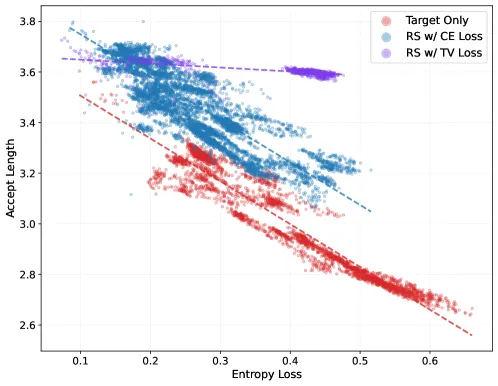
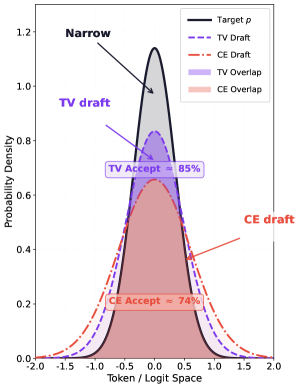
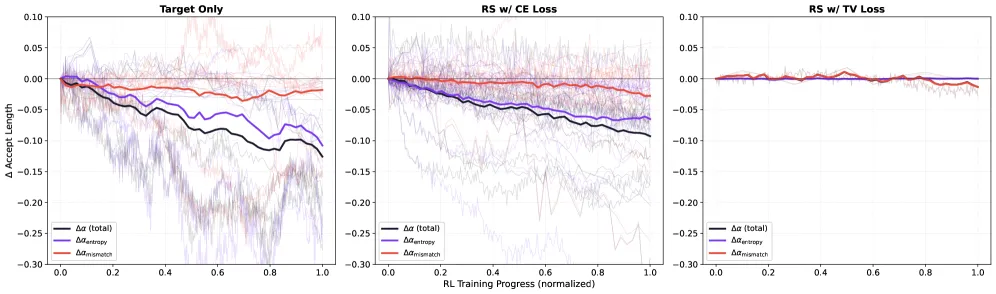
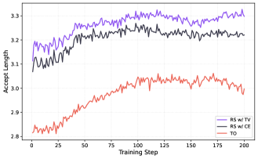
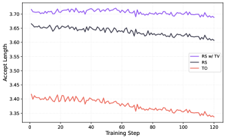
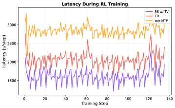
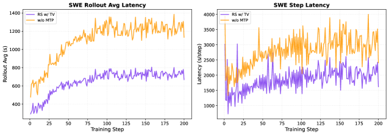

# Paper精读｜Breaking Entropy Bounds: Accelerating RL Training via MTP with Rejection Sampling

> [!abstract] 一句话结论
> 这篇论文（**Bebop**）发现 RL 训练里 MTP（多 Token 预测）的接受率被**目标模型熵**线性卡死，给出的解法是**端到端 Total Variation (TV) loss** + **Rejection Sampling**——让 MTP 在 RL 全程维持稳定高接受率，在 Qwen3.5/3.6/3.7 上拿到最高 **1.8× 端到端加速**。

> [!cite]- 论文信息（点开折叠）
> - **论文标题**：Breaking Entropy Bounds: Accelerating RL Training via MTP with Rejection Sampling
> - **arXiv**：2606.12370
> - **链接**：[https://arxiv.org/abs/2606.12370](https://arxiv.org/abs/2606.12370)
> - **作者**：Yucheng Li, Huiqiang Jiang, Yang Xu, Jianxin Yang, Yi Zhang, Yizhong Cao, Yuhao Shen, Fan Zhou, Rui Men, Jianwei Zhang, An Yang, Bowen Yu, Bo Zheng, Fei Huang, Junyang Lin, Dayiheng Liu, Jingren Zhou
> - **机构**：Qwen Team, Alibaba Inc.
> - **日期**：2026-06-10

---

## 1️⃣ 论文想解决什么问题

RL 后训练里最贵的一步是 rollout：模型自己生成上万 token 的轨迹，这段时间把整个训练管线拖住。MTP（Multi-Token Prediction）本该是现成的解药——draft-then-verify 的 speculative decoding 机制直接搬去加速 rollout 就行。但现有方案在 RL 里集体失灵：**MTP 接受率随 RL 训练大幅下滑**，加速还没兑现就先漏光了。

先前的解释（MiniMax-Forge、ReSpec、EAGLE）把锅甩给**策略权重更新导致的 draft-target 分布不匹配**，药方是在线 MTP 联合训练——代价是实打实的显存和延迟开销。

这篇论文把这笔账重算了一遍：理论分析加实验分解都指向同一个结论，**熵才是主导因素**，分布不匹配的影响微乎其微——那笔最贵的在线更新，根本不用花。

---

## 2️⃣ 核心洞察

### 洞察1：MTP 接受率受目标熵线性约束

不管 target-only 采样还是 rejection sampling，只要 draft 是 CE/KL 训出来的，RL 阶段策略熵一涨，接受率就线性往下掉。作者给的是命题级证明：target-only 的接受率 $\alpha^{\mathrm{TO}} = \max_y p(y) \geq \exp(-\mathcal{H}(p))$，CE/KL-trained RS 的接受率同样呈 $\alpha^{\mathrm{RS}} \approx a - b \cdot \mathcal{H}(p)$ 的线性关系。

*图1(a)：MTP 接受率随策略熵上升线性下降。每个点代表不同规模 Qwen3.5/3.6/3.7 模型在某个 RL step 的均熵和接受长度。蓝色（TO）和红色（RS w/ CE）斜率明显，橙色（RS w/ TV Loss）几乎平坦——TV Loss 消除了熵依赖。*

### 洞察2：Rejection Sampling 优于 Greedy Target-Only

RS 的接受率就是 **TV overlap** $\sum_v \min(p(v), q(v)) = 1 - d_{\mathrm{TV}}(p, q)$——连续函数，对排序变化不敏感；target-only 靠离散的 top-1 判断吃饭，高熵时（一堆 token 概率挤在一起）动不动突然拒绝。

*图1(b)：TV 训练的 draft 分布（蓝色实线）与 target 分布（灰色虚线）的重叠区域远大于 CE 训练的 draft（红色实线），TV Accept 85% vs CE Accept 74%。TV 的梯度机制使其自动聚焦高概率区域。*

### 洞察3：TV Loss 直接优化接受率

CE/KL 只能间接压 TV distance——Pinsker 不等式给的是上界，不是精确值；CE 的梯度 $q_j - p_j$ 对每个 token 一视同仁地使劲，有效支持集 $\exp(\mathcal{H}(p))$ 一扩大，均匀的 per-token 误差就累积成大的 TV distance。

**TV Loss 的梯度正比于 **$q_j$，天然聚焦高概率 token、压住长尾，产出**概率正比的不匹配** $|q^*(v) - p(v)| \lesssim \delta \cdot p(v)$——TV distance 从此和熵脱钩。

### 洞察4：Pre-RL训练即可，无需在线更新

分解分析把接受率的变化拆成熵驱动 vs 分布不匹配两个分量，结论是 RS 下后者近乎为零。所以 RL 前用 TV Loss 把 MTP 训一次，整个 RL 过程就稳了——在线更新纯属白花钱。

*图3：将 RL 训练中接受长度变化 *$\Delta\alpha$*（灰色）分解为熵驱动（橙色）和分布不匹配（绿色）。在 TO 下两者都有贡献；RS w/ CE 下几乎全是熵驱动；RS w/ TV Loss 下所有分量几乎为零——证明 pre-RL 训练就够了。*

---

## 3️⃣ 方法解读

### 组件1：End-to-End Multi-Step TV Loss

- 传统 MTP 拿 CE/KL 优化每个 draft head，可 RS 接受率的决定量是 TV distance——优化目标和实际度量从一开始就没对齐

- 单步 TV Loss：$\mathcal{L}_{\mathrm{TV}} = 1 - \sum_{v} \min(p(v), q(v))$（p detached，梯度只流过 q）

- 多步 e2e TV Loss：$\mathcal{L}_{\mathrm{e2e}} = 1 - \frac{1}{\gamma} \sum_{j=1}^{\gamma} \prod_{i=1}^{j} \alpha_i$——索性直接优化归一化期望接受长度，中间每一步的接受率连乘全部可导

- 梯度有界 $\leq 1$，训练稳；还顺带自动做**动态步权重分配**——当前卡脖子的那一步拿到更大的梯度

- 三种 loss 的梯度特性摆在一起看：

| **属性** | **Forward KL** | **Reverse KL** | **TV Loss** |
| --- | --- | --- | --- |
| 梯度形式 | $q_j - p_j$ | $q_j[\log(q_j/p_j)-C]$ | $-q_j[\mathbb{1}[q_j \leq p_j] - C]$ |
| $\propto q_j$? | 否 | 是 | 是 |
| 长尾抑制 | 否 | 是 | 是 |

### 组件2：Rejection Sampling 验证

- 标准 RS：接受概率 $\min(1, p(\hat{y})/q(\hat{y}))$，输出分布无偏

- 接受率 $\alpha^{\mathrm{RS}} = \sum_v \min(p(v), q(v))$，是 p、q 的连续函数

- 论文还划了条 RS vs TO 的**决策边界**：$d_{\mathrm{TV}}(p, q) < 1 - p(\hat{y})$ 时 RS 更优——对原生 MTP 模型，23/24 个模型-任务组合落在 RS 这边

### 梯度分析

- CE 梯度 $q_j - p_j$：**跟 **$q_j$** 不成正比**，对全词表均匀施加优化压力，落下一身 uniform mismatch

- TV 梯度 $-q_j[\mathbb{1}[q_j \leq p_j] - S]$：

  - $q_j \leq p_j$（会被接受的 token）→ 梯度为正，鼓励加码

  - $q_j > p_j$（会被拒绝的 token）→ 梯度为负，压住过度自信

  - $q_j \approx 0$（无关 token）→ 梯度自动归零

  - 有界梯度保住训练稳定性

### 优势估计

- e2e TV loss 比 CE 再多拿 ~10% 接受率

- Agent 任务上接受率最高到 97-98%

- 额外赚 25% 推理吞吐

- 熵-接受率斜率压掉 95%+（从 -1.68 到 -0.06），基本解耦

- 端到端异步 RL 训练加速 1.5-1.8×，agentic RL rollout 加速最高 2.4×

---

## 4️⃣ 实验部分怎么读

### 实验设置

- **模型**：Qwen3.5-35A3B, Qwen3.6-35A3B, Qwen3.6-Plus, Qwen3.7-Plus, Qwen3.7-Max

- **RL 框架**：基于 veRL 的异步 RL，SGLang 做 rollout 引擎

- **MTP 步数**：$\gamma = 3$（一次验证 4 个 token）

- **训练**：LR=3.5×10⁻⁵（SFT），LR=1-2×10⁻⁶（RL），3% warmup，1 epoch

- **任务**：数学推理（HMMT25, AIME25）、代码（LiveCodeBench）、SWE-Bench、Agent 任务、MT-Bench（OOD）

### 核心结果

| **指标** | **CE Loss** | **KL Loss** | **Rev KL** | **TV Loss** | **e2e TV Loss** |
| --- | --- | --- | --- | --- | --- |
| Math | 75.0% | +0.0% | +1.3% | +2.4% | **+3.0%** |
| Code | 71.3% | +0.0% | +1.0% | +2.5% | **+3.3%** |
| SWE | 75.1% | +0.2% | -0.2% | +3.3% | **+8.0%** |
| Agent | 90.3% | +0.2% | +1.0% | +5.2% | **+6.7%** |
| MTBench(OOD) | 65.3% | +0.0% | +0.5% | +1.4% | **+2.3%** |

**模型规模扩展**：

| **模型** | **Math** | **Code** | **Agent** |
| --- | --- | --- | --- |
| Qwen3.7-Max (e2e TV) | 87.6% | 87.7% | 94.6% |
| Qwen3.7-Plus (e2e TV) | 87.4% | 85.7% | 98.6% |
| Qwen3.6-Plus (CE) | 82.2% | 78.7% | 99.1% |
| Qwen3.6-35A3B (CE) | 78.3% | 74.4% | 97.1% |

### RL 训练中的接受长度

*图6：(a) Reasoning RL 和 (b) SWE RL 中 RS w/ TV Loss 始终保持最高接受长度，TO 持续下降。SWE 任务熵上升，Bebop 仍维持稳定。*

### RL 训练延迟加速

*图7：MTP + RS + TV Loss 相比无 MTP 实现 1.5-1.8× 每步延迟降低，agentic RL 最高 2.4× rollout 加速。*

### 关键发现

1. **Target-only 下所有 loss 没差别**（<0.3%）——TO 的接受率只看 target 的 top-1 概率，draft 训成什么样都白搭

2. **TV loss 在长尾/高熵任务上赢得最多**（SWE +8%）——CE 的 uniform mismatch 恰好在这类任务上最重

3. **模型越大 MTP 接受率越高**——更大的 backbone 分布更 peaked，更好猜

4. **RL 中更新 MTP 权重没有好处**：CE 更新甚至会把 TV-trained draft 拉回 CE baseline

### 训练细节

- 冻结 LLM backbone，只训 5 个 MTP draft head

- Megatron 分布式训练，global batch size 256，sequence length 256K

- 全词表 TV loss 用 fused backward kernel 压中间激活

- Top-K 近似 TV loss 不稳定（K=20000 仍有性能下降），最终用全词表方案

---

## 5️⃣ 学术评价

**优点：**

1. **理论和实验互相咬合**：两个命题给出线性关系，分解实验再把熵 vs 分布不匹配各自的份额拆开验证——"熵是主因"不是拟合出来的，是两边顶着得出的

2. **省钱省在了刀刃上**：pre-RL 训一次就够，在线更新整个砍掉——RL 里部署 MTP 的成本从"要不停维护"变成"一次付清"

3. **对比做得全**：CE/KL/Reverse KL/TV/e2e TV 五种 loss，TO vs RS 两种采样，多模型多任务——挑不出明显的漏项

4. **开源落在实处**：SGLang 的 rejection sampling 实现（PR #26312）直接可复跑

> [!ed-warning] 局限（风险与不确定性）
> 1. **理论建模是启发式的**：uniform vs probability-proportional mismatch 的分析基于梯度结构，不是严格的形式化证明
>
> 2. **熵不变性有适用范围**：RL 探索把策略熵大幅推出 SFT 训练数据覆盖范围时，draft head 面对的是 OOD 目标分布，$\delta$ 不再有界，熵-接受率约束会卷土重来
>
> 3. **全词表 TV loss 开销不小**：大词表场景要靠 fused kernel 硬扛，Top-K 近似又不稳定

---

## 6️⃣ 局限与可扩展方向

- 熵不变性在分布内成立，出了 SFT 数据覆盖范围就退化——那种场景建议切回 RL 中 MTP 联合训练（继续用 TV loss 更新）

- 自适应 MTP：按局部熵估计动态调 draft 长度 $\gamma$，吞吐还有得赚

- TV loss 的 top-K 近似稳定性待改进

- 温度与接受率的关系把探索成本的吞吐代价量化了，可以拿来指导 RL 超参选择

- 位置相关的接受率模式（早期高、后期低）提示了 adaptive MTP 的空间

---

## 7️⃣ 最后总结

Bebop 是第一个把"RL 里 MTP 为什么退化"当问题系统拆解、并给出闭环方案的工作。全文最值钱的一步是归因纠偏：**熵约束是主因，分布不匹配只是配角**——这一句判下来，在线 MTP 更新这笔最贵的开销直接免掉，换来的反而是更高的加速比（1.8×）。跨 Qwen3.5/3.6/3.7 三个代次、五类任务都成立。看完最想追问的是两件事：大词表 TV loss 目前要靠 fused kernel 硬扛、Top-K 近似又不稳定，这笔计算账还有没有更漂亮的算法；以及策略熵被探索推出 SFT 覆盖范围之后，"pre-RL 一次训练"还守不守得住。

---

## 8️⃣ 三句速记

> [!summary]- 点开展开
> 1. **RL 训练中 MTP 接受率下降的主因是目标模型熵上升**（而非分布不匹配），CE/KL-trained draft 的接受率与熵线性负相关
>
> 2. **TV Loss 直接优化 RS 接受率**，梯度正比于 $q_j$ 实现概率正比的不匹配，熵-接受率斜率压掉 95%+，MTP 在 RL 里维持稳定高接受率
>
> 3. **Pre-RL TV loss 训练 + Rejection Sampling 就够**，不需要在线 MTP 更新，Qwen3.5-3.7 上最高 1.8× 端到端异步 RL 加速
