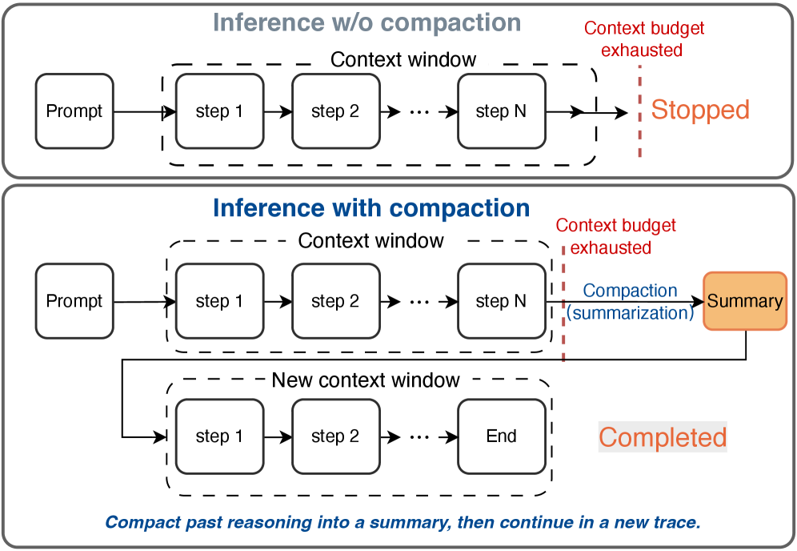
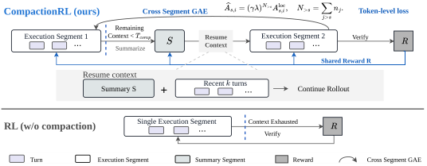
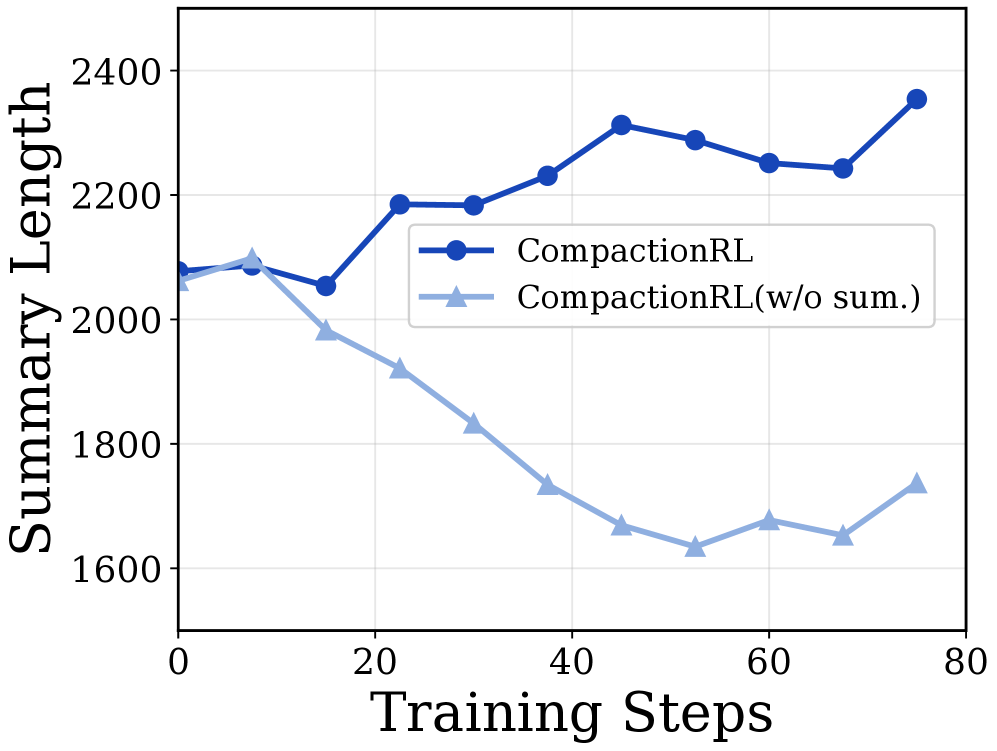

# Paper精读｜CompactionRL: Reinforcement Learning with Context Compaction for Long-Horizon Agents

> [!abstract] 一句话结论
> 提出 **CompactionRL**：把**上下文压缩**（context compaction）从推理时的启发式技巧拉进 RL 训练，变成 PPO 框架里与任务执行联合优化的策略行为。配两处关键设计——**token级损失归一化**和**跨轨迹GAE**——让长视野 agent 在固定 context budget 下突破有效训练 horizon。

> [!cite]- 论文信息（点开折叠）
> - **论文标题**：CompactionRL: Reinforcement Learning with Context Compaction for Long-Horizon Agents
> - **arXiv**：2607.05378
> - **链接**：[https://arxiv.org/abs/2607.05378](https://arxiv.org/abs/2607.05378)
> - **作者**：Yujiang Li, Zhenyu Hou, Yi Jing, Jie Tang, Yuxiao Dong
> - **机构**：Tsinghua University
> - **日期**：2026-07-06

---

## 1️⃣ 论文想解决什么问题

LLM agent 跑长视野任务（SWE-bench 修 bug、Terminal-Bench 终端操作）时，交互轨迹涨得比 context window 快。硬扩 context 又贵又有"lost in the middle"——长序列中间的信息，模型本来就利用不好。

现有的 context compaction（把历史摘要后重建上下文）基本都当**推理时的启发式**在用。论文点破了一件事：摘要一旦顶替了原始历史，后面所有 action 能依赖的信息就全看摘要质量了。所以**compaction 本身就是性能关键的决策过程**，不是被动的预处理步骤。

这个判断有实验背书：执行模型固定，只换摘要模型，SWE-bench Verified 准确率从 49.0% 跳到 55.5%（+6.5 分）——换个摘要器，成败就跟着换。

真把 compaction 拉进 RL 训练，两个结构性障碍马上冒头：

1. **GRPO 等 group-wise 方法用不了了**：compaction 把一条 rollout 切成不定数量的 segment，group 大小不再固定，归一化基准失效

2. **跨 segment 的信用分配被打断**：同一条 rollout 里不同 segment 分享最终 reward，但时间距离差得很远

---

## 2️⃣ 核心洞察

> [!important] 三条核心洞察
> 1. **Compaction 是性能关键的策略行为**：摘要生成不该是外部启发式，该跟任务执行一起被优化。实验摆在那儿：换个摘要模型就是 6.5 个百分点的差距。
>
> 2. **从 group-wise 转向 PPO + value function**：compaction 把 segment 数量切成不定的，GRPO 的 group-relative advantage 失去了立足点——改用 PPO 的 value-function-based advantage estimation，天然支持变长 segment 和单 rollout 采样。
>
> 3. **Token级归一化 + 跨轨迹 GAE 修正**：segment 长度不齐会让长 rollout 被过度加权（token 级归一化来治）；早期 segment 的 reward 距离被人为拉近，要按后续 token 数做折扣修正（跨轨迹 GAE）。

*图1：左——Context compaction 允许在固定 context window 下通过摘要重建继续执行；右——CompactionRL 在 GLM-4.7-Flash(30B-A3B) 和 GLM-4.5-Air(106B-A30B) 两个尺度上相比基线在 compacted 评估下性能持续提升。（来自 Figure 1 / Figure 2 的组合概念）*

---

## 3️⃣ 方法解读

### 组件1：Trainable Context Compaction

- 剩余 context budget 低于阈值 $T_{\text{comp}}$ 时触发压缩

- 策略 $\pi_\theta$ 生成摘要 $S_t \sim \pi_\theta(\cdot | h_t \oplus q_{\text{sum}})$，其中 $q_{\text{sum}}$ 是固定的摘要指令

- 重建上下文：$\bar{h}_t = (s) \oplus u_{\text{resume}}(S_t) \oplus (z_{t-k+1}, \ldots, z_t)$，最近 k=2 步原始交互原样保留

- 摘要 token 由可训练策略自己生成，和执行 token 共享最终 task reward——摘要写得好不好，最后由任务成败说了算

### 组件2：Token-level Loss Normalization

既然 compaction 会把 rollout 切成不定数的 segment，损失就不能在 segment 级别算，否则切得越碎的轨迹声音越大。做法是挪到生成的 token 集合 $\mathcal{M}$ 上：

- $\mathcal{L}_\pi = -\frac{1}{|\mathcal{M}|} \sum_{(s,i) \in \mathcal{M}} \min(\rho_{s,i}(\theta) \hat{A}_{s,i}, \text{clip}(\rho_{s,i}(\theta), 1-\epsilon, 1+\epsilon) \hat{A}_{s,i})$

- segment 数量带来的权重偏差被消掉——一条 rollout 不管被切成几段，每个 token 权重一样

### 组件3：Cross-Trajectory GAE

切 segment 还有第二个后遗症：标准 GAE 在每个 segment 边界都把终端 reward 视为"更近"，早期行为的贡献被高估。修正要按真实的时间距离来：

- 修正公式：$\hat{A}_{s,i} = (\gamma\lambda)^{N_{>s}} A_{s,i}^{\text{loc}}$，其中 $N_{>s}$ 是 segment $s$ 之后的可训练 token 数

- 早期 segment 的 reward 按实际距离正确折扣回来

### 优势估计

论文的核心优势在于：

- 把 context compaction 从推理时技巧提升为 RL 训练的一等公民

- token-level 归一化和跨轨迹 GAE 两处修正，各自打在 compaction 带来的结构性病灶上

- 固定 peak context budget 下实现等效 4× context 的扩展效果

*图2：CompactionRL 总览。Rollout 阶段，agent 在固定 context budget 下交互，剩余 budget 不足时策略生成摘要并重建上下文。所有执行和摘要 segment 共享轨迹 reward R。训练时通过跨轨迹修正将局部 GAE 优势 *$\hat{A}^{\text{loc}}_{s,i}$* 乘以 *$(\gamma\lambda)^{N_{>s}}$* 得到全局优势 *$\hat{A}_{s,i}$*。（来自 Figure 2）*

---

## 4️⃣ 实验部分怎么读

### 实验设置

| **设置项** | **详情** |
| --- | --- |
| 模型 | GLM-4.7-Flash (30B-A3B), GLM-4.5-Air-SFT (106B-A30B) |
| 训练框架 | slime（开源异步 RL 框架） |
| 训练数据 | SWE-Dev |
| Batch size | 128, group size = 1 |
| Context budget | 64k (Flash) / 80k (Air) |
| 最大 compaction 次数 | 3 次/rollout |
| Critic 初始化 | 同模型 checkpoint + 50 步 value pretraining |
| 评估环境 | Harbor + Terminus-KIRA scaffold |

### 核心结果

| **模型** | **Peak Len.** | **SWE-bench Verified (Compacted ×4)** | **Terminal-Bench 2.0 (Compacted ×4)** |
| --- | --- | --- | --- |
| GLM-4.7-Flash (base) | 64k | 50.5 | 13.4 |
| + RL (w/o compaction) | 64k | 48.0 | 12.4 |
| + CompactionRL (ours) | 64k | **56.0** | **20.2** |
| GLM-4.5-Air (base) | 80k | 59.8 | 21.4 |
| + RL (w/o compaction) | 80k | 62.5 | 23.6 |
| + CompactionRL (ours) | 80k | **66.8** | **24.5** |

关键发现：

- compacted 评估下，CompactionRL 全面压过不做 compaction 的 RL 训练

- 标准 RL 在单窗口评估下更好看，可一到 compacted 推理就迁移不过去——训练和部署的错位

- CompactionRL 已经进了 GLM-5.2 (750B-A40B) 的 RL 训练管线

*（原图未能本地化：Figure 3: 行为对比；IMA 媒体接口没有可用媒体编号）*

*图3：GLM-4.5-Air 在 80k ×4 compacted 评估下的行为对比。(a) 平均 compaction 次数/trace——CompactionRL 比 base 和"无摘要训练"变体更少，说明学会了更高效地利用 context；(b) 平均工具调用次数；(c) 仅在触发 compaction 的任务上的 Pass@1 准确率——CompactionRL 最高。（来自 Figure 3）*

### 训练细节

- 策略学习率 $2 \times 10^{-6}$，critic 学习率 $3 \times 10^{-6}$

- Length-adaptive GAE：$\lambda = 1 - \frac{1}{\alpha l}$，$\alpha = 1.5$

- 每 batch 2 次 value update + 1 次 policy update

- 最大 response 长度 10,240 tokens，compaction 阈值 10,240 tokens

*图4：GLM-4.5-Air CompactionRL 训练动态。(a) 摘要长度——训练使摘要越来越长、信息更完整；(b) 每轮推理 token 数——持续增长说明有效扩展了可用 context；(c) 策略熵——增长更缓慢，说明优化过程更可控。（来自 Figure 4）*

---

## 5️⃣ 学术评价

**优点：**

1. 问题定义这一步最见功力——compaction 从推理技巧被重新定性为 RL 策略行为，后面所有设计都是从这条重新定性顺下来的

2. 两处修正都是小刀口大收益——token-level 归一化和跨轨迹 GAE 各自动一处，但都打在 compaction 带来的结构性病灶上

3. 有一条硬证据链——已经部署到 GLM-5.2 的训练管线，工业可用性不用再猜

4. 训练动态给了可观测的机制证据——摘要变长、推理 token 增长、策略熵涨得更慢，三条曲线都在讲"学会了更高效地用 context"

> [!ed-warning] 局限（风险与不确定性）
> 1. Train-test mismatch：CompactionRL 在单窗口（无 compaction）评估下表现下降，没法同时优化两种推理模式
>
> 2. 实验范围有限——只测了代码类 benchmark，web browsing、multi-agent 这些更复杂的 agentic 场景没碰
>
> 3. 跨轨迹 GAE 仍是近似——多次 compaction 边界下的长期信用分配可能不够精确

---

## 6️⃣ 局限与可扩展方向

- 当前方法需要 compaction-enabled 的推理环境，没法直接部署到无 compaction 的场景

- 摘要质量全靠 task reward 信号驱动，缺一个显式的信息保留约束

- 可以往下探的方向：自适应 compaction 触发策略、多模态 agent 的 compaction、与 longer-context 模型的协同

---

## 7️⃣ 最后总结

CompactionRL 把 context compaction 从推理时的被动摘要，翻成了被主动学习的策略行为——配上 token 级归一化和跨轨迹 GAE 这两处 credit assignment 的精细修正，固定 context budget 下的长视野 agent 训练就走通了。全文最值得记下的判断是compaction 质量直接决定任务成败：换个摘要器就是 6.5 分的差距，任何在构长视野 agent 系统的人都绕不开这条。至于 train-test mismatch——compact 训练的模型回单窗口评估会掉点——那是把推理环境假设交出去的代价，值不值要按部署场景算。

---

## 8️⃣ 三句速记

> [!summary]- 点展开
> 1. **CompactionRL 把上下文压缩拉进 RL 训练**，执行与摘要生成联合优化，agent 在固定 context 预算下突破交互 horizon 限制
>
> 2. **Token级损失归一化 + 跨轨迹 GAE** 治好了 compaction 带来的 segment 数量不定和信用分配失真
>
> 3. GLM-4.5-Air 上 SWE-bench Verified 到 **66.8%**（+7.0），已进 GLM-5.2 训练管线
