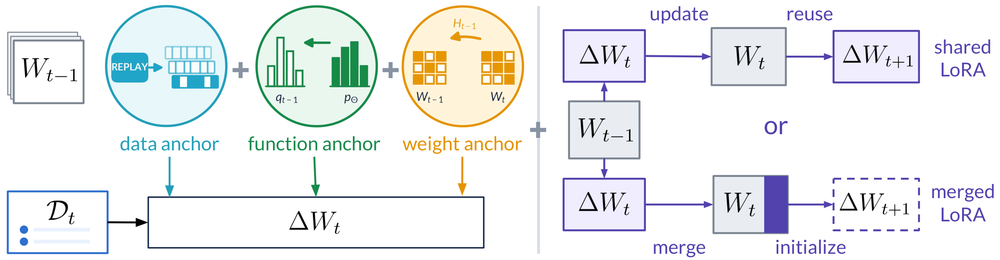
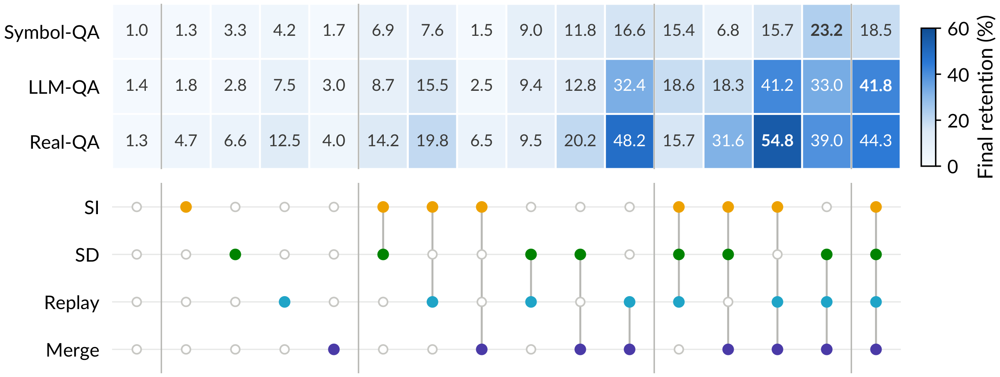
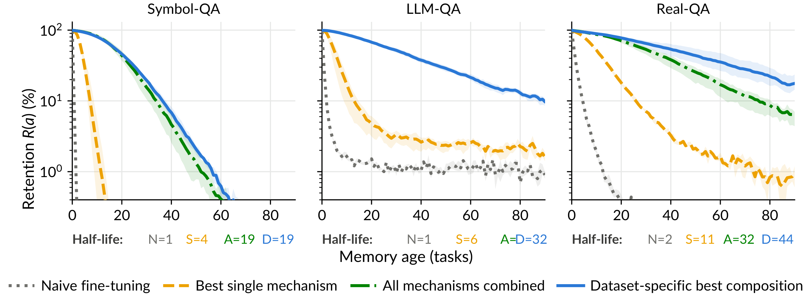

# Paper精读｜Continual Learning Mechanisms Compose for Long-Horizon Memorization

> [!abstract] 一句话结论
> 这篇论文干的第一件事是把问题造干净：将“模型连续学习 100 个任务后还能记住多少”单独定义成 **long-horizon memorization**，再系统组合三类抗遗忘机制（数据、函数、权重 anchor）与两种 LoRA 状态分配方式。最佳组合把 100 个任务后的平均保留率从朴素顺序微调的 **1.2% 提高到 34.9%**——但这不是胜利宣言：旧记忆最终仍在衰减，对新问题的泛化也没有被证明。

> [!cite]- 论文信息（点开折叠）
> - **论文标题**：Continual Learning Mechanisms Compose for Long-Horizon Memorization
> - **alphaXiv**：[https://www.alphaxiv.org/abs/2609.compose-cl](https://www.alphaxiv.org/abs/2609.compose-cl)
> - **论文主页**：[https://compose-cl.github.io](https://compose-cl.github.io)
> - **arXiv**：页面未提供 arXiv 编号
> - **作者**：Zheyuan Zhang, Alvin Zhang, Daniel Khashabi, Tianmin Shu
> - **机构**：Johns Hopkins University
> - **日期**：2026-09-06
> - **研究类型**：持续学习 / 语言模型参数记忆 / 方法组合与实验分析

---

## 1️⃣ 论文想解决什么问题

大模型如果不断接收新知识并更新参数，理想状态是参数本身成为长期记忆。但顺序微调会让新任务的梯度覆盖旧任务形成的参数结构，产生 catastrophic forgetting。现有持续学习研究往往使用较短任务序列，或者测量迁移、下游任务表现；模型编辑则常常关注少量定向事实修改。作者想隔离出一个更直接的问题：模型依次学会 100 组问答后，最后还能从参数中回忆多少之前学过的关联？

先把问题钉在参数层面：第 t 个任务的数据记作 D_t，模型参数从 Θ_{t−1} 更新为 Θ_t。顺序微调的病灶就在这一步——当前任务的监督微调损失只顾眼前：

$L_t^{SFT}(\Theta)=-\mathbb{E}_{(x,y)\sim D_t}[\log p_\Theta(x,y)]$。

作者的补救不是发明一个新算法，而是往这个损失后面挂上三个保持项：

$\Theta_t=\arg\min_\Theta L_t^{SFT}(\Theta)+R_D^t(\Theta)+R_F^t(\Theta)+R_W^t(\Theta)$。

这三个项分别回答“要保留什么证据”：旧数据的行为样本、旧模型在当前输入上的输出函数、以及旧任务重要的参数；LoRA allocation 则回答“新信息存在哪里、旧更新如何保留下来”。

---

## 2️⃣ 核心洞察

> [!important] 核心洞察
> 1. **抗遗忘机制解决的是不同层面的破坏**：数据 replay 保留样本层面的证据，self-distillation 保持函数输出，SI/EWC 保持参数重要性。单个机制只覆盖一个遗忘来源，组合才有机会互补。
>
> 2. **Merged LoRA 是关键的容量管理方式**：每个任务训练一个新 LoRA，训练结束后把更新合并进 dense weights，再为下一个任务重新初始化 LoRA。这样累计更新可以逐渐获得高于固定 rank 的有效容量，同时持久状态大小仍保持常数级。
>
> 3. **组合改变的是遗忘时间尺度，不是消灭遗忘**：最佳组合把 memory half-life 推到 19/32/32 个任务，但 100 个任务后仍只有约三分之一的关联被保留，曲线仍持续下降。
>
> 4. **Replay × merged LoRA 有超加性协同**：二者单独增加的保留率之和，明显低于二者同时启用后的增益。这是论文比“把几个技巧堆在一起”更有价值的地方：它用 factorial design 测量了交互项。

---

## 3️⃣ 方法解读

### 组件 1：三种 anchors

- **Data anchor**：使用上一任务结束时冻结的模型生成伪序列。每个新任务前生成 300 条序列，当前任务 minibatch 与 replay minibatch 配对训练；不把旧原始样本或 replay 样本继续带到下一任务。它对应 generative replay。

- **Function anchor**：在当前任务输入上，让新模型匹配上一任务冻结模型的输出分布，采用 self-distillation / Learning without Forgetting 思路。与 data anchor 不同，它不是在生成的旧数据上蒸馏，而是在当前输入上约束函数行为。

- **Weight anchor**：走的是最老的一条路——不管数据、不管函数，直接按重要性给参数上锁，对重要参数施加二次惩罚：

$R_W^t(\Theta)=\frac12(\vartheta-\vartheta^\star_{t-1})^\top H_{t-1}(\vartheta-\vartheta^\star_{t-1})$。

H 是累计重要性估计，实验使用 Synaptic Intelligence（SI）或 online EWC。

### 组件 2：Shared LoRA 与 merged LoRA

LoRA 将权重更新写成 ρBA，其中 A、B 是低秩矩阵。

- **Shared LoRA**：所有任务继续更新同一对 A/B；参数空间共享，容易出现后续任务覆盖旧方向。

- **Merged LoRA**：每个任务使用新的 A/B，完成任务后把 ρB⋆A⋆ 合并到当前 dense weight，再初始化下一对 A/B。它类似把多个低秩小更新累积成更高秩的实际参数变化。

二者都只保留一个 dense model 和一对当前 LoRA，因此持久状态随任务数保持常数；对照的 O-LoRA 和 sequential OSRM 则需要随任务增长的状态。

*图：三种 anchor 约束“保留什么”，shared/merged LoRA 规定“新更新如何分配与持久化”。*

### 组件 3：三个数据集

| **数据集** | **构成** | **规模** | **意义** |
| --- | --- | --- | --- |
| Symbol-QA | 随机 key-value 关联 | 10,000 对，100 任务，每任务 100 例 | 测最纯粹的参数记忆，几乎没有语义结构可利用 |
| LLM-QA | LLM 生成的虚构事实 | 10,000 对，100 任务，每任务 100 例 | 有自然语言和主题结构，但答案仍受控 |
| Real-QA | 十个公开 QA 数据集筛选 | 5,000 对，100 任务，每任务 50 例 | 语义最自然，但不等于真正开放域泛化 |

每个任务学完后都在此前所有任务上评估。作者研究的是 memorization 而非 generalization，所以测试用训练时见过的 query-answer 对；模型在改写问题上的表现另行讨论，但不作为主指标。

### 组件 4：Task-level Successive Halving

组合空间为：3 种权重 anchor 选项 × 3 种 self-distillation 选项 × 5 种 replay 选项 × 2 种 LoRA allocation，共 **90 个配置**。作者不是让 90 个配置全部跑满 100 个任务，而是按任务地平线逐轮淘汰：

- 10 个任务后保留前 45 个；

- 20 个任务后保留前 23 个；

- 50 个任务后保留前 10 个；

- 只有最后 10 个跑到 100 个任务。

这是计算预算与长时程目标的折中，但它也埋下一个隐患：早期 retention 排名未必能预测 100-task 最优；作者报告搜索阶段和最终排名有较强一致性，但仍不是无偏穷举。

*（原图未能本地化：Task-level successive halving；IMA 媒体接口没有可用媒体编号）*

*图：90 个配置在 10/20/50/100 任务地平线逐步筛选；能走到 100 任务的配置都包含 data anchor 与 merged LoRA。*

---

## 4️⃣ 实验部分怎么读

### 指标

令 M_{i,j} 表示学完前 i 个任务后，在第 j 个任务上的准确率。三个主要指标是：

- **Final retention**：最后学完 100 个任务后，所有任务的平均准确率；

- **Immediate acquisition（Diag）**：每个任务刚学完时的准确率平均值；

- **Forget**：一个任务历史最好准确率到最终准确率的下降。

作者还按 memory age a=i−j 汇总 R(a)，定义 memory half-life 为保留率降到初始值一半时经历的任务数。

### 核心结果

| **结果** | **Symbol-QA** | **LLM-QA** | **Real-QA** | **解读** |
| --- | --- | --- | --- | --- |
| 朴素顺序微调最终保留率 | 约 0.x% | 约 0.x% | 约 0.x% | 平均为 1.2%，100 任务后几乎全忘 |
| 最强单机制 | 4.2% | 7.5% | 12.5% | 单一抗遗忘信号作用有限 |
| 最强组合 | 23.2% | 41.8% | 54.8% | 组合显著改善，但仍有大量遗忘 |
| 论文统一推荐组合（SI+SD+Replay+merged LoRA） | 约 23% | 约 42% | 约 39% | 三数据集都进入 Top 3，跨数据集更稳健 |
| half-life：朴素微调 | 1 | 1 | 2 | 遗忘几乎发生在下一任务 |
| half-life：最强单机制 | 4 | 6 | 11 | 有改善但很快衰减 |
| half-life：最强组合 | 19 | 32 | 44 | 记忆寿命明显拉长 |

论文 Figure 3 的全 factorial 最佳均值分别为 **23.2%、41.8%、54.8%**。作者强调的统一最佳方法是三 anchor + merged LoRA：平均最终保留率 **34.9%**，相对朴素顺序微调的 1.2% 是约 **28 倍**。两组数字不能混为一谈：前者是各数据集各自最优组合，后者是一个跨三个数据集都稳定进入 Top 3 的统一组合。

*图：16 种 anchor/merged-LoRA 组合在三个数据集上的最终保留率；组合通常远高于单机制，且数据集最优结构并不完全相同。*

### 交互效应：真正有价值的结果

factorial analysis 显示 replay 与 merged LoRA 是四个因素中最大的主效应：

- replay 主效应：提升约 9.5–19.3 个百分点；

- merged LoRA 主效应：提升约 5.9–20.5 个百分点；

- replay × merged LoRA 在三个数据集上都为正且显著。

举例：不启用 SI/SD 时，replay 与 merged LoRA 单独增益之和在三个数据集约为 3.9、7.7、13.9 个百分点，但联合使用相对于朴素微调的增益达到 15.6、31.0、46.9 个百分点。拆开看很清楚——merged LoRA 提供可持续的“新工作区”，replay 提供旧信息的训练信号；一个解决存储/容量，一个解决恢复/监督，二者在机制上正好互补。

SI 和 self-distillation 的作用更依赖数据集及组合。尤其 SI 与 merged LoRA 在 Symbol-QA 上出现负交互，可能因为 SI 保存的参数重要性与旧 LoRA 因子绑定，但 merged LoRA 每轮会初始化新坐标；随机符号映射又缺少可复用结构，使错位约束成本更高。这个解释是论文的合理分析，不等于已被单独因果验证。

*图：组合方法让记忆衰减更慢；但所有曲线最终仍下降，所以这是延缓遗忘而非永久记忆。*

### 泛化与通用能力

作者专门评估 GSM8K、MATH、MGSM、MMLU-Redux 等 held-out benchmark，结论并不乐观：改善记忆不等于保留通用能力，所有方法在这些 benchmark 上都出现 catastrophic forgetting。O-LoRA 在 LLM-QA 和 Real-QA 上保留更多通用能力，但其最终记忆保留率只小幅高于 merged LoRA，而且需要随任务增长的状态。

这篇论文优化的目标其实很窄：它有效改善“记住训练过的关联”，但没有解决“学新东西同时保持原有推理、知识和泛化能力”。对真实 Agent 来说，后者可能比单纯记住 100 批训练样本更重要。

---

## 5️⃣ 学术评价

**优点：**

1. **问题定义清楚且可量化**：100 个任务、无任务 ID、旧样本不保留，把长期参数记忆与普通多任务学习区分开。

2. **组合空间被系统拆解**：不是只展示一个“我们组合了三个技巧”的结果，而是用 successive halving 和 2⁴ factorial 估计主效应及交互效应。

3. **结果具有机制解释**：replay 与 merged LoRA 的超加性不是单纯榜单数字，而能对应“旧信息监督”与“可持续新工作区”两类互补瓶颈。

4. **诚实披露关键边界**：论文明确说主实验是 memorization，训练 query 与测试 query 相同；也报告通用能力仍然遗忘，没有把 28 倍提升包装成通用持续学习解决方案。

5. **对 Agent/Harness 有直接启发**：长期运行 Agent 的记忆机制可按“保留证据的层次”和“更新容量如何分配”两个轴设计，而不是只选一个 replay 或正则化技巧。

> [!ed-warning] 局限（风险与不确定性）
> 先说处境：90 个配置 × 100 任务的全量穷举算不起，successive halving 是省预算的妥协，我理解这个选择。但理解归理解，下面几条还是要摆出来：
> 1. **主指标是训练集回忆，不是泛化**：不测 paraphrase、相关新问题或真实时间变化下的知识迁移，不能证明模型学会了可泛化知识。
>
> 2. **100 个任务仍是受控实验**：每任务 50/100 条样本，数据流有固定任务顺序；虽然有多 seed，但搜索阶段明确使用固定开发任务顺序，任务顺序敏感性仍需更充分评估。
>
> 3. **replay 并非真正零信息记忆**：旧原始样本不保存，但每个任务前要用冻结模型生成 300 条伪序列；这把信息压缩进模型生成分布，可能受生成质量、温度和伪样本偏差影响。
>
> 4. **最佳方法不一定统一最优**：三个数据集的最强组合不同；“三 anchor + merged LoRA”是跨数据集稳定的折中，不是每个数据集的绝对冠军。
>
> 5. **计算预算与选择偏差**：successive halving 用早期表现淘汰配置，可能错过晚期反超的方法；TSH 的价值是省预算，不是严格无偏搜索。
>
> 6. **真实模型规模与任务形态仍有限**：论文聚焦连续 SFT 的 QA 关联记忆，和持续预训练、工具使用、代码 Agent 的状态记忆并不等价。
>
> 7. **通用能力仍明显退化**：这是应用上的最大风险。对于 Agent，记住新事实但失去数学、知识或工具调用能力，不能算完整的 continual learning 成功。

---

## 与其他论文的对话

| **方向** | **代表方法** | **本文关系** |
| --- | --- | --- |
| 参数重要性正则化 | EWC、SI | 作为 weight anchor 纳入组合空间，但不是单独依赖它 |
| 生成式 replay | LAMOL、Deep Generative Replay | 本文使用冻结模型生成伪序列，并将其与 LoRA allocation 做 factorial 对比 |
| 函数保持 | Learning without Forgetting | 作为 function anchor，与 data anchor 的“在哪些输入上蒸馏”区分开 |
| LoRA 累积更新 | ReLoRA | 借用 merge + reinitialize 逻辑，并将其用于持续任务记忆 |
| 任务隔离低秩空间 | O-LoRA、OSRM | 作为随任务增长状态的对照，结果没有显示其普遍优于 merged LoRA |
| Agent 长期记忆 | AgentOdyssey 等 | 本文提供的是参数内记忆的受控基准，不是 Agent 交互环境或外部记忆系统 |

---

## 7️⃣ 最后总结

这篇论文最重要的贡献不是提出一个神奇的抗遗忘算法，而是把长期参数记忆拆成两个设计问题：用什么 anchor 保存旧信息，以及如何给连续更新分配低秩容量。实验说服我的一点是：data replay 与 merged LoRA 的组合比单独使用任何一项都更有效，并且存在跨数据集的超加性互动。

但最终保留率 34.9% 也在提醒：组合机制只是把遗忘推迟，并没有实现真正的终身记忆；held-out 通用能力照样会遗忘。对 Agent 来说，它更像一个“参数记忆层”的设计基准，而不是完整的长期记忆/Harness 解决方案。下一步该做的是把任务改写、工具反馈、真实持续数据流、任务顺序变化和通用能力保持纳入同一个评估闭环。

---

## 8️⃣ 三句速记

> [!summary]- 点开展开
> 1. **三 anchor + merged LoRA** 把 100 任务后的平均保留率从 1.2% 提高到 34.9%，但不是永久记忆。
>
> 2. 最大的协同来自 **replay × merged LoRA**：一个保留旧信息训练信号，一个提供可持续更新空间。
>
> 3. 论文证明的是“训练过的关联记得更久”，不是“模型获得了长期泛化记忆”；通用能力仍会退化。