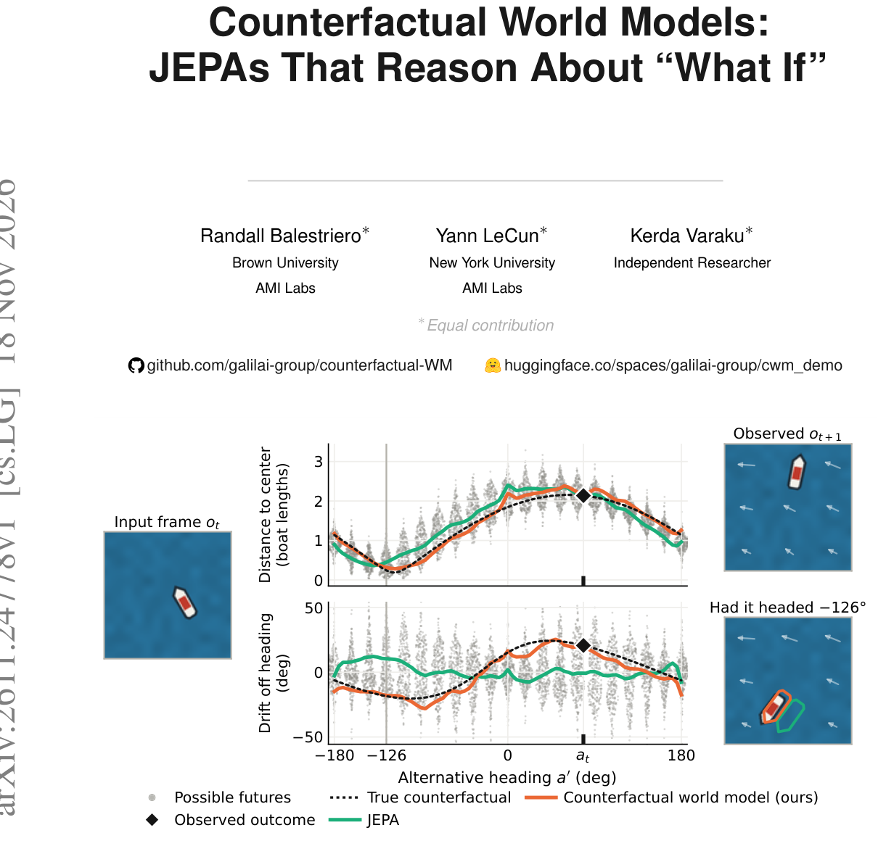
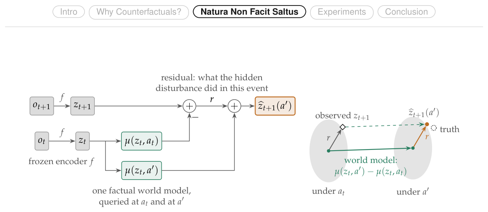
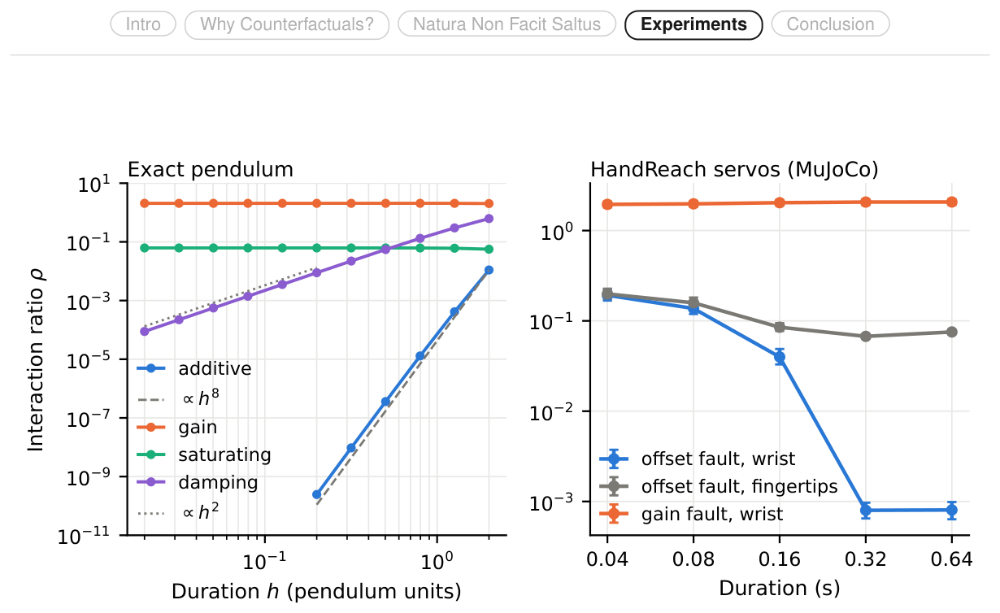
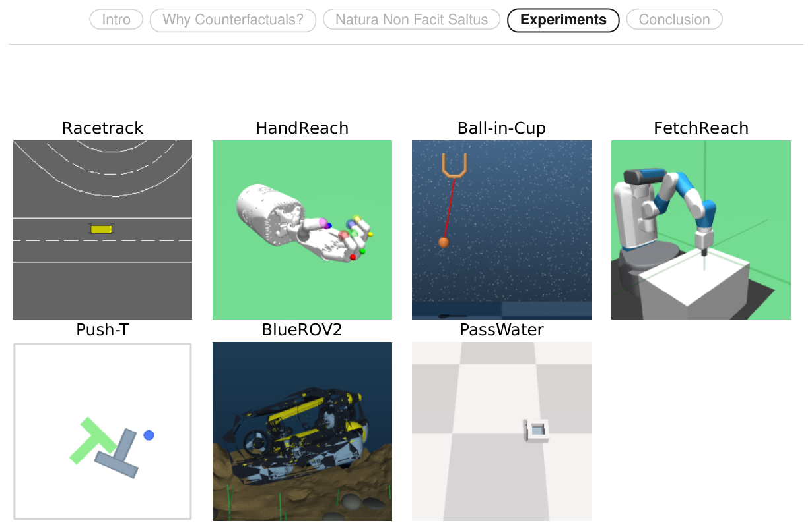
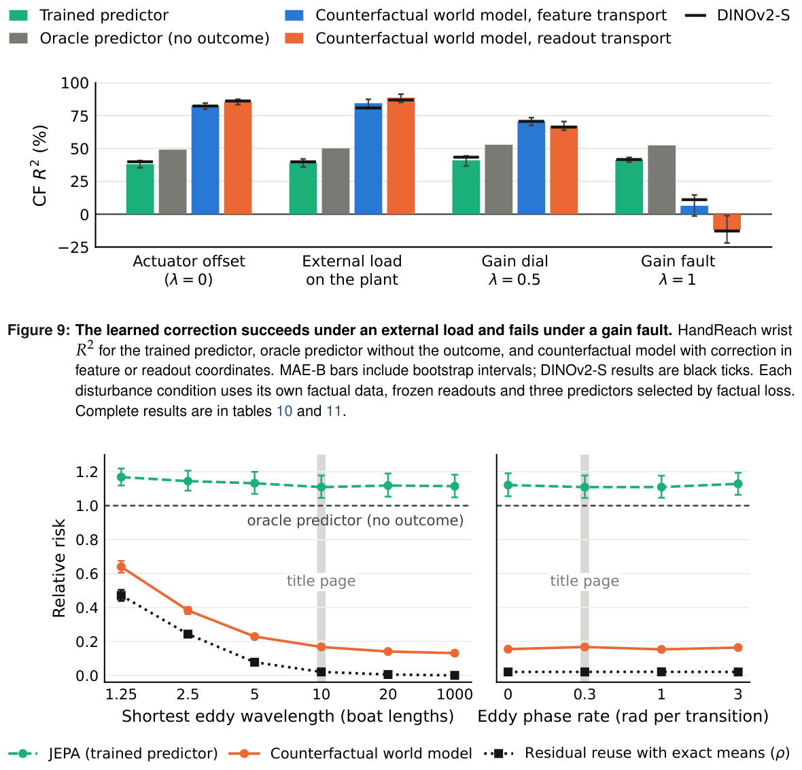

# Paper精读｜Counterfactual World Models: JEPAs That Reason About "What If"

> [!abstract] 一句话结论
> 本文先证明一个负面结论——**只用事实数据（factual transitions）训练的世界模型，无论数据和容量多大都无法回答个体反事实问题**（动作与隐扰动的配对耦合不被事实似然识别）；再用一个物理先验"自然不跳跃"（action 与 disturbance 以分离的力进入动力学时，其交互随转移时长 $h$ 二阶衰减）推出免训练的**残差复用**规则：反事实预测 = 观测结果 + 世界模型在两个动作处的预测之差。该规则误差率 $O(h^2)$ 且被证明是 **minimax 最优**；在 4 个渲染模拟器上把冻结 JEPA 的反事实 $R^2$ 从 38–46% 提到 86–96%（同一预测器、同一权重、零额外参数），并在增益故障、接触、像素坐标等处如实展示了失效。

> [!cite]- 论文信息（点开折叠）
> - **论文标题**：Counterfactual World Models: JEPAs That Reason About "What If"
> - **arXiv**：2611.24778
> - **链接**：[https://arxiv.org/abs/2611.24778](https://arxiv.org/abs/2611.24778)
> - **代码**：https://github.com/galilai-group/counterfactual-WM ｜ Demo：https://huggingface.co/spaces/galilai-group/cwm_demo
> - **作者**：Randall Balestriero, Yann LeCun, Kerda Varaku（三人同等贡献）
> - **机构**：Brown University / AMI Labs；New York University / AMI Labs；Independent Researcher
> - **日期**：2026-11-18
> - **阅读范围**：正文 §1–§5 全文通读（alphaXiv .md 全文 + arXiv HTML 交叉核对）；附录 A–D 的关键表格（Table 3/4/5/6/7/15）与评测协议按正文引用处核对；附录 E/G/H 的定理陈述与证明构造读至能复述其条件与主线，未逐行验算每个不等式

---

## 1️⃣ 论文想解决什么问题

问题先摆在这儿："预测下一帧"这件事做得再好，也回答不了"刚才如果走另一条路会怎样"。

贯穿全文的例子：一艘船选择航向 $a_t$，一股看不见的洋流 $\varepsilon$（disturbance，扰动）在推它。行动前，任何世界模型都不知道这股流，所以它只能预测**在所有可能洋流上的平均落点**。船走完后，观测到的落点 $z_{t+1}$ 偏离了这个平均值——这个偏离本身就泄漏了"这股流实际把船推了多远"的信息。此时一个真正新的问题出现了：**如果当初选另一个航向 $a'$，在同一般洋流里，船会停在哪？** 这就是个体反事实（individual counterfactual）。它的答案把"坏决策"和"坏运气"分开，是 debug 失败、事后规划（hindsight planning）、给动作归因的基础。

旧方法在**哪一步**失败？事实数据记录的是"某个状态下执行某动作后发生了什么"，从不记录"同一初始状态、同一 realized 扰动下，两个动作各自的结果"。所以事实数据只确定每个动作下结果的**边际分布**，不确定两个动作的结果之间**怎么配对**（哪个 $a'$ 的结果属于这次事件）。论文用两个机制证明这不是工程缺陷而是原理边界：

1. **边际不识别配对**（Proposition 2.1）：两个机制 $Y(a')=U$ 与 $Y(a')=1-U$（$U$ 均匀分布）在所有动作下的事实分布完全相同，但对同一个观测 $Y(a)=u$，反事实答案分别是 $u$ 和 $1-u$。事实数据再多也无法区分。
2. **生成模型也救不了**（Theorem 2.2，gauge 非识别）：即使有精确的事实似然、用可逆生成模型从观测反推 latent noise 再换动作解码，这个操作也不被事实数据唯一确定——对每个动作独立地重参数化噪声（$\nu$-保持的双射 $G_{s,a}$），事实分布分毫不变，但隐含的反事实配对 $T_{a'}\circ G_{a'}\circ G_a^{-1}\circ T_a^{-1}$ 变了。扩散模型、normalizing flow 同样中招。

为什么现有修补不够？加数据（边际已精确）、加容量（定理与容量无关）、换生成式似然（gauge 自由度仍在）都不补这个洞；配对数据/已知机制/模拟器可以补，但真实世界很少给。本文的转向是：**不向数据要结构，向物理要结构**。

---

## 2️⃣ 核心洞察

*图注：Figure 1——标题页例子。上：不同备选航向下船到中心的距离，灰带是洋流可能造成的所有未来（JEPA 只能预测其中心，绿线）；菱形是实际观测到的落点；橙色是本文反事实世界模型的预测，几乎贴住虚线所示的真实反事实。下：执行航向 $a_t$ 的观测帧（上）与"若当初走 −126°"的从未被任何模型看到的帧（下）。*

> [!important] 三条核心洞察
> 1. **耦合不可学，但可以被物理"赠送"**：个体反事实缺失的信息是"同一扰动下两个动作的结果怎么对应"。论文证明它从事实数据中不可恢复（含 minimax 不可能性，Theorem H.2），所以正确的方向不是更好的学习，而是引入一条**关于扰动如何进入系统的物理假设**——分离力通道（separate channels）。这条假设对应后面 §3 的短时展开和 §4.3 的增益故障失效实验。
> 2. **"自然不跳跃"⇒ 交互是二阶小量**：当动作与扰动作为独立的力进入 ODE $\dot s = v_s(s,a) + b_s(s,\varepsilon)$，一阶 Taylor 展开里动作项 $h\,v$ 与扰动项 $h\,w$ 是**相加**的，互相不依赖；它们的交互只能通过"各自先改变了状态"累积起来，所以是 $O(h^2)$。这直接给出：**换动作的效果（一阶项）与扰动无关，而这正是事实世界模型能预测的量**——CATE 与 ITE 的差距按 $h^2$ 消失（Theorem 3.4 + Corollary 3.5，对应 §4.1 的摆/伺服实验）。
> 3. **残差复用 = 观测结果带事件、世界模型带动作**：$\hat z(a') = z_{t+1} + \mu(z_t,a') - \mu(z_t,a_t)$。观测结果里藏着 realized 扰动干了什么（residual），模型两次预测的差藏着换动作会干什么。加性世界里这是**唯一**精确的规则（Proposition 3.2），且证明其 $O(h^2)$ 率在"事实数据 + 单个观测"的信息条件下**不可被一致改进**（minimax 下界，Theorem 3.6）——对应 §4.2 的像素实验与 §4.4 的规划实验。

---

## 3️⃣ 方法解读

方法拆成五个组件，每个都过同一套问题：是什么 / 为什么需要 / 怎么做 / 代价。

### 组件1：反事实世界模型的构造（Definition 3.1, Eq. 6/7）

**是什么。** 给定一个普通的事实预测器 $\mu(H_t, a)$（JEPA：在冻结编码器特征空间预测下一帧 embedding）和一条观测到的转移 $(H_t, a_t, z_{t+1})$，反事实世界模型（counterfactual world model）对备选动作 $a'$ 的预测是：

$$
\hat z_{t+1}(a') = z_{t+1} + \mu(H_t, a') - \mu(H_t, a_t). \tag{6}
$$

**为什么需要。** 事实预测器只能给 $\mathbb{E}[Y(a')\mid H_t]$——对扰动取平均的落点；反事实要的是同一 realized 扰动下的落点。$(6)$ 用观测结果 $z_{t+1}$ 携带 realized 扰动的全部效果（residual $r = z_{t+1}-\mu(H_t,a_t)$），只让模型补"换动作的差"。反事实：把这个加法去掉，你就回到平均预测，在论文校准过的环境里只能解释 ~50% 的反事实方差（oracle 无结果参照）。

*图注：Figure 2——左：反事实世界模型数据流，residual 是"隐扰动在这次事件里干了什么"，一个事实世界模型在 $a_t$ 和 $a'$ 各查一次；右：结果空间视角，灰色是每个动作下扰动可能造成的所有结果，菱形是观测，橙色 = 把同一 residual 加到 $a'$ 的预测上。没有任何东西为反事实而训练。*

**怎么做。** 两种坐标里做这个加法：(6) 在**特征空间**（feature space）做，只需编码器 + 预测器，适用于任何预训练表征、无需状态标签；(7) 在**读出坐标**（readout）做——先用事实帧拟合一个冻结非线性读出 $\pi$（embedding→物理量），然后

$$
\hat s_{t+1}(a') = \pi(z_{t+1}) + \pi(\mu(H_t, a')) - \pi(\mu(H_t, a_t)). \tag{7}
$$

两者在 $\pi$ 非线性时不等价；论文证明 (7) 的坐标里交互往往小得多（§4.3：读出坐标比解码修正后的 embedding 在所有环境多 1.4–25.9 个百分点）。

**代价。** 零新参数、零重训，只有两次预测器前向 + 一次加法；但 (7) 需要物理状态标签拟合读出，且残差只在"坐标里动作与扰动近似可加"时才能搬运——这条代价在像素上爆炸（见组件5 后的失效分析）。

### 组件2：误差恒等式与交互比 ρ（Eq. 9/10/13/14/16）

**是什么。** 设 $\Delta_h = Y_h(a') - Y_h(a)$ 是同一事件里的个体动作对比（ITE），$\mu_h(z,a')-\mu_h(z,a) = \mathbb{E}_{\nu_z}\Delta_h$ 是模型可学的 CATE。代入 (8) 得到**精确恒等式**（不是不等式）：

$$
\mathbb{E}_{\nu_z}\|T_R - Y_h(a')\|^2 = \mathrm{tr}\,\mathrm{Var}_{\nu_z}(\Delta_h). \tag{10}
$$

**为什么需要。** 它把"残差复用的误差"翻译成一个有因果含义的量：**ITE 相对 CATE 的方差**——即换动作的效果随扰动波动多少。波动为零（无交互）⇒ 精确；波动大 ⇒ 修正比不修正还糟。反事实：如果交互为零，ITE=CATE，(10) 说误差为零，这正是加性世界（Eq. 11）的情形。

**怎么做。** Theorem 3.3 用动力学的**混合导数** $\partial_a\partial_\varepsilon F$ 给出可控上界：若 $|\partial_a\partial_\varepsilon F[u,v]| \le K_z\|u\|\|v\|$，则

$$
\mathbb{E}\|T_R - Y(a')\|^2 \le K_z^2\,\|a'-a\|^2\,\mathrm{tr}\,\mathrm{Cov}(\varepsilon), \qquad
\rho_z(a,a') := \frac{\mathrm{tr}\,\mathrm{Var}(\Delta)}{\mathrm{tr}\,\mathrm{Var}(Y(a'))} \le \left(\frac{K_z\|a'-a\|}{\kappa_z}\right)^2, \tag{13/14}
$$

其中 $\kappa_z$ 是"结果能把不同扰动区分开"的分离常数。$\rho < 1$ ⇔ 残差复用严格优于不观测结果的任何预测器（因为分母正是"不看结果的最优预测器"的误差）。对学出来的预测器 $\hat\mu = \mu + e$，(16) 把误差干净地拆成两块：

$$
\mathbb{E}\|\hat T_R - Y(a')\|^2 = \mathrm{tr}\,\mathrm{Var}(\Delta) + \|e(z,a') - e(z,a)\|^2. \tag{16}
$$

**代价。** $\rho$ 依赖配对结果，事实数据只能从下方界定它（能查出增益故障这类大交互，不能证明小交互）——所以 $\rho$ 是**部署后诊断量**，部署前要靠物理知识/模拟器/配对试验。这是整个方法的可操作性边界，论文在结论里如实承认。

### 组件3：短时物理展开（Eq. 17–21, Theorem 3.4/Corollary 3.5）

**是什么。** 把"分离力"写成 ODE $\dot s = v_s(s,a) + b_s(s,\varepsilon)$（牛顿/拉格朗日力学 $M(q)\ddot q = \tau_a + \tau_\varepsilon - c$ 都是这个形状），动作与扰动在一段时长 $h$ 内保持。Taylor 展开：

$$
z_{t+h} = z_t + h\,DE(s_t)\,v_s(s_t,a) + h\,DE(s_t)\,b_s(s_t,\varepsilon) + O(h^2),
$$

一阶动作项不含 $\varepsilon$，一阶扰动项不含 $a$。把高阶项打包为 $R_h$ 并假设 $\|R_h\|_{L^2(\nu_z)} \le Ch^2$（Theorem 3.4 的条件 (20)），则残差复用的误差满足

$$
\|T_R - Y_h(a')\|_{L^2} \le 2Ch^2, \qquad \mathbb{E}\|T_R - Y_h(a')\|^2 \le 4C^2h^4. \tag{21}
$$

**为什么需要。** 这是把"物理直觉"变成"可检验的率"的一步：$h\,w(z,\varepsilon)$ 在两个动作的展开相减时**精确抵消**（Eq. 23–24），剩下的交互只有 $R_h(a')-R_h(a) = O(h^2)$。绝对误差本身不够（$h\to 0$ 时所有预测器都趋于把结果猜成 $s_t$），Corollary 3.5 给出相对版本：在一阶扰动分离条件 $\|w(z,\varepsilon)-w(z,\varepsilon')\|\ge\kappa\|\varepsilon-\varepsilon'\|$ 下，

$$
\rho_h(a,a') \le \left(\frac{2Ch}{\kappa\sigma - \sqrt2\,Ch}\right)^2 = O(h^2). \tag{25}
$$

**怎么做。** 对隐速度系统也有对应版本（Corollary E.4）：只观测位姿时，力对位置的作用本来就是 $O(h^2)$，绝对误差 $O(h^6)$，相对率仍是 $O(h^2)$。

**代价。** $h$ 必须短于 $\kappa\sigma/C$ 量级的窗口；窗口随扰动变弱而收窄（阻尼故障的实测 $\rho$ 停在 0.74–1.08，窗口关死）。另一条获得近似可加性的路是**伺服稳定**（servo settling）：位置伺服收敛到设定点后响应近似加性，实测 HandReach 偏移故障的 $\rho$ 从 0.04s 的 0.19 降到 0.32s 的 0.0008——"多短才算短"是系统属性，必须实测。

*图注：Figure 4——左：阻尼摆 $\ddot\theta=-\sin\theta-0.2c\dot\theta+u$ 上四种扰动机制的交互率随时长 $h$ 的变化：加性力按 $h^8$ 下降，阻尼故障按预测的 $h^2$，增益故障与饱和保持在 ~2.06 / ~0.06；右：MuJoCo HandReach 原生伺服，偏移故障随伺服收敛 $\rho$ 从 0.19 → 0.0008，而增益故障始终 ~2。两面板均用模拟器精确均值，无任何学习模型。*

### 组件4：minimax 最优性（Theorem 3.6）

**是什么。** 给定"拥有每个动作/时长的精确事实转移律 + 查询事件的观测结果 $Y_h(-1)$"这一信息条件，任何估计器 $\delta$ 都有

$$
\frac{4C^2h^4}{1+C^2h^2} \le \inf_\delta \sup_{M\in\mathcal F_C} \mathbb{E}_M\|\delta - Y^M_h(1)\|^2 \le \sup_{M\in\mathcal F_C}\mathbb{E}\|T^M_R - Y^M_h(1)\|^2 = 4C^2h^4. \tag{26}
$$

**为什么需要。** 没有这一步，"残差复用好用"就只是经验观察；有了它，残差复用的率与最优可能率的差距在 $h\to0$ 时渐近消失，**多容量、更好的事实似然都不能在无附加信息时一致改进**。

**怎么做（下界构造）。** 造两个光滑 ODE 世界，事实转移律**完全相同**，唯一区别是隐扰动差一个旋转/反射——事实数据不可见，但同事件耦合不同；其二阶余项恰好把风险顶到 $4C^2h^4$。

**代价。** 这是最坏情形（over $\mathcal F_C$）的结果：已知物理机制、配对观测或重复试验的特定系统可以更好。之所以必须这样表述，是因为这条下界干的事就是造出"两个事实上不可区分的世界"——只要允许任何附加信息进入估计器，这对世界就变得可分，下界立即失效；minimax 声明只覆盖"无附加信息"的场景，与组件1 的非识别定理首尾呼应。

### 组件5：冻结编码器上的事实训练（Theorem 3.7 / Corollary 3.8 / Proposition 3.9）

**是什么。** (16) 说学出来的预测器只在"动作对比误差" $e_\Delta$ 上贡献风险，共享误差抵消。Theorem 3.7 证明对**任何**冻结编码器 $f$，平方损失回归的唯一总体最小化子就是条件均值 $\mu(x)=\mathbb{E}[Y\mid X=x]$（且任意正权重不改变最小化子集合，Eq. 27–30）；Proposition 3.9 给出因果条件：行为策略只依赖模型可见信息 + 独立随机化（"shared inputs"），则 $\mu(H,a')-\mu(H,a)$ 就是干预对比，**无需倾向得分加权**。

**为什么需要。** 这把"JEPA/MAE/DINOv2/CLIP 谁的预训练目标更配反事实"这类争论一刀切断：预训练只决定被预测的特征，事实条件均值由平方损失统一识别；预测器的因果性由日志生成方式保证。反事实：如果操作员日志里含有模型看不到的信息（例如舵手凭体感逆流调向），动作就与扰动相关，预测的对比被混杂——论文把这类日志明确留作未解决方向。

**怎么做。** 实验里预测器 = 2 个宽度 1024 的 attention 块，输入 $k\in\{1,2,3\}$ 帧 CLS embedding + 过去动作 + 查询动作，在全部事实转移上以位移 $z_{t+1}-z_t$ 为目标做平方损失训练（Eq. 31，缩放 $r$ 只用拟合数据），架构/正则/检查点按留出事实误差选择。**代价**：事实损失对动作对比只是不完美代理——Push-T 上事实误差变好、动作对比反而变差（Table 7 的例外行）。

### 组件之间怎么连（端到端数据流）

一条样本的旅程：模拟器渲染 224×224 帧 $o_t$ → 冻结编码器（如 MAE-B）取 CLS 得 $z_t\in\mathbb R^{768}$ → 与历史帧/动作拼成上下文 $H_t$ → 事实预测器 $\hat\mu(H_t,a)$ 输出下一帧 embedding 位移（事实数据训练）。查询时：观测到 $z_{t+1}$（含 realized 扰动效果）→ 计算预测差 $\hat\mu(H_t,a')-\hat\mu(H_t,a_t)$ → 加到 $z_{t+1}$（特征空间）或加到 $\pi(z_{t+1})$ 上（读出坐标，$\pi$ 由事实帧+状态标签拟合、冻结）→ 与模拟器真值反事实比较得 physical counterfactual $R^2$。训练全程零反事实标签；唯一"反事实专属"操作是推理时的一次加法。

### 关键公式与推导

骨干公式逐条摊开——符号、推导链、假设，编号对齐原文。

**Eq. 1/6（构造）**：$\hat z_{t+1}(a') = z_{t+1} + \mu(H_t,a') - \mu(H_t,a_t)$。符号：$z_t=f(o_t)\in\mathbb R^d$ 冻结编码器特征；$a\in\mathbb R^p$ 动作；$\mu$ 事实预测器。推导链：观测结果 = 期望结果 + 扰动造成的偏差（residual）；同事件换动作 = 期望结果 + 同一扰动偏差 + 动作差 ⇒ 三项里中间那项由观测免费提供。
> 人话：预测误差里"运气"的部分这次已经看到了，直接搬过去；模型只需要回答"换动作本身挪动多少"——这恰是它训练时就会的。

**Eq. 9/10（误差恒等式）**：$T_R - Y(a') = \mathbb{E}_{\nu_z}\Delta - \Delta$，取范数期望得 $\mathrm{tr}\,\mathrm{Var}_{\nu_z}(\Delta)$。假设：$\mu$ 为总体条件均值、扰动在各动作下同分布 $\nu_z$、查询动作有事实支撑。注意这是恒等式而不是近似——之所以能做到恒等，是因为推导只用了 $\mu$ 的定义（条件均值）和残差复用的代数形式，没有对动力学做任何光滑性假设。
> 人话：误差 = "换动作的效果在扰动间的抖动"。抖动为零 ⇒ 一刀准；抖动大 ⇒ 平均效果骗人。

**Eq. 13/14（交互界）**：$\mathbb{E}\|T_R-Y'\|^2 \le K_z^2\|a'-a\|^2\mathrm{tr}\,\mathrm{Cov}(\varepsilon)$；相对形式 $\rho\le(K_z\|a'-a\|/\kappa_z)^2$。$K_z$ = 混合导数上界（动作怎么改变扰动的一阶效果），$\kappa_z$ = 结果区分扰动的敏感度。
> 人话：分子是"动作与扰动搅在一起的程度"，分母是"扰动对结果的影响强度"；比值小于 1，观测结果就值得用。

**Eq. 20/21（短时展开）**：$F_h = z + hv + hw + R_h$，$\|R_h\|_{L^2}\le Ch^2$ ⇒ $\|T_R-Y'\|_{L^2}\le2Ch^2$、均方 $\le 4C^2h^4$。关键一步是 Eq. 23–24：两个动作的展开相减，$hw(z,\varepsilon)$ 精确抵消。
> 人话：很短的一步里，"推多远"和"被水流带多远"各管各的；两者的相互影响只存在于二阶小量里，随 $h^2$ 缩水。

**Eq. 25（相对率）**：$\rho_h\le\left(\frac{2Ch}{\kappa\sigma-\sqrt2Ch}\right)^2$，需 $h<\kappa\sigma/(\sqrt2C)$。
> 人话：扰动越弱（$\kappa\sigma$ 小）或动力学越弯（$C$ 大），"短"的门槛越苛刻——窗口是系统的属性，不是常数。

**Eq. 26（minimax）**：下界 $4C^2h^4/(1+C^2h^2)$ 与上界 $4C^2h^4$ 同阶同常数。信息条件：精确事实律 + 单观测，无配对。
> 人话：在"只看事实数据+这一次结果"的限制下，残差复用已经把能拿的都拿到了；想更好必须引入新信息（配对试验/已知机制）。

**Eq. 27–30（平方损失识别）**：$\mathbb{E}\|Y-\hat\mu(X)\|^2 = \mathbb{E}\|Y-\mu(X)\|^2 + \mathbb{E}\|\hat\mu(X)-\mu(X)\|^2$；任意正权重 $w(X)$ 不改变总体最小化子集合。
> 人话：冻结编码器随便谁的——只要目标是最小平方，学到的就是那个条件均值；这也解释了为什么七个异构编码器全部工作。

---

## 4️⃣ 实验部分怎么读

### 实验设置

*图注：Figure 5——七个 224×224 渲染模拟器：Racetrack、HandReach、Ball-in-Cup、FetchReach、Push-T、BlueROV2 水下机器人、PassWater 液体运输。每个转移被注入有物理含义的有界扰动（伺服偏移/力/位置目标/推力）；反事实分支共享同一初始状态与同一 realized 扰动。*

* **环境**：7 个原生模拟器，主对比用 HandReach、Ball-in-Cup、FetchReach、PassWater、BlueROV2 五个；Racetrack/Push-T 作诊断。环境校准使动作与扰动各贡献约一半反事实方差（"oracle 无结果"参照因此停在 ~50% $R^2$）。观测协议（附录 B/F）验证 scored 物理量可从图像恢复；7 个环境中 2 个未通过扰动恢复 95% 阈值 → 标记为诊断性结果。
* **模型与预算**：冻结编码器 DINOv2-S/B、MAE-B（主实验），追加 DINOv3-B、SigLIP 2-B、CLIP-B、EVA-02-B；预测器 2×attention 块宽 1024，k∈{1,2,3} 帧 CLS；事实拟合数据 8k episodes（80/20 划分，实际拟合 6,553），BlueROV2 另有 32k/128k 预算；3 个随机种子；bootstrap 区间对 source states 与训练种子。
* **动作生成**：事实动作从命令支撑均匀采样、与扰动独立——Prop 3.9 的可交换/支撑条件按设计成立。之所以要靠设计而不是靠真实日志，是因为真实遥操作日志里动作往往依赖模型看不到的信息（如操作员体感），那时动作与扰动相关、预测的对比被混杂且**事后不可检测**——论文把这类日志明确留给未来工作。
* **指标**：physical counterfactual $R^2$（对真反事实值的方差解释率），预登记坐标；单帧、三种子。
* **基线**：① 同一训练预测器不加修正（权重完全共享）；② oracle 预测器（无结果）：知道模拟器完整状态+真实动力学、对扰动律平均——理论上"不看结果"的最优；③ factual copying；④ shuffle 对照（把观测结果换成同源另一扰动抽取的结果）；⑤ 精确均值残差复用（Monte Carlo 条件均值，无学习模型）。

### 核心结果

| 环境（1 帧、8k episodes、3 种子） | 训练预测器（同权重） | **反事实世界模型（读出坐标）** | oracle（无结果） | 精确均值残差复用 | 原文位置 |
|---|---:|---:|---:|---:|---|
| HandReach | 38.1% | **85.6%** | 49.1% | 98.3% | Fig. 6 / Table 5 |
| Ball-in-Cup | 41.6% | **94.2%** | 51.1% | 99.8% | 同上 |
| FetchReach | 44.8% | **95.7%** | 49–51% 区间 | ~100% | 同上 |
| 液体运输 PassWater | 42.1% | **94.8%** | 50.2%（解析值） | ~100% | 同上 |
| BlueROV2（8k） | 31.1% | **73.6%** | 51.8% | 100% | Table 5 |
| BlueROV2（16× 数据 = 128k） | — | **90.1–93.5%** | 51.8% | 100% | Fig. 7 / Table 8 |

所有数字为 physical counterfactual $R^2$（%）。这张表之所以能把"提升从哪来"钉死，是因为三组对照各自排除了一个替代解释：factual copying 只有 6.7–43.5%（排除"照抄观测结果"）；shuffle 对照掉到 −14.6%–6.3%（排除"只是把预测器变好了"，修正确实用了**这次事件**的扰动信息）；oracle 无结果停在 ~50%（校准使扰动占一半方差，排除"环境太容易"）。特征空间修正（无需状态标签）在四个环境达 73.4–94.1%，读出再加 1.4–4.3 点（PassWater 多达 12.1–17.7 点）；BlueROV2 上特征空间修正吃亏吃得最狠（8k 时 46.1–53.0%，16× 数据才 65.9–72.2% vs 读出 90.1–93.5%）——差距被定位到坐标而非机制。四个追加编码器 81.0–95.3%，DINOv3-B 是全部七个编码器里最高的（HandReach 88.8 / Ball-in-Cup 95.0），说明结论不绑定某个预训练家族。

数据与事实误差的关系（Fig. 7 / Table 7/8）：事实数据 ×8（MAE-B）把读出修正从 69.8→85.6（HandReach）、80.8→94.2（Ball-in-Cup）、90.7→95.7（FetchReach）、83.9→94.8（PassWater）；按留出事实误差选预测器在 6 个环境中的 5 个改善或保持反事实精度，Push-T 是例外——事实损失不是动作对比的完美代理。

规划实验（Fig. 11 / Table 15，事件数 HandReach/Ball-in-Cup/FetchReach/BlueROV2 各 300、液体 100）：事后规划成功率反事实模型 37–69%（五环境条形：37/60/69/50/62），oracle 无结果规划器 14–23%，训练预测器 9–25%；同一事件再加两次尝试把反事实模型抬到 51–97%。跨三转移的持续故障（一个扰动贯穿整段）把成功率从 4–25% 提到 11–51%，而每步独立重抽的 fresh 扰动只带来 −4~+6 点——**残差的信息随扰动持续性走**。

### 消融与公平性

* **增益旋钮（Table 3/4，Fig. 9）**：扰动从加性偏移连续过渡到乘性增益故障 $\varepsilon\mapsto\varepsilon[(1-\lambda)+\lambda a/a_{\max}]$，平衡模型预测 $\rho=0/0.5/2$；实测 HandReach/Ball-in-Cup 在 $\lambda=0.5$ 时 0.50/0.48，$\lambda=1$ 时 2.01/1.97——误差严格跟随交互，学出来的修正也在 $\lambda=1$ 崩掉（读出坐标 −12.8~−11.8%）。为什么这组消融能支持机制归因而不只是相关？因为交互率 $\rho$ 是在拟合任何视觉模型**之前**、用模拟器 Monte Carlo 条件均值直接算出来的——先有理论预测的 0.5/2，再看到学出来的系统跟着崩，因果方向唯一。
* **时长消融（Fig. 4）**：摆上加性力 $\propto h^8$、阻尼故障 $\propto h^2$、增益/饱和 ~2.06/0.06 不随时长下降——把 Theorem 3.4 的"短"逐机制量化。
* **历史/新鲜份额（Fig. 8）**：扰动方差中 fresh 份额 25%→100%，训练预测器从 71.7 掉到 38.1（历史可推断的部分消失），反事实模型只从 91.4 到 85.6；k=1→3 帧历史带来的变化 −4.5~+1.6 点、不显著——观测结果才是 fresh 扰动的唯一信息源。
* **空间 vs 时间变化（Fig. 10）**：标题页洋流涡旋缩小，$\rho\propto1/L^2$（$2\times10^{-6}$@L=1000 → 0.49@L=1.25 船长）；反事实模型的相对风险 = $\rho$ + 0.12–0.15 的近似恒定估计误差；时间漂移相位率 0→3 rad/转移，$\rho$ 恒为 0.020–0.22——**残差搬运需要的是"备选动作结果之间的距离上扰动近似不变"，与时间无关**。

*图注：Figure 10——左：洋流涡旋最短波长 $L$ 从 1000 缩到 1.25 船长，残差复用的相对风险随 $\rho$ 上升而训练预测器（JEPA）始终高于 oracle；右：涡旋图案时间漂移速率 0–3 rad/转移，相对风险几乎不变。灰点为标题页电流设定。*

* **失效模式（§4.3）**：像素坐标 $\rho=2.13$，解码后相对风险 5.86——把平均图像差加到观测图像上得到的是"暗印+重影"而非位移的船；且 $h$ 缩到 0.05（动作只跨 ~1.4 像素）仍无救——像素在物体边缘的强度跳变使二阶余项巨大。折叠坐标 $\cos(\text{pitch})$ 的 $\rho=1.67$ vs 加性 $\sin(\text{pitch})$ 的 $\rho=0$。接触：Push-T 方块速度的精确均值残差复用 $R^2$ 为 5.6/−15.5/−44.4%。**公平性判断**：所有对比共享同一预测器权重与同一事实预算，唯二变量是"是否看观测结果"与"搬运坐标"；oracle 反而比学习模型多知道整个模拟器状态；不可对齐处仅剩 BlueROV2 的 16× 数据（作者如实标注）。

### 训练细节

预测器以位移 $z_{t+1}-z_t$ 为回归目标（Eq. 31，缩放 r 由拟合数据估计）；架构与检查点按留出事实误差选；读出 $\pi$ 在事实帧+状态标签上拟合后冻结；无任何反事实数据进入训练或模型选择；oracle 用 Monte Carlo 对扰动律平均（HandReach/Ball-in-Cup/FetchReach/BlueROV2 的 MC 参照与独立数值精化一致但无形式误差界，PassWater 只用 4 个扰动抽样/状态——作者在 Scope of evidence 里自己点出）。复现需要但原文未披露的：各模拟器精确物理参数（作者称随代码发布）。

---

## 5️⃣ 学术评价

**优点：**

1. **不可能性与可用性闭环**：非识别定理（含 gauge 构造、minimax 不可能性）→ 物理假设 → 误差率 → 最优性 → 实测全部接通，且每个理论失效模式（增益、接触、折叠、像素）都有对应实验主动引爆，这在"只报好消息"的论文里罕见。
2. **对照设计近乎无懈可击**：训练预测器与反事实模型**共享全部权重**（唯一差别是看没看观测结果）；shuffle 对照证明用的是事件特异信息；oracle 有完整模拟器状态仍败给看结果的模型——"观测结果 > 完美先验"这个反直觉主张被这三个对照钉死。
3. **minimax 带尖常数**：上下界同为 $4C^2h^4$，不是"同阶"的含糊声明。
4. **编码器无关性的形式化**：Thm 3.7/Cor 3.8 把"冻结任意预训练编码器 + 平方损失"合法化，实验用 7 个异构编码器背书。

> [!ed-warning] 局限（风险与不确定性）
> 1. **全部实验在渲染模拟器里**，扰动是作者设计的执行器故障；真实视频的观测充分性、扰动谱、接触动态未验证——两个环境已经因扰动恢复不足 95% 被降级为诊断，真实场景只会更难。
>
> 2. **单转移**：残差只在一步内搬运；跨视野链式反事实、扰动持续性判断都留给未来（§4.4 只做了三步持续故障的初步测试）。
>
> 3. **可加坐标不是免费的**：读出需要状态标签；特征空间修正弱得多（尤其 BlueROV2）；"学出可加坐标"是论文自己列的第一开放方向。
>
> 4. **$\rho$ 无法部署前认证**：事实日志只能从下方界定交互；新系统上确认安全窗口需要配对试验/模拟器/物理知识——方法的自适应门槛仍在系统外。
>
> 5. **Prop 3.9 的日志条件**在真实数据上不保证成立（遥操作员感知多于日志），此时动作对比被混杂且不可检测。

**分析者待验证疑问**：真实机器人的扰动多为乘性+加性混合，$\lambda$ 中间区域的率是否有闭式（论文只测了端点与 λ=0.5）；3 种子 + bootstrap 是否足以支撑 Table 6 编码器排名的稳定性；V-JEPA 类视频编码器（时序上下文）是否会改变 fresh/persistent 分界。

---

## 6️⃣ 局限与可扩展方向

* 假设"分离力通道" → 改为乘性混合扰动 → 测交互率与 CF $R^2$ 随 $\lambda$ 的连续退化曲线 → 若中间区域出现理论未覆盖的率阶，则推翻"只有一阶/二阶两档"的隐含分类。
* 假设"坐标可加" → 训练编码器/读出显式优化可加性（论文方向 ii）→ 比较 learned-additive 读出 vs 普通 $\pi$ 的 $\rho$ → 若学出的坐标 $\rho$ 系统性更低，则"additivity can be learned"成立。
* 假设"单转移" → 链式反事实：每步用自己的观测结果 → 长视野 hindsight 规划成功率 → 与模型基线规划比较，验证残差在链上的误差累积是否仍是 $O(h^2)$。
* 真实系统配对试验（方向 i）：同一持续扰动下试两个动作 → 直接测 $\rho$ → 给出"残差复用安全窗"的实证认证流程。

---

## 7️⃣ 最后总结

这篇论文把世界模型文献里一句被默认的话——"模型预测得够准就能回答 what-if"——证明是错的：反事实配对从事实数据里根本不可恢复，生成式似然也救不了。然后它指出物理已经替我们付了识别成本：只要动作与扰动以各自的力进入动力学，短时间内加性自动成立，残差复用就是唯一正确且 minimax 最优的规则，代价只是两次前向和一次加法。实验的价值不在 86–96% 这个数字，而在它同时展示了规则在哪崩（乘性故障、接触、折叠坐标、像素）以及崩的方式与理论预测逐点吻合。对世界模型方向的意义是结构性的：**观测到的结果应当成为世界模型的一等输入**——正如 offset-free 控制几十年来对它自己的模型所做的那样。

---

## 8️⃣ 三句速记

> [!summary]- 点开展开
> 1. **反事实不可学、只可"被物理赠予"**：事实数据确定每个动作的边际，不确定跨动作配对；分离力通道使加性以 $O(h^2)$ 精度自动成立。
> 2. **$\hat z(a') = z_{t+1} + \mu(z,a') - \mu(z,a_t)$**：零新参数、零重训、零反事实数据，minimax 率 $4C^2h^4$ 带尖常数不可改进。
> 3. **看结果的普通 JEPA 打赢了知道模拟器但不看结果的 oracle**（86–96% vs ~50%）；增益故障/接触/像素处规则如预测地失效——交互比 $\rho$ 是部署后唯一可信的自检指标。
