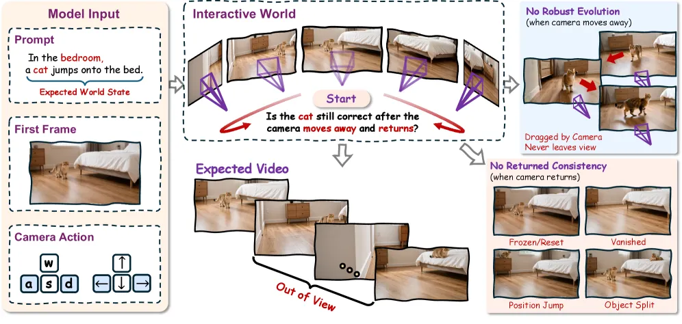
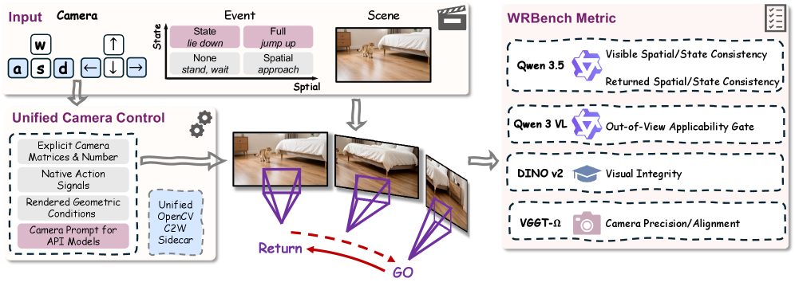
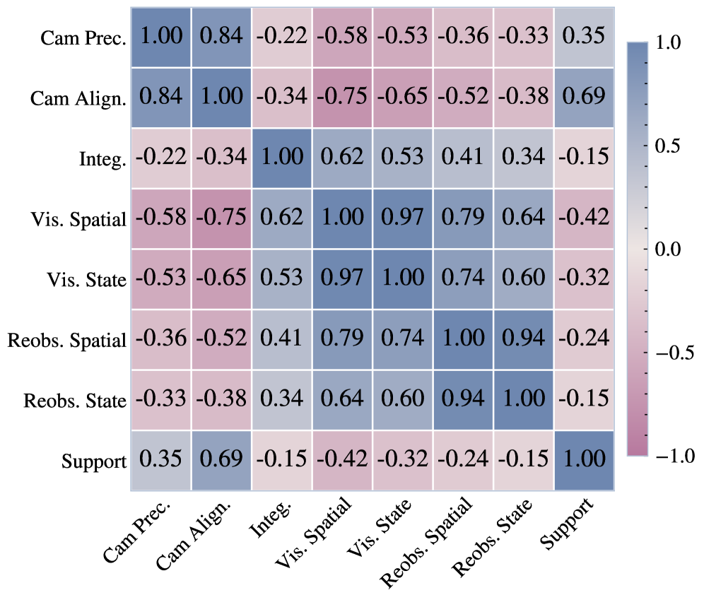
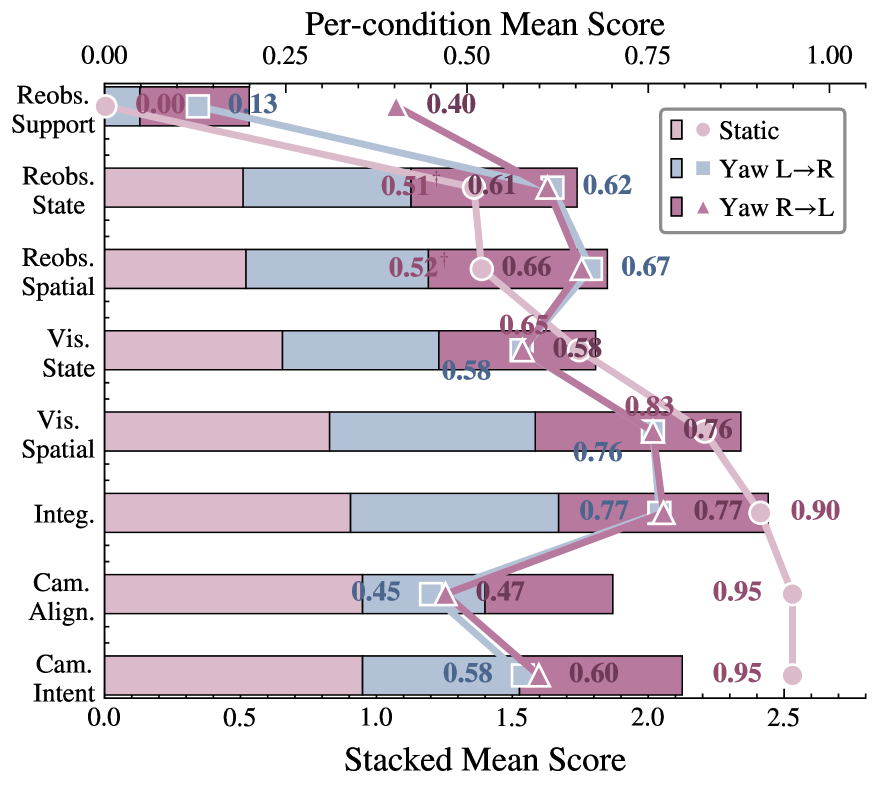
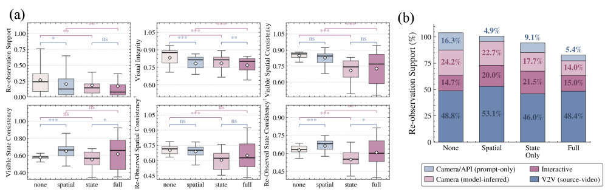

# Paper精读｜Current World Models Lack a Persistent State Core

> [!abstract] 一句话结论
> **WRBench** 是第一个把相机运动当**可观测性干预**来使的诊断基准：相机转开、目标离开视野、再转回来——这段看不见的时间里，世界有没有照常演化？23 个视频生成模型交出同一份答卷：没有。**无法在视线外维持世界状态的持续演化**是全员共有的缺陷，一句话——"可见质量高 ≠ 回看状态正确"。

> [!cite]- 论文信息（点开折叠）
> - **论文标题**：Current World Models Lack a Persistent State Core
> - **arXiv**：2606.20545
> - **链接**：[https://arxiv.org/abs/2606.20545](https://arxiv.org/abs/2606.20545)
> - **作者**：Jinpeng Lu, Dexu Zhu, Haoyuan Shi, Linghan Cai, Guo Tang, Yinda Chen, Jie Cao, Duyu Tang, Yi Zhang, Yong Dai, Xiaozhu Ju
> - **机构**：中国科学技术大学 / 北京人形机器人创新中心 / 中科院自动化所NLPR / 独立研究员 / 德累斯顿工业大学 / 北京大学
> - **日期**：2026-06-18

---

## 1️⃣ 论文想解决什么问题

世界模型被当作通向 AGI 的关键一跳，但这顶帽子发得太随意——现有视频生成模型到底能不能真正建模"物理世界"，其实从没被严查过。爱因斯坦那句"我不看月亮时，月亮依然存在"是现成的试金石：真正的世界模型应该如此，相机移开了，世界状态照样往前走。

现有基准评测存在严重盲点：它们奖励表面属性（图像保真度、运动流畅性、相机可控性），却从不追问一个根本问题——**当目标物体离开视野后再回来时，它的状态是否与离开的预期一致？** 比如提示词说"猫跳上床"，相机转开后猫应该在床上，但当前模型普遍会在回看时将猫重置为跳之前的地板位置。

这个问题之所以被忽视，是因为现有benchmark将相机控制视为"渲染命令"而非"可观测性干预"。WRBench的创新在于：把相机运动当作改变观察角度的干预手段，测试模型是否在视野之外维持了事件的持续演化。

*图1：WRBench核心概念。同一场景、同一事件，通过视角干预测试可见和回看的证据是否支持同一个正在演化的世界状态。*

---

## 2️⃣ 核心洞察

> [!important] 核心洞察
> 1. **可见质量与回看状态是正交能力**：模型可以生成高质量画面、执行合理的相机运动、甚至让目标重新进入视野，但在回看时仍然无法维持正确的事件终点状态。这三个能力（preservation → access → re-observed consistency）并不绑定在一起。
>
> 2. **相机的转动决定"能否测试"，不决定"能否通过"**：相机运动（如左右平移）可以将回看的支持率从接近0提升到约40%，但回看状态得分几乎不变（变化不到0.01）——相机控制只是打开了测试的大门，门后的世界状态演化该不及格还是不及格。
>
> 3. **空间位移比原位状态变化更容易追踪**：当物体被移动到新位置时，模型可以利用新的坐标和静态场景作为锚点来跟踪；但当物体在原位发生状态变化（如折叠、倾倒）时，没有新坐标可追踪，导致回看时物体漂移和模糊。
>
> 4. **规模增长不带来世界状态演化能力**：在23个模型、四个控制范式（显式轨迹、源视频变换、几何缓存、仅提示词）、以及不同参数规模的范围内，这个缺陷反复出现。更清晰的图像、更紧密的控制、更丰富的几何先验或更大的参数量都无法解决这个问题。

---

## 3️⃣ 方法解读

### WRBench 四层架构

WRBench 是一个分层诊断基准，包含四个核心组件：

**Natural-25 提示套件**：25个家庭场景 × 四级事件设计（空间位移 vs 状态变化 × 有相机控制 vs 无相机控制），构成测试的基础场景矩阵。每个测试用例固定相同的初始观察和事件，只变化视角条件。

**WRBenchLib 统一工具包**：将异构模型纳入公平比较的关键创新。不同模型接收相机指令的形式各异（显式轨迹、源视频、几何条件、自然语言提示），WRBenchLib 将每个 event-view record 翻译为各模型可消费的形式，并记录实际交付的条件和生成的视频，建立完整的生成溯源映射。

**六维评估套件**：

1. **Requested-camera precision**：显式轨迹模型是否执行了请求的相机路径

2. **Prompt-camera alignment**：仅提示词模型是否遵循了预期的相机意图

3. **Visual integrity**：帧证据是否结构完整可读（无切割、消失、身份漂移）

4. **Visible spatial/state consistency**：目标可见时的空间关系和动作状态是否正确

5. **Re-observation support**：经过隐藏期后，目标是否能以可评分的形式回到视野

6. **Re-observed spatial/state consistency**：在满足(5)的子集上，回看的目标是否保持了预期的空间关系和事件终点

**人类偏好标注**：2,547条去重的人类标注裁决，用于校准自动评估器的阈值。

*图2：WRBench方法概览。Natural-25事件-视角记录提供场景、事件和视角干预；WRBenchLib将每条记录翻译为生成视频和溯源记录。*

### 评估方法

评估采用分层诊断链，从控制执行逐步深入到状态闭合。关键设计决策：维度(vi)是条件于维度(v)的——如果目标从未回到可判断的视野中，则记录为"支持不足"而非"通过/失败"。这种设计避免了将"无法回看"误判为"回看状态错误"。

---

## 4️⃣ 实验部分怎么读

### 实验设置

| **项目** | **详情** |
| --- | --- |
| 评估模型数 | 23个视频生成模型 |
| 控制范式 | 四种：source-video、geometry-cache、model-inferred、prompt-only |
| 生成视频总数 | 9,600个 |
| 场景覆盖 | Natural-25（25个家庭场景） |
| 人类标注 | 2,547条去重裁决 |
| 事件设计 | 2×2矩阵：空间位移/原位变化 × 有相机控制/无相机控制 |

### 核心结果

WRBench的核心发现是一个**统一的缺陷模式**：所有23个模型都在"回看状态一致性"上失败。

**关键数据**：

- 最佳可见状态得分可达 ~0.76（Hailuo 0.759），但回看状态得分最高仅 ~0.66

- 相机平移可将回看支持率从近0提升到约40%，但回看状态得分几乎不变

- 空间位移事件的回看状态得分比原位变化事件高约0.038（p<0.01）

- 原位变化使可见位置得分下降0.114（p<0.001），使回看状态下降0.068（p<0.001）

**指标相关性揭示了能力的正交性**：

*图4：WRBench六维指标的Pearson相关性结构。可见和回看一致性形成局部区块，但它们之间的相关性仅为0.60-0.79，证明这是两种不同的能力。*

**相机运动的影响**：

*图5：静态相机、左→右平移、右→左平移三种条件下的对比。相机运动主要影响回看支持率（access），但对回看状态一致性（correctness）几乎没有影响。*

**事件因子压力分析**：

*图6：按事件因子分解的箱线图。原位变化（in-place）比空间位移对回看状态造成更大破坏，因为缺少新坐标锚点。*

### 训练细节

论文未涉及模型训练，而是对已有模型进行诊断评估。评估器使用CLIP、DINOv2等预训练视觉编码器，阈值通过人类标注校准。

---

## 5️⃣ 学术评价

**优点：**

1. **问题选得刁，而且落得了地**：Einstein 的"月亮是否存在"听着是个哲学梗，这篇把它变成一个可打的分数——相机转开再回来，状态对不对得上，判据写得清清楚楚。

2. **严谨的分层评估设计**：六维诊断链从控制执行到状态闭合层层递进，条件化评估避免了将"无法回看"误判为"回看失败"的逻辑漏洞。

3. **广泛的模型覆盖**：23个模型覆盖四种控制范式，证明了缺陷的普遍性——不是某个模型的bug，而是整个范式的系统性缺失。

4. **人类校准扎实**：AC1一致性系数在0.788-0.937之间，桥接样本量充足（136-229对），证明自动评估器与人类判断高度对齐。

> [!ed-warning] 局限（风险与不确定性）
> 1. **诊断多于治愈**：论文清楚地指出了问题的存在，但对“如何修复”的指引有限——仅提出了“what-memory”和“endpoint-persistence”两个方向。
>
> 2. **Natural-25的场景多样性有限**：25个家庭场景虽然覆盖了常见情况，但可能不足以代表更复杂的真实世界交互。
>
> 3. **未深入探讨因果机制**：论文观察到缺陷在所有模型中重复出现，但没有深入分析是训练数据偏差、架构限制还是优化目标导致的根本原因。

---

## 6️⃣ 局限与可扩展方向

- **扩展事件复杂度**：当前Natural-25聚焦于单一物体的空间/状态变化，未来可扩展到多物体交互、因果链事件

- **架构层面的解决方案**：论文暗示需要"persistent state core"，但未探索具体架构（如显式世界状态表示、记忆模块）的效果

- **Reward模型集成**：论文提到WRBench的结构可直接用于偏好/奖励挖掘，但尚未实现

- **跨模态扩展**：当前仅评估视频生成，可扩展到3D场景生成、机器人规划等需要持续世界状态的任务

---

## 7️⃣ 最后总结

WRBench 戳破的是一个人人默认已久的等号：把"生成逼真的视频帧"当成"理解物理世界"。前者只需要渲染能力，后者要的是**在视线之外维持事件持续演化的能力**。这项研究最实在的贡献，是把这层模糊的直觉做成可量化的六维诊断框架，再用 23 个模型的全面评估坐实了结论——这不是某个模型的缺陷，而是整个视频生成范式的一个系统性盲区。往哪儿补，论文指了两条路："what-memory" 和 "endpoint-persistence"；这两块不补上，视频生成器就还只是视图条件的渲染器，谈不上世界模型。

---

## 8️⃣ 三句速记

> [!summary]- 点开展开
> 1. **WRBench是首个将相机运动视为可观测性干预的基准**，测试视频生成模型在目标离开视野后是否能维持其持续演化状态
>
> 2. **所有23个模型共享同一缺陷**：可见质量高 ≠ 回看状态正确，回看状态一致性是与帧质量正交的独立能力
>
> 3. **空间位移比原位状态变化更容易追踪**，因为缺少新坐标锚点的原位变化会导致模型在回看时产生漂移和模糊
