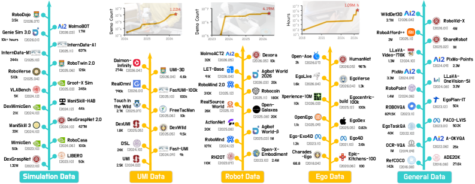
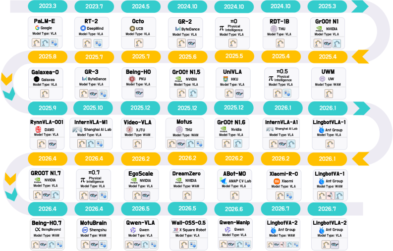
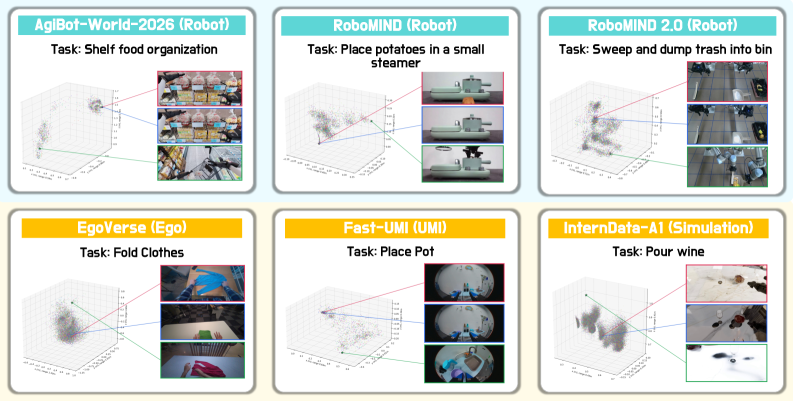
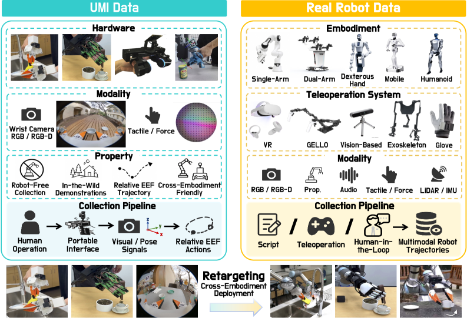

# Paper精读｜Data Pyramid for Embodied Manipulation

> [!abstract] 一句话结论
> **把具身操纵的数据生态摆成一座五层数据金字塔（real-robot → UMI-style → egocentric/exocentric → simulation → general），两个轴一拉——scalability 与 robot alignment——每层数据的斤两立刻有了坐标：越往塔底越好收，也越难直接用到机器人身上。三类具身基础模型（Embodied Brain, VLA, WAM）各吃哪几层、怎么吃，六大开放挑战就是这张地图上还没填的空格。**
> 
> *图注：论文总览。五个数据类别沿 scalability 和 robot alignment 两个维度组织，辅以 quality, diversity, reusability, physical fidelity 四个补充维度。*

> [!cite]- 论文信息（点开折叠）
> - **论文标题**：Data Pyramid for Embodied Manipulation
> - **arXiv**：2607.24744
> - **链接**：[https://arxiv.org/abs/2607.24744](https://arxiv.org/abs/2607.24744)
> - **作者**：Yifan Ye*, Yankai Fu*, Yaoxu Lv*, Bohan Hou*, Jun Cen*, Lingdong Kong*, 等 28 位作者
> - **机构**：PKU, NTU, HKUST, NUS, CUHK, HKU, Duke, UCB, GBU, NJU, SJTU
> - **日期**：2026-07-27
> - **项目页**：[Embodied Data Pyramid](https://embodied-data-pyramid.github.io/) | GitHub: [Awesome Embodied Data Pyramid](https://github.com/embodied-ai/Awesome-Embodied-Data-Pyramid)

---

## 核心框架：数据金字塔

*图注：五层数据金字塔组织，从塔顶到塔底依次为 real-robot, UMI-style, egocentric/exocentric, simulation, general data。*

### 两大核心维度

| **维度** | **含义** | **趋势** |
| --- | --- | --- |
| **Scalability** | 数据源扩展的效率（硬件依赖、人力、环境重置、安全监督、边际成本） | 从塔顶到塔底递增 |
| **Robot Alignment** | 数据支持物理机器人学习和执行的程度 | 从塔顶到底递减 |

### 四个补充维度

| **维度** | **含义** |
| --- | --- |
| **Quality** | 数据的有效性、一致性、信息性和任务相关性 |
| **Diversity** | 任务、物体、场景、视点、指令、embodiment、行为、结果的覆盖度 |
| **Reusability** | 数据跨任务、环境、embodiment、传感系统、模型家族的可迁移性 |
| **Physical Fidelity** | 数据捕捉真实交互动态的保真度（接触、摩擦、顺应性、传感噪声、执行延迟） |

### 五层数据分类

| **层级** | **数据类别** | **Scalability** | **Robot Alignment** | **核心优势** | **核心局限** |
| --- | --- | --- | --- | --- | --- |
| **1 (塔顶)** | Real-Robot Data | ★★★★★ | ★★★★★ | 直接可执行、高物理保真 | 高成本、难扩展 |
| **2** | UMI-Style Data | ★★★★ | ★★★★ | 便携、无机器人、显式 end-effector | 缺少关节本体感受、需 retargeting |
| **3** | Egocentric / Exocentric Data | ★★★ | ★★★ | 自然人类演示、手部细节丰富 | 人类-机器人形态差距 |
| **4** | Simulation Data | ★★★ | ★★★★ | 可扩展、可控、特权标签 | Sim-to-Real Gap |
| **5 (塔底)** | General Data | ★★★★★ | ★ | 海量、多样性、推理先验 | 弱动作/接触监督 |

---

## 各层数据深度解析

### 第1层：Real-Robot Data

**数据获取范式**：

1. **Scripted Collection**：无连续人类控制，人工设计任务逻辑和执行条件

  - **Rule-Based Execution**：有限状态机 + 逆运动学 + 运动规划

  - **Trajectory Playback**：重放已有轨迹（可加扰动增加多样性）

  - **Autonomous Policy Rollouts**：RL/imitation learning 策略自主生成

2. **Teleoperation**：人类连续控制机器人

  - **Kinesthetic Teaching**：直接物理引导（适合固定基座）

  - **Leader-Follower Teleoperation**：主从臂映射（适合双臂，如 ALOHA）

  - **Integrated Leader-Follower**：同一机构（如 ARX AC-One）

  - **Device-Mediated**：VR/XR控制器、SpaceMouse、智能手机

  - **Vision-Based**：视觉估计人体/手部运动后 retargeting

  - **Wearable / Motion-Capture**：IMU套装、光学动捕、数据手套

3. **Human-in-the-Loop Enhancement**：DAgger 范式，人类在关键状态介入纠正

**数据规模演变**：从 2015 年 ~50K trajectories 到 2026 年 2M+ trajectories（Open X-Embodiment 聚合）

**关键数据集**：

- Open X-Embodiment (2023): 2.4M trajectories, 527 tasks, 22 embodiments

- RoboMIND 2.0 (2026): 310K trajectories, 739 tasks, 1000+ hours

- AgiBot World Beta (2025): 1M trajectories, ~3000 hours

**关键趋势**：从单臂→双臂→移动操作→灵巧手；从 RGB→RGB-D + Force/Torque + Tactile + Audio + IMU

### 第2层：UMI-Style Data

**核心思想**：Universal Manipulation Interface（UMI）——一套便携式、全程不需要机器人的采集接口，专门用来收真实世界操纵演示。

**硬件演进**：

- 原始 UMI：手持夹腕 + 腕部相机 + IMU + 视觉惯性 SLAM

- FastUMI：简化硬件

- LEGATO：跨平台的统一抓取接口

- FreeTacMan：手指穿戴式接口

- 现代变体：触觉/力感知（ViTaMIn, exUMI, ManipForce）、多视角（MV-UMI）、3D 传感（UMI-3D）

**相对轨迹表示**：用当前 end-effector 姿态的相对 6-DoF 轨迹作为 embodiment-agnostic 动作空间。

**规模演进**：从 UMI 原始 2.5K → FastUMI-100K 100K → RealOmni 789.8K

### 第3层：Egocentric/Exocentric Data

**捕获基础设施**：

| **传感类型** | **具体设备** | **特性** |
| --- | --- | --- |
| **Wearable 相机** | 单目 RGB | 轻量、长时、无深度 |
|  | 立体 RGB | 可估深度、需标定 |
|  | RGB-D | 直接深度、受环境光影响 |
| **Exocentric 相机** | 多视角固定相机 | 补充 wearable 视野 |
| **Motion Tracking** | IMU | 不受遮挡、漂移 |
|  | 光学动捕 | 高精度、受控环境 |
|  | 头显追踪 (Quest/Vision Pro) | 便携、专有管线 |
| **Auxiliary** | 眼动仪 | 注意力线索 |
|  | 麦克风阵列 | 语音+声学事件 |
|  | EMG | 肌肉激活信号 |
|  | 触觉传感器 | 接触分布、滑移 |

**监督构建方式**：

- **Semantic Supervision**：动作/语言标注、程序性标注

- **Geometric Supervision**：相机/场景几何、手/身体姿态、物体/交互几何

- **Multimodal Supervision**：眼动+音频、惯性+生理、力+触觉

- **Robot-Oriented Supervision**：robot-compatible actions、human-robot alignment

**关键数据集**：Ego4D (3670h), Ego-Exo4D (1286h), Assembly101 (513h), EgoDex (829h), Egocentric-100K (100K h), HumanNet (967K h), Xperience-10M (10K h)

### 第4层：Simulation Data

**仿真器后端对比**：

| **后端** | **特点** |
| --- | --- |
| MuJoCo | 高效刚体动力学、稳定接触建模 |
| Isaac Sim/Lab | GPU 并行、照片级渲染、传感器建模 |
| SAPIEN | 铰接物体交互、PhysX |
| PyBullet | 轻量原型 |
| Brax | JAX-native、加速器友好 |
| Genesis | 统一多物理场 |
| Newton | 可微物理仿真 |

**数据生成方式**：

1. **Human-Executed Demonstrations**：遥操作、VR控制、动捕重定向

2. **Rule-Based Execution**：程序化专家 + 运动规划

3. **Trajectory Playback & Expansion**：MimicGen 式物体中心增强

4. **Autonomous Policy & Generative Rollouts**：RL 策略 + LLM/VLM 辅助任务合成

**World Models as Simulators**：DayDreamer, UniSim, GAIA-1, Genie 等学习型仿真器，用于策略训练、评估和合成数据生成。

**Sim-to-Real Gap**：

- **Observation mismatch**：纹理、光照、材质、深度噪声

- **Interaction mismatch**：

  - Kinematic gaps：形态、关节限制、坐标帧

  - Dynamic gaps：执行器延迟、顺应性、扭矩饱和、反向间隙

### 第5层：General Data

| **数据类别** | **代表数据集** | **规模** | **监督目标** |
| --- | --- | --- | --- |
| Vision-Language | LLaVA-OneVision-SI | 3.2M | Caption, VQA, OCR, Knowledge |
| Segmentation/Loc. | SA-1B, Objects365 | 1.1B masks / 10M boxes | 语义/实例分割、目标检测 |
| 3D Spatial | ScanNet, MMScan | 1.5K scenes / 1.4M captions | 3D 问答、空间关系 |
| Planning | ALFRED, EgoPlan-IT | 25K / 50K | 子目标、下一步动作 |
| Video Temporal | Moment-10M, COIN | 10M moments / 11.8K videos | 时间定位、步骤分割 |
| Physics/Failure | CLEVRER, RoboFail | 20K / 130 | 物理推理、失败诊断 |
| Grasping | GraspNet-1B, DexGraspNet 2.0 | 1.1B / 427M grasps | 2D/6-DoF 抓取 |
| Robot Video | RoboVQA, RoVid-X | 238h / 10K+ h | 机器人视频理解 |

---

## 数据在具身基础模型中的应用

*图注：具身基础模型的数据使用演进。早期系统主要依赖 real-robot trajectories，近期系统越来越把 real-robot, egocentric, simulation, general, UMI-style 数据混在一起喂。*

### 三类模型家族的数据使用

| **模型家族** | **核心能力** | **主要数据** | **数据使用方式** |
| --- | --- | --- | --- |
| **Embodied Brain (VLM)** | 感知、推理、规划 | General + Egocentric + 少量 Robot | Action-free: 视觉-语言预训练；Action-labeled: 基础级动作监督 |
| **Vision-Language-Action (VLA)** | 感知+推理→动作 | Real-Robot + Simulation + Egocentric | Action-labeled: 离散/连续动作生成；Action-free: latent action learning, proxy learning |
| **World Action Model (WAM)** | 世界动态+动作影响 | General Video + Robot + Simulation | Action-free: 未来帧预测；Action-labeled: 动作条件生成 |

### VLA 动作空间表示

| **策略** | **代表模型** | **方式** |
| --- | --- | --- |
| Embodiment-specific projection | GR00T N1, Octo, SmolVLA | 每机器人独立 projector |
| Fixed-dimensional zero-padded | π0.5, Qwen-VLA, ABot-M0 | 统一维度 + validity mask |
| Semantic action slots | Qwen-RobotManip, RDT-1B, Being-H0.5 | 固定物理含义维度 |

### 几何动作表示

| **坐标系** | **代表模型** | **特点** |
| --- | --- | --- |
| Robot-centric | Open X-Embodiment | 直接控制器接口 |
| Camera-centric | Qwen-RobotManip, OC-VLA | 视觉一致性 |
| Wrist-centric | METIS, LDA-1B | 分离局部手指与全局手腕运动 |

---

## 数据规模演进

*图注：各类数据集随时间的规模增长。Simulation, UMI, robot datasets 按 demonstrations 计；ego datasets 按 hours 计；general datasets 按 QA pairs 计。*

---

## 关键数据趋势

### 趋势1：数据配方从单一走向混合

- 早期：real-robot only（RT-1, OpenVLA）

- 近期：real-robot + egocentric + simulation + general + UMI（LingbotVA 2.0, Qwen-RobotManip）

### 趋势2：预训练规模急剧扩大

- 2024: ~1K hours 级别

- 2026: Qwen-RobotManip ~38,100 hours, Xiaomi-Robotics-1 ~100,000+ hours

### 趋势3：Egocentric 数据日益重要

- EgoVLA, Being-H0, HumanScale 等以 egocentric 数据为主

- EgoScale 验证 1K→20K hours 持续改进

### 趋势4：对低质量数据更宽容

- π0.7 发现低质量轨迹+足够清晰的 prompt 仍可提供有用监督

---

## 六大开放挑战

### 1. 触觉数据

- 现有数据集仍以 RGB-D 为主，触觉尚未标准化

- 视觉只能间接推断接触力、滑移、局部变形、摩擦、抓取稳定性

- 近期 RoboMIND 2.0, Humanoid Everyday 开始纳入触觉

### 2. 失败数据与恢复

- 现有数据集严重偏向成功演示

- 需要：失败前上下文、失败起始、失败类别/原因、恢复动作、恢复结果

- 关键转变：将失败视为不可用轨迹 → 重要监督来源

### 3. 可扩展数据收集

- 从 first-person RGB → 多穿戴传感器（眼动、深度、IMU、触觉、EMG）

- 挑战：设备成熟度、标定、同步、干扰自然操作

- 方向：更轻、无线、模块化、自动标定

### 4. 跨 Embodiment 状态-动作对齐

- 仅有共同数据格式不足以保证兼容监督

- 需要一致的几何语义，而非仅共享存储模式

- 方向：记录坐标约定、标定参数、控制模式作为一等元数据

### 5. Egocentric 先验用于灵巧手策略

- 人-机器人差距不仅是视觉的，更是运动学、形态学和物理的

- 方向：将 egocentric 数据视为结构化交互先验（任务意图、抓取选择、接触序列、工具使用策略），而非精确动作标签

### 6. Data Recipes（数据配方）

- 最佳数据组成仍是开放问题

- 缺少精确的、计算匹配的消融实验

- 方向：架构感知的、阶段依赖的数据配方；固定/课程/自适应混合策略的系统比较

---

## 与其他论文的对话

| **论文** | **关注点** | **与本文的关系** |
| --- | --- | --- |
| Kimi K3 | 架构创新 + scaling | K3 的 RL 训练数据配方是什么？是否也遵循金字塔？ |
| AREX | 自递归改进 agent | AREX 的 RL 数据属于金字塔哪一层？ |
| Language model harnesses | Harness 组合泛化 | 数据金字塔视角下，harness 如何影响数据使用？ |
| Measuring Reward-Seeking | RL 制造 reward-seeker | 金字塔最顶层的 RL 数据是否也有此风险？ |
| HOPE | 模型压缩 | 数据金字塔对模型压缩后训练有何启示？ |

---

## 8️⃣ 三句速记

> [!summary]- 点开展开
> 1. **五层数据金字塔**：real-robot → UMI-style → egocentric/exocentric → simulation → general，沿 scalability 和 robot alignment 两大维度组织。
>
> 2. **数据配方演进**：从单一 real-robot → 五层混合，egocentric 数据日益重要，预训练规模从千小时走向十万小时。
>
> 3. **六大开放挑战**：触觉数据、失败恢复数据、可扩展收集、跨 embodiment 对齐、egocentric 灵巧手策略、最优 data recipe。
