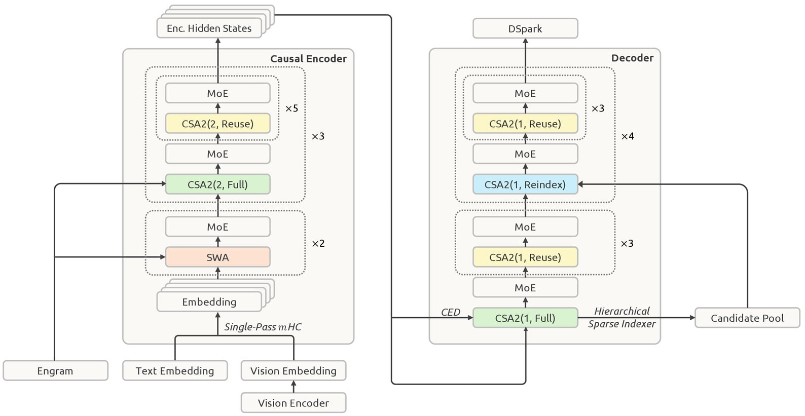

# Paper精读｜DeepSeek-V4.1-Flash: Pushing the Limits of KV Cache Compression

> [!abstract] 一句话结论
> DeepSeek-V4.1-Flash 的真正贡献不是把模型做小，而是把**预填充计算、运行时 KV Cache、持久化 KV Cache、稀疏索引和部署重放**当成一件事一起重新设计：CED 把 prefill 激活参数降到 8B，CSA2 + FP4 把全局 KV 压到每 token 890 bytes，SWA Bounded Replay 再把持久化 KV 压到 V4-Flash 的约 1/8。整份论文是一条面向长时程 Agent 的“模型—缓存—推理系统协同设计”路线，五个瓶颈一个没放过。

> [!cite]- 论文信息（点开折叠）
> - **论文标题**：DeepSeek-V4.1-Flash: Pushing the Limits of KV Cache Compression
> - **来源**：DeepSeek-AI
> - **alphaXiv**：[https://www.alphaxiv.org/abs/2609.deepseek-v4-1-flash](https://www.alphaxiv.org/abs/2609.deepseek-v4-1-flash)
> - **模型检查点**：[https://huggingface.co/deepseek-ai/DeepSeek-V4.1-Flash](https://huggingface.co/deepseek-ai/DeepSeek-V4.1-Flash)
> - **相关基线**：DeepSeek-V4-Flash、DeepSeek-V4-Pro
> - **日期**：论文页面未明确给出正式发表日期；按用户提供的 alphaXiv 页面记录

---

## 论文分类标注

- **研究类型**：模型技术报告 / 系统—架构联合优化论文，而不是单一算法论文

- **领域归属**：大语言模型系统、长上下文推理、稀疏注意力、KV Cache 压缩、多模态 Agent

- **方法学标签**：MoE、Causal Encoder–Decoder、跨层 KV 复用、层级稀疏索引、FP4 KV、近似状态重建、异步 RL、on-policy distillation

- **评测对象**：基础模型能力、推理、代码 Agent、网络安全 Agent、通用 Agent、视觉 Agent、多 Agent

- **证据边界**：论文的核心数字主要来自 DeepSeek 内部评测框架；代码、数据配方、完整部署成本和部分硬件细节没有完全公开，因此“比竞品更便宜”应理解为架构与缓存占用上的强证据，而不是经过独立复现实测的总拥有成本结论。

---

## 1️⃣ 论文想解决什么问题

长时程 Agent 的负载与普通聊天不同：它会不断读取代码、文档、工具返回结果和历史轨迹，因此输入 token 数量远大于输出 token 数量。过去的长上下文优化主要降低注意力计算，但当计算被稀疏化以后，新的瓶颈转移到了三个地方：**HBM 中的运行时 KV Cache、SSD/主存中的持久化 KV Cache，以及缓存迁移时的 I/O 和互连带宽**。

DeepSeek-V4 已经使用全局注意力分支加 Sliding-Window Attention（SWA）。SWA 的窗口固定，所以它的缓存规模与上下文长度基本无关；真正随上下文增长的是全局 KV。V4 的持久化缓存还保存了 SWA KV，这在多轮短对话中尤其浪费：SWA 只在当前活跃会话的分钟级时间窗口内有价值，却被放进了可保存 72 小时以上的长期缓存。

V4.1-Flash 的目标因此不是单纯追求 benchmark 分数，而是在保持甚至提升能力的同时，让“读入一百万 token、反复调用工具、跨轮复用上下文”的 Agent 变得可部署。

---

## 2️⃣ 核心洞察

> [!important] 核心洞察
> 1. **长上下文的下一场竞争是缓存系统，而不只是注意力 FLOPs**：当稀疏注意力把计算成本压下去后，缓存容量、带宽和恢复成本会成为主要约束。V4.1-Flash 将它们作为一等公民设计。
>
> 2. **输入重、输出相对轻的 Agent 适合 CED**：把底部一半 Transformer 当作 causal encoder，并从中间层状态为上半部分生成全局 KV，使大量 prompt token 不必完整通过全部 decoder 层。
>
> 3. **跨层复用要同时处理“缓存共享”和“索引更新”**：CSA2 不把所有层强行绑定到同一组 Top-K，而是用 Full、Reindex、Reuse 三种静态模式，在节省 KV 的同时保留部分层的选择自由。
>
> 4. **近似重建可以替代长期保存**：SWA 的理论依赖跨层累积，但有效感受野可能远小于理论窗口。只重放最近窗口的 token，虽然不再数学等价，却能用极低存储换取可接受的质量损失。
>
> 5. **后训练的主要杠杆可能是数据与环境流水线，而非新 RL 算法**：论文明确说没有引入新的 post-training 算法，收益主要来自可验证任务合成、交互环境构造、质量审计、异步 RL 和大规模 OPD。

---

## 3️⃣ 方法解读

### 组件1：Causal Encoder–Decoder（CED）

CED 把 40 层网络对半拆成 20 层 encoder + 20 层 decoder，赌的是 Agent 负载里 prompt token 占大头：全局注意力所需的 KV，decoder 层不再从自己的隐藏状态产生，而是从第 20 层 encoder 的隐藏状态直接投影：

$C_l = H_{L/2}W^{KV}_l,\qquad Z_l = H_{L/2}W^Z_l,\qquad l>L/2$

其中：

- $H_{L/2}$：encoder 最后一层的隐藏状态；

- $W^{KV}_l$：第 $l$ 个 decoder 层对应的 KV 投影；

- $C_l$：该层的全局 KV；

- $Z_l$：与压缩/注意力计算相关的辅助投影。

这样做的关键不是减少层数，而是让 decoder 的**全局 KV 生成**不再要求 prompt 经过完整的上半部分网络。对长度为 $N$、层数为 $L$、SWA 窗口为 $n_{win}$ 的序列，论文给出的 prefill 复杂度从：

$O(NL)$

降为：

$O(NL/2+n_{win}L/2)\approx O(NL/2),\quad N\gg n_{win}$

这解释了为什么论文说 prefill 计算接近减半。

但 CED 不是“免费午餐”：SWA KV 仍需逐层生成，decoder 的局部状态还必须通过 replay 获得。因此，CED 的收益依赖后面的 SWA Bounded Replay；二者是配套设计，而不是可以独立评价的两个小技巧。

### 组件2：Compressed Sparse Attention 2（CSA2）

CSA2 同时沿三个维度压缩：

- **单条目维度**：压缩每个 KV entry 的表示；

- **序列维度**：多个 token 压成一个主 KV entry，并只选少量 Top-K；

- **层维度**：让不同层共享主 KV、indexer K 或 Top-K 索引。

每个 CSA2 层静态指定为三种模式之一：

- **Full Mode**：生成自己的 main KV、indexer K，并对全上下文做索引，产生新的 Top-K；

- **Reindex Mode**：复用前一层的 main KV 和 indexer K，但用本层的 indexer Q 重新打分，重新选择 Top-K；

- **Reuse Mode**：同时复用 main KV 和最近的 Top-K，不再做新的索引。

这三种模式的分工里有一条关键区分：**缓存复用不等于索引复用**。Reindex Mode 允许不同层在共享 KV 的同时各选各的关注位置，不至于所有层被迫用同一份检索结果；Reuse Mode 则把索引计算彻底跳过，把大多数层变成廉价的复用层。

论文配置中，encoder 的 18 个 CSA2 层按 6 层一组，每组 1 个 Full + 5 个 Reuse；decoder 的 20 层按 4 层一组，第一组是 1 个 Full + 3 个 Reuse，后四组是 1 个 Reindex + 3 个 Reuse。每次 sparse attention 选 Top-512，SWA 窗口为 128。

*图注：论文的整体架构图展示了 20 层 encoder + 20 层 decoder、CSA2 模式分组、SWA、Engram、DSpark 和层级稀疏索引器的组合。图中对应的是整体架构，而不是单独的 CSA2 流程图；CSA2 的三种模式见论文 Figure 4。*

### 组件3：Hierarchical Sparse Indexer

跨层复用减少了索引次数，但第一个 Full 层仍需扫描全部可见上下文，后续 Reindex 层如果继续扫描全上下文，成本仍会随序列长度增长。层级索引器的做法是：

1. 第一个 Full 层对全上下文打分，并先按 block 做聚合；

2. 每个 block 用其中最高的 indexer score 表示；

3. 保留最高分的 2,048 个 block，每个 block 8 个位置，形成最多 16,384 个候选位置；

4. 后续 Reindex 层只在候选池中重新打分和选择自己的 Top-512；

5. Reuse 层不再进行新的索引。

第一层仍然是随上下文增长的全范围扫描，但后续层的候选搜索空间在固定配置下与上下文长度近似无关。论文明确把该候选限制在训练和推理中都打开，避免出现“训练时看全上下文、推理时突然只能看候选池”的分布错配。

*（原图未能本地化：Figure 5：Hierarchical Sparse Indexer；IMA 媒体接口没有可用媒体编号）*

*图注：第一个 Full 层从全上下文建立 block 级候选池，后续 Reindex 层只在候选位置内重新选择 Top-K；这把大部分索引成本从随上下文线性增长改造成候选池受限的搜索。*

### 组件4：FP4 Main KV Cache

V4.1-Flash 在训练中就使用 FP4 global KV cache，而不是只在部署阶段事后量化。论文声称性能损失很小，配合 CSA2 后把全局 KV 降到每 token 890 bytes，约为 DeepSeek-V4-Flash 的 1/4、DeepSeek-V1 的 1/437。

这里要区分两个概念：

- **global KV footprint**：主要常驻 HBM 的运行时缓存；

- **persistent KV footprint**：为了跨请求/跨轮复用而保存到 SSD 或 host memory 的缓存。

论文的 890 bytes/token 不是“所有内存总和”，也不等于完整请求的显存占用。实际部署仍要加上 SWA KV、激活、权重、路由状态、Engram 和系统管理开销。

### 组件5：SWA Bounded Replay

V4.1-Flash 不再把 SWA KV 长期放进 persistent KV cache，而是：

- 将 SWA KV 放到每台机器约 10% host DRAM 的短 TTL memory pool；

- global KV 保持至少 72 小时的持久化生命周期；

- SWA miss 时只重放最近 $n_{win}$ 个 token，而不是精确重建所需的 $L\times n_{win}$ 个 token。

这是一种明确的存储—计算交换：牺牲少量重算和近似性，换取持久化存储的大幅下降。论文承认，重放后的 SWA 状态与完整前向得到的状态不再数学等价；“质量损失可忽略”是实验主张，而非理论保证。

### 组件6：Single-Pass mHC、Engram 与 DSpark

- **Single-Pass mHC**：把 residual stream mixing 所依赖的系数向前错移一个 block，消除 kernel 间的依赖，使 Mega-mHC 可以把 residual update、input mixing 和 coefficient prediction 融合到一次遍历中。论文称激活内存流量相对原实现减半。

- **Engram**：加入 196B 参数的条件记忆模块，分布在两个模块中，使用 2/3/4-gram、8 个 hash head 和 FP8 embedding。它把部分“记忆”从深度计算中拆出来，推理时从 host memory 预取。

- **DSpark**：采用半自回归 draft generation 和 confidence-scheduled verification，用于 speculative decoding；它是在 backbone 预训练后单独训练的推测解码模块。

这三个组件分别对付激活搬运、参数化记忆和输出解码速度——“Flash”不是靠某一种 KV 技术撑起来的，而是多个系统瓶颈一起优化的结果。

---

## 训练和系统基础设施

### 多模态与基础模型训练

模型是 552B backbone MoE，另有 196B Engram 参数；prefill 每 token 激活 8B，decode 激活 16B。网络共有 40 层，hidden size 为 5120；每个 MoE 层包含 1 个 shared expert 和 384 个 routed experts，每 token 激活 6 个 routed experts。

视觉路径使用从头训练的 DeepSeek-ViT：2D-RoPE、线性 patch projection、RMSNorm、SwiGLU，并通过 3×3 pixel-unshuffle 将视觉 token 数量降低 9 倍。预训练语料规模为 45T multimodal tokens，模型从 64K 序列长度开始就使用稀疏注意力训练，在训练到 34T tokens 后扩展到 1M context，没有 dense attention warmup。

### 训练数据与后训练

论文对 post-training 的表态很坦白：作者明确说没有提出新的 post-training 算法，还是 SFT → RL → on-policy distillation 那一套，创新全押在数据和环境上：

- 将任务形式化为 problem、environment、verification system 三元组；

- 自动生成并审计通用 Agent 与 coding Agent 任务；

- 通过内部员工/合作方工作流、失败轨迹和公开 GitHub 仓库构造环境；

- 使用多个 Agent 验证可运行性、难度、正确性和 hackability；

- 采用异步 RL、跨 scaffold 训练、模型合并、40 多个异构 teacher 的 OPD；

- 用 DSec 管理大规模 sandbox，目标规模达到数百万并发实例。

这篇论文的隐含结论是：在当前阶段，后训练的性能收益很大一部分来自“任务工厂 + 环境工厂 + 质量控制”，而不是再发明一个 RL loss。

---

## 4️⃣ 实验部分怎么读

### 实验设置

| **维度** | **设置** |
| --- | --- |
| 模型 | DeepSeek-V4.1-Flash Base / Post-trained |
| Backbone | 552B MoE；Engram 196B |
| 激活参数 | Prefill 8B；Decode 16B |
| 上下文 | 最长 1M tokens |
| 预训练 | 45T multimodal tokens；64K 起训，34T tokens 后扩展到 1M |
| 评测 | 世界知识、推理、代码数学、长上下文、多模态、代码/通用/安全/视觉 Agent |
| Agent scaffold | Claude Code、Codex、OpenCode、Pi、mini-SWE、DeepSeek Harness |
| 主要部署优化 | CED、CSA2、FP4 KV、SWA Bounded Replay、kernel fusion |

### 基础模型结果

论文内部框架的核心对比如下；同一行分差不超过 0.3 时被视为同水平：

| **Benchmark** | **V4-Flash Base** | **V4-Pro Base** | **V4.1-Flash Base** |
| --- | --- | --- | --- |
| MMLU-Pro | 68.3 | 73.5 | **74.1** |
| BigCodeBench | 56.8 | 59.2 | **60.6** |
| HumanEval | 69.5 | 76.8 | **79.4** |
| GSM8K | 90.8 | 92.6 | **93.0** |
| LongBench-V2 | 44.7 | 51.5 | 45.2 |
| MMMU-Pro | — | — | 56.5 |
| DocVQA | — | — | 95.6 |

解读：V4.1-Flash Base 在代码和数学若干指标上已经超过 V4-Pro Base，但 LongBench-V2 仍明显落后 V4-Pro。这说明“更强的缓存效率”并不自动等价于“所有长上下文理解能力更强”；系统能处理更长输入，和模型是否能在长输入中稳定检索/推理，是两个不同问题。

*（原图未能本地化：Figure 1：KV Cache 压缩与 Agent benchmark 表现；IMA 媒体接口没有可用媒体编号）*

*图注：论文 Figure 1 同时展示 Agent benchmark 表现和不同 DeepSeek 代际的 global KV/token。V4.1-Flash 的核心卖点是：缓存占用大幅下降并没有伴随整体能力退化。*

### Post-training 与 Agent 结果

| **Benchmark** | **V4.1-Flash** | **论文中对比结果** |
| --- | --- | --- |
| GPQA Diamond | 90.9 | V4-Flash 89.9；K3 92.9；GPT-5.6 Sol 94.1 |
| Codeforces Rating | 3471 | V4-Flash 3289；V4-Pro 3348 |
| MathArena Apex | 65.6 | V4-Pro 65.3；K3 65.6 |
| Terminal-Bench 2.1 | **90.6** | Opus-5 89.1；GPT-5.6 Sol 88.8 |
| Terminal-Bench 3.0 | 30.0 | Opus-5 43.3；GPT-5.6 Sol 34.4 |
| DeepSWE v1.1 | **74.2** | Opus-5 74.0；GPT-5.6 Sol 73.0 |
| CyberGym | **88.1** | GPT-5.6 Sol 84.5；V4-Pro 83.3 |
| AutomationBench | **54.8** | Opus-5 50.3；GPT-5.6 Sol 45.8 |
| Agents’ Last Exam | **31.8** | Opus-5 28.6；GPT-5.6 Sol 26.7 |
| Chartography | 78.9 | Opus-5 84.0；GPT-5.6 Sol 79.9 |

这里最重要的不是“全面超过闭源模型”这种宣传式结论，而是能力分布：V4.1-Flash 在 coding/terminal/general agent 上非常强，但 Terminal-Bench 3/4、视觉 Agent 和最难推理任务仍有明显差距。论文自己也承认，窄 benchmark gap 不等于复杂边界条件上完全等价。

### Reasoning Effort：把质量—成本曲线暴露给用户

模型用一个 1–100 的 effort 标量控制推理强度，并把它写进 RL 的 reward。长度惩罚系数随 effort 指数衰减：低 effort 强调短答案，高 effort 允许更多 token 用于探索和验证。

论文报告：

- reasoning-intensive 八项任务平均 Pass@1：effort 25 时 67.1%，effort 100 时 76.3%；

- DeepSWE v1.1：66.0% → 74.2%；

- Terminal-Bench 2.1：82.4% → 90.6%；

- 输出 token 约增加 2.5 倍；

- effort 60–80 已获得大部分效果提升，100 的额外收益边际递减。

这比简单的 max_tokens 更有意义：它试图让模型学会一条平滑的“成本—质量”控制曲线。不过论文没有公开足够多的跨任务、跨温度和跨硬件延迟数据，因此 effort 数值本身不能直接等同于实际美元成本或端到端延迟。

### Scaffold 鲁棒性

在 DeepSWE v1.1 上，各 scaffold 的结果为 65.5–74.2；Terminal-Bench 2.1 为 84.1–90.6。模型没有只在一个自家 harness 上评测，而是更换 system prompt、tool schema 和 turn-taking logic 后继续测，这为“能力来自模型而非专门适配某个 harness”提供了更强证据。

但这里仍要留个心眼：所有 scaffold 都使用了相同模型、相同任务集和相近的长上下文设置，且 benchmark 本身仍可能包含与训练环境相近的结构。它证明了迁移鲁棒性有所改善，不等于在任意真实企业工具链上都不会掉点。

### Multi-Agent 结果

在 Agent Team 模式下，模型使用 lead agent、异步 teammate、持久 mailbox 和共享任务板。初步结果显示多 Agent 在所有测试 deadline 上超过单 Agent：

| **任务** | **多 Agent** | **单 Agent** | **多 Agent 最佳点** |
| --- | --- | --- | --- |
| ProgramBench，8 小时 Almost@1 | 30.04% | 20.39% | 多 Agent |
| FrontierSWE v2，20 小时 Mean@5 | 32.90% | 28.20% | 多 Agent |

这组实验更像“协作 harness + test-time compute scaling”结果，而不是单纯模型能力结果。它说明当任务可拆分、deadline 足够长、共享工作区不会造成冲突时，Agent Team 有收益；它没有证明多 Agent 在所有任务上都比单 Agent 更快或更便宜。

---

## 5️⃣ 学术评价

**优点：**

1. **问题选得非常准确**：论文抓住了长时程 Agent 部署中常被忽略的缓存容量、缓存迁移和恢复成本，而不只是继续堆 benchmark。

2. **优化是乘法式而非单点式**：CED 减 prefill，CSA2 减 global KV，FP4 减 entry size，层级索引减搜索，Bounded Replay 减 persistent SWA，kernel fusion 减 memory traffic；这些优化在系统层面互相放大。

3. **把近似性说清楚了**：SWA Bounded Replay 并不声称数学等价，而是承认状态重建近似，再用实验验证质量损失；这比把近似缓存包装成“无损”更可信。

4. **评测覆盖了真实 Agent 变量**：不仅有静态推理题，还有多 scaffold、代码环境、安全环境、视觉 Agent 和多 Agent。

5. **后训练经验具有方法论价值**：论文把可验证任务、环境质量、失败轨迹和异步基础设施放在中心位置，对 Agent RL 工程的启示可能比某个新 loss 更大。

> [!ed-warning] 局限（风险与不确定性）
> 1. **大量结果来自内部框架**：数据清洗、训练硬件、完整成本、缓存命中率分布和端到端吞吐没有充分公开，外部复现难度高。
>
> 2. **缓存压缩的鲁棒边界尚未充分刻画**：CSA2 的 Top-K 选择错误、候选池漏召回、FP4 误差、SWA replay 边界都可能在极长、多轮、分布外任务中放大。
>
> 3. **LongBench-V2 并没有达到 V4-Pro**：这提醒我们不要把“支持 1M context”误读为“1M token 都能等质量理解”。
>
> 4. **Agent benchmark 与生产成本不是同一个量**：论文报告了 Pass@1 和输出 token，但没有完整公开 GPU/CPU/SSD/网络成本、缓存命中率和队列等待，因此无法从表格直接推导商业部署成本。
>
> 5. **安全评测存在双重用途风险**：CyberGym、SEC-Bench 和 ExploitGym 的高分说明能力很强，也意味着 sandbox 隔离、网络策略和奖励防攻击必须成为生产部署的硬约束。
>
> 6. **模型—harness 协同仍可能带来隐性过拟合**：虽然跨 scaffold 评测比单一 harness 更可靠，但任务、工具接口和环境构造仍可能与训练分布有联系。

---

## 与相关工作的对话

| **相关方向** | **V4.1-Flash 的位置** | **关键差异** |
| --- | --- | --- |
| YoCo / CED 类 decoder-decoder 架构 | 继续沿用“从较低层共享 KV、减少 prefill”的路线 | V4.1 将 CED 与 CSA2、SWA replay 和完整部署系统绑定 |
| MLA / CSA / HCA | 沿 entry 维度和序列维度做 KV 压缩 | CSA2 进一步把跨层 KV、索引和 Top-K 复用统一起来 |
| IndexCache / YOIO / HySparse | 证明跨层索引或 KV 共享可节省计算/缓存 | CSA2 同时保留 Full、Reindex、Reuse，避免所有层使用同一选择 |
| Engram | 用条件记忆把记忆与计算解耦 | V4.1 将其作为大规模模型的 host-memory 预取组件 |
| DSpark | 以半自回归草稿和置信度调度提升 decode | 与 KV 压缩共同服务于低延迟输出 |
| Agent RL / OPD | 使用标准 SFT、RL、OPD，而不主张新算法 | 重点转向任务合成、环境验证、异步 rollout 和 teacher 组合 |

---

## 6️⃣ 局限与可扩展方向

- 建立公开的端到端长上下文成本基准：同时报告 HBM、host DRAM、SSD、网络、prefill、decode 和 cache hit/miss。

- 对 CSA2 候选池做 recall 曲线和最坏情况压力测试，明确 Top-K 漏召回如何影响不同任务类型。

- 对 SWA Bounded Replay 进行跨 cache-resumption 边界、短 suffix、多轮工具调用和图像密集输入的系统消融。

- 公开不同 effort、不同 scaffold、不同 batch/concurrency 下的真实延迟与成本曲线，而不仅是 output token 数。

- 将多 Agent 协作收益分解为任务可并行性、通信成本、共享状态冲突和 deadline 四个因素。

- 在模型能力之外，对 sandbox 防越权、reward hacking、网络隔离和敏感工具调用做独立安全评测。

---

## 7️⃣ 最后总结

DeepSeek-V4.1-Flash 拿出来的不是一个神奇模块，而是一条完整的部署路线：**用架构减少需要生成的 KV，用稀疏与低精度减少 KV 大小，用 replay 避免长期存储，用系统工程把这些设计落到大规模 Agent。** 论文最硬的技术判断是：当上下文越来越长，模型能力、缓存系统和 Agent harness 必须共同缩放。它在代码 Agent 和通用 Agent 上的结果很强，但 LongBench 和最难闭源对比也说明，缓存效率领先不等于所有长上下文推理边界都已经解决。

---

## 8️⃣ 三句速记

> [!summary]- 点开展开
> 1. V4.1-Flash 用 CED + CSA2 + FP4 + SWA Bounded Replay，把长 Agent 的 prefill、HBM KV 和持久化 KV 同时压低。
>
> 2. 真正的系统创新在“近似状态重建替代长期保存”：用可控重算换缓存容量，并用训练时一致的候选池避免推理分布错配。
>
> 3. 它最值得关注的不是“全面击败所有模型”，而是展示了面向 Agent 部署的模型—缓存—环境协同设计；但内部评测和极端边界仍需要外部复现。
