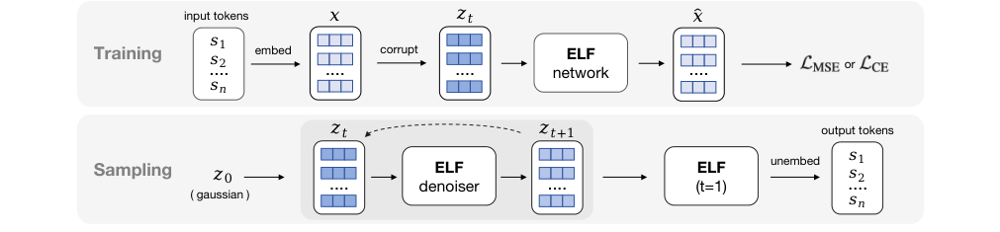
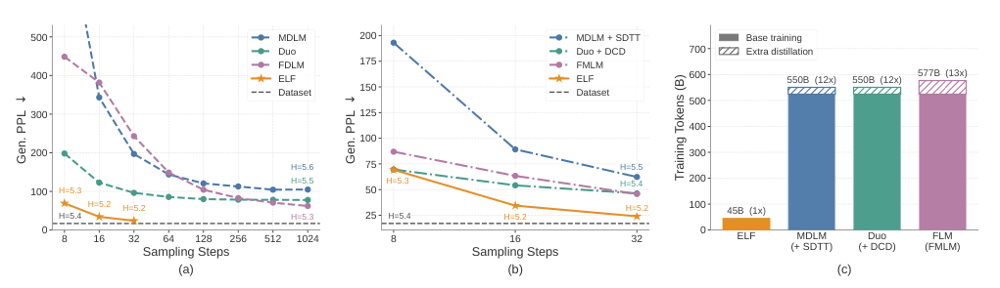

# Paper精读｜ELF: Embedded Language Flows — Kaiming He团队让连续扩散语言模型重归聚光灯

> [!abstract] 一句话结论
> **ELF 赌的就是一件事：连续扩散语言模型不是先天不行，是之前的设计空间没探对。** 把 Flow Matching 应用到连续嵌入空间、离散化推迟到最后一刻，ELF 用 10x 更少的训练 token 就超越了所有领先的离散/连续 DLM。
> ---

> [!cite]- 论文信息（点开折叠）
> - **论文标题**：** ELF: Embedded Language Flows
> - **arXiv**：** 2605.10938
> - **链接**：** [https://arxiv.org/abs/2605.10938](https://arxiv.org/abs/2605.10938)
> - **作者**：** Keya Hu*, Linlu Qiu*, Yiyang Lu, Hanhong Zhao, Tianhong Li, Yoon Kim, Jacob Andreas, Kaiming He (MIT)
> - **日期**：** 2026-05-11
> - **标签**：** #扩散语言模型 #FlowMatching #连续扩散 #KaimingHe #MIT

---

## 1️⃣ 论文想解决什么问题

扩散语言模型这几年基本是**离散方案**的天下（D3PM、MDLM、SEDD、DNDM），连续方案一直被压着打。更麻烦的是，连名字里带「连续」的那批（Diffusion-LM、CDCD、DiffuSeq）也不算真连续——名义上在嵌入空间去噪，中间步骤却总要塞词级交叉熵约束或最近邻离散化，半路就爬回了离散空间。

**核心问题：** 连续 DLM 不行，到底是语言天生离散、连续空间就不合身，还是之前的设计空间压根没探对？

---

---

## 2️⃣ 核心洞察

ELF 的关键洞察就一句话：**在连续空间做去噪就老老实实待在连续空间，只在最后一步离散化。**

这话听着像废话，但此前几乎没有工作真的守住它——大多数连续 DLM 中途就做了 token-level 的离散投影或交叉熵监督，等于半路就上了岸。

ELF 的配方：

> [!important] 核心洞察
> 1. **Flow Matching 连续时间框架** — 用 rectified flow 线性插值定义从噪声到数据的路径
>
> 2. **x-prediction 参数化** — 直接预测干净嵌入，而非预测噪声或速度
>
> 3. **权重共享** — 同一网络在去噪阶段做 denoising，在 t=1 时刻做 decoding
>
> 4. **无需独立 decoder** — 去掉传统 LDM 中的单独解码器，推理时零额外模块
>
> 5. **自然支持 CFG** — 因为是纯连续空间，Classifier-Free Guidance 直接照搬图像领域的成熟技术

---

---

## 3️⃣ 方法解读

### 嵌入空间构建

*图 3｜ELF 在训练中的连续嵌入、去噪与解码路径。 [来源](https://arxiv.org/pdf/2605.10938v1#page=3)*

token 先经冻结的 T5-small encoder（35M）映射到 512 维连续嵌入，再用 bottleneck 压到 128 维。encoder 只在训练时用，推理时不背任何开销。

### Flow Matching 公式

路径就取直线，rectified flow 的标准做法——噪声到数据不绕路：z_t = t*x + (1-t)*eps，其中 t 属于 [0,1]。速度场 v = dz/dt = x - eps。训练目标是最小化 MSE：

L_MSE = E[||x_theta(z_t, t) - x||^2]

### 共享权重解码器

t=1 时，同一网络预测的 x_theta 直接经 unembedding 层映射到 token 概率——解码不另起炉灶。为了让这条出口真的落在 token 空间上，训练里额外掺 20% 的交叉熵损失：

L_CE = E[-log p(token | x_theta(z_1, 1))]

### 推理

ODE/SDE 两套采样器：ODE 确定性采样 64 步，SDE 加随机噪声换多样性。CFG（Classifier-Free Guidance）和 self-conditioning 都是图像域现成的技术，直接配着用——纯连续空间的好处在这里兑现。

---

---

## 实验结果

*图 7｜ELF 与多类扩散语言模型基线的系统级对照。 [来源](https://arxiv.org/pdf/2605.10938v1#page=8)*

| **数据集** | **任务** | **ELF-B (105M)** | **对比基线** |
| --- | --- | --- | --- |
| OpenWebText | 无条件生成 | Gen. PPL 大幅领先 | 10x 更少训练 token，超越 MDLM (170M) 等 |
| WMT14 De-En | 机器翻译 | BLEU 有竞争力 | 细节见论文 Tab.1 |
| XSum | 摘要 | ROUGE 有竞争力 | 细节见论文 Tab.1 |

**关键数字：**

- 训练 token 量仅为对比基线的 **1/10**（45B vs 数百 B）

- 更少采样步数就能达到更低生成困惑度

- 无需 distillation 等后处理技巧

- 自然支持 CFG，控制生成质量与多样性的 trade-off

---

---

## 5️⃣ 学术评价

**贡献：**

1. 把一个被普遍怀疑的命题正面做掉了：极简设计下连续 DLM 就是能做好——之前不行是路子不对，不是空间不对

2. Flow Matching 和 continuous-time 框架进了语言扩散，图像域攒了那么多年的家当（CFG 等）从此可以直接搬过来用

3. 共享权重把独立 decoder 顺手省掉——方法清单短一截，推理时零额外模块

4. Appendix A 把现有连续 DLM 的设计空间梳理成 survey 表格，这张表本身就值钱，后来人能少走很多弯路

**几个存疑的细节：**

- 训练仍然是 80% MSE + 20% CE 的混合，「只在最后一步离散化」在训练目标上打了折扣，没有想象中那么纯粹

- encoder 是 T5-small（35M），到了 ELF-L（652M）这个 bottleneck 还罩不罩得住，论文没给答案

- 实验停在 105M 参数量级，更大模型、更多样化任务上的表现还悬着

---

---

## 局限与展望

1. **规模验证不足** — 只在 105M-652M 规模上实验，1B+ 级别的 scaling 规律是空白，连续空间的胜势能不能带上去，要更大规模才见分晓

2. **条件生成性能一般** — WMT 和 XSum 上「有竞争力」但没拉开差距，真正的领先在无条件生成

3. **Encoder 依赖** — 推理时确实不用，但训练时绑死了冻结的 T5 encoder，端到端的联合优化做不了

4. **CE 损失的混合** — 那 20% 的 CE 仍是离散监督的「拐杖」，去掉它模型还站不站得住，是个该补的消融

---

---

## 8️⃣ 三句速记

> [!summary]- 点开展开
> 1. **连续 DLM 不是不行，是之前路子没走对** — 坚持连续去噪到最后一步，ELF 用 1/10 的 token 实现超越
>
> 2. **x-prediction + Flow Matching + 共享权重** — 三个关键设计，让图像域扩散技术（CFG 等）无缝迁移到语言
>
> 3. **Kaiming He 团队出手** — MIT 的探索类工作，Appendix A 那张设计空间地图是留给后续工作的路标
