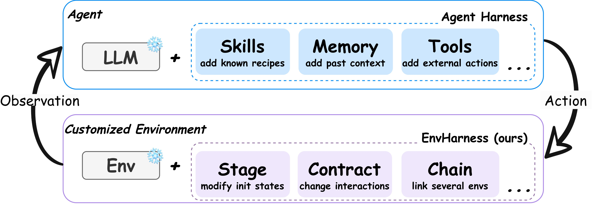
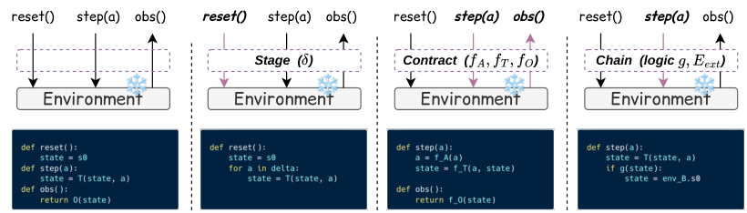
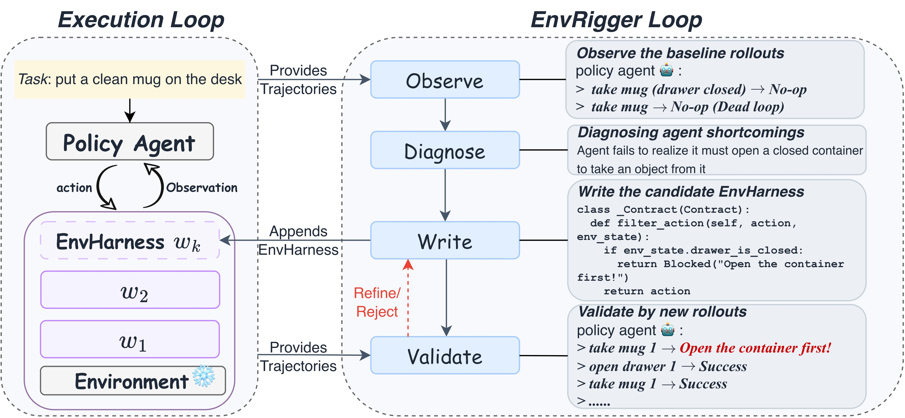

# Paper精读｜EnvHarness: Awakening Static Worlds for Agent Learning

> [!abstract] 一句话结论
> **EnvHarness**：把 agent harness 的思想照搬到"环境的另一侧"——**agent harness 用插件组件包装冻结的 LLM 变成 agent；EnvHarness 用插件组件包装冻结的静态环境变成可定制环境**（Customized Env = Static Env + EnvHarness）。核心是三类环境无关的组件：**Stage**（改初始状态）、**Contract**（重写交互：动作/转换/观测）、**Chain**（拼接/扩展环境），全部在标准接口层操作，**不触碰底层模拟器、保留原始 verifier**。配套 **EnvRigger** 把目标策略当黑盒：Observe → Diagnose → Write → Validate 四阶段循环，从执行轨迹诊断缺陷、合成组件、新鲜 rollout 验证。5 个基准 × 4 个领域（ALFWorld/WebArena/SWE-bench Verified/OfficeQA/SpreadsheetBench）：**最高 +9.0 点（ALFWorld OOD）**、SWE-bench +2.70 SR 且**少用 9.8% 执行步**；RL 训练信号也更优（ALFWorld In-Dist 81.4→87.9）。策略与环境的**持续定向共同进化**。

> [!cite]- 论文信息（点开折叠）
> - **论文标题**：EnvHarness: Awakening Static Worlds for Agent Learning
> - **arXiv**：2608.19880
> - **链接**：[https://arxiv.org/abs/2608.19880](https://arxiv.org/abs/2608.19880)
> - **代码**：github.com/google-research/envharness ｜ 网站：[www.envharness.com](http://www.envharness.com)
> - **作者**：Chengsong Huang, Zifeng Wang, Rujun Han, Jun Yan, Yanfei Chen, Zoey CuiZhu, Ke Jiang, Peng Xia, Han Yu, Yufan Zhuang, Yifei Ming, Jiaqi Pan, Bhavana Dalvi Mishra, Jiaxin Huang, Burak Gokturk, Tomas Pfister, Chen-Yu Lee（Google Cloud AI Research 为主，UNC/WashU 参与）
> - **日期**：2026-08-20

---

## 1️⃣ 论文想解决什么问题

LLM agent 的学习来源正从"策展文本"转向"交互环境"，可现有环境有三个老毛病：

1. 手工构建 + 静态：环境是人工硬编码交互逻辑和 verifier——昂贵、固定

2. 对 agent 的弱点"失明"：静态环境不知道 agent 哪里弱——只让 agent 练习它已经会的行为

3. 快速过时：agent 进步后环境很快被"甩在后面"——无法持续提供挑战

现有环境生成方法（GenEnv/VeriEnv/SWE-smith 等）也想解决，但各有三个缺陷：

- 领域特定管线：每个领域要重新搭

- **依赖昂贵或不可靠的 verifier**

- 产出的环境仍然是静态的——生成一次就固定了

核心需求：一个通用的、可编程的、保留原始验证逻辑的环境定制层——不用从零重建环境，也能让环境跟着 agent 一起进化。

---

## 2️⃣ 核心洞察

> [!important] 核心洞察
> 1. Harness 思想可以镜像：agent harness（Agent = Model + Harness）是"不改权重、外部加层"；EnvHarness（Customized Env = Static Env + EnvHarness）把同一哲学用到环境侧——**环境能力也可以通过外部层扩展，而不是重写核心**。Table 1 的对偶是全文最漂亮的洞见。
>
> 2. 接口级干预 = 安全：只在标准环境接口（reset/step）层面动手，不碰底层模拟器——ground-truth 评估逻辑保留，原始 verifier 照常打分。这是它跟"环境生成"分道扬镳的地方：生成会替换 verifier，定制不碰 verifier。
>
> 3. 三类组件覆盖三种定制模式：Stage（初始状态）、Contract（交互规则）、Chain（任务结构）——"三个基本模式，期待更多"。
>
> 4. 组件策略无关、选择策略相关：组件本身（w 变换）是环境变换、任何策略可用；但选择与参数化必须基于目标策略的观测行为——黑盒观察轨迹即可，不需要内部权重。
>
> 5. 静态环境可能有害：从静态环境提取技能可能**降低**性能（SpreadsheetBench 低于无技能基线）或拉长轨迹（SWE-bench 步数变多）——因为静态环境只让 agent 练习已有行为。**定制环境是纠正性的**：暴露弱点、提供针对性训练信号。
>
> 6. EnvRigger 诊断的双向性：策略挣扎 → 简化/搭脚手架（scaffold missing steps）；策略完美 → 环境太宽松，要加难（inject harder scenarios）——环境的难度是自适应调节的。

---

## 3️⃣ 方法解读

### 组件1：EnvHarness 范式（§2.1）

形式化：环境 E = (S, A, O, T, R, s₀)。EnvHarness 组件 = 环境无关变换 w：E' = w(E)，全部动作发生在接口层——定制初始状态 s₀'、过滤暴露空间（A', O'）、更新转换机制 T'，所有干预外部化，原始 verifier 保留。

**与 agent harness 的对偶（Table 1）**：

| **Agent Harness** | **EnvHarness** |
| --- | --- |
| 基础系统：冻结 LLM | 静态环境 |
| 解决：缺动作/记忆/循环 | 硬编码交互逻辑 |
| Harness 层：能力（工具、记忆） | 定制（状态、规则、观测） |
| 统一输出：自主 agent | 定制环境 |

*Figure 2（核心类比）：agent harness 通过外部插件层（技能、记忆、工具）把冻结 LLM 变成 agent；EnvHarness 把同一原则应用到交互的另一侧——通过插件组件定制冻结环境，底层环境完全不动。*

### 组件2：三类组件（§2.2，Figure 3）

拿 ALFWorld 任务"把干净的杯子放到桌上"当例子最直观：

1. Stage（改初始状态）：w_stage,δ 在 reset() 后施加一串状态操作 δ=(a₁…a_k)，只改 s₀'。可加难（把杯子藏进抽屉，逼 agent 先搜索）或减难（预先清洗杯子，只留最后放置步骤）——**定制起点**。

2. Contract（重写交互）：w_contract,r 三元组 (f_A, f_T, f_O) 分别改写动作空间/转换动力学/观测空间（默认恒等）。可加动作前置条件（没拿杯子就不能洗）、截断房间描述逼 agent 逐步构建空间表征、移除高级传送命令逼逐步移动——**定制交互规则**。

3. Chain（扩展环境）：w_chain,ℓ 由额外环境 E_ext + 组合逻辑 g 构成，E' = g(E, E_ext)。空间取并集、R' 为复合奖励；g 可拼接/交错/按中间结果动态分支。例子：追加"加热土豆放台面"任务，两个环境都验证才成功——逼 agent 把目标扛过原会停止的点（长时程）。

组合性：共享标准接口 → 自由堆叠（Stage+Contract+Chain）。

*Figure 3（组件架构）：左→右为基础环境 + 三个组件（Stage/Contract/Chain），高亮箭头与代码块显示每个包装器如何覆写接口方法（reset/step）来修改状态初始化、转换动力学或观测处理——基础环境与 verifier 完全冻结。*

### 组件3：EnvRigger 自动化（§3，Figure 4）

任务-策略条件化映射：E' = H(E, t; π) = (w_k ∘ … ∘ w₁)(E)——每个 w_i 针对 π 在任务 t 上的弱点设计。

**四阶段循环**（图 4 右侧）：

1. Observe：在基任务上跑 π 收集 rollout 批次——失败暴露弱点、成功界定能力边界

2. Diagnose：分析根因（重复动作循环、长观测解析失败、误读工具约束），决定定制方向：挣扎 → 搭脚手架简化；完美 → 环境太宽松，**注入更难场景**。输出文本诊断

3. Write：基于诊断合成一个或多个组件（单个缺陷可能需 Stage+Contract 组合），输出候选集

4. Validate：包装候选组件实例化 E'，跑 π 的新鲜 rollout，按成功率/失败分布决定：接受 / 拒绝（不可解或不具挑战）/ 精炼（信号尺度差）——精炼则回 Write，循环直到接受或预算耗尽。所有接受的组件加入 EnvHarness

假设：基础环境在验证阶段支持确定性 reset（Stage 的初始状态变更可复现）。

*Figure 4（EnvRigger 循环）：左侧执行循环运行策略产出轨迹，右侧 EnvRigger 以 Observe→Diagnose→Write→Validate 四阶段系统工作，Write+Validate 形成修订循环：生成候选组件 → 新鲜 rollout 评估 → 失败则修订。*

### 组件4：技能提取与实验设置（§4）

- 学习范式：技能提取（ReasoningBank 方式）为主 + RL 兼容性验证

- 5 基准 × 4 领域：ALFWorld（文本具身）、WebArena（网页）、SWE-bench Verified（软件工程）、OfficeQA + SpreadsheetBench（办公自动化）

- 公平性关键设计：EnvRigger 与策略 agent 用**同一模型骨干**（ALFWorld/WebArena 用 Gemini-3.1-Flash-Lite，其余 Gemini-3.5-Flash）——排除"蒸馏更强外部模型"的收益来源

- 基线：No Skills / Original Envs / GenEnv / VeriEnv / SWE-smith（领域特定生成器），共享种子实例、环境数、提取管线、策略模型

- Chain 组件排除在自动管线外（EnvRigger 难观察拼接环境的内部状态），单独在 §5 分析

---

## 4️⃣ 实验部分怎么读

### 主结果（Table 2/3）——一致增益，静态环境甚至有害

**ALFWorld（Table 2）**：

| **技能来源** | **In-Dist** | **OOD** | **Avg** |
| --- | --- | --- | --- |
| No Skills | 62.6 | 60.7 | 61.7 |
| Original Envs | 63.3 | 61.4 | 62.4 |
| GenEnv | 63.3 | 61.9 | 62.6 |
| **EnvHarness** | **66.2** | **70.4** | **68.3** |
| Improvement | +2.9 | **+9.0** | +5.9 |

**WebArena（Table 2）**：Avg 38.5 → 41.6（+3.1，Shopping +6.2 最佳），胜过 VeriEnv（39.6）

**SWE-bench Verified / OfficeQA / SpreadsheetBench（Table 3）**：

| **** | **SWE SR↑** | **SWE 步数↓** | **Office EM↑** | **Office F1↑** | **Sheet Pass@1↑** |
| --- | --- | --- | --- | --- | --- |
| No Skills | 47.67 | 53.58 | 54.23 | 55.77 | 46.44 |
| Original Envs | 49.88 | 55.01（变长！） | 54.40 | 55.77 | 45.88（变差！） |
| SWE-smith | 50.12 | 54.72 | – | – | – |
| **EnvHarness** | **52.58** | **49.61** | **56.20** | **57.73** | **49.15** |
| Improvement | +2.70 | -5.40（**9.8% 更少步数**） | +1.80 | +1.96 | +3.27 |

**关键观察**：

- 每个基准上 EnvHarness 都胜过原始环境，最高 +9.0（ALFWorld OOD）

- 静态环境技能可以有害：SpreadsheetBench 上原始环境技能 < 无技能基线；SWE-bench 上拉长轨迹——静态环境只练已有行为

- 通用接口打败领域特定生成器（GenEnv/VeriEnv/SWE-smith），且覆盖了没有生成基线的办公自动化域

### RL 训练信号（Table 4）——不只是辅助数据

Qwen3-8B-base + GRPO：

| **** | **ALFWorld In-Dist** | **OOD** | **Avg** | **WebShop Score** | **SR** |
| --- | --- | --- | --- | --- | --- |
| Original Envs | 81.4 | 89.6 | 85.5 | 75.6 | 66.0 |
| **EnvHarness Envs** | **87.9** | 88.8 | **88.4** | **79.2** | **67.4** |

- 4/5 指标提升（仅 ALFWorld OOD 微降 0.8）——**重塑环境是独立有效的在线策略优化信号，不是辅助数据**

### Chain 长时程（Table 5）——效率翻倍级

| **** | **SR↑** | **AS↓** |
| --- | --- | --- |
| No Skills | 47.67 | 53.58 |
| Original Envs | 49.88 | 55.01 |
| EnvHarness (Stage/Contract only) | 52.58 | 49.61 |
| EnvHarness (Chain only) | 49.63 | **41.96**（-21.7%） |
| **Combined (S/C + Chain)** | **54.30** | 43.12 |

- Chain 单独就把平均步数从 53.58 压到 41.96（-21.7%）——拼接环境逼 agent 规划更高效的路径

- Stage/Contract + Chain 组合最优（SR 54.30）

### 环境扩展性（Figure 5）——唯一持续改进

- 相同环境预算下，EnvHarness 环境随规模增加**持续提升**，而真实/生成环境**平台化**——EnvHarness 的定制环境有更高信息密度

### 跨模型迁移（Figure 6/Table 9）——弱模型收益更大

- 从最弱到最强策略模型，EnvHarness 技能均有提升；较弱模型从定制环境获益更多（弱点暴露更充分）

---

## 5️⃣ 学术评价

**优点：**

1. 对偶洞见是全文最亮的一笔："Agent = Model + Harness" 的镜像"Customized Env = Static Env + EnvHarness"——把 harness 工程浪潮（Lilian Weng 的 harness engineering 主题）从模型侧推到环境侧，一篇文章把 agent 学习的两个杠杆打通

2. 接口级安全干预：不碰底层逻辑、保留原始 verifier——与"环境生成"（换 verifier）划清界限，工程上可审计、可回退

3. 黑盒诊断 + 白盒验证：EnvRigger 不看内部权重（只观察轨迹）但用新鲜 rollout 严格验证——自动化的正确性有保障，且 write-and-validate 循环天然防"合成出不可解环境"

4. 公平性设计严谨：EnvRigger 与策略同骨干（排除蒸馏强模型嫌疑）、同种子同管线同环境数对比——结论可信

5. 静态环境有害的实证：SpreadsheetBench 降级、SWE-bench 拉长轨迹——"环境也要共同进化"不是口号而是数据

6. 三组件设计干净：Stage/Contract/Chain 覆盖"起点/规则/结构"三个正交定制维度，且可自由组合

7. **开源**（github.com/google-research/envharness）+ 全领域通用（含无生成基线的办公域）

> [!ed-warning] 局限（风险与不确定性）
> 先说处境：接口级定制是拿安全换约束——不碰底层逻辑，就注定看不到拼接环境的内部状态，Chain 被挡在自动管线外是诚实的取舍，不是疏忽。带着这个前提，几条该提的：
> 1. Chain 未进自动管线：EnvRigger 看不到拼接环境的内部状态，Chain 只能靠人工配对——自动化程度打了折扣
>
> 2. verifier 依赖：整套方法假设原始环境有可靠 verifier、确定性 reset 可复现（Stage 验证的前提）——无 verifier 或随机环境的领域受限
>
> 3. 技能提取范式的带宽：主实验走"环境→轨迹→技能"的间接路径，EnvRigger 定制的环境质量被技能提取损失稀释——直接评估定制环境本身的学习信号（如 RL）只在两个基准做了
>
> 4. 诊断质量依赖 LLM：Diagnose/Write 阶段的缺陷识别与组件合成质量取决于骨干 LLM 能力（同骨干排除了蒸馏嫌疑，但也带来一个副作用——弱骨干时诊断可能不准）
>
> 5. 成本未充分披露：EnvRigger 的 Observe/Validate rollout 都在烧 token（附录 Table 11 有估计但正文没强调）——自动化是有代价的
>
> 6. 目标指标适配：Table 12 显示"目标区间命中率"定制是可行的（user-defined target constraints），但正文着墨少——定向定制能力没被充分展示

---

## 6️⃣ 局限与可扩展方向

- Chain 自动化：让 EnvRigger 能观测/模拟拼接环境的内部状态，把长时程定制纳入自动循环

- 无 verifier 环境：弱监督/自监督验证（LLM-as-judge 做 verifier 的可靠性边界）

- 直接 RL 规模化：更多基准上验证"定制环境作为独立 RL 信号"的规模法则

- 组件库扩展：Stage/Contract/Chain 之外的新组件类型（奖励整形、课程调度、多 agent 环境）

- 与 harness 工程叠加：Agent Harness（模型侧）+ EnvHarness（环境侧）双杠杆共同进化——**Agent+Env 联合优化**是自然的下一步

- 可解释性：EnvRigger 的文本诊断 → 组件的映射审计，确认诊断-组件-技能链路的因果性

---

## 与其他论文的对话

| **相关工作** | **关系** | **差异** |
| --- | --- | --- |
| **Agent Harness（Anthropic/OpenAI/Lilian Weng harness engineering）** | 直接对偶 | Harness 包装冻结 LLM 加能力；EnvHarness 包装冻结环境加定制——**同一哲学的镜像**（Table 1 明示） |
| **GenEnv / VeriEnv / SWE-smith（环境生成）** | 竞争基线 | 生成 = 领域特定管线 + 换 verifier + 产出仍静态；EnvHarness = 通用接口 + 保留 verifier + 持续可定制 |
| **ReasoningBank（技能提取）** | 提取管线 | EnvHarness 用其从轨迹提取技能——上游定制环境喂给下游提取 |
| **SWE-bench Verified** | 评测基准 | EnvHarness 用它做软件工程域验证（SR +2.70、步数 -9.8%） |
| **GRPO / RL 策略优化（Qwen3）** | RL 兼容性验证 | 定制环境作为在线 RL 训练信号（ALFWorld 81.4→87.9） |
| **Task-CoEvolve（2608.20169，今日同榜）** | harness 优化邻居 | Task-CoEvolve 优化 harness 代码本身（验证任务共同进化）；EnvHarness 定制环境（训练数据侧）——**"共同进化"主题的两翼** |
| **SWE-Bench ProMax（2608.09802）** | 评测方法论 | ProMax 提高基准难度（专家策展）；EnvHarness 让环境动态适配 agent——静态基准 vs 动态环境 |
| **Recirculation（2608.17981）** | 推理时增强 | Recirculation 增强模型推理；EnvHarness 增强环境侧——模型/环境两侧的外部增强各占一席 |

---

## 7️⃣ 最后总结

EnvHarness 的价值在于把 harness 工程浪潮从模型侧镜像到环境侧：既然 agent 能力可以靠外部插件层扩展（不改权重），环境为什么不能？实现也利落——三类接口级组件（Stage/Contract/Chain）覆盖"起点/规则/结构"三个定制维度，原始 verifier 全程保留；EnvRigger 用"观察-诊断-编写-验证"的循环把合成自动化（黑盒策略、白盒验证）。实证给的答案很硬：定制环境提取的技能全面超过原始环境与领域特定生成器（最高 +9.0），静态环境技能甚至有害；定制环境是独立有效的 RL 信号（ALFWorld +6.5），且随规模持续改进（真实/生成环境平台化）。它和今日同榜的 Task-CoEvolve 一起，把"共同进化"这个主题做实了：harness 优化代码、环境定制数据、agent 更新策略——三者开始形成闭环。对做 agent 训练/评测的人，这是"环境即代码"范式的开篇之作。

---

## 8️⃣ 三句速记

> [!summary]- 点开展开
> 1. 环境也有 harness：Agent = Model + Harness 的镜像——Customized Env = Static Env + EnvHarness；插件组件包装冻结环境，原始 verifier 永不触碰。
>
> 2. 三类组件 + 四阶段自动合成：Stage（初始状态）/Contract（交互规则）/Chain（任务拼接）；EnvRigger 黑盒观察轨迹 → 诊断 → 合成 → 新鲜 rollout 验证，策略与环境持续定向共同进化。
>
> 3. 静态环境有害、定制环境持续改进：5 基准 × 4 域最高 +9.0（ALFWorld OOD）、SWE-bench 步数 -9.8%；静态环境技能让 SpreadsheetBench 降级、SWE-bench 拉长轨迹；RL 信号 ALFWorld 81.4→87.9，且环境规模越大收益越持续（真实/生成环境平台化）。
