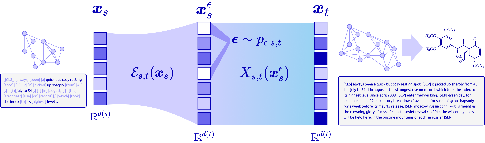
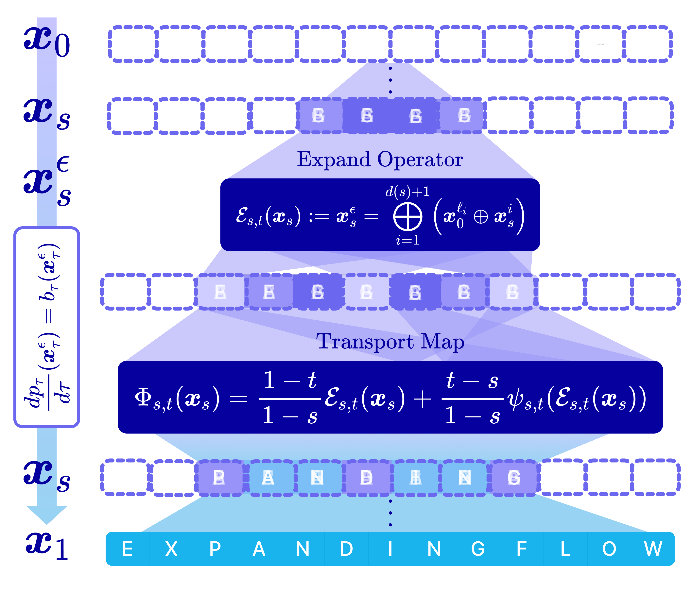

# Paper精读｜Expanding Flow Maps

> [!abstract] 一句话结论
> **给 flow-based 生成模型补一个 expand operator，把「状态维度在初始化时焊死」这条限制拆掉——流映射分解成「扩展状态空间 + 沿插值轨迹传输」两个可学习操作，连续和离散状态空间上都做出自适应维度的少步生成。**

> [!cite]- 论文信息（点开折叠）
> - **论文标题**：Expanding Flow Maps
> - **arXiv**：2607.21585
> - **链接**：[https://arxiv.org/abs/2607.21585](https://arxiv.org/abs/2607.21585)
> - **作者**：Sophia Tang, Pranam Chatterjee
> - **机构**：University of Pennsylvania (CIS / Bioengineering)
> - **日期**：2026-07-23

---

## 1️⃣ 论文想解决什么问题

Flow maps 已经是少步生成的统一底座，连续和离散状态空间都管。但它出厂就带一条焊死的限制：**状态空间维度在初始化时固定**——生成 $d$ 维向量就必须一直是 $d$ 维，生成 $L$ 长度序列就必须一直是 $L$ 长度。

现实任务偏偏不长这样：

- 可变分辨率图像和 3D 形状

- 任意长度的音频和视频

- 未知序列长度的语言

- 不同内在维度的多模态数据交织

**核心问题**：如何实现自适应维度的少步生成？

---

## 2️⃣ 核心洞察

> [!important] 三条核心洞察
> 1. **Expand-Transport 分解**：把流映射从固定维度推广到扩展维度——任意两个时间步之间的映射，拆成两个操作：
>
>   - **Expand Operator** $\mathcal{E}_{s,t}$：把状态从 $d(s)$ 维提升到 $d(t)$ 维，添的是条件噪声坐标
>
>   - **Transport Map** $X_{s,t}$：把扩展后的状态沿插值轨迹从时间 $s$ 推到时间 $t$
>
> 2. **局部时间坐标（Local Time Coordinate）**：每个维度有自己的"局部时钟"。新插入的维度在插入时刻从 $t_i=0$ 开始，按 $\frac{t - t_i^{\text{ins}}}{1 - t_i^{\text{ins}}}$ 增长，这使得所有维度在共同的局部时钟上去噪。
>
> 3. **PDMP 统一表征**：Expanding Generative Flow 是分段确定性马尔可夫过程（PDMP），传输（ODE）和跳跃（维度扩展）统一进同一个带扩展生成器的随机过程。

*图注：从时间 *$s$* 的低维空间 *$\mathbb{R}^{d(s)}$* 跳到时间 *$t$* 的高维空间 *$\mathbb{R}^{d(t)}$*：(i) 通过 expand operator *$\mathcal{E}_{s,t}$* 添加噪声 *$\epsilon$* 扩展维度，(ii) 通过 transport map *$X_{s,t}$* 在扩展空间中沿插值轨迹推进。*

---

## 3️⃣ 方法解读

### 组件1：Expand Operator $\mathcal{E}_{s,t}$

维度要能长，先得回答「新坐标从哪来」。$\mathcal{E}_{s,t}$ 的填法是条件噪声坐标——不是乱填，噪声正是后续 transport 要去噪的对象：

$\mathcal{E}_{s,t}(\boldsymbol{x}_s, \boldsymbol{\epsilon}): \mathbb{R}^{d(s)} \times \mathbb{R}^{d(t)-d(s)} \to \mathbb{R}^{d(t)}, \quad \boldsymbol{\epsilon} \sim p_{\epsilon|s,t}$

新坐标怎么摆进状态，按任务特性分三种实例化：

- **拼接（Concatenation）**：$\text{Cat}(\boldsymbol{x}_s, \boldsymbol{\epsilon})$ — 适合自回归序列生成

- **位置插入（Positional Insertion）**：在 $\{1, \dots, d(t)\}$ 中选定位置交错插入 — 适合任意长度序列生成

- **子节点扩展（Child Expansion）**：$\boldsymbol{x}_s^{\epsilon}[i] = \boldsymbol{x}_s[\text{pa}(i)] + \sigma \boldsymbol{\epsilon}_i$ — 适合 coarse-to-fine 生成

### 组件2：Transport Map $X_{s,t}$

传输部分不发明新东西，照旧用 mean velocity 参数化——要紧的是 $s,t$ 任意取之后，整族流映射得彼此自洽：

$X_{s,t}(\boldsymbol{x}_s^{\epsilon}) = \boldsymbol{x}_s^{\epsilon} + (t-s) v_{s,t}(\boldsymbol{x}_s^{\epsilon})$

自洽由三个一致性条件钉死：

- **Lagrangian**：$\partial_t \Phi_{s,t}(\boldsymbol{x}) = v_{t,t}(\Phi_{s,t}(\boldsymbol{x}))$

- **Eulerian**：$\partial_s \Phi_{s,t}(\boldsymbol{x}) + \nabla_{\boldsymbol{x}} \Phi_{s,t}(\boldsymbol{x}) \tilde{v}_{s,s}(\boldsymbol{x}) = 0$

- **Semigroup**：$\Phi_{u,t}(\Phi_{s,u}(\boldsymbol{x})) = \Phi_{s,t}(\boldsymbol{x})$

### 组件3：Expanding Flow Map

整个流映射就是两个操作的复合——先扩维，再传输：

$\Phi_{s,t} = X_{s,t} \circ \mathcal{E}_{s,t}$

展开形式：

$\Phi_{s,t}(\boldsymbol{x}_s) = \mathcal{E}_{s,t}(\boldsymbol{x}_s) + (t-s) v_{s,t}(\mathcal{E}_{s,t}(\boldsymbol{x}_s))$

### 组件4：离散 Expanding Flow Map

序列版本换了个抓手：离散序列（simplex 空间）上，插值改由 mean denoiser $\psi_{s,t}$ 定义：

$\psi_{s,t}(\boldsymbol{x}) = \boldsymbol{x} + (1-s) v_{s,t}(\boldsymbol{x}), \quad v_{s,t}(\boldsymbol{x}) = \frac{\psi_{s,t}(\boldsymbol{x}) - \boldsymbol{x}}{1-s}$

离散 EFM：

$\Phi_{s,t}(\boldsymbol{x}_s) = \frac{1-t}{1-s} \mathcal{E}_{s,t}(\boldsymbol{x}_s) + \frac{t-s}{1-s} \psi_{s,t}(\mathcal{E}_{s,t}(\boldsymbol{x}_s))$

往哪儿插、插几个，交给一个按 insertion 概率抽取的二项分布：

$\ell_i \sim \text{Binomial}(L - n_s, \frac{\hat{\mathcal{I}}_{s,t}(\boldsymbol{x}_s)[i]}{L - n_s})$

### 组件5：Piecewise-Deterministic Markov Process

分量各自看清楚之后，作者把整套过程放进一个统一表征：传输（ODE）与跳跃（维度扩展）共用一个扩展生成器，一份算式管两类演化：

$\mathcal{L}_t f(\boldsymbol{x}) = \underbrace{b_t(\boldsymbol{x}) \cdot \nabla f(\boldsymbol{x})}_{\text{传输}} + \underbrace{\lambda_t(\boldsymbol{x}) \int (f(\mathcal{E}_t(\boldsymbol{x}, \boldsymbol{\epsilon})) - f(\boldsymbol{x})) p_{\epsilon|t}(d\boldsymbol{\epsilon})}_{\text{跳跃}}$

**Change-of-Variables Formula**：

$\log p_t(X_{s,t}(\boldsymbol{x}_s^{\epsilon})) = \log p_s(\boldsymbol{x}_s^{\epsilon}) - \int_s^t \nabla \cdot b_{\tau}(X_{s,\tau}(\boldsymbol{x}_s^{\epsilon})) d\tau$

似然沿用换元公式，改动只有一处且很有分寸——散度仅对已插入的活跃维度求和，还没上场的维度不计账：

$\nabla \cdot b_{\tau} = \sum_{i: t_i^{\text{ins}} \leq \tau} \partial_{\boldsymbol{x}^i} b_{\tau}^i$

*图注：离散 Expanding Flow Maps 示意图。通过 expand operator 插入潜在 token，然后通过 mean denoiser *$\psi_{s,t}$* 将插入的 token 去噪到目标分布。*

---

## 4️⃣ 实验部分怎么读

### 实验设置

| **任务** | **数据集** | **状态空间** | **基线** |
| --- | --- | --- | --- |
| 分子构象生成 | GEOM-QM9, GEOM-Drugs | 连续 3D 坐标 | GeoDiff, SubgDiff, MSGEN |
| 分子图生成 | QM9 | 离散图结构 | DeFoG, CFM |
| 语言建模 | LM1B | 离散序列 | FLM, FMLM, CFM, Duo, MDLM |

### 核心结果

**分子构象生成**（Table 1）：

| **模型** | **步数** | **GEOM-QM9 COV-R** | **GEOM-QM9 COV-P** | **GEOM-Drugs COV-R** | **GEOM-Drugs COV-P** |
| --- | --- | --- | --- | --- | --- |
| MSGEN | 1000 | 88.36 | 49.54 | 85.06 | 49.28 |
| **EFlow** | **20** | **88.51** | **53.07** | **81.78** | **55.88** |
| **EFM+R** | **14** | **87.79** | **55.56** | **87.97** | **64.67** |

*EFlow 用 20 步超越 1000 步的 MSGEN，EFM+R 用 14 步达到最佳——步数砍掉 10-50×，COV-P 反而全面更高。*

**分子图生成**（Table 2）：

| **模型** | **步数** | **Valid ↑** | **Unique ↑** | **FCD ↓** |
| --- | --- | --- | --- | --- |
| DeFoG | 100 | 99.2 | 96.2 | 0.134 |
| **EFlow** | **10** | **97.9** | **96.1** | **0.390** |
| CFM | 1 | 90.0 | 91.8 | 2.14 |
| **EFM** | **1** | **90.2** | **97.7** | **0.44** |

*同为 1 步，EFM 的 FCD 是 0.44，CFM 只有 2.14——差了近 5 倍。*

**语言建模**（Table 3 & 4）：

| **模型** | **步数** | **Gen. PPL ↓** |
| --- | --- | --- |
| FLM | 1024 | 111.36 |
| **EFlow** | **1024** | **103.63** |

| **模型** | **步数** | **Gen. PPL ↓** |
| --- | --- | --- |
| FMLM | 2 | 110.19 |
| CFM | 1 | 269.72 |
| **EFM** | **1** | **98.35** |

*EFM 1 步 PPL 98.35，超越所有少步基线。*

*（原图未能本地化：Figure 3: EFlow 生成样本；IMA 媒体接口没有可用媒体编号）*

*图注：GEOM-Drugs 上的 EFlow 分子构象生成样本。重原子骨架先固定，氢原子随后插入并去噪。*

*（原图未能本地化：Figure 4: EFM 生成样本；IMA 媒体接口没有可用媒体编号）*

*图注：EFM 少步蒸馏后的分子构象生成样本。仅 14 步即达到最佳精度。*

---

## 5️⃣ 学术评价

**优点：**

1. **打的是真痛点**：「维度出厂焊死」是 flow maps 的框架级限制，可变分辨率、任意长度生成、多模态交织都撞过这堵墙——拆掉它，这套框架能接的应用面宽了一圈

2. **推导链条没有断点**：从 expanding interpolant 到 expand operator、transport map，再到 PDMP 统一表征，每一步都有数学对象接住

3. **统一是全面的**：连续 + 离散、固定维度 + 可变维度、多步 + 少步，全在一个框架里

4. **三种模态都验过**：连续（3D 分子构象）、离散图（分子图）、离散序列（语言），不是只挑对自己有利的模态

5. **少步优势有数字撑着**：多个基准上用 10-50× 更少的步数超越现有方法，20 步对 1000 步是最直观的一组

6. **没有另起炉灶**：expand operator 取 identity 时自然退化为标准 flow maps——新框架把旧框架完整含住，这是好理论的体面

> [!ed-warning] 局限（先替作者说句公道话，再提问题）
> 先说处境：「怎么加维度」是刚引入的自由度，论文先给三种手动实例化、把自动选择留作后续方向，我理解这个顺序——先证明分解成立，再谈怎么选。但该提的还是要提：
> 1. **扩展算子靠手选**：拼接、位置插入、子节点扩展得按任务特性挑，目前没有学习机制
>
> 2. **离散 EFM 单步坍缩**：单步采样性能下降明显，是框架目前最刺眼的洞
>
> 3. **语言建模熵偏低**：EFM 的熵低于固定长度基线，可能与局部时间坐标的调度有关
>
> 4. **语言只到 LM1B**：更大规模语言模型上的效果，论文没有展示
>
> 5. **训练目标不好伺候**：diagonal loss、consistency loss、insertion loss 三套要一起训练

---

## 6️⃣ 局限与可扩展方向

- 开发自适应的 expand operator 选择机制（基于学习而非人工设计）

- 研究单步离散 EFM 模式坍缩的解决方案

- 扩展到更大规模的语言模型（GPT-2/LaMMA 级别）

- 探索多模态生成（图像+文本联合扩展）

- 研究 expand operator 的最优调度策略

- 将框架扩展到视频生成（时空维度同时扩展）

---

## 7️⃣ 最后总结

先摆最硬的数字：EFlow 用 20 步追平 1000 步的 MSGEN，EFM+R 14 步做到最佳；同为 1 步，EFM 的 FCD 是 0.44、CFM 只有 2.14，语言建模上 EFM 的 PPL 98.35 对 CFM 的 269.72。数字背后是同一个主张，也是全文我最认同的一句判断：输出大小本身应该是可学习的自由度，而不是预先设定的超参数。但有两个洞还没填平：离散 EFM 的单步坍缩、语言建模熵偏低（可能与局部时钟调度有关）。expand operator 能不能自动学出来、单步能不能稳住，这两件事决定这套框架是停在论文里，还是走进主流生成管线。

---

## 8️⃣ 三句速记

> [!summary]- 点开展开
> 1. **Expand-Transport 分解**：$\Phi_{s,t} = X_{s,t} \circ \mathcal{E}_{s,t}$——流映射拆成「维度扩展 + 沿插值轨迹传输」两个可学习操作。
>
> 2. **局部时间坐标**：每个维度自带时钟，新插入的维度从 $t_i=0$ 开始去噪，异构维度得以同步去噪。
>
> 3. **框架兼容**：expand operator 取 identity 就退回标准 flow maps；连续/离散、固定/可变、多步/少步，全在这一个框架里。
