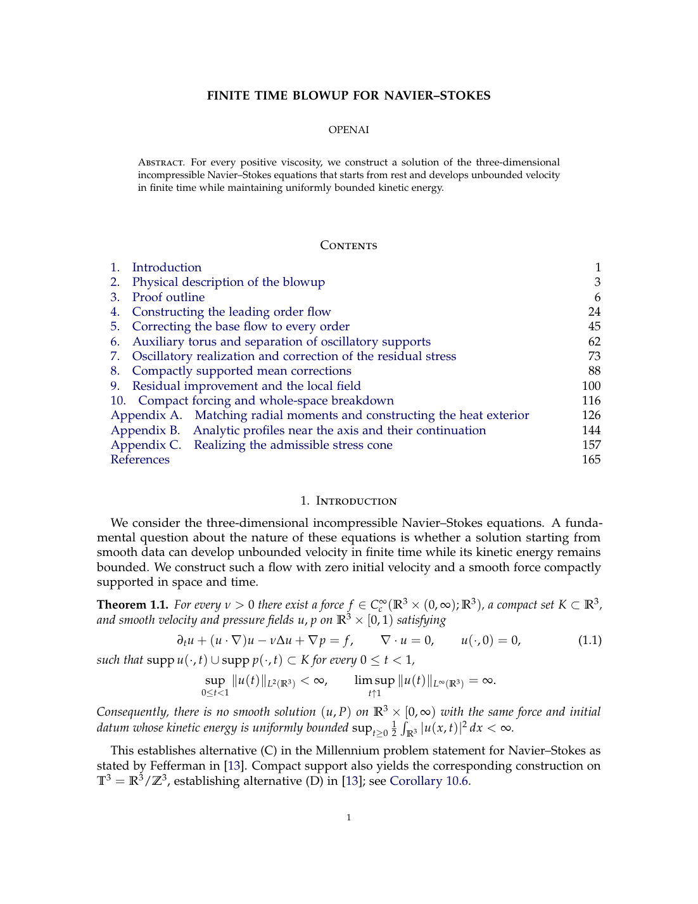
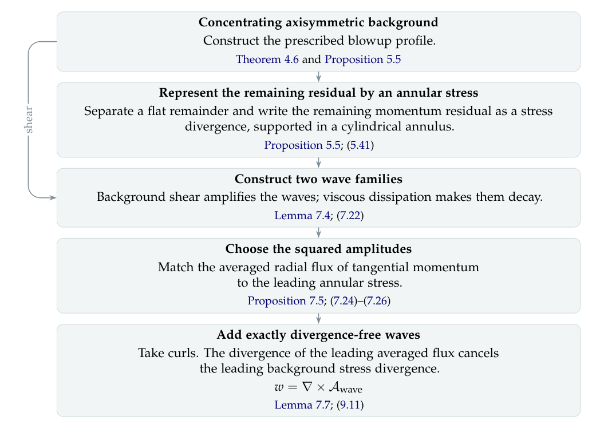
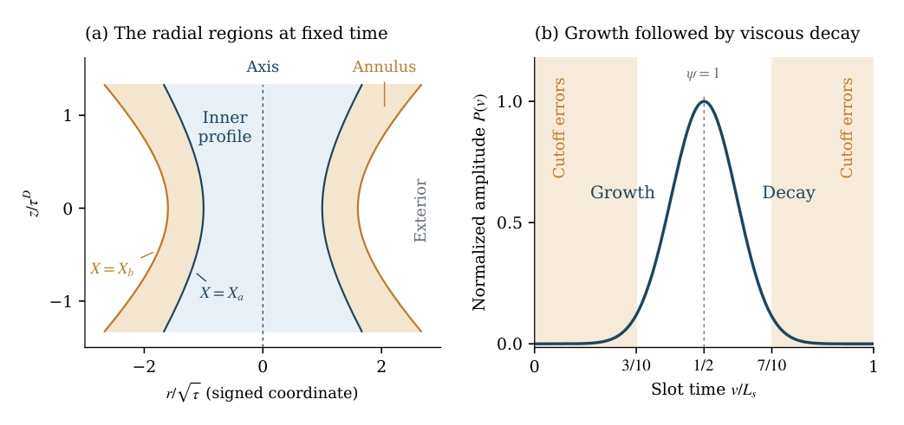

# Paper精读｜Finite time blowup for Navier–Stokes

> [!abstract] 一句话结论
> 论文声称：对任意正粘性系数 ν，构造一个三维不可压 Navier–Stokes 解，初始速度为零，外力在时空中光滑且紧支撑；解在 t=1 前每个时刻都光滑、动能保持有界，但当 t→1 时 L∞ 速度发散。作者据此声称建立 Clay 千禧年问题在 R³ 上的 breakdown alternative (C)，并由紧支撑构造推出周期三维环面上的 alternative (D)。
> 这不是无外力问题的"任意解都会爆炸"，也不是数值模拟发现，而是一项高度定制的存在性构造：先设计会集中和放大的背景流，再用振荡脉冲产生的平均二次动量通量抵消背景流的奇异残差，最后把所有误差修正到外力在 t=1 仍然光滑。

> [!cite]- 论文信息（点开折叠）
> - **来源页面**：[https://www.alphaxiv.org/abs/2609.navier-stokes-solution](https://www.alphaxiv.org/abs/2609.navier-stokes-solution)
> - **原始论文 PDF**：[https://cdn.openai.com/pdf/32d9f210-8b73-45e0-91bc-82a30aef8a9a/navier-stokes.pdf](https://cdn.openai.com/pdf/32d9f210-8b73-45e0-91bc-82a30aef8a9a/navier-stokes.pdf)
> - **配套 Lean 仓库**：[https://github.com/openai/NavierStokesAndEuler](https://github.com/openai/NavierStokesAndEuler)
> - **页面标注**：OpenAI，提交日期 2026-09-08；本文没有 arXiv 编号，来源是 OpenAI PDF/项目页面而非 arXiv 版本。

---

## 1. 论文究竟证明了什么

论文的 Theorem 1.1 给出：对每个 ν>0，存在

- f ∈ C∞_c(R³×(0,∞);R³)；

- 紧集 K；

- R³×[0,1) 上光滑的速度 u 和压力 p；

满足

∂t u +(u·∇)u −νΔu+∇p=f，  div u=0， u(·,0)=0。

并且：

- 对每个 t<1，u、p 的空间支撑位于同一个固定紧集 K；

- sup_{0≤t<1} ||u(t)||₂ <∞；

- limsup_{t↑1} ||u(t)||∞ =∞。

因此同一初值和同一外力不可能存在一个在所有 t≥0 都光滑、且动能统一有界的全局解：如果存在，它在 t<1 的局部区间上要和构造出的解一致，继而继承 t=1 附近的速度无界性，产生矛盾。

这里的逻辑重点是"存在一个特殊外力，使得不存在满足全局光滑+统一能量界的解"，而不是"证明三维无外力 Navier–Stokes 的所有光滑解都会有限时爆炸"。

---

## 2. 核心机制：细长塌缩涡 + 振荡脉冲

令 τ=1−t，作者引入小参数 h∈(0,1/100)，设计一个轴对称、自相似收缩的核心：

- 径向尺度 ℓr ≍ τ^(1/2)；

- 轴向尺度 ℓz ≍ τ^(1/2−h)；

- 因为 h>0，ℓr/ℓz ≍ τ^h→0，核心越来越像细长柱体；

- 方位角和轴向速度典型大小 ≍ τ^(−1/2−h)；

- 径向速度只有 O(τ^(−1/2))。

核心体积约为 τ^(3/2−h)，所以尽管速度发散，动能仍可趋于 0（论文给出的核心动能量级为 τ^(1/2−3h)，在 h<1/100 时仍趋于 0）。这是"L∞ 发散而 L² 有界"的关键尺度分离。

物理图像是：径向流把角动量带向更小半径，导致旋转加速；轴向流把不可压缩条件要求的流体输送出去；轴向和方位角剪切共同放大扰动。外部采用一个纯方位角、满足径向热方程的 heat exterior，使核心之外不需要奇异外力。

*图：定理页主要声明有限时间 L∞ 速度发散但动能有界，并说明这对应 Millennium problem breakdown alternative (C)/(D)。*

---

## 3. 为什么不能只用背景流

单独的塌缩背景流虽然可以产生速度发散，但它与 Navier–Stokes 方程之间的残差在核心外侧的过渡环带中会发散。若直接把残差定义为外力，外力就会在 t=1 处奇异，不符合定理要求的光滑紧支撑外力。

作者因此把问题改写成一个"奇异项精确抵消"问题：

1. 先构造背景 (uB,pB)，使残差等于环带应力的负散度，加上对奇异时刻 flat 的误差；

2. 在环带放置两族局部化、空间振荡的脉冲；

3. 利用脉冲的二次项 ∇·(w⊗w) 产生预设的平均动量通量；

4. 让两族脉冲的协方差正组合恰好抵消背景应力；

5. 对剩余谐波、均值项和径向矩继续迭代修正。

关键不是振荡速度本身的平均值，而是其平方乘积的平均值。例如径向速度和方位角速度都可以零均值，但它们的乘积具有非零平均，从而产生净的角动量通量。

---

## 4. 应力锥与两族脉冲

背景流在环带留下二维目标应力 T=(Trθ,Trz)。作者构造两族脉冲，其单位振幅协方差方向为 v1、v2，并要求

T=c1v1+c2v2， c1>0， c2>0。

也就是 T 位于两个脉冲协方差方向生成的正锥内部。正系数很重要：它允许把应力解释为两族脉冲的平方振幅，而不是靠不合法的负平方根或破坏实值性的系数。

论文用径向 profile 的构造、五个累计径向积分的匹配，以及在环带插入 N log X 型高频微扰来实现这一点。微扰振幅只有 O(N⁻¹)，但 X∂X 会把导数改变到 O(1)——剪切方向因此能拿到 O(1) 量级的调整，而 profile 值和径向矩只挪动小量；再用局部修正把五个矩精确恢复。

---

## 5. 脉冲的放大—粘性衰减过程

论文设计脉冲先从背景剪切中吸收能量并放大，随后由于剪切改变波形、径向波长缩短，粘性阻尼最终占优，脉冲在时间槽末尾衰减。尺度上，论文给出典型波振幅和波长：

- Awave ≍ q^(−1/2−h/2)；

- ℓwave ≍ q^(1/2+h/2)；

- Awave² ≍ q^(−1−h)，正好达到所需应力尺度。

脉冲用向量势取 curl 构造，因此速度增量自动无散。作者额外引入辅助二维环面变量 Y：不同标签的脉冲在 Y 上拥有不相交支持，从而让它们的交叉乘积在点态上消失，同时保留同一标签内部的必要相互作用。这是一个高度技术化的"管理大量振荡脉冲交互"的装置。

*图 5｜背景流到第一轮振荡校正的构造步骤。 [来源](https://cdn.openai.com/pdf/32d9f210-8b73-45e0-91bc-82a30aef8a9a/navier-stokes.pdf#page=13)*

*图：proof outline 页面展示了背景构造、脉冲修正与最终外力延拓的整体证明结构。*

---

## 6. 误差修正与最终外力

构造不是一次性完成，而是四步循环：

1. 解非齐次振幅方程，消除有限个支撑谐波；

2. 调整波振幅，修正辅助平均后的切向残差；

3. 对辅助变量零均值部分使用 temporal mean inverse；

4. 用五方程修正径向矩缺陷，并重新恢复压力。

论文的 Proposition 9.6 声称每循环一次，残差衰减指数提高 1/10。通过有限阶段比较、逐阶段估计、局部化和端点延拓，最终得到一个速度和压力在 t<1 光滑、但残差可以延拓穿过 t=1 的构造。这个延拓后的残差就是光滑外力 f。

作者的谨慎藏在一个细节里：不是直接把"无限多 flat 残差"粗暴相加，而是先在固定有限阶段比较，再利用每阶估计和端点定理完成实现——绕开无限级数在 t=1 的直接求和问题。

---

## 7. 周期环面结果

论文主定理是 R³。论文声称由于最终速度、压力和外力具有紧支撑，可以把整个构造放入足够大的周期盒中，从而得到 T³=R³/Z³ 上的对应 breakdown 结果（Corollary 10.6）。配套仓库 README 也把 Navier–Stokes 部分分成：

- whole space R³：没有全局光滑且统一动能有界的解；

- periodic torus：不存在全局光滑解。

这两个表述并不完全相同：R³结果保留了"统一动能有界"的条件，周期环面结果的全局光滑性表述更直接。

---

## 8. Lean 仓库核对

仓库为：[https://github.com/openai/NavierStokesAndEuler。](https://github.com/openai/NavierStokesAndEuler。)

README 声称使用 Lean 4.34.0-rc2、Mathlib 和 Lake，并提供 Comparator 独立检查说明。

从源码结构看，NavierStokes.lean 导入 NavierStokes.ComparatorSolution；后者把两个结果暴露为：

- navier_stokes_breakdown_R3；

- navier_stokes_breakdown_periodic。

源码中的证明桥接到 ComparatorBridge，再由 ActualCandidateAssembly.selected_candidate 提供候选构造。也就是说，仓库不是只有一个"定理声明"文件，而是有大量 ActualCandidateConstruction、StageEstimates、SignedWaveData、MeanExterior 等模块，尝试把构造的各个阶段接成 Lean 定理链。

但本次环境中 git clone 整个仓库未完成，因此我没有在本机执行 lake build，不能把"源码中存在证明链"升级成"我已独立编译验证"。仓库 README 的"可独立检查"主张仍应以实际的 clean checkout + lake build/Comparator 检查和外部复核为准。

*图 3｜集中几何和参照脉冲的径向剖面与衰减。 [来源](https://cdn.openai.com/pdf/32d9f210-8b73-45e0-91bc-82a30aef8a9a/navier-stokes.pdf#page=9)*

*图： concentrating geometry 页面展示了核心收缩、环带位置和脉冲位置关系。*

---

## 9. 论文没有做什么

- 没有数值实验；这是解析构造，不是 simulation paper。

- 没有给出一个简单可运行的显式速度公式；核心对象由 profile、脉冲、校正和极限拼接构成。

- 没有证明无外力 Navier–Stokes 的一般解必然爆炸。

- 没有证明普通物理边界条件或自然初值会产生这种奇异性。

- "动能有界"是对构造解的统一上界，不是说所有可能解都满足该性质。

- 论文尚未被我核验为 Clay Institute 已接受的正式解决方案；应区分"作者声称建立 alternative (C)/(D)"与"数学界完成同行评审并承认解决"。

---

## 10. 我的判断

如果构造中的 profile 存在性、无穷阶残差修正、t=1 端点延拓、外力光滑性以及周期化步骤都没有隐藏缺口，那么这是直接击中三维 Navier–Stokes 千禧年问题 breakdown 分支的结果，而且机制很漂亮：用不改变平均速度的高频脉冲，通过二次通量给塌缩背景提供内部动量输运。

但它的可信度门槛极高。最需要外部专家逐条检查的是：

1. 脉冲平均应力与真实物理二次项之间是否完全一致；

2. 辅助环面上的"交叉项点态消失"在代入物理相位图后是否仍覆盖所有导数项；

3. 四步修正循环是否真的保持无散、支撑和五个径向矩；

4. 残差对所有笛卡尔时空导数是否在 t=1 一致延拓；

5. 用统一有界动能的局部唯一性/一致性推出无全局解的逻辑是否严格符合 Clay 版本的量词；

6. Lean 形式化是否依赖未经证明的公理或 Comparator challenge 中的假设，及其与论文构造的对应关系。

因此最准确的评价是：这是一篇声称用极其复杂的解析构造解决 Navier–Stokes breakdown 分支的论文，论证目标和机制都非常明确；在没有完成同行评审、独立编译和逐项数学审查前，不能简单说"千禧年问题已经被正式解决"。
