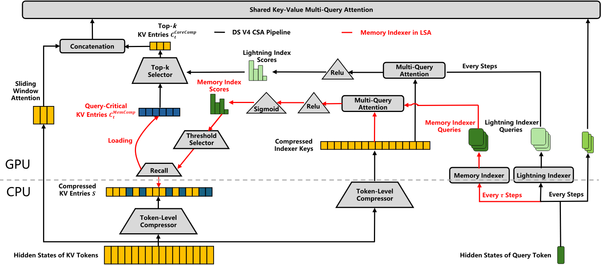
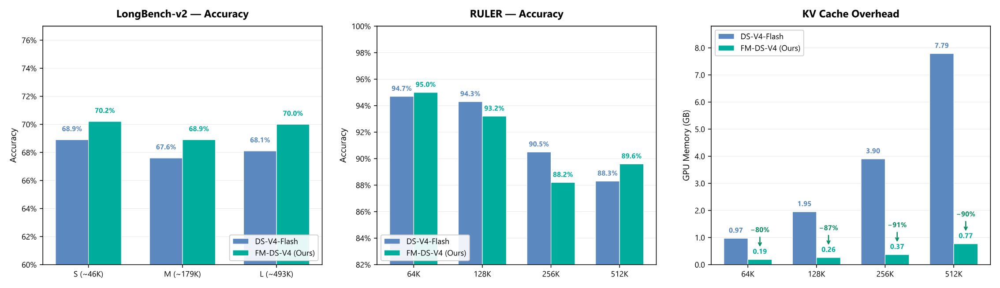

# Paper精读｜FlashMemory-DeepSeek-V4: Lightning Index Ultra-Long Context via Lookahead Sparse Attention

> [!abstract] 一句话结论
> 提出 **Lookahead Sparse Attention (LSA)**：backbone 的主要计算路径不动，只用一个独立的 **Neural Memory Indexer** 在解码时主动预测并只取回 query-critical 的历史 KV chunk，将 GPU KV cache 占用压缩至完整上下文的 **13.5%**（500K 长度下达 90%），同时平均准确率反而 **+0.6%**——这个“反而”不是运气：过滤掉无关 chunk 之后，attention 里的噪声也少了，“less is more” 的注意力去噪效应在这儿有实测支撑。

> [!cite]- 论文信息（点开折叠）
> - **论文标题**：FlashMemory-DeepSeek-V4: Lightning Index Ultra-Long Context via Lookahead Sparse Attention
> - **arXiv**：2606.09079
> - **链接**：[https://arxiv.org/abs/2606.09079](https://arxiv.org/abs/2606.09079)
> - **作者**：Yan Wang, Qifan Zhang, Jiachen Yu, Tian Liang, Dongyang Ma, Xiang Hu, Zibo Lin, Chunyang Li, Zhichao Wang, Miao Peng, Nuo Chen, Jia Li, Yujiu Yang, Haitao Mi, Dong Yu
> - **机构**：Independent Researchers / Tencent / The Hong Kong University of Science and Technology (Guangzhou) / Tsinghua University
> - **日期**：2026-06-09

---

## 1️⃣ 论文想解决什么问题

当前超长上下文 LLM 推理面临一个根本矛盾：**推理 FLOPs 可以通过稀疏注意力降低到近常数，但 KV cache 的 GPU 显存占用仍然随序列长度线性增长**。DeepSeek-V4 等模型通过重压缩注意力（HCA）缓解了增长速度，但为了保留细粒度事实回忆能力，仍需保留大量低压缩/全注意力层，只是减缓而未能消除线性瓶颈。

另一方面，作者对生产环境推理日志的实证分析发现：**超过 90% 的 64K+ 长上下文请求仅靠最后 8K token 就能准确回答**——绝大多数 GPU 显存被浪费在了对当前 token 无贡献的历史上下文中。但简单使用滑动窗口丢弃历史又会彻底失败于那些真正需要全局上下文合成的任务。

现有方案处于两难：要么保留全部 KV cache 支付线性增长的显存税，要么丢弃历史丢失远方回忆能力。LSA 的核心理念是：**让模型不再被动地记住所有历史，而是主动预测未来几步解码需要哪些历史 chunk**，按需取回。

---

## 2️⃣ 核心洞察

> [!important] 三条核心洞察
> 1. **预测性上下文选择替代被动缓存**：LSA 不修改 backbone 模型的主要计算路径，而是增加一个轻量级的 Memory Indexer，以固定步长 τ=64 触发，预测未来 τ 步解码所需的历史 compressed KV chunk，只在 GPU 中保留这些 query-critical 的 chunk。这从根本上将 KV cache 从线性增长变为按需分配。
>
> 2. **骨干无关的解耦训练（Backbone-Free Decoupled Training）**：Memory Indexer 被设计为标准的 Dual-Encoder 检索架构，所有历史 compressed indexer keys 和 label 都可离线预计算并冻结。训练时仅优化 query encoder 端的三个低秩投影矩阵（< 0.1% 全模型参数量），**从来不需要将千亿参数 backbone 模型加载到 GPU 显存**。整个 Indexer 在一张 H20 GPU 上 1 小时内收敛。
>
> 3. **“注意力去噪器”效应**：在超长上下文场景中，LSA 不仅节省显存，还通过过滤掉数千条无关历史 chunk，**减少了 attention dot-product 中的噪声**，从而缓解了长上下文中的事实幻觉。在 LongBench-v2-L (493K) 上以 10% 的显存预算反而超越全量 baseline +1.9%——去噪假设要的就是这样一条直接证据。

---

## 3️⃣ 方法解读

### 组件1：Memory Indexer 架构

*图 2｜LSA 前瞻稀疏索引与标准 CSA 流程。 [来源](https://arxiv.org/html/2606.09079v1/#S1.F2)*

- 完全复用 DeepSeek-V4 原生 Lightning Indexer 的架构设计，保持对 backbone 的最小修改

- 核心改变只有两处：(1) 将最终激活函数从 ReLU 替换为 **Sigmoid**（将分数归一化到 (0,1)），(2) 将硬 Top-k 选择替换为 **阈值机制**（I ≥ 0.5），实现动态数量召回

- 解码时每 τ=64 步触发一次，用当前隐藏状态通过低秩投影生成 indexer query，与历史 compressed indexer keys 做 head-fused gated matching

- 匹配分数超过 0.5 的历史 compressed KV entry 从 CPU Cold Pool 取回 GPU，参与后续原生 Lightning Indexer 的细粒度 Top-k 筛选

### 组件2：Lookahead 数据集构建

- 关键挑战：用原生 Lightning Indexer 的硬 Top-k 输出作为 ground truth 会被大量低概率噪声条目污染（每个窗口近 10,000 个正样本）

- 提出 **Cross-Layer Majority Voting** 黄金标签过滤流水线：对每个解码 token，遍历所有 L=21 层 CSA 提取原生 indexer logit，经 Softmax 归一化 → Top-p (p=0.6) 核采样 → 跨层投票（≥3 层共识才认定为真正正样本）

- 最终正样本量降至每窗口约 100-1000，消除了标签噪声

- 训练集约 10,000 个长文档，上下文长度 16K~512K

### 组件3：解耦训练策略

- 训练目标：标准的 **Binary Cross-Entropy** loss，将 Memory Indexer 作为检索模型优化

- 关键系统洞察：历史 compressed indexer keys 完全冻结，仅训练 query encoder 端的投影矩阵 W^DQ, W^IUQ, W^w

- 使用 **Focal Loss (γ=2)** 替代标准 BCE，防止易分类负样本主导梯度

- 负采样比 3:1（三个负样本对应一个正样本）

- 排除了 Pairwise-to-Pointwise 链式训练、强负样本挖掘、加权损失等流行技巧——实验里试过，无效甚至有害

### 组件4：最优架构配置

- 早期实验发现：浅层（初始层）的 indexer 性能极差（只捕捉 token 级统计信息），过多的层联合（8 层）会导致 recall 过高（30%-49% 的 chunk 被召回），违背降显存目标

- 通过约 500 次 Pareto 扫描，确定 **3 个战略中间层（第 10、12、20 层）** 放置独立 Memory Indexer 为最优配置

- 推理时采用 **OR-mode 路由**：任一层的预测分数 ≥ 0.5 即取回该 chunk

- 投影层使用随机初始化（而非加载预训练权重），低秩投影维度设为 r=2048

---

## 4️⃣ 实验部分怎么读

### 实验设置

- 基线模型：DeepSeek-V4-Flash

- 对比变体：DS-V4-Flash（全量）、**FM-DS-V4（本文方法）**、Recency Only（仅滑动窗口）、Random 10%（随机保留 10% 历史 chunk）

- 所有变体通用保留：全量 HCA 层（128:1 压缩）+ 最后 8K prompt + 已解码 token 的本地 CSA window

- 评估基准：LongBench-v2（三档长度 46K/179K/493K）、LongMemEval（125K/500K）、RULER（64K/128K/256K/512K）

### 核心结果

*图 1｜长上下文性能与硬件效率。 [来源](https://arxiv.org/html/2606.09079v1/#S0.F1)*

| **指标** | **DS-V4-Flash** | **FM-DS-V4 (Ours)** | **Recency Only** | **Random 10%** |
| --- | --- | --- | --- | --- |
| 平均准确率 | 76.9% | **77.5%** (+0.6%) | 33.3% | 38.7% |
| 平均 KV cache 占用 | 0.93 GB | **0.10 GB** (13.5%) | 0.04 GB | 0.12 GB |
| LongBench-v2-L (493K) | 68.1% (1.80 GB) | **70.0%** (0.18 GB) | 54.3% (0.04 GB) | 46.9% (0.22 GB) |
| LongMemEval-S (125K) | 80.6% (0.46 GB) | **82.0%** (0.06 GB) | 19.2% (0.04 GB) | 20.1% (0.07 GB) |
| RULER (64K) | 94.7% (0.23 GB) | **95.0%** (0.04 GB) | 36.6% (0.03 GB) | 52.8% (0.05 GB) |
| RULER (512K) | 88.3% (1.87 GB) | **89.6%** (0.18 GB) | 18.8% (0.04 GB) | 27.2% (0.22 GB) |

### 关键发现

- **FM-DS-V4 在所有任务上匹配或超越全量 baseline**，平均 +0.6%，最长 500K 下显存节省达 90%

- 在同一显存限制下，Recency Only 和 Random 10% 全面崩溃（33-39% vs 77%），证明 LSA 的预测性路由是有效的

- 注意：Recency/Random 在 LongBench-v2 上尚有一定表现，是因为 DeepSeek-V4 的 HCA 层（128:1 压缩全局注意力）已经能支撑粗粒度语义理解，但细粒度事实回忆仍需 CSA chunk

### 训练细节

- Memory Indexer 在一张 H20 GPU 上 1 小时内收敛

- 约 500 次训练 runs 在 8×H20 集群上 1 周内完成

- 训练仅涉及不到 0.1% 的全模型参数量

---

## 5️⃣ 学术评价

**优点：**

1. **效率-精度平衡是实打实拿到了**：86.5% 的平均显存节省下精度不降反升——长上下文推理这条线里，「省显存」和「涨点」能同时报出来的结果不多

2. **解耦训练是个能单独学走的设计**：indexer 训练与 backbone 完全物理隔离，500 runs 一周扫完；「训千亿模型的 indexer 却不用加载千亿模型」这一条，把实验门槛砍掉了一大截

3. **局限披露得坦率**：项目因组织调整中断、大量超参数未做系统消融、MRCR 基准失败——全写在论文里，这种坦率在同类论文里不常见

> [!ed-warning] 局限（风险与不确定性）
> 1. **MRCR 基准上严重退化**（76.0% → 48.0%）：在多范围密集检索任务上全面失败，暴露了当前 frozen key + 浅层 dot-product 匹配的容量上限
>
> 2. **上下文长度泛化天花板仅 2× 训练长度**：在超过 2× 训练长度时 recall 退化为随机采样，归因于 OOD 位置编码问题
>
> 3. **非恒定显存开销**：即使上下文无关任务，绝对 chunk 保留量仍随序列长度膨胀（500K 下约为 125K 的 2.5×），Sigmoid 阈值在大规模候选池中仍会累积假阳性

---

## 6️⃣ 局限与可扩展方向

- **Frozen Key Representation**：受限于计算预算，从未调整或优化原生 DeepSeek-V4 的 compressed indexer keys（仅训练 query encoder）——key 端的联合优化是这套方案最顺手的下一步，卡住的只是算力

- **浅层交叉交互**：纯通过 64 步粗粒度 dot-product 相似度做匹配，缺少多轮交互能力。引入 Late-Interaction 架构（如 ColBERT 式的 token 级交叉匹配）是对 MRCR 那类密集检索最对症的方向

- **解耦训练隔离**：缺乏与 backbone 的端到端联合优化，indexer 受限于静态伪标签，无法感知自回归解码的动态偏移

- **项目已中断**：由于组织调整，项目主导者已离开腾讯，项目暂停。论文中多个超参数（τ=64、阈值 0.5）未经系统消融，索引器层配置（10/12/20）虽经 500-run 扫描但缺乏更细粒度的逐层消融

- **位置编码泛化限制**：当前 2× 训练长度的泛化天花板需要新的位置编码方案或更长的训练分布来解决

---

## 7️⃣ 最后总结

FlashMemory 的路子一句话讲得清：不再被动缓存全部历史，而是训练一个轻量级预测器主动按需取回。在 DeepSeek-V4-Flash 上，不到 0.1% 的额外参数、1 GPU hour 的训练，换来 86.5% 的平均显存节省和 +0.6% 的精度提升——这个交换比在长上下文推理这条线里相当能打。真正让它从一堆 KV cache 压缩工作里站出来的是 +0.6% 那一头：过滤无关 chunk 不只是省钱，还顺手给 attention 去了噪，超长上下文里的事实幻觉跟着缓解——“less is more” 在这儿是字面成立的。当然，MRCR 上 76%→48% 的崩盘和 2× 训练长度的泛化天花板，把 Dual-Encoder + frozen key 这套方案的能力边界标得清清楚楚——下一步往哪儿走（key 端联合优化、late interaction）论文自己都指了，可惜项目因组织调整中断，只能等后来者接手。

---

## 8️⃣ 三句速记

> [!summary]- 点开展开
> 1. **LSA 范式**通过 Neural Memory Indexer 主动预测并取回 query-critical KV chunk，将 LLM 推理的 KV cache 占用压缩至 13.5%（500K 下达 90%），同时精度 +0.6%。
>
> 2. **Backbone-Free Decoupled Training** 将 Indexer 训练与千亿参数 backbone 物理隔离，仅优化不到 0.1% 参数、1 GPU hour 内收敛——500-run 扫描一周做完，靠的就是这套隔离。
>
> 3. **核心局限**：MRCR 密集检索全面失败（76%→48%），上下文泛化仅 2× 训练长度，Sigmoid 假阳性随序列长度累积导致非恒定开销。
