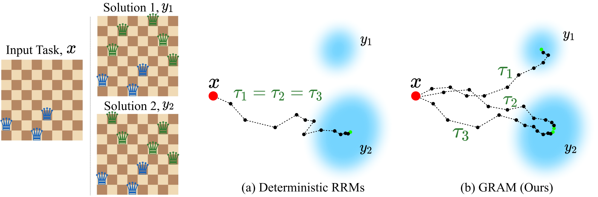
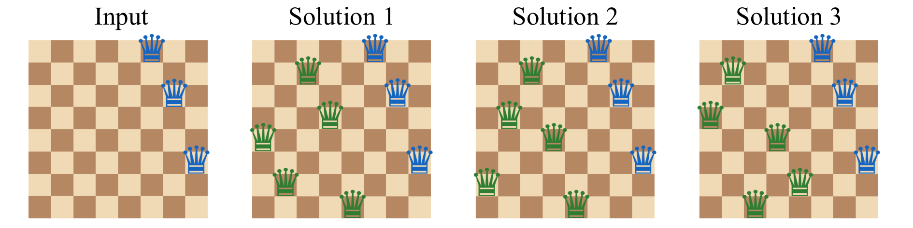
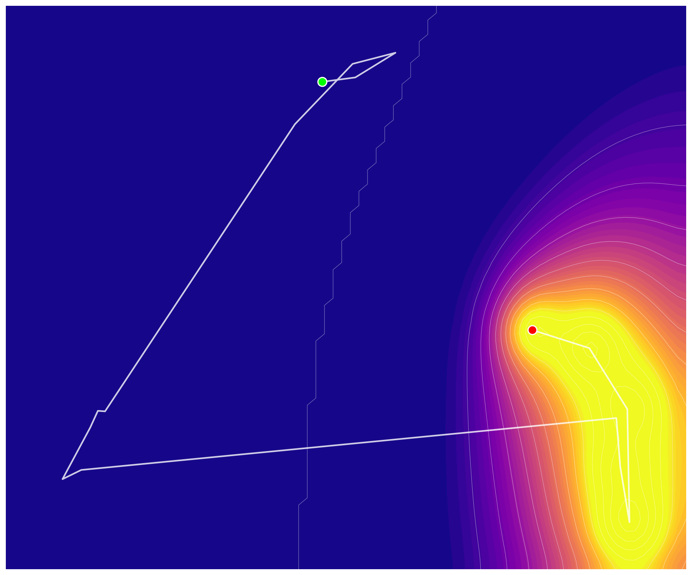
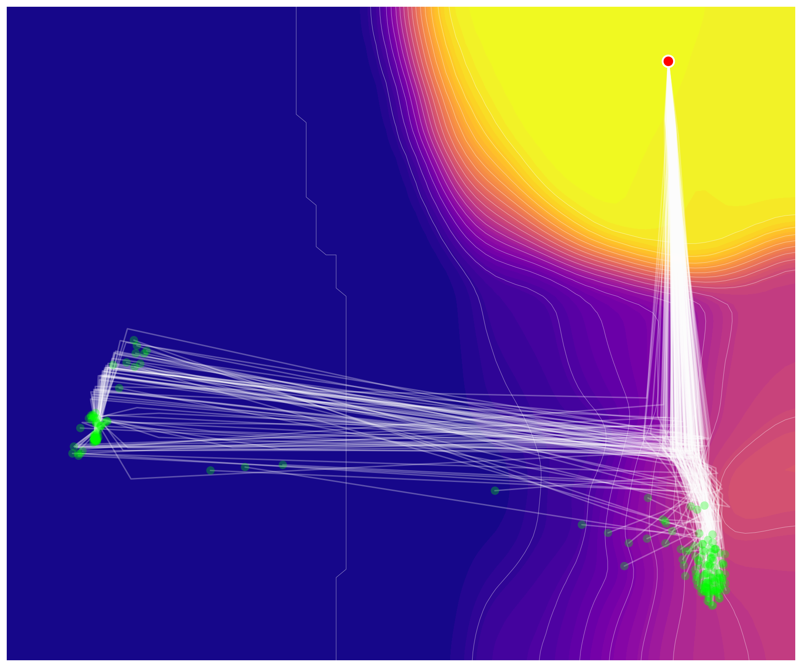
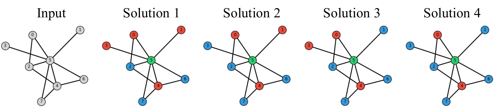
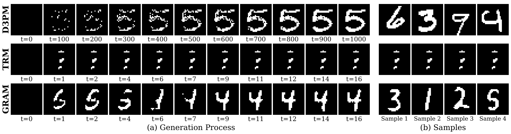

# Paper精读｜Generative Recursive Reasoning

> [!abstract] 一句话结论
> GRAM 把递归推理模型（RRM）里确定性的潜状态更新换成**以状态为条件的随机更新** $z_t = u_t + \varepsilon_t$，其中 $\varepsilon_t \sim \mathcal{N}(\mu_\theta(u_t), \sigma^2_\theta(u_t) I)$，让同一个输入能采样出多条推理轨迹；在 Sudoku-Extreme 上拿到 **97.0%**（10M 参数、16 个监督步，vs TRM 87.4% / 7M 参数、同为 16 步），并在 N-Queens 这类多解任务上把「解覆盖率」从确定性模型的不超过 36.1% 拉开。

> [!cite]- 论文信息（点开折叠）
> - 论文标题：Generative Recursive Reasoning
> - arXiv：[2605.19376](https://arxiv.org/abs/2605.19376)（v1 2026-05-19 / v2 2026-05-20）
> - 项目页：[ahn-ml.github.io/gram-website](https://ahn-ml.github.io/gram-website)
> - 作者：Junyeob Baek, Mingyu Jo, Minsu Kim, Mengye Ren, Yoshua Bengio, Sungjin Ahn
> - 机构：KAIST / Mila / NYU / Université de Montréal
> - 阅读范围：正文 §1–§5 + 附录 A.1–A.3、B.1–B.2、C、D.1–D.3（D.4 图像样例未逐张核对）

---

## 1️⃣ 论文想解决什么问题

### 现有 RRM 卡在哪里：不是容量不够，是轨迹被压成了一个点

递归推理模型（HRM、TRM、Looped Transformer）的核心想法是：不生成更长的思维链，而是反复精炼同一个潜状态。给定输入 $x$ 和固定初始状态 $z_0$，模型反复执行

$$z_{t+1} = f(z_t, e_x)$$

精炼 $T$ 次后解码出答案。这条公式看上去只是「多算几步」，但里面藏了一个结构性限制：**$f$ 是确定函数**。给定 $z_0$ 和 $e_x$，整条轨迹 $z_1, z_2, \dots, z_T$ 完全确定，输出也完全确定。

于是每次运行都走同一条路。反复应用 $f$ 的过程，数学上就是迭代一个映射趋向不动点——论文用词是 "collapse the space of plausible reasoning paths into a single attractor"（把可能的推理路径空间塌缩成单一吸引子）。

这带来三个具体后果，而且都不是「模型再大一点就好」能解决的：

1. 多解任务必然只给一个答案。 训练目标 $p(y\mid x)$ 在多解任务上本来就是多峰的（一道 Sudoku 有多个合法填法），但确定性的 $f$ 只能收敛到其中一个模式——通常是训练集里出现频率最高的那个。这不是训练不充分，是结构上装不下第二个模式。
2. 单条路容易困在次优轨迹。 没有岔口就没有回退，一步走偏只能沿着偏下去。
3. 无法当生成模型用。 确定性 RRM 建模的是 $p(y\mid x)$，采样不出 $p(x)$——它没有「随机性」这个入口。

论文用一张对比图把这件事讲得很直白：同样是三条独立的潜推理轨迹 $\tau_1, \tau_2, \tau_3$，旧模型三条完全重合，GRAM 三条走向不同解。

### 一个贯穿全文的例子

用论文附录 Figure 9 那个 8×8 N-Queens 残局：盘面上已经摆了 5 个皇后，需要补完剩下的且互不攻击。8×8 N-Queens 一共有 **92 个合法解**，也就是说给定这个残局，合法的补法通常不止一个。

- **确定性 RRM 的做法**：$f$ 迭代到不动点，输出一个补法。换一个残局，它可能给出与已有皇后冲突的补法——因为它记住的是「某个」模式，而不是「在这个约束下任意可行」的模式。这就是为什么 Figure 4（右）会显示：**随着合法解数量增加，三个确定性基线的准确率断崖式下跌**，而 GRAM 保持平稳。
- **GRAM 的做法**：从同一个 $z_0$ 采样 20 条轨迹，得到 20 个候选补法，多数投票或用一个打分器（LPRM）挑一个。候选之间不一样，是因为每一步都加了随机扰动。

这个例子后面会反复用到：讲随机过渡时看它「在哪一步分叉」，讲消融时看它「去掉噪音后怎么退回单解」。

---

## 2️⃣ 核心洞察

**方向来自约束，多样性来自随机性。**

这句话是理解 GRAM 的钥匙，也是它和「往模型里随便加点噪声」的分水岭。

论文把随机过渡写成「确定性更新 + 条件高斯扰动」：

$$u_t = f_H(h_{t-1}, l_t), \qquad \varepsilon_t \sim \mathcal{N}\big(\mu_\theta(u_t),\, \sigma^2_\theta(u_t) I\big), \qquad h_t = u_t + \varepsilon_t$$

拆开看，两项各管一件事：

- **$\mu_\theta(u_t)$ 管方向。** 它是**以当前状态为条件**的均值，所以它知道「现在走到哪了、约束满足得怎么样」，把轨迹往可行区域推。这一项继承了旧模型「精炼」的能力，没有丢。
- **$\sigma^2_\theta(u_t)$ 管多样性。** 它是**状态相关的方差**，不是固定超参——「这一步该留多大岔口」由模型自己学：早期状态不确定，方差放大以铺开候选；临近收敛，方差收缩以稳定落点。

为什么这个耦合不能省？直接看论文的机制消融（Sudoku-Extreme / N-Queens 8×8，5 个样本）：

| 变体 | Sudoku | N-Queens |
|---|---|---|
| 完整 GRAM | 93.96 | 99.69 |
| 去掉学到的均值（$\mathcal{N}(0,\sigma^2 I)$，只剩随机性） | 94.88 | **50.27** |
| 去掉随机性（$\mathcal{N}(\mu, 0)$，只剩引导） | **0.00** | **0.00** |
| TRM + 随机解码（argmax 换成采样） | 82.87 | 71.66 |
| TRM + 随机初始化（$z_0 \sim \mathcal{N}(0,I)$） | 78.53 | 71.82 |

这三行讲了三件事，每件都很反直觉：

> [!important] 三条核心洞察
> 1. **只有随机性、没有学到的方向，Sudoku 还能撑住（94.88），N-Queens 直接崩到 50.27。** 说明在约束密集的多解空间里，光「乱走」不够，必须有一个知道约束在哪的推力。
> 2. **只有方向、没有随机性，两个任务全 0。** 这不是「性能差」，是训练直接崩了。原因在训练机制：后验 $q_\phi(\tau\mid x,y)$ 是**看过答案 $y$** 的，如果它没有随机性，就会把 $y$ 近乎确定地编码进潜状态，先验 $p_\theta$ 学不到任何东西；推理时没有 $y$，分布完全对不上，输出全废。论文的措辞是 "deterministic guidance conditioned on the target leads to severe overfitting"。
> 3. **把随机性硬塞给 TRM 没用**（82.87 / 78.53，都没超过 GRAM 的 93.96）。所以增益来自**变分框架**，不是「随机」这个动作本身。

第 2 条和第 3 条合起来，才是这篇论文真正的立论：**随机性必须长在变分推断的框架里，并且和「知道约束在哪」的均值耦合，才有用。**

---

## 3️⃣ 方法解读

### 组件一：编码器——只算一次，全程复用

**是什么。** 输入 $x$（Sudoku 是 81 个 token，ARC 是补齐到 30×30 的 900 个 token）过一个编码器，得到 $e_x = f_{\mathrm{enc}}(x;\theta)$，之后整个递归过程都复用它。

**为什么这么设计。** 潜状态每一步都在变，但输入不变。把输入编码提到循环外面，等于把「读题」和「推理」分开：推理的每一步只做「在已知题意下更新思路」，不用重复读题。这也是它能把参数压到 10M 的原因——递归核只有 2 层（$f_L$ 与 $f_H$ 各 `[Attention + SwiGLU] × 2`），重复用的是同一组权重。

**怎么做。** 三层：token embedding（词表 11 或 12 维到 $D$）、ARC 专用的 16 个 puzzle embedding（区分不同任务）、位置编码（RoPE 或可学习）。

**代价。** 输入被压成一个固定 $e_x$，所有轨迹共享。如果任务需要「反复回看输入的不同部分」，这个设计会限制它——Sudoku/ARC 这类结构化任务不敏感，长文档推理可能会。

### 组件二：随机潜过渡——把「一步到位」改成「每一步留个岔口」

这是全文的核心，也是旧模型和 GRAM 的唯一结构差别。

**是什么。** 旧模型：$z_t = f(z_{t-1}, e_x)$，确定。GRAM：先算一个确定提议 $u_t$，再从**以 $u_t$ 为条件的高斯**里采一个扰动加上去，$z_t = u_t + \varepsilon_t$。

**为什么必须加这一项。** 因为要多解，就必须让「同一个起点能有不同的下一步」。这一点没法靠调 $f$ 实现：$f$ 是什么函数都行，只要是确定的，给定输入输出就唯一。所以随机性必须作为**独立的一步**引入。反事实很直接：$\sigma \to 0$ 就退化成旧模型（消融里这一行是 0.00，见上一节）。

**怎么做。** 两个头从 $u_t$ 输出 $\mu_\theta(u_t)$ 和 $\sigma^2_\theta(u_t)$，用重参数化采样 $\varepsilon_t = \mu_\theta(u_t) + \sigma_\theta(u_t)\odot\xi,\ \xi\sim\mathcal{N}(0,I)$。注意 $\mu_\theta$ 的输入是 $u_t$ 而不是 $x$——它看的是「当前思路」，所以这个推力是**逐步给**的，不是一次性偏置。

**代价。** 每一步多两个小头；采样让梯度有噪声；最关键的是——它把「推理」变成了「生成」，于是必须用变分推断来训（见组件四），训练复杂度上去了。

**一个边界。** 作者只在**高层** $h$ 加噪，低层 $l$ 的 $K$ 次refine是确定的。脚注 1 说试过给低层也加噪，"did not improve performance"（没给数字）。一个合理解释是：低层负责细粒度中间计算，噪声会污染约束传播；高层负责抽象的「思路转向」，才是需要多样性的地方。但这一条属于**未报告的实验**，不能当定论用。

这个差别在潜空间可视化里看得最清楚。TRM 的轨迹（红点为初始状态）收敛到单个点：

GRAM 用同样方式画 50 条轨迹，铺开成一片，且落点分成若干簇：

两张图是同一个量（潜状态的二维投影）在同一个任务上的对照。**注意看图的方式**：它证明的是「轨迹不再重合」，不能直接推出「覆盖的解法更多」——后者要看覆盖率的数字（下一节），因为多条轨迹也可能挤在同一个吸引子附近抖动。

### 组件三：双层递归——慢变量与快变量

**是什么。** 潜状态拆成 $z=(h,l)$。$h$ 每个过渡更新 1 次（承载抽象推理状态），$l$ 每个过渡内更新 $K$ 次（承载细粒度中间计算）。解码器**只读 $h$**。

**为什么需要两层。** 时间尺度不一样。「这一题打算从哪个方向解」这种决策应该慢，「这一格的候选数怎么算」应该快。如果共用一个状态，快的更新会把慢的意图冲掉。

**怎么做（一个过渡内部）。**

1. 先固定 $h_{t-1}$，把 $l$ 精炼 $K$ 次：$l_{t,k} = f_L(h_{t-1}, l_{t,k-1}, e_x)$，$k=1..K$，$l_{t,0} := l_{t-1}$；
2. 用精炼后的 $l_t$ 算 $u_t = f_H(h_{t-1}, l_t)$；
3. 在 $u_t$ 上加扰动得到 $h_t$；
4. 令 $z_t = (h_t, l_t)$ 进入下一步。

**代价。** 每个过渡的实际计算是 $K+1$ 次前向，论文里一个监督步有 $T$ 个过渡，外层还有 $N_{\mathrm{sup}}=16$ 个监督步——所以名义上「16 步」的实际深度是 $16 \times T \times (K+1)$ 层前向。这也解释了为什么它的训练慢（作者在局限里自己承认）。

**一个自我暴露的问题。** 消融表 3(a) 里，`+DS+SG`（有深监督 + 随机引导，**没有**层级递归）在 N-Queens 上拿到 **100.00**，比完整 GRAM 的 99.69 还高。也就是说层级递归在这个任务上没贡献甚至略降。作者的说法是 "the effect of hierarchical recursion is task-dependent"，没有进一步解释。

### 组件四：训练——ELBO 太大，改用截断代理

**是什么。** 把整条轨迹 $\tau=(z_0\to\cdots\to z_{T_{\mathrm{Total}}})$ 当潜变量，最大化 $\log p_\theta(y\mid x)$ 的变分下界（ELBO），同训生成参数 $\theta$ 与变分参数 $\phi$。

**为什么不能直接算。** 因为要对所有可能的轨迹做边际化（积分），算不出来。所以引入看过答案的后验 $q_\phi(\tau\mid x,y)$，把积分换成采样估计。

**怎么做。** 关键简化：先验和后验是**同结构的马尔可夫链**，且所有随机性都从 $\varepsilon$ 进，所以两者可以在**噪声空间**里对齐，逐项算 KL。于是全轨迹 ELBO 变成「一项重建 + 每一步一个 KL」：

$$\mathcal{L}_{\mathrm{ELBO}}=\mathbb{E}_{q_{\phi}}\big[\log p_{\theta}(y\mid z_{T_{\mathrm{Total}}},x)\big]-\sum_{t=1}^{T_{\mathrm{Total}}}\mathbb{E}_{q_{\phi}(\epsilon_{<t}\mid x,y)}\Big[\mathrm{KL}\!\left(q_{\phi}(\epsilon_{t}\mid u_{t},y)\,\|\,p_{\theta}(\epsilon_{t}\mid u_{t})\right)\Big]$$

但这一项仍然要求对整条轨迹反向传播，显存撑不住。所以实际训练用的是**截断版**：每个监督步只对最后一步过渡 $z_{T-1}^{(n)}\to z_T^{(n)}$ 传梯度。

**代价（作者自己写明了）。** 这是「有偏但省显存」的近似，$\mathcal{L}_{\mathrm{GRAM}}$ 不是精确 ELBO。附录 A.3 在验证集上同时记录真 ELBO 和代理目标，两条曲线都单调下降，曲线之间的间隙被解释为「前几步累积的 KL」——也就是说，作者用**相关性证据**（两者同向下降）支撑这个近似，而不是证明它有界。

### 组件五：推理期——宽度扩展 + 两个选优器

**是什么。** 两个扩展轴：深度（跑多少过渡，用 ACT 自适应停）和宽度（并行采样 $N$ 条轨迹）。宽度是这篇的新贡献。

**怎么做。**

- 采样 $\{\tau^{(i)}\}_{i=1}^N \sim p_\theta(\tau\mid x)$，各自解码出 $\hat y^{(i)}$；
- 选优两种：**多数投票**，或 **LPRM**——一个值头 $v_\psi(z_t)$，回归目标是这条轨迹最终预测的准确率 $r\in[0,1]$，取预测值最高的候选；
- 深度轴用 ACT：解码器多带一个 halt 头 $q_\psi: \mathbb{R}^D\to\mathbb{R}^2$，输出 (halt, continue) 两个 Q 值，用 TD loss 训，让每条轨迹自己决定在哪停。

**代价。** 宽度是拿算力换可靠性：$N=20$ 就是 20 倍前向。论文对此的处理是主张「同等计算预算下更划算」——$N=20$、16 迭代的 GRAM 拿到 97.0%，而 TRM 要跑到 320 迭代才有 90.5%。但这个「等预算」是作者的估计，正文没有给显式的 FLOPs 或墙钟时间对照表。

### 组件之间怎么连：一个样本走完全程

以那个 N-Queens 残局为例：

1. 盘面 → 64 个 token → 编码成 $e_x$（一次）；
2. $z_0=(h_0,l_0)$ 固定初始化；
3. 进入第 1 个监督步：$l$ 精炼 $K$ 次 → 算 $u_1$ → 采样 $\varepsilon_1$ → 得 $h_1$；重复 $T$ 次得到 $z_T^{(1)}$；
4. 解码器读 $h_T^{(1)}$，输出一个候选盘面，并算一次损失（深监督在这里用上）；
5. $z_T^{(1)}$ 直接当下一个监督步的起点，重复到第 16 步；
6. 推理时不做 5 的反复，而是把 3–4 并行跑 $N$ 次，得到 $N$ 个候选，投票或 LPRM 选一个。

### 关键公式与推导

**① 潜状态转移（式 2）**

$$z_{t}\sim p_{\theta}(z_{t}\mid z_{t-1},e_{x}),\qquad t=1,\dots,T$$

> 人话：下一步的状态不是算出来的，是从一个分布里抽出来的。旧模型这里是等号，GRAM 这里是采样号——整篇论文就改这一个符号。

**② 随机过渡的实现（式 4–5）**

$$\epsilon_{t}\sim p_{\theta}(\epsilon_{t}\mid u_{t}):=\mathcal{N}\!\left(\mu_{\theta}(u_{t}),\,\sigma_{\theta}^{2}(u_{t})I\right),\qquad z_{t}=u_{t}+\epsilon_{t}$$

> 人话：先用确定函数给出「大概该往哪走」($u_t$)，再在这个位置上撒一个高斯，均值决定方向偏多少，方差决定敢撒多开。两者都从当前状态学出来，不是写死的。

**③ 层级分解（式 6–9）**

$$l_{t,k}=f_{\mathrm{L}}(h_{t-1},\,l_{t,k-1},\,e_{x}),\quad k=1,\dots,K$$
$$u_{t}=f_{\mathrm{H}}(h_{t-1},\,l_{t}),\qquad h_{t}=u_{t}+\epsilon_{t}$$

> 人话：快变量（$l$）在慢变量（$h$）不动的前提下自我更新 $K$ 次，更新完再让慢变量挪一步——挪的时候才撒噪声。噪声只在慢变量上，因为要多样化的是「解题方向」，不是「中间计算」。

**④ 边际似然（式 10）与 ELBO（式 11）**

$$p_{\theta}(y\mid x)=\int p_{\theta}(y\mid\tau,x)\,p_{\theta}(\tau\mid x)\,d\tau$$
$$\log p_{\theta}(y\mid x)\geq\mathbb{E}_{q_{\phi}(\tau\mid x,y)}[\log p_{\theta}(y\mid\tau,x)]-\mathrm{KL}\!\left(q_{\phi}(\tau\mid x,y)\,\|\,p_{\theta}(\tau\mid x)\right)$$

> 人话：想要的是「在所有可能推理路径上取平均后的答对概率」，这个积分算不出来；于是拿一个猜路径的分布 $q$ 去采样估计，代价是要付一笔「$q$ 和真实先验差多远」的罚金（KL）。**这笔罚金就是训练时看过答案的代价**——所以 $q$ 必须带随机性，否则它会把答案直接抄进潜状态，罚金无穷大，先验学不到东西（对应消融里 $\sigma=0$ 全 0 的现象）。

**⑤ 为什么能逐项算 KL（式 12–13）**

先验与后验都是同结构的马尔可夫链，且随机性全部经由 $\varepsilon$ 注入，所以在**噪声空间**里两者可以逐项配对：

$$\mathcal{L}_{\mathrm{ELBO}}=\mathbb{E}_{q_{\phi}}\big[\log p_{\theta}(y\mid z_{T_{\mathrm{Total}}},x)\big]-\sum_{t=1}^{T_{\mathrm{Total}}}\mathbb{E}_{q_{\phi}(\epsilon_{<t}\mid x,y)}\Big[\mathrm{KL}\!\left(q_{\phi}(\epsilon_{t}\mid u_{t},y)\,\|\,p_{\theta}(\epsilon_{t}\mid u_{t})\right)\Big]$$

> 人话：不用去比整条轨迹的分布，只要在每一步比「同一个 $u_t$ 下，两个高斯差多远」。这一步是把不可算的轨迹级 KL 拆成可算的逐步 KL 的关键，前提是两边共用同一个确定性骨架 $u_t$。

**⑥ 实际训练用的截断代理（式 14）**

$${\mathcal{L}}_{\mathrm{GRAM}}^{(n)}=\mathbb{E}_{q_{\phi}}\big[\log p_{\theta}(y\mid z_{T}^{(n)},x)\big]-\mathrm{KL}\big(q_{\phi}(\epsilon_{T}^{(n)}\mid u_{T}^{(n)},y)\,\|\,p_{\theta}(\epsilon_{T}^{(n)}\mid u_{T}^{(n)})\big)$$

> 人话：把「全过程求和」砍成「只看这一步的最后一跳」。省掉的是显存，留下的是偏差——所以它只是梯度近似，不是新的变分目标。

---

## 4️⃣ 实验部分怎么读

### 实验设置

- **任务**：Sudoku-Extreme（9×9、最少提示数，需要长链约束传播）、ARC-AGI-1/2（抽象视觉推理，30×30 补齐、900 token）、N-Queens（8×8 / 10×10，多解）、Graph Coloring（8 / 10 顶点，多解）、二值化 MNIST（无条件生成）。
- **基线**：Direct Pred（Transformer，27M / 100M 两档）、Looped TF（7M）、HRM（27M）、TRM（7M）；多解任务另加 AR 与 MDLM（离散扩散）。
- **预算**：主表（Table 8）所有递归模型的分数都在 **16 个监督步**下取得；参数量并**未对齐**（GRAM 10M vs TRM 7M）。
- **未报告**：主表没有给随机种子数与方差；消融表（Table 3）只报单点、用 5 个样本评测。

### 核心结果

| 方法 | 参数 | Sudoku-Extreme | ARC-AGI-1 | ARC-AGI-2 |
|---|---|---|---|---|
| Direct Pred | 27M | 0.0 | 21.0 | 0.0 |
| Looped TF | 7M | 61.3 | – | – |
| HRM | 27M | 55.0 | 40.3 | 5.0 |
| TRM | 7M | 87.4 | 44.6 | 7.8 |
| **GRAM** | **10M** | **97.0** | **52.0** | **11.1** |
| 平均人类 | – | – | 60.2 | – |

（均为 16 监督步；大模型分数论文只作难度参照，未列为对照基线）

三点值得单独拎出来：

1. **Sudoku 上 87.4 → 97.0 是 +9.6 个百分点**，而参数只多 3M。对比 HRM（27M、55.0），说明这个任务的瓶颈不是容量——论文附录 D.1 的标题直接写了 "Sudoku-Extreme Resists Parameter Scaling"。
2. **ARC-1 是 52.0，人类平均 60.2**，仍是明显落后；论文引的 Gemini 3 Pro 是 75.0，但作者明确说不可比（训练数据、预算、脚手架都不同）。
3. **宽度扩展的性价比**：$N=20$、16 迭代的 GRAM 拿到 97.0，而 TRM 跑到 320 迭代才 90.5。这是全文最实用的一个结论——**并行采样比继续加深更划算**，因为它绕开了深度的延迟瓶颈。

多解任务：

| 方法 | N-Queens 8×8 准确率 | 解覆盖率 | Graph Coloring 8 顶点冲突边 ↓ |
|---|---|---|---|
| 确定性 RRM（最好） | — | ≤ 36.1% | — |
| AR（自回归） | 96.3 | 高 | 19.0 |
| MDLM（扩散） | 96.1 | 高 | — |
| **GRAM** | **99.7** | 高 | **2.7**（10 顶点 3.3） |

（准确率为单样本；覆盖率用 20 个样本统计；冲突边越低越好）

这张表要连着看：**确定性模型的覆盖率上限 36.1% 是结构性的**，不是调参能补的；而 AR/MDLM 这类生成模型覆盖率够，但**约束满足差**（Graph Coloring 冲突边 19.0 vs 2.7）。GRAM 的定位就在这两者之间——既有多解采样，又有递归精炼带来的约束满足。

无条件生成（作为「随机性确实能当生成模型用」的证据）：

- MNIST：TRM 直接崩掉（**FID 303.29**，典型的模式坍塌）vs GRAM 在 16 步时 FID 77.79、256 步时 73.34，与 D3PM（1000 步、74.03）持平；
- 推理步数**从 8 增到 256，IS 单调从 1.85 升到 2.04，FID 从 84.08 降到 73.34**——而训练只用了 16 步。这是「递归精炼本身有增益」的独立证据；
- Sudoku 生成：**99.05% 合法率**，10.9M 参数、16 个监督步；对比 D3PM 用 55.1M 参数、1000 步去噪。

### 消融与公平性

**(a) 逐组件累加**（Sudoku / N-Queens 8×8，5 样本）

| 变体 | Sudoku | N-Queens |
|---|---|---|
| base（Looped TF） | 61.25 | 71.30 |
| + 深监督 + 层级递归（≈HRM / TRM） | 55.00 / 87.40 | 80.70 / 72.90 |
| + 随机引导（SG） | 65.64 | 86.30 |
| + 深监督 + SG（无层级） | 73.90 | **100.00** |
| + 深监督 + 层级 + SG（= GRAM） | **93.96** | 99.69 |

这张表是全文最有说服力的一张，也是最能挑毛病的一张：

- **SG 在每个配置下都有增益**（61.25→65.64、87.40→93.96），这是「随机引导是通用扩展」的直接证据；
- 但 **N-Queens 上 `+DS+SG` 的 100.00 高于完整 GRAM 的 99.69**，说明层级递归贡献为负（-0.31pp）。单点、5 样本、无方差，这个差异在噪声范围内，但作者没有给方差，所以无法判断它是噪声还是真实回退。

**(b) 机制拆解** 已在「核心洞察」一节列出。这里补一个公平性判断：

- 消融确实做到了**同架构单变量**（只改 $\varepsilon_t$ 的分布形式：$\mathcal{N}(\mu,\sigma^2 I)$ → $\mathcal{N}(0,\sigma^2 I)$ → $\mathcal{N}(\mu,0)$），这一层是干净的；
- 但**主表不是等参数比较**（10M vs 7M），也不是等 FLOPs。论文用「+3M 参数换 +9.6pp」来论证不是容量问题，逻辑上站得住——因为 27M 的 HRM 只有 55.0——但严格来说缺少一个「10M 的 TRM」作为对照。

### 训练细节

- 每个任务都把输入输出当离散 token 序列：Sudoku 81 token / 词表 11；ARC 900 token / 词表 12 + 16 个 puzzle embedding；N-Queens $N^2$ token / 词表 3；Graph Coloring 用邻接矩阵严格上三角 $n(n-1)/2$ 个 token；MNIST 经 CNN patchify 成 14×14=196 token / 词表 3。
- 递归核：$f_L$ 与 $f_H$ 各 2 层 `[Attention + SwiGLU]`，权重在过渡间共享。
- 深监督跨 $N_{\mathrm{sup}}=16$ 个监督步；梯度只过每个监督步的最后一跳。
- **未报告**：具体学习率、batch size、训练卡数与时长的正文数值（在附录 B.2/Table 6-7，本次未逐项核对）。

---

## 5️⃣ 学术评价

### 作者承认的局限

- 「深监督的顺序性限制了训练效率，比不上 Transformer，这是把 GRAM 扩到基础模型规模的主要障碍」（§5 原话意思）。这一条其实很重：全文最强的结果都停在 10M 参数。
- 低层加噪实验失败（脚注 1），但没给数字。

### 本文证据直接暴露的问题

1. **层级递归的增益不稳定。** 消融表里 N-Queens 的 `+DS+SG`（100.00）反超完整 GRAM（99.69），Sudoku 上则是层级带来的 +20.06pp。作者归因为 "task-dependent"，但没有给出「什么任务需要层级」的判据——这使组件三的设计缺少独立支撑。
2. **「等计算预算」没有量化。** 「$N=20$ @16 迭代 vs TRM @320 迭代，计算预算相当」是全文最有价值的实用结论，但正文没有 FLOPs 或墙钟时间表。读者无法自行复核这个前提。
3. **代理目标的验证只到相关性。** 附录 A.3 给的是「两条曲线同向下降」，这证明优化在推进，但不证明偏差有界。作者措辞也很克制（"biased but useful surrogate"）。
4. **消融的统计强度弱于主表。** 主表给 $\pm$ 标准差，消融表（Table 3）只给单点、5 个样本，恰恰是最需要区分「真实回退还是噪声」的地方没有方差。

### 分析者的待验证疑问

- **LPRM 的选择偏差。** LPRM 的回归目标是「这条轨迹最终答对的比例」，训练数据来自同一模型自己的轨迹。如果模型在某类题上系统性自信而错误，LPRM 会优先挑出「自信的错答」。论文没有做「best-of-N 随 $N$ 增大是否饱和甚至回退」的曲线——而这正是检验选择器是否被自信错误主导的标准实验。
- **随机性在长程任务上是否仍可控。** 所有任务的最长推理链是 Sudoku（81 格）。在需要上千步的推理里，逐步注入的方差会累积，$\sigma_\theta$ 能否自动收敛到足够小，没有证据。

---

## 6️⃣ 局限与可扩展方向

**① 训练效率是真正的天花板。**
论文自己的观察：深监督是顺序的，$T_{\mathrm{Total}}=T\times N_{\mathrm{sup}}$ 步必须串行。检验方式：固定总前向次数，比较「深而窄」与「浅而宽」的墙钟时间下的准确率。如果宽的那一侧在同等墙钟下仍占优（论文的并行结论暗示如此），那训练侧的串行瓶颈可以用「并行多条短轨迹 + 聚合」来绕，而不是硬啃串行深度。

**② 层级递归该不该保留，需要判据。**
目前只在两个任务上有对照。可检验的做法：构造一组「抽象决策 vs 细粒度计算」比例不同的人工任务（比如从纯 Sudoku 到「先判断题型再解题」），看层级带来的增益是否随这个比例单调上升。若是，就有了选择依据；若不是，组件三应当默认关掉。

**③ 把「多解」当能力而不是副作用。**
论文的评测里 coverage 只是附属指标。更严格的做法是：给定同一个残局，要求模型**穷举**前 $k$ 个不同解（而不是「随便给一个合法解」），用「$k$ 个解的全覆盖率」和「重复率」评价。这会直接暴露「多条轨迹其实在同一个吸引子附近抖动」这种伪多样性。

---

## 7️⃣ 最后总结

这篇论文的价值不在某个数字，而在**改了一个符号**：把递归推理里的等号换成采样号，随之把 RRM 从「确定性精炼器」变成「潜变量生成模型」，于是旧模型做不到的三件事（多解、宽度扩展、无条件生成）一次性都通了。它最扎实的部分是消融——用 $\sigma=0$ 全崩、$\mu=0$ 在 N-Queens 崩这两行，把「随机性必须和学到的方向耦合」讲成了证据而不是主张。

它最薄弱的部分在规模：10M 参数、81 格盘面，所有结论都停在「结构化小任务」。作者自己指出顺序深监督是扩展瓶颈，而这个瓶颈恰恰是这类架构相对 Transformer 的先天劣势。所以更准确的定位是：**它证明了「概率化递归」这个方向成立，但没证明它能长大。**

---

## 8️⃣ 三句速记

> [!summary]- 点开展开
> 1. 旧 RRM 的问题是确定性把轨迹空间压成单一吸引子，多解任务必然只出一个答案——加参数救不了。
> 2. GRAM 用 $z_t=u_t+\varepsilon_t$（$\varepsilon\sim\mathcal{N}(\mu(u_t),\sigma^2(u_t)I)$）把方向交给均值、多样性交给方差；去掉任一，消融分别崩到 50.27 和 0.00。
> 3. Sudoku 97.0%、ARC-1 52.0%，且宽度扩展（$N=20$/16 步）胜过 TRM 深挖（320 步）——但全部停在 10M 参数，规模化未验证。
