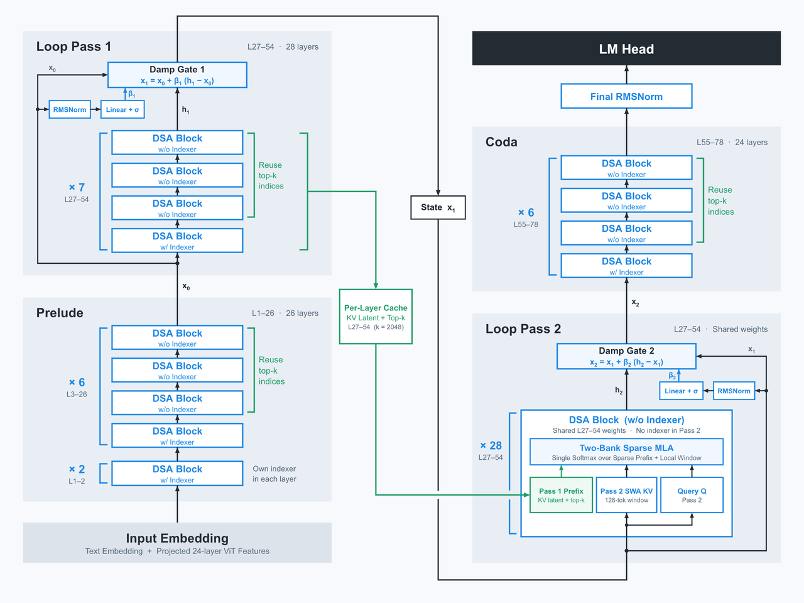
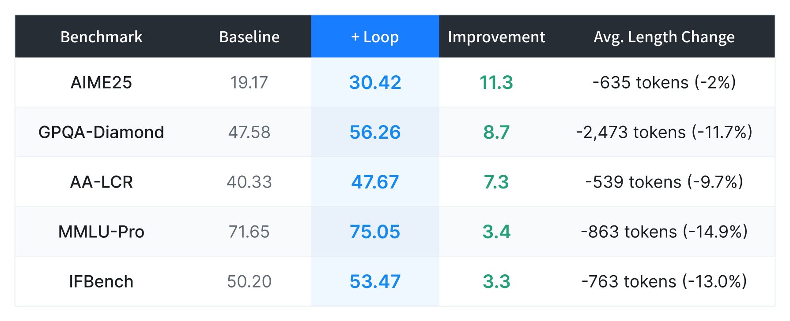
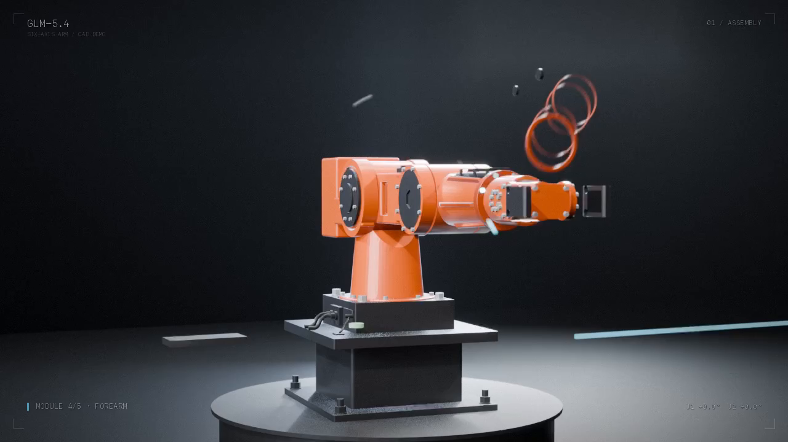

# Paper精读｜GLM-5.4: Toward Generalized Coding with Our First Loop Transformer

> [!abstract] 一句话结论
> **Z.ai 把 GLM-5 750B 基座中间的 28 层改造成跑两遍的 Loop Transformer（权重共享 + 每趟独立的 per-token 门控 + 跨趟稀疏 KV 复用），在参数量不变、训练算力只多约 10%的条件下加"计算深度"：30B 同参数对照上 AIME25 从 19.17 提到 30.42（+11.25），并宣称达到 2T-3T 参数模型的智能水平——后半句目前没有任何公开评测表佐证，只能当作厂商声明。**

> [!cite]- 论文信息（点开折叠）
> - **论文标题**：GLM-5.4: Toward Generalized Coding with Our First Loop Transformer
> - **链接**：[https://www.alphaxiv.org/abs/2611.glm-5](https://www.alphaxiv.org/abs/2611.glm-5)
> - **原始来源**：Z.ai 官方博客 [https://z.ai/blog/glm-5.4](https://z.ai/blog/glm-5.4)；产品文档 [https://docs.z.ai/guides/llm/glm-5.4](https://docs.z.ai/guides/llm/glm-5.4)
> - **作者**：Z.ai（模型发布公告，未署个人作者）
> - **机构**：Z.ai
> - **日期**：2026-11-23
> - **阅读范围**：公告全文（alphaXiv Markdown 版与 z.ai 博客原文逐段对照，内容一致）+ 官方架构图与 30B 消融表 OCR 读取。**本文是发布公告而非同行评审论文：无技术报告、无附录、无 750B 完整 benchmark 对照表**——旗舰级声明目前只有叙述、没有公开评测数据，证据缺口在 4️⃣ 节逐条指出。

---

## 1️⃣ 论文想解决什么问题

这一节先回答：Z.ai 为什么愿意把旗舰模型押在一个 2018 年就提出、但从未在 750B 量级成功过的老架构上。

公告的直接动机来自他们在 GLM-5.3 技术博客里给出的论断：**记忆密集型任务（memory-intensive tasks）吃参数，推理密集型任务（reasoning-intensive tasks）吃有效算力（effective compute）**。大型软件工程、网络安全、3D 建模、物理控制都属于超长因果链任务——模型要沿着多步因果链走下去，同时维持全局逻辑一致性。公告原话："堆参数和背数据解决不了这个问题"（Stacking parameters and memorizing data cannot solve this）。

用一个贯穿全文的例子把"失败机制"说具体：想象模型正在生成一段 1M 上下文的 CAD 建模代码，遇到一个难 token——它必须引用 30 万 token 之前定义过的一条几何约束才能正确落笔。在标准的单遍前向里，这个 token 只有**一次**被深度加工的机会：78 层走完就出结果了。要么靠参数把这类关联"背"下来（那就要 2T-3T 级参数量去背所有可能的长程组合），要么在输出层显式"绕弯"——生成长思维链，在 token 层面兜圈子来补偿层内深度的不足。前者贵在参数和显存，后者贵在输出延迟。这个例子后面会在 3️⃣ 的端到端流程和 4️⃣ 的输出长度分析里反复回来。

既然出路是"深度"，为什么不能直接把网络加深？因为加深 = 加参数 = 显存和部署成本同步膨胀。**Loop Transformer（循环 Transformer）**给出的第三条路是：让同一组权重层跑多遍，深度换来了，参数不涨。这个想法并不新——2018 年的 Universal Transformer 就提出了权重共享深度，近年的 recurrent depth / looped LM 工作也在小规模上验证过收益。但公告诚实承认了这条路线的死穴：从零开始训练的 looped 模型，在同等预训练算力预算下始终落后于不做层共享的模型。层共享省下的参数，又被表示能力的损失原样吃回去了。

Z.ai 的转向就在这一步：**不从零训练，而是把一个已经预训练好的 GLM-5 基座，通过继续训练（continued training）改造成 Loop Transformer**。基座已经学会"一遍怎么把 token 加工好"，继续训练只需要教它"第二遍怎么利用第一遍的状态"，所以训练开销相对小——这解释了为什么这套方法能在 ~10% 额外算力（30B 对照）下跑通，而 from-scratch 路线八年都没能走到旗舰量级。

---

## 2️⃣ 核心洞察

> [!important] 三条核心洞察
> 1. **Loop 的价值在"改造已预训练基座"，不在"从头训练循环网络"**。Universal Transformer 一系失败在"同算力下共享吃亏"；GLM-5.4 绕开这个失败模式的方式是不跟预训练算力硬碰——基座的表示能力是现成的，继续训练只学"第二遍怎么用第一遍"。对应 3️⃣ 组件0，也解释了消融表里 Baseline 与 +Loop 之间只差 ~10% 训练算力。
> 2. **第二趟不能粗暴覆写残差流，必须按 token、按趟数做门控渐近写入**。直接覆写会让激活范数跨迭代爆炸，下游层收到超出训练分布尺度的表示，训练直接崩掉。Z.ai 的解法是 per-token 门控（damp gate）：第一趟小步保守写、第二趟大开写、难 token 第一趟写得更狠。对应 3️⃣ 组件1，是整套方法里最"驯服失败模式"的一环。
> 3. **第二趟的显存与索引开销可以压到几乎免费**。朴素实现下每趟循环各存一份全量 KV cache，显存随趟数线性翻倍，1M 上下文根本没法部署。GLM-5.4 用"第一趟稀疏 KV 复用 + 第二趟独立滑窗 + 注意力索引跨趟复用"三件套，把第二趟成本压到一个滑窗。对应 3️⃣ 组件2/3——三个组件干的是同一件事：让多趟循环在 750B、1M 上下文下部署得起。

*图注：GLM-5.4 官方架构图（OCR 读取）。78 层基座切三段：L1-26 Prelude 段（26 层，单次）→ L27-54 循环段（28 层，共享权重跑两趟，Pass 1 / Pass 2 各带一个 Damp Gate）→ L55-78 段（24 层，单次）→ Final RMSNorm → LM Head。循环段标注 Two-Bank Sparse MLA（softmax over Sparse Prefix + Local Window）、KV Latent + Top-k（L27-54 段 k=2048）、第二趟复用第一趟 indexer 的 top-k 索引。*

---

## 3️⃣ 方法解读

### 组件0：Loop 拓扑——78 层怎么切、两趟怎么排

**是什么**：GLM-5 基座共 78 层，GLM-5.4 把它切成 Prelude（L1-26，26 层）、循环段（L27-54，28 层）、后段（L55-78，24 层）三部分；循环段的 28 层权重共享地执行两遍（Loop Pass 1 → Loop Pass 2），前后段照旧单遍执行，最后过 RMSNorm 出 LM Head。

**为什么需要**：之所以选"中间段"做循环而不是整网循环，是因为首尾段承担的是输入嵌入加工和输出投影这类"单次性"职能，循环它们没有推理收益只有开销；而中段是长程关联形成的主要场所——回到那个 CAD 难 token 的例子，跨 30 万 token 的几何约束关联主要在中段 Attention 里建立，把深度加在这里收益最大。

**怎么做**：参数量不变（还是 78 层的权重），变的是前向计算量——等价深度从 78 层变成 26+28+28+24=106 层。按层前向 FLOPs 粗算（分析者推算，公告未给数字），循环段计算翻倍使全模型前向 FLOPs 增加约 36%；推理吞吐的账在 4️⃣「部署与吞吐」里单独算。

**代价与反事实**：第二趟不是白来的——它假设"第一趟的中间状态值得精炼"。拿掉第二趟，模型就退回 GLM-5 基线，消融表的 Baseline 列正是这个反事实：AIME25 立刻从 30.42 掉回 19.17。

### 组件1：Gated Progressive Updates——per-token 门控驯服激活爆炸

**是什么**：**门控渐近更新（Gated Progressive Updates）**——每个循环趟为每个 token 维护一个独立的标量门（官方图标作 Damp Gate 1 / Damp Gate 2），循环层的候选更新按门的比例写回残差流（residual stream，即 Transformer 里各层输出的累加通道）。按公告文字描述形式化（分析者推导，公告未给公式）：

$$
h^{(k+1)} = h^{(k)} + g^{(k)}_t \odot \Delta h^{(k)}_t, \qquad g^{(k)}_t \in [0,1]
$$

> 人话：第二遍不是把答案直接盖在第一遍上面，而是"按比例掺进去"——掺多少由每个 token 自己的门说了算。

**为什么需要**：公告给出了明确的失败机制——把已有模型的中间层改造成多趟循环时，**直接覆写隐藏状态会让激活范数（activation norms）跨迭代爆炸**，下游层收到的是尺度和分布都超出预期的表示。这不是理论担忧而是工程实测：下游 L55-78 段的权重是在"单遍分布"上训练出来的，第二趟写入幅度一旦失控，等于把表示推出这些层的工作范围。反事实很直接：把门恒设为 1，就退回"直接覆写"，公告描述的爆炸随之出现。

**怎么做**：训练之后门自己长出了分工——**第一遍小门保守写**（写全局上下文，门值小，维持尺度稳定），**第二遍开门写完整更新**（复用第一遍的状态做精炼）。更进一步，门还会按 token 难度动态调步长：难 token 上第一遍写得更激进，让复杂预测更多享受迭代精炼。回到 CAD 例子：普通 token（右括号、缩进）第一遍几乎不写，而那个需要引用几何约束的难 token 会在第一遍就被大步写入、第二遍再做修正。

**代价**：每个 token 每趟多一个标量参数与一次逐元素乘法（开销可忽略）；真正的代价是新增了一个结构性假设——第二趟的收益依赖第一趟写出的状态质量，第一趟如果写坏，第二趟是在坏状态上精炼。公告没有讨论这个误差传播问题。

### 组件2：Hybrid KV Cache——两 bank 稀疏注意力让第二趟几乎不花显存

**是什么**：**混合 KV 缓存（Hybrid KV Cache）**，官方图标注为 Two-Bank Sparse MLA（MLA，Multi-head Latent Attention，DeepSeek 系的潜空间注意力，KV 以压缩潜向量存储）。第二趟的注意力查询同时看两个"bank"：**Sparse Prefix bank**（直接复用第一趟 indexer 筛出的 top-k KV，架构图标注 L27-54 段 k=2048）与 **Local Window bank**（第二趟自己新产生的 KV，只保留一个滑动窗口）。两个 bank 在同一位置可以重叠——同一位置既留下第一趟的"旧表示"也有第二趟的"新表示"。形式化（分析者推导）：

$$
\mathrm{Attn}(q_t) = \mathrm{softmax}\left(\left[\, s_1 \cdot A_{\text{sparse}}(q_t,\ K^{(1)}_{\text{top-k}})\ ;\ \ s_2 \cdot A_{\text{local}}(q_t,\ K^{(2)}_{\text{window}})\ \right]\right)
$$

> 人话：第二遍回顾历史时，只翻第一遍画过重点的那几页（2048 条），外加自己刚写下的草稿（滑窗）；整本笔记本从不重新抄一遍。

**为什么需要**：朴素实现是每趟各存一份全量 KV cache，显存随趟数线性相乘。1M token 上下文下，750B 模型的单份 KV 已经是天文数字，翻倍即不可部署。反事实：不引入复用，"多一遍循环"在 1M 上下文上就不是优化项而是部署否决项——公告明说 1M 上下文部署成本增幅"控制得很好"，靠的就是这一层。

**怎么做**：第一趟的稀疏注意力（DSA，DeepSeek-style Sparse Attention）先用 indexer 选出 top-k 上下文 KV；第二趟把这些直接拿来当 Prefix bank，自己的新 KV 落在 Local Window bank 里；注意力对两个 bank 的拼接做 softmax。

**代价**：这里有一个公告没有讨论的结构性信息瓶颈——第二趟的"视野"被限定在第一趟 indexer 选中的 top-k 加自己的滑窗之内。如果第一趟的 indexer 为某个 token 漏选了关键上下文（例如 30 万 token 前的那条几何约束恰好没进 top-2048），第二趟没有任何机制能把它找回来。跨趟复用省下的显存，是用"第二趟不能反悔第一趟的选择"换的。

### 组件3：Sparse Attention Index Reuse——索引复用，零开销

**是什么**：GLM-5 基座本身用稀疏注意力，每个循环趟原本要各自跑一遍 indexer（负责从全上下文中挑 top-k 的轻量网络）。GLM-5.4 让**第二趟直接复用第一趟 indexer 生成的注意力索引**，第二趟索引开销为零。

**为什么需要**：没有这步，indexer 的前向成本随趟数翻倍——而 indexer 正是稀疏注意力在长上下文下的主要计算负担之一。

**怎么做与证据**：公告称实验显示复用索引与每趟重算索引的表现"几乎一致"（performs nearly identically）。注意：这里没有给数字，属于**未量化声明**——到底差多少个百分点、在哪些 benchmark 上测的，均未报告。

**代价**：与组件2 的瓶颈同源且叠加：第一趟的索引选择同时决定了第二趟能看什么。两处复用（KV、索引）共享同一个单点假设——第一趟的选择对第二趟足够好。

### 组件之间怎么连：端到端走一遍

一个样本从进入到输出，依次经过：

1. **Prelude（L1-26）**：单遍，把 token 加工成带全局初步上下文的表示；
2. **Loop Pass 1（L27-54，28 层）**：第一遍循环。门控保守写入，建立全局上下文；indexer 选出 top-2048 稀疏索引；对应 KV 落入潜空间缓存；
3. **Loop Pass 2（L27-54，同一组权重）**：第二遍。开门写入精炼更新；注意力看 Sparse Prefix bank（第一趟的 top-k KV）+ Local Window bank（自己的滑窗新 KV）；索引直接复用第一趟的；
4. **后段（L55-78）+ RMSNorm + LM Head**：单遍，读出最终分布。

那个 CAD 难 token 走完这条流水线：第一遍就被门控识别为难 token、大步写入几何约束关联的初步表示；第二遍在两 bank 注意力里同时对照第一趟的全局视野和自己的局部新状态，把落笔修正到位。对照消融表：正是这套机制让 AIME25 上 19.17 → 30.42——难 token 的"被加工两次"变成了分数。

---

## 4️⃣ 实验部分怎么读（证据审计）

先说结论：**整篇公告唯一的受控硬数据是 30B iso-parameter 消融表**。旗舰级声明（可比 2T-3T）没有随附任何评测表。这一节把有的和没有的分开列清楚。

### 实验设置

30B iso-parameter（同参数量）对照：模型为与 750B 基座**完全同架构**的 30B 模型；对照组（Baseline）与实验组（+Loop）参数量相同，总训练算力只差约 10%；两者都在 **200K 长上下文 SFT 之后**评测，**thinking mode 开启**。采样次数、随机种子、方差：**未报告**。

### 核心结果：30B iso-parameter 消融表

*图注：官方 30B iso-parameter 消融表（公告原表，OCR 读取）。条件：同架构 30B、同参数量、总训练算力 +~10%、200K long-context SFT 后、thinking mode enabled。Baseline = 单遍（即 GLM-5 式前向），+Loop = 两遍循环。*

| 指标 | Baseline（单遍） | **+Loop（两遍）** | 差值（绝对/相对*） | 平均输出长度变化 |
| --- | --- | --- | --- | --- |
| AIME25 | 19.17 | **30.42** | +11.25 / +58.7% | -635 tokens（相对值 OCR 未读全） |
| GPQA-Diamond | 47.58 | **56.26** | +8.68 / +18.2% | -2,473 tokens（-11.7%） |
| AA-LCR | 40.33 | **47.67** | +7.34 / +18.2% | -539 tokens（-9.7%） |
| MMLU-Pro | 71.65 | **75.05** | +3.40 / +4.7% | -863 tokens（-14.9%） |
| IFBench | 50.20 | **53.47** | +3.27 / +6.5% | -763 tokens（-13.0%） |

*相对提升为分析者按表中两列差值计算（公告表只给绝对差值列，OCR 读出 11.3 与 7.3 两处，与分析者计算的四舍五入一致）。AA-LCR 的全称与评测协议公告未说明。*

两个发现值得展开：

**增益排序与"推理链长度"一致**。增益从大到小：AIME25（数学竞赛推理，+58.7% 相对）> GPQA-Diamond（博士级科学推理，+18.2%）≈ AA-LCR（长上下文推理，+18.2%）> IFBench（指令遵循，+6.5%）> MMLU-Pro（通识知识，+4.7%）。这正好是公告"长推理链收益最大"主张的数据形态——**越是需要多步因果链的任务，多跑一遍的边际收益越大**；而 MMLU-Pro 这类主要考"记没记住"的通识任务，深度帮不上忙，增益最小。要诚实地说：这是**相关性证据**（增益排序与任务类型排序吻合），不构成机制归因——公告没有做"关掉某一趟只留另一趟"之类的中间消融。

**一部分推理从显式输出 token 移进了循环层内部**。GPQA-Diamond、MMLU-Pro 等基准上平均输出长度降 10-14%，且主要降在思维链长度上。这回扣开头那个 CAD 难 token 的例子——旧路线是"在 token 层面绕弯补偿层内深度"，新路线把一部分弯子搬回了层内。**这是本公告最有信息量的实证发现**："加深度"与"省推理 token"是同一枚硬币的两面，同参数下既更准又更便宜。

### 750B 声明与证据缺口

公告对 GLM-5.4 旗舰级的全部证据是叙述性的：先在 1B、4B、30B、750B 基座上渐进验证（公告称为 **Scaling Correctness** 验证，各量级数字未给），750B 上"达到可比 2T-3T 参数模型的智能水平"。缺口清单：**没有任何 750B 对照表**；"可比 2T-3T"没有指名对照模型、没有 benchmark、没有评测条件；没有第三方复测。按本笔记的证据标准，这条主张目前的状态是：**作者陈述，本文未验证**。

### 部署与吞吐

服务端吞吐：非高峰最高 **200 tokens/s**，高峰维持 **70-80 tokens/s**（未披露硬件、batch、并发配置）。之所以单独拎出来讲，是因为循环架构天然抬高每 token 前向 FLOPs（分析者按 106 层等价深度粗算约 +36%），吞吐能维持靠的是公告明说的"模型-系统协同设计"：KV 复用与索引复用省下的访存、加上系统层 kernel 融合砍掉循环放大的碎片化读写开销。1M 上下文下部署成本相对 GLM-5.3 的增幅"控制得很好"——同样无数字。这些数字属于"厂商在自己的部署上测的"，与外部基准不可比，但至少说明循环架构没有把在线服务推向不可用区。

### 应用演示（Generalized Coding）

公告用四段演示视频展示"编码能力外溢"：自述式音乐视频《Hello World》、FreeCAD 里的六轴机械臂工程级建模、完整游戏（角色移动/物理/地图/战斗/美术资产）、纯数学几何 + 自定义 GLSL shader 的交互式 3D 观鸟体验。

*图注：官方演示视频"Scaling Coding to Engineering"的抽帧（分析者自源视频截取）：GLM-5.4 在 FreeCAD 中通过生成 CAD 脚本建模六轴机械臂。演示无评测协议，不能作为能力证据，只能作为能力展示。*

要给这些演示定位准确：**没有评测协议、没有成功率、没有失败案例展示**，属于 cherry-pick 风险最高的证据层级。"Generalized Coding"（代码成为解决更广任务的基础介质）作为路线宣言是清晰的，作为能力结论目前不可验证。另外，公告坦率披露了一个失效模式：模型会陷入过长的**"马拉松思考"（marathon thinking）循环**——但又称这种拖长的自省与自我修正"确实持续带来超出参数量的准确率"。这是作者自认的局限里唯一带正面解释的一条。

### 训练细节

几乎全部未披露：循环段为何选 L27-54（而非其他层段）、门控的具体参数化、两 bank 注意力的归一方式、继续训练的数据配比与步数、750B 改造的实际算力开销（只有 30B 的 ~10% 口径）。复现所需的核心信息当前均不在公开域；且 API"即将推出"、权重"计划在安全加固后开源"——现阶段外部无法验证任何旗舰级声明。

---

## 5️⃣ 学术评价

**优点：**

1. **iso-parameter 对照是公告里最干净的一段证据**：同架构、同参数量、训练算力只差 ~10%，比较的不是"新模型 vs 别人家旧模型"而是"同一模型加不加第二趟"——这种对照设计在模型发布公告里少见，让"AIME25 +11.25 归因于循环深度"的因果链基本站得住（残余混淆只剩那 10% 算力）。
2. **Scaling Correctness 验证阶梯（1B→4B→30B→750B）是工程上负责任的路径**：把未在旗舰量级验证过的架构逐级放大，而不是直接押注。
3. **诚实披露 marathon-thinking 失效模式**：厂商公告里主动写自家模型的坏习惯，并对它给出一个功能性解释，可信度加分。
4. **"隐式深度替代显式思考 token"的发现**（输出长度降 10-14%）为"层内深度 vs 输出层推理"的替代关系提供了旗舰量级的第一手数据点，对接下来的 test-time compute 研究有参考价值。
5. **三个组件全部服务于"部署可行性"这一单一约束**（门控保训练稳定、KV 复用保显存、索引复用保吞吐），工程目标一致而非特性堆砌。

> [!ed-warning] 局限（风险与不确定性）
> 1. **旗舰级声明（可比 2T-3T）零证据**：无对照模型名、无 benchmark 表、无评测条件。这条主张的可信度完全取决于对 Z.ai 的先验信任。
> 2. **关键设计选择未说明理由**：为什么循环段是中间 28 层（L27-54）？为什么恰好两趟？门控为什么按 token 而不是按层？没有消融支撑任何一个选择。
> 3. **跨趟复用的单点假设未做敏感性分析**："复用索引与重算几乎一致"无数字；第一趟 indexer 误选关键上下文时第二趟无法补救（组件2 的结构性瓶颈），公告未讨论该风险。
> 4. **发布者即作者**：无同行评审、无第三方评测；30B 消融虽干净，也是自家测自家。权重未开源、API 未开放，当前外部可复现性为零。
> 5. **Generalized Coding 演示无协议**：四段视频证据层级最低，不能支撑"通用编码"能力主张。
> 6. 30B 消融的采样次数与方差未报告——AIME25 这种小样本基准上，19.17 与 30.42 的差值受采样波动影响的空间不小（分析者疑问，非指控）。

### 与已有工作的对话

| 关联工作 | 它到哪一步 | GLM-5.4 推进到哪 |
| --- | --- | --- |
| Universal Transformer（Dehghani et al., 2018） | 提出权重共享深度，从头训练，小规模 | 绕开 from-scratch 陷阱：预训练基座 + 继续训练，首次做到 750B 旗舰量级 |
| Recurrent Depth / Looped LM（近年小规模工作） | 小模型上验证循环深度收益 | 同参数、+10% 算力的受控对照（30B），并给出部署级方案（门控/KV/索引） |
| DeepSeek Sparse Attention（DSA 一系） | indexer + top-k 稀疏注意力 | 把稀疏索引跨趟复用，让第二趟索引零开销——稀疏结构成了循环的"免费午餐" |
| GLM-5.3 技术博客（Z.ai） | "memory 吃参数、reasoning 吃算力"论断 | 用 Loop 架构把该论断兑现成产品；GLM-5.4 是论断的架构答案 |
| SWE-Bench ProMax（本库已精读） | GLM-5 作为开源基线：22.9%/36.5%（mini-swe-agent/OpenHands） | GLM-5.4 主打"Generalized Coding"，同一战场的新一代选手；等 API 开放后可在同基准复测 |
| Tencent WorkBuddy Bench（本库已精读） | GLM-5.2 在 Security 双榜夺冠，"开源≠落后" | GLM-5.4 若开源，"参数效率 × 安全加固"将成为榜单新变量 |
| δ-mem / Mooncake（本库已精读，推理效率谱系） | 显存/缓存侧的效率创新 | GLM-5.4 的 Two-Bank KV 复用是同一约束（显存墙）下的架构侧答案 |

---

## 6️⃣ 局限与可扩展方向

1. **自适应趟数（作者自列的开放问题）**：假设——固定两趟对所有 token 一致；改变——按 token 难度动态分配趟数（简单 token 一趟、难 token 三趟）；看——难 token 准确率与服务吞吐的 Pareto 前沿；推翻条件——若动态深度导致门控失效或吞吐崩塌，说明 damp gate 的两趟分工是过拟合到固定深度的产物。
2. **趟数扩展的回报曲线**：假设——两趟已接近收益饱和；改变——30B 同协议下跑 3/4 趟；看——AIME25 增益与输出长度的变化；若增益停滞而长度继续降，则隐式推理容量已饱和，"深度换推理"存在上限。
3. **循环段位置的消融**：假设——中段是长程关联形成的最优位置；改变——循环 Prelude 段或后段同层数对比；看——长上下文基准（AA-LCR 类）是否大幅回落；若不回落，"中段最优"只是巧合而非机制。
4. **第一趟 indexer 的容错**：假设——第一趟 top-k 选择对第二趟足够好；改变——在长上下文检索型任务上人工注入"关键上下文未被首趟选中"的案例；看——第二趟能否通过 Local Window 自纠；若不能，跨趟复用的显存节省要重新计价。
5. **门控的可解释性**：假设——门值是 token 难度的代理信号；检验——把门值分布与人工难度标注/困惑度做相关；若相关强，damp gate 可顺带当难度估计器，服务路由与早停。

---

## 7️⃣ 最后总结

GLM-5.4 的真正贡献不是"又一个更强的模型"，而是给"参数之外的第二条智能轴"补上了旗舰量级的工程可行性证据：同参数、只多 ~10% 训练算力，30B 上 AIME25 +58.7%（相对）、输出长度还降了一成多。它的三个架构组件（门控、两 bank KV、索引复用）没有一个在发明新理论，全部在解决"老想法为什么一直落不了地"的工程死穴——这个定位本身就值得做架构与推理效率方向的人细读。但也要把话说全：750B 旗舰声明的证据是零表零第三方，"可比 2T-3T"在开放权重发布之前只能当营销话术听；marathon-thinking 的失效模式提示循环深度不是免费午餐。这份公告的可复现性当前为零，所有结论的最终检验要等 API 与开源兑现。

---

## 8️⃣ 三句速记

> [!summary]- 点开展开
> 1. **Loop Transformer 首次旗舰化**：GLM-5 750B 中段 28 层权重共享跑两遍，参数不变、训练算力 +~10%，30B 同参数对照 AIME25 19.17→30.42（+58.7% 相对），长推理链任务收益最大。
> 2. **三个组件都是"驯服部署成本"**：per-token 门控防激活爆炸、两 bank 稀疏 KV 让第二趟只花一个滑窗、索引复用让第二趟零索引开销——1M 上下文部署成本因此可控。
> 3. **旗舰声明尚无证据**："可比 2T-3T"零表零第三方、marathon-thinking 失效模式自认、权重与 API 均未开放——架构方向可信（30B 对照干净），产品结论待验。
