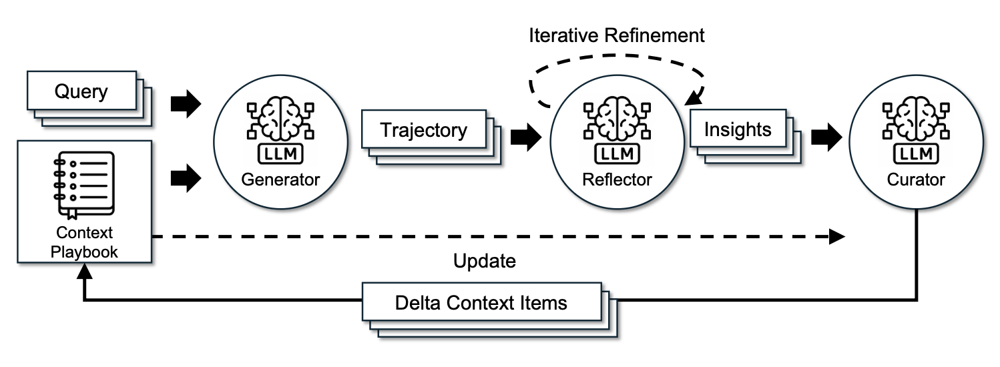
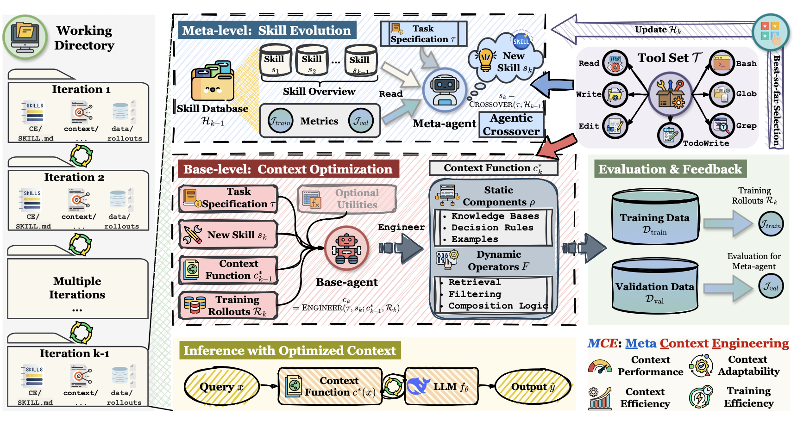
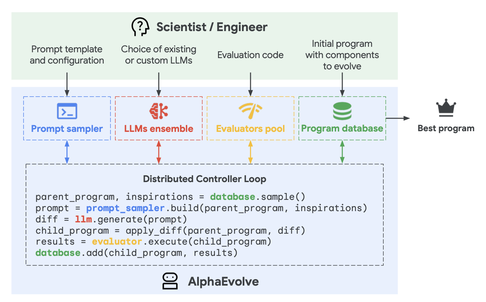

# Paper精读｜Harness Engineering for Self-Improvement

> [!abstract] 一句话结论
> Lilian Weng 这篇综述论证的事很直接：**harness engineering**——围着 LLM 搭的那层系统，管规划编排、工具调用、记忆管理、结果评估——才是**递归自我改进（RSI）眼下走得通的路**。与其等模型学会直接改写自身权重，不如先把「代码层」的 harness 变成可以自动搜索的优化对象。

> [!cite]- 论文信息（点开折叠）
> - **论文标题**：Harness Engineering for Self-Improvement
> - **链接**：[https://lilianweng.github.io/posts/2026-07-04-harness/](https://lilianweng.github.io/posts/2026-07-04-harness/)
> - **作者**：Lilian Weng
> - **机构**：Lil'Log（个人博客）
> - **日期**：2026-07-04
> - **来源**：alphaXiv / Lil'Log（28 min read）

---

## 1️⃣ 论文想解决什么问题

**递归自我改进（RSI）** 的概念可追溯到 I. J. Good（1965）的"超智能机器"定义——一个能在所有智力活动上超越人类、并设计更优机器来改进自身的系统。Yudkowsky（2008）把它拧成一个反馈回路：AI 用当前的智能，去改进产生智能的那个认知机制本身。

在当代 AI 语境下，RSI 可以是模型直接改写自身权重，也可以更宽泛地理解为模型改进训练流水线和部署系统，催生出一批在经济价值任务上更强的继任模型。Anthropic、OpenAI 这些前沿实验室的研发速度已经明显加快。

但pretraining evals 之外的那一层——harness——同样关键。Claude Code、Codex 这些编码 agent 产品的成功已经说明：harness 是 AI 部署的核心组件。所以问题来了：**harness engineering 如何贡献于 RSI？我们能不能把 harness 本身当优化目标，用自动化搜索找到更优的设计？**

---

## 2️⃣ 核心洞察

> [!important] 核心洞察
> 1. **Harness 是模型与外部世界之间的操作系统层**：它编排执行流程，决定模型怎么思考、规划、调用工具、感知上下文、存储产物、评估结果。类比操作系统——封装复杂逻辑，保持接口简单。
>
> 2. 优化对象的演进路径：instruction prompts → structured context → workflow → harness code → optimizer code。模型越强，优化目标就越从手工启发式走向通用自动化。
>
> 3. 代码是通用语言：LLM 能优化执行 agent 的代码，就等于拿到了比手写 prompt 大得多的设计空间。✨Code✨ 是定义程序和系统的通用语言。
>
> 4. 递归改进挑基模型：STOP 实验摆在那儿——GPT-4 上递归结构涨点，GPT-3.5 和 Mixtral 上反而掉。**Harness 改进能把模型能力用得更足，但智能本身还是硬通货**。
>
> 5. 评估器必须在循环之外：奖励黑客、多样性坍塌、过拟合这些坑，逼着评估系统和权限控制必须站在进化循环外面，配上 held-out 测试和人工审核。

---

## 3️⃣ 方法解读

### 组件1：Harness 设计模式

相比早期 "agent = LLM + memory + tools + planning + action" 的框架，现代 harness 工程要多管四件事：

- 工作流设计（循环工程）：定义模型可操作、测试、迭代的流程

- 评估系统：自动化验证任务完成质量

- 权限控制：安全边界和权限管理

- 持久状态管理：文件系统作为持久记忆

设计原则是刻意简洁通用以支持泛化——参考软件工程实践，跟操作系统封装复杂逻辑一个思路。

### 组件2：Context Engineering

把所有工具响应和模型生成一股脑追加进上下文，很快就会失控。Context Engineering 要做的就是给 LLM 一个更结构、更省的上下文。

**Agentic Context Engineering (ACE; Zhang et al. 2025)** 把上下文当成可进化的 playbook：

- Generator：生成任务轨迹，参考已有的 bullet points

- Reflector：从成功和失败轨迹中提炼洞察

- Curator：以增量、条目的方式更新结构化上下文

关键设计选择：curator 不重写完整 prompt blob，而是输出结构化的 (identifier, description) 条目，用确定性逻辑合并进上下文日志——上下文坍塌和简洁性偏差都被这步挡住。

*图片说明：Agentic Context Engineering (ACE) 框架。Generator 生成轨迹，Reflector 提炼洞察，Curator 以结构化 bullet 形式更新上下文 playbook，避免完整重写。*

**Meta Context Engineering (MCE; Ye et al. 2026)** 把机制（怎么管上下文）和内容（上下文里有什么）拆开：

- 内层优化：给定 skill，在训练数据上找到最优上下文

- 外层优化：在验证集上找到最优 skill

- Meta-level agent 执行 crossover 操作，基于历史 skills 创建新 skill

MCE 不强制启发式规则，用自由格式 skills 存任务最重要的知识，skill 和 skill-conditioned context 一起迭代进化。

*图片说明：Meta Context Engineering (MCE) 双层优化框架。Meta-level 搜索上下文管理机制（skill），base-level 优化任务上下文。Skill 数据库追踪历史，meta-agent 执行 crossover 创建新 skill。*

### 组件3：Meta-Harness

Meta-Harness (Lee et al. 2026) 把优化目标再往下沉一层——优化决定信息存储、检索和呈现方式的代码。"Meta-" 的意思就是：一个用来优化 harness 的 harness。

- 创建新 harness 的 proposer 本身就是一个 coding agent

- 最终输出是 Pareto 前沿上的 harness 候选集合

- 整个执行历史通过文件系统访问，coding agent 用 grep/cat 这些命令翻

- 提出的 harness 是文件系统里的字典，装着源代码、分数、rollout 轨迹和状态更新

### 组件4：Workflow Design

工作流设计可以由领域专家手工搭（AI Scientist 的 idea → code → experiment → paper → review 流水线就是），也可以当成搜索问题自动发现：

**Automated Design of Agentic Systems (ADAS; Hu et al. 2025)**：

- 初始化 agentic workflow archive（从 CoT、self-refine 这些简单 agent 起步）

- Meta-agent 受 archive 启发编程新 agent（先生成高层描述，再实现代码）

- 两步 self-refine 检查新颖性

- 评估新候选，成功的加入 archive

**AFlow (Zhang et al. 2025)**：

- 把 agentic workflow 表示为图（节点=LLM 调用，边=代码逻辑操作）

- 基于 MCTS 优化 workflow：选择节点 → LLM 扩展 → 评估 → 回加

- 在 QA、code、math 任务上超越手工方法和 ADAS

### 组件5：Self-Improving Harness

**Self-Taught Optimizer (STOP; Zelikman et al. 2023)**：

- 种子 improver 接收初始解决方案、效用函数和黑盒 LLM，返回改进方案

- 元效用 = improver 在下游任务集合上的平均效用

- 递归更新：基于 I_{t-1} 的元效用表现改进 improver 本身

- 实验里 improver 自己摸出了遗传算法、分解改进、多臂 bandit、模拟退火这些策略

- ⚠️ 关键发现：GPT-4 上 STOP 涨点，GPT-3.5/Mixtral 上反而退化

**Self-Harness (Zhang et al. 2026)**：

- 弱点挖掘：把失败聚类成 verifier-grounded 的失败模式

- Harness 提案：基于失败模式提出有界的 harness 编辑

- 验证：在 held-in（测试弱点解决）和 held-out（测试是否引入新问题）上评估

- 只接受在两个 split 上都不回归的候选

*（原图未能本地化：Figure 3: Self-Harness 框架；IMA 媒体接口没有可用媒体编号）*

*图片说明：Self-Harness 的 propose-evaluate-accept 循环。弱点挖掘从执行轨迹中提取失败模式；harness 提案基于失败模式提出有界编辑；验证阶段仅在 held-in 和 held-out 上均无回归时才接受编辑。*

### 组件6：Evolutionary Search

进化搜索在 harness 优化里用得很广：

**AlphaEvolve (Novikov et al. 2025)**：

- 维护候选程序池，prompt 冻结的 LLM 生成改进 diff

- 关键设计：代码区域用 `# EVOLVE-BLOCK-START/END` 标记；meta-prompt 与指令共同进化

- 在矩阵乘法、GPU 内核优化、算法竞赛这些领域找到过更优解

**Darwin Gödel Machine (DGM; Zhang et al. 2025)**：

- 直接对着可编辑 harness-code 仓库做进化

- 每个 agent 能改自己的 harness，靠 bash + editor 工具

- 在 SWE-bench Verified 上从 20% 提升到 50%

*图片说明：AlphaEvolve 的进化搜索流程。维护候选程序池，LLM 生成 diff 改进，评估后保留成功候选，逐步发现更优解。Meta-prompt 与解决方案程序共同进化。*

### 组件7：Joint Optimization with Model Weights

**SIA (Hebbar et al. 2026)** 试着把 harness 改进和模型参数更新塞进同一个循环：

- Meta-Agent：提出初始 harness

- Task-Specific Agent：执行任务

- Feedback-Agent：基于轨迹决定这轮改 harness 还是改模型权重

⚠️ 这个实验有混淆因素（task agent 远弱于 meta agent），证据我只能暂定为 provisional。

### 优势估计

- harness 设计被形式化成可执行的搜索空间，strong coding agent 从此能用人类工程师用的那套设计空间

- 代码作为优化目标，比 prompt 通用得多、可扩展得多

- 进化搜索在可自动评估、适应度可量化的任务上效果扎实

- 双层优化（MCE）把机制与内容分开，上下文管理因此更灵活

---

## 4️⃣ 实验部分怎么读

### 实验设置

survey 论文，没有统一实验，各方法的结果摆在一起看：

| **方法** | **基线模型** | **基准** | **关键结果** |
| --- | --- | --- | --- |
| Meta-Harness | 强 coding agent | TerminalBench-2 | 从 Terminus-KIRA/Terminus-2 初始化，性能显著提升 |
| Self-Harness | MiniMax M2.5, Qwen3.5, GLM-5 | Terminal-Bench-2 | 学习模型特定的 harness 指令，提升 held-out pass rate |
| DGM | Claude 3.5 Sonnet | SWE-bench Verified | 20% → 50% |
| DGM | Claude 3.5 Sonnet | Polyglot | 14.2% → 30.7% |
| AFlow | 多种 LLM | QA, Code, Math | 超越手工方法和 ADAS |
| STOP | GPT-4 | 多下游任务 | 平均性能提升（GPT-3.5/Mixtral 退化） |

### 核心结果

*（原图未能本地化：Figure 5: Meta-Harness 性能；IMA 媒体接口没有可用媒体编号）*

*图片说明：Meta-Harness 在文本分类（左）和 TerminalBench-2（右）上的性能曲线。搜索从强 harness 初始化，迭代优化后性能持续提升。*

**关键发现：**

1. harness 设计一旦变成可执行搜索空间，strong coding agent 就能直接用人类工程师的那套设计空间干活

2. 进化搜索在可自动评估的任务上效果扎实（SWE-bench、算法竞赛这些）

3. 递归改进挑基模型——GPT-4 上有效，弱模型上反而退化

4. Self-Harness 学出来的指令是模型特定的，对着各家的弱点下药

### 训练细节

- MCE 使用标准工具集 T = {Read, Write, Edit, Bash, Glob, Grep, TodoWrite}

- Self-Harness 需要 verifier 提供 ground-truth 评估

- DGM 使用 bash + editor 两种基本工具进行代码编辑

- AlphaEvolve 使用 EVOLVE-BLOCK 标记限定代码改进区域

---

## 5️⃣ 学术评价

**优点：**

1. 地图画全了：auto-research、self-improving agents、evolutionary search 里散落的线头被收进 harness engineering 一个框，分类和组织都清楚

2. 「优化对象演进路径」是全文最值钱的一条线索：prompt → context → workflow → code → optimizer，优化对象从手工启发式一路走向通用自动化，RSI 的层次化路径被串成了一条线

3. 立场务实：harness 是近期可落地的 RSI 路径——不等模型学会改自己权重，先把身边这层代码优化起来

4. 挑战列得全：评估、记忆、负结果、多样性坍塌、奖励黑客、长期成功、人类角色，7 个未来挑战一个不落

5. 两个类比挑得准：harness 之于模型像操作系统之于硬件；prompt engineering 被 instruction tuning 内部化，是现成的历史前例

> [!ed-warning] 局限（风险与不确定性）
> 1. 非原创研究：survey/position paper，没有新方法新实验，价值在组织不在发明
>
> 2. 横向比较做不了：各方法实验设置互不统一，数字放一张表里也说明不了谁强
>
> 3. 对 RSI 的语气偏乐观：时间线和可行性都往乐观方向讲，安全风险着墨太少
>
> 4. SIA 那段证据要打折：作者自己承认实验有混淆因素，读的时候心里留个折扣

---

## 6️⃣ 局限与可扩展方向

- 评估器质量：当前自我改进循环仅在评估指标可测量、客观的任务上有效（类似 RL）；研究品味、新颖性、长期科学价值难以量化

- 上下文与记忆生命周期：记忆随 agent 自主性增长而膨胀，需要管理上下文以弥补长文本生成的限制

- 负结果缺失：文献偏向成功发表，LLM 难以决定何时放弃假设、报告负结果

- 多样性坍塌：进化和 RL 循环倾向于利用已知高奖励模式，需要机制防止种群坍塌为同一解的变体

- 奖励黑客：agent 可能过拟合 unit tests、利用 judge model 的偏见、或利用 benchmark artifacts

- 长期成功：编码 agent 提升日常生产力，但短期优化目标常忽略可维护性、所有权边界、迁移成本、向后兼容性

- 人类角色：人类应上移栈层而非被移除，系统设计需考虑何时以及如何设置人工监督节点

---

## 7️⃣ 最后总结

这篇 survey 的价值在地图，不在单个景点：STOP、Self-Harness、AlphaEvolve、DGM、Meta-Harness 这些散在各处的工作，被「优化对象从 prompt 一路升级到 optimizer code」这条线串了起来，harness 是 RSI 近期实用路径这个论点因此立住了。但 Weng 自己也把天花板画出来了——递归改进挑基模型，GPT-4 上行、GPT-3.5 和 Mixtral 上反而退化；进化搜索只在能自动评估的任务上灵。全文真正留下的两个硬问题是：**评估器能不能强到撑起开放领域的自我改进？人类在循环里怎么保持有意义的监督？**这两个问题不解决，harness engineering 就只能停在「可评估任务上的自我改进」。

---

## 8️⃣ 三句速记

> [!summary]- 点开展开
> 1. Harness 是 RSI 的近期路径：优化围着 LLM 的系统层（代码）比等模型直接改写权重更现实，优化对象从 prompt 演进到 code 再到 optimizer
>
> 2. 代码是通用语言：harness 设计变成可执行搜索空间后，strong coding agent 能用人类工程师的同一设计空间，进化搜索在可评估任务上效果扎实
>
> 3. 评估是核心瓶颈：奖励黑客、多样性坍塌、负结果缺失、长期目标对齐这些挑战全都指向同一件事——评估器必须位于进化循环之外，人类监督不可移除
