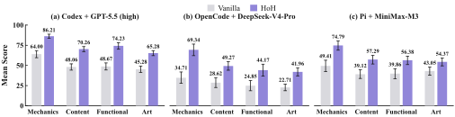
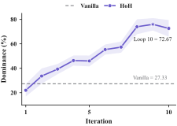

# Paper精读｜Harness-of-Harness: Multi-Day Autonomous Software Development with Continual Improvement

> [!abstract] 一句话结论
> **Harness-of-Harness（HoH）不去跟"让一个 Coding Agent 一口气写完软件"较劲，而是在现有 harness 外面再加一层持续改进协议：每轮分别以 Planner、Developer 和独立 QA Tester 三个角色调用它，围绕小而可验证的增量循环，并<span class="mark-strong">把代码状态和证据状态一起带进下一轮</span>。**三个 benchmark 上，三轮 HoH 全部稳定压过 Vanilla harness；70 轮的多日案例里，它从空目录自主建出了一个能玩的第一人称射击游戏。

> [!cite]- 论文信息（点开折叠）
> - **论文标题**：Harness-of-Harness: Multi-Day Autonomous Software Development with Continual Improvement
> - **arXiv**：2609.01481v1
> - **链接**：[https://arxiv.org/abs/2609.01481](https://arxiv.org/abs/2609.01481)
> - **代码**：[https://github.com/Flesymeb/HarnessOfHarness](https://github.com/Flesymeb/HarnessOfHarness)
> - **项目主页**：[https://flesymeb.github.io/HarnessOfHarness/](https://flesymeb.github.io/HarnessOfHarness/)
> - **作者**：Haoyang Yan, Min-Le Su, Hangfan Zhang, Zhanhao Li, Chen Zhang, Shao Zhang, Yang Chen, Lei Bai, Shuyue Hu
> - **机构**：上海人工智能实验室
> - **日期**：2026-09-01

---

## 论文分类标注

- **研究类型**：Agent 系统方法论文 + 长时程自主软件开发实验

- **领域归属**：LLM Agent > Coding Agent > Harness Engineering > 持续迭代与证据驱动开发

- **方法学标签**：多角色编排、迭代增量开发、独立 QA、跨轮次状态管理、版本化项目记忆

- **主要对象**：不修改底层 coding harness，而是在其外层构建一个"管理 harness 的 harness"

- **与相关工作的关系**：承接 SWE-Agent、OpenHands、MetaGPT、AgentCoder、Meta-Harness、Self-Harness 等工作，但重点从"一次任务完成"转向"多轮、跨天、持续改进的完整软件构建"

---

## 1️⃣ 论文想解决什么问题

现有的 Coding Agent，干"解决一个 issue""完成一次 bounded episode"这类活没问题。可一旦让它长时间从零构建一个完整软件，几乎注定失控：早期需求被遗忘，局部修复跟别的模块打架；同一个问题反复检查；已有的能力又生成一遍；功能还没齐就早早宣布完成。

难点不在让模型执行更久，在让它在这段时间里持续保持**<span class="mark-strong">方向、连续性和可验证性</span>**。软件开发里还缠着三种不同的判断：下一步做什么、具体怎么实现、实现完是不是真的满足要求——这三种判断需要不同的视角和权限，全塞给同一个 Agent，等于让开发者自己验收自己的代码。

HoH 的基本想法很直接：把现有 coding agent 当成一个可调用的 harness，用另一个外层协议来组织它。外层协议不规定 Agent 每一步必须怎么想，只规定它必须交付什么可验证的中间产物，再让独立 QA 根据证据定下一轮的优先级。

---

## 2️⃣ 核心洞察

> [!important] 核心洞察
> 1. **Harness-of-Harness 是管理 harness 的外层控制回路。** 底层 harness 照旧管文件读写、终端、编译和工具调用；HoH 管的是另几件事——什么时候重新调用它、以什么角色调用、喂它哪些跨轮次状态、以及怎么判断这轮是不是真有进展。
>
> 2. **<span class="mark-strong">软件状态不等于开发知识</span>。** 当前代码只回答"现在有什么"，回答不了"哪些需求验证过、哪些 bug 出现过、哪些修复后来又回归了"。所以 HoH 把两份账分开记：artifact state（代码/资源/配置）和 evidence state（验证过的行为、未解决的缺口、回归风险）。
>
> 3. **持续改进必须同时处理 repair 和 capability growth。** 每轮只修 bug，系统在局部修补里打转；每轮只加功能，缺陷和回归越攒越多。Planner 的做法是把"优先修复阻塞问题"和"新增一个小而完整的能力"放进同一轮的有界目标。
>
> 4. **约束可验证产物，而不是规定工作流。** Planner、Developer、QA 都有结构化输出契约，输出不合 schema 就触发重试；但怎么分析、怎么调工具、怎么实现，Agent 自己定。这是在可靠性和自主性之间各让一步。

---

## 3️⃣ 方法解读

### 1. 形式化：从需求到持续演化的 artifact

先把整件事钉成一个映射——给定软件规格 S、初始项目 A₀、固定模型 M 和固定底层 harness H，HoH 要在 T 轮之后交出完整软件 Aᵀ：

```text
HoH(M,H): S → A
```

每一轮拆成三个角色的调用：

```text
Dₜ = Plan_H(S, Eₜ₋₁)
Aₜ = Dev_H(Aₜ₋₁ ; S, Dₜ)
Eₜ = Test_H(Aₜ ; S, Dₜ)
```

符号含义：

- `S`：公开产品需求或 benchmark specification；

- `Aₜ`：第 t 轮后的项目 artifact，包括源代码、配置、资源和项目元数据；

- `Dₜ`：本轮开发文档，描述下一步有限目标、要保留的行为和验收条件；

- `Eₜ`：本轮 QA 产生的证据包；

- `H`：底层 coding-agent harness；

- `Plan_H / Dev_H / Test_H`：用同一个底层模型/harness，但以不同角色、不同权限和不同输入分别调用。

跨轮次的状态转移就一行：

```text
(Aₜ₋₁, Eₜ₋₁) --loop t--> (Aₜ, Eₜ)
```

两份状态各管一件事：`A` 保证开发不用每轮从头来，`E` 保证下一轮不是只盯着当前代码猜历史。缺哪一条，循环都转不起来。

### 2. Project Planner：决定"下一步做什么"

Planner 读三样东西：

- 原始 PRD/任务规格 S；

- 上一轮 QA 的 evidence bundle Eₜ₋₁；

- 当前 artifact Aₜ₋₁ 的只读实现上下文。

它没有生产代码的写权限，产出只有一份开发文档 Dₜ，文档被要求：

- 选择最多三个有序优先级；

- 优先处理阻塞问题和回归；

- 选择一个有界但局部完整的增量；

- 写明哪些已经验证的功能必须保留；

- 写明本轮可以观察到的验收条件。

"有界"在这里不是数文件个数，而是框定一个可独立验证的行为单元——比如"加入完整的敌人战斗循环"可能牵扯多个脚本、UI 和资源，但它们同属一个可观察目标；无关的架构重构则被挡在本轮之外。

### 3. Developer：单写入者实现增量

Developer 从 Aₜ₋₁ warm-start，不是每次从空项目起跳。生产 artifact 的写权限在它手里，底层 harness 的文件、shell、构建、运行和测试工具随便用。

HoH 管的是结果，不是过程：

- 不能用一个更小的重写项目替代已有项目；

- 要保留已验证的功能；

- 要让项目保持可构建、可运行；

- 每个声称完成的机制都要有可重放的运行记录。

它内部走 shift-left 的 baseline–change–retest：先立目标行为基线，每次重要改动后立刻重跑相关路径和邻近回归面。注意这套测试只是开发自检，顶不了最终验收。

### 4. QA Tester：只读、独立、证据绑定

QA Tester 拿到的是冻结后的 Aₜ、S、Dₜ，外加确定性的 build/runtime 检查结果。它碰不了生产代码，能动用的只有：

- black-box 测试：输入、交互、渲染结果、状态变化和端到端流程；

- white-box 检查：源代码、配置、资源绑定、runtime state 和日志；

- 截图、视频、replay trace 等公开证据。

"代码里有这个函数"在 QA 这里不算功能证据——它要看到实际行为。每条 claim 都要绑上对应的执行记录，最后归成两堆：

```text
Eₜ = Eᵥₑᵣ ∪ Egap
```

- `Eᵥₑᵣ`：有证据支持的 verified records，下一轮必须保护；

- `Egap`：失败、回归、未满足需求或证据不足，下一轮转化为修复目标。

这个分工治的是个老毛病：Developer 最熟自己写了什么，也最容易把"实现了"当成"完成了"；QA 只认冻结 artifact 上的可观察证据，没这层人情可讲。

### 5. Progressive Disclosure：不用专门 Memory Module 的记忆方案

HoH 没把"记忆"做成向量数据库，也没让上下文无限膨胀，而是用文件系统做渐进式披露：

- 详细计划、报告、历史和运行记录持久化到项目目录；

- 先向下一轮展示简洁、分类的索引；

- 只有相关内容才被进一步读取；

- skills 以轻量 Markdown 提供按需指导；

- 工具按角色暴露，避免每个角色看到全部工具。

这套设计真正防的是上下文膨胀。长时程 Agent 最危险的不是没历史，是历史太多——真正要紧的东西被淹在里头。

### 6. Versioned Project History：代码与证据一起版本化

每轮都留档：

- 当前 workspace；

- development document；

- issue ledger；

- QA 报告；

- evidence packet；

- Git commit 和 issue history。

一旦出现重大回归，可以退回之前验证过的项目状态，把那时的回归记录重新交给 Planner，而不是让模型对着当前代码逆推一切。

---

## 4️⃣ 实验部分怎么读

### 实验设置

作者用了三个 benchmark、三种 harness–model 组合：

| **Benchmark** | **任务类型** | **规模** |
| --- | --- | --- |
| GameCraft-Bench | 从自然语言规格构建可玩的 Godot 游戏 | 45 个任务，覆盖 15 个游戏族 |
| FrontierSWE | 从零实现、性能优化和研究型软件任务 | 15 个任务 |
| ProgramBench | 根据编译程序和文档重建行为等价的程序 | 论文主表报告平均 hidden test pass rate |

三种组合：

- Codex CLI 0.142.5 + GPT-5.5 High；

- OpenCode 1.14.30 + DeepSeek-V4-Pro；

- Pi Coding Agent 0.80.10 + MiniMax-M3。

Vanilla 是底层 harness 普通跑一遍开发；HoH@T 是经过 T 次 Planner–Developer–QA 循环后的 artifact。主实验取 T=3，HoH 的中间结果被留在开发环路外，只在完整运行后评估——免得 benchmark 分数漏给后续 Planner。

### 核心结果

| **配置** | **GameCraft Vanilla → HoH@3** | **FrontierSWE 关键指标** | **ProgramBench Vanilla → HoH@3** |
| --- | --- | --- | --- |
| Codex + GPT-5.5 | 49.58 → **71.52**（+21.93） | Dominance 44% → **71%** | 60.41 → **66.50** |
| OpenCode + DeepSeek-V4-Pro | 26.90 → **48.98**（+22.08） | Dominance 25% → **44%** | 45.27 → **57.56** |
| Pi + MiniMax-M3 | 42.16 → **58.78**（+16.62） | Dominance 35% → **64%** | 35.83 → **52.68** |

FrontierSWE 的平均 reward 分别从 0.31→0.54、0.23→0.31、0.26→0.55。收益不挑模型：起点最强的 Codex 还能再涨，起点较弱的 OpenCode 和 Pi 也各有明显改善。



*图注：GameCraft-Bench 将完整软件质量拆成 Core Mechanics、Content Depth、Functional Visuals、Art and Presentation。HoH@3 在三个 harness–model 配置上四个维度都提升，说明收益不只是"能跑起来"，还包含内容、可视反馈和呈现质量。*

### 多轮不是简单重复调用

为了堵住"多给几次调用机会也能涨"这个解释，作者加了 Vanilla Continuation：每轮只发一句"继续开发和测试当前游戏"，没有 Planner 文档，也没有独立 QA 证据。

在 Codex + GPT-5.5 上：

| **方案** | **Pass 数** | **GameCraft 分数** | **平均累计 tokens** |
| --- | --- | --- | --- |
| Vanilla | 1 | 49.58 | 2.59M |
| Vanilla Continuation | 2 | 54.99 | 4.56M |
| Vanilla Continuation | 3 | 58.24 | 6.33M |
| HoH | 1 | 59.71 | 2.88M |
| HoH | 2 | 64.84 | 5.67M |
| HoH | 3 | **71.52** | 8.41M |

HoH@2 用 5.67M tokens 就过了 Vanilla Continuation 三轮的 58.24 分，后者花了 6.33M tokens。账很清楚：收益来自**<span class="mark-strong">重新规划、独立验收、证据反馈组成的结构</span>**，不是让同一个会话多写几次代码。

### 消融实验：三种跨轮状态都不可缺

| **变体** | **GameCraft 分数** | **相对 Full HoH** | **含义** |
| --- | --- | --- | --- |
| Full HoH@3 | **71.52** | — | 更新计划 + evidence feedback + warm-start |
| w/o Plan Update | 63.39 | −8.13 | 后续轮次复用第一轮计划 |
| w/o Evidence Feedback | 65.23 | −6.28 | Planner 看不到上一轮 QA 证据 |
| w/o Warm-Start | 63.67 | −7.85 | 每轮从空初始项目重建 |

去掉 warm-start 后，平均 token 消耗从 **<span class="mark-number">8.41M</span>** 涨到 **<span class="mark-number">11.12M</span>**——Agent 在一遍遍重复重建。三个消融各打一个机制：

- Plan Update 没了，循环不知道下一步该往哪转；

- Evidence Feedback 没了，Planner 分不清哪些功能真成了、哪些只是代码声称完成；

- Warm-Start 没了，开发从增量演化退化成重复生成。

*（原图未能本地化：Figure S5：HoH 消融实验；IMA 媒体接口没有可用媒体编号）*

*图注：消融结果显示，去掉计划更新、证据反馈或 warm-start 都会降低最终质量；去掉 warm-start 还会把 token 消耗抬高一大截。*



*图注：Codex + GPT-5.5 在 FrontierSWE 上从 Vanilla 的 27.33% baseline dominance 持续提升，HoH@9 达到 76.00%，HoH@10 为 72.67%；说明多轮结构能延续收益，但也存在后期波动。*

---

## 多日自主开发案例：Fusepoint

作者给 HoH 一个空 workspace 和一份 PRD：开发一款约五分钟的单人第一人称拆弹游戏。要求包括：

- 按顺序占领两个控制点；

- 在最终目标完成三阶段拆弹；

- 三个区域分别放置 3、5、10 个敌人，共 18 个；

- 实现成功和爆炸两条分支；

- 具备战斗、叙事、UI、3D 资源、音效和可玩性。

跑在 Codex CLI + GPT-5.6-Sol 上，高推理强度，一共 **70 轮**。人只在网络或 API 掉线时出手恢复基础设施，规划、实现、debug、测试、验收一概没碰。

70 轮大致走成三段：

1. **初始构建（1–27 轮）**：搭起可运行的项目和核心交互，同时大量暴露缺失需求和缺陷；

2. **能力扩展（28–49 轮）**：新增功能和修复并行，局部改动开始牵动任务状态、战斗、UI 和已有行为；

3. **稳定化阶段**：功能逼近完整，新增减少，issue 关闭速度超过新问题产生速度。

到第 70 轮：

- 共记录 81 个 issue；

- 已关闭 65 个；

- 尚有 16 个未解决；

- 17 个 issue 曾在关闭后因后续改动导致回归并重新打开。

这个案例最值钱的不是"模型写出了一个游戏"，而是它演示了**<span class="mark-strong">回归不被当偶发事故，而被当成有历史的项目状态</span>**：系统记得某个行为验证过、后来又坏了，还能把它重新排进后续计划。

---

## 5️⃣ 学术评价

**优点：**

1. **抽象抓得准。** 它没把问题偷换成"给模型更长的上下文"，而是把长时程开发拆成 artifact continuity 和 evidence continuity 两条状态链。

2. **角色分工有实际工程含义。** Planner 管范围，Developer 管实现，QA 管独立验收；三者权限和信息都不同，自我验收和无边界改动没了土壤。

3. **评测不只看能不能编译。** GameCraft 把质量拆成机制、内容、功能视觉、艺术呈现；FrontierSWE 和 ProgramBench 覆盖实现、性能、研究和行为等价重建。

4. **多轮对照和消融都做了。** Vanilla Continuation 证明"多跑几次"拿不到同样收益；消融证明计划、证据、warm-start 各有贡献。

5. **兼容现有 Agent 生态。** 不用重写 Codex、OpenCode 或 Pi 的内部实现，直接套在外面。

> [!ed-warning] 局限（风险与不确定性）
> 先说处境：70 轮的多日运行，token、时间和外部工具的消耗都摆在台面上，把这种案例扩成大规模跨项目统计短期内不现实——单项目展示是当前成本下的合理选择。理解归理解，该提的还是要提：
> 1. **Fusepoint 终归是单个项目的展示。** 很有说服力，但替代不了大规模、跨项目的长期可靠性统计。
>
> 2. **成本仍然很高。** 每轮至少三次模型调用，外加构建、测试、截图和交互的运行开销；70 轮项目消耗的 token、时间和外部资源不是小数目。
>
> 3. **基础设施依赖没有消失。** 论文明说人工要恢复网络或 API；真实自治系统撞上依赖、许可证、GPU、限流这些问题，仍需要一个可靠的恢复层。
>
> 4. **QA 质量决定闭环的上限。** 测试选得不全、视觉检查粗糙、evidence schema 设计不当，Planner 拿到的反馈就是歪的。
>
> 5. **角色契约和工具仍是人工设计。** HoH 能自动跑循环，但 Planner 的规则、QA 的检查策略、skills 和工具暴露方式都得工程师来定。
>
> 6. **"独立 QA"不是完全独立的外部真理。** QA 仍是同类模型在调用，只是角色、权限、输入被分开；模型之间的共同盲点它兜不住，不能等同于真实用户或独立测试团队。
>
> 7. **结果和版本、供应商耦合。** 实验绑定 GPT-5.5、DeepSeek-V4-Pro、MiniMax-M3 和 Codex/OpenCode/Pi 的具体版本；换模型、换工具能力或换任务分布，效果得重新验。
>
> 8. **质量目标还不完整。** 论文管到功能、可玩性、视觉和音频；真实软件还要安全、性能、可维护性、可观测性、许可证合规和长期运营成本。

---

## 与其他论文的对话

| **工作** | **重点** | **HoH 的区别** |
| --- | --- | --- |
| SWE-Agent / OpenHands | 在软件环境中完成任务 | HoH 关注跨轮次、从零构建和状态延续 |
| AgentCoder / Self-Refine | 生成—测试—修复 | HoH 把计划、开发、独立 QA 和跨轮证据组织成长期循环 |
| MetaGPT / ChatDev | 多角色协作开发 | HoH 的角色更强调权限边界、证据绑定和持续迭代，而不是一次性角色对话 |
| Meta-Harness / Self-Harness | 优化或改进 Agent harness | HoH 不主要修改 harness 本身，而是在其外层管理长期项目演化 |
| SWE-EVO / SlopCodeBench | 长时程软件演化和退化评估 | HoH 是面向开发过程的控制协议，强调如何维持进展和恢复回归 |
| Harness Engineering for Self-Improvement | 将 harness 作为系统层优化对象 | HoH 更具体地把 harness 的执行组织成项目级闭环，并验证完整软件产物 |

---

## 对 Agent 工程的启发

把这篇论文和 WHALE 放在一起看最有意思：

- **WHALE** 优化的是模型权重 θ 和可执行 harness h，研究"模型和工作流如何共同适配"；

- **HoH** 假设底层模型和 harness 固定，研究"如何在长时间内组织这些调用，使软件持续变好"。

二者可以叠成三层架构：

```text
底层模型权重：学会编码、调试、使用工具
底层 Harness：提供文件、shell、编译器、浏览器和运行环境
HoH 外层协议：规划、实现、独立验收、证据反馈、版本恢复
```

这也把"Agent 自我改进"拆出了至少三种含义：

1. 改模型参数；

2. 改 harness 的工具和控制流；

3. 前两者都不动，只改长期运行时的项目管理和反馈闭环。

实际部署里，第三层往往最先落地：不用重训模型，也不用 Agent 改自己的底层 runtime，让它围着可验证 artifact 小步循环就行。

---

## 7️⃣ 最后总结

Harness-of-Harness 的核心贡献，是把"让一个 Coding Agent 跑很久"改造成"用一个外层协议持续管理一串有边界的开发阶段"。每轮只做一个有限、可观察的增量，独立 QA 产出 evidence，Planner 再按证据定下一轮。<span class="mark-strong">代码状态保证开发连续，证据状态保证方向连续</span>。

实验把最要紧的混淆排掉了：收益不是更多 token、更多重复调用买来的，而是计划更新、独立验收、warm-start 三件套成的闭环。从零构建大型项目、游戏、工具库、需要持续集成的多模块软件，是它最适配的场景。

但它离"完全自主软件公司"还有距离：测试策略、工具链、角色契约、基础设施恢复、质量目标，全都还要人来设计。更准确的定位是：**HoH 是把现有 Coding Agent 从一次性执行器，变成可持续、可审计、可回退的软件开发系统的一套外层控制协议。**

---

## 8️⃣ 三句速记

> [!summary]- 点开展开
> 1. **HoH 在 Coding Agent 外面再套一层 harness，用 Planner–Developer–QA 三角色循环管理长期软件开发。**
>
> 2. **Artifact state 保代码连续，Evidence state 保验证知识；缺任何一条，长时程开发都会失控。**
>
> 3. **它不是多调几次模型，而是靠有界增量、独立验收、证据反馈和版本历史，让 Agent 持续修复并扩展完整软件。**
