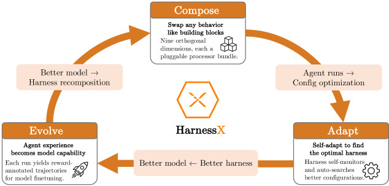
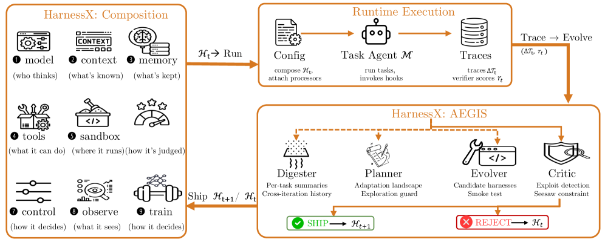
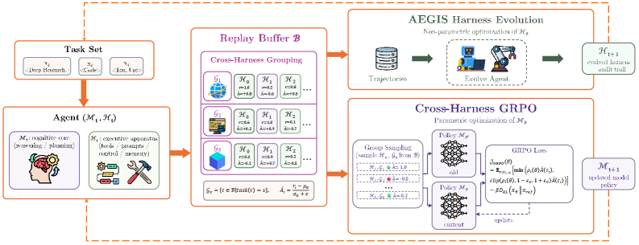
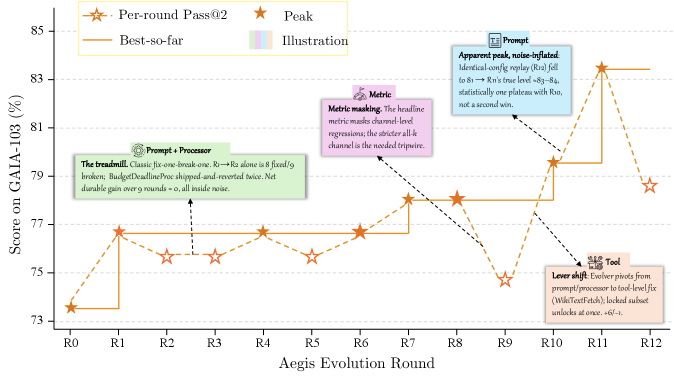
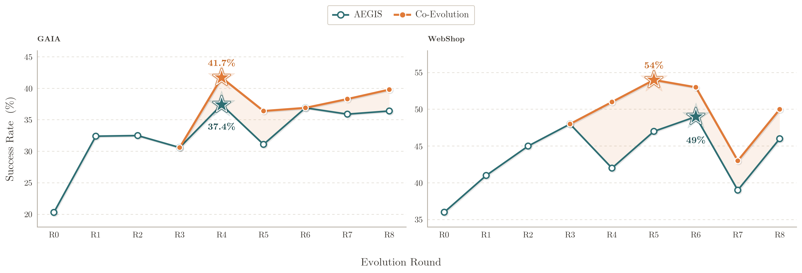

# Paper精读｜HarnessX: A Composable, Adaptive, and Evolvable Agent Harness Foundry

> [!abstract] 一句话结论
> HarnessX 把 Agent 的 **runtime harness**（prompt、tool、memory、control flow 的运行时编排层）当成了一个 **可组合的 typed 对象**，再让 **AEGIS**——一个吃执行轨迹的 **四阶段演化引擎**——自动进化 harness 配置：五个基准平均涨 **+14.5%**（最高 **+44.0%**），落点是 **harness 进化与模型 scaling 互补，是被忽视的那条杠杆**。

> [!cite]- 论文信息（点开折叠）
> - **论文标题**：HarnessX: A Composable, Adaptive, and Evolvable Agent Harness Foundry
> - **arXiv**：2606.14249
> - **链接**：[https://arxiv.org/abs/2606.14249](https://arxiv.org/abs/2606.14249)
> - **作者**：Darwin Agent Team
> - **机构**：Anthropic（Claude Code SDK v0.0.25 实验环境）
> - **日期**：2026-06-12

---

## 1️⃣ 论文想解决什么问题

当前 Agent 系统的 harness 设计绕不开三个结构性问题：

第一，harness 是手工打造且静态的。 每次更换模型版本、工具集或问题域，都需要 bespoke 修改，没有一条从执行经验里自动改进的路。

第二，harness 各组件架构纠缠。 prompt template、tool wrapper、retry policy、memory 通常耦合在同一代码路径中，改一处可能静默破坏另一处，跨域复用等于复制粘贴而非组合。

第三，harness 工程与模型训练完全独立。 进化 harness 时收集的轨迹数据被丢弃，没有用于模型训练；模型升级也不会自动反馈到 harness 改进。

这篇论文的核心洞察是：**harness 本身就是一个可以被程序化进化的对象**。与其不断调大模型，不如让执行反馈自动优化 agent 的运行时编排接口。

---

## 2️⃣ 核心洞察

HarnessX 的整体架构如下：

*Figure 1：HarnessX 整体架构概览。展示了 composition layer（9 维 typed processor）、AEGIS evolution engine（四阶段 pipeline）、和 co-evolution loop 三层结构。*

> [!important] 三条核心洞察
> 1. Harness 是可替换的 typed 对象：论文将 harness 形式化为 $\mathcal{H} = (\mathcal{M}, \mathcal{C})$，其中 $\mathcal{M}$ 是模型配置（哪个模型担任什么角色），$\mathcal{C}$ 是 harness 配置（处理器管线 + 共享槽位）。两者正交分离，使得同一套 harness 可以绑定不同模型，同一模型可以绑定不同 harness。
>
> 2. **Harness 演化等价于符号空间的 RL**：这是论文最精彩的理论映射。Harness 配置 = state，typed edit = action，执行轨迹 + verifier score = feedback。这个 **operational mirror** 不仅解释了为什么演化有效，还预测了三种 RL 病态（reward hacking、catastrophic forgetting、under-exploration），为 AEGIS 的架构防御提供了设计依据。
>
> 3. **Co-evolution 打破双重天花板**：Harness-only 会遇到 **scaffolding ceiling**（harness 已经暴露了最佳工具/上下文，但模型本身推理能力不够利用），Model-only 会遇到 **training-signal ceiling**（模型学到了新能力但 harness 从未提供触发它们的上下文）。Co-evolution 通过共享 replay buffer 上的 cross-harness GRPO 同时优化两条轴。

---

## 3️⃣ 方法解读

### 组件 1：Harness Composition（可组合层）

- Hook 机制：harness 定义了 8 个生命周期事件（task_start → step_start → before_model → after_model → before_tool → after_tool → step_end → task_end），每个 hook 有严格的 permitted modifications 约束（见表 1）

- Processor 体系：9 维度的处理器分类法（model、context、memory、tools、execution、evaluation、control、observability、training bridge），每个维度是一个可独立替换的组件

- Slot 资源：tool registry、tracer、workspace、sandbox、plugin list 作为 singleton 共享给所有 processor

### 组件 2：AEGIS 演化引擎（自适应层）

AEGIS 是一个 **四阶段 pipeline**，由一个 meta-agent（Opus 4.6）统一驱动：

- Digester：压缩执行轨迹，提取失败模式和 trace features

- Planner：基于压缩后的证据制定 adaptation plan，输出 change manifest（每个编辑的可证伪声明）

- Evolver：生成候选编辑（typed harness edit），支持 multi-component intervention

- Critic：用确定性门控判断候选编辑是否应该 shipped，检查 next round 的 trace delta 是否匹配 manifest 预测

关键设计：**change manifest 让每次编辑可证伪**——Critic 检查下一轮的实际 trace delta 是否与预测一致。

*Figure 2：AEGIS 演化循环。单个 meta-agent（Opus 4.6）统一驱动四阶段（Digester → Planner → Evolver → Critic），根据信号强度选择性调用。确定性门控决定是否 shipped 候选编辑。*

### 组件 3：Harness-Model Co-Evolution（联合进化层）

- 维护一个 **FIFO replay buffer**（固定容量，先进先出淘汰）

- 同一批轨迹同时驱动 AEGIS harness 进化 + **cross-harness GRPO** 模型训练

- Cross-harness advantage：将同一任务在不同 harness 版本下的轨迹分组，计算组内相对优势（公式 3），使得 model RL 可以在零额外 rollout 成本下运行

*Figure 3：Harness-Model 联合进化循环。Agent *$(\mathcal{M}_t, \mathcal{H}_t)$* 在固定 verifier 下执行任务批次，轨迹和奖励 *$(\tau, r)$* 进入共享 replay buffer *$\mathcal{B}$*。同一批数据同时驱动 AEGIS harness 进化和 cross-harness GRPO 模型训练，双输出 *$(\mathcal{M}_{t+1}, \mathcal{H}_{t+1})$* 汇入下一轮。*

### 优势估计

- Variant Isolation：解决 GAIA 等异构任务集上 single-harness 演化的停滞问题——将任务聚类，每个 edit 只在其目标簇上评估，避免 seesaw constraint 导致的 regression 逃逸

- Inverse Scaling Pattern：越弱的模型从 harness 进化中获益越大（Qwen3.5-9B +44.0% vs Sonnet 4.6 +11.2% on ALFWorld），说明 harness 填补的行为缺口对弱模型最关键

---

## 4️⃣ 实验部分怎么读

### 实验设置

| **基准** | **领域** | **任务数** | **验证器** |
| --- | --- | --- | --- |
| GAIA | 多步检索 | 103 | Exact match |
| ALFWorld | 具身规划 | 134 | Goal completion |
| WebShop | 网页交互 | 100 | Attribute match |
| τ³-Bench | 多轮对话 | 3 domains | Rule compliance |
| SWE-bench Verified | 软件工程 | 55 | Patch resolution |

- 模型家族：Claude Sonnet 4.6、GPT-5.4、Qwen3.5-9B

- Meta-agent 固定为 Opus 4.6

- 最多 15 轮演化，连续 3 轮无 shipped edit 则早停

- 每轮评估全部任务（无 subsampling）

- 元代理 token 预算：100M–175M

**Evolution 轨迹：**

*Figure 4：演化轨迹（pass@2 成功率 vs round）。虚线为 static-harness 基线，实线为 evolved harness。所有模型均在 15 轮内持续超越静态基线，且在收敛后未见明显退化。*

### 核心结果

**表 4：Main Results (pass@2 success rate, %)**

| **Benchmark** | **Task Agent** | **Initial** | **Evolved** | **Δ** | **Best Round** |
| --- | --- | --- | --- | --- | --- |
| ALFWorld | Sonnet 4.6 | 83.6 | 94.8 | **+11.2** | 7 |
| ALFWorld | GPT-5.4 | 76.9 | 97.8 | **+20.9** | 4 |
| ALFWorld | Qwen3.5-9B | 53.0 | 97.0 | **+44.0** | 9 |
| WebShop | Sonnet 4.6 | 60.0 | 76.0 | **+16.0** | 7 |
| WebShop | GPT-5.4 | 55.0 | 73.0 | **+18.0** | 8 |
| WebShop | Qwen3.5-9B | 36.0 | 49.0 | **+13.0** | 7 |
| GAIA | Sonnet 4.6 | 73.8 | 83.5 | **+9.7** | 11 |
| GAIA | GPT-5.4 | 73.8 | 73.8 | **0.0** | 4 |
| GAIA | Qwen3.5-9B | 20.3 | 37.4 | **+17.1** | 4 |
| SWE-bench | Sonnet 4.6 | 76.4 | 87.3 | **+10.9** | 3 |
| SWE-bench | GPT-5.4 | 45.5 | 63.6 | **+18.2** | 3 |
| SWE-bench | Qwen3.5-9B | 23.6 | 41.8 | **+18.2** | 2 |
| τ³-Bench | Sonnet 4.6 | 89.6 | 95.0 | **+5.4** | – |
| τ³-Bench | GPT-5.4 | 76.2 | 90.7 | **+14.5** | – |
| τ³-Bench | Qwen3.5-9B | 93.5 | 94.6 | **+1.1** | – |

- 14/15 配置改善，平均绝对提升 +14.5%

- Inverse scaling：Qwen3.5-9B 始终获益最大（+44.0%, +17.1%, +18.2%）

- GAIA GPT-5.4 停滞：异构任务集上 single-harness 无法同时满足互斥编辑需求，motivate 了 variant isolation

**表 5：Variant Isolation 效果（GAIA, GPT-5.4）**

| **Strategy** | **Final (%)** | **Peak (%)** | **Final−Peak** | **Tokens** |
| --- | --- | --- | --- | --- |
| Ensemble (variant isolation) | **87.4** | 87.4 | **0.0** | 107.8M |
| Global (no isolation) | 49.5 | 73.8 | **−24.3** | 143.7M |

- Variant isolation 不仅更准（87.4% vs 49.5%），还更省 token（107.8M vs 143.7M）

**表 6：Meta-agent 架构对比（GAIA）**

| **Evolver** | **Accuracy (%)** | **Best round** | **Tokens** |
| --- | --- | --- | --- |
| AEGIS | **87.4** | R14 | **107.8M** |
| Claude Code SDK v0.0.25 | 86.4 | R12 | 123.1M |

- 精度相当（差距在一个标准误差内），AEGIS 更高效

**Co-Evolution 结果：**

Co-evolution 相比 harness-only 额外提升 **+4.7%**：

*Figure 5：Co-evolution vs harness-only evolution。星星标记各方法峰值，阴影区域为 co-evolution 增益。在 GAIA 和 WebShop 上，co-evolution 均超越了 frozen-model 上限。

### 训练细节

- Co-evolution GRPO：lr = 1×10⁻⁶，clip ε = 0.2，no KL penalty，5 training steps/round

- Replay buffer：4-round sliding window（GAIA: 824 traces, WebShop: 400 traces）

- Reward：GAIA = 0.9×correctness + 0.1×format；WebShop = attribute-match（binary）

---

## 5️⃣ 学术评价

**优点：**

1. operational mirror 不是装饰性类比：它把 harness 演化映射到 RL 框架后，真的推导出了具体的架构防御（variant isolation、change manifest falsifiability、cross-harness advantage）——理论映射能落地成设计，这比多数停在"我们像 RL"的论文多走了一步

2. 实验铺得够宽：5 个基准横跨不同领域，3 个模型家族验证 cross-model generalization，6 个消融实验（variant isolation、meta-agent 架构、evolver 架构、co-evolution、failure analysis、token 效率）

3. 可诊断性：通过 trace structure 将 RL 病态落地为具体案例（reward hacking on GAIA R10、catastrophic forgetting on τ³-Bench Telecom R7、under-exploration on ALFWorld R4–R7）

4. inverse scaling 发现："harness 进化对弱模型价值更大" 这条规律反直觉，但直接回答了"弱模型该往哪儿补短板"

> [!ed-warning] 局限（风险与不确定性）
> 先说处境：演化式方法做 held-out 评测确实有工程难处——演化集就是它学习的对象，另留 held-out 要么砍任务规模要么多花轮次。但理解归理解，这条不补，增益就只能理解为"在自己出的卷子上考自己"：
> 1. No held-out evaluation：所有增益都在 adaptation set 上测量，存在过拟合演化集的风险
>
> 2. Meta-agent 固定为 Opus 4.6：未评估 weaker meta-agent 的效果，无法确定 AEGIS 的质量上限是否受 meta-agent 能力约束
>
> 3. τ³-Belm Telecom 的耦合退化：即使每轮编辑都通过了 gate，累积的同类编辑仍可产生 sub-threshold 耦合退化（−14.0%），这是 per-edit gating 的结构性局限
>
> 4. 代码尚未开源：论文声明 "complete codebase will be open-sourced in a future release"

---

## 6️⃣ 局限与可扩展方向

- Cross-model generalization 待验证：目前只在 Sonnet→GPT/Qwen 做了单向测试，未验证 GPT→Sonnet 或 Qwen→Sonnet 的跨族进化

- Meta-agent 能力边界：AEGIS 的质量上限取决于 Opus 4.6，探索 cheaper meta-agent（如 Sonnet）能否达到 comparable performance 是重要方向

- Larger scale evolution：当前实验在 100–134 任务规模上，扩展到千级任务集时的 variant isolation 效率未评估

- Human-in-the-loop：change manifest 的可证伪框架天然支持人类专家介入，这是一个有潜力的 hybrid 方向

---

## 7️⃣ 最后总结

HarnessX 的主张一句话能说清：agent 的性能瓶颈不只来自模型本身，runtime harness 的进化是一条被忽视的杠杆。通过 typed composition + trace-driven evolution + co-evolution 三层设计，论文在 15 个 model-benchmark 配置上拿到了系统性改进。我觉得最大的贡献不在某个单一数字，而在建立了一套 可组合、可观测、可证伪 的 harness 工程范式——原本手工试错的 process，被变成了一个结构化的 learning problem。读完最想验证的一件事：这些增益放到 held-out 任务上还剩多少——no held-out evaluation 是硬伤；meta-agent 单点依赖（质量上限拴在 Opus 4.6 身上）是第二个。

---

## 8️⃣ 三句速记

> [!summary]- 点开展开
> 1. Harness 是 first-class typed 对象，通过 8 个 lifecycle hook + 9 维 processor taxonomy 实现正交组合，edit 不再互相静默破坏
>
> 2. AEGIS 把 harness 演化映射为符号空间 RL，四个阶段（Digester→Planner→Evolver→Critic）配合 change manifest 的可证伪机制，系统性防御 reward hacking / catastrophic forgetting / under-exploration
>
> 3. Co-evolution 打破双重天花板，cross-harness GRPO 在零额外 rollout 成本下让模型内化 successive harness 的策略，harness-only +4.7% 额外收益
