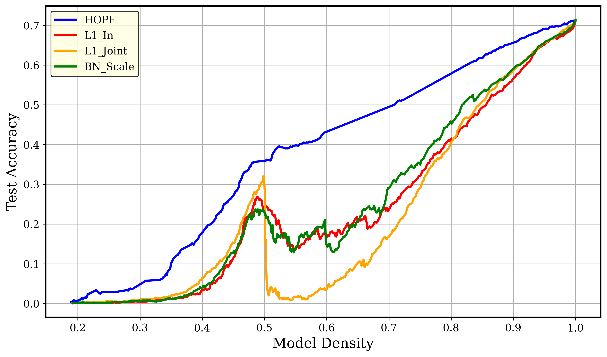

# Paper精读｜Hilbert Operator for Progressive Encoding (HOPE): A Mathematical Framework for Deconstructing Learned Representations in Deep Networks

> [!abstract] 一句话结论
> **不碰参数数值，把每个神经元当成连续 Hilbert 空间里的 rank-1 Hilbert-Schmidt 算子来称重——剪枝和合并从此是同一件事，都是低秩子空间投影。更狠的是，含 BN 的网络连一条训练数据都不用，BN 的滑动统计配上最大熵原理就能解析出全部代价，无数据、无超参数，顺手把网络里的核心不变量和可塑冗余也分了出来。**

> [!cite]- 论文信息（点开折叠）
> - **论文标题**：Hilbert Operator for Progressive Encoding (HOPE): A Mathematical Framework for Deconstructing Learned Representations in Deep Networks
> - **arXiv**：[https://arxiv.org/abs/2607.21366](https://arxiv.org/abs/2607.21366)
> - **作者**：Hossein Mobahi, Peter L. Bartlett
> - **机构**：Google DeepMind / UC Berkeley
> - **日期**：2026-07-23

---

## 1️⃣ 论文想解决什么问题

剪枝这事儿有个老毛病，看权重幅值挑人。$L_1$ 剪枝把幅值小的神经元当冗余剪掉，但 overparameterized 网络里的幅值根本不代表本事大小，它更多是优化过程留下的伪迹：网络存在尺度对称性，同一组功能可以用完全不同幅值的参数实现，你按幅值剪，剪掉的只是优化器的心情。

另一条路是激活匹配——看神经元对真实数据的响应再决定剪谁。思路更对，但要反复跑前向传播，计算贵，而且换一批数据分布结果就漂。

论文把压缩当成分析网络表示的代理任务来做，说学习与压缩存在根本联系、LLM 已被证明是通用压缩器——这层动机是讲故事的包装，真正要解决的，是顺着上面两条死路逼出来的一个问题。

> [!ed-quote] 核心问题
> **如何在无需数据、无超参数的情况下，客观评估神经元的功能重要性？**

---

## 2️⃣ 核心洞察

三条洞察是递进的：先换空间，再定义对象，最后解决「没数据怎么办」。

> [!important] 三条核心洞察
> 1. **把评估从参数空间搬到函数空间**：不看权重数值，看神经元对输入施加的变换。尺度对称性能骗过幅值剪枝，是因为它只活在参数空间里——函数空间里没有这个骗局。
> 2. **神经元 = rank-1 Hilbert-Schmidt 算子**：把每个神经元提升到连续 Hilbert 空间 $\mathcal{H} = L_2(\mathcal{X}, P_{\mathcal{X}}; \mathbb{R}^c)$ 里，剪枝 = 投影到零算子，合并 = 两个 rank-1 子空间的最优 rank-1 近似。两件事从此共用一套语言。
> 3. **BN 统计 → 最大熵原理 → 解析代理分布**：含 BN 的架构里，滑动均值和方差就是免费的分布信息，配上最大熵原理构造高斯代理，Hilbert 空间内积全部解析可得，一次前向传播都不用跑。

*图注：ImageNet ResNet-50，Accuracy vs Density。HOPE（蓝）在相同密度下压着 $L_1$ 输入剪枝（红）、$L_1$ 联合剪枝（绿）、BN Scale 剪枝（橙）打——函数空间称重确实比看幅值靠谱。*

---

## 3️⃣ 方法解读

### 组件1：神经元的函数化定义

HOPE 的第一步是个偷换——评估神经元时根本不看它的参数，只看它对输入干了什么。为了让 BN 也一起算进来，先把 BN 的缩放和平移吸收进有效参数：

$$
\mathbf{w}_{\text{in},i}^{\text{eff}} = \frac{\gamma_i}{\sqrt{\sigma_i^2 + \epsilon}} \mathbf{w}_{\text{raw},i}, \quad b_i = \beta_i - \frac{\gamma_i \mu_i}{\sqrt{\sigma_i^2 + \epsilon}}
$$

再把神经元的端到端信号映射写成连续函数：

$$
f_i(\mathbf{x}) = \Psi(y_i) \mathbf{w}_{\text{out},i}, \quad y_i = (\mathbf{w}_{\text{in},i}^{\text{eff}})^T \mathbf{x} + b_i
$$

其中 $\Psi$ 是正一次齐次（PH-1）激活函数，ReLU 这类都算。PH-1 不是装饰条件，它让缩放可以被干净地搬进搬出，后面容量对 resharding 的不变性全靠它撑着。

### 组件2：代理分布的解析构造

没有数据，真实分布 $P^*_{\mathcal{X}}$ 拿不到。HOPE 的做法不是去采数据，而是问了一个更聪明的问题：只凭 BN 的统计，对输入能做的最诚实的猜测是什么？两步走：

1. **Diaconis-Freedman 效应**：高维输入的一维线性投影天然趋近高斯，也就是说每个神经元「看到」的预激活信号近似高斯。

2. **最大熵代理**：在 BN 统计约束下最大化微分熵 $H(\mathbf{x}) \propto \log\det(\Sigma_x)$，答案是多元高斯 $P_{\mathcal{X}} = \mathcal{N}(\hat{\boldsymbol{\mu}}_x, \hat{\Sigma}_x)$。

这是全文我觉得最冒险的一步——把「预激活近似高斯」直接当构造分布的地基。好在 Diaconis-Freedman 给了点理论背书，而且选最大熵本身就是一种坦白：我只用我知道的信息，不多编一分。

### 组件3：Hilbert 空间中的 rank-1 算子

有了分布，就能把输入端函数 $g_i$ 和输出向量 $\mathbf{w}_{\text{out},i}$ 做张量积，得到全文的中心对象：

$$
f_i = g_i \otimes \mathbf{w}_{\text{out},i} \in \mathcal{H} \cong \mathcal{H}_{\text{in}} \otimes \mathcal{H}_{\text{out}}
$$

每个神经元在 $\mathcal{H}$ 里就是一个 rank-1 Hilbert-Schmidt 算子。**容量**定义为：

$$
\|f_i\|_{\mathcal{H}} = \|\mathbf{w}_{\text{out},i}\|_2 \cdot \sqrt{K(i,i)}
$$

其中核函数 $K(i,j) = E_{\mathbf{x} \sim P_{\mathcal{X}}}[\Psi(y_i)\Psi(y_j)]$，全部解析可得。

> [!note] 这个容量为什么好
> 它对权重 resharding（重新缩放）和神经元的物理形状（输入/输出维度）都无动于衷。幅值剪枝被尺度对称性骗得团团转的那个骗局，在这个空间里根本不存在。

### 组件4：压缩成本泛函

有了容量，接下来是定价。HOPE 没有拍脑袋设计损失，而是从三条公理（幅度中性、连通性保持、无穷容量依赖）把成本泛函硬推出来——这是全文最硬的地方。**剪枝成本**：

$$
\mathcal{J}_{\text{prune}} = \frac{N \cdot \|f_i\|_{\mathcal{H}}}{E_a - \|f_i\|_{\mathcal{H}}}
$$

**合并成本**：

$$
\mathcal{J}_{\text{merge}} = \frac{N \cdot \sqrt{\|f_i - f_p\|_{\mathcal{H}}^2 + \|f_j - f_p\|_{\mathcal{H}}^2}}{E_a - \|f_i\|_{\mathcal{H}} - \|f_j\|_{\mathcal{H}} + \|f_p\|_{\mathcal{H}}}
$$

其中 $f_p$ 是 Hilbert 空间中最优的父神经元（通过约束 rank-1 近似求解），$N$ 为层神经元数，$E_a$ 为层总容量。分母里那个 $E_a - \|f_i\|$ 是有讲究的——代价随神经元占用的容量份额非线性上涨，越接近掏空全层预算，剪它越贵。

**块驱逐（Block Eviction）**：残差瓶颈块另给一个宏观成本：

$$
\mathcal{J}_{\text{evict}} = \frac{\sum_{l=1}^{2} N_{\text{active}}^{(l)} E_{\text{active}}^{(l)}}{\sum_{k=1}^{d_{\text{amb}}} \sqrt{\gamma_k^2 + \beta_k^2}}
$$

微观（神经元级剪枝/合并）和宏观（整块驱逐）从此共用一个决策框架——统一性在这里真正兑现，不是口号。

### 组件5：渐进编码循环

定价有了，压缩流程是个贪心循环：

1. **初始化**：预计算所有神经元容量、两两几何交叉容量、各层总容量

2. **贪心扫描**：遍历所有可行操作，算失真率 $\text{DR} = \mathcal{J}_k / \Delta P_k^{\text{init}}$，挑最小的做

3. **局部更新**：只重算受影响的神经元及其邻居的交叉容量

每次迭代 $\mathcal{O}(L \cdot N^2)$，$L$ 为层数，$N$ 为每层神经元数。注意两两交叉容量要 $O(N^2)$ 量级的预计算——这笔开销，后面局限里会回来咬它。

### 组件6：DEFT——迁移学习应用

最后是这套容量观的反哺：既然容量能分出核心和外围，迁移学习可以直接借用。基于 $\mathcal{J}_{\text{prune}}$ 的分布，把神经元分成 Universal Core（高容量，冻结）和 Peripheral Slack（低容量，可塑），这就是 Dispersed Elastic Fine-Tuning (DEFT)：

- **结构掩码**：切断 slack→core 的连接，目标任务的梯度不许碰核心

- **动态冗余解决**：迁移前先合并冗余特征，把可塑参数空间腾出来

逻辑很直白——源任务教出来的核心别动，可塑的部分拿去学新的。

### 优势估计

- **完全无数据（含 BN 架构）**：BN 统计 + 最大熵原理解析构造代理，一条前向都不跑

- **无超参数**：成本泛函是公理推出来的，不是调出来的

- **统一框架**：剪枝、合并、块驱逐共用同一把尺子

- **公理化推导**：从幅度中性、连通性保持、无穷容量依赖三条公理出发，理论链条完整

- **跨架构**：从全连接无缝扩到 ResNet-50 的卷积

---

## 4️⃣ 实验部分怎么读

### 实验设置

**模型压缩实验**：

- 模型：Keras 公开 ResNet-50（ImageNet 预训练）

- 基线：$L_1$ 输入剪枝、$L_1$ 联合剪枝、BN Scale 剪枝

- 指标：Accuracy vs Density（活跃神经元比例）

**迁移学习实验**：

- 源任务：CIFAR-100 的 4 个超类 → 20 个细粒度类别

- 目标任务：SVHN 10 类数字分类

- 基线：Full FT、Head-Only FT、PEFT (BN-Tuning)、EWC

- 指标：H-Score（源保留率和目标准确率的调和平均）

### 核心结果

**模型压缩**：HOPE 在相同密度下压着所有基于幅度的结构化剪枝基线打（见 Figure 1）。这个对比对 HOPE 其实有利——幅值基线正是被尺度对称性坑得最惨的那批，但它至少证明了一件事：换空间这一步没有白换。

**迁移学习（Table 1）**：

| **方法** | **Target Acc (SVHN)** | **Source Retention (CIFAR)** | **H-Score** |
| --- | --- | --- | --- |
| **DEFT** | **89.79 ± 0.84** | **52.14 ± 5.29** | **65.82 ± 3.96** |
| Head-Only | 36.11 ± 2.79 | 63.13 ± 4.62 | 45.79 ± 2.05 |
| Full FT | 94.09 ± 0.28 | 7.52 ± 1.63 | 13.88 ± 2.84 |
| EWC | 93.94 ± 0.22 | 6.74 ± 1.74 | 12.54 ± 2.99 |
| PEFT | 81.91 ± 0.49 | 5.44 ± 0.98 | 10.18 ± 1.63 |

*这张表最有说服力的不是 89.79% 那一格，而是跷跷板两端被同时按住了：DEFT 拿到 Full FT 几乎全部的可塑性（89.79% vs 94.09%），源保留率又从 7.52% 拉到 52.14%。对照组里最扎心的是 EWC 和 PEFT——俩方法生来就是干「别忘掉源任务」这行的，源保留率反而掉到 7% 以下。*

---

## 5️⃣ 学术评价

**优点：**

1. **公理化推导是真硬**：剪枝、合并、块驱逐从同一组公理推出来，不是三个经验 trick 缝在一起，这在压缩文献里少见

2. **无数据 + 无超参数不是营销词**：BN 统计本来就在那儿躺着，用最大熵把它变成完整分布，这一手是全文最漂亮的地方

3. **尺度对称性是被解决了，不是被绕开了**：有效参数吸收 + Hilbert 范数，从根上断掉了幅值剪枝的老病根

4. **微观宏观同一把尺子**：神经元级和块级操作共用成本度量，统一性有实际后果

5. **DEFT 把压缩理论接到了迁移学习上**：结构掩码切 slack→core，stability-plasticity 困境有了一个具体的、可操作的答案

> [!ed-warning] 局限（先替作者说句公道话，再提问题）
> 先说处境：无数据方法找公平基线本来就难——跟要数据的方法比，赢了说不清是数据的功劳还是框架的功劳，所以只跟 $L_1$、BN Scale 这类同为无数据的基线比，我理解这个选择。但理解归理解，说服力确实不够：
> 1. **压缩实验没碰现代结构化剪枝**：VDEP、CHIP 这两年的方法全没出现，读者会问，换到函数空间到底是赢在思路，还是赢在基线弱
> 2. **DEFT 只在 CIFAR-100→SVHN 上验过**：跨域规模小，没上大规模视觉-语言迁移，更没碰 LLM 微调
> 3. **高斯代理假设偏强**：Diaconis-Freedman 保的是线性投影，遇到非标准架构或重尾输入可能失灵
> 4. **合并的 $\mathcal{O}(N^2)$ 两两比较**：极宽层（LLM 的 FFN 动辄上万神经元）这笔开销不好说能扛住
> 5. **没有 Transformer/LLM 实验**：框架在 ResNet-50 验证，恰好避开了当前最需要压缩的地方

---

## 6️⃣ 局限与可扩展方向

- 把 HOPE 搬到 LLM 上验证，FFN 层是首选靶子

- 跟 VDEP、CHIP 这类现代结构化剪枝做大规模对比

- 核心-外围分离在持续学习（continual learning）里的应用

- 代理分布超越高斯假设（重尾、混合分布）

- 扩到无 BN 架构（需要一次性校准前向传播）

- 合并候选搜索提速（$\mathcal{O}(N^2)$ 是当前的痛点）

---

## 7️⃣ 最后总结

读完这篇，我最确定的一件事：HOPE 把评估从参数空间挪到函数空间，尺度对称性这个幅值剪枝的老病根是被连根拔掉的，不是绕开的——公理化推导让整个框架立得住。我最不确定的一件事：高斯代理出了 BN 的舒适区还站不站得住。下一步最该验证的是 LLM 的 FFN 层——如果容量这套语言在那儿也成立，剪枝、合并、迁移这三件长期各干各的事，就真的共用一套语法了。DEFT 已经给了个预演。

---

## 8️⃣ 三句速记

> [!summary]- 点开展开
> 1. **神经元 = rank-1 Hilbert-Schmidt 算子**：把神经元搬进连续 Hilbert 空间，剪枝和合并统一成低秩子空间投影，一套语言管两件事。
> 2. **BN 统计 + 最大熵 = 无数据压缩**：滑动统计造高斯代理，内积全部解析算出，前向传播一次不跑。
> 3. **DEFT：压缩理论反哺迁移**：容量分出核心与外围，结构掩码切断 slack→core，stability-plasticity 各得其所。
