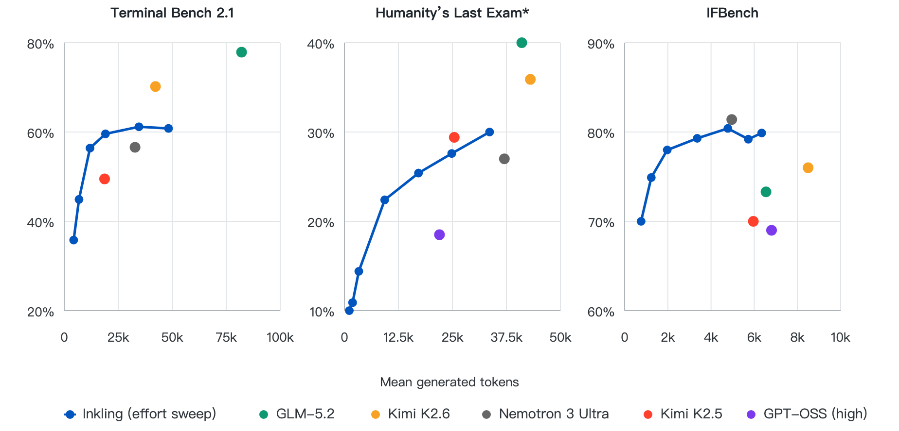
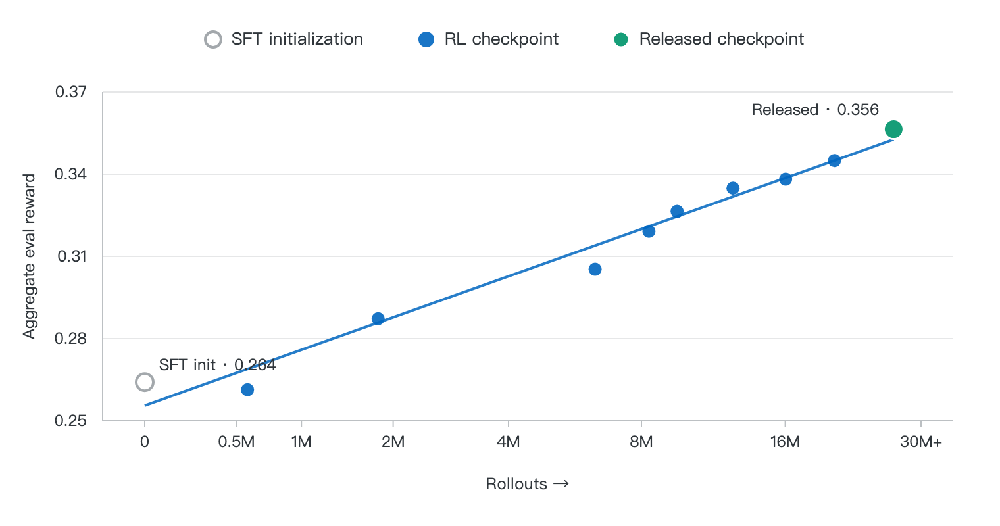

# Paper精读｜Inkling: Our Open-Weights Model

> [!abstract] 一句话结论
> Thinking Machines 发布 **Inkling**——975B 总参数 / 41B 激活的 MoE 模型。可控思考努力（controllable thinking effort）此前是 GPT-5.6 这类闭源模型的专属，**Inkling 第一次把它带进开源权重**，原生多模态（文本/图像/音频）和大规模 RL 训练也在同一次训练里做齐。定位不装：不做"最强模型"，做"最好的可微调底座"。
> *（原图未能本地化：Inkling: Our open-weights model；IMA 媒体接口没有可用媒体编号）*
> *The cover image: a fluid, generative ink-blot artwork in deep blues and blacks, evoking both the fluidity of thought and the inkwell from which the model's name derives. The abstract forms radiate outward, suggesting the model's capacity for expansive, controllable reasoning.*

> [!cite]- 论文信息（点开折叠）
> - **论文标题**：Inkling: Our Open-Weights Model
> - **原文链接**：[Thinking Machines Blog](https://thinkingmachines.ai/news/introducing-inkling/)
> - **作者**：Thinking Machines
> - **机构**：Thinking Machines
> - **日期**：2026-07-15
> - **类型**：模型发布公告（含完整技术报告）

---

## 1️⃣ 论文想解决什么问题

当前开源模型面临一个根本性困境：**能力越强，使用成本越高**。DeepSeek V4 Pro、Kimi K2.6、Nemotron 3 Ultra 等模型在 benchmark 上表现亮眼，但开发者实际部署时面临两个痛点：

1. **思考成本不可控**：模型要么"想太少"答错，要么"想太多"浪费 token，无法根据任务难度动态调整推理 compute

2. **多模态能力缺失**：大多数开源模型只支持文本，音频/视觉能力依赖外部编码器，无法实现真正的原生多模态推理

Inkling 的设计目标是：**在开源的前提下，提供一个"够广、够省、够安全"的底座**，让开发者通过微调解决自己的问题，而不是追求 benchmark 上的最高分。

---

## 2️⃣ 核心洞察

> [!important] 核心洞察
> 1. **可控思考努力是开源模型的缺失能力**：通过 RL 训练让模型学会"该多想时多想，该少想时少想"，在 Terminal Bench 2.1 上达到 Nemotron 3 Ultra 同等性能仅需 1/3 token
>
> 2. **原生多模态不需要编码器**：音频用 dMel 频谱图、视觉用 40×40 patch + hMLP，直接和文本 token 联合训练，避免了编码器瓶颈
>
> 3. **30M+ rollouts 的 RL 训练带来 log-linear 持续提升**：推理分数随 RL 训练步数对数线性增长，且 chain of thought 自动变得更简洁（emergent compression）
>
> 4. **安全性和可微调性可以兼得**：FORTRESS 对抗测试 78%（开源最高），同时支持在 Tinker 上微调后不破坏安全行为

---

## 3️⃣ 方法解读

### 组件1：MoE 架构

- 256 个 routed experts + 2 个 shared experts，每 token 激活 6 个 routed experts

- 总参数 975B，激活参数 41B（激活率 4.2%）

- **Sigmoid-based router** + auxiliary-loss-free load-balancing bias（避免传统 MoE 的辅助损失干扰训练目标）

- 参考 DeepSeek-V3 的 MoE 设计但做了简化

### 组件2：注意力机制

- **滑动窗口 + 全局注意力 5:1 交替**：每 5 层 sliding window 配 1 层全局注意力，8 个 KV heads

- **相对位置编码（RPE）替代 RoPE**：在长上下文外推性上优于 RoPE，1M token 上下文窗口

- **短卷积**：在 attention 的 key/value 投影后、以及残差分支输出处各加一次短卷积，增强局部信息提取

### 组件3：多模态输入

- **编码器无关架构（encoder-free）**：

  - 音频 → 离散 dMel 频谱图 → 轻量 embedding 层

  - 图像 → 40×40 pixel patches → 四层 hMLP → 轻量 embedding 层

- 音频和视觉 token 与文本 token 联合训练，共享同一个 Transformer backbone

- 推理时可配合 Python 工具做图像 zoom/crop 操作

### 组件4：可控思考努力

*官方图｜思考预算和主要任务表现的关系。 [来源](https://thinkingmachines.ai/news/introducing-inkling/)*

- 通过 system message 设定 effort 参数（0.2 ~ 0.99）

- 训练时通过 **per-token cost** 让模型学习"不同 effort 对应不同 token 消耗"

- 结果：effort=0.99 时性能最高，effort=0.2 时速度最快

- 在 Terminal Bench 2.1 上，Inkling 用 1/3 token 达到 Nemotron 3 Ultra 同等分数

> **Figure 3 — 可控思考努力曲线**：折线图，X 轴为 effort（0.2 ~ 0.99），Y 轴为性能分数（0-100）。每条折线代表一个 benchmark（Terminal Bench 2.1, HLE, IFBench）。所有曲线均呈单调递增趋势，但 effort > 0.8 后边际收益递减。标注显示 Inkling 在 effort=0.99 时达到 Nemotron 3 Ultra（虚线）的同等性能，但仅消耗 1/3 的 token（约 8000 vs 24000）。另一条曲线显示 mean generated tokens 从 effort=0.2 时的 ~5K 增长到 effort=0.99 时的 ~25K。

### 组件5：大规模 RL 训练

*官方图｜从 SFT 到发布检查点的强化学习曲线。 [来源](https://thinkingmachines.ai/news/introducing-inkling/)*

- **异步 RL，30M+ rollouts**，连续两个长训练阶段

- 推理分数随 rollout 数量 **log-linear 提升**（从 SFT 初始化到最终 checkpoint 单调递增）

- **Emergent chain-of-thought 压缩**：RL 训练后，模型的思考链自动变得更简洁（去掉语法冗余如冠词、连词），但保持可理解和正确性

- 奖励信号：

  - 推理任务：正确性奖励

  - 指令遵循：rubric grader + factuality grader 双评分器

  - 校准性：proper scoring rules + 短形式 QA 的弃答奖励

> **Figure 4 — RL 训练 log-linear 提升**：折线图，X 轴为 RL rollout 数量（从 0 到 30M+），Y 轴为聚合推理 eval 的 reward（AIME + HLE + GPQA 等）。曲线从约 40% 单调上升到约 75%，全程保持对数线性趋势，未出现平台期。虚线标注"SFT 初始化"起点和"released checkpoint"终点。

### 组件6：安全训练

- FORTRESS 对抗测试 78%（开源最高），良性查询通过率 95.9%

- StrongREJECT 98.6%（与闭源模型持平）

- 安全行为覆盖：CBRN、网络攻击、失控风险、谄媚、弱势用户保护

- 微调后安全行为保持研究（ongoing work）

### 优势估计

- **开源可微调**：全权重 Hugging Face 发布 + Tinker 平台支持微调

- **NVFP4 checkpoint**：支持 NVIDIA Blackwell 高效推理

- **1M token 上下文**：业界最长之一

- **多模态原生**：文本/图像/音频统一训练，非后期拼接

- **Inkling-Small 兄弟模型**：276B/12B 激活，性能接近但成本更低

---

## 4️⃣ 实验部分怎么读

### 实验设置

- 所有 eval 在 effort=0.99、temperature=1.0 下运行

- Coding eval 使用 256K max-token trajectory limit

- 对比模型：Nemotron 3 Ultra, Kimi K2.5, Kimi K2.6, GLM 5.2, DeepSeek V4 Pro, Gemini 3.1 Pro, Claude Fable 5, GPT 5.6 Sol

### 核心结果

| **指标** | **Inkling** | **Nemotron 3 Ultra** | **Kimi K2.6** | **GPT 5.6 Sol** | **Claude Fable 5** |
| --- | --- | --- | --- | --- | --- |
| HLE text only | 29.7% | 26.6% | 35.9% | 47.2% | 53.3% |
| HLE with tools | 46.0% | 37.4% | 54.0% | 55.0% | 64.5% |
| AIME 2026 | 97.1% | 94.2% | 96.4% | 99.9% | 99.9% |
| GPQA Diamond | 87.2% | 86.7% | 91.1% | 94.1% | 92.6% |
| SWEBench Verified | 77.6% | 70.7% | 80.2% | 82.2% | 95.0% |
| Terminal Bench 2.1 | 63.8% | 56.4% | 71.3% | 91.9% | 84.6% |
| MMMU Pro | 73.5% | – | 79.0% | 83.0% | 84.2% |
| VoiceBench | 91.4% | – | – | – | – |
| FORTRESS Adv | 78.0% | 77.6% | 65.6% | 82.4% | 96.0% |

> **Figure 2 — 通用模型基准对比（雷达图）**：五轴雷达图，五个轴分别为：Text / Agentic / Multimodal / Audio / Safety。每个轴的范围是 0-100。五种颜色的多边形分别代表五种模型：Inkling（蓝色）、Nemotron 3 Ultra（橙色）、GLM 5.2（绿色）、GPT 5.6 Sol（紫色）、Claude Fable 5（红色）。Inkling 的多边形在所有轴都偏向"Safety"和"Agentic"方向，但在"Text"和"Multimodal"方向被闭源模型超出。Inkling 的整体形状偏五边形（均衡），不像某些模型那样偏科某个方向。图注说明："Inkling is a broad, balanced generalist model."

> **Figure 1 — Inkling 自我微调 Demo（终端截图）**：黑色背景终端界面复刻了 OpenCode 的视觉效果。界面顶部显示 "Build · inkling · tinker-prod"，当前目录 "~/news/introducing-inkling/"，版本号 "1.33.7"。下方有 7 个故事播放控制按钮（Story 1-7），关键帧预览：
>
> - Story 1: landing and first prompt — 初始对话界面
>
> - Story 2: base model answer — 展示模型原始回答（包含字母 "e"）
>
> - Story 3: fine-tuning intent — 用户提示："fine tune yourself with Tinker to be a lipogram model where you never use the letter e"
>
> - Story 4: rubric — 模型生成评估标准
>
> - Story 5: training — 通过 Tinker API 进行训练
>
> - Story 6: self-update — 模型加载新权重
>
> - Story 7: updated model answer — 新回答不再包含字母 "e"
>
> 图注说明完整展示了从"模型在当前 harness 中运行"到"新定制化模型生效"的完整闭环。

### 训练细节

- **预训练**：45T tokens，文本/图像/音频/视频混合

- **优化器**：Muon（大矩阵权重）+ Adam（其他参数），weight decay 与 learning rate 平方耦合

- **硬件**：NVIDIA GB300 NVL72 系统

- **后训练**：SFT（Kimi K2.5 合成数据）→ 大规模 RL（异步，30M+ rollouts）

- **Inkling-Small**：276B/12B 激活，相同后训练流程，性能接近大哥但成本更低

> **Figure 5 — Chain of Thought 演化示例**：并排展示同一个数学题（5D 时空中的自旋-2 涨落）的两次回答。左侧"Early in RL — verbose, grammatical" 的回答完整流畅："We need to understand the operator. The 5D line element is ds² = e^{2A(x)} (ds²_4d + dx²), where A(x) = sin(x) + 4 cos(x)..."。右侧"Late in RL — compressed, telegraphic" 的回答变得碎片化："We need determine eigenvalue problem for spin-2 fluctuations h_{μν}(x,y) with TT in 4d and depend on x..."，去掉了冠词（the）、连词（and）和冗余解释（"Wait"），但保持了推理的正确性。RL 训练使模型的推理风格从"学术写作"变成了"电报体"，但答案质量不变。

### Inkling vs Inkling-Small 对比

| **指标** | **Inkling (41B)** | **Inkling-Small (12B)** |
| --- | --- | --- |
| HLE text only | 29.7% | 29.6% |
| AIME 2026 | 97.1% | 95.1% |
| SWEBench Verified | 77.6% | 77.4% |
| Terminal Bench 2.1 | 63.8% | 52.7% |
| SimpleQA Verified | 43.9% | 20.9% |
| IFBench | 79.8% | 83.4% |

Inkling-Small 在推理和 agentic 任务上跟大哥贴得很近，拉开差距的是 Terminal Bench（63.8% vs 52.7%）和 SimpleQA（43.9% vs 20.9%）。12B 激活 + 可控思考努力，预算紧的场景下这差价换得值。

---

## 5️⃣ 学术评价

**优点：**

1. **工程完整度高**：不是"刷 benchmark 的模型"，而是从架构设计（MoE + RPE + 短卷积）到训练策略（Muon + 异步 RL）再到部署生态（Tinker + Hugging Face + 多推理框架）的完整系统

2. **可控思考努力是真正的差异化**：此前只有 GPT-5.6 等闭源模型支持，Inkling 首次在开源模型中实现，对生产部署有直接价值

3. **多模态原生设计**：encoder-free 架构避免了传统多模态模型的编码器瓶颈，音频/视觉与文本真正联合训练

4. **安全训练透明**：公开 FORTRESS/StrongREJECT 测试结果，承认开源模型的安全挑战，并承诺持续研究

5. **RL 训练的 log-linear 发现**：30M+ rollouts 下推理分数持续提升未饱和，为"RL scaling 还能走多远"提供了正面证据

> [!ed-warning] 局限（风险与不确定性）
> 先说处境：Inkling 本来就没打算跟闭源旗舰拼绝对分数，定位是可微调的底座，我理解为什么它不把 benchmark 表上那些落后当回事。但理解归理解，数字摆出来还是得认：
> 1. **绝对性能不及闭源旗舰**：HLE 29.7% vs Claude Fable 5 的 53.3%，SWEBench 77.6% vs 95.0%，差距就摆在那儿
>
> 2. **多模态能力仍落后**：MMMU Pro 73.5% vs Gemini 3.1 Pro 的 82.0%，音频 VoiceBench 91.4% vs 94.3%
>
> 3. **RL 训练细节不够透明**：未公开奖励函数的具体设计、rollout 的采样策略、异步 RL 的并行度等关键细节
>
> 4. **Inkling-Small 尚未完成测试**：预览版，full weights 未发布
>
> 5. **缺乏 ablation study**：无法判断 MoE 设计、RPE vs RoPE、短卷积等组件各自的贡献

---

## 6️⃣ 局限与可扩展方向

- **RL scaling 的极限探索**：30M+ rollouts 仍未饱和，继续增加能否突破闭源模型的推理差距？

- **多模态能力的持续进化**：当前音频/视觉能力偏基础，需要更多领域数据和更精细的模态平衡

- **安全微调的影响**：开源模型微调后安全行为如何保持？Tinker 上的实际案例需要更多研究

- **Inkling-Small 的潜力**：12B 激活参数 + 可控思考努力，能否成为"本地部署的最佳选择"？

- **与 Harness Engineering 的结合**：Inkling 作为可微调底座，如何与 ACE/MCE/Self-Harness 等框架结合，实现自动化的自我改进

---

## 7️⃣ 最后总结

Inkling 不是"又一个刷榜模型"，它对"开源模型该往哪里走"的答案是绕开正面拼分：**靠差异化定位（可控思考 + 原生多模态 + 可微调底座），在闭源模型的阴影下圈出自己的一块地**。

从技术角度看，MoE 架构、RPE 替代 RoPE、encoder-free 多模态、30M+ rollouts 的 RL 训练，每一个都是值得拆开研究的工程选择。但真正让我多看两遍的是“RL 训练下 chain of thought 自动压缩”——没有哪个奖励显式鼓励简洁，推理链却自己变短了。现在模型的推理里还藏着多少水分，这个发现至少把问题摆上了桌。

知识网络这边，这条笔记直接挂在 `model-harness`（可微调底座）、`scaling-rl-for-llms`（30M rollouts log-linear）、`embodied-ai`（多模态推理）三个概念上。

---

## 8️⃣ 三句速记

> [!summary]- 点开展开
> 1. **可控思考努力**：Inkling 首次在开源模型中实现 effort/performance 的连续调节，同等性能下仅需竞品 1/3 token
>
> 2. **原生多模态**：encoder-free 架构让音频/视觉/文本联合训练，避免编码器瓶颈
>
> 3. **RL 持续 scaling**：30M+ rollouts 下推理分数 log-linear 增长未饱和，且 chain of thought 自动压缩变简洁
