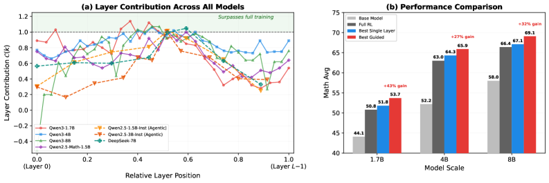
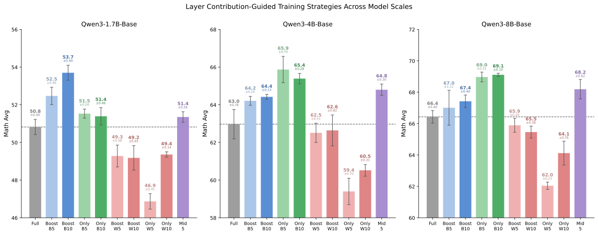
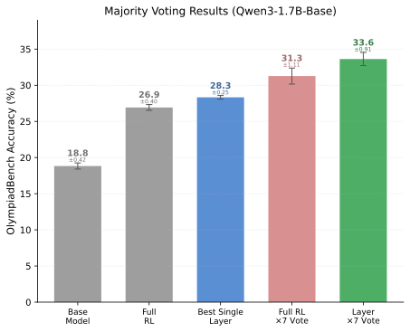

# Paper精读｜Is One Layer Enough? Training a Single Transformer Layer Can Match Full-Parameter RL Training

> [!abstract] 一句话结论
> **RL 微调的增益高度集中在少数中间层**——只训一个 Transformer 层就能恢复甚至超过全参数 RL 训练，而且这个模式跨模型家族、数据集、RL 算法、任务领域全都成立。

> [!cite]- 论文信息（点开折叠）
> - **论文标题**：Is One Layer Enough? Training a Single Transformer Layer Can Match Full-Parameter RL Training
> - **arXiv**：2607.01232
> - **链接**：[https://arxiv.org/abs/2607.01232](https://arxiv.org/abs/2607.01232)
> - **作者**：Zijian Zhang, Rizhen Hu, Athanasios Glentis, Dawei Li, Chung-Yiu Yau, Hongzhou Lin, Mingyi Hong
> - **机构**：University of Minnesota / Peking University / Amazon（独立工作）
> - **日期**：2026-07

---

## 1️⃣ 论文想解决什么问题

RLVR 现在是 LLM 后训练的标配，数学推理、代码生成、Agent 决策的提升都有它一份。但默认做法是对所有层做**均匀的全参数更新**——这里头藏着个没人检查过的假设：每层对 RL 增益的贡献差不多。

论文把这个问题翻了开来：**RL 增益在网络里到底是怎么按层分布的？** 要是贡献高度不均匀，这个结构本身就能拿来设计更省的训练策略。

---

## 2️⃣ 核心洞察

> [!important] 三条核心洞察
> 1. **单层训练即可匹配全参数 RL**：Qwen3-1.7B 上最佳单层（Layer 10）的 layer contribution 达到 1.14——只训这一层，拿到的提升是全参数 RL 的 114%。28 层里有 5 层贡献超过 1.0。
>
> 2. **贡献呈「中间高、两端低」的稳定结构**：高贡献层一致落在堆栈中间（约 40%-60% 深度），靠近输入和输出的层贡献低一大截。7 个模型、3 种 RL 算法、多个任务，形状都一样。
>
> 3. **高贡献层之间互补**：top-7 高贡献层的 Jaccard 相似度只有 34.1%——它们各自解决的是不同的问题子集。把 7 个层训练模型拉来做多数投票（majority voting），效果超过最佳单层，也超过全参数基线。

*Figure 1 — 7 个模型的 layer contribution 按归一化深度画在一起，每个点是一层，颜色区分模型。中间层贡献最高、两端急剧下降的形状跨模型一致地出现。*

---

## 3️⃣ 方法解读

### 组件1：Layer Contribution 定义

要回答「增益怎么分布」，先得有把尺。论文造了个直接的度量 **Layer Contribution 𝒞(k)**：

$\mathcal{C}(k) = \frac{\text{Score}(\text{train layer } k) - \text{Score}(\text{base})}{\text{Score}(\text{full-parameter}) - \text{Score}(\text{base})}$

分母是全参数 RL 的总提升，分子是只训第 k 层拿到的提升。𝒞(k) > 1.0，就是单层干过了全参数。

### 组件2：逐层独立训练协议

- 对每个模型，逐层冻结其他参数，只用 GRPO 训这一层

- 训练数据统一用 NuminaMath-CoT（去污后 50K 问题）

- 其余所有层、embedding、LM head 全部冻结

- 全参数 GRPO 基线用完全相同的超参数做对照

### 组件3：Layer-Aware 训练策略（3 种）

| **策略** | **做法** | **效果** |
| --- | --- | --- |
| **Boost Bk** | 对 top-k 层使用更高学习率（1e-5 vs 5e-6） | Qwen3-1.7B: +2.88（占总增益 43%） |
| **Only Bk** | 仅训练 top-k 层，其余冻结 | Only B5 即超越全参数基线 |
| **Middle Heuristic** | 直接选中间 5 层（无需 profiling） | 效果接近 contribution-guided 选择 |

### 优势估计

- 不用 per-dataset profiling：层排序跨数据集高度一致（Pearson r > 0.9）

- 省算力：选择性训练大幅压缩可训练参数量

- 即插即用：直接塞进现有 RLVR 流程就行

---

## 4️⃣ 实验部分怎么读

### 实验设置

| **模型** | **参数量** | **层数** | **RL算法** | **任务/数据** | **扫描方式** |
| --- | --- | --- | --- | --- | --- |
| Qwen3-1.7B-Base | 1.7B | 28 | GRPO | Math / NuminaMath-CoT | Full |
| Qwen3-4B-Base | 4B | 36 | GRPO | Math / NuminaMath-CoT | Full |
| Qwen3-8B-Base | 8B | 36 | GRPO | Math / NuminaMath-CoT | Full |
| Qwen2.5-Math-1.5B | 1.5B | 28 | Dr. GRPO | Math / MATH | Full |
| Qwen2.5-1.5B-Instruct | 1.5B | 28 | GiGPO | Agentic / ALFWorld | Partial |
| Qwen2.5-3B-Instruct | 3B | 36 | GiGPO | Agentic / ALFWorld | Partial |
| DeepSeek-Distilled-Qwen-7B | 7B | 28 | GRPO | Math / Skywork | Partial |

评估覆盖 12 个 benchmark：Math（MATH500, GSM8K, OlympiadBench, AMC）、Code（HumanEval+, MBPP, LiveCodeBench）、Reasoning（GPQA-Diamond, MMLU-Pro）、Language（C-Eval, IFEval, MGSM）。

### 核心结果

| **指标** | **基线** | **本文方法** | **提升** |
| --- | --- | --- | --- |
| Qwen3-1.7B 最佳单层 𝒞(k) | 1.0（全参数） | **1.14** (Layer 10) | +14% |
| Qwen3-1.7B 平均层贡献 | — | 0.62 | — |
| Qwen3-1.7B: Only B5 vs Full | 50.82 | **51.53** | +0.71 |
| Qwen3-1.7B: Boost B10 vs Full | 50.82 | **53.70** | +2.88 |
| Qwen3-4B: Only B5 vs Full | 62.97 | **65.87** | +2.90 |
| Qwen3-8B: Boost B10 vs Full | 66.43 | **67.42** | +0.99 |
| 7-layer 投票 vs 全参数 (OlympiadBench) | ~28% | **>30%** | 超越 |

*Figure 7 — 三种 layer-aware 训练策略对比。蓝色（Boost Bk）和绿色（Only Bk）一致压过灰色全参数基线；红色（提升低贡献层）反而往下掉；紫色（中间层启发式）贴着 contribution-guided 的效果走。*

*Figure 8 — 7 个高贡献层训练模型的多数投票。投票不止超过最佳单层和全参数基线，连同一全参数模型的 7 样本 self-consistency 投票也一并超过——层间互补是真的在起作用。*

### 训练细节

- 优化器：AdamW

- 基础学习率：5×10⁻⁶（Boost 策略中 top-k 层用 1×10⁻⁵）

- 训练数据：NuminaMath-CoT 降采样至 50K（去污后）

- 每个实验报告 3 次独立运行的 mean ± std

---

## 5️⃣ 学术评价

**优点：**

1. **发现够硬**：RL 增益在层间高度不均匀、「中间高两端低」，而且是头一回被系统摆上台面——7 个模型上反复出现，不是单模型的巧合

2. **覆盖面撑得住结论**：7 个模型 × 2 个家族 × 3 种 RL 算法 × 数学+Agent 任务，结论全部同向

3. **方案拿来就能用**：Boost、Only、Middle Heuristic 三种策略都简单，不带额外计算开销

4. **分析不止一层**：互补性（Jaccard）、权重变化幅度（Figure 9）、跨数据集一致性都验过了

> [!ed-warning] 局限（风险与不确定性）
> 先说处境：逐层扫描的实验成本本来就高，guided training 先只做数学我理解。但该提的还是得提：
> 1. **引导策略只在数学推理上验过**：coding 和 agentic 任务的 guided training 留作未来工作
>
> 2. **为什么偏偏是中间层，没有理论答案**：论文自己承认这是开放问题
>
> 3. **Layer Contribution 的数值依赖训练配置**：换超参数、换数据，排序可能跟着变
>
> 4. **没跟 LoRA/QLoRA 这类 PEFT 方法比**：选择性层训练和低秩适配谁更值，论文没碰

---

## 6️⃣ 局限与可扩展方向

- 把 layer-aware 策略扩到 coding 和 agentic 任务

- 给中间层的高贡献性找理论解释（可能与特征抽象层级有关）

- layer selection 和 LoRA/QLoRA 组合，做更极致的参数高效训练

- 预训练阶段能不能提前预测哪些层会成为 RL 高贡献层

- 动态 layer selection：训练过程中贡献排序会不会漂移

---

## 7️⃣ 最后总结

读完最确定的一件事：**RL 后训练的增益不是均匀撒在网络里的，而是高度集中在少数中间层**——这个结构性现象以前没人系统摆出来过，它给「RL 怎么重塑预训练模型」提供了一个可测的切面，也直接改得出更省的训练策略。而全文最实用的结论可能是最不讲究的那条：不做任何 profiling、直接训中间 5 层，就能追上甚至超过全参数 RL——免诊断的启发式，在工业级 RL 部署里最容易落地。

---

## 8️⃣ 三句速记

> [!summary]- 点开展开
> 1. **RL 增益高度集中**：只训一个 Transformer 层就能恢复甚至超过全参数 RL，最佳层贡献 114%。
>
> 2. **中间层是 RL 的关键区**：高贡献层稳定落在 Transformer 40%-60% 深度，跨模型、算法、任务都成立。
>
> 3. **Layer-aware 训练稳定优于均匀训练**：Boost top-k 或只训 top-k 都超过全参数基线，免 profiling 的「中间层启发式」就能贴近最优。
