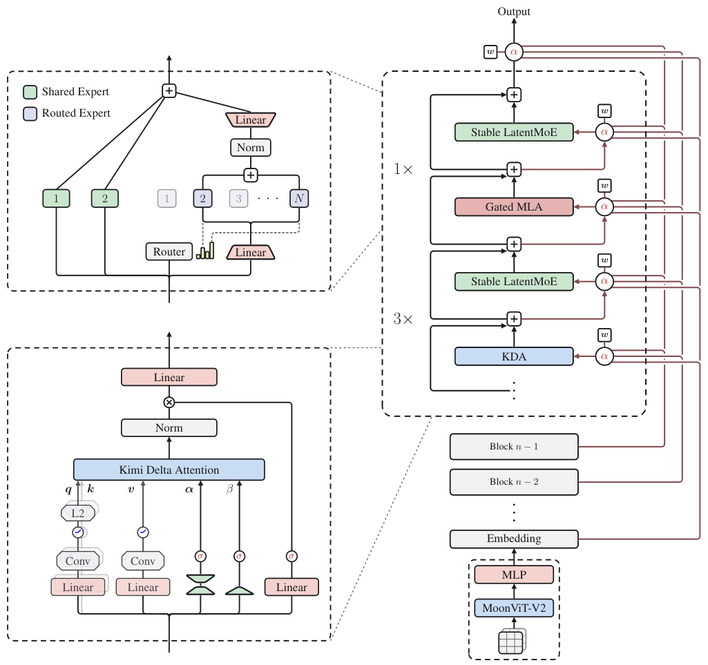
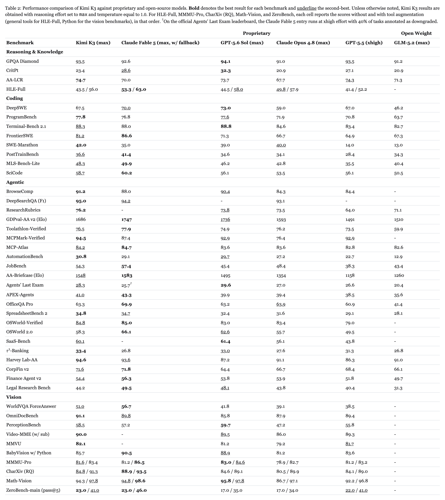

# Paper精读｜Kimi K3: Open Frontier Intelligence

> [!abstract] 一句话结论
> **2.8T 参数的 MoE，Kimi 这回押的是架构不是参数量：Kimi Delta Attention (KDA)、Attention Residuals (AttnRes)、Stable LatentMoE、Per-Head Muon 一起换来 2.5× scaling efficiency 提升；后训练配百万 token 级 agentic RL，部署靠从 SFT 阶段就开始的 MXFP4 量化感知训练——长程编码、agent、知识、推理和视觉任务上达到开源 frontier 水平。**
> *（原图未能本地化：Figure 1: 标题页与主要结果；IMA 媒体接口没有可用媒体编号）*
> *图注：论文标题页与 Figure 1 — 主要 benchmark 结果对比。虽然整体仍落后于 Claude Fable 5 和 GPT-5.6 Sol，但 Kimi K3 持续超越其他开源和闭源模型。*

> [!cite]- 论文信息（点开折叠）
> - **论文标题**：Kimi K3: Open Frontier Intelligence
> - **arXiv**：2607.24653
> - **链接**：[https://arxiv.org/abs/2607.24653](https://arxiv.org/abs/2607.24653)
> - **作者**：Kimi Team (Tongtong Bai, Yifan Bai, et al., 302+ authors)
> - **机构**：Moonshot AI
> - **日期**：2026-07-27

---

## 模型规格总览

| **组件** | **规格** |
| --- | --- |
| 总参数 | 2.8T |
| 激活参数 | 104B |
| 层数 | 93（69 KDA + 24 Gated MLA） |
| 注意力头数 | 96 |
| 隐藏维度 | 7168 |
| MoE 专家数 | 896（激活 16 + 2 shared） |
| 潜在 MoE 维度 | 3584 |
| 每专家隐藏维度 | 3072 |
| 词表大小 | 160K |
| 上下文长度 | 1,048,576 |
| 激活函数 | SiTU-GLU |
| 视觉编码器 | MoonViT-V2 (401M) |
| 量化 | MXFP4 weights / MXFP8 activations |

---

## 技术亮点深度解析

### 亮点1：Kimi Delta Attention (KDA) + Attention Residuals (AttnRes)

**问题**：93 层深度叠上 1M token 长序列，信息流动受阻——梯度衰减、注意力稀释。

**KDA 的设计**：

- Kimi 自研的高效注意力机制，当 scaling attention 的底座

- 和标准注意力比，长序列上的信息传播效率更高

**AttnRes 的设计**：

- 核心思想：**跨深度选择性检索表示，而非均匀累积**

- 传统残差连接：$h_{l+1} = h_l + f_l(h_l)$ — 信息均匀累积

- AttnRes：$h_{l+1} = h_l + \alpha \cdot f_l(h_l)$，其中 $\alpha$ 是学习到的检索系数

- 模型由此可以"跳过"不必要的信息累积，93 层深度下信息质量保得住

**Block Attention Residuals 架构**：

- 把 KDA 和 AttnRes 组合成 Block 结构

- 69 层 KDA + 24 层 Gated MLA 交替

### 亮点2：Stable LatentMoE

**问题**：896 个专家、每 token 激活 16 个的 MoE，负载不均衡会很严重。

**Quantile Balancing**：

- 直接从 router-score 分位数推导专家分配

- 甩掉启发式更新和难调的平衡超参数

- 确保 896 个专家的负载完美均衡

**Per-Head Muon**：

- Muon 是 Moonshot 此前提出的优化器，靠正交化梯度更新方向加速训练

- Per-Head Muon 把它推到注意力头级别：每个头独立优化

### 亮点3：SiTU-GLU 激活函数

**Sigmoid Tanh Unit (SiTU)**：

- Sigmoid 和 Tanh 的特性拼在一起，梯度流更平滑

- 93 层深度训练里比 SwiGLU 稳

### 亮点4：MXFP4 量化感知训练

**策略**：从 SFT 阶段即开始量化感知训练（QAT）

- 权重：MXFP4（4-bit 微缩放浮点）

- 激活：MXFP8（8-bit 微缩放浮点）

**部署优势**：

- 官方 API 定价：\$0.30/MTok（cache-hit）/\$3.00/MTok（cache-miss）/ \$15.00/MTok（output）

- 支持 vLLM、SGLang、TokenSpeed

### 亮点5：基础设施创新

**Fully Balanced Expert-Parallel Training**：

- 静态形状 + 关键路径无主机同步

- 支持 64+ 加速器的 supernode 配置

**Million-Token Agentic RL**：

- 支持百万 token 级别的 agentic 强化学习

- Persistent rollout 和 sandbox states

- 跨 general、agentic、coding 三个领域

*图注：模型架构图。展示 Stable LatentMoE 和 KDA 模块（左）、AttnRes 操作（右上）、Block Attention Residuals backbone（右）。*

---

## 训练配方

### 预训练

- 大规模多模态数据（文本、图像、视频）

- 1M token 上下文窗口

### SFT（监督微调）

- 高质量指令数据

- **从 SFT 阶段即开始 MXFP4 量化感知训练**

### RL（强化学习）

- 跨 general、agentic、coding 三个领域

- 多种推理努力级别（low / high / max）

- 百万 token 级别的 agentic RL

### Post-Training 特点

- **Preserved Thinking History Mode**：训练时保留完整推理历史

- 多 reasoning effort 级别：low / high / max（默认 max）

---

## 实验结果

### 编码任务

| **模型** | **DeepSWE** | **Terminal-Bench** | **FrontierSWE** | **SWE-Marathon** |
| --- | --- | --- | --- | --- |
| GPT-5.6 Sol | 73.0 | 88.8 | 71.3 | 39.0 |
| Claude Fable 5 | 70.0 | 88.0 | 86.6 | 35.0 |
| **Kimi K3** | **67.5** | **88.3** | **81.2** | **42.0** |
| Claude Opus 4.8 | 59.0 | 84.6 | 66.7 | 40.0 |

**分析**：

- SWE-Marathon（长程 SWE 任务）拿到 **42.0**，**超越所有对比模型**——全场最高的一格

- Terminal-Bench 88.3 与 Fable 5 持平

- DeepSWE 67.5 略低于 Fable 5（70.0）

### Agent 任务

| **模型** | **BrowseComp** | **MCPMark** | **AutomationBench** |
| --- | --- | --- | --- |
| GPT-5.6 Sol | 90.4 | 92.9 | 29.7 |
| Claude Fable 5 | 88.0 | 87.4 | 29.1 |
| **Kimi K3** | **91.2** | **94.5** | **30.8** |

**分析**：

- BrowseComp 91.2，**最佳**（压过 GPT-5.6 Sol 的 90.4）

- MCPMark 94.5 大幅领先（vs Fable 5 87.4）

- AutomationBench 30.8，三个对比模型里最高

### 推理/知识

| **模型** | **GPQA Diamond** | **HLE-Full** |
| --- | --- | --- |
| GPT-5.6 Sol | 94.1 | 44.5/58.0 |
| Claude Fable 5 | 92.6 | 53.3/63.0 |
| **Kimi K3** | **93.5** | **43.5/56.0** |

### 视觉任务

| **模型** | **Video-MME** | **MMMU-Pro** | **CharXiv (RQ)** |
| --- | --- | --- | --- |
| GPT-5.6 Sol | 89.5 | 83.0/84.6 | 84.6/89.1 |
| **Kimi K3** | **90.0** | **81.6/83.4** | **84.8/91.3** |

*Video-MME 90.0 达到最佳。*

*图注：完整的 benchmark 评估表格，涵盖 Reasoning & Knowledge、Coding、Agentic、Vision 四大类。*

---

## 案例研究

### 1. GPU Kernel 优化

- 24 小时内独立优化 4 个 GPU 内核（AttnRes、KDA、MLA）

- 性能与 Claude Fable 5 竞争，大幅超越 Opus 4.8 和 GPT-5.5

- **关键洞察**：Kimi K3 给自己架构写 kernel 反而是强项

### 2. GPU 编译器开发（MiniTriton）

- 从零构建了一个 Triton 类编译器

- tile-level IR 层、优化 pass、PTX 代码生成一应俱全

- roofline benchmark 上与 Triton 持平或更优

- **关键洞察**：能搭完整编译器流水线，不是只会写孤立 kernel

### 3. 芯片设计

- 48 小时内自主设计了一块服务 nano 模型的芯片

- 用开源 EDA 工具 + Nangate 45nm 库

- 4mm² 内实现 100MHz 时序收敛、8700+ tokens/s 解码吞吐

- **关键洞察**：首次"模型为模型设计芯片"的演示

### 4. 研究自动化

- 复现 I-Love-Q 天体物理普遍关系

- 通常要 1-2 周的研究工作，2 小时跑完

- 产出 3000+ 行 Python 代码 + 交互式 HTML 仪表盘

---

## 局限性与风险

### 1. 对推理历史敏感

- 训练时采用 preserved thinking history 模式

- agent harness 要是没把历史推理内容完整回传，生成质量会高度不稳定

- **建议**：使用 Kimi Code 等验证兼容的 harness

### 2. 过度主动

- 训练强调长程、挑战性任务

- 用户意图模糊时，可能替用户做出意外决策

- **建议**：在 system prompt 或 AGENTS.md 里写明确的行为约束

### 3. 用户体验差距

- 性能上有竞争力，但用户体验仍落后于 Claude Fable 5 和 GPT-5.6 Sol

### 4. 评估中的 confound

- Claude Fable 5 在 SWE-Marathon 上 35% 任务触发 fallback

- GPT-5.6 Sol 在 KCB 2.0 上 10% 任务进入 cyber guard

---

## 与今天其他论文的对话

| **论文** | **关注点** | **与 Kimi K3 的关系** |
| --- | --- | --- |
| Measuring Reward-Seeking | RL 训练如何制造 reward-seeker | Kimi K3 的 RL 训练是否也有此风险？ |
| AREX | 不扩大参数如何提升 agent 能力 | Kimi K3 用 2.8T 参数 + 架构创新回答同一问题 |
| Language model harnesses | harness 如何承担组合泛化 | Kimi K3 的 preserved thinking history 是 harness 设计的新维度 |
| HOPE | 如何压缩大模型 | Kimi K3 的 MXFP4 是压缩的实用方案 |
| Expanding Flow Maps | 生成模型如何突破固定维度 | 两者都在探索 scaling 的新维度 |

---

## 开放问题

1. **MoE 路由的可解释性**：896 个专家中激活 16 个，路由模式是否有意义？

2. **AttnRes 的理论分析**：跨深度选择性检索背后的数学机理是什么？

3. **长程 RL 的稳定性**：百万 token agentic RL 如何避免 reward hacking？

4. **MXFP4 的精度影响**：4-bit 权重对哪些任务最敏感？

5. **Scaling Efficiency 来源**：2.5× 提升中有多少来自架构 vs MoE vs 优化器？

---

## 7️⃣ 最后总结

Kimi K3 不只是把参数堆到 2.8T：KDA + AttnRes 处理 93 层深度和 1M 上下文下的信息流动，Stable LatentMoE + Quantile Balancing + Per-Head Muon 处理 896 专家 MoE 的稳定性，MXFP4 处理部署成本——三个层面的架构问题各给了一个具体答案。

性能要分两头看：SWE-Marathon（42.0）、BrowseComp（91.2）、MCPMark（94.5）、Video-MME（90.0）这些 agent 和长程基准上它是最佳的。

但整体仍落后 Claude Fable 5 和 GPT-5.6 Sol，用户体验差距论文自己也承认。开源离 frontier 更近了一步，但那两家的位置还没被翻过去。

---

## 8️⃣ 三句速记

> [!summary]- 点开展开
> 1. **2.8T MoE + KDA + AttnRes + Stable LatentMoE**：架构创新换来 2.5× scaling efficiency 提升。
>
> 2. **百万 token agentic RL + MXFP4 量化**：撑起长程 agentic 任务，4-bit 量化从 SFT 阶段就开始训。
>
> 3. **开源 frontier 的位置**：SWE-Marathon、BrowseComp、MCPMark、Video-MME 一批基准上已是最佳；但整体仍落后 Fable 5 和 GPT-5.6 Sol，用户体验差距还没补上。
