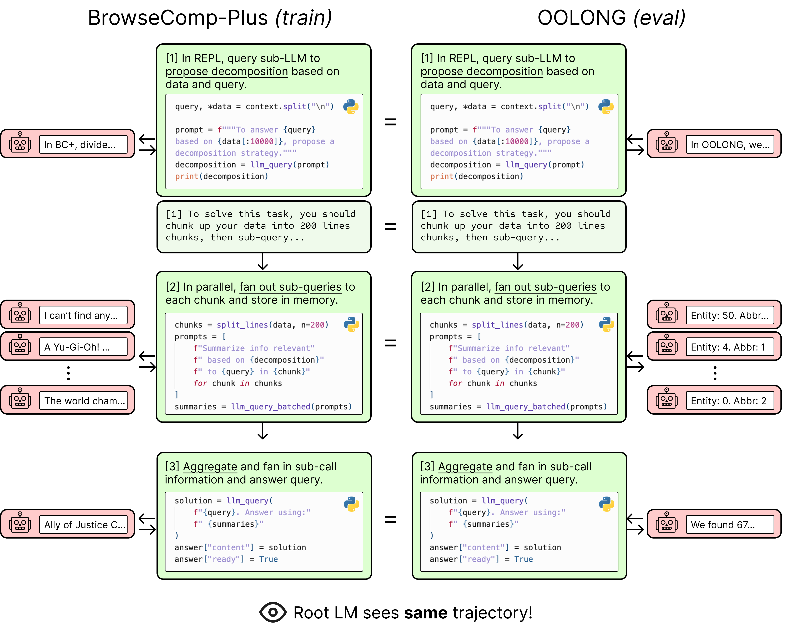
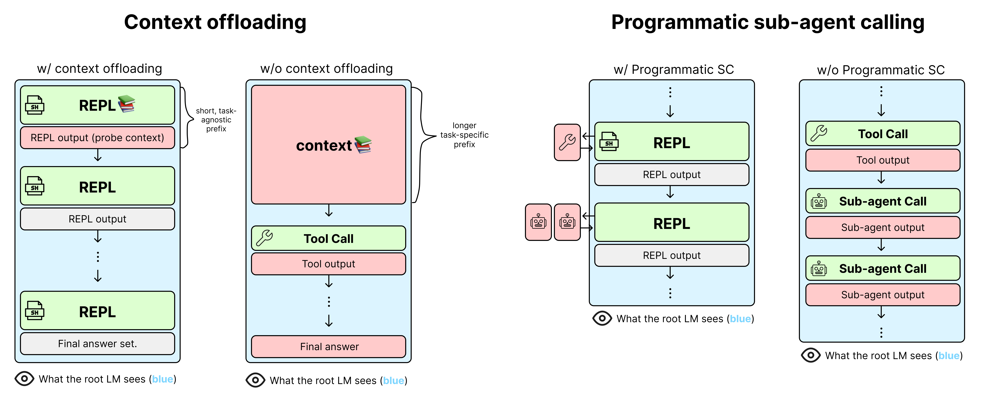
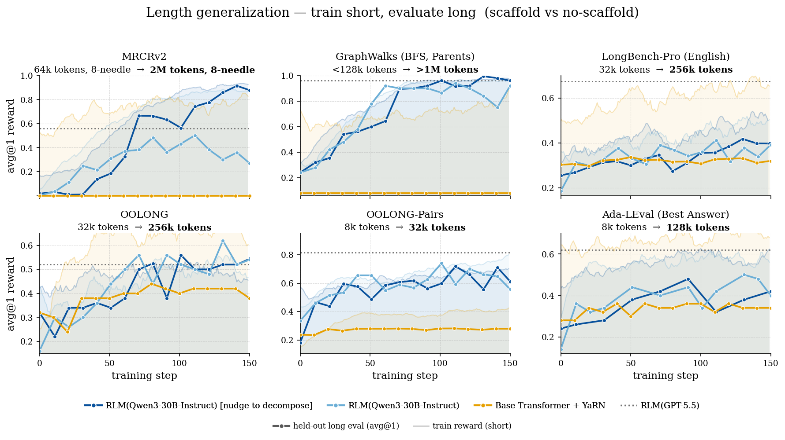

# Paper精读｜Language model harnesses are compositional generalizers

> [!abstract] 一句话结论
> **组合泛化这件事，作者主张别再指望 Transformer 自己开窍——交给神经网络外面那层程序（harness）来管。办法是两个动作：上下文卸载 + 程序化子调用，让每一次单独的 LM 调用都保持局部在分布内（LID）。结果是只在短任务上训过的模型，直接泛化到 8-32 倍更长的任务和跨域任务，eval lift 达到 train lift 的约 10 倍。**

> [!cite]- 论文信息（点开折叠）
> - **论文标题**：Language model harnesses are compositional generalizers
> - **arXiv**：无（博客原文，作者个人站点发布）
> - **链接**：[https://alexzhang13.github.io/blog/2026/harness/](https://alexzhang13.github.io/blog/2026/harness/)
> - **作者**：Alex Zhang, Omar Khattab
> - **机构**：MIT / Chroma
> - **日期**：2026-07-20

---

## 1️⃣ 论文想解决什么问题

现在的 post-training 是在暴力堆料：策划更长的训练环境、更长的 rollout 轨迹，一轮接着一轮。为什么要这么堆？因为前沿 Transformer 在**组合泛化**上实在不行——学过的知识拼不出新问题的解，每个新领域都得重新投一笔数据和训练，扩展的回报持续递减。

作者戳破的窗户纸是：chain-of-thought、tool use 这些 scaffolding 看着热闹，但泛化能力的提升完全被交给了底层神经网络及其 2017 年级别的 token 级归纳偏置——harness 只管编排，从没为泛化负责过。问题的根子是结构性的：Transformer 的可微操作设计空间太窄，装不下高层的抽象归纳偏置。

---

## 2️⃣ 核心洞察

> [!important] 三条核心洞察
> 1. **Harness 应承担高层归纳偏置**：harness 是外部世界和神经网络之间的那层程序，本职是把任意复杂状态 $s$ 编码成一个或多个 LM 消化得了的局部在分布观察 $o$——陌生的大问题，进门先被拆成熟悉的小问题的组合。
>
> 2. 局部在分布（LID）原则：整条任务轨迹可以 OOD，但每个 Transformer call 看到的 prompt 必须留在训练分布内。做法是让 harness 在任务状态集合 $\mathcal{T}$ 上**诱导等价关系** $\sim_H$——结构相似的任务归进同一个等价类，主上下文看到的是几乎相同的 token 序列。
>
> 3. RLM 的组合泛化来源于同构：Recursive Language Model (RLM) 靠**上下文卸载**（输入特定的信息走符号变量，不走 prompt 前缀）和**程序化子代理调用**（子代理/工具就是 REPL 里的函数），让完全不同的任务在 root LM 的上下文窗口里看起来 token-for-token 相同——旧任务上学到的本事，就这样搬进结构相似的新任务。

*图注：BrowseComp-Plus 和 OOLONG 两个不同任务在 RLM 的 root LM 上下文中看到几乎相同的 token 序列——特定查询被延迟到子调用，信息经 REPL 变量传递。*

---

## 3️⃣ 方法解读

### Recursive Language Model (RLM) Harness

RLM 是把上面三条洞察落成的一个 harness 设计，赌注摆得很清楚：任务分解这活儿 Transformer 干不了，程序来干：

- 上下文卸载：输入特定上下文不作为 LM prompt 的前缀传入，而是作为符号变量传递，root LM 不直接看到内容——于是不管问题差多远，第一步在 root LM 眼里长得都差不多。

- 程序化子代理调用：子代理和工具被实现为 REPL 函数，输出直接存入变量而非返回给主上下文。Root LM 只看到抽象化的结果（如聚合统计值），原始数据碰都不碰。

- 递归性：每个子代理自己也可以是一个 RLM 实例，一层套一层，LID 在每一层都成立。

*图注：标准方法将全部上下文和工具输出塞入前缀导致 context rot；RLM 通过上下文卸载 + 程序化子调用让 root LM 视角下两个完全不同的问题看起来同构。*

### 训练方式

- 使用 **prime-rl**（Decoupled PPO + GRPO-like advantages + KL loss）进行 RL 训练

- 模型：Qwen3-30B-A3B-Instruct-2507

- 训练数据：仅在短任务上训练（各环境不同的 short split）， batch size 64, 4 rollouts/sample, 150 steps

- 可选"分解提示"（nudge to decompose）：在 user message 中加入鼓励模型显式分解的提示——这是防捷径的保险栓，模型偷懒学个不可泛化的捷径，长任务上就会现形

### 优势估计

这笔账作者算得很清楚：只要 harness 诱导的等价类 $[τ'] = \{τ \in \mathcal{T}: τ' \sim τ\}$ 成立，root LM 看到的轨迹就跟任务长度、任务领域整体解耦，RLM 学到的自然是一个与长度和领域无关的分解策略——短任务上练的分解，长任务直接照用。

---

## 4️⃣ 实验部分怎么读

### 实验设置

**长度泛化（6 个 benchmark）**：

| **Benchmark** | **短任务范围** | **长任务范围** | **变化轴** |
| --- | --- | --- | --- |
| MRCRv2 | 64K, 2-needle | 2M, 8-needle | 输入长度 |
| GraphWalks | <128K | >1M | 输入长度 |
| LongBenchPro | 32K | 256K | 输入长度 |
| OOLONG | 32K | 256K | 输入长度 |
| OOLONG-Pairs | 8K in / 7K out | 32K in / 146K out | 输入+输出长度 |
| Ada-LEval | 8K | 128K | 输入长度 |

**策略/跨域泛化（3 个 benchmark）**：

| **训练域** | **测试域** | **共享策略** |
| --- | --- | --- |
| OOLONG (TREC) | OOLONG (SPAM/HAM) | 聚合统计 |
| OBLIQ-Bench (写作作者) | OBLIQ-Bench (数学推理) | 相似性搜索 |
| OBLIQ-Bench (Twitter stance) | OBLIQ-Bench (Wildchat errors) | 过滤搜索 |

对比基线：base Transformer (+YaRN)、base RLM、RLM + 分解提示

### 核心结果

*（原图未能本地化：Figure 1: 训练 lift vs eval lift；IMA 媒体接口没有可用媒体编号）*

*图注：在 6 个长度泛化和 3 个策略泛化实验中，RLM 的 eval lift（在未见过的长任务/不同域上）匹配甚至超过了 train lift（在短任务上），而 base Transformer 的 eval lift 几乎不增长。*

*图注：以 MRCRv2 为例，RLM 在短任务上的训练 reward 稳步上升，同时在 8-32x 更长的 eval split 上的 reward 几乎同步增长；base Transformer 训练 reward 增长但 eval reward 平坦。*

**关键发现**：

1. RLM 在 MRCRv2、GraphWalks、OOLONG、OOLONG-Pairs 上训练后，eval 性能接近甚至超过使用 frontier model (GPT-5.5) 的 RLM

2. 长度泛化里最硬的一条：RLM 的 eval lift 约等于 train lift，而 base Transformer 的 eval lift ≈ 0——短任务上练出来的东西，原样带进了长任务

3. 跨域泛化中 token 分布完全不同、仅共享潜在结构，RLM 依然大幅优于 base Transformer

4. 轨迹相似度分析（Figure 8）：RLM eval 轨迹与训练轨迹的平均距离明显小于 base Transformer——LID 不停留在口号上，轨迹层面量得出来

### 训练细节

- RL 框架：prime-rl, Decoupled PPO with GRPO-like advantages + KL loss

- 训练步数：150 steps

- Batch size：64, 4 rollouts/sample

- 评估频率：长度泛化每 10 步，策略泛化每 20 步

- 计算资源：8xH100（Laude Institute Slingshots program）

- RLM 额外开销：训练时间 1.5-3x base Transformer（多步采样 + 子调用等待）

---

## 5️⃣ 学术评价

**优点：**

1. 把 harness 的角色重新定义了——从工具调用的编排器升格为泛化能力的承载者。LID 原则最实用的地方是它可检查：一个 harness 好不好，就看它能不能把每个 call 拉回分布内

2. 实验铺得开也压得住：6 个长度泛化 + 3 个策略泛化 + 轨迹距离多种度量，方向全部一致——短任务上练的，长任务和别的域直接能用

3. 全部在开源模型（Qwen3-30B-A3B）上做，不需要 frontier model 就能检验，这条对后来者是实打实的门槛降低

4. 没有藏代价：RLM 的额外计算开销、以及模型学到不可泛化捷径导致长度泛化失败的情况，都摆在台面上

5. 把 harness 设计和 scaling law 接上了：更好的归纳偏置抬的是"扩展系数"本身，不是曲线上的一个点

> [!ed-warning] 局限（风险与不确定性）
> 先说处境：这是篇博客（RLM 系列工作的 companion），不是带几十页附录的正式论文，实验收在一个模型上，我理解这个选择。但理解归理解，该提的还是要提：
> 1. 只在 Qwen3-30B-A3B 单一模型上验证，更大规模、其他架构一个没碰——LID 到底是普适原则还是 Qwen 的特性，现在分不清
>
> 2. 短→长的泛化默认"分解策略在长短任务间相同"，需要全局信息的长任务可能不满足这条
>
> 3. RLM 的额外计算开销（1.5-3x）在更复杂任务上的 scaling 特性没有探索
>
> 4. 未与更现代的 harness 设计（如 Claude Code 的 managed agents）做直接对比

---

## 6️⃣ 局限与可扩展方向

- 仅在 Qwen3-30B-A3B 上验证，需在更大模型（70B+）和其他架构（MoE、其他 LLM 家族）上复现

- 长度泛化失败的情况（如 MRCRv2 中模型学到非可泛化捷径）需要更系统的研究和解决方案

- RLM 训练开销的 scaling 特性——是否在更复杂任务上依然相对可控

- 与 Claude Code managed agents 等现代 harness 的对比实验

- 探索 harness 设计空间：除了 RLM，是否还有其他满足 LID 原则的 harness 架构

- 理论层面：需要更严格的"局部在分布"定义和"等价类诱导"的形式化证明

- 扩展到多模态和具身智能场景

---

## 7️⃣ 最后总结

这篇博客把一个行业默认翻了面：post-training 拼命堆长轨迹的时候，组合泛化其实一直没人负责——作者把责任主体点名了，是 harness。RLM 用上下文卸载和程序化子调用守住每个 call 的局部在分布，"训短任务、用长任务"和"训一个域、用另一个域"两条都跑通了。我最买账的是 LID 这个判据本身：它把"harness 设计得好不好"从手感问题变成可检查的问题。**也许扩展的瓶颈不在于数据量，而在于我们如何将数据喂给模型**。最想看到的下一步是 70B+ 和其他架构上的复现——LID 若只在 Qwen3-30B-A3B 上灵，它是一个好用的设计；在哪都灵，它才配叫原则。

---

## 8️⃣ 三句速记

> [!summary]- 点开展开
> 1. Harness 应承担组合泛化的责任：把复杂问题归约为简单子问题的组合，让每个 LM call 保持局部在分布（LID），而不是等 Transformer 自己学会泛化。
>
> 2. RLM 的上下文卸载 + 程序化子调用：输入特定信息存入符号变量、子代理输出经 REPL 传递而非返回主上下文，不同任务在 root LM 视角下 token-for-token 同构。
>
> 3. 训练短任务即可泛化到 8-32x 更长任务和跨域任务：eval lift 匹配 train lift，base Transformer 的 eval lift 几乎为零——回报递减不是堆料的宿命，换种喂法可能就解了。
