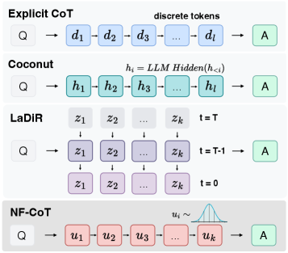
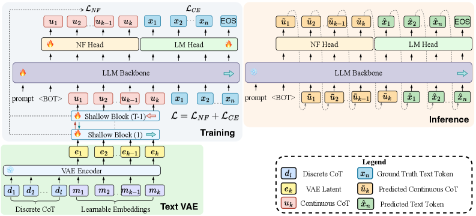
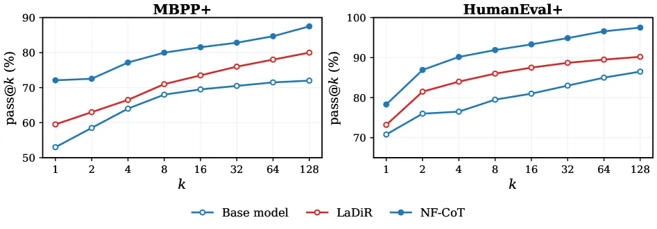
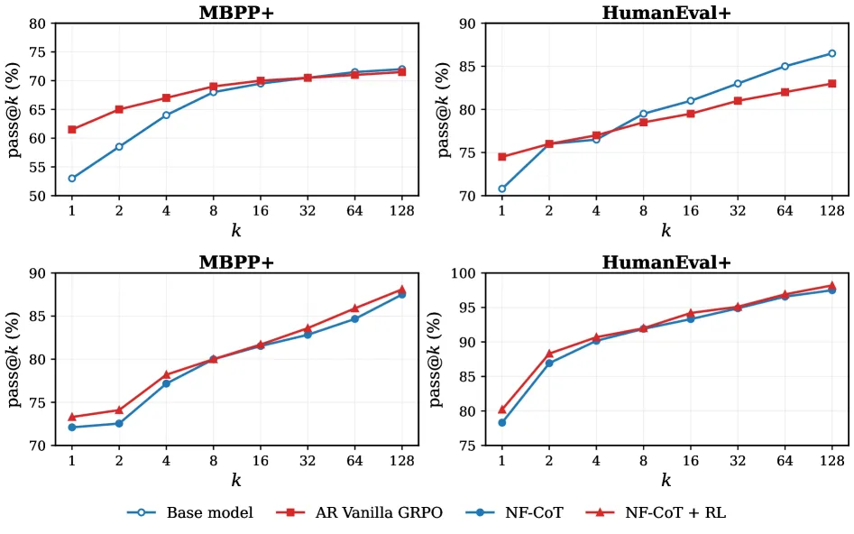

# Paper精读｜Latent Reasoning with Normalizing Flows

> [!abstract] 一句话结论
> **NF-CoT** 把自回归归一化流（Normalizing Flow）直接放进 LLM 的 causal stream，让连续隐推理站上和语言 token 同等的地位——显式 CoT 那套接口一件不丢：逐个采样、概率评分、KV-cache 兼容、可追踪似然。代价上同样占优：代码生成比扩散式隐推理 LaDiR 快 **1.92×**，Qwen3-8B 上平均 pass@1 提升 **+13.0%**。

> [!cite]- 论文信息（点开折叠）
> - **论文标题**：Latent Reasoning with Normalizing Flows
> - **arXiv**：2606.06447
> - **链接**：[https://arxiv.org/abs/2606.06447](https://arxiv.org/abs/2606.06447)
> - **作者**：Guancheng Tu, Xiangjun Fu, Suhao Yu, Yao Tang, Haoqiang Kang, Lianhui Qin, Yizhe Zhang, Jiatao Gu
> - **机构**：University of Pennsylvania / UC San Diego / Meta
> - **日期**：2026-06-04
> - **主页**：[https://nf-cot.vercel.app](https://nf-cot.vercel.app)

---

## 1️⃣ 论文想解决什么问题

显式 CoT 的效率账很好算：每个推理步骤都得用自然语言 token 写出来，token 开销大、信息密度低、推理成本高——**中间计算被迫用最贵的载体表达**，这是根本问题。

隐空间推理（Latent CoT）想用连续状态替掉文本 token 做中间计算，方向没错，但已有两家各有各的瘸腿：

- **Coconut** 等用隐藏态直接反馈 → **确定性的**，背后没有概率模型

- **LaDiR** 等用扩散模型建模隐空间 → 需要**迭代去噪**，没有原生自回归似然

> [!ed-quote] 关键矛盾
> **隐空间推理要保留显式 CoT 的自回归采样、概率评分、KV-cache 解码、可追踪似然估计等全套接口，同时获得更高的计算效率。** 之前没人同时做到。

---

## 2️⃣ 核心洞察

### 洞察1：归一化流提供隐推理所需的全部接口

*图1：四种 CoT 推理范式对比。NF-CoT（右下）用自回归流采样连续思维，既保留了显式 CoT 的逐个预测性质，又像 LaDiR 一样在紧凑连续空间运行，且无需迭代去噪。*

NF-CoT 的第一步是个偷换：把显式 CoT 的 token 序列换成连续向量序列 $u_{1:K}$，中间用**可逆变换** $u_{1:K} = F_\theta(e_{1:K}; q)$ 把 VAE 编码的原始隐空间和 LLM 友好的流空间接起来。选可逆是有讲究的——信息无损之外，它还顺手解锁精确似然，变分换元公式直接给：

$\log p_\theta(e_{1:K} \mid q) = \log p_\theta(u_{1:K} \mid q) + \log\left|\det J_{F_\theta}(e_{1:K}; q)\right|$

流本身再带上自回归因果高斯密度 $p_\theta(u_{1:K} \mid q) = \prod_{i=1}^K \mathcal{N}(u_i; \mu_\theta(q, u_{<i}), \sigma_\theta^2(q, u_{<i}))$——左到右采样、精确似然，两个接口一起到账。

### 洞察2：统一因果架构是关键设计

连续思维和文本答案必须活在同一条 causal stream 里，否则 KV-cache 的好处就断了。NF-CoT 的做法是**两种 head + 一个共享 backbone**：

- **NF Head**：在连续思维位置输出高斯分布的 $\mu, \sigma$

- **LM Head**：在文本位置输出 token logits

两种位置在同一条因果序列中交替，KV-cache 天然共享。推理时采完连续思维，同一份 KV-cache 直接接着解码答案，prompt 不用重算。

### 洞察3：隐空间直接支持策略梯度优化

隐空间做 RL 一直有个障碍：思维没有似然，策略梯度就写不出来。NF-CoT 恰好没这个障碍——连续思维自带精确似然 $\log p_\theta(\tilde{u} \mid q)$，可以直接进策略梯度：

$\nabla_\theta J_{\mathrm{RL}} = \mathbb{E}\left[ A(q, \tilde{u}, \hat{x}) \nabla_\theta \log \pi_\theta(\tilde{u}, \hat{x} \mid q) \right]$

GRPO 于是能直接作用在连续推理空间，优化的是思维分布本身，不只是答案解码。实验还证明 RL 之后 pass@k 多样性不坍塌。

---

## 3️⃣ 方法解读

### 组件1：两段式训练课程

*图2：训练时用冻结的 VAE encoder + shallow flow blocks 将离散 CoT 转为连续思维状态 *$u_{1:k}$*，LLM 在同一个 causal pass 中处理 prompt、BOT token、连续状态、答案 token。推理时跳过 VAE 和 shallow blocks，直接自回归采样 *$u_{1:k}$*。*

训练分两段走，动机很实际：随机初始化的 flow 组件要是和 backbone 一起放开训，预训练能力先被搅坏。

**Stage 1（冻结 backbone）**：

- 冻结 LLM backbone，只训练 shallow flow blocks + 连续思维投影层

- 让 $e \to u$ 重参数化先和冻结的 LLM 空间对齐

- 避免随机初始化的 flow 组件破坏 backbone 的预训练能力

**Stage 2（端到端联合训练）**：

- 全部参数解锁，联合优化 flow NLL 和 answer cross-entropy

- 统一似然目标：$\mathcal{L}_{\mathrm{sup}} = \lambda_{\mathrm{flow}}\mathcal{L}_{\mathrm{flow}} + \lambda_{\mathrm{text}}\mathcal{L}_{\mathrm{text}}$

- 训练时给 $e_{1:K}$ 加小高斯噪声提升鲁棒性

### 组件2：推理流程

推理链路比训练短一截：**shallow flow blocks 不用跑**（只在训练时需要）。直接：

1. 从自回归高斯密度 $p_\theta(\tilde{u}_{1:K} \mid q)$ 左到右采样连续思维

2. 采样完成后自动切换 LM head 在同一 causal stream 中解码答案

3. Continuous thought 期间构建的 KV-cache 直接被答案生成复用

相比 LaDiR 的 30 步迭代去噪，NF-CoT 一次前向通过即可生成全部隐推理。

### 组件3：隐空间强化学习

RL 部分是 GRPO 风格，只是作用对象从 token 换成了连续思维：

- GRPO 风格：每组采样多条思维-答案轨迹，组归一化优势

- 冻结 shallow blocks，只优化 LLM-facing 的 $u$ 空间策略

- 策略似然分解为 NF head 的高斯似然 + LM head 的 token 似然

- RL 后 pass@k 不坍塌 → 连续思维空间维持了轨迹多样性

### 优势估计

- 相比显式 CoT 的压缩比约 6.0×（64 个连续 token 编码平均 385 个文本 token）

- 相比 LaDiR：推理加速 1.92×，FLOPs 减少 2.48×，训练吞吐提升 2.85×

- Qwen3-8B 上平均 pass@1 提升 +13.0%（55.8 → 68.8）

- RL 额外提升 +1.3% 平均 pass@1

- 隐空间扰动实验证明：连续思维是**平滑的推理流形**，而非脆弱的隐变量链

---

## 4️⃣ 实验部分怎么读

### 实验设置

- **模型**：Qwen3-8B-Base

- **训练数据**：Ling-Coder（1.4M Python 指令），RL 用 AceCoder + KodCode

- **隐变量**：$K=64$ 个潜在 slot，$N=5$ 个 shallow MetaBlocks

- **评估**：HumanEval, HumanEval+, MBPP, MBPP+, LiveCodeBench v6

- **采样**：每个问题 16 个解，报告平均 pass@1

### 核心结果

**Pass@1 结果（Qwen3-8B-Base 对照）：**

| **方法** | **MBPP** | **MBPP+** | **HumanEval** | **HumanEval+** | **LCB v6** | **Avg** |
| --- | --- | --- | --- | --- | --- | --- |
| Base Model | 60.5 | 53.8 | 78.2 | 68.6 | 17.7 | 55.8 |
| Standard SFT | 63.3 | 52.7 | 84.6 | 69.5 | — | — |
| Soft Thinking | 64.2 | 53.1 | 85.0 | 71.2 | — | — |
| TaH+ | 65.6 | 56.5 | 85.8 | 74.3 | — | — |
| LaDiR | 66.8 | 59.5 | **87.4** | 73.2 | 21.3 | 61.6 |
| **NF-CoT (Unified)** | **83.9** | **72.1** | 85.8 | **78.3** | **23.7** | **68.8** |
| $\hookrightarrow$ +RL | 85.4 | 73.3 | 86.7 | 80.2 | 25.1 | 70.1 |

**与传统开源模型对比：**NF-CoT (Unified) 平均 68.8，超过 OlympicCoder (68.5)、OpenCoder (62.0)、Ouro (66.9)。

### Pass@k 扩展性

*图3：Pass@k 曲线。NF-CoT 全面超越 Base Model 和 LaDiR。在 MBPP+ 上 pass@1（72.1）已接近 Base 的 pass@128（72.0），k=128 时达到 87.5。连续思维多样性不随采样数增加而饱和。*

### RL 后的多样性保持

*图4：上方行是 token-space GRPO——pass@k 在大 k 时饱和甚至下降；下方行是 NF-CoT 隐空间 RL——pass@k 趋势保持向上，既提升 pass@1 又维持了多样性。*

### 效率对比

| **指标** | **NF-CoT (Unified)** | **NF-CoT (Dual-Path)** | **LaDiR** |
| --- | --- | --- | --- |
| 推理总时间 (s) | **325.6** | 380.0 | 625.3 |
| 样本/秒 | **8.06** | 6.90 | 4.20 |
| FLOPs/样本 | **19.9T** | 21.6T | 49.3T |
| 训练样本/秒 | **18.4** | 12.2 | 6.45 |
| 训练总 FLOPs | **2.25e19** | 2.25e19 | 1.50e20 |

### 消融关键发现

1. **两阶段课程不是摆设**：去掉 Stage 1，HumanEval 下降 2.9%、HumanEval+ 下降 3.2%

2. **Unified 优于 Dual-Path**：统一架构消除 latent interface 不匹配，还省掉二次 backbone 前向

3. **隐空间是平滑流形**：扰动连续思维至近乎正交（余弦相似度 0.116），pass@1 仅从 86.0 降至 83.6——变的是实现风格，不是对错

---

## 5️⃣ 学术评价

**优点：**

1. **一处设计，四个问题一起解决**：NF 进 causal stream 之后，采样、评分、KV-cache、RL 同时有着落，不用为每件事单独补机制——这是我读下来最服气的地方

2. **效率账算得清**：相比 LaDiR 近 2× 加速、训练 6.66× 更少 FLOPs，数字都摆在效率表里

3. **RL 兼容是真兼容**：隐空间精确似然让策略梯度能直接优化思维分布，RL 后 pass@k 还不坍塌——不是硬凑出来的性质

4. **消融打在承重墙上**：两阶段课程、Unified vs Dual-Path、隐空间扰动，每一条都在检验核心设计，不是走过场

> [!ed-warning] 局限（先替作者说句公道话，再提问题）
> 先说处境：连续思维的监督信号只能从显式 CoT 蒸馏，而代码是这类数据最现成的领域，我理解为什么实验全押在代码生成上。但理解归理解，该算的账还是要算：
> 1. **需要显式 CoT 作为监督信号**：依赖 VAE 从离散 CoT 蒸馏连续目标，没有显式 CoT 的场景就用不了
>
> 2. **只验证了代码生成**：数学推理、通用 reasoning 上的表现，一个字没有
>
> 3. **隐变量长度固定**：64 个 slot 对所有问题一刀切，没有自适应机制
>
> 4. **RL 提升幅度有限**：只有 +1.3%，SFT 阶段已接近饱和

---

## 6️⃣ 局限与可扩展方向

- 扩展到数学推理、科学推理等其他需要 CoT 的领域

- 自适应隐变量长度：根据问题复杂度动态调整 K

- 更大的 backbone 规模（8B → 更大模型）能否进一步放大隐推理优势

- 与其他策略优化方法（PPO、DPO）在隐空间的结合

- 是否需要更好的 VAE 编码来提升连续 CoT 质量

---

## 7️⃣ 最后总结

读完印象最深的一点：NF-CoT 把推理的中间态从 token 搬进连续空间，却没有为这次搬家付出任何接口代价——显式 CoT 的采样、评分、KV-cache、RL 一件没丢，LaDiR 那份迭代去噪的账单也免了（近 2× 加速，pass@1 从 55.8 到 68.8）。Unified 架构的简洁和 RL 兼容性是实打实的工程卖点。我最想追问的是两件事：这套接口出了代码生成还灵不灵；64 个 slot 的一刀切什么时候换成自适应。前者决定这是不是一个方向的开头，后者决定它能不能走出代码这个演示场。

---

## 8️⃣ 三句速记

> [!summary]- 点开展开
> 1. **自回归归一化流住进 causal stream**：可逆变换 $u = F_\theta(e)$ 保证信息无损，精确似然与左到右采样一起到手
>
> 2. **Unified 架构是关键设计**：NF Head + LM Head 共享 backbone，一份 KV-cache 用到底；相比 Dual-Path 消除 latent interface 不匹配，推理无需重算前缀
>
> 3. **代码生成上压过 LaDiR**：推理快 1.92×、FLOPs 省 2.48×、训练吞吐高 2.85×，Qwen3-8B 平均 pass@1 从 55.8 提升至 68.8（+13.0%）
