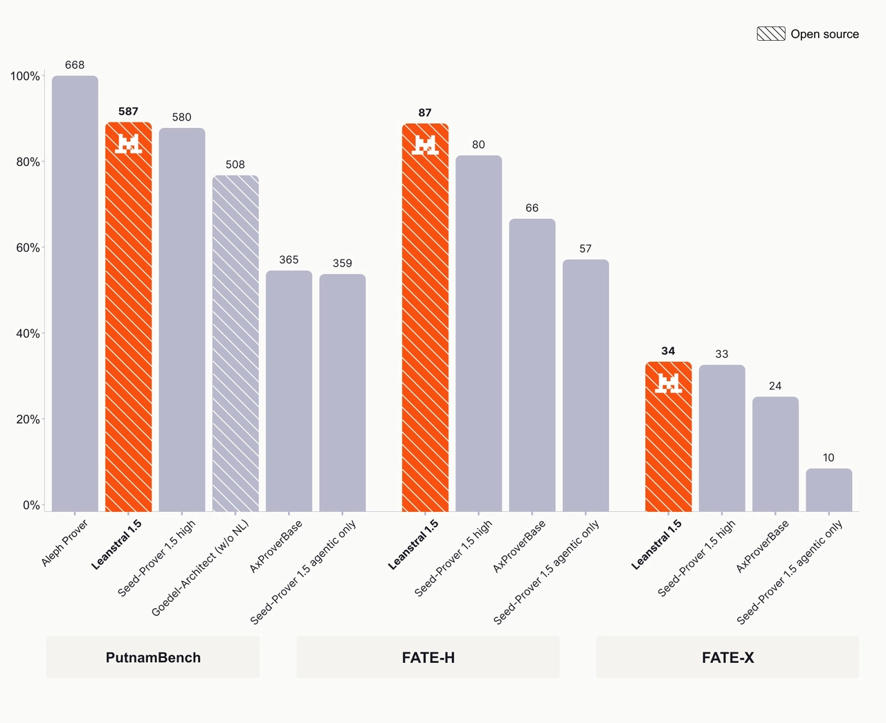
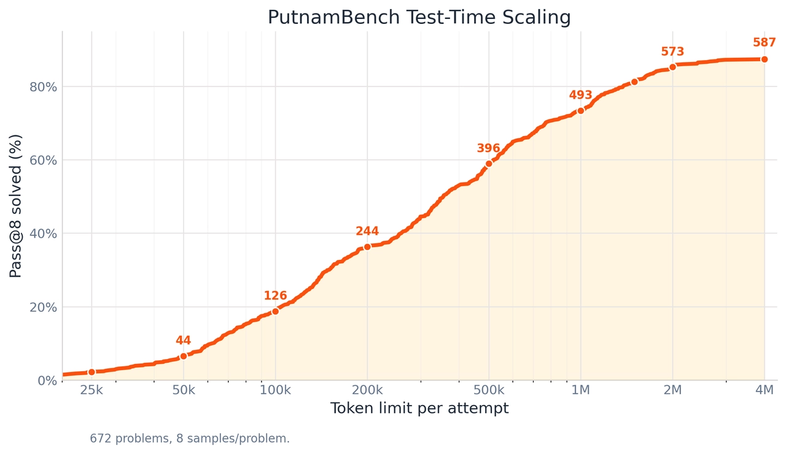
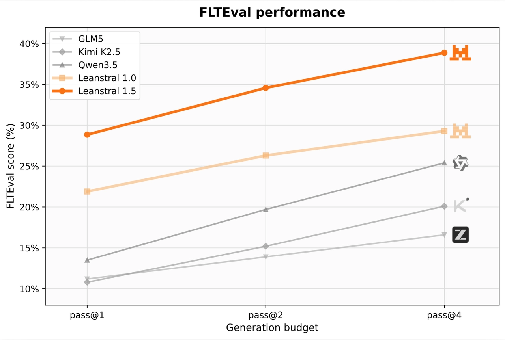

# Paper精读｜Leanstral

> [!abstract] 一句话结论
> **Leanstral** 是 Mistral 推出的一系列 **Lean 4 代码智能体模型**（119B 总参 / 6B 激活，MoE）——它不搞专用的证明器脚手架（prover scaffold），而是直接跑在开源的 **Mistral Vibe 代码智能体 harness** 里，像普通编码助手一样编辑文件、跑命令、看编译器反馈。结果：**<span class="mark-strong">miniF2F 满分饱和（244/244）</span>、PutnamBench 解 587/672、FATE-X 34% SOTA、FLTEval 43.2%**——以 6B 激活参数的规模追平甚至超越比它大 10 倍的闭源/开源系统，单题成本仅为 Seed-Prover 1.5 High 的 1/10 以下。更惊艳的是它**跨领域迁移到代码验证**：给 AVL 树证明 O(log n) 时间复杂度，并在 57 个真实开源仓库中自动发现 5 个从未被报告的 bug——**<span class="mark-strong">无人工介入的"LLM 演绎验证找 bug"全自动流水线</span>**首次得到验证。

> [!cite]- 论文信息（点开折叠）
> - **论文标题**：Leanstral
> - **arXiv**：无标准 ID（alphaXiv slug: 2608.leanstral）
> - **链接**：[https://www.alphaxiv.org/abs/2608.leanstral](https://www.alphaxiv.org/abs/2608.leanstral)
> - **作者**：Aditi Kabra, Albert Q. Jiang, Andrew Zhao, Dhia Garbaya, Indraneel Mukherjee, Jason Rute, Mert Unsal, Roman Soletskyi, Simon Sorg
> - **机构**：Mistral AI（Albert Q. Jiang 等）
> - **日期**：2026-08-06
> - **发布**：开源 Leanstral 1.5（Apache-2.0），博客：[mistral.ai/news/leanstral](https://mistral.ai/news/leanstral/)

---

## 1️⃣ 论文想解决什么问题

形式化定理证明（formal theorem proving）提供了一条"正确性可被可信内核验证"的路径。但现有高性能 Lean 系统普遍依赖**专用测试时扩展（test-time scaling）工作流**：蓝图生成与精炼、递归引理分解、并行证明器编排、自定义搜索过程。这些系统确实强大，但它们的测试时扩展接口**不是大多数 Lean 用户日常使用的接口**——Seed-Prover 1.5 High 每问题要 10 个 H20 天（conjecture proposing + lemma pools）；Goedel-Architect 用蓝图生成+并行引理证明扩展推理。

论文的核心立场：**与其为证明专门造一个怪异的脚手架，不如<span class="mark-strong">把模型训练成"普通的代码智能体"</span>**——测试时扩展就是"在标准交互循环里跑得更久"。这有两个好处：

1. **易用**：用户像用 Claude Code 一样让它在仓库里干活，用的是专门优化过 Lean 证明工程的开源模型

2. **训练-推理对齐**：训练时模型就暴露在长时程交互模式中（这正是推理时要用到的），而非训练一个只在专用脚手架里工作的"证明机器"

Lean 专用基础设施（可靠的奖励、高效反馈）仍然必要，但它是**支撑通用代码智能体循环**，而不是**取代用户面对的测试时工作流**。

---

## 2️⃣ 核心洞察

> [!important] 核心洞察
> 1. **<span class="mark-strong">"代码智能体" > "专用证明器"</span>**：现有系统（Seed-Prover、Goedel-Architect）把测试时扩展做成了专有脚手架；Leanstral 证明原生代码智能体方法在样本与成本效率上更优——普通接口（Mistral Vibe）+ 通用循环（编辑/编译/反馈/压缩），就达到或超过专用工作流的结果。这是对"证明需要特殊脚手架"这一隐含假设的直接挑战。
>
> 2. **MoE 的规模效率**：119B 总参 / 6B 激活——只用 6B 活跃参数干活，但拥有 119B 的知识容量。这是它能"小成本干大事"的结构基础：FLTEval 上比 3-10 倍大的开源模型（GLM5-744B、Kimi-K2.5-1T、Qwen3.5-397B）都强。
>
> 3. **测试时扩展 = 上下文压缩下的长跑**：Leanstral 唯一用的测试时扩展手段是 **context compaction（上下文压缩）**——每 <span class="mark-number">200k token</span> 自动压缩一次，让轨迹最长跑到 4M token。Figure 2 显示：token 预算从 50k 涨到 4M，PutnamBench 解题数从 44 单调涨到 587——**单调扩展**是"压缩没丢失关键信息"的强证据。
>
> 4. **代码验证是数学能力的自然外溢**：训练目标（证明 Lean 定理）意外地迁移到了"验证代码性质"——AVL 树复杂度证明、Rust 仓库 bug 发现。因为验证代码干的就是"证明关于程序的定理"。
>
> 5. **全自动 bug 发现流水线的范式意义**：Aeneas（Rust→Lean 翻译）+ Leanstral（自动形式化性质 + 尝试证明 + 失败则证伪）——**无人在环**的演绎验证找 bug。57 个仓库、47 个可证伪性质、11 个真 bug、5 个从未上报。这回答了"LLM 能否规模化做严谨代码验证"。



*官方图｜Leanstral 1.5 在多个形式化证明评测上的表现。 [来源](https://mistral.ai/news/leanstral-1-5/)*

*Figure 1（第 1 页）：Leanstral 1.5 以开源模型身份拿下 SoTA 性能，而每问题成本比 Seed-Prover 1.5 High 低 10 倍以上——后者单问题消耗 10 H20 天算力。*

---

## 3️⃣ 方法解读

### 组件1：三阶段训练数据（Data）

- **Mid-training（中期训练）**：从 Mistral Small 4 checkpoint 出发，训练 6.5B 去重后的 Lean 专用 token + 通用代码智能体数据。Lean token 包含：通用模型尝试单定理证明的轨迹 + 仓库级真实证明工程 issue

- **SFT**：Lean 代码智能体轨迹占 50% 可训练 token；按正确性/格式/风格过滤；**专门过滤对长时程证明工程有害的行为**——未经编译反馈就宣称成功、拒绝困难但可行的任务、幻觉仓库中不存在的约束

- **RL**：LeanGym PR 数据（50%）+ LeanGym 单定理数据（20%）+ prove-or-disprove 多轮数据（30%）；**RL 样本筛选**：只选 SFT checkpoint 下解决率"低但非零"（8 rollouts 估测）的样本——去掉已饱和和信号不足的例子

### 组件2：两个训练环境（Environments）

- **Prove-or-Disprove Multiturn 环境**：给 sorried 定理陈述 + 必需 imports，要求证明或证伪。失败（不编译/依赖额外公理/证错定理）→ 给 Lean 编译器反馈重试；达到最大轮数或上下文上限判失败。部分奖励给格式正确（thinking block + 格式化答案）；**完整奖励要求证明通过 Lean Interact 验证器编译 + #print axioms 确认只用标准公理 + 禁用 native decide**（已知一致性问题的策略）

- **LeanGym 环境**（代码智能体环境）：agent 与仓库交互、收工具输出、编辑文件、决定下一步。工具：bash + lean-lsp-mcp（**LSP 接口关键**——lake build 慢且粗粒度，LSP 给低延迟的目标/错误/类型信息/局部诊断）

  - **PR 环境**：克隆仓库到 PR 基提交，启动补丁含全部 PR 变更但把修改的证明/定义体换成 sorry，目标是填回正确内容使目标定理验证通过

  - **单定理环境**：裸 Lean 项目含定理陈述/imports/配置，agent 可自由写额外引理和新文件

  - **修改版 SafeVerify**：支持多文件提交、定理否定证明检查、指定完成部分声明（其他声明不得改动）、允许保留未解决定理与自定义公理（防止直接用 sorry 但允许用 ground truth 里的 sorried 定理）

### 组件3：CISPO RL 训练（Training）

- 用 **CISPO**（MiniMax 的截断重要性加权策略梯度目标）训练，减少"训练器-生成器不匹配"对长代码智能体轨迹的影响：

```
L_CISPO(θ) = −1/Σ|oi| · Σ_G Σ_t ρ̄_{i,t} Â_i log π_θ(a_{i,t}|s_{i,t}, T_i)
ρ̄ = min(π_θ/π_sample, c)   # 截断重要性比
```

- **关键设计**：最终验证器结果传播到轨迹中所有模型生成 token；prompts 与工具响应只作上下文不参与训练目标——这训练模型"用代码智能体接口干活"（看反馈、改文件、建辅助引理、坚持长证明轨迹）而不只是"吐 Lean 代码"

### 优势估计

- **规模-成本效率**：6B 激活实现 119B 级知识容量，单题成本 \$1.68（PutnamBench）vs Seed-Prover\$240——**143 倍成本差**

- **训练-推理对齐**：训练和推理都用同一个 Mistral Vibe 循环，无 scaffold 差异

- **目标保持**：context compaction 时保留原始任务指令在第一条用户消息——"reduce objective drift"（防止压缩后目标漂移，这是 1.0 到 1.5 的关键改进）

- **可验证奖励闭环**：Lean 编译器 + SafeVerify 提供 RLVR 式可验证奖励，奖励信号零噪声

---

## 4️⃣ 实验部分怎么读

### 实验设置

- 所有基准用 Mistral Vibe + 修改版 SafeVerify；无评估专用修改

- 对比对象：Seed-Prover 1.5、Goedel-Architect、Hilbert、AxProverBase、Aleph Prover（agentic provers）+ DeepSeek-Prover-V2、OpenAI o3、Kimina-Prover、Claude-Sonnet-4、Gemini-2.5-Pro（reasoners）

### 核心结果

**① miniF2F（标准形式化基准）——满分饱和**

- Leanstral 1.5 pass@4（2M token 轨迹上限）：**MiniF2F-valid 244/244 满分**、MiniF2F-test 242/244；两个未解题各追加 1 和 37 次尝试后也解出

**② PutnamBench（Putnam 竞赛，672 题）——唯一全开源 + 唯一通用 agent 框架**

| **系统** | **解题数** | **单题成本(\$)** |
| --- | --- | --- |
| Aleph Prover high | 668 | 68 |
| Goedel-Architect (w/ NL) | 597 | 1.47 |
| **Leanstral 1.5** | **587** | **1.68** |
| Seed-Prover 1.5 | 581 | 240* |
| Hilbert | 462 | 244 |

- **关键解读**：Leanstral 是榜单中**唯一完全开源**且**唯一用通用编码智能体脚手架**的系统——它比 Seed-Prover 多解 6 题却便宜 143 倍；比 Goedel-Architect 少 10 题但成本几乎相同且无需自然语言引导。**<span class="mark-strong">"专用脚手架"的优势被"通用智能体 + 长跑"追平了</span>**。



*官方图｜PutnamBench 上的测试时计算扩展。 [来源](https://mistral.ai/news/leanstral-1-5/)*

*Figure 2（第 6 页）：PutnamBench 上 pass@8 的测试时扩展曲线。总轨迹 token 预算（自动压缩窗口）从 50k 增到 4M，解题数从 44 单调增长到 587——****单调扩展****证明上下文压缩没有丢失关键信息，追加算力直接转化为解题数。*

**③ FATE（抽象代数，三难度）——非自然语言证明者 SOTA**

- FATE-M（本科）**100% 满分**（pass@2）；FATE-H（研究生）87%；**FATE-X（专家级）34% SOTA**——对比 Seed-Prover 1.5 high 33%、AxProverBase 24%；reasoners（DeepSeek-Prover-V2-671B、o3、Gemini-2.5-Pro）在 FATE-H/X 上几乎全部 0-3%（它们靠自然语言推理，不会 Lean 形式化）

**④ ArXivLean（arXiv 论文自动形式化）——平价追平闭源旗舰**

- 17.1%（7/41）追平 Aristotle 与 **GPT-5.5 xhigh**，超 Gemini 3.1 Pro 与 Claude-Opus-4.7 high（14.6%）——而 GPT-5.5 xhigh 单题 \$4.21，Leanstral <\$1.5

**⑤ FLTEval（新基准，真实 Lean 仓库 PR）——开源性价比之王**

- 43.2%（pass@8）超 Claude Opus 4.6 pass@1 的 39.6%，成本却只有 \$216 vs \$**1650（1/7.6）**

- 对开源巨头：Qwen3.5（最强开源对手）pass@4 才 25.4%，Leanstral 1.5 **pass@1 就 28.9%**，pass@4 高 13.5 点



*官方图｜FLTEval 解题率随采样数量的变化。 [来源](https://mistral.ai/news/leanstral-1-5/)*

*Figure 3（第 7 页）：FLTEval 上 Leanstral 1.0/1.5 对比 3-10 倍大的开源模型。最强对手 Qwen3.5 pass@4 才 25.4%；Leanstral 1.5 单次采样 28.9%，pass@4 时领先 13.5 个点。*

### 案例研究：代码验证（Case Study）

**AVL 树 O(log n) 证明**：给定 Lean 实现（含 TimeM monad 时间追踪），Leanstral 证明三个性质：① 高度对数有界（保持平衡）② 插入 O(log n) ③ 删除 O(log n)。**耗时 <span class="mark-number">8+ 小时、22 次上下文压缩、270 万输出 token</span>**——难点在 monadic 时间追踪与重平衡多执行路径；Leanstral 通过反复自我纠错，最终找到"48·height+48"这一接近最优（47 ticks）的成本上界并完成归纳证明。

*（原图未能本地化：Figure 4: AVL 树插入 O(log n) 证明示例——给定代码与性质，Leanstral 生成证明（含辅助引理）；IMA 媒体接口没有可用媒体编号）*

*Figure 4（第 9 页）：插入 O(log n) 证明。Leanstral 生成 ∃C K 的 refine 证明，构造辅助引理 insert_time_le_48_height_plus_48（高度→成本）与 height_le_two_log2_size（大小→高度），经 omega 组合完成——所有辅助引理均为 Leanstral 自主生成。*

**全自动 bug 发现流水线**：Aeneas（Rust→Lean 函数翻译）→ Leanstral 自动推断程序员意图并形式化性质 → 尝试证明（pass@4）→ 失败则尝试证伪（pass@4）→ 证伪成功标记潜在 bug。**57 个仓库 → 47 个可证伪性质 → 11 个真 bug → 5 个从未上报**。典型案例 datrs/varinteger 的 sign 函数：`Std.U64.MAX` 输入时 `(value+1)` 溢出——debug 崩溃、release 静默返回 0 而非 `Std.i64.MIN`。**测试和 fuzzing 会漏掉这个边界输入，形式化验证穷举所有输入**。

*（原图未能本地化：Figure 5: bug 发现流水线——Aeneas 翻译 Rust→Lean，Leanstral 自动形式化性质并尝试证明/证伪；IMA 媒体接口没有可用媒体编号）*

*Figure 5（第 10 页）：bug 捕获流水线。Rust 仓库 → Aeneas 翻译为 Lean → Leanstral 自动形式化期望性质 → 尝试证明（pass@4）；失败则尝试证明性质不成立（pass@4）；证伪成功 → 标记潜在 bug。全程无人介入。*

---

## 5️⃣ 学术评价

**优点：**

1. **范式主张清晰且被证明**："原生代码智能体 > 专用证明器脚手架"——不是口号，是用 PutnamBench/FLTEval/FATE 三个维度 + 成本数据（\$1.68 vs\$240）证明的。这直接挑战了 Seed-Prover/Goedel-Architect 为代表的专用脚手架路线。

2. **成本-效率是最大卖点**：6B 激活参数、Apache-2.0 全开源、单题 <\$2——把"形式化证明"从"每问题 10 H20 天的贵族研究"拉到了普通开发者可用的水平。开源 SoTA 的含义是**可复现、可二次开发**。

3. **代码验证迁移是惊喜**：训练目标是数学证明，却自然外溢到 AVL 复杂度证明和真实仓库 bug 发现。**"无人介入的演绎验证找 bug"流水线**（Aeneas+Leanstral）是论文最超出预期的贡献——它展示了 LLM 严谨验证的真实价值（穷举输入 vs 测试/模糊的抽样）。

4. **训练细节的工程严谨性**：RL 样本筛选（低但非零解决率）、有害行为过滤（假成功/过早拒绝/幻觉约束）、compaction 时保留原始任务、禁用 native decide——每个设计都有明确的失败案例支撑（1.0→1.5 的改进正是这些教训）。

5. **数据与基准开源**：FLTEval 新基准、SafeVerify 修改版、模型权重全部开源——可复现性拉满。

> [!ed-warning] 局限（风险与不确定性）
> 1. **测试时扩展的"单调性"代价**：4M token 轨迹、8+ 小时单题、22 次压缩——性能靠"跑得久"堆出来，端到端延迟极高；pass@8 意味着 8 条并行轨迹，实际算力消耗被"单题成本低"掩盖（成本 \$1.68 是采样平均，峰值算力需求不小）。
>
> 2. **对比公平性存疑**：与 Goedel-Architect/Seed-Prover 的成本对比是**估算**（\$1/H20 × 报告预算），且不同系统用不同 pass@（8 vs 8x8 vs 1）——"143 倍便宜"有营销成分，严谨的 apples-to-apples 需要统一 pass@ 与硬件。
>
> 3. **基准饱和问题**：miniF2F 已满分（244/244），FATE-M 100%——这些基准已不能区分系统优劣，Leanstral 的领先主要在更难但样本量小的基准（FATE-X 34%、ArXivLean 17%）。
>
> 4. **bug 发现的召回率未量化**：57 仓库里 5 个 bug——但"有多少 bug 被漏掉"（假阴性率）没有对照实验（用已知 bug 仓库测召回）；47 个 flag 中 36 个是"性质太强或格式错误"的误报，流水线的精确率（11/47=23%）偏低。
>
> 5. **RL 依赖"验证器"这个前提**：整套方法的核心是 Lean 编译器 + SafeVerify 提供的零噪声奖励——对没有形式化验证器的领域（大多数软件工程任务）无法直接迁移，方法的适用范围受限。

---

## 6️⃣ 局限与可扩展方向

- **多智能体并行证明**：作者明确提出——一个 agent 分解定理/仓库任务，多个 agent 并行攻击独立子目标，最终 agent 整合验证产物——"verifiable context 下的多 agent 并行"是降延迟的关键路径

- **研究级问题的持久性与校准**：LeanEval 式任务中 Leanstral 常误判"缺 Mathlib 依赖"而过早停止（实际某题另一尝试用 587 行 Lean 就解决了）——需要更好的检索、更强的非形式推理、保留原始研究目标的压缩机制

- **bug 发现召回率的对照实验**：用含已知 bug 的仓库集测召回率，量化"漏报"；提升性质形式化的精度（减少 36 个误报）

- **验证器泛化**：Lean 之外的验证器（Coq、Isabelle、Dafny、F*）与代码验证场景（内存安全、协议性质）的迁移

- **与主流代码 agent 的整合**：把 Leanstral 的 Lean 能力作为通用编码助手的"形式化验证子模块"——"vibe-coding 的可信基础"

---

## 与其他论文的对话

| **相关工作** | **关系** | **差异** |
| --- | --- | --- |
| **Seed-Prover 1.5 (2025)** | 当前最强专用证明器之一 | 每题 10 H20 天 + 引理池/猜想建议专用脚手架；Leanstral 用通用 agent 循环实现同级性能，成本 1/143 |
| **Goedel-Architect** | 蓝图生成+并行引理证明 | 需要自然语言引导（w/ NL 597 vs w/o NL 508）；Leanstral 无需 NL 引导达 587 |
| **Ten Advances（OpenAI 数学合集）** | AI 数学能力展示 | Ten Advances 产出未验证证明（249 页非形式化）；Leanstral 走 Lean 机器验证路线——两条"AI 证明"路线对照 |
| **AlphaProof Nexus（DeepMind）** | LLM+Lean 形式化验证闭环 | 都用 Lean 做验证闭环；Leanstral 的差异化是"通用代码 agent 接口 + MoE 规模效率 + 开源" |
| **DeepSeek-Prover-V2 / Kimina-Prover** | 开源证明者 | 它们是"reasoner"（自然语言→Lean），FATE-H/X 几乎 0%；Leanstral 的 agentic 交互+工具反馈是关键差异 |
| **Mistral Vibe / Claude Code / Codex** | 代码 agent 脚手架 | Leanstral 把通用代码 agent 框架"占为己用"——证明 harness 层能力（呼应 LongHorizon-Harness 主题） |
| **Aeneas (2022)** | Rust→Lean 翻译 | 与 Leanstral 组成"翻译+验证"全自动流水线，实现无人工 bug 发现 |

---

## 7️⃣ 最后总结

Leanstral 的核心贡献不是"又强了一点"的证明器，而是**范式选择**：它证明了"把模型训练成普通代码智能体、用通用循环+上下文压缩做测试时扩展"，可以在形式化数学上达到甚至超越"专用脚手架+天量算力"的路线，同时成本低两个数量级、且完全开源。它的代码验证迁移（AVL 复杂度 + 5 个真实 bug）更暗示了更大的图景——**LLM 的形式化验证能力可能是"可信软件开发"的解锁钥匙**，而 Leanstral 让这条路径第一次有了可负担的开源起点。局限同样真实：性能靠长跑堆出（延迟高）、对比有估算成分、bug 召回率未量化、方法依赖验证器存在。但作为"开源形式化证明 + 代码验证智能体"的标杆，它把 Seed-Prover 式的贵族路线拉下了神坛——**对形式化方法与 AI 交叉方向的人，这是本周必读**。

---

## 8️⃣ 三句速记

> [!summary]- 点开展开
> 1. **通用智能体 > 专用脚手架**：Leanstral 用普通代码 agent 循环（Mistral Vibe）+ 上下文压缩长跑，PutnamBench 587/672、miniF2F 满分——追平 Seed-Prover 却便宜 143 倍，且全开源。
>
> 2. **6B 激活打 1T 对手**：119B/6B MoE 在 FLTEval 上 pass@1 即超 Qwen3.5-397B pass@4，成本仅 Claude Opus 4.6 的 1/7.6。
>
> 3. **数学能力外溢成"无人工找 bug"**：Aeneas+Leanstral 全自动流水线在 57 个真实仓库中发现 5 个从未上报的 bug——形式化验证穷举所有输入，测试和 fuzzing 做不到。
