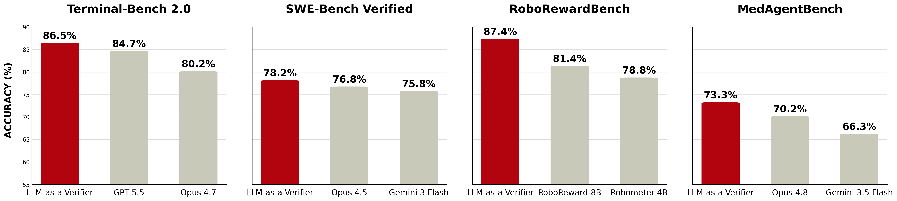
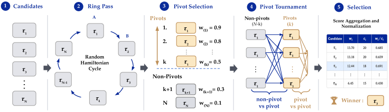
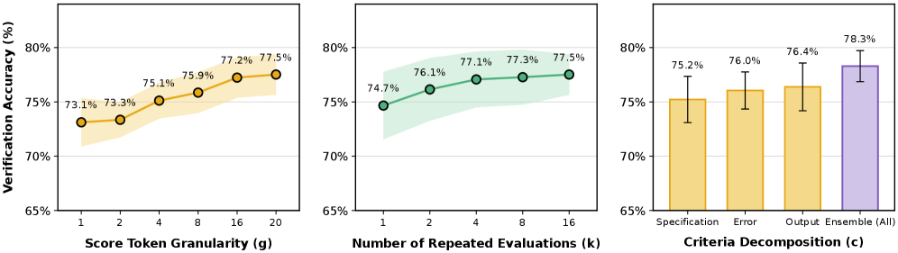
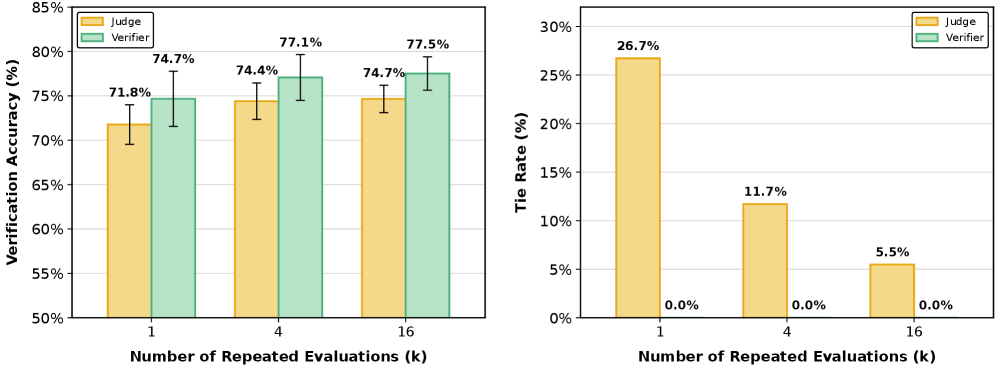

# Paper精读｜LLM-as-a-Verifier: A General-Purpose Verification Framework

> [!abstract] 一句话结论
> **LLM-as-a-Verifier** 把「验证」从流程里的边角活扶正成一条独立的 scaling axis：一个无需额外训练的通用框架，只靠 scoring token 上的 **logit 期望值**把离散评分拉成连续分数，再沿粒度细化、重复评估和标准分解三个轴各自加码——coding / robotics / medical 四个 benchmark 全部拿到 SOTA。

> [!cite]- 论文信息（点开折叠）
> - **论文标题**：LLM-as-a-Verifier: A General-Purpose Verification Framework
> - **arXiv**：2607.05391
> - **链接**：[https://arxiv.org/abs/2607.05391](https://arxiv.org/abs/2607.05391)
> - **作者**：Jacky Kwok, Shulu Li, Pranav Atreya, Yuejiang Liu, Yixing Jiang, Chelsea Finn, Marco Pavone, Ion Stoica, Azalia Mirhoseini
> - **机构**：Stanford University / UC Berkeley / NVIDIA Research
> - **日期**：2026-07-06

---

## 1️⃣ 论文想解决什么问题

pre-training、post-training、test-time compute——generation 的三条 scaling axis 被翻来覆去研究了个遍，但**验证**（verification，判断一个解法到底对不对）从来没被当成独立的 scaling axis 正经研究过。

现有两条路都糙在分辨率上：

- 标准 LM judges 输出离散分数（如 1-5 分），质量相近的 complex solutions 一比就给同样的分——tie rate 高达 27%，等于没区分

- Learned reward models 被训练分布焊死，换个领域就失灵

两条路的共同病灶：评分分辨率低，喂不进 agentic 任务需要的细粒度反馈信号。

于是核心问题来了：验证自己能不能也变成一条可加码的 axis，在 generation scaling 之外开出第二条增长曲线？

---

## 2️⃣ 核心洞察

> [!important] 核心洞察
> 1. 验证是一个被低估的 scaling axis：在 Terminal-Bench V2 上，如果模型拥有 oracle verifier，能将 pass@5 从 83.1% 提升到 92.1%，甚至跨模型池的 oracle pass@K 能到 98.9%——生成端其实已经攒够了候选，卡脖子的是"选择能力"。
>
> 2. 从离散到连续的范式转变：标准 judge 只取 logit 最高的那个 token 就交卷，这篇偏要给全部 scoring token 按概率做加权。分数从 {1,...,G} 的离散集合变成连续的 [0,1] 区间，tie rate 从 26.7% 降到 0。
>
> 3. 三轴独立缩放，互补不冗余：
>
>   - 粒度缩放（G）：增加 scoring token 数量 → 提升 SNR → 更好区分正/负解
>
>   - 重复评估（K）：蒙特卡洛平均 → 方差以 O(1/K) 下降 → 去噪
>
>   - 标准分解（C）：将"正确性"拆解为 Specification / Output / Errors → 减少单一标准的 prompt bias
>
> 4. **验证信号 = 任务进度估计器**：LLM-as-a-Verifier 的分数与 agent 执行步骤高度相关（Spearman VOC = 0.848 on successful trajectories），同一个 verifier 拿去当 ranking monitor 还是 early-warning system 都能用。
>
> 5. 可直接当 RL 的 dense reward：连续的验证分数塞进 off-policy (SAC) 和 on-policy (GRPO) 都行，sample efficiency ≈1.8× 加速（LIBERO）。

*图1：LLM-as-a-Verifier 在 coding、robotics、medical 三个领域四个 benchmark 上全面达到 SOTA：Terminal-Bench V2 (86.5%)、SWE-Bench Verified (78.2%)、RoboRewardBench (87.4%)、MedAgentBench (73.3%)。（来自 Figure 1）*

---

## 3️⃣ 方法解读

### 组件1：Fine-grained Reward Estimation

整篇框架压在这一条式子上（Eq. 3.1）——不挑 logit 最大的那个 token，而是让每个 scoring token 按自己的概率对分数做贡献：

$R(x,\tau) = \frac{1}{CK} \sum_{c=1}^{C} \sum_{k=1}^{K} \sum_{g=1}^{G} p_\theta(v_g | x, c, \tau) \cdot \phi(v_g)$

三个设计各有各的算计：

- 用字母（A-J 对应 1-10，或更多）代替数字当 scoring token——理由很实际：单个字母 token 可以提取 logprobs

- 评分尺度开到 1-20（而非传统的 1-5）——刻度越密，logit 期望的连续化才越平滑

- 最终归一化到 [0,1]，再通过 Bradley-Terry 模型转成 pairwise preference

### 组件2：Probabilistic Pivot Tournament（高效排名算法）

排名这头另有一个工程问题：候选有 N 个时，传统 Round-Robin 要 $O(N^2)$ 次比较，烧不起。作者的解法是五阶段 pipeline：Ring Pass → Pivot Selection → Pivot Rounds → Aggregation → Champion——预算从 $O(N^2)$ 压到 $O(Nk)$，固定预算下逼近最优 accuracy。

*图6：五阶段 pipeline —— (1) Ring Pass：随机 Hamiltonian cycle 消除位置偏差；(2) Pivot Selection：选 top-k 作为支点；(3) Pivot Rounds：仅比较 pivot vs 所有其他候选；(4) Aggregation：汇总胜负；(5) Champion：选出最优。将比较次数从 O(N²) 降为 O(Nk)。（来自 Figure 6）*

### 组件3：Criteria Decomposition

把"整体正确性"拆成 3 个独立子标准，各自单独打分再合：

- Specification：是否满足所有任务需求

- Output：最终输出格式是否符合预期

- Errors：logs/tool outputs 中是否无错误信号

任一单独标准约 75-76% 准确率，ensemble 后到 78.3%——拆开比不拆强，和三轴缩放是同一个逻辑。

### 优势估计

- 不依赖额外训练——同一个框架原样搬进 coding / robotics / medical 直接部署

- logit 拿不到的 frontier models 也有路（Appendix B.6 的两阶段 workaround）

- candidate pool 里混着不同模型产出的轨迹（heterogeneous pool），照样能排

*图4：验证准确率在三个独立轴上均呈单调上升趋势——粒度 G=1→20 从 73.1% 升至 77.5%；重复评估 K=1→16 从 74.7% 升至 77.5%；标准分解 ensemble 三个标准后达 78.3%。三轴互补不冗余。（来自 Figure 4）*

---

## 4️⃣ 实验部分怎么读

### 实验设置

| **Benchmark** | **领域** | **Agent Harness** | **生成模型** | **Verifier** |
| --- | --- | --- | --- | --- |
| Terminal-Bench V2 | Shell coding | Capy | GPT-5.5 | Gemini 2.5 Flash |
| SWE-Bench Verified | GitHub issue | mini-swe-agent | Opus 4.5 / G3 Flash / M2.5 | Gemini 2.5 Flash |
| RoboRewardBench | Robotics | VLM-based | Qwen 3.6 35B | — |
| MedAgentBench | Medical EHR | AgentBench | Opus 4.8 | Gemini 2.5 Flash |

统一参数：G=20, K=8, 三标准分解。

### 核心结果

| **Benchmark** | **Pass@1** | **Oracle Pass@N** | **LLM-as-a-Verifier** | **提升** |
| --- | --- | --- | --- | --- |
| Terminal-Bench V2 | 83.1% | 92.1% | **86.5%** | +3.4 |
| SWE-Bench Verified | 76.1% | 84.4% | **78.2%** | +2.1 |
| RoboRewardBench | — | — | **87.4%** (vs 81.4% best) | +6.0 |
| MedAgentBench | 70.2% | 75.0% | **73.3%** | +3.1 |

*图7：左——Pairwise verification accuracy：Verifier 在 k=1 时即达 74.7%，k=16 时达 77.5%，全程优于 Judge。右——Tie rate：Judge 在 k=1 时产生 26.7% 的 tie，Verifier 始终为 0%。（来自 Figure 7）*

### RL 效果（额外实验）

| **环境** | **Reward type** | **Baseline** | **+Verifier reward** |
| --- | --- | --- | --- |
| LIBERO (robotics) | Off-policy SAC | 69% | 76% (≈1.8× fewer steps) |
| MATH (reasoning) | On-policy GRPO | baseline | ≈1.1× 加速 |

### 训练细节

- 粒度这条轴：G=1→20 时 SNR 从 0.775 升到 0.799（Table 1），边际递减但一直是正的

- 重复评估这条轴：K=1→16 时 accuracy 从 74.7%→77.5%，收益递减来得很快

- 最有意思的一条：单 pass verifier (K=1) 就追平了 heavily ensembled judge (K=16)——粒度比堆重复次数划算

---

## 5️⃣ 学术评价

**优点：**

1. 验证被正儿八经立成第四条 axis：三轴缩放给了可操作的加码路径——不是又一个 benchmark hack，是方法论层面的新条目

2. letter-based scoring 是全文性价比最高的一手：拿字母当 scoring token 换回 logprobs 访问权，再对全部 token 取期望，零训练成本换到连续分数

3. 跨域不改一行框架：coding、robotics、medical 三个异质领域同一套跑通，起作用的是机制本身而非某家的 domain knowledge

4. 一个信号三处复用：ranking（verifier）之外还伸到 task progress estimation（VOC）和 dense RL reward——selection → monitoring → training 一条链全占了

5. 每个主张都有配套解释：SNR 分析说清粒度为什么有效，tie rate 27%→0 说清连续为什么赢离散，不是纯经验堆数字

> [!ed-warning] 局限（风险与不确定性）
> 先说处境：整套方法吃的就是 logit，这个依赖是机制本身，不是设计失误。但理解归理解，代价摆在那：
> 1. Claude 系列通过 API 拿不到 logprobs，只能走两阶段 workaround——直接适用范围被砍掉一块
>
> 2. 三轴配置全是 handmade（手动设计标准、固定 G=20/K=8），没有"什么时候该往哪个轴加码"的自适应调度策略
>
> 3. RL 实验只在 single-turn 设置里做过，multi-turn RL（long-horizon agentic rollouts with per-step rewards）一个字没碰

---

## 6️⃣ 局限与可扩展方向

- 自适应三轴调度：根据 verifier 自身的不确定性动态分配 G/K/C compute

- Learned Criteria Decomposition：标准分解目前是 hand-crafted，可尝试 per-domain 自动分解

- Multi-turn RL dense rewards：将验证信号扩展到多轮 agentic 场景的 credit assignment

- Best-of-N 与 generation scaling 的耦合：generation + verification 的联合 scaling law 尚未建立

- Infrastructure 应用：Claude Code / Codex extension 是产品级落地基石，可进一步公开 user study

- 与 self-improvement 闭环：验证器自身能否通过 verification signal 做 meta-learning，持续优化自身打分能力

---

## 7️⃣ 最后总结

这篇最值钱的判断，是把「验证」从 generation 的附属品升格成独立的 scaling axis：pre-training / post-training / test-time compute 三条老轴全在 scaling 生成端，这篇证明验证能力自己也能加码，而且收益独立于生成端。四个 benchmark 全 SOTA 说明不是挑对了领域；VOC 0.848 和 RL ≈1.8× 加速说明这条验证信号不止能选答案。

要说最虚的地方：三轴配置全靠手工（G=20、K=8、标准手写），调度逻辑没给——框架立住了，账还没算明白。下一步最该补的，是按 verifier 自身的不确定性动态分配 G/K/C 的策略。

---

## 8️⃣ 三句速记

> [!summary]- 点开展开
> 1. 从离散到连续：用 logit 期望值替代单一 scoring token，将 tie rate 从 27% 降到 0%，同时释放了沿 G/K/C 三个轴独立缩放验证能力的空间
>
> 2. 验证是第四轴：pre-training、post-training、test-time compute 都在 scaling generation，而 LLM-as-a-Verifier 首次系统论证了 verification scaling 是一条独立且可量化的能力提升路径
>
> 3. 一个框架三个用途：trajectory ranking（SOTA results）、task progress estimation（VOC=0.848）、dense RL reward（sample efficiency ≈1.8×）——验证信号的价值远超"选最好的"
