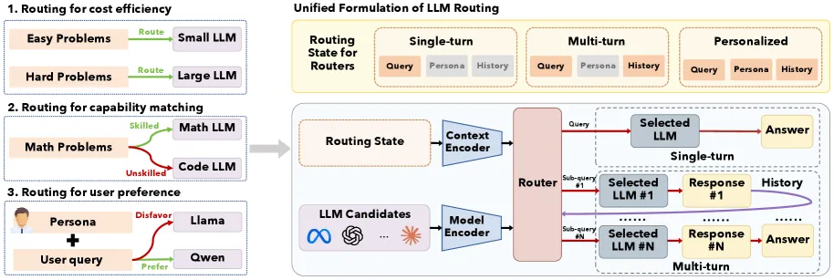
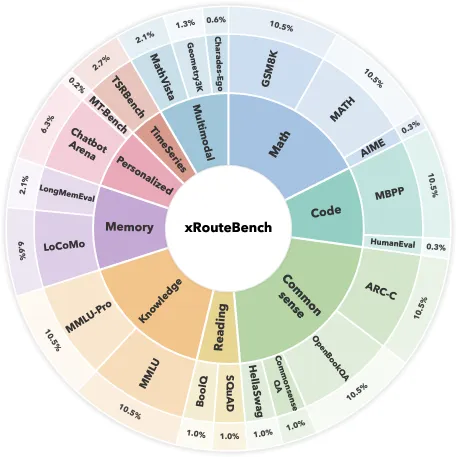
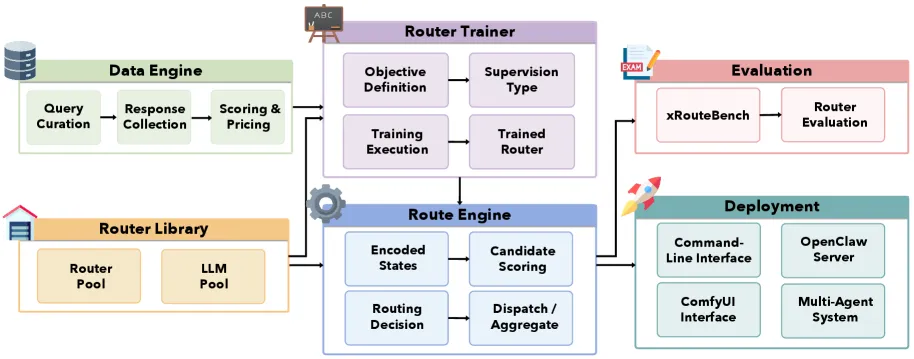
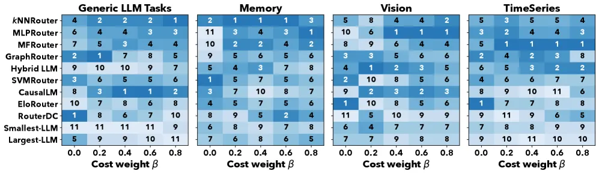

# Paper精读｜LLMRouter: Unified Infrastructure for Developing, Evaluating, and Deploying LLM Routers

> [!abstract] 一句话结论
> **给 LLM 路由这个各自为政的领域立了三件公共品：① **统一形式化**——把模型路由建模为**序贯决策过程**，由 5 类组件刻画（context encoders / model encoders / scoring functions / decision rules / learning signals），现有方法全部归入**单轮、多轮、个性化**三族；② **xRouteBench 基准**——覆盖通用 LLM、记忆增强、视觉（图/视频）、时间序列、个性化 5 条轨道的统一成本感知评测；③ **LLMRouter 开源库**——16+ 个代表性路由器的模块化实现，加新路由只需实现路由方法 + 损失函数。实验里最有分量的三个发现：学习式路由比最强固定模型基线**相对提升 14.6%**（MFRouter 76.48 vs Largest-LLM 71.48）；**紧成本约束下轻量路由器排名反转**——"最优路由器"跟着预算走；用户条件路由带来一致个性化增益（真实用户反馈下 PersonalizedRouter 83.05%）。**

> [!cite]- 论文信息（点开折叠）
> - **论文标题**：LLMRouter: Unified Infrastructure for Developing, Evaluating, and Deploying LLM Routers
> - **arXiv**：2608.06867
> - **链接**：[https://arxiv.org/abs/2608.06867](https://arxiv.org/abs/2608.06867)
> - **作者**：Tao Feng, Fangxu Yu, Haozhen Zhang 等（Jiaxuan You 通讯组）
> - **机构**：UIUC / University of Maryland / NTU / Purdue / UIC
> - **日期**：2026-08-07
> - **项目**：xRouteBench + LLMRouter 库

---

## 1️⃣ 论文想解决什么问题

LLM 生态现在的模样：从前沿闭源到廉价开源，模型在**成本**与**任务特定能力**上差异巨大，没有任何单一模型能在所有查询和预算约束下都最优。于是**模型路由**（每个 query 交给哪个模型）成了降本增效的枢纽，还得顺带做能力匹配（capability matching）和用户偏好适配（user preference）。

但路由研究一片散沙：

- 二元路由器（弱/强仲裁）、成本感知级联、奖励引导集成、对比/图路由器、个性化路由器、agentic RL 路由器——形式化各异

- 实现互不兼容，无标准化评测管线——没法公平对比，扩展也费劲

- 现有基准（RouterBench、RouterEval）只覆盖单轮文本；输入 token 成本主导、多模态、时序、个性化这些路由决策长得完全不一样的场景一概没碰

论文的三个交付物各回答一个问题：**怎么统一描述所有路由器？（形式化）→ 怎么公平评测？（xRouteBench）→ 怎么低成本复现与扩展？（LLMRouter 库）**

---

## 2️⃣ 核心洞察

> [!important] 核心洞察
> 1. 所有路由器都是序贯决策过程：状态 s_t=(q, u, h_t)（查询 + 可选用户上下文 + 交互历史），动作 a_t ∈ M∪{⊥}（派发给候选模型或终止聚合）。二元路由器、级联、图路由、agentic RL 路由器全是这个框架的特例——统一形式化让公平对比成为可能。
>
> 2. 5 组件分解是"路由器的积木"：任何路由器的差异都归结为 5 个组件的选择（E_q 上下文编码 / E_m 模型编码 / g 打分 / d 决策规则 / L 学习信号）——有了这副积木，"加新路由器 = 只实现路由方法与损失函数"才真正成立，模块化复用靠的就是它。
>
> 3. 决策逻辑根本不同的场景需要专属评测：长上下文（输入 token 成本主导）、多模态（只有部分模型能处理）、时序（多模态编码）、个性化（用户特定偏好）——现有基准全都不覆盖，xRouteBench 把这块空白补上。
>
> 4. "性能-成本联合评测"是路由的独特需求：统一协议同时评估响应质量与推理成本（α·perf − β·cost 加权，扫 5 个权重）——路由的成败天生就是 trade-off，单看质量或单看成本都会误导。
>
> 5. 实证最有价值的发现是"排名反转"：performance-first 下复杂/大型路由器领先，但随成本权重 β 增大，轻量路由器排名系统性上升——"最优路由器"不是绝对的，取决于部署的预算约束。给实践者的信号很直接：别照搬别人的路由配置，按自己的成本约束选。

*Figure 1（统一形式化）：左：路由的三个驱动需求——成本效率、能力匹配、用户偏好；右：统一形式化把它们全部化为一个决策过程——上下文编码器 E_q 表示路由状态，模型编码器 E_m 表示候选 LLM，打分函数 g 与决策规则 d 生成路由动作，学习信号 L 拟合最优策略。*

---

## 3️⃣ 方法解读

### 组件1：统一形式化——路由即序贯决策（§2）

- 目标：π* = argmax_π E[perf(y|q) − λ·c(τ)]——质量最大化、成本最小化，λ 控制权衡

- 5 组件：

  - Context encoder E_q：Embedding-based（向量；rating 路由退化为常数、kNN 用现成句嵌入、判别式路由器训轻量编码器、个性化路由基于异构交互图）或 Text-based（级联把草稿响应+验证置信度附到查询）

  - Model encoder E_m：编码每个候选模型（参数/能力/成本特征）

  - Scoring function g：把上下文与模型表示转为分数

  - Decision rule d：选 argmax 或阈值等

  - Learning signal L：监督（偏好对）或强化（RL 路由）

- 三族划分：单轮（一次派发即终止）、多轮/agentic（可多次派发与终止）、个性化（状态含用户上下文 u）

### 组件2：xRouteBench 基准（§3）

- 设计原则：所有任务由 LLMRouter 数据引擎构造，共享查询 schema、监督格式、评测协议；非文本资产（图/视频/时序）经转换脚本变为**自包含文本查询**（可选指向源资产指针）——路由与感知分离，纯文本与多模态候选收到相同文本输入

- 5 条轨道、4,767 实例：Generic LLM Tasks、memory（LoCoMo/LongMemEval）、vision（Geometry3K/MathVista/Video）、time-series、personalized

- 统一协议：每查询联合评估质量与成本，暴露"输入 token 成本主导生成成本"的场景；新应用只需转换脚本 + 注册指标

- 填补的空白：RouterBench/RouterEval 只覆盖单轮文本；视觉路由基准限于图像 QA 无视频/长上下文；Chatbot Arena 缺持久用户上下文

### 组件3：LLMRouter 库（§4）

- 六模块：路由数据构建、路由器实现与训练、推理、评估、部署

- 16+ 内置路由器：

  - 单轮：kNNRouter、SVMRouter、MLPRouter、EloRouter、MFRouter、RouterDC、Hybrid LLM、AutoMix、GraphRouter、CausalLM、规则基线（Smallest/Largest-LLM）

  - 多轮：Router-R1（RL）、kNN/LLM 多轮变体

  - 个性化：GMTRouter、PersonalizedRouter

- 扩展性：加新路由器 = 实现路由方法 + 损失函数，其余（数据/评估/部署）复用

### 优势估计

- 统一形式化 → 公平对比：5 组件分解让不同方法在同一坐标系下比较

- 模块化 → 低门槛扩展：新路由器的接入成本降到最低

- 成本感知评测 → 贴近部署：性能-成本联合评估 + 权重扫描，暴露"哪种路由在哪种预算下最优"

- 多场景覆盖：长上下文/多模态/时序/个性化这些"路由决策逻辑不同"的场景首次统一评测

- 部署闭环：Slack 接口收集真实用户偏好（234 条记录）、ComfyUI 可视化、OpenClaw 服务器部署

---

## 4️⃣ 实验部分怎么读

### 实验设置

- 候选池：18 个开源模型（7B-671B），两个供应商（Together API / NVIDIA NIM）：Gemma-2-9B、Mistral 系列、Qwen2.5-7B/Qwen3-Next-80B、Llama 系列、GPT-OSS-20B/120B、RNJ-1-15B、DeepSeek-V3.1、Cogito-v2

- 评测协议：加权奖励 α·perf − β·cost，扫 5 档（质量唯一 (1.0,0.0) → 重成本 (0.2,0.8)）

- 个性化轨道：persona 条件化 LLM 裁判（DeepSeek-V3.1）判 win/tie/loss；裁判成本不计入

- 多轮/RL 路由器无法优化该加权目标，单配置跑一次

### 核心发现

**发现 1：学习式路由 > 最强固定模型（质量优先，Table 2）**

- MFRouter 平均 76.48 vs Largest-LLM 71.48——**相对提升 ~7%（绝对 5 点）**；论文摘要里的 14.6% 相对提升是跨轨道/设置的综合数字

- 查询感知路由（kNN/SVM/MLP/MF）普遍超过"永远选最大/最小模型"的规则基线——路由确实在做能力匹配

**发现 2：紧成本约束下轻量路由器排名反转（Figure 5/6）**

- 随成本权重 β 增大，路由器排名系统性变化——重路由器（依赖大模型特征/多轮调用）让位给轻量路由器

- Figure 5 的排名矩阵直接把这个反转画了出来；Figure 6 的性能-成本前沿显示不同路由器占据不同 trade-off 区间

- **实践含义：路由器的"最优性"依赖部署预算约束，必须按自己的成本权重选择**

**发现 3：用户条件路由一致提升个性化（Table 3/4）**

- 模拟（persona 裁判）下 GMTRouter 领先；**真实用户反馈（15 用户 40 会话 234 条偏好）下 PersonalizedRouter 83.05% 领先，GMTRouter 跌到第六**——模拟排名不完全迁移，**必须用真实反馈验证个性化路由器**

- 用户条件路由（用 user features + session）比无用户上下文路由一致性更好

**额外：多智能体系统内逐节点路由（Table 5）**

- 把每个功能节点（规划/执行/验证 prompt 差异巨大）独立路由：6/7 个学习式路由器超过"永远选最大模型"（MFRouter 76.48 vs 71.48）——路由在 MAS 内部也有效，且泛化到训练时未见过的节点 prompt

*Figure 2（基准构成）：xRouteBench 覆盖通用 LLM 任务、记忆、视觉（图/视频）、时序、个性化五类路由场景，百分比表示各数据集贡献的测试查询比例——路由决策逻辑不同的场景首次统一评测。*

*Figure 3（系统架构）：LLMRouter 的六模块系统支持路由数据构建、路由器实现与训练、推理、评估与部署——加新路由器只需实现路由方法与损失函数。*

*Figure 5（成本排名反转）：随成本权重 β 增加，路由器排名系统性变化——性能优先时复杂/大型路由器领先，紧成本约束下轻量路由器排名上升。这是"最优路由取决于预算约束"的直接可视化证据。*

---

## 5️⃣ 学术评价

**优点：**

1. 基础设施类贡献的标杆：统一形式化 + 统一基准 + 模块化库三件套齐备——路由领域最缺的就是这种"公共品"，后续研究从此有坐标系可依

2. 5 组件分解的洞察力：把看似不兼容的方法（二元仲裁/级联/图路由/agentic RL）统一到同一形式化——不是简单分类，是找到了共同的抽象层，模块化复用直接受益

3. 成本感知评测的设计：α·perf − β·cost 加权 + 权重扫描是路由评测的正确姿势——单看质量或单看成本都会误导，"排名反转"这个发现就是从这个设计里长出来的

4. 真实用户验证：Slack 收集真实偏好反馈（234 条），发现模拟排名不迁移（GMTRouter 模拟第一 → 真实第六）——给"用 persona 裁判代替真实用户"的做法敲了记警钟

5. 与 W2S-OPD 作者的呼应：Fangxu Yu（W2S-OPD 一作）参与——模型选择（路由）与模型蒸馏（W2S-OPD）是"部署成本优化"的两条互补路线，同一研究者同时耕耘两个方向，信号意义不小

> [!ed-warning] 局限（风险与不确定性）
> 先说处境：候选池全开源有成本可控、可复现的好处，闭源 API 的调用量价我理解为什么没碰；但理解归理解，该提的还是要提：
> 1. 候选池全开源：18 个开源模型——真实部署最常见的"开源+闭源混合池"（如 GPT/Claude 与小模型级联）未覆盖，路由对闭源 API 的适用性未知
>
> 2. 个性化评估的裁判问题：persona 裁判（DeepSeek-V3.1）与真实用户反馈的排名不一致（GMTRouter 案例）——基准的个性化轨道本身的可信度存疑，论文用真实数据点出了问题，但没回答"如何廉价获得可靠个性化监督"
>
> 3. 路由器的成本假设简化：成本按 per-token 定价计算，未考虑真实部署的额外开销（路由推理本身、延迟、并发）；λ 与 (α,β) 的换算关系不明确
>
> 4. 多轮/RL 路由器的评测不公平：它们"无法优化加权目标，单配置跑一次"——与可扫权重的单轮路由器不在同一比较面上
>
> 5. MAS 实验的基线局限：只对比"永远选最大模型"，未对比"统一小模型"等更实际的 MAS 成本基线

---

## 6️⃣ 局限与可扩展方向

- 混合候选池：开源+闭源混合路由（真实部署形态），评估闭源 API 的成本/延迟约束

- 路由器的真实部署成本：把路由推理开销、延迟、并发纳入统一评测

- 个性化监督的规模化：如何用更少真实反馈训练可靠个性化路由器（主动学习、迁移）

- 路由与蒸馏的联合：路由选模型 vs 蒸馏压模型——何时路由优于蒸馏、何时反之、可否联合优化（呼应 W2S-OPD）

- 跨库互操作：LLMRouter 与主流 serving 框架（vLLM、SGLang）的对接

---

## 与其他论文的对话

| **相关工作** | **关系** | **差异** |
| --- | --- | --- |
| **RouterBench / RouterEval** | 现有路由基准 | 只覆盖单轮文本、质量独立于成本；xRouteBench 统一成本感知 + 五场景 |
| **Hybrid LLM / AutoMix / RouterDC** | 代表性单轮路由器 | 全部被 LLMRouter 统一形式化并模块化实现（16+ 内置） |
| **GraphRouter (Feng et al. 2024)** | 图路由器 | 同一作者组的早期工作，纳入统一框架 |
| **Router-R1 / agentic routers** | RL 路由 | 归入"多轮路由"族；评测受"单配置"限制 |
| **W2S-OPD（2607.26246）** | 同作者（Fangxu Yu） | W2S-OPD 蒸馏（把强模型压进弱模型）；LLMRouter 路由（按查询选模型）——部署成本优化的两条互补路线 |
| **Mooncake（FAST '25）** | 系统层优化 | Mooncake 优化 serving 内部资源（KVCache）；LLMRouter 优化模型选择层——不同层的成本优化 |
| **Chatbot Arena** | 偏好数据来源 | Arena 提供人群级信号但缺持久用户上下文；xRouteBench 个性化轨道补充用户条件路由 |
| **Semantica（今日 GitHub 第一）** | 可问责 AI 基础设施 | Semantica 管知识图与溯源；LLMRouter 管模型选择——"AI 系统基础设施"主题的不同切面 |

---

## 7️⃣ 最后总结

LLMRouter 没有提出新的路由算法，它干的是另一件事：给整个路由领域装上**统一坐标系**（序贯决策 5 组件形式化）、**公平标尺**（xRouteBench 成本感知评测）和**可复用积木**（16+ 路由器的模块化库）——基础设施型论文该有的三样它都齐了。实证里我认为最值钱的是成本权重的"排名反转"效应：最优路由器不是绝对的，紧预算下轻量设计反超——这条直接指导实践，路由方案必须按自己的部署约束选，照搬论文配置要吃亏。它和笔记库里的 W2S-OPD（同作者、蒸馏 vs 路由互补）正好凑成"模型经济性"主题的一对。要挑毛病就三处：全开源候选池、个性化裁判的可信度存疑、多轮路由器评测不对称——都是下一轮该补的窟窿。对做 LLM 部署/推理优化或模型选型的人，这篇就是从"拍脑袋选模型"走向"科学路由"的那套地基。

---

## 8️⃣ 三句速记

> [!summary]- 点开展开
> 1. 路由 = 序贯决策：状态（查询+用户+历史）→ 动作（派发模型或终止），5 组件（上下文编码/模型编码/打分/决策规则/学习信号）统一所有路由器，归入单轮/多轮/个性化三族。
>
> 2. 成本权重决定最优路由：性能优先时大型路由器领先，紧成本约束下轻量路由器排名反转——MFRouter 76.48 vs Largest-LLM 71.48，但 β 增大后格局颠倒。
>
> 3. 个性化必须用真实反馈验证：persona 裁判下 GMTRouter 第一、真实用户下跌到第六（PersonalizedRouter 83.05% 领先）——模拟排名不可靠。