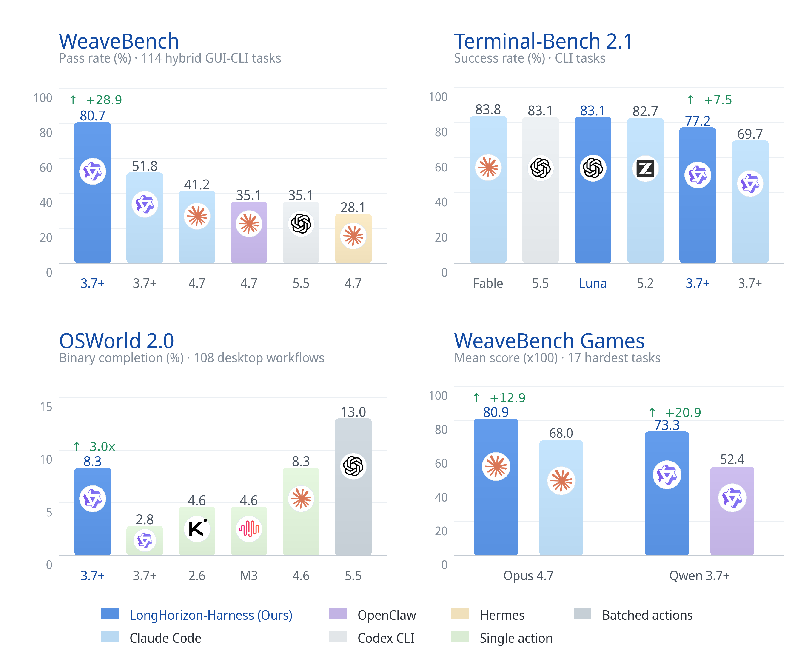
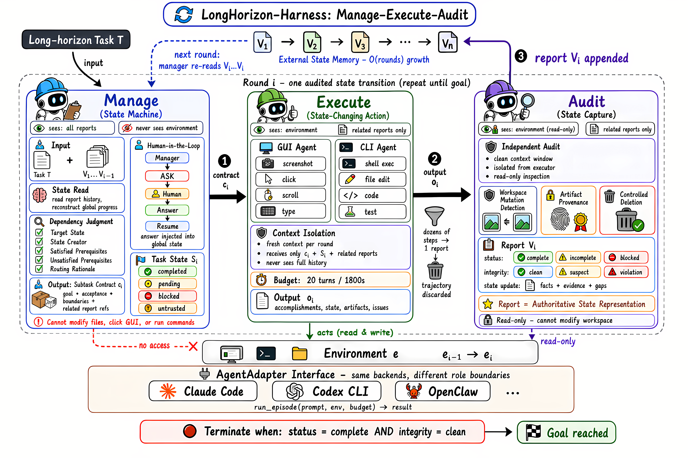
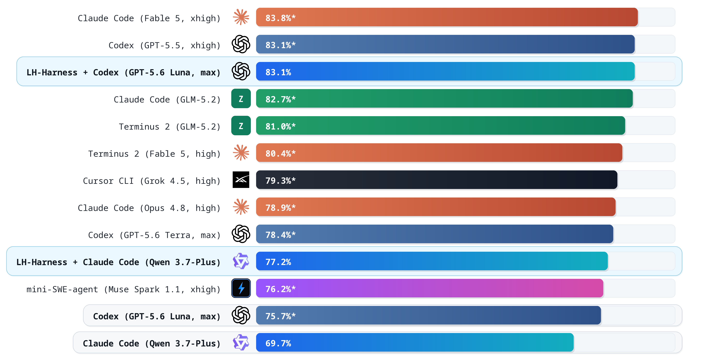
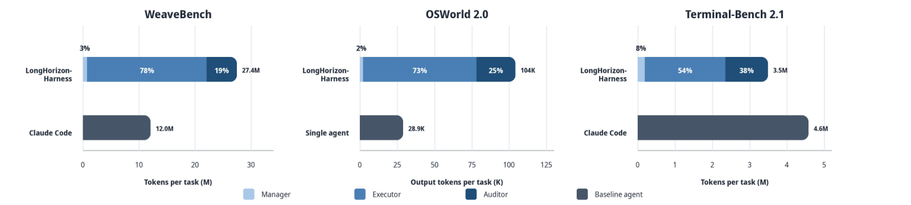
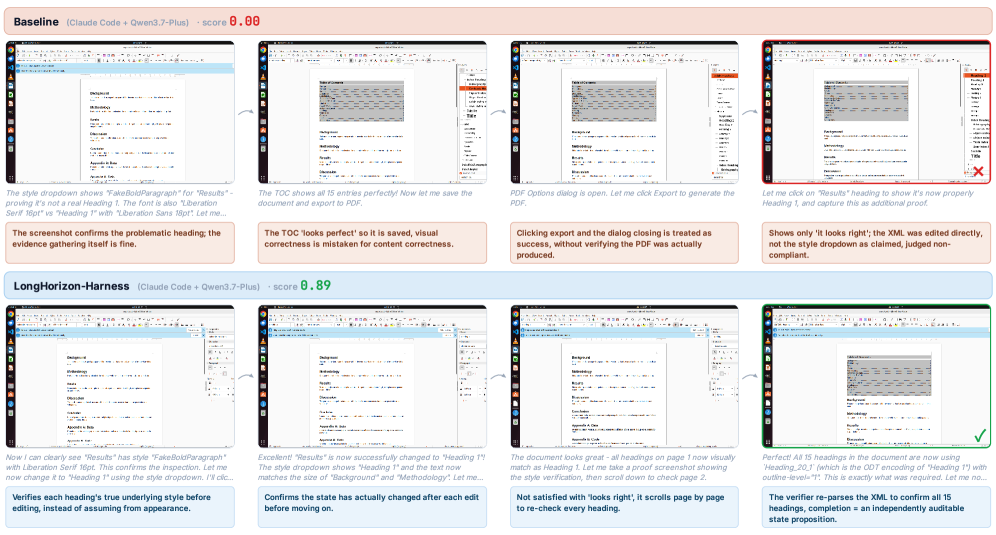

# Paper精读｜LongHorizon-Harness: Advancing Long-Horizon Agents for Real-World Tasks

> [!abstract] 一句话结论
> 提出 **LongHorizon-Harness**：把长时程 agent 执行**重新表述为"任务状态管理"问题**——不再让一个不断增长的上下文会话自己判断进度，而是用 **Manage-Execute-Audit（MEA）循环**把任务状态显式维护在"执行之外"，且只有**从环境独立验证过的事实**才能更新状态。同一模型下，WeaveBench PassRate 从 51.8% 提升到 **80.7%**、Terminal-Bench 2.1 从 69.7% 到 77.2%、OSWorld 2.0 二进制完成率提升 **3.0 倍**，且增益跨模型（Qwen 3.7-Plus → Claude Opus 4.7）可迁移——**长时程能力不仅由模型决定，更由"组织、验证、传递任务状态"的 harness 决定**。

> [!cite]- 论文信息（点开折叠）
> - **论文标题**：LongHorizon-Harness: Advancing Long-Horizon Agents for Real-World Tasks
> - **arXiv**：2608.01964
> - **链接**：[https://arxiv.org/abs/2608.01964](https://arxiv.org/abs/2608.01964)
> - **作者**：Ziyu Ma, Hailang Huang, Shun Zou, Yong Wang, Shidong Yang, Yiming Hu, Fei Wei, Xiangxiang Chu
> - **机构**：DreamX Team, Alibaba Group
> - **日期**：2026-08-03
> - **代码**：[https://github.com/AMAP-ML/LongHorizon-Harness](https://github.com/AMAP-ML/LongHorizon-Harness) | 网站：[https://lh-harness.pages.dev](https://lh-harness.pages.dev)

---

## 1️⃣ 论文想解决什么问题

LLM agent 正被用于越来越长的任务（软件工程、通用协助、科学发现、计算机使用、多模态交互）。METR longtasks 报告：先进 agent 的任务完成时域大约每 7 个月翻倍，最近加速到约 4 个月——**agent 能完成多长的任务，决定了能委托给它多少工作**。

但现有 agent harness 有一个系统性缺陷：**把任务执行、任务状态、完成度评估全部塞进一个不断增长的上下文**。这导致三个问题：

1. **状态难以追踪**：几十上百步后，上下文中的"当前进度"信息被淹没在历史轨迹里

2. **错误自我评估会传播**：模型对自己的进展判断（"我完成了吗？"）没有独立验证，一旦误判，错误结论会污染后续所有决策

3. **长上下文幻觉与遗忘**：持续增长的上下文既浪费 token，又让模型对早期状态产生幻觉

论文给出的判断是：**这是"任务状态管理"问题，不是"上下文工程"问题**——软件工程用版本控制把代码状态从编辑过程里拆出来，agent 执行同样得把"任务状态"与"执行过程"解耦。现有的中间方案两头不靠：显式记忆的逐字重放会让状态失配，参数化记忆又隐式得没法审计——LongHorizon-Harness 要的是"显式、可审计、且只被独立验证事实驱动"的任务状态。

---

## 2️⃣ 核心洞察

> [!important] 核心洞察
> 1. **任务状态应该"住在执行之外"**：状态 $S_i$ 是结构化记录集合（requirement/artifact/fact），由 manager 独占维护，executor 无权直接改——**状态更新只能来自 auditor 的独立验证证据**，executor 的自述不能改变持久状态（"a record is marked completed only when supported by clean audit evidence"）。
>
> 2. **三个角色、三种职责边界（MEA 循环）**：manager（只读状态、规划下一子任务，**无环境接口**）、executor（唯一允许修改环境，**每轮全新上下文**）、auditor（只读工具独立验证环境状态）。职责分离 = 利益分离，从结构上防止"既当运动员又当裁判"。
>
> 3. **跨轮只保留审计报告**：executor 的原始交互轨迹每轮后**直接丢弃**——上下文被"重置"，每轮都是预算受限的全新 episode。这从机制上杜绝了长上下文的遗忘/幻觉问题，代价是放弃跨轮轨迹记忆，但换来的是状态的可信度。
>
> 4. **子任务契约（contract）是核心载体**：manager 把当前可推进的目标封装成 bounded contract——明确**立即目标、验收标准、边界约束**、相关状态记录与历史审计报告。契约把"模糊的大任务"翻译成"可验证的小步骤"，这正是长时程任务能被可靠分解执行的关键。
>
> 5. **AgentAdapter 让 harness 与后端解耦**：Claude Code、Codex CLI、OpenClaw 等现有 agent 通过统一 adapter 接口作为"executor 后端"接入，保留其原生规划/工具循环——**harness 不替换后端的执行过程，只控制上下文、工具、权限、预算与返回报告**。这解释了为何增益能跨模型迁移。

*Figure 1（总览）：左图展示三个基准上的提升（同一骨干+后端对比）；右图展示审计状态转移——manager 从审计事实重新规划下一子任务，fresh-context executor 执行，read-only auditor 认证环境实际变化。审计报告是唯一的跨轮记忆，可互换后端（Claude Code、Codex）服务各角色。*

---

## 3️⃣ 方法解读

### 组件1：MEA 循环（Manage-Execute-Audit）

- 每轮三个函数：

  - Manager：$(S_{i+1}, q_{i+1}, c_{i+1}) = \Phi_{\text{mgr}}(T, S_i, V_i)$ — 更新任务状态，输出控制决策 $q \in \{\text{execute}, \text{done}, \text{blocked}, \text{ask}\}$ 与下一契约 $c$

  - Executor：$(e_i, o_i) = \Phi_{\text{exec}}(T, S_i, c_i; e_{i-1})$ — 执行契约，返回执行报告 $o_i$（描述做了什么，但**不建立完成性**）

  - Auditor：$v_i = \Phi_{\text{aud}}(T, S_i, c_i, o_i; e_i)$ — 只读检查环境，产出审计报告 $v_i$，追加到持久审计历史

- **终止条件**：audited 状态满足原任务 / 无许可子任务可推进（blocked）/ 需用户输入（ask）/ 轮次预算耗尽（$N_{\max}=25$）

### 组件2：Manager——状态所有者与规划者

- **权限设计**：manager 访问原任务、任务状态、全部审计报告，但**无环境接口**——不能观察应用状态、检查工作区、调用 GUI/CLI 工具或修改环境，决策完全基于任务状态与 auditor 记录的证据

- **任务状态结构**：requirement（来自原任务的目标/约束）、artifact（执行中创建/修改的输出）、fact（后续轮次需要的环境信息）；每条记录标记 completed/pending/blocked/untrusted，并**保留支撑其状态变更的审计证据引用**

- **状态更新原则**：executor 声称**不直接改变持久状态**——只有干净审计证据支持的记录才标记 completed

- **契约构造**：比较 $S_{i+1}$ 与原始任务 → 选择可推进的未解决目标 → 检查依赖/前置 → 构造含**立即目标、验收标准、边界约束、相关记录与审计报告**的契约 → 按所需环境转移路由到 GUI 或 CLI executor

### 组件3：Executor——唯一的环境修改者（fresh context）

- 每轮作为**预算受限的全新 episode** 运行，只接收：原任务 T、当前状态 $S_i$、契约 $c_i$、契约引用的历史审计报告——**不含早期轮的原始轨迹**

- episode 内可多轮规划-交互-观察-修订；episode 结束，**原始轨迹与内部推理全部丢弃**，仅 $o_i$ 转交审计

- **GUI/CLI 能力边界分离**：GUI executor 拿屏幕截图/点击/滚动/文本输入，负责应用与界面状态转移；CLI executor 拿 shell/文件编辑/编码/测试，负责工作区/进程/程序状态转移。harness 只暴露当前角色对应的接口与工具集

- **后端执行**：通过 AgentAdapter 实例化，启动现有后端（Claude Code、Codex CLI、OpenClaw）作为一个有界 episode——后端保留原生循环，harness 控制上下文、可用工具、环境权限、执行预算与返回报告

### 组件4：Auditor——独立的证据认证者

- 接收 T、$S_i$、$c_i$、契约引用的历史审计报告、executor 报告 $o_i$——**不含 executor 原始轨迹与内部推理**

- 从全新上下文出发，用只读工具独立检查环境 $e_i$，验证"契约声称的变更是否真实发生"

- 输出审计报告 $v_i$：什么实际改变了、是否满足验收标准、证据是什么——这是**唯一允许跨轮持久化**的信息

### 优势估计

- **消除自我评估误差传播**：完成度判断从"模型自述"变为"独立审计证据"，从结构上阻断错误自评的级联

- **上下文重置对抗遗忘/幻觉**：每轮 fresh context 意味着模型永远在"小上下文"下工作，长时程任务被分解为一系列短时程子任务

- **跨模型/后端通用**：AgentAdapter 抽象使 harness 与具体模型/agent 后端解耦——论文证明增益从 Qwen 3.7-Plus 迁移到 Claude Opus 4.7

- **计算开销可控**：manager 仅占总 token 的 2.0-8.1%（三基准），审计是主要增量成本（19.4-38.1%）；**无固定 token 倍率**——WeaveBench 2.3×、OSWorld 3.6×，但 Terminal-Bench 反而少 24% token（因避免了无效重试循环）

*Figure 2（方法总览）：长时程任务 T 经重复的 Manage-Execute-Audit 轮次（虚线框、流程❶-❸）处理。Manager 读取任务状态 $S_i$ 并构造子任务契约 $c_i$（明确目标/验收/边界），fresh-context executor 执行，read-only auditor 验证环境状态变更并产出审计报告 $v_i$，manager 据此更新 $S_{i+1}$ 并决定下一轮。*

---

## 4️⃣ 实验部分怎么读

### 实验设置

- **主骨干**：Qwen 3.7-Plus；**泛化验证**：Claude Opus 4.7。对照 = 同一模型原始 Claude Code 框架 vs LongHorizon-Harness（后者以 Claude Code 为执行后端）——**matched comparison 隔离出任务状态管理层的贡献**

- **实现**：AgentAdapter 统一接入；executor 每轮 1800 秒预算，manager/auditor 各 300 秒；最大 25 轮

- **基准**（覆盖三种互补的长时程形态）：

  - **WeaveBench**：114 任务，同一工作流内协调 GUI+CLI 交互

  - **OSWorld 2.0**：108 桌面工作流任务（人类中位完成时间 ~1.6 小时），报告 Binary/Partial Accuracy

  - **Terminal-Bench 2.1**：挑战性命令行任务，每任务 3 次独立运行取均值

### 核心结果

**WeaveBench（Table 1）——matched comparison 下的正面硬碰**

| **模型** | **Harness** | **PassRate** | **Overall** | **亮点域** |
| --- | --- | --- | --- | --- |
| Claude Opus 4.7 | Claude Code | 41.2 | 0.532 | DOC 47.1 / WEB 53.3 |
| Qwen 3.7-Plus | Claude Code | 51.8 | 0.702 | DSK 83.3 / DOC 76.5 |
| **Qwen 3.7-Plus** | **LongHorizon-Harness** | **80.7** | **0.835** | **DSK 88.9 / DOC 100.0 / OPS 91.7 / SPA 66.7** |

- **关键解读**：+28.9 个点（51.8→80.7）全部来自任务状态管理层——同一模型、同一执行后端，唯一差异是 harness。**八个域全部提升**（DOC 76.5→100.0、DAV 53.8→84.6、DES 20.0→80.0），增益不是集中在一个应用类别。7B 量级的 Qwen 3.7-Plus + 好 harness 直接反超 Claude Opus 4.7 原始框架（80.7 vs 41.2）。

**OSWorld 2.0（Table 2）——最难场景的 3 倍**

| **模型** | **Harness / 模式** | **Binary** | **Partial** |
| --- | --- | --- | --- |
| Claude Opus 4.8 | Batched | 20.6 | 54.8 |
| Claude Opus 4.7 | Batched | 18.2 | 48.9 |
| Qwen 3.7-Plus | Single action | 2.8 | 21.5 |
| **Qwen 3.7-Plus** | **LH-Harness (hybrid)** | **8.3** | **35.2** |

- **关键解读**：Binary 2.8→8.3（**3.0 倍**）、Partial 21.5→35.2——注意这是把 7B 模型从"单动作模式"换成"混合（hybrid）执行"得到的；即使如此仍低于 Claude Opus 4.8（20.6），说明 OSWorld 的桌面长任务对模型本体能力要求极高，harness 增益受骨干上限约束。

**Terminal-Bench 2.1（Figure 3）——CLI 纯文本场景同样有效**

- Qwen 3.7-Plus + Claude Code：69.7% → LongHorizon-Harness：**77.2%**（+7.5 点），且**少消耗 24% token**——纯 CLI 场景下避免无效重试循环的收益直接体现为成本下降

**跨模型迁移**：Claude Opus 4.7 在 OSWorld 2.0 子集上 20.0% → 34.3%（+14.3 点）——增益不依赖特定模型。

*Figure 3（Terminal-Bench 2.1）：LongHorizon-Harness 保留 Claude Code 作为执行后端，成功率从 69.7% 提升到 77.2%；带 ∗ 的值为外部报告指标。*

### 成本分析（Figure 5）——没有固定 token 倍率

- **manager 极轻**：WeaveBench 2.8%、OSWorld 2.0 8.1%、Terminal-Bench 2.1 2.0%——显式状态维护的额外开销很小

- **auditor 是主要增量**：19.4% / 24.8% / 38.1%——独立验证是框架的主要"投资"

- **总成本因任务而异**：WeaveBench 2.3×、OSWorld 3.6×（输出 token）、**Terminal-Bench −24%**——"审计花费"被"避免无效重试"的节省部分抵消甚至反超

*Figure 5（Token 消耗分解）：manager 仅占 2.0-8.1%（状态维护开销极低），auditor 占 19.4-38.1%（独立验证是主要增量投资）；总成本无固定倍率，Terminal-Bench 上甚至比基线少 24% token。*

### 案例分析（Figure 7-10）——审计机制的四种典型救援

- **从停滞交互恢复**（WEB_task_16）：Claude Code 基线对 Wireshark "Decode As" 对话框无响应仍重试 400+ 步（得分 0.59）；LH-Harness 检测到无进展后由 manager 更新状态、换路径继续

- **审计"表面完成"**（DOC_task_2）：基线直接编辑文档 XML 得到视觉上合理的结果（但未走 LibreOffice 工作流，得分低）；auditor 检查底层结构发现语义错误

- **保留修复前证据**（DOC_task_4）：基线在完成修复前证据采集前就改了表格；harness 通过契约强制先采证再修复

- **从已验证进展继续**（WEB_task_10）：基线完成核心优化却卡在 DevTools 证据采集（0.53）；harness 把证据采集作为独立审计契约完成

*Figure 8（DOC_task_2 案例）：Claude Code 基线直接编辑文档 XML 并终止于视觉上看似合理的结果，但未遵循要求的 LibreOffice 工作流；LongHorizon-Harness 的 auditor 检查底层结构，识别出标题样式未语义归一化，触发修正。*

---

## 5️⃣ 学术评价

**优点：**

1. **问题重构打在点上**：把"长时程执行"重新表述为"任务状态管理"——这个 framing 比"长上下文"或"记忆增强"更贴住病根，而且直接类比软件工程里状态管理这个核心抽象

2. **职责分离是结构级防御**：manager 无环境接口 + executor 每轮 fresh context + auditor 只读验证——自我评估偏差是被结构挡掉的，不是靠 prompt 约束求来的

3. **"审计报告是唯一跨轮记忆"是个敢做减法的决定**：拿轨迹记忆换状态可信度，账算下来在多种任务形态下都划算，Terminal-Bench 的 token 反降就是最硬的背书

4. **matched comparison 干净**：同一模型 + 同一后端，harness 层的贡献被隔离出来；跨模型验证（Qwen→Claude）排除了"过拟合某个骨干"的解释

5. **落地成本低**：AgentAdapter 让 Claude Code、Codex、OpenClaw 原样当 executor 后端，原生循环一行不改——论文自己的实验就是拿 Claude Code 跑的，照着复现不难

> [!ed-warning] 局限（风险与不确定性）
> 先说处境：同一骨干兼三职、轮次和预算固定，都是工程上最省事的第一版选择，我理解论文为什么这么起步。但有几条确实得盯住：
> 1. **基准类型仍偏"任务完成式"**：三个基准都有明确终态（GUI 工作流、桌面任务、CLI 任务）；开放式长程目标（没有明确完成判据的探索型任务）没碰
>
> 2. **auditor 的"独立"要打折**：实验里 manager/executor/auditor 用同一骨干——审计的"独立性"是**上下文级**的（看不到轨迹），不是**模型级**的；同一模型既执行又审计，系统性偏差的风险还在，"异模型审计"这个消融论文没做
>
> 3. **轮次上限与预算敏感**：$N_{\max}=25$、executor 1800s/轮是实验设定，超长任务（人类数小时~数天）的轮次成本没分析；卡在 blocked 时 manager 的"无许可子任务"判断质量也没单独评估
>
> 4. **token 成本波动大**：OSWorld 3.6× 的开销在 API 计费场景下不是小数；"审计投资"的 ROI 随任务难度变，"何时值得审计"现在没有自动决策
>
> 5. **权限差异的公平性瑕疵**：论文自述其运行用 root 权限，官方结果用普通用户账户——虽然声称不构成 matched comparison，WeaveBench 的绝对分数对比还是要谨慎读

---

## 6️⃣ 局限与可扩展方向

- **异模型审计**：用更强的模型当 auditor（如 Claude 审 Qwen 的执行），测试"模型级独立"是否进一步提升可靠性

- **自适应审计策略**：根据任务风险/契约置信度动态决定审计深度，控制 token ROI

- **开放式长程目标**：把 harness 扩展到无明确终态的探索型任务（研究、创作），状态表示需要从"requirement/artifact/fact"扩展

- **多 executor 协作**：GUI/CLI 之外增加更多角色（如网络、数据库），或同一契约并行多 executor 竞争

- **状态表示的学习化**：目前 requirement/artifact/fact 是手工设计的 schema，能否让 manager 学习更优的状态抽象？

- **与 RSI 结合**：harness 本身可被优化（如 HarnessX 的进化思路）——"管理任务的 harness"与"管理 harness 的 harness"递归

---

## 与其他论文的对话

| **相关工作** | **关系** | **差异** |
| --- | --- | --- |
| **Lilian Weng: Harness Engineering for Self-Improvement** | 同主题（harness 层决定 agent 能力上限） | Weng 论证 harness 是 RSI 的近期路径；本文给出 harness 设计的具体范式（MEA）与量化证据 |
| **HarnessX (Darwin Agent Team)** | 用进化引擎自动演化 harness 配置 | HarnessX 优化"harness 的参数"；本文设计"harness 的结构"（角色分离+审计）——互补 |
| **Claude Code / Codex CLI / OpenClaw** | 作为 executor 后端接入 | 本文不改后端原生循环，只控制上下文/工具/预算——"用"而非"改"现有 agent |
| **MemHarness（同日热榜）** | 都主张"不要直接重放/信任历史" | MemHarness 重构经验记忆；本文重构任务状态——前者管"过去的经验"，后者管"当前的进度" |
| **ReAct / Reflexion** | 单轮推理-行动循环/自我反思 | 都是单上下文内自评；本文把评估外包给独立审计角色，跨上下文 |
| **METR longtasks** | 提供任务时域翻倍的背景数据 | 本文回应"如何让 agent 扛住更长任务"的工程路径 |
| **OSWorld / WeaveBench / Terminal-Bench** | 评测基准 | 论文在三个互补基准上验证，覆盖 GUI+CLI 混合、桌面、纯命令行 |

---

## 7️⃣ 最后总结

LongHorizon-Harness 的核心主张是：**长时程 agent 的瓶颈不只是模型能力，更是 harness 如何表示、验证和传递任务状态**。做法是把"任务状态"从"执行上下文"里剥离——manager 管状态、executor 干活（每轮 fresh context）、auditor 独立验证，跨轮只传审计报告。最有说服力的一组数字：同一模型、同一后端，只换 harness 就让 WeaveBench 多拿 28.9 个点，而且增益跟着迁到 Claude Opus 4.7 上。往大了说，这是在给 agent 工程重新分工——操作系统把进程状态和执行解耦，agent harness 也该把任务状态和交互过程解耦。开放问题还是那两个：审计的"模型级独立性"，以及 token ROI 的自适应控制。对实践者，这篇给的是一套立刻能用的范式：**把大任务拆成"可验证的小契约"，每步只信独立审计过的证据**——眼下让 agent 可靠扛长任务，这可能是性价比最高的一条路。

---

## 8️⃣ 三句速记

> [!summary]- 点开展开
> 1. **状态住在执行之外**：任务状态由 manager 独占维护，只有 auditor 独立验证过的环境事实才能更新它——executor 的自述不能改变状态。
>
> 2. **MEA 三权分立**：Manager（规划，无环境接口）/ Executor（执行，每轮全新上下文）/ Auditor（只读验证）——职责分离从结构上杜绝自我评估误差传播。
>
> 3. **同一模型，换 harness 就 +28.9 点**：WeaveBench 51.8→80.7%，跨模型（Qwen→Claude）迁移有效；审计是主要 token 增量，但 Terminal-Bench 上反而省 24%——无固定成本倍率。
