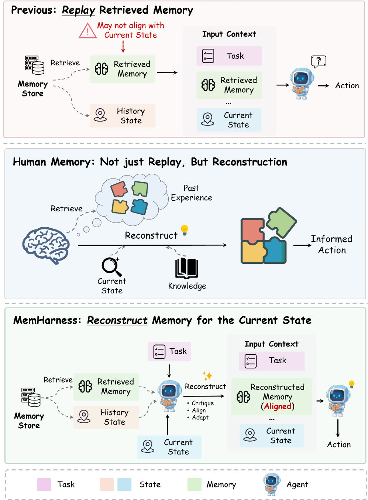
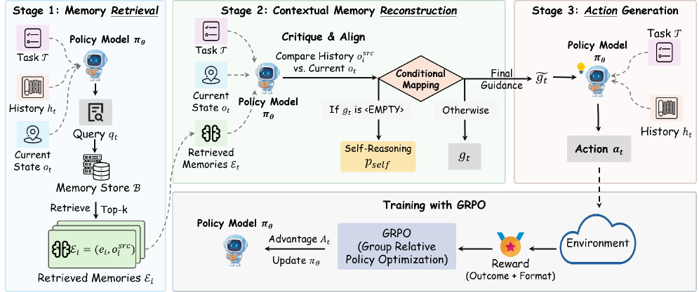
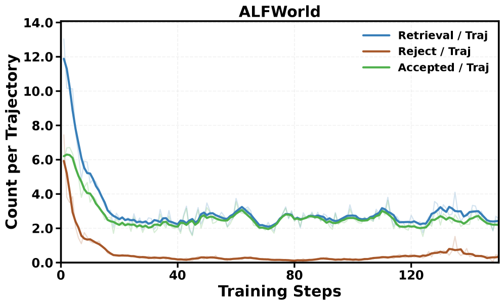
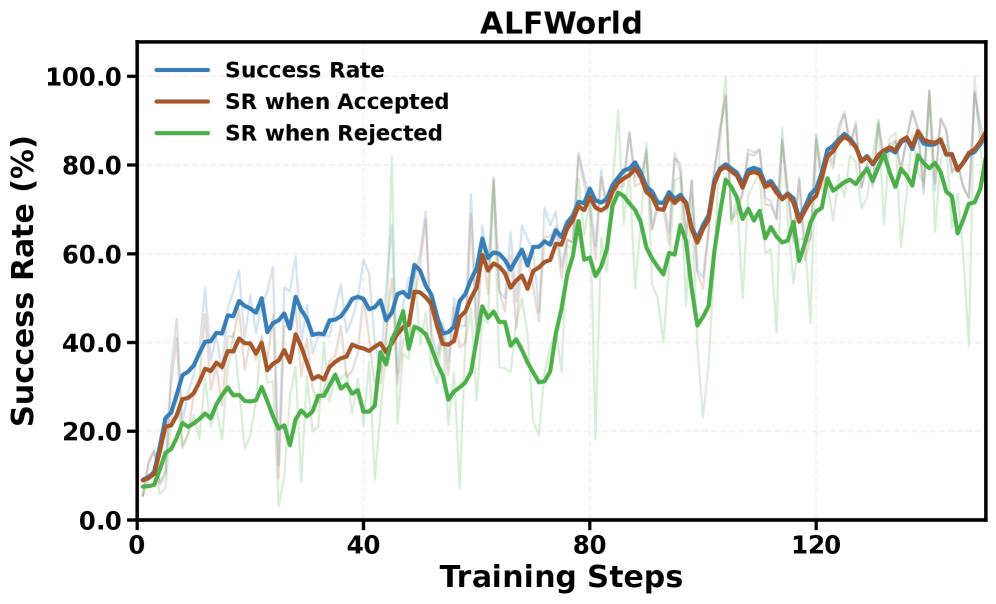

# Paper精读｜MemHarness: Memory Is Reconstructed, Not Replayed

> [!abstract] 一句话结论
> 提出 **MemHarness**，核心动作是换范式：把 LLM agent 的"检索-重放"（retrieve-and-replay）改成**"<span class="mark-strong">检索-评估-重构</span>"**（retrieve-evaluate-reconstruct）——每个决策步，统一策略模型先**批判并重构**检索到的历史经验（把"经验的源状态"与"当前状态"摆在一起对比），生成状态对齐的引导再行动。这种重构能力不是标出来的，是 **GRPO 端到端训练**里自然长出来的：ALFWorld（<span class="mark-number">85.2%</span>）、WebShop（<span class="mark-number">75.6%</span>）双超 GPT-4o/Gemini-2.5-Pro 和一众 RL/记忆基线，OOD 上也稳——**<span class="mark-strong">7B 模型碾压闭源大模型</span>**。

> [!cite]- 论文信息（点开折叠）
> - **论文标题**：MemHarness: Memory Is Reconstructed, Not Replayed
> - **arXiv**：2607.28272
> - **链接**：[https://arxiv.org/abs/2607.28272](https://arxiv.org/abs/2607.28272)
> - **作者**：Rong Wu, Daocheng Fu, Licheng Wen, Xuemeng Yang, Shu Zou, Jianbiao Mei, Yuxin Wang, Hairong Zhang, Yu Yang, Tao Hu, Cong Zhang, Botian Shi, Pinlong Cai (通讯)
> - **机构**：浙江大学 / 上海人工智能实验室 / 复旦大学 / 上海创新研究院 / 上海交大 / 澳大利亚国立大学 / 中国科学技术大学
> - **日期**：2026-07-30
> - **代码**：[https://github.com/KnowledgeXLab/MemHarness](https://github.com/KnowledgeXLab/MemHarness)

---

## 1️⃣ 论文想解决什么问题

给 LLM agent 配记忆已经是常规操作：从过往轨迹里总结经验、复用成功模式。但主流做法一直是 **verbatim replay（逐字重放）范式**——把检索到的轨迹/原则当静态记录，直接插进上下文，从不问它跟当前状态合不合。论文咬住的设计缺陷是**混淆了"检索相关性"与"动作级适用性"**：一条经验语义上再相关，只要它产生于不同的环境条件，对当前状态就可能完全不适用，照搬就是**负迁移**（negative transfer）。

另一条路线（参数化记忆，如把经验内化进权重）能状态条件化地生成行为，但经验和它的影响全藏在权重里，查不了也改不了。中间地带其实一直摆在那儿：**保留显式、可追溯的记忆库，同时按当前状态动态重构它们**。

论文从认知科学给自己找了依据：**人类记忆是重构性的（reconstructive）而非复现性的（reproductive）**——回忆不是调出一份不变的过去记录，而是拿当下的线索和先验知识重新组织、解释检索到的经验。范式转变由此而来：从 retrieve-and-replay 到 retrieve, evaluate, and reconstruct。

---

## 2️⃣ 核心洞察

> [!important] 核心洞察
> 1. **重放错在"状态失配"而非"检索不准"**：传统记忆 agent 的失败点不是检索质量，而是把"语义相关"误当作"当前适用"。经验的抽象/一般性与决策时的具体/易变状态之间存在鸿沟——这个鸿沟只能靠"按状态重构"弥合。
>
> 2. **重构 = 显式记忆与参数化记忆的中间地带**：保留可追溯的记忆库（可检查、可修正），但通过统一策略模型在决策时动态改写——兼得两者的优点。
>
> 3. **重构能力是"涌现"的，不是监督出来的**：重构引导 g_t 没有 ground-truth 标注，被当作隐式推理过程（latent reasoning process），通过 GRPO + 任务级稀疏奖励端到端优化——策略自己学会了何时采用、何时改写、何时拒绝记忆。
>
> 4. **<span class="mark-strong">重构目标本身提升了内在推理能力</span>**：最反直觉的发现是——测试时完全禁用记忆（w/o memory），模型仍优于纯 RL 基线（83.0% vs 76.4%）。重构在训练期当了一把"潜引导"（latent guidance），把 agent 的固有推理能力练强了。



*Figure 1（核心动机图）：三种记忆利用范式。Prior methods 直接重放检索到的记忆，冒状态失配的风险；Human memory 按当前语境重构过去经验；MemHarness 受此启发，把检索记忆重构为状态对齐的引导。*

---

## 3️⃣ 方法解读

### 组件1：问题形式化——POMDP + 经验记忆库

- 决策建模为 **POMDP** M=(S,A,O,P,R)，策略 π_θ 在部分可观测条件下依赖最近 w 步的历史窗口 h_t=(o_{t-w+1}, a_{t-w+1}, …, o_t)，目标是最大化期望回合回报

- 维护经验记忆库 **B={m_i}**，每条 m_i=(e_i, o_i^src) 包含**抽象策略 e_i** 和**其源观测 o_i^src**——源观测是重构的关键，它让模型能比较"历史状态"与"当前状态"

- 检索器 R 按上下文查询 q_t 返回 top-k 条目 E_t=R(q_t,B)，|E_t|=k（实验用 k=3，BGE-M3 嵌入）

- 记忆库在 RL 训练中**从空开始渐进填充**：策略自己把交互轨迹蒸馏成自然语言经验，并做语义去重、效用跟踪、定期剪枝

### 组件2：从重放到重构——两阶段生成

**重放范式**（baseline）：a_t ~ π_θ(·|T, h_t, E_t)——检索结果直接进动作上下文。

**MemHarness 范式**（Eq. 2）：

```
g_t ~ π_θ(·|T, h_t, E_t)        # 第一步：重构（critique + rewrite）
g̃_t = f(g_t)                     # 后处理：<EMPTY> 时回退到自我推理 p_self
a_t ~ π_θ(·|T, h_t, g̃_t)        # 第二步：用重构后的引导生成动作
```

- 关键：重构与动作生成**共享同一个策略 π_θ**，不引入额外模块

- 重构上下文 x_recon = T ⊕ h_t ⊕ ⋃(e_i, o_i^src)——通过比较每个源观测与当前 h_t，策略识别状态漂移，**保留、修订或拒绝**检索到的经验

### 组件3：三阶段推理管线（Figure 2）

1. **检索（Retrieval）**：策略基于 h_t 决定是否查询记忆库；触发则返回 E_t

2. **上下文记忆重构（Reconstruction）**：策略批判 E_t 与 h_t 的匹配度，生成状态特定引导 g_t——适用知识保留，错位内容丢弃或改写；无适用记忆则输出 <EMPTY> 回退自我推理

3. **动作生成（Action Generation）**：同一策略基于 h_t 和 g̃_t 生成可执行动作

### 组件4：GRPO 端到端训练

- 引导 g_t 是无标注隐变量 → 用 RL 优化 retrieve-reconstruct-act 全管线，GRPO 从组采样估计优势，无需价值网络

- **奖励设计**：R(τ_i) = R_outcome + 0.1 × R_format

  - R_outcome：稀疏任务奖励（失败 0，成功 10）

  - R_format ∈ [0,1]：三标准等权——① 每步恰好一个 <think> 和一个 <action> 块；② 记忆检索频率适中（每集 1-5 次 <retrieve_memory>）；③ 严格英文输出

- 格式奖励刻意"轻"（0.1 权重）：鼓励 agentic 协议（先推理、必要时检索、单动作/步）但不压倒主任务目标

- **冷启动**：遵循 DeepSeek-R1/EvolveR 做法——200 条多轮交互轨迹（含 CoT 与主动检索）+ 200 条轨迹→记忆的 QA 示例，先对齐交互与记忆抽象格式，再 GRPO 优化



*Figure 2（方法总览）：推理管线三个阶段——(1) Memory Retrieval：策略生成查询获取相关经验；(2) Contextual Memory Reconstruction：比较记忆源状态与当前状态，重构适配引导（记忆不适用则回退自我推理）；(3) Action Generation：基于重构记忆生成动作。*

---

## 4️⃣ 实验部分怎么读

### 实验设置

- **基准**：ALFWorld（具身家务任务，6 类：Pick/Look/Clean/Heat/Cool/Pick2）与 WebShop（目标导向在线购物）

- **指标**：任务成功率（SR）+ WebShop 平均得分

- **基线**：闭源 LLM（GPT-4o、Gemini-2.5-Pro）、提示/记忆 agent（ReAct、Reflexion、Mem0、ExpeL、MemP、SimpleMem）、RL agent（RLOO、GRPO、MemRL、EvolveR、Mem0+GRPO、SimpleMem+GRPO）

- **实现**：Qwen2.5-7B-Instruct 为策略主干，verl-agent 框架；公平对比（同主干、w=3 历史窗口、同交互预算、同优化配置）

### 核心结果

**主结果（Table 1）——7B 碾压闭源大模型**

| **方法** | **ALFWorld Avg SR** | **WebShop Score** | **WebShop SR** |
| --- | --- | --- | --- |
| GPT-4o | 49.2 | 31.8 | 23.7 |
| Gemini-2.5-Pro | 62.1 | 42.5 | 35.9 |
| Qwen2.5-7B（基座） | 14.5 | 26.4 | 7.8 |
| ReAct / Reflexion | 27.9 / 39.9 | 46.2 / 58.1 | 19.5 / 28.8 |
| GRPO（纯 RL） | 76.4 | 79.3 | 66.1 |
| EvolveR（重放式记忆 RL） | 70.1 | 84.1 | 72.6 |
| **MemHarness** | **85.2** | **87.4** | **75.6** |

- **关键解读**：① 7B 的 MemHarness 比 Gemini-2.5-Pro 高 +23.1%（ALFWorld）/ +39.7%（WebShop SR）——规模劣势被记忆重构范式弥补；② 比纯 GRPO 高 +8.8%/+9.5%——纯 RL 已很强，记忆重构是"锦上添花"而非替代；③ **<span class="mark-strong">朴素 RL+记忆组合反而退化</span>**（Mem0+GRPO 52.0、SimpleMem+GRPO 54.5，都远低于纯 GRPO 76.4）——直接重放记忆在 RL 训练下会污染策略，而 MemHarness 的重构机制正是为此设计

**消融（Table 2）——每个组件都有明确贡献**

- **RL 必要性**：冷启动模型仅 7.6%（ALFWorld）——格式对齐不等于决策能力，RL 才是核心

- **Raw Memory 引入噪声**："RL + Raw Memory"（无重构）伤害性能——证实逐字重放引入状态失配噪声

- **内在策略提升**："w/o memory"（测试时禁用记忆）仍有 83.0% vs RL Only 76.4%——**重构目标在训练期作为潜引导提升了模型固有推理**

- **策略内重构必要性**：用通用指令微调 LLM 替换内部重构模块（actor 不变）→ 85.2% 降至 77.7%——零样本的文本改写不够用，跟环境动态对上号的重构得靠端到端 RL 学出来

### OOD 泛化（4.4，Table 3）——记忆在未知环境是双刃剑

- ALFWorld OOD（房间布局与物体放置训练时未见）：MemHarness 85.9%，比 RL+Raw Memory 的 76.3% 高出近 10 个百分点

- 关键对比：w/o memory 83.0% vs w/o reconstruction 82.4%——**<span class="mark-strong">注入未适配记忆（无重构）反而比不用记忆更差</span>**，逐字重放在 OOD 环境引入噪声；MemHarness 通过动态过滤与改写错配引导，安全利用经验达成最优

### 机制深潜（4.5，Table 4）——重构真的在"比较状态"吗？

- **源状态消融**：正确源状态 85.2% > 随机源 84.3% > 无源 80.0%（ALFWorld）——源观测确实是重构的信息基础

- **反事实探测**（构造 match s⁺ / edit s⁻ 状态对）：

  - ALFWorld：s⁺ 时 46.0% 输出不变、53.4% 适配；s⁻ 时不变降至 37.3%、拒绝升至 6.4%

  - WebShop：s⁻ 时适配下降、拒绝上升（72.1%→78.8%）

  - **结论**：重构对细粒度状态变化有真实响应——不是"装样子"的记忆注入，而是真正感知状态漂移后调整输出

### 训练动态（4.6，Figure 3/4）——记忆利用行为自适应演化

- Figure 3：RL 训练中每轨迹的平均检索数、接受重构数、拒绝重构数随训练演变——模型学到何时检索、何时采纳、何时拒绝

- Figure 4：按记忆决策条件化的成功率动态——"SR when Accepted/Rejected"揭示接受/拒绝重构与任务成功的相关性



*Figure 3(a)（ALFWorld）：RL 训练过程中记忆使用行为演变——曲线显示每轨迹的平均记忆检索次数、接受重构次数、拒绝重构次数；模型自适应地学会"何时该用记忆、何时该拒绝"。*



*Figure 4(a)（ALFWorld）：训练动态——"SR when Accepted/Rejected"表示包含至少一次接受/拒绝记忆重构的轨迹的成功率，揭示记忆决策与任务成功的相关性。*

---

## 5️⃣ 学术评价

**优点：**

1. **范式级贡献**：从认知科学（重构性记忆）出发，把记忆 agent 从"检索-重放"推进到"检索-评估-重构"——不是加一个模块，而是重新定义了记忆与决策的交互方式。这个"中间地带"（显式记忆 + 动态重构）卡位卡得准：两头的好处都想要、两头的毛病都想躲。

2. **最反直觉的发现最有价值**："w/o memory 仍优于纯 RL"（83.0% vs 76.4%）说明重构目标在训练期是高质量潜引导，**把 agent 的内在推理练强了**——部署时就算记忆库不可用，训练收益也还在。这个发现让方法跳出了"记忆系统"的定位。

3. **端到端简洁性**：重构与动作生成共享统一策略，无额外模块、无监督标注，仅靠 GRPO + 稀疏任务奖励就把"批判-改写-拒绝"这套能力长出来——工程上省到近乎偷懒。

4. **反事实探测是我最欣赏的实验设计**：用构造的 match/edit 状态对验证重构确实感知状态变化（而非记忆注入的形式主义），并做源状态消融——对"机制是不是真在工作"给出了正面证据。

5. **OOD 论证闭环了**：先摆明"记忆在 OOD 是双刃剑"（w/o reconstruction < w/o memory），再证明重构机制恰好化解这个矛盾。

> [!ed-warning] 局限（风险与不确定性）
> 先替作者说句公道话：要验证"按状态重构"这个机制，就得挑状态结构化、能构造反事实状态对的环境，ALFWorld/WebShop 是现成的选择。但公道话归公道话，框框也确实小了：
> 1. **环境规模有限**：仅 ALFWorld 和 WebShop 两个合成/半合成环境，都是文本交互、状态变化相对结构化；真实开放环境（长程任务、非结构化状态）的有效性未验证。
>
> 2. **记忆库的冷启动问题**：记忆从空开始由策略自身蒸馏填充——早期 RL 阶段策略能力弱，蒸馏出的记忆质量低，是否存在"低质量记忆 → 错误引导 → 策略恶化"的恶性循环？论文未分析记忆质量的时间演化。
>
> 3. **重构的语义黑盒**：虽然反事实探测证明重构响应状态变化，但"模型内部到底如何决定保留/改写/拒绝"仍是黑盒——没有分析重构文本与最终动作的因果链条。
>
> 4. **7B 规模的锚定**：所有实验在 Qwen2.5-7B；更大模型（或更小的 1.5B）上重构能力是否涌现、收益是否缩放，未做规模消融。
>
> 5. **检索依赖外部嵌入**：BGE-M3 检索器是冻结的外部组件——检索质量上限可能限制重构输入质量，端到端联合优化检索器未探索。

---

## 6️⃣ 局限与可扩展方向

- **更大规模与开放环境**：作者声明将探索更大模型与开放环境——重构范式在长程真实任务（如 Web 自动化、机器人操作）里成不成立，是最该回答的问题

- **检索器与策略的联合优化**：检索器目前冻结，若把"检索什么"也纳入 RL 可学，可能进一步提升

- **记忆质量的显式管理**：如何在 RL 训练中监控/保证记忆库质量，避免低质量经验的污染与放大

- **重构的可解释性**：把"为什么拒绝/改写这条记忆"显式输出，构建可审计的决策链

- **与其他 RL 范式的结合**：重构目标作为潜引导的性质，与隐式推理（CoT）、世界模型学习的结合

- **多模态/具身场景**：状态比较在视觉状态（机器人）下如何实现——源状态与当前状态的对比需要视觉理解

---

## 与其他论文的对话

| **相关工作** | **关系** | **差异** |
| --- | --- | --- |
| **Reflexion (Shinn et al. 2023)** | 用自然语言反馈改进 agent | Reflexion 是自我反思，无显式记忆库；MemHarness 是外部记忆 + 状态条件重构 |
| **ExpeL (Zhao et al. 2024)** | 从轨迹提炼经验再利用 | ExpeL 偏向重放抽象经验；MemHarness 强调按当前状态批判改写 |
| **Mem0 / SimpleMem** | 记忆系统 + RL 结合 | 论文实验显示 Mem0+GRPO、SimpleMem+GRPO 严重退化（52.0/54.5 vs GRPO 76.4）——"重放"与 RL 不兼容，重构是解药 |
| **EvolveR (Wu et al. 2025)** | 记忆蒸馏 + 演化，与 MemHarness 同源 | EvolveR 70.1 低于 MemHarness 85.2——记忆蒸馏之外，"按状态重构"是关键增量 |
| **GRPO (DeepSeek 2025)** | 训练范式基础 | MemHarness 证明 GRPO 可端到端训练"重构"这类隐式推理步骤（无监督标注） |
| **认知科学重构性记忆 (Bartlett)** | 理论基础 | 人类记忆重构性（reconstructive memory）是论文范式转变的直接灵感来源 |

---

## 7️⃣ 最后总结

MemHarness 的核心贡献是给记忆增强 agent 换了一个心智模型：**<span class="mark-strong">记忆不是档案，而是原材料</span>**——检索到的经验必须经过"按当前状态评估与重构"才能指导行动。技术上，它证明了无监督标注的隐式重构步骤可以纯粹靠 GRPO 端到端长出来；而我读完印象最深的还是那个反直觉发现——重构目标把模型的内在推理练强了，测试时不用记忆也赢纯 RL（83.0% vs 76.4%）。局限同样清楚：环境规模有限、记忆质量演化没分析、重构机制还是黑盒。往大了说，"retrieve, evaluate, reconstruct" 有机会成为记忆增强 agent 的标准范式，位置类似 ReAct 之于推理-行动循环——这话得等更多环境验证后才敢说死。对实践者一句实在话：你的 agent 配了记忆却不见涨分，先别急着换检索器，缺的可能是**那个按状态批判记忆的中间层**。

---

## 8️⃣ 三句速记

> [!summary]- 点开展开
> 1. **记忆不是重放，是重构**：检索到的经验必须按当前状态批判改写后才可用——"语义相关"≠"当前适用"。
>
> 2. **重构能力靠 GRPO 涌现**：无标注的隐式重构步骤用任务级稀疏奖励端到端训练，策略自己学会"保留/改写/拒绝"记忆。
>
> 3. **重构提升内在推理**：测试时禁用记忆仍优于纯 RL（83.0% vs 76.4%）——重构目标作为潜引导，把 agent 的固有推理能力练强了。
