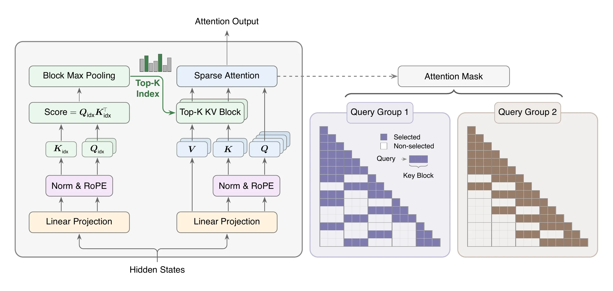
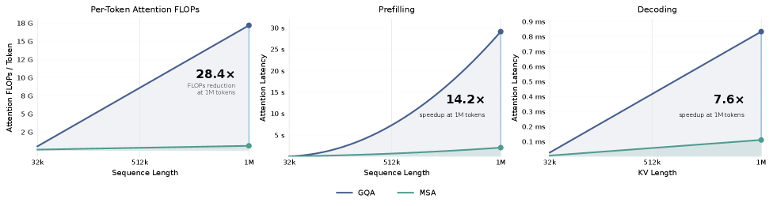
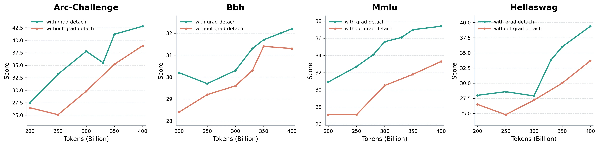
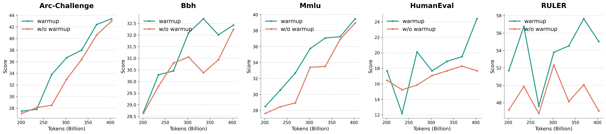
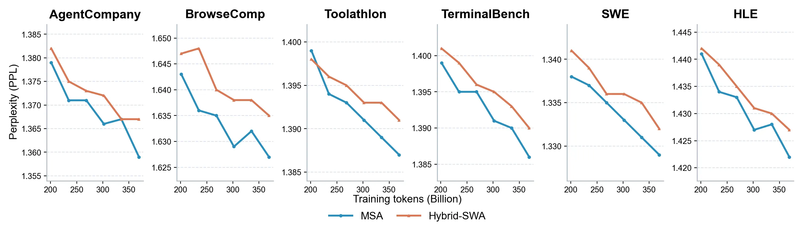

# Paper精读｜MiniMax Sparse Attention

> [!abstract] 一句话结论
> MSA 在 **GQA 架构**上实现块级稀疏注意力，通过轻量 **Index Branch** 为每个 GQA 组独立检索 Top-16 个 KV 块，将百万级上下文的 attention 计算量压缩 **28.4×**，配合定制 GPU kernel 在 H800 上实现 **14.2× prefill** 和 **7.6× decoding** 的实际墙钟加速，已在 **109B 参数**原生多模态模型 MiniMax-M3 上生产部署。

> [!cite]- 论文信息（点开折叠）
> - **论文标题**：MiniMax Sparse Attention
> - **arXiv**：2606.13392
> - **链接**：[https://arxiv.org/abs/2606.13392](https://arxiv.org/abs/2606.13392)
> - **作者**：Xunhao Lai, Weiqi Xu, Yufeng Yang, Qiaorui Chen, Yang Xu, Lunbin Zeng, Xiaolong Li, Haohai Sun, Haichao Zhu, Vito Zhang, Pengyu Zhao
> - **机构**：MiniMax / Peking University / NVIDIA / Zhejiang University / Huazhong University of Science and Technology
> - **日期**：2026-06-11

---

## 1️⃣ 论文想解决什么问题

超长上下文能力已成为前沿 LLM 的刚需——Agent 工作流、仓库级代码推理、持久化记忆都需要模型同时关注数十万到数百万 token。但 softmax attention 的 O(N²) 计算成本使其在部署规模上完全不可持续。

已有的稀疏注意力方案各有痛点：固定模式（Sliding Window、BigBird）缺乏适应性，检索型稀疏注意力（如 InfLLM、Quest）在需要端到端训练和大规模部署时不够简洁高效，且难以兼容已有的 GQA 预训练检查点。

> [!ed-quote] 核心问题
> 论文的核心问题是：如何设计一种**最小化、可扩展、且能从预训练 GQA 检查点近乎无损转换**的块级稀疏注意力机制，使其既能训到底、又能跑得快？

---

## 2️⃣ 核心洞察

> [!important] 三条核心洞察
> 1. 轻量级索引头 + GQA 组独立选择：Index Branch 仅引入两个投影矩阵（一个共享 key 头 + 每 GQA 组一个 query 头），以极低的参数和计算开销实现组特定的稀疏检索，同时保持块级执行的高效性。
>
> 2. 训练技巧四件套保障训练稳定性：KL 散度对齐 Index 与 Main Branch 分布、梯度截断防止 Index 梯度干扰 Main、Indexer Warmup 先训索引再联合训练、始终保留 local block 防止信息丢失——这些设计让 MSA 能从零训起或从预训练权重转换。
>
> 3. **稀疏不等于加速，GPU 协同设计是关键**：理论 FLOPs 减少不代表墙钟加速。MSA 的定制 kernel（exp-free TopK、KV-outer 稀疏 attention、pre-scheduled tile chunking、LSE fusion）专为 GPU tensor core 利用率设计，将稀疏性转化为实实在在的吞吐提升。

---

## 3️⃣ 方法解读

### 组件1：Index Branch（索引分支）

- 引入一个共享的 index key 头（W_k_idx）和每 GQA 组一个 index query 头（W_q_idx），总参数量远小于主注意力头

- 对每个 query token 和 GQA 组，计算 token 级注意力分数后汇聚到块级，独立选择 Top-16 个 KV 块

- 始终保留 **local block**（当前 query 所在块），形成"滑动窗口 + 稀疏"的混合模式

- 使用 **exp-free TopK** 选择（直接取 logits 前 k 大，避免 softmax 归一化），减少 kernel 计算量

### 组件2：Main Branch（主分支）

- 仅对 Index Branch 选中的块执行精确的 **block-sparse softmax attention**

- 使用 **KV-outer 稀疏注意力**，在块粒度下利用 KV-outer 约简避免冗余数据搬运

- 每个 query 最多关注 k×B_k = 16×128 = **2048 token**，与序列长度 N 无关

### 架构总览

- 左侧为 Index Branch：对每个 query token，用一个轻量级打分头计算所有因果可见 KV 块的分数，取 Top-16 个块（图中绿色部分），同时始终保留 local block（浅蓝色）

- 右侧为 Main Branch：只对选中的 KV 块做精确的 softmax attention，大幅减少 FLOPs

- 训练时用 KL Loss 对齐 Index Branch 的选择分布与 Main Branch 的 attention 分布（图中虚线表示 KL 散度计算路径）

### 组件3：训练策略

- KL Loss：最小化 Index Branch 的 block 选择分布与 Main Branch 的 group-averaged attention 分布之间的 KL 散度

- Gradient Detach：Index Branch 的梯度不流入 Main Branch，避免索引噪声干扰主分支训练

- Indexer Warmup：前 10% 训练步数单独训练 indexer（冻结 Main Branch），建立索引能力后再联合训练

- Local Block：始终保留当前 query 所在 block，保证局部上下文的完整性

### 组件4：GPU Kernel 协同设计

- Exp-free TopK：per-thread register TopK 替代 softmax + argsort，减少 shared memory 和 warp 同步

- Pre-scheduled tile chunking：kernel 启动前预计算 tile 划分，避免运行时动态调度开销

- Two-phase forward：先做 phase-1（统计值计算），再做 phase-2（attention 输出），严格在线 softmax

- Query concatenation：同 GQA 组内的 query 头合并计算，提高 tensor core 利用率

- Sparse KL Loss：LSE fusion + dynamic load balancing 处理各 GQA 组选中块数不一致问题

---

## 4️⃣ 实验部分怎么读

### 实验设置

| **配置** | **参数** |
| --- | --- |
| 模型 | 109B MoE（6B 激活/token），41 层，128 路由专家 + 1 共享专家，Top-4 路由 |
| 注意力 | 64 query heads / 4 KV heads (G=16), head dim=128, RoPE dim=64 |
| MSA 参数 | B_k=128, k=16（每 query 选 16 个块，每块 128 token） |
| 训练数据 | 3T token，原生多模态（文本 + 图像 + 视频） |
| GPU | H800 |

### 核心结果

| **指标** | **Full Attention (GQA)** | **MSA** | **提升** |
| --- | --- | --- | --- |
| Benchmark 质量 | 基线 | 持平 | 未见掉分 |
| 1M context 计算量 | O(N²) | O(NkB_k) | **28.4× 减少** |
| Prefill 墙钟 (H800) | 基线 | 14.2× 加速 | **14.2×** |
| Decoding 墙钟 (H800) | 基线 | 7.6× 加速 | **7.6×** |

- 左图（Prefill）：随着上下文长度从 128K 增加到 1M，GQA 延迟呈二次方增长，MSA 延迟增长极为平缓，差距持续扩大

- 右图（Decoding）：同样趋势，各上下文长度下 MSA 的延迟都压在 GQA 下面

- 注意：纵轴为对数尺度，实际加速比随上下文长度增加而持续增大

- 横轴为不同 benchmark 任务，纵轴为得分

- MSA-PT（橙色条）和 MSA-CPT（绿色条）与 Full Attention 基线（蓝色条）高度接近

- 四种 benchmark 覆盖不同能力维度，MSA 的条形和基线在图上几乎重合

### 训练动态

- 蓝色曲线：有 Indexer Warmup 的训练轨迹，收敛更快、更稳定

- 红色/橙色曲线：无 Warmup 的训练轨迹，收敛较慢或不稳定

- 有无 Warmup 的差距直接摆在曲线上——这一步不是锦上添花的可选项

### 消融实验

- 横轴为上下文长度，纵轴为 Perplexity（越低越好）

- 蓝色曲线：MSA，在不同上下文长度下 perplexity 均更低

- 橙色曲线：FLOP-matched 滑动窗口基线，perplexity 始终高于 MSA

- 说明MSA 的自适应稀疏选择（非固定窗口）不是白付的复杂度——同等 FLOPs 下，会挑块的压过了固定窗口

---

## 5️⃣ 学术评价

**优点：**

1. 极简设计：仅增加两个投影矩阵，与 GQA 自然兼容，可从预训练 checkpoint 直接转换

2. 工程落地完整：从训练到推理、从 H800 到各代 GPU，全链路优化，已在生产 109B 模型上验证

3. 训练技巧系统化：KL Loss + Gradient Detach + Indexer Warmup + Local Block 四件套保障质量无损

4. GPU 协同设计扎实：不仅是理论稀疏化，而是从 GPU 执行角度重新设计 kernel，有真实加速数字

> [!ed-warning] 局限（风险与不确定性）
> 先说处境：既要端到端可训，又要能从现成 GQA 检查点近乎无损转换，索引分支带来的额外训练复杂度是 MSA 为「可转换」付的价钱，我理解它为什么长成这样。但账还是要算：
> 1. 需要块级稀疏索引训练，增加额外训练复杂度（warmup、KL loss 调参）
>
> 2. 极端长上下文下块级选择可能不够精确
>
> 3. 依赖 GQA 架构，不适用于 MHA-only 模型

---

## 6️⃣ 局限与可扩展方向

- 动态 k 选择：能否根据 query 复杂度或上下文密度动态调整选中块数？

- 超稀疏场景：k 更低时（如 k=4）能否保持质量？

- 块大小自适应：短文本下 B_k=128 可能过粗

- 与其他稀疏策略结合：MSA 的 Index Branch 能否与全局 token、更大滑动窗口协同？

---

## 7️⃣ 最后总结

MSA 给我的印象是设计极简、真跑进了生产的稀疏注意力方案：GQA 框架里加一对轻量索引头做块级稀疏检索，四件套训练技巧把质量稳住，定制 kernel 把省下的 FLOPs 兑换成墙钟。稀疏注意力这条线，论文里省 FLOPs 的多，把 FLOPs 换成生产环境实测加速的少——MSA 属于后者，在 109B 多模态模型上交出 **14.2× prefill / 7.6× decoding** 且质量不掉。对要部署百万级上下文的人，这是少数能直接落地的方案。

---

## 8️⃣ 三句速记

> [!summary]- 点开展开
> 1. MSA 用轻量 Index Branch 为每个 GQA 组独立选择 Top-16 KV 块 → attention 计算压缩 28.4×。
>
> 2. 四件套训练技巧（KL Loss + Gradient Detach + Warmup + Local Block）保障训练稳定与质量无损。
>
> 3. 定制 GPU kernel 实现真实墙钟加速：1M context 下 prefill **14.2×**、decoding **7.6×**，109B 模型已部署。
