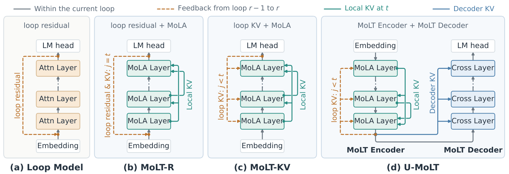
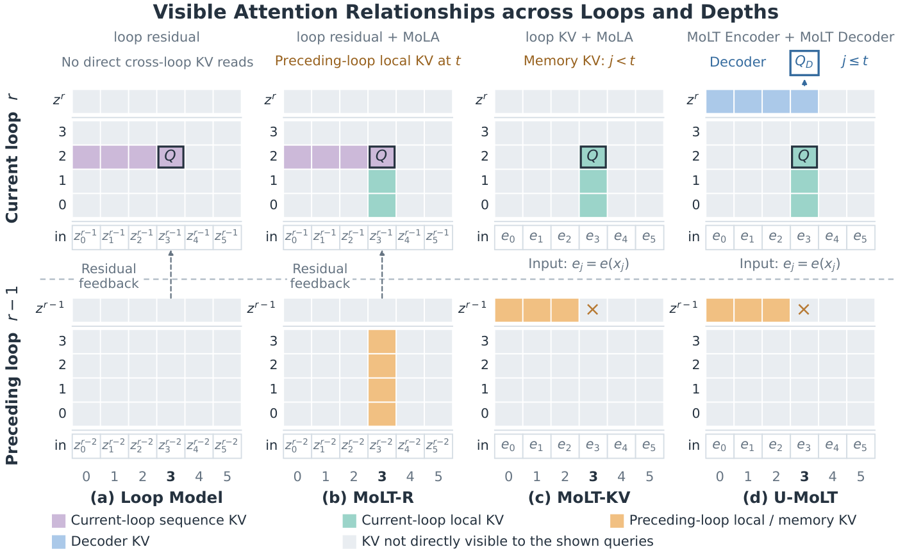
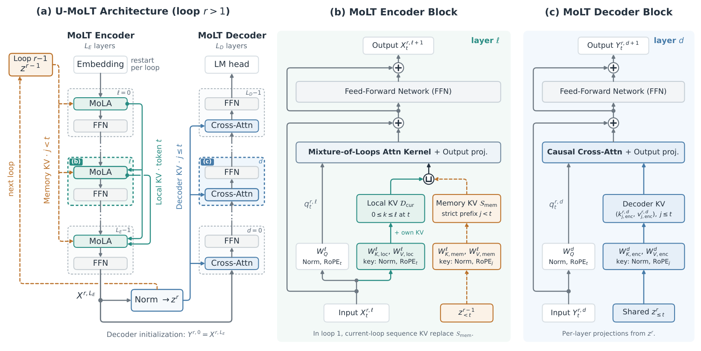
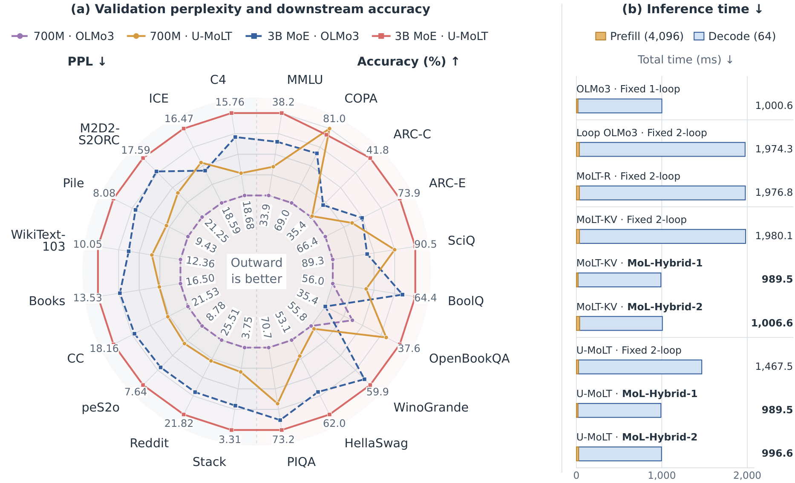
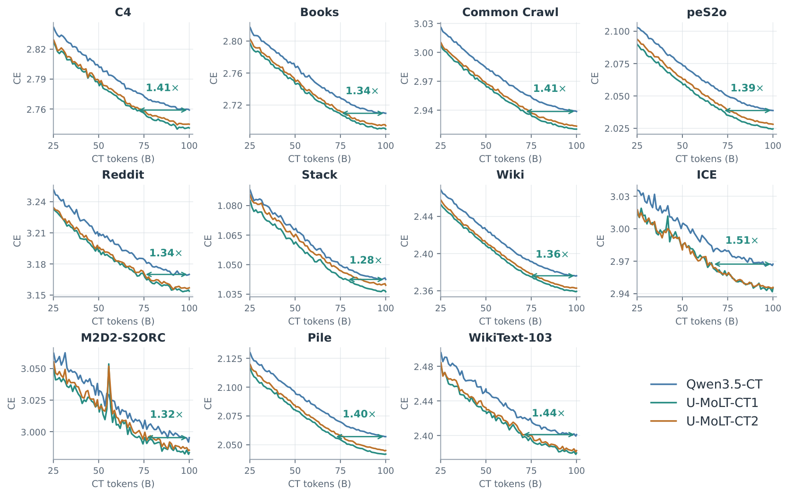

# Paper精读｜Mixture-of-Loops Transformer

> [!abstract] 一句话结论
> 把循环 Transformer（looped Transformer）跨 loop 传递的东西从残差流换成 **KV 记忆**：MoLA 用一个注意力分布同时读序列 KV 和深度 KV；loop KV 范式靠嵌入重启 + 严格前缀记忆拔掉同位置跨 loop 依赖，解锁每个 token 只跑一遍的 MoL 解码；U-MoLT 再把记忆构建和预测读出拆开。400B token 预训练里 U-MoLT 在 700M/1.5B dense 和 3B MoE 上全面压过 OLMo3（700M 达 1.7× token 效率，3B MoE 十域困惑度 −0.75、十任务准确率 +2.1pp），代价是训练 FLOPs 翻倍；推理端 MoL-Hybrid-2 在 S-size 上 996.6 ms 匹配非循环 OLMo3 的 1000.6 ms。

> [!cite]- 论文信息（点开折叠）
> - 论文标题：Mixture-of-Loops Transformer
> - arXiv：[2611.34923](https://arxiv.org/abs/2611.34923)（v1，2026-11-25，cs.LG）
> - 作者：Lianghui Zhu, Shijie Wang, Xinggang Wang, Jinze Bai, Bo Wang, Xiang Bai
> - 机构：华中科技大学 / ByteDance Seed / University of Toronto
> - 代码：github.com/hustvl/MoLT
> - 阅读范围：LaTeX 源码全文（正文 §1–§5 + 附录 A/B/C），arXiv HTML 不可用，无来源缺口
> - 论文类型：方法/实验论文（新架构族 + 训练范式 + 解码调度 + 理论分析）

---

## 1️⃣ 论文想解决什么问题

这一节要回答：循环 Transformer 的效率税到底交在哪个环节，以及为什么现有修补绕不过去。

**循环 Transformer（looped Transformer）**——同一份权重沿深度反复执行 $N$ 次，每执行一次叫一个 loop，第一个之后的叫反馈循环（feedback loop）——用参数量两倍的深度换表达力，Huginn、Ouro、SMELL 这批工作已经把它推到正经预训练规模。标准接口是**环间残差（loop residual）**：上一个 loop 的最终状态原样传给下一个 loop 当输入。这个看似无害的选择卡死两件事。其一，一个 loop 的全部中间表示被反复压进一条残差流，层与层、loop 与 loop 之间只有这一个窄通道，信息稀释随深度累积。其二，token $t$ 的第 $r$ 个 loop 依赖它自己的第 $r-1$ 个 loop 输出——同位置跨 loop 依赖把 $N$ 个 loop 串成必经的顺序链，解码每生成一个 token 都要把整栈跑 $N$ 遍。实测（Tab. 7：S-size 113M、4096-token prompt + 64 步解码、单卡 H20）：非循环 OLMo3 总时 1000.6 ms，固定 2-loop 直接翻到 1974.3 ms。

全文有一个贯穿的参照点，跟着它走会轻松很多：Figure 3 里那个黑框 query $Q$，钉在 loop $r>2$、第 2 层、token $t=3$ 的位置。在 Loop Model 里它能看到的只有当前 loop 第 2 层在 $j\leq 3$ 的序列 KV；上一个 loop 的 12 层中间表示全部被蒸馏成 $z^{r-1}_3$ 一个向量，从入口塞进残差流。想直接引用上上个 loop 第 9 层算出的某个中间特征？没有通道。后面每一节都用这个 $Q$ 的可见范围变化来对照各组件干了什么。

已有修补都在残差框架内打转：LPT 给每层配 first-loop KV cache 加滑动窗，PLT 用 shifted states 让不同位置的 loop 重叠执行，LoopFold 把多个 loop 深度批在一起再加 corrector 修正——全都默认"每 token 要执行或重叠 $N$ 个 loop"，只是想办法让这 $N$ 遍更便宜。作者把问题换了个轴：跨 loop 到底该传什么？

---

## 2️⃣ 核心洞察

Figure 1 是全家族的施工图：从 (a) Loop Model 到 (b) MoLT-R、(c) MoLT-KV、(d) U-MoLT，每一步换的都是跨 loop 的传递物。

*图注：Figure 1——MoLT 家族。(a) 残差反馈的 Loop Model；(b) MoLT-R 在残差之外保留各层 local KV 供跨层/跨 loop 直读；(c) MoLT-KV 从嵌入重启、只读严格前缀记忆 KV；(d) U-MoLT 把 loop KV 编码器与 cross-only 解码器配对。橙色虚线 = 跨 loop 反馈，青色 = 当前 token 的 local KV，蓝色 = decoder KV。*

*图注：Figure 3——四种结构下 $Q$（loop $r>2$、第 2 层、token 3）能直接读到的 KV 网格。浅灰 = 不可见；橙色 × = MoLT-KV 里 token 3 被严格前缀排除在记忆之外；蓝色 = U-MoLT decoder 的因果读出范围 $j\leq t$。*

> [!important] 三条核心洞察
> 1. **传 KV，不传状态。** KV 天生可拼接、可掩码、可被 softmax 选择性复用——"记什么、忘什么"从架构决定降级成注意力的运行时决定。对应 Tab. 2 消融：深度源从无到 cur. layer 到 X layer 到 X loop 每扩一级 CE 都在降（3.310 → 3.296 → 3.291 → 3.286，sparse MoLT-KV）。
> 2. **同位置依赖才是解码税的根，loop 本身不是。** 嵌入重启 + 严格前缀记忆（$j<t$）让每个反馈 loop 变成严格三角递归 $z^r_t=F_t(x_t,z^{r-1}_{<t})$，Prop. 1 证明 token $t$ 在 $r\geq t+2$ 稳定且不需要任何收缩假设。于是"每 token 跑 $N$ 遍"被"每 token 跑一遍、记忆沿 token 递归"替换——对应实验 Tab. 6，单遍 MoL 与固定 2-loop 的 ΔCE 全部落在 ±0.0014 内。
> 3. **预测和记忆是对立的两种角色。** 深层既要为预测塌向下一 token 分布，又要当未来 token 的干净记忆源。U-MoLT 物理隔离这两个职责，decoder 不进反馈路径——Prop. 3 保证未用 decoder 遍历可整段省略而预测不变。对应 Tab. 2 里 re-proj 一致优于 self 0.014–0.021。

> [!ed-quote] 我认为全文最硬的一步
> Prop. 1–3 加两个 Corollary 把"单遍解码算出的就是多 loop 稳定解"做成了构造性结论：严格三角依赖图让稳定解沿 token 序唯一存在、$t+2$ 轮内收敛，一行归纳法完事，不借助 LCKV 那种只对 top-layer 反馈成立的特殊结构，也不用 LoopFold 式的 corrector 去修补误差——它证明根本没有误差（确定性贪心下）。

---

## 3️⃣ 方法解读

先把符号立好：loop 编号 $r\geq 1$，层编号 $\ell\in\{0,\ldots,L-1\}$（层内参数互不相同、跨 loop 共享），$X^{r,\ell}$ 是进入第 $\ell$ 层的残差流，$z^r$ 是归一化的 loop 输出，$e(x_t)$ 是 token 嵌入。反馈接口决定每个 loop 保留什么、下一个 loop 怎么接收——两个变体的全部差异都在接口上。

### 组件 1：MoLT-R——残差反馈 + 可直读的中间 KV

**是什么。** 标准 loop residual 之上，把每层的 local KV 留下来供后续直读。序列源 $\mathcal S_X$ 是当前层输入 $X_j^{r,\ell}$（$j\leq t$）的本地投影；深度源分两堆——$\mathcal D_{\mathrm{cur}}^{<\ell}$ 是当前 loop 更早层（$k<\ell$）在 $t$ 处的 local KV，$\mathcal D_{\mathrm{prev}}$ 是上一 loop 全部 $L$ 层在 $t$ 处的 local KV，保留原投影不重投影（上一 loop 已算完，writer 可以比当前 reader 深）。

**为什么需要。** 残差流是唯一通道时中间表示必然被压缩，反事实直接写在 Tab. 2 里：同为 2-loop、不加深度源的 method (2) CE 3.299，加 X layer 到 3.293，加 X loop 到 **3.284**——一个参数不加，纯靠"可读"每步都赚。$Q$ 的可见范围从"当前 loop 同层"扩到"当前 loop 更早层 + 上一 loop 全部 12 层"（Figure 3(b) 的绿格加橙格）。

**怎么做。** 边界条件：loop 1 从 $e(x_t)$ 起，之后各 loop 从 $z^{r-1}_t$ 起（式 1）：

$$X^{r,0}_t=\begin{cases}e(x_t),&r=1\\ z^{r-1}_t,&r>1,\end{cases}\qquad \widehat X^{r,\ell}_t=X^{r,\ell}_t+\mathrm{MoLA}_\ell\!\left(X^{r,\ell}_t,\mathcal S_X,\mathcal D_{\mathrm{cur}}^{<\ell}\sqcup\mathcal D_{\mathrm{prev}}\right)$$

$$X^{r,\ell+1}_t=\widehat X^{r,\ell}_t+\mathrm{FFN}_\ell\!\left(\widehat X^{r,\ell}_t\right),\qquad z^r=\mathrm{Norm}\!\left(X^{r,L}\right)$$

> 人话：残差流照旧把上一 loop 的输出递给下一 loop（这是 MoLT-R 的名字里 R 的来源），但注意力的输入多了一堆"写好的便签"——本 loop 更早层和上一 loop 所有层在当前 token 处留下的 KV，谁有用读谁。

**代价。** 同位置跨 loop 依赖原样保留（残差边界和 $\mathcal D_{\mathrm{prev}}$ 都作用在 $t$ 处），所以解码仍要 $N$ 遍、KV 缓存随 loop 数线性涨。它买的是表达力不是效率——Tab. 4 里 700M 规模它拿了全家族最高的综合分（59.2% 准确率 / 14.84 困惑度）。

### 组件 2：MoLT-KV——嵌入重启 + 严格前缀记忆

**是什么。** 每个 loop 从 $e(x_t)$ 重新开始；上下文不走残差，走上一 loop 归一化输出 $z^{r-1}$ 在严格前缀 $j<t$ 上按层投影出的记忆 KV（每层自己的 $W^\ell_{K,\mathrm{mem}}$ / $W^\ell_{V,\mathrm{mem}}$，式 4–5），加上当前 loop 在 $t$ 处的深度 KV（含 own KV，默认全历史）。Loop 1 没有记忆可用，序列源换成当前 loop 在 $j<t$ 的序列 KV。

$$X^{r,0}_t=e(x_t),\qquad \widehat X^{r,\ell}_t=X^{r,\ell}_t+\mathrm{MoLA}_\ell\!\left(X^{r,\ell}_t,\mathcal S_{\mathrm{mem}},\mathcal D_{\mathrm{cur}}\right)$$

$$k^{r,\ell}_{j,\mathrm{mem}}=\mathrm{RoPE}_j\!\left(\mathrm{Norm}\!\left(z^{r-1}_jW^\ell_{K,\mathrm{mem}}\right)\right),\qquad v^{r,\ell}_{j,\mathrm{mem}}=z^{r-1}_jW^\ell_{V,\mathrm{mem}}\quad(j<t)$$

> 人话：每个 loop 都是"从头算这个 token"，唯一的外部信息是严格更早位置的记忆。当前 token 自己的内容必须从深度 KV（当前 loop 内部逐层留 KV）走——这是三角递归成立的前提：$t=0$ 时前缀为空，own KV 保证每层的注意力源非空。

**为什么需要。** 这一步的目标只有一个：把同位置跨 loop 依赖连根拔掉，好让后面 Prop. 1 的三角递归成立。但拿掉的代价在 Tab. 2 里同样直白：没有深度 KV 的 MoLT-KV（method 7，CE **3.322**）连单 loop 基线（3.318）都打不过——loop 2 读不到任何 $t$ 位置信息；补上 own/cur. layer 到 3.308/3.296 才追平反超。深度源不是锦上添花，是这个范式的承重墙。

**代价。** 记忆只剩一个通道后，loop 1 的表示质量直接决定 loop 2 的记忆质量（训练时靠组件 5 的 loop forcing 对齐缓解）；每层多一套记忆投影，S-size dense 12 层 +3.54M 参数。3B token 预算下最好的 MoLT-KV（3.286）仍比最好的 MoLT-R（3.284）略差——表达力上有折损，换来的单遍解码权在推理端兑现。

### 组件 3：MoLA——一个 softmax 混合序列与深度

作者敢把序列 KV 和深度 KV 放进同一个注意力分布（式 6）而不加显式 gate，是因为两种源共用一套 per-head 仿射 QK 归一化 + RoPE，logit 尺度天然可比，权重让 softmax 自己分配：

$$o^{r,\ell}_t=\frac{\sum_{(k,v)\in\mathcal S_t^{r,\ell}\sqcup\mathcal D_t^{r,\ell}}\exp\!\left(s\!\left(q^{r,\ell}_t,k\right)\right)v}{\sum_{(k,v)\in\mathcal S_t^{r,\ell}\sqcup\mathcal D_t^{r,\ell}}\exp\!\left(s\!\left(q^{r,\ell}_t,k\right)\right)},\qquad s(q,k)=h^{-1/2}q^{\top}k$$

> 人话：query 是唯一裁判，序列上下文（更早 token）和深度上下文（本 token 更早层/上一 loop）在同一张选票表上竞争，没有人工指定的"深度权重"。这继承了 MoDA 的序列–深度联合归一化，把循环结构的跨 loop 读取也收编进同一套机制。

深度注意力的成本上界在附录 B 给得很干净：全历史 $K_\ell=\ell+1$ 时，$\sum_\ell K_\ell=L_E(L_E+1)/2$，单步解码 $O(L_E^2H_qh)$——占序列注意力 $O(L_ET H_qh)$ 的一个 $O(L_E/T)$ 零头。这解释了 Tab. 2 里从 own KV 扩到全历史 $\Delta$FLOPs 几乎不动（+0.68% → +0.71%），也解释了"深度读取随便开"在工程上为什么成立。

**代价（分析者疑问）。** 共享 softmax 意味着深度源和序列源在抢同一份注意力预算：上下文变长时序列/记忆 KV 数量随 $T$ 线性涨、深度 KV 固定 $O(L_E^2)$，深度源的份额会不会被稀释，论文没有测——短上下文（≤4096）下无碍，长上下文是开放问题。

### 组件 4：U-MoLT——记忆构建与预测读出分离

*图注：Figure 4——U-MoLT 拆成两个阶段。(a) 向下的 MoLT Encoder（$L_E$ 层 MoLA，嵌入重启、读严格前缀记忆）与向上的 cross-only MoLT Decoder（$L_D$ 层，从 raw encoder 输出 $X^{r,L_E}$ 起，逐层用独立投影从归一化输出 $z^r$ 读 decoder KV，因果 $j\leq t$）；(b)(c) 两种 block 的内部数据流。*

**是什么。** 把 loop KV 栈降格为 encoder（$L_E$ 层 MoLA），另起一个不进反馈路径的 cross-only decoder（$L_D$ 层）专职预测：decoder 起点 $Y^{r,0}=X^{r,L_E}$，每层用自己的 $W^d_{K,\mathrm{enc}}$ / $W^d_{V,\mathrm{enc}}$ 从 $z^r$ 投 decoder KV（式 7），预测头接 decoder 输出（式 8）。

**为什么需要。** 两个动机，一个工程一个原理。工程上，plain MoLT-KV 想加层就得加深每个 loop 的记忆构建。原理上（讨论节的代表解耦论证，我认为是全文最有解释力的一段）：MoLT-KV 的 $z^r$ 同时喂词表投影和下一 loop 记忆——深层被迫在"为预测塌向 logits、丢掉细节"和"为未来 token 保持干净记忆"之间摇摆。U-MoLT 让 $z^r$ 待在网络中段当高保真共享记忆，decoder 残差流尽管塌向 logits，反正它的状态永远不进任何 KV。反事实是 Tab. 2 的 6 组配对三元组全部同序：re-proj（独立投影）< shared < self（decoder 自注意力），re-proj 对 self 的 CE 优势 0.014–0.021，参数相同。

**怎么做 + 代价。** 推理红利由 Prop. 3（decoder omission）兑现：decoder 不进反馈路径，所以中间 loop、非最终 prompt 位置的 decoder 遍历全部可省，预测严格不变。等分 $L_E=L_D=L/2$、配 MoL-Hybrid-2 时，四项主导推理成本（全 prompt prefill 块深、二次 prefill 注意力、每步解码遍历、持久 KV 存储）全部匹配非循环 $L$ 层骨干。代价有二：参数 +1.771M（S-size）；cross-only 是个先验，在混合骨干上未必可行——Qwen 适配里保留 decoder 状态递归的 CT1 反而胜过严格 cross-only 的 CT2（后面 4️⃣ 展开）。

### 组件 5：Loop forcing——并行训练跨 loop 递归

训练目标是多 loop 监督（式 9）：所有 loop 共享同一批 next-token 真值，损失 $\mathcal L=\sum_r\alpha_r\mathcal L_r$，权重 $\alpha_r$ 归一。

**为什么不能直接训。** MoL 解码要算的递归 $z^\star_t=F_t(x_t,z^\star_{<t})$ 沿 token 顺序跑 $T$ 步——训练不可行。Loop forcing 的做法是 teacher forcing 的跨 loop 版：反馈 loop 的记忆源用上一 loop 的 $z^{r-1}_{<t}$（一个并行 pass 就能算完），而不是顺序解码出的前缀，$T$ 个顺序步变 $N$ 个并行 pass。梯度可开可断：开梯度让后 loop 损失穿透记忆 KV 回修 $z^1$。

**外推为什么可能不崩。** 2-loop 训练时 $F_t$ 从没见过自己的输出，MoL 解码却要吃自己递归生成的记忆——结构上就是 exposure bias 的跨 loop 版。论文靠三件事兜底：共享 readout 监督逼 $z^1$、$z^2$ 对齐（记忆投影在 $z^1$ 上训的、用到 $z^2$ 和递归输出上时不漂）；嵌入重启锚定残差流（长递归里历史只从 softmax 进，不覆盖 $e(x_t)$）；输出与 QK 归一化保证激活和 logit 有界，无收缩假设也有界。$\alpha$ 权重是个真实权衡：1:1 升到 1:4，loop 2 CE 3.279 → 3.272，loop 1 却从 3.306 涨到 3.322——两个 loop 在争同一份容量。

**代价。** 训练 FLOPs $\times N$（附录 Tab.：700M 规模 2.01×，wall-clock 1.99×）——这是全文效率叙事里最贵的一条税，第 4️⃣ 节公平性部分展开。

### 组件 6：MoL / MoL-Hybrid 解码调度

三档调度。**Fixed-loop**：每 token $N$ 遍、每 loop 一份 KV 缓存（MoLT-R 只能走这档）。**MoL**：空缓存逐 token，一遍/token——读已缓存的 prefix 记忆 KV + 当前深度 KV，输出投影成新记忆 KV 追加；Cor. 1 说这就是在按 token 序直接算稳定解 $z^\star$，任意位置 $t$ 的结果匹配深度 $r\geq t+2$ 的展开——**训练只跑 2 个 loop，解码不受 2 封顶**。**MoL-Hybrid**：$k\in\{1,2\}$ loop 并行 prefill 初始化 prompt 记忆（投影 $z^k$），解码用 MoL 更新；Hybrid-1 的 prompt 停在单 loop 深度（记忆源恰与 2-loop 训练时一致），Hybrid-2 保留 2-loop 深度。Cor. 2 保证 prompt 冻结后 continuation 的递归结构不变，$s\geq m+2$ 匹配任意深度展开——并行 prefill 不封顶后续深度。

### 组件之间怎么连

拿贯穿例子把 U-MoLT 端到端走一遍（6+6 层、2 loop、4096-token prompt）。Prefill：loop 1 全 prompt 并行（读当前 loop 序列 KV），loop 2 全 prompt 并行（读 loop 1 的 $z^1$ 记忆）；decoder 只在最后一个位置跑一遍（Prop. 3），投好 prompt decoder KV；第一个 continuation token 从 loop 2 的 logits 出。之后每步解码：$e(x_t)$ 起，6 层 encoder 各读 [prompt 记忆 $z^2_{<P}$ | 递归追加的 continuation 记忆] + 当前深度 KV（≤6 层全历史），一遍 12 块；decoder 读 $z^r$ 的 per-layer KV，6 块——合计每步 $L=12$ 块，与非循环 12 层同价。$Q$ 在这套系统里的可见范围：当前 loop 更早层在 $t$ 处的 local KV（深度路径）+ $j<t$ 的记忆 KV（递归携带了整个前缀的多 loop 计算——从 token $j$ 到当前的最长因果路径深 $(t-j+1)L_E+L_D\geq 3L/2$，超过非循环 $L$ 层）+ decoder 侧 $j\leq t$ 的 $z^r$ 投影。单遍不等于浅：同 token 的循环被换成了跨 token 的记忆递归。

---

## 4️⃣ 实验部分怎么读

### 实验设置

- **组件消融**：S-size ~113M（宽 768、GQA、QK 归一化、SwiGLU），12 层或 6+6；3B FineWeb token、1024 上下文、GPT-2 分词、Muon、BF16、**seed 11 单种子**、同初始化；比较 update 5722 的验证 CE 与更新耗时中位数（最后 500 updates）。
- **Scaling**：OLMo3 全套管线（OLMo-mix-0625-official、Dolma2 分词、4096 上下文、400B token）；700M = 38 层 vs U-MoLT 19+19 共享权重（711.02M vs 700.53M，+1.50%），另含 1.5B dense 和 3B MoE（660M 激活）。评价：10 域困惑度（C4/ICE/M2D2/Pile/WikiText-103 + 5 个 Dolma 域）+ 10 任务准确率（MMLU 用 Var 协议），final checkpoint 单 run。
- **解码对比**：单独一对 3B-token 的 S-size MoLT-KV / U-MoLT checkpoint（反馈梯度 detached；MoLT-KV 记忆反馈在交替层 0,2,…,10，U-MoLT dense 6 层 encoder）；8 窗口 × 896 个 teacher-forced 目标 = 7,168，H20 单卡 batch 1，每窗 5 次取均。
- **Qwen 适配**：Qwen3.5-0.8B-Base（24 层 = 18 GDN + 6 full-attn）切 12+12，encoder 里 3 个 full-attn 层当 MoLA 反馈层、9 个 GDN 层 loop 间状态重置；100B token 同流同分词同 AdamW schedule；CT1 的 decoder GDN 记忆来自本层输入，CT2 来自 encoder 输出。

### 核心结果

*图注：Figure 2——(a) 400B token 后 700M 与 3B MoE 的 10 域困惑度（左半周）+ 10 任务准确率（右半周）雷达图，外圈更好：实线 U-MoLT 两个尺度全面压住虚线 OLMo3；(b) S-size 4,096-token prefill + 64 步解码的总时，MoL-Hybrid 把固定 2-loop 的 ~1.98 s 砍回 ~1 s 一线。*

**S-size 组件矩阵（Tab. 2，3B token，CE 越低越好）**：

| 配置 | CE | 相对 2-loop 基线 | 额外参数 |
|---|---|---|---|
| OLMo3 1-loop（参照） | 3.318 | — | — |
| 2-loop 残差（method 2） | 3.299 | −0.019 | 0 |
| MoLT-R X loop dense（5） | 3.284 | −0.015 | 0 |
| MoLT-KV 无深度源（7） | 3.322 | +0.023（劣于 1-loop） | +3.54M |
| MoLT-KV X loop sparse（14） | 3.286 | −0.013 | +1.77M |
| **U-MoLT X loop dense re-proj（29）** | **3.273** | −0.026 | +1.77M |

矩阵的读法有三层：深度源阶梯每个反馈形式下都单调受益（承重墙证据）；最好的两个配置（29 的 3.273、14 的 3.286）都是 X loop——恰是读上一 loop 同位置 KV、破坏三角递归的那类源，能单遍解码的当前 loop 变体停在 3.276/3.279（表达力 vs 单遍的矩阵内税 0.003–0.007）；decoder KV 的 re-proj > shared > self 在全部 6 组配对里同序。

**Scaling（Tab. 4/5，400B token，final checkpoint）**：

| 规模 | OLMo3 acc / PPL | U-MoLT acc / PPL |
|---|---|---|
| 700M dense | 56.6 / 15.64 | 59.1 / 14.86（MoLT-R 59.2 / 14.84） |
| 1.5B dense | 61.2 / 13.86 | **62.6 / 13.15** |
| 3B MoE (660M 激活) | 60.1 / 13.99 | **62.2 / 13.24** |

条件都是 OLMo3 管线、4096 上下文、Dolma2 分词、单 run final checkpoint。700M 块里 MoLT-R 综合分最高（表达力路线），U-MoLT 在 OpenBookQA/COPA/MMLU 三项反超；1.5B 和 3B MoE 上 U-MoLT 十域困惑度、十任务准确率全胜（3B MoE：PPL −0.75、acc +2.1pp）。

**Token 效率（附录 A，独立 400B split 配对 run）**：U-MoLT 在 232.8B token 处达到 OLMo3 400B 的 11 域均值验证 CE（2.598 → 匹配点），即 1.7×；分域 1.4–2.1×（WikiText-103 2.0×、ICE 2.1×）；400B 终点均值再降到 2.553（ΔCE −0.045，几何均值困惑度 −4.4%）。下游 answer BPB 55 项评价 44 项改善，均值 1.094 → 1.075。

**解码质量与延迟（Tab. 6/7）**：

| 模型 × 调度 | ΔCE vs 固定 2-loop | 总时（8×895 步，128-prompt） | 4096-prompt 总时 |
|---|---|---|---|
| MoLT-KV 固定 2-loop | 0 | 31.51 s | 1.980 s |
| MoLT-KV MoL-Hybrid-1 | +0.0014 | 16.79 s（−46.7%） | 0.990 s（−50.0%） |
| U-MoLT 固定 2-loop | 0 | 23.43 s | 1.468 s |
| U-MoLT MoL-Hybrid-2 | −0.0005 | 16.87 s（−28.0%） | **0.997 s** |

全部 7,168 个 teacher-forced 目标上 ΔCE 落在 −0.0005 到 +0.0014——理论上的"无误差"在实测里确实量不出来。延迟侧两个教训：纯 MoL 的顺序 prefill 在 4096-token prompt 上要 73.8 s（MoLT-KV），hybrid 的并行 prefill 把它拉回 ~1 s；U-MoLT 的 MoL-Hybrid-2 总时 996.6 ms，与 OLMo3 固定 1-loop 的 1000.6 ms 打平——循环结构在推理端不再有延迟罚金。

**Qwen3.5 适配（Tab. 8 + Fig.）**：100B token 继续预训练后，U-MoLT-CT1 在全部 11 域 CE 低于保持原架构的 Qwen3.5-CT（均值 2.480 vs 2.496），只加 3.15M 参数（+0.42%）；CT1 沿训练轨迹在 66.3–78.3B token 处达到基线终点，分域加速 1.28–1.51×（均值 1.4×）。

*图注：Figure 7——11 个域的验证 CE 轨迹（25B 起）：青线 U-MoLT-CT1、橙线 CT2 全程压着蓝线 Qwen3.5-CT，绿箭头标注达到基线终点 CE 的 token 加速倍数（1.28–1.51×）。*

### 消融与公平性

**消融能支持什么。** 深度源阶梯（单调受益）+ placement 依赖反馈形式（MoLT-R dense 最好、MoLT-KV sparse 全面更好且省 1.77M）+ decoder KV 全序一致——这三组是干净的机制归因，各自只动一个因素。但 X loop 最优与单遍解码互斥这件事，论文只摆出数字没有解释机制：同位置读取到底稀释在哪一层，留给了读者。

**公平性四问。**

其一，token 效率不等于算力效率。U-MoLT 的 1.7× 建立在训练 FLOPs 2.01×、wall-clock 1.99×（14,026 vs 7,049 H20·h）、显存 1.34× 上；等算力匹配点在 198.9B（400B cosine 中段），作者明说精确等算力对照需要专门跑到那个预算的 run——没做。读者无法从本文判断"算力花在 loop 上 vs 花在更多层"哪个更划算，讨论节也只把它列为 open question。

其二，**没有方差**。Scaling 对比单 run final checkpoint，+2.1pp / −0.75 PPL 的量级没有置信区间；S-size 消融单种子（seed 11），矩阵里 0.003 级的差距（X loop vs 当前 loop）无从判噪声。组件矩阵内的 0.01+ 差距大概率稳，但最好配置间的排序是贴着噪声线在比。

其三，**MoL 外推证据薄**。质量对照只有 7,168 个 teacher-forced 目标、单窗 896 token；没有 free-running 生成质量，没有长 continuation（递归记忆在数百 token 后是否漂移，附录的三条机制是论证不是测量），长上下文也只有 4096。

其四，**两套实验配置不同**。组件矩阵用开梯度，解码对照 checkpoint 用 detached——论文没有报 detached 对 CE 的影响幅度，两表之间不能直接换算。

### 训练细节（复现要件）

700M/400B：AdamW（$\beta_1=0.9$，$\beta_2=0.95$，wd 0.1 不含 embedding，clip 1.0），warmup 2000 步到 $3\times10^{-4}$，cosine 到 $3\times10^{-5}$，global batch 4.19M token，95,368 步，Dolma2 词表 100,352 tied embedding，2-loop 等损失权，MoLA 在 encoder 偶数层 sparse 放置、当前 loop 深度 KV 全历史。Qwen CT：peak LR $10^{-4}$、warmup 1.05B token、cosine 到 $10^{-5}$、global batch 1.05M token。S-size：Muon、BF16、1024 上下文。未披露：MoE 路由细节、1.5B/3B 的 MoLA 具体放置、OLMo3 基线超参是否与 U-MoLT 网格化对齐、detached vs 开梯度的 CE 差。

---

## 5️⃣ 学术评价

### 与最接近工作的精确比较

| 方法 | 跨 loop 传什么 | 同位置跨 loop 依赖 | 每 token 解码遍数 | 单遍等价性 |
|---|---|---|---|---|
| Loop Model / MoLT-R | 残差流（+local KV 直读） | 有 | $N$ | — |
| LPT | 残差 + first-loop KV | 有 | $N$ | — |
| PLT / LoopFold | shifted 残差 / 预测输入+corrector | 有 | $N$（重叠）/ 批式 | 近似修正，非严格 |
| LCKV | top-layer KV 严格前缀 | 无 | 1（非循环） | top-layer 特例 |
| Looped CED | 循环 encoder + cross decoder | 有（每 token 跑全部轮） | $N$ enc + 1 dec | — |
| **MoLT-KV / U-MoLT** | 逐层记忆 KV，严格前缀 | **无** | **1** | **Prop. 1 + Cor. 1/2 构造性等价** |

U-MoLT 与 Universal YOCO / DeepSeek CED / LooM 同属"encoder 建共享记忆 + cross decoder 读出"的组织（作者自己标的谱系），增量集中在反馈接口：嵌入重启 + 严格前缀让 decoder 遍历可省、且单遍更新与任意深度展开严格等价——这是 Looped CED"每 token 仍执行所有 encoder 轮"没有的性质。

**优点：**

1. **理论–实现闭环是我近期读的架构论文里最完整的。** Prop. 1 → Cor. 1/2 把单遍解码的等价性做成构造性归纳（严格三角、无收缩假设），实测 ΔCE ≤ 0.0014 印证；对比 LoopFold/PLT 的 corrector/重叠近似，它证明的是"没有误差"而不是"误差可接受"。
2. **32 配置消融矩阵的变量控制纪律好。** 反馈形式 × 深度源 × placement × decoder KV 四轴正交，每行标 ΔParams/ΔFLOPs，结论全部配对比较——re-proj > shared > self 六组同序这种可复验的规律比任何单点数字都有说服力。
3. **成本对账诚实。** 附录把 2.01× FLOPs、1.99× wall-clock、1.34× 显存、198.9B 等算力点全部列出来，没有把训练成本藏进"token 效率"的话术里。
4. **跨骨干验证。** Qwen3.5 的 GDN 混合骨干上 +0.42% 参数换全 11 域降 CE，说明 loop KV 接口不是 OLMo3 专属的过拟合。

**局限：**

1. **效率叙事的口径要小心。** "1.7× token 效率"对训练贵 2 倍的模型是宣传友好口径；等算力对照缺失（作者承认），"比 OLMo3 好"在固定 token 预算下成立、在固定算力预算下未验证。
2. **X loop 最优与单遍解码互斥没解释。** 矩阵内 0.003–0.007 的税贴着噪声线（单种子），它随规模/训练长度放大还是消失，决定 MoL 解码路线的实际上限，论文没有答案。
3. **递归外推只有短窗口证据。** 896 token teacher-forced 不能回答"数百 token free-running 后记忆漂移"——附录的对齐论证是定性的，没有一条长生成的曲线。
4. **Qwen 适配两头不讨好。** 严格 cross-only（CT2）输给保留 decoder 递归（CT1）0.003 均值 CE，而 CT1 的 GDN 长度 4 卷积留 28-token 尾窗、decoder omission 不再精确——U-MoLT 的先验在混合骨干上既没保住纯度也没保住速度。
5. **Scaling 到 3B 为止、无方差。** 讨论节自己承认更大规模是 open question。

> [!ed-warning] 一个容易被"1.7×"盖住的边界
> 这篇论文买通的是**推理端**效率与表达力的兼得；训练端它比对手贵一倍。把它读成"全面更高效的架构"会错——正确的读法是"花两倍训练算力，买到同 token 预算下更好的模型 + 推理端免罚金"，且前半句在等算力口径下还未经检验。

---

## 6️⃣ 局限与可扩展方向

1. **等算力对照（最该补的实验）。** 假设：同算力下 loop 复用优于加层/加宽。做法：38L OLMo3 vs 19+19 U-MoLT 在 198.9B 预算各跑完整 cosine（当前对照是 400B 中段插值，LR schedule 不同）。看 final CE 与下游任务。若 U-MoLT 不再领先，loop 路线应重述为"表达力选项"而非"效率路线"。
2. **N > 2。** 方法与损失公式支持任意 N，scaling 实验全在 N=2。改 N∈{3,4} 看：训练 FLOPs 变 N×、解码端不变（MoL 本来就一遍）——收益曲线若平，2 就是甜点；若陡，loop forcing 的并行训练成本值得再翻倍。同时测 MoL 在更大 N 训练下的外推质量。
3. **长生成的递归漂移。** 假设：对齐三机制撑得住任意长 continuation（本文未测）。跑 free-running 1k+ token 生成 + 固定 prompt 长续写困惑度，对照 fixed N-loop。若漂移随长度线性涨，loop forcing 需要 DAgger 式的递归分布数据。
4. **深度源的长上下文稀释。** MoL 解码时序列/记忆 KV 随 T 涨、深度 KV 固定——测深度注意力权重份额随上下文长度的变化（本文 4096 为止）。若被稀释，深度源需要独立温度或缩放。
5. **"长颈鹿"三段式。** 讨论节预告的 encoder–neck–decoder（中段循环、两端不循环）初验最强。它能顺带回答 X loop 之争：若 neck 内允许同位置读取且 neck 不需要单遍，表达力与效率可以分而治之。

---

## 7️⃣ 最后总结

这篇论文把 looped Transformer 的设计空间重新打开在一个此前没人认真动过的轴上：**跨 loop 传什么**。残差流是"压缩"的接口，KV 是"引用"的接口——后者把"保留哪些中间计算"从架构问题降级成注意力的运行时选择，并顺手解开了同位置依赖这个解码税的结。三条理论（稳定化、token 序递归、decoder omission）撑起一个反直觉的结论：训练只跑 2 个 loop，解码每 token 只跑 1 遍，结果严格等价任意深度的展开。实验的长短板同样分明：400B token 规模上对 OLMo3 的 +1.4~2.6pp 全面领先是硬的，Qwen 骨干 +0.42% 参数全 11 域受益也硬；但 2× 训练算力、单种子、短窗口质量验证，让"效率"必须读成"推理端免罚金 + 训练端表达力"，而不是全栈便宜。与库里 DeepSeek-V4.1-Flash（CED 的共享 KV 读出分离）和 GLM-5.4 Loop Transformer（looped 骨干的工程化）正好构成三条边的三角：MoLT 把 CED 的读出分离推到循环极限，又给 looped 骨干补上了它一直缺的推理端解法。

---

## 8️⃣ 三句速记

> [!summary]- 点开展开
> 1. **接口换轨**：跨 loop 传 KV 记忆而非残差状态，MoLA 单一 softmax 混合序列/深度源——2-loop 残差 CE 3.299 → MoLT-R 3.284（零参数）→ U-MoLT 3.273（+1.77M）。
> 2. **三角递归解锁单遍解码**：嵌入重启 + 严格前缀记忆使 $z^r_t=F_t(x_t,z^{r-1}_{<t})$，$r\geq t+2$ 稳定、无需收缩假设；MoL 解码每 token 一遍、ΔCE ≤ 0.0014，MoL-Hybrid-2 在 4096-prompt 上 996.6 ms 匹配非循环 OLMo3 的 1000.6 ms。
> 3. **主结果与它的税**：400B token 预训练 700M/1.5B/3B MoE 全面超 OLMo3（acc +2.5/+1.4/+2.1pp），700M 1.7× token 效率、Qwen3.5-0.8B 适配 1.4×——但训练 FLOPs 2.01×、单种子单 run，等算力对照未做。
