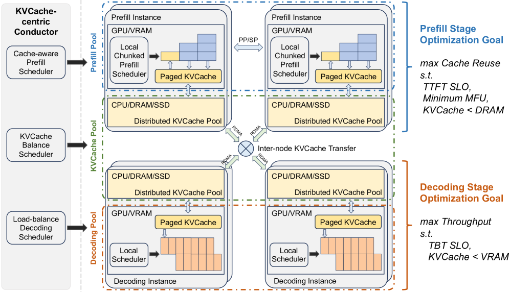
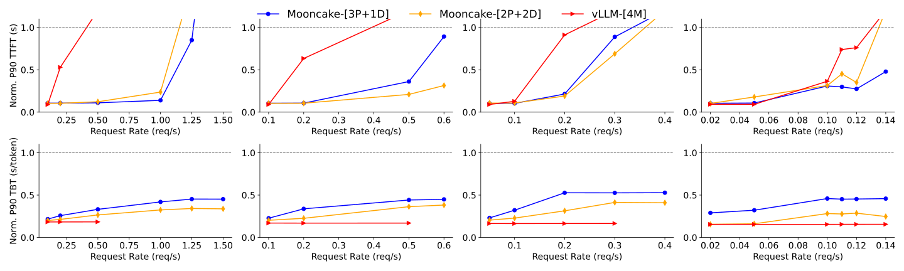

# Paper精读｜Mooncake: A KVCache-centric Disaggregated Architecture for LLM Serving

> [!abstract] 一句话结论
> **Mooncake** 是 Kimi（月之暗面）的 LLM 服务生产平台，核心是 **KVCache 中心化的分离式架构（disaggregated architecture）**——把 prefill 与 decoding 集群物理分离，并利用 GPU 集群中**未被充分利用的 CPU、DRAM、SSD 资源**构建分布式 KVCache 池。其全局调度器 **Conductor** 以"最大化有效吞吐 + 满足延迟 SLO（TTFT/TBT）"为目标做 KVCache 感知调度，并针对真实世界普遍存在的**过载场景**设计了**基于生成长度预测的早期拒绝策略**。相比 vLLM 基线：模拟场景吞吐最高提升 **525%**，真实负载下 Kimi 可多处理 **75%** 的请求，且输入越长优势越大。

> [!cite]- 论文信息（点开折叠）
> - **论文标题**：Mooncake: A KVCache-centric Disaggregated Architecture for LLM Serving（FAST '25 版标题：Trading More Storage for Less Computation — A KVCache-centric Architecture for Serving LLM Chatbot）
> - **arXiv**：2407.00079
> - **链接**：[https://arxiv.org/abs/2407.00079](https://arxiv.org/abs/2407.00079)
> - **作者**：Ruoyu Qin, Zheming Li, Weiran He, Mingxing Zhang, Yongwei Wu, Weimin Zheng, Xinran Xu
> - **机构**：Moonshot AI（月之暗面）/ 清华大学
> - **日期**：2025-09-03（v4；FAST '25 会议版 2025-02）
> - **会议**：USENIX FAST '25（23rd USENIX Conference on File and Storage Technologies）
> - **系统**：Kimi 的服务平台

---

## 1️⃣ 论文想解决什么问题

LLM serving 的工作负载已高度多样化：输入/输出长度、到达频率与分布、以及最重要的——**不同等级的 SLO 需求**都各不相同。作为 MaaS 提供商，Kimi 的优化目标是：**最大化有效吞吐（直接影响收入），同时满足分层 SLO（TTFT 首 token 延迟、TBT token 间延迟）**。

传统 LLM serving 系统（如 vLLM）存在两个核心瓶颈：

1. **prefill 与 decoding 强耦合**：二者在同一 GPU 上争抢资源。prefill 是计算密集型（大量矩阵乘），decoding 是访存密集型（带宽受限）。长上下文请求的 prefill 会**严重干扰 decoding 的 TBT SLO**——论文用 dummy LLaMA2-70B 实测证明这一点（Figure 2）。

2. **KVCache 资源浪费**：长上下文场景下 KVCache 占用巨大（论文指出每个 token 的 KV 占用可达 ~0.5KB+），GPU HBM 装不下；而 GPU 集群中 CPU 的 DRAM/SSD 资源大量闲置。传统做法要么丢弃 KVCache（下次重复计算），要么困在 GPU 显存里（容量受限）。

3. **过载场景被忽视**：现有研究几乎都假设"所有请求都会被处理"（optimize throughput/TTFT/TBT accordingly）。但真实商业服务中，**请求增长远快于集群扩容**，过载是常态。系统必须在达到负载阈值后**拒绝或延迟部分请求**——现有系统没有为分离式架构设计过拒绝策略。

Mooncake 的回答：**用存储换计算**——把 KVCache 视为一等公民，用海量廉价存储（CPU DRAM/SSD）换取 prefill 计算的减少；同时用架构分离（prefill/decoding 物理解耦）换取 SLO 的稳定。

---

## 2️⃣ 核心洞察

> [!important] 核心洞察
> 1. **KVCache 中心化 = 把"缓存"从 GPU 显存的附庸提升为系统设计的中心**：传统系统把 KVCache 当 GPU 内的临时数据；Mooncake 把它当**跨节点、跨层级（GPU→CPU DRAM→SSD）的可调度资源**。用论文标题的语言——"用更多存储换更少计算"（Trading More Storage for Less Computation）。
>
> 2. **分离式架构（disaggregation）是 SLO 稳定的前提**：prefill 与 decoding 物理分离后，长上下文 prefill 的计算风暴不再冲击 decoding 的 TBT；这是"吞吐提升 525% 且不破 TBT SLO"的根本原因（Figure 12 中 vLLM 被迫单请求处理来避免干扰）。
>
> 3. **前缀缓存的复用是长上下文场景的杀手锏**：请求 trace 分析显示**块命中数符合长尾分布**（Figure 6）——少数热门前缀被大量请求复用。KVCache 池 + 前缀哈希去重（Figure 3）让"复用缓存"成为默认路径，prefill 只算未命中部分。
>
> 4. **过载时"预测式早期拒绝"比"事后拒绝"更优**：与其让请求跑完 prefill 才发现 decoding 来不及（资源白费），不如**预测生成长度、预估 TTFT/TBT 是否达标**，在**进入系统前**就拒绝——把拒绝决策从"浪费算力后"提前到"消耗算力前"。
>
> 5. **生产级实证**：论文不是模拟器论文——Mooncake 是 Kimi 的真实生产平台，23,000 条真实请求 trace 回放验证，这比纯合成基准更有说服力。

*Figure 1（系统架构）：Mooncake 采用分离式架构——prefill 集群与 decoding 集群物理分离，GPU 集群的 CPU/DRAM/SSD/RDMA 资源聚合为分布式 KVCache 池；全局调度器 Conductor 负责请求分发与 KVCache 块的复制/交换。*

---

## 3️⃣ 方法解读

### 组件1：分离式架构（Prefill / Decoding Disaggregation）

- **动机（Figure 2）**：实测显示 prefill 与 decoding 的资源画像完全不同——prefill 吞吐随 batch 增大而增、decoding 对 batch 敏感度不同；长上下文 prefill 一来，同机 decoding 的 TBT 会被拖高一大截

- **设计**：prefill 节点（组）与 decoding 节点（组）分开部署，各自优化；prefill 计算密集型、decoding 访存密集型的特征被解耦，SLO 互不干扰

- 节点间通过 **RDMA（800Gbps）** 高速互联传输 KVCache

### 组件2：分布式 KVCache 池（Disaggregated KVCache Pool）

- **资源来源**：GPU 集群中**闲置的 CPU、DRAM、SSD**——"harness underutilized resources to provide ample cache capacity and transfer bandwidth"

- **存储结构（Figure 3）**：CPU 内存中 KVCache 以**分页块（paged blocks）**存储；每块带**哈希值（自身哈希 + 前缀哈希）**用于去重——相同前缀的请求共享缓存块

- **淘汰策略**：LRU / LFU / 基于请求特征的算法

- **传输组件 Messenger**：独立于推理的 (GPUDirect) RDMA 组件，负责 CPU↔GPU 的 KVCache 块传输

- **外部 API**：提供 context caching API 给外部用户，提高 KVCache 复用率

### 组件3：Conductor——全局调度器

- 负责：请求分发（基于 KVCache 分布与负载）、KVCache 块的复制/交换（为未来推理优化）

- **请求四步工作流（Figure 4）**：

  1. **KVCache Reuse**：prefill 节点按前缀缓存块 ID 从远端 CPU 内存加载前缀缓存启动请求（无前缀缓存则跳过）

  2. **Incremental Prefill**：用前缀缓存完成 prefill，新产生的增量 KVCache 存回 CPU 内存；未缓存 token 超阈值（prefill_chunk，通常 >1000 token）则分块流水线执行

  3. **KVCache Transfer**：Messenger 把增量 KVCache 传输给 decoding 节点

  4. **Decoding**：decoding 节点加载 KVCache 开始生成；异步加载与 GPU 解码并行，避免 GPU 空闲

### 组件4：KVCache 中心化调度（§6，Algorithm 1）

- **prefill 全局调度**：不只是负载均衡（按请求数），还考虑**前缀缓存命中长度**与**可复用 KVCache 块的分布**——在"路由到缓存命中更长的节点（省算力）"与"均衡负载保证 TTFT SLO"之间权衡

- **调度分支**（kv_cache_balancing_threshold）：

  - **Cache-aware 调度**：缓存差异小 → 直接选预估 TTFT 最优的实例

  - **Cache-aware + balancing 调度**：缓存差异大 → 额外估算 KVCache 传输时间，综合传输+排队+执行时间选实例

- **KVCache 热点迁移**：若最优前缀命中在别的节点，评估后主动把热块 TransferKVCache 到目标节点

- **decoding 调度**：负载均衡（SelectDecodingInstance 最小化 TBT）

- **SLO 检查**：预估 TTFT/TBT 超 SLO 则拒绝请求

### 组件5：过载导向调度（§7）

- **负载定义**：分离式架构下直接用 **SLO 满足度** 衡量负载（l_ttft、l_tbt），而非传统"请求数/容量比"（耦合系统因 prefill/decoding 干扰难以精确预估）

- **预测式早期拒绝**：关键创新——需要**预测生成长度**（输出长度），因为拒绝决策必须知道请求的资源需求。基于预测，在请求进入系统前判断能否满足 SLO，不能则拒绝

- **解决负载波动**：早期拒绝策略本身会造成负载波动（拒绝突发），论文讨论如何缓解

---

## 4️⃣ 实验部分怎么读

### 实验设置

- **测试平台**：8×NVIDIA A800-SXM4-80GB 节点（80GB HBM，NVLink，RDMA 800Gbps），每节点部署一个 prefill 或 decoding 实例

- **模型**：为保护专有信息 + 可复现性，全部实验用 **dummy 模型**（与 LLaMA2-70B 同架构）

- **基线**：vLLM（含 continuous batching + PagedAttention）

- **指标**：TTFT/TBT 的 **P90**（90 分位）作为 SLO 判定；SLO 上限 = 最低 RPS 观测值的 10×（TTFT）/ 5×（TBT）；归一化到 1.0

- **数据**：ArXiv Summarization（长输入 8088 tok，缓存率 ~0%）、L-Eval（19019 tok，缓存率 >80%）、模拟数据（16k-128k，50% 缓存率）、真实数据（23,000 条带时间戳 trace，~50% 缓存率）

### 核心结果

**端到端性能（Figure 11/12）——长上下文 vs 基线**

| **场景** | **Mooncake** | **vLLM** | **提升** |
| --- | --- | --- | --- |
| 长上下文（ArXiv/L-Eval） | 保持 SLO | decoding 被 prefill 干扰破坏 | 大幅领先 |
| 模拟数据（16k-128k 长上下文） | 批量处理不破 TBT SLO | 被迫逐请求处理 | **吞吐 +50% ~ +525%** |
| 真实负载（10P+10D vs 20M） | TBT SLO 满足 ~100% | TBT 仅 57% 满足 | **多处理 75% 请求** |

- **关键解读 1（架构红利）**：525% 的吞吐提升来自"分离式 + 批量"——Mooncake 敢批量处理长上下文请求，因为 prefill 风暴被隔离在 prefill 集群；vLLM 必须逐请求处理来保护 decoding，吞吐自然暴跌

- **关键解读 2（缓存红利）**：L-Eval（缓存率 >80%）场景，前缀缓存让 prefill 只算 20% 的输入——"用存储换计算"的直接体现

- **关键解读 3（真实负载）**：TTFT 两者几乎打平（~100% 满足），但 **TBT 是分水岭**——Mooncake 100% vs vLLM 57%，且有极端高 TBT 的请求；TBT 是长上下文场景用户体验的关键

**过载场景（§8.2）**：预测式早期拒绝 vs 基线（在两阶段开始前按负载拒绝）——基线会拒绝**已在 prefill 阶段消耗算力的请求**造成浪费；Mooncake 的预测式策略更早、更准。

*Figure 12（模拟数据端到端实验）：Mooncake-[3P+1D]/[2P+2D] 与 vLLM-[4M] 对比。长上下文请求把 vLLM 的 decoding 阶段拖垮，vLLM 被迫逐请求处理；Mooncake 保持批量处理且从不破坏 TBT SLO，吞吐提升 50%-525%。*

---

## 5️⃣ 学术评价

**优点：**

1. **生产级实证价值极高**：Mooncake 是 Kimi 的真实生产平台，不是实验原型——"真实负载下多处理 75% 请求"是拿 23,000 条真实 trace 验证的，可信度远超合成基准

2. **问题定义切中行业痛点**：明确指出"处理所有请求既不高性价比也不现实"——过载场景是每个商业推理服务都面对、但学术研究普遍回避的问题；预测式早期拒绝是实用的回答

3. **架构思想的简洁性**：KVCache 中心化 + 分离式，两个理念都不复杂，但组合起来产生了 525% 的吞吐差距——"用存储换计算"的 trade-off 表述清晰，且把 CPU/DRAM/SSD 闲置资源变废为宝

4. **SLO 感知的调度设计**：用 SLO 满足度而非请求数定义负载（分离式架构下的自然选择），调度算法显式建模排队时间/传输时间/执行时间三个分量的权衡

5. **FAST '25 的选择耐人寻味**：作为存储会议的最佳论文级工作，它把"KVCache 作为文件/存储系统资源"的视角带进了系统界——KVCache 的去重、淘汰、迁移，换了个对象，还是存储系统的经典问题

> [!ed-warning] 局限（风险与不确定性）
> 1. **dummy 模型的可复现性悖论**：用 LLaMA2-70B 架构的 dummy 模型换取可复现性，但**损失了生产真实性的关键一环**——Kimi 真实模型（Kimi K2/K3 级别）的注意力模式、缓存行为可能与 LLaMA2 差异巨大，525% 的结论能否外推到真实生产模型存疑
>
> 2. **生成长度预测的准确性依赖**：预测式早期拒绝的命脉是"生成长度预测"——预测不准会误拒绝（伤害体验）或误接受（破坏 SLO），论文对预测器的精度/鲁棒性分析不足
>
> 3. **单一基线**：只对比 vLLM；与 Splitwise、DistServe 等其他分离式/前缀缓存系统（如 SGLang RadixAttention）的对比缺失，无法定位 Mooncake 在分离式设计空间中的相对位置
>
> 4. **TTFT 的收益不明显**：真实负载下 TTFT 与 vLLM 几乎打平（~100% vs ~100%）——分离式的收益主要体现在 TBT 与吞吐，论文对"为什么 TTFT 没优势"的解释不充分
>
> 5. **规模与配置敏感性**：实验配置有限（3P+1D、2P+2D、10P+10D）；prefill:decoding 实例比例、KVCache 池容量、RDMA 带宽等关键参数如何影响性能，缺乏系统的参数扫描

---

## 6️⃣ 局限与可扩展方向

- **生成长度预测的改进**：把预测器从启发式升级为可学习的（基于 prompt 特征回归/LLM 预估），并给出预测置信度用于拒绝决策

- **多层缓存替换策略**：GPU HBM → CPU DRAM → SSD 三级缓存的联合替换策略（何时逐出到 SSD、何时从 SSD 提升），论文对 SSD 层的实际使用深度着墨不多

- **KVCache 池的可扩展性**：去重哈希、热点迁移在更大集群（数百节点）下的扩展性；与文件系统/对象存储的融合（KVCache 即文件？）

- **与其他系统技术的正交组合**：与投机解码（speculative decoding）、量化 KV（KV quantization）、稀疏注意力（如 NSA）的组合——Mooncake 的缓存层能否直接服务这些新技术？

- **多租户与隔离**：商业场景的多租户 KVCache 隔离、配额、计费（缓存命中如何计费）未讨论

- **跨请求的缓存优化**：除前缀命中外，能否主动改写请求（prompt caching 友好化）提高整体缓存命中率？

---

## 与其他论文的对话

| **相关工作** | **关系** | **差异** |
| --- | --- | --- |
| **vLLM（基线）** | PagedAttention + continuous batching | 耦合式架构，长上下文 prefill 干扰 decoding；Mooncake 分离式解决 |
| **Splitwise (2024)** | 也是 prefill/decoding 分离 | Splitwise 聚焦相位分离与相位感知调度；Mooncake 的增量是"KVCache 中心化 + 过载拒绝" |
| **DistServe (2024)** | 分离式 serving + 调度 | 类似架构思路，但 Mooncake 强调 KVCache 池与预测式拒绝的生产级落地 |
| **SGLang RadixAttention** | 前缀缓存复用 | 单节点内缓存树；Mooncake 把缓存扩展到跨节点 CPU/DRAM/SSD 池 |
| **MemHarness / LongHorizon-Harness（同日热榜）** | 系统层 harness 主题 | 那两篇管"任务状态管理"；Mooncake 管"KVCache 资源管理"——都是"系统层决定上层能力"的证据 |
| **Infinite-LLM / PagedAttention 系列** | 长上下文 KVCache 管理 | Mooncake 的差异化：利用 CPU/SSD 资源做分布式缓存而非只优化 GPU 内布局 |

---

## 7️⃣ 最后总结

Mooncake 的价值在于它把 LLM serving 的优化视角从"GPU 计算效率"转向"**KVCache 资源管理**"——用存储换计算，用分离换稳定。作为 Kimi 的生产平台，它证明了 KVCache 中心化的分离式架构在长上下文、过载场景下对 vLLM 式耦合架构的代际优势（吞吐 +50%~525%、TBT SLO 100% vs 57%、多处理 75% 请求）。它的方法论启示是：**LLM serving 系统设计的瓶颈正从"算力"转移到"状态（KVCache）管理"**——这与 LongHorizon-Harness 把"任务状态"从执行中剥离、MemHarness 把"经验记忆"从重放中重构，是同一个时代趋势在不同层的体现。局限在于 dummy 模型的可复现性代价、单一基线和预测器精度依赖。对系统从业者的启示：**下一个 serving 系统的竞争焦点不是更强的 GPU，而是更聪明的 KVCache 层**。

---

## 8️⃣ 三句速记

> [!summary]- 点开展开
> 1. **用存储换计算**：KVCache 中心化架构把 GPU 集群闲置的 CPU/DRAM/SSD 变成分布式缓存池，前缀复用让 prefill 只算未命中部分——长上下文场景吞吐提升最高 525%。
>
> 2. **分离换稳定**：prefill 与 decoding 物理解耦，长上下文 prefill 的计算风暴不再冲击 TBT SLO——真实负载下 TBT 满足率 100% vs vLLM 的 57%。
>
> 3. **过载要预测式拒绝**：基于生成长度预测，在请求进入系统前判断能否满足 SLO——比"跑完 prefill 再拒绝"节省算力，Kimi 因此多处理 75% 的请求。
