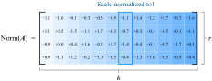
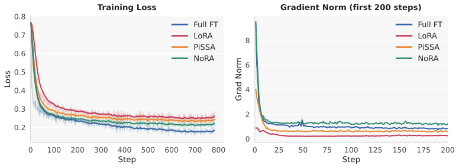

# Paper精读｜Normalized Low-Rank Adaptation

> [!abstract] 一句话结论
> **NoRA** 发现：LoRA 早期训练效果很大程度上取决于随机初始化的下投影矩阵 A 的列范数；<span class="mark-strong">沿 rank 维度把 A 的每一列归一化</span>，可以修正 LoRA 的隐式输入侧预条件器，使梯度规模更接近全参数微调，从而加快收敛、提升下游效果并减少遗忘。更实用的是，很多收益只需在初始化时做一次，因此可以用 **NoRA-init**，不改变普通 LoRA 的训练和部署接口。

> [!cite]- 论文信息（点开折叠）
> - **论文标题**：Normalized Low-Rank Adaptation
> - **arXiv**：2608.31036v1
> - **链接**：[https://arxiv.org/abs/2608.31036](https://arxiv.org/abs/2608.31036)
> - **项目代码**：[https://github.com/Joluck/NoRA](https://github.com/Joluck/NoRA)
> - **项目主页**：[https://spherelab.ai/NoRA/](https://spherelab.ai/NoRA/)
> - **作者**：Jiale Kang, Ziyin Yue, Zheng Zhan, Yangyi Huang, Weiyang Liu
> - **机构**：Yuanshi Intelligence / Microsoft Research / The Chinese University of Hong Kong / Shenzhen Loop Area Institute
> - **日期**：2026-08-31

---

## 论文分类标注

- **研究类型**：方法论文 + 优化动力学分析 + 多阶段实验

- **领域归属**：大语言模型参数高效微调（PEFT）> LoRA 优化与初始化

- **方法学标签**：参数化改造、预条件器分析、预训练/SFT/RLVR 对照实验

- **核心对象**：LoRA 的下投影矩阵 A，而不是增加新的可训练模块

- **与已有工作关系**：与 LoRA、PiSSA、MiLoRA、MiSS、DoRA、rsLoRA 互补；与论文中讨论的 MLA 归一化 latent、Weight Normalization 和预条件优化有关

---

## 1️⃣ 论文想解决什么问题

LoRA 把权重更新写成低秩分解：ΔW = αBA，其中 A 是下投影，B 是上投影。标准做法是随机初始化 A、零初始化 B。这样做能保证训练开始时 ΔW=0，不破坏基础模型，但也带来一个容易被忽略的事实：在第一步，A 先固定不动，真正接收梯度的是 B；所以 LoRA 最初如何学习，完全由随机 A 把输入投影成什么样决定。

现有 LoRA 改进通常从几个方向入手：提高 rank、改变 α 的缩放、使用 SVD/梯度/激活信息初始化，或者改变权重参数化。本文关注一个更基础的问题：**A 的几何尺度是否本身就是一个重要的优化设计维度？**作者借鉴 MLA 中对低维 latent 表示做归一化的现象，但不直接使用 Norm(Ax)，因为那会使对输入 x 的变换变成非线性，失去 LoRA 的精确合并能力；他们改为归一化 A 本身。

---

## 2️⃣ 核心洞察

> [!important] 核心洞察
> 1. **<span class="mark-strong">LoRA 的 rank 不只是容量，也决定了隐式学习率</span>。** A 的每一列对应一个输入坐标投向 rank 维 latent 空间的方向；列范数越大，该输入坐标初期获得的有效更新越大。
>
> 2. **问题不是“随机方向”本身，而是随机方向的尺度失衡。** 不同输入坐标的 A 列范数随机波动，导致每个坐标的学习率不均匀；在常见初始化下，平均列范数还可能随 r/k 缩小，使 LoRA 的有效梯度远低于全参数微调。
>
> 3. **<span class="mark-strong">初始化阶段已经决定了大部分收益</span>。** 因为 B 初始为 0，A 的梯度初始为 0；A 先决定了有效预条件器。因此只在初始化时规范化 A，就能抓住主要收益；持续规范化则还能在后期抑制尺度爆炸或塌缩。
>
> 4. **NoRA 是优化几何改造，不是增加模型容量。** 它没有新增可训练参数，也没有推理时额外计算；它改善的是同一低秩容量下的梯度流。



*图注：左侧展示对 A 的每一列沿 rank 维度归一化；右侧展示在 LLaMA-3.2-3B Math 训练中，不同 rank 与初始化方式的初始梯度范数。NoRA 的梯度规模明显接近全参数微调。*

---

## 3️⃣ 方法解读

### 1. 标准 LoRA 与问题来源

LoRA 的更新为：

```text
ΔW = αBA
```

其中：

- W₀：冻结的基础权重；

- A ∈ R^(r×k)：下投影，k 是输入维度，r 是低秩维度；

- B ∈ R^(d×r)：上投影，d 是输出维度；

- r ≪ min(d,k)；

- α：缩放系数。

标准初始化为 B⁽⁰⁾=0、A 随机初始化。令 G=∂L/∂W 是对应全参数权重的梯度，则初始化时：

```text
∂L/∂B = αGAᵀ
∂L/∂A = 0
```

于是第一阶段往哪个方向学，完全由随机 A 投出来的 latent 特征说了算。

### 2. NoRA：沿 rank 维度归一化 A

把 A 写成列向量：A=[a₁,a₂,...,aₖ]，每个 aⱼ∈Rʳ 对应一个输入坐标。NoRA 定义：

```text
Norm(A)[:,j] = aⱼ / max(||aⱼ||₂, ε)
```

于是每一列满足 ||Norm(A)[:,j]||₂≈1，并把更新改成：

```text
Δy = αB Norm(A)x
```

注意这里是先把 A 归一化，再与 x 做线性变换。归一化只依赖 LoRA 参数，不依赖输入，因此对 x 仍然是线性的；训练完成后可以把 Norm(A) 吸收到 BA 中，保持 LoRA 的 exact mergeability。

### 3. NoRA-init：只归一化一次

NoRA-init 在初始化时做：

```text
A⁽⁰⁾ = Norm(A_init),  B⁽⁰⁾ = 0
```

之后 A、B 按普通 LoRA 方式训练，不再强制归一化。它的逻辑是：早期阶段 A 的尺度决定了隐式预条件器，初始化修正已经覆盖主要问题；持续归一化带来的额外稳定性是增益，而不是全部收益的来源。

### 4. BIMI：Block Identity Matrix Initialization

BIMI 用重复的单位矩阵初始化 A：

```text
A = [Iᵣ, Iᵣ, ..., Iᵣ, E_q]
```

其中 E_q 是不完整的尾部单位矩阵块。这样 A 的每一列天然是单位范数，且局部方向互相正交。B 仍然初始化为 0，所以初始 ΔW 仍为 0。BIMI 不需要对基础权重做 SVD，是 NoRA-init 的一种确定性结构化实现。

### 5. NoRA 与 MiSS 的关系

MiSS 使用固定的重复单位矩阵作为下投影，因此可以被理解为一种固定 A 的 LoRA。由于这个 A 的每一列范数都是 1，作者把 MiSS 视为 NoRA 原则的特殊情形。

区别在于：

- MiSS：A 固定，训练中不更新；

- BIMI：只用 block identity 初始化，之后 A 可训练；

- NoRA-init：随机 A 归一化后可训练；

- NoRA：训练全过程持续归一化 A。

这让作者能够把 MiSS 的经验效果与 NoRA 的一般原则连接起来：关键可能不是固定投影，而是让输入到 latent 的各个方向拥有平衡尺度。



*图注：SFT 训练中，NoRA 的 loss 下降更快，训练轨迹更接近 full finetuning；标准 LoRA 初始梯度明显偏小。*

### 6. 为什么有效：隐式预条件器视角

把初始化时 B 的第一步更新合并回 W，代数一展开，隐式预条件器就现形了：

```text
ΔW = -η G P
P = α² AᵀA
```

全参数微调相当于 P=I。LoRA 则等价于：在输入坐标侧，用一个由 A 决定的、秩最多为 r 的正半定矩阵 P 对全参数梯度做右乘。

对第 j 个输入坐标，更新可以拆成：

```text
ΔW[:,j] = -η [ α² ||aⱼ||² G[:,j]
              + Σ(i≠j) α²(aᵢᵀaⱼ)G[:,i] ]
```

第一项是该坐标自身的更新，系数 α²||aⱼ||² 就像这个坐标的学习率；第二项是低秩瓶颈造成的坐标间串扰，系数是不同 latent 方向的内积。

标准随机初始化下，若 A 的元素方差约为 1/k，则：

```text
E||aⱼ||² = r/k
```

通常 r≪k，所以有效学习率整体偏小，而且每个坐标的学习率还会随机波动。NoRA 把每个 ||aⱼ||² 设为 1，使 P 的对角线变成确定的 1；在随机方向近似下，E[P]也更接近 I。直觉上，它把 LoRA 从“每个输入坐标拿到一个随机且很小的学习率”，变成“先给所有坐标一个平衡的基础学习率，再由 B 学习具体更新”。

*（原图未能本地化：Figure 3：论文首页与方法定位；IMA 媒体接口没有可用媒体编号）*

*图注：论文首页渲染图，概括了 NoRA 的研究动机：通过控制下投影 A 的尺度，在保留 LoRA 线性可合并特性的同时改善优化动力学。*

---

## 4️⃣ 实验部分怎么读

### 实验设置

| **阶段** | **模型/结构** | **数据** | **评测** |
| --- | --- | --- | --- |
| 预训练 | MLA、MHA；约 340M 参数 | SlimPajama；另有 FineWeb-10BT 超参实验 | LAMBADA、WikiText、ARC、HellaSwag、PIQA、WinoGrande、OpenBookQA |
| SFT | Llama-3.2-3B | MetaMath、CodeFeedback | GSM8K、MATH、HumanEval、MBPP；MMLU/AGIEval/ARC-C 看遗忘 |
| RLVR | DeepSeek-R1-Distill-Qwen-1.5B | DAPO-Math-17K | AIME24/25、AMC、HMMT、MATH500、Minerva |

SFT 中 rank=32、学习率 2e-5、1 epoch；NoRA 推荐 α=r。RLVR 使用 8 张 GPU、DAPO、1024 步、rank=32、α=64、每题采样 8 个回答。

### 核心结果一：归一化维度决定成败

在 GSM8K 和 Math 平均分上，沿列/rank 维度归一化远胜沿行/input 维度归一化：

| **初始化** | **不归一化** | **Norm_k（行归一化）** | **Norm_r（列归一化）** |
| --- | --- | --- | --- |
| Uniform(-1/√k,1/√k) | 29.27 | 29.75 | **37.16** |
| Gaussian | 31.05 | 30.54 | **36.95** |
| Uniform(-1,1) | 29.61 | 29.58 | **36.66** |
| BIMI | — | — | **37.07** |

这里的结果非常关键：它说明 NoRA 不是“随便加一个 normalization 就有效”。真正重要的是**沿 rank 维度归一化每一列 A**，因为这正好控制了输入坐标侧的隐式学习率；行归一化没有修正这个问题。

### 核心结果二：SFT 效果与知识保留

| **方法** | **GSM8K** | **Math** | **HumanEval** | **MBPP** | **平均** | **遗忘指标平均变化** |
| --- | --- | --- | --- | --- | --- | --- |
| LoRA | 50.94 | 10.38 | 37.20 | 53.20 | 37.93 | -0.56 |
| MiSS | 60.80 | 14.60 | 39.60 | 55.80 | 42.70 | -0.70 |
| NoRA-init | 59.89 | 14.24 | 39.60 | 55.80 | 42.38 | -0.19 |
| **NoRA** | **61.63** | **14.46** | **42.10** | **55.30** | **43.37** | **+0.02** |
| Full FT | 65.12 | 17.96 | 36.15 | 49.05 | 42.07 | +0.02 |

标准 LoRA 的平均分为 37.93，NoRA-init 提升到 42.38，NoRA 提升到 43.37，增加 **<span class="mark-number">5.44 分</span>**。NoRA 在 GSM8K 和 HumanEval 上尤其明显。

知识保留这一栏更说明问题：LoRA 在 MMLU/AGIEval/ARC-C 上平均变化为 -0.56，NoRA 为 +0.02。也就是说，NoRA 不只是让适配任务分数更高，还减轻了“学新任务时损失旧知识”的问题。不过这里的“遗忘”指标是有限的三项 benchmark 平均值，不能直接等同于全面避免灾难性遗忘。

### 核心结果三：预训练中的优化崩溃

在约 340M 的预训练实验中，标准低秩参数化在 MHA 设置下出现明显异常：LAMBADA 困惑度直接崩溃到无法报告（表中为 “-”），多个常识任务的分数也大幅下滑；NoRA-init 则避免了这种优化崩溃。

作者给出的解释是：<span class="mark-strong">相同 rank 不等于相同的可学习性</span>。低秩容量决定“能表达多少”，而 A 的初始化尺度决定“梯度能不能有效流进去”。NoRA-init 通过修正输入侧预条件器，使同一个 rank 的低秩适配器更容易被优化。

### 核心结果四：RLVR 中比谱初始化稳定

| **方法** | **AIME24/25 等数学任务平均分** |
| --- | --- |
| Base | 41.0 |
| LoRA | 42.8 |
| **NoRA** | **44.4** |
| MiLoRA | 18.0 |
| PiSSA | 0.2 |

NoRA 比 Base 高 <span class="mark-number">3.4</span> 分，比 LoRA 高 <span class="mark-number">1.6</span> 分。PiSSA 和 MiLoRA 在 SFT 中可能有效，但在 RLVR 中几乎崩溃，说明<span class="mark-strong">基于基础权重 SVD 的谱初始化未必适合强化学习的动态优化</span>；NoRA 不需要 SVD，也不依赖基础权重的谱结构，因此更加稳健。

---

## 与其他方法的对话

| **方法** | **核心改动** | **是否需要 SVD/额外信息** | **是否保持 LoRA 合并** | **与 NoRA 的差别** |
| --- | --- | --- | --- | --- |
| LoRA | 随机 A + 零 B | 否 | 是 | 存在初始尺度失衡 |
| PiSSA | 用主奇异成分初始化 | 需要 SVD | 需要相应处理 | 可能在 RL 中不稳定 |
| MiLoRA | 用较小奇异成分初始化 | 需要 SVD | 需要相应处理 | 同样依赖谱结构 |
| MiSS | 固定重复单位矩阵 A | 否 | 是 | A 不再可训练 |
| DoRA | 分解方向和幅度 | 否 | 是 | NoRA 可与 DoRA 组合，修正 A 的尺度 |
| NoRA-init | 初始化归一化 A | 否 | 是 | 简单、改动小 |
| NoRA | 训练中持续归一化 A | 否 | 是 | 稳定性和效果通常最好 |

---

## 5️⃣ 学术评价

**优点：**

1. **抓住了 LoRA 中经常被忽略的优化瓶颈。** 许多工作把注意力放在 rank、SVD 或 scaling 上，而本文把 A 视为输入侧预条件器来分析，给出了比“经验调参”更清晰的解释。

2. **方法极简且容易迁移。** NoRA 不增加参数，不需要额外数据、不需要 SVD，也没有推理时开销；代码层面是在 PEFT 的 LoRA layer 中对 `lora_A.weight` 做列归一化。

3. **跨训练范式验证。** 同时覆盖预训练、SFT、RLVR，并测试 LoRA、DoRA、MiSS 等相关参数化，尤其是 RLVR 中对谱初始化方法的对照很有价值。

4. **NoRA-init 具有工程吸引力。** 如果一次初始化就能获得大部分收益，用户不必承担每次 forward 做归一化的实现复杂度。

5. **理论与实验相互咬合。** “列范数是输入坐标学习率”的推导，与行归一化无效、列归一化有效、初始梯度更大等实验现象是一致的。

> [!ed-warning] 局限（风险与不确定性）
> 1. **实验规模和覆盖仍有限。** 主要 SFT 使用 Llama-3.2-3B，RL 使用 1.5B，预训练约 340M；尚不能直接保证在 70B 以上模型、视觉/语音模型或不同硬件上同样有效。
>
> 2. **若干比较没有完全统一现实训练条件。** SFT 中作者说明会为各方法单独调参；这有利于公平比较最佳效果，但也使“方法本身”的增益和超参增益难以完全分离。
>
> 3. **预条件器解释主要针对早期阶段。** 推导忽略了 B 变大后 αBΔA 项的影响；后期训练中 A、B 的耦合、AdamW 的自适应尺度和 weight decay 可能改变实际动力学。
>
> 4. **NoRA 的表达能力并未增加。** 它主要改善优化，不解决 rank 太低造成的表达瓶颈；如果任务需要更高秩，NoRA 不能替代增加容量。
>
> 5. **持续归一化的实现细节值得进一步研究。** A 的梯度经过归一化映射后是切向梯度，列范数的有效尺度会由 B 和 α 承担；不同优化器、weight decay、dropout 和量化训练下的行为还需要更多消融。
>
> 6. **知识保留结论需要更广泛验证。** 三个 retained benchmarks 的平均变化很漂亮，但还不能据此断言 NoRA 在所有领域都能避免灾难性遗忘。

---

## 对用户当前方向的启发

NoRA 和你前面关注的模型参数编辑、LoRA 微调、RL/蒸馏方向有一个重要连接：**参数更新的“方向”和“尺度”是两个不同问题。** Heretic/abliteration 更像是在寻找并削弱某些功能方向；NoRA 则不改变 LoRA 的低秩方向容量，专门控制这些方向在训练初期如何接收梯度。

如果把 LoRA 看成“在一个低秩子空间里学习”，那么：

- rank 决定子空间最多有多少维；

- A 的列方向决定输入如何进入这个子空间；

- A 的列范数决定不同输入坐标的有效学习率；

- B 负责把 latent 更新映射回输出空间。

NoRA 的贡献就是把第二、第三件事分开：让 A 主要负责方向，让尺度更多由 B 和 α 负责。这和 weight normalization、hyperspherical learning 的思想是一脉相承的。

---

## 7️⃣ 最后总结

NoRA 的核心不是“又一种 LoRA 结构”，而是指出了 LoRA 隐含的一个优化事实：<span class="mark-strong">随机下投影 A 同时决定低秩子空间和输入侧预条件器</span>，随机且偏小的列范数会让早期梯度变弱、变得不均匀。沿 rank 维度归一化 A 可以消除这种尺度失衡，同时保持 LoRA 的线性和可合并性。

实验表明，NoRA 在 SFT、预训练和 RLVR 中都比普通 LoRA 更稳定；NoRA-init 还说明初始化本身就贡献了大部分收益。论文最值得借鉴的地方，是把一个很小的工程改动与“低秩适配器究竟如何学习”的优化几何联系起来。

---

## 8️⃣ 三句速记

> [!summary]- 点开展开
> 1. **NoRA = 对 LoRA 的 A 矩阵按列沿 rank 维度归一化。**
>
> 2. **A 的列范数相当于输入坐标的隐式学习率；标准随机 LoRA 会让它随机且偏小。**
>
> 3. **NoRA 不增加参数或推理开销，NoRA-init 只初始化归一化也能拿到大部分收益；但大规模模型和更多任务上的泛化仍需验证。**
