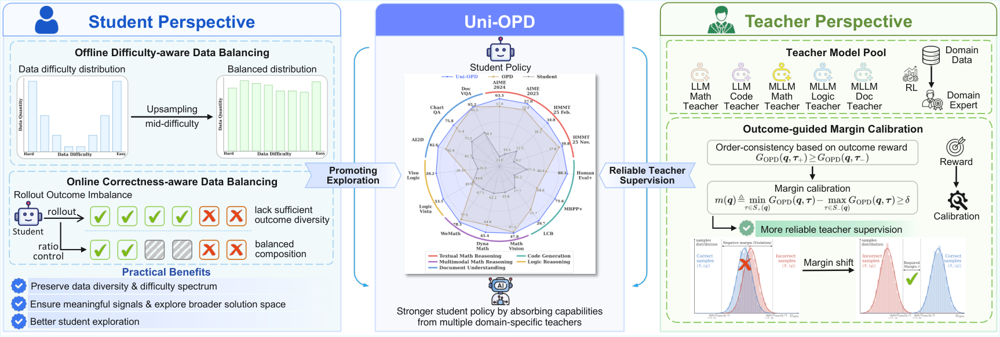
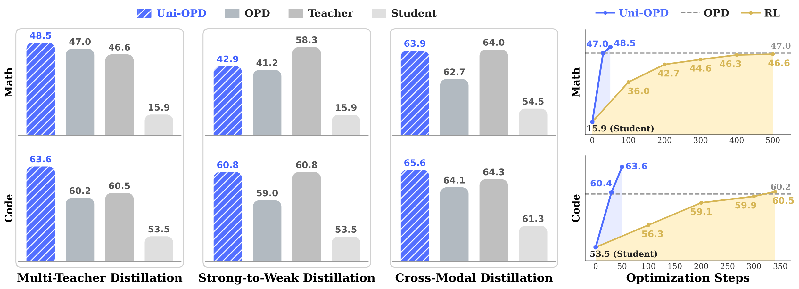

# Paper精读｜On-Policy Distillation (Uni-OPD)

> [!abstract] 一句话结论
> 把强化学习的 **on-policy 性质**和知识蒸馏的 **token 级密集教师反馈**拼到一起，再给一个双重优化视角（学生探索 + 教师监督校准），让 OPD 在多个场景下稳定跑赢传统 off-policy 蒸馏和纯 RL 方法。

> [!cite]- 论文信息（点开折叠）
> - **论文标题**：** Uni-OPD: Unifying On-Policy Distillation with a Dual-Perspective Recipe
> - **arXiv**：** 2605.03677
> - **链接**：** [https://arxiv.org/abs/2605.03677](https://arxiv.org/abs/2605.03677)
> - **作者**：** Wenjin Hou, Shangpin Peng, Weinong Wang 等（浙江大学、深圳环宇研究院、腾讯LLM部）
> - **日期**：** 2026-05-05

---

## 1️⃣ 论文想解决什么问题

SFT → RL 两步走是当前 post-training 的主流，但这套范式里藏着一组矛盾：

1. **SFT（off-policy）**：训练数据是静态的专家轨迹，学生推理时一走进没覆盖过的状态就犯 **暴露偏差（exposure bias）**，错误越滚越多。

2. **RL（on-policy）**：在线采样躲开了分布偏移，可奖励是序列级/终局的，细粒度信用分配难做 → 训练不稳定、收敛慢。

**On-Policy Distillation (OPD)** 想两头都占：on-policy 的分布，加上 token 级的密集监督。但现有 OPD 效果时好时坏，论文就问：**OPD 在什么条件下才能稳定可靠地提升性能？**

---

## 核心洞察：OPD 的两大瓶颈

论文把 OPD 时好时坏的病根诊断成两条，一条在学生侧，一条在教师侧：

| **瓶颈** | **所属视角** | **具体表现** |
| --- | --- | --- |
| **探索不足** | 学生侧 | OPD 训练中，学生采样到的轨迹分布不均匀——简单样本过多、困难样本不足，暴露在"有信息量状态"下的机会不够 |
| **监督不可靠** | 教师侧 | 教师对学生的 token 级指导信号（反向 KL 散度中的 logits）与最终的 outcome-level 正误排序不一致——正确的轨迹教师打分反而低，错误的反而高 |

---

## 方法解读：Uni-OPD 的双重视角优化

### 学生侧：联合离线和在线数据平衡

*图 2｜Uni-OPD 的学生侧数据平衡与教师侧边际校准。 [来源](https://arxiv.org/html/2605.03677v1/#S3.F2)*

| **策略** | **类型** | **做法** |
| --- | --- | --- |
| **Offline 难度感知平衡** | 数据构建 | 训练前对样本按难度聚类，确保每个 batch 包含从易到难的混合比例，避免模型只学简单模式 |
| **Online 正确性感知平衡** | 在线采样 | 训练中根据当前学生采样轨迹的正确/错误比例动态调整采样权重，让模型更多见到自己容易出错的场景 |

### 教师侧：结果导向的边际校准

核心发现：**教师 token 级指导的结果排序必须与最终 outcome 排序一致**，否则 OPD 的信号自己跟自己打架。

- 教师给正确轨迹的 token 总体打分高于错误轨迹 → 信号可靠

- 反过来 → 上 **Outcome-Guided Margin Calibration**：用一个校准函数在 token 级奖励上施加 outcome 层面的 margin，把正确/错误轨迹之间的排序一致性找回来

> 直观理解：不要求教师在每个 token 上都完美，只要求教师整体上更「看好」正确答案的方向。

---

## 理论贡献 / 机制解释

- 把 OPD 的 **order-consistency** 条件形式化：教师 token 级聚合指导要与 outcome reward 排序一致

- 提出**边际校准**机制：outcome-level 信号经 margin 注入 token 级蒸馏损失，比直接拿 outcome 加权更稳

- 统一框架罩住四种蒸馏场景：单教师、多教师、强到弱、跨模态

---

## 4️⃣ 实验部分怎么读

### 关键数字

*图 1｜Uni-OPD 的整体性能与收敛轨迹。 [来源](https://arxiv.org/html/2605.03677v1/#S0.F1)*

| **场景** | **核心结果** |
| --- | --- |
| **单教师 + 多教师蒸馏** | Qwen3-VL-4B 学生，在数学/逻辑/文档三个领域的多教师蒸馏大幅领先普通 OPD |
| **强到弱蒸馏** | Qwen3-30B-A3B 教师 → Qwen3-4B/1.7B 学生，Uni-OPD 持续优于 OPD |
| **跨模态蒸馏** | 文本代码教师 → 多模态学生，Uni-OPD 在代码和数学任务均优于 OPD |
| **数学推理** | Qwen3-8B 在 AIME'24 达 **70%**（简报数据），远超 off-policy 蒸馏 |
| **训练效率** | 训练成本较 off-policy 蒸馏 **降低 30 倍**，收敛速度远快于 RL |

### 消融实验（关键洞察）

- 离线和在线数据平衡**各自独立贡献收益**，组合起来效果最好

- 边际校准在 teacher-student 能力差距大的时候收益最大

- 三个组件（离线平衡 + 在线平衡 + 边际校准）全开时达到最优

---

## 5️⃣ 学术评价

- **优势：** 从诊断（两大瓶颈）到方案（双视角）一条线走通；统一框架罩住四种蒸馏场景；代码开源（GitHub: WenjinHou/Uni-OPD）

- **创新点：** outcome-guided margin calibration 把 outcome 信号带回 token 级蒸馏——第一个在 OPD 里系统处理 teacher 监督可靠性的工作

- **局限：** 实验集中在较小模型（4B/8B），70B+ 的验证没做；边际校准的缩放规律（scaling law）也还没探

---

## 6️⃣ 局限与可扩展方向

1. 扩展到更大规模教师蒸馏（70B+ 甚至 MoE）

2. 应用到更宽的场景：agentic planning、tool use、long-horizon decision making

3. 搞清 OPD 的训练动力学和参数几何机理

---

## 8️⃣ 三句速记

> [!summary]- 点开展开
> 1. 🎯 OPD 两大瓶颈：**学生探索不足** + **教师监督排序不一致**
>
> 2. 🔧 学生侧双数据平衡（离线难度 + 在线正确率），教师侧边际校准恢复排序一致性
>
> 3. 🚀 Qwen3-8B AIME'24 达 70%，训练成本比 off-policy 蒸馏低 30 倍

---

*注：本文档基于 arXiv 2605.03677v1 论文摘要、方法章节及实验表格撰写。部分性能数据参考了 alphaXiv 每日简报。*
