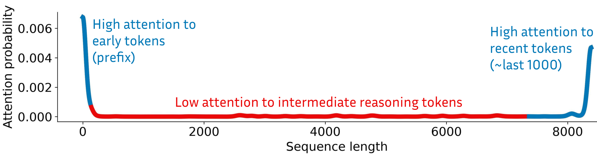
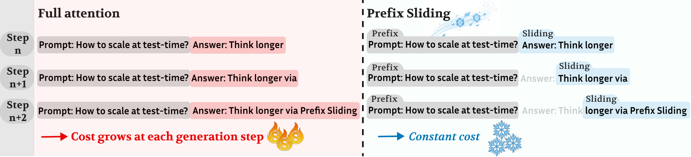
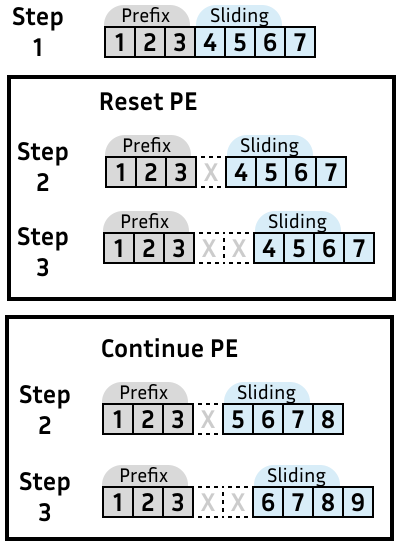
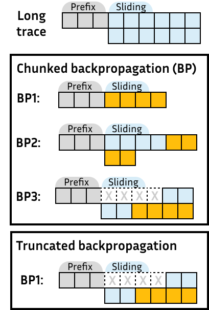
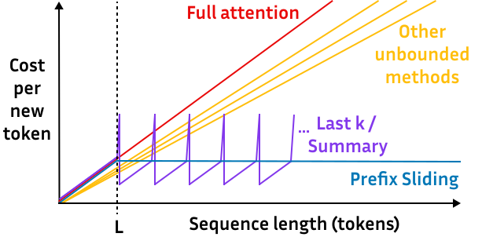
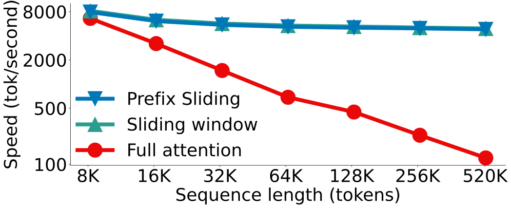
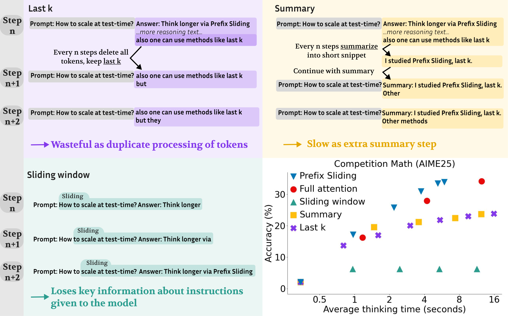
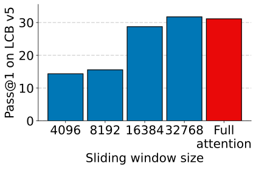

# Paper精读｜Prefix Sliding for efficient test-time scaling

> [!abstract] 一句话结论
> Prefix Sliding 保留**任务前缀**与**最近推理窗口**，丢弃中间历史 token，使现有全注意力模型在长思考时的每-token 成本趋于常数；无需训练即可在保持性能的同时约 **3× 加速**，并让 RL rollout 延伸到 **10 万 token 以上**。它不是全新的 Transformer 架构，而是一个简单、可部署、击中长时程 test-time scaling 瓶颈的推理原语。

> [!cite]- 论文信息（点开折叠）
> - **论文标题**：Prefix Sliding for efficient test-time scaling
> - **arXiv**：2608.26070（v1, 2026-08-26）
> - **链接**：[https://arxiv.org/abs/2608.26070](https://arxiv.org/abs/2608.26070)
> - **代码**：[https://github.com/Muennighoff/prefix-sliding](https://github.com/Muennighoff/prefix-sliding)
> - **作者**：Niklas Muennighoff, Zhengyang Wang, Zeyi Chen, Weijia Shi, Binyuan Hui, John Yang, Dapeng Jiang, Mika Senghaas, Fares Obeid, Johannes Hagemann, Sami Jaghouar, Ludwig Schmidt, Percy Liang, Jason Wei, Andrew Y. Ng, Luke Zettlemoyer, Yejin Choi, Mike Lewis
> - **机构**：Stanford University / University of California at Santa Barbara / Prime Intellect / University of Washington
> - **日期**：2026-08-26

---

## 论文分类标注

- **研究类型**：Transformer 推理效率 / test-time scaling 方法论文；同时包含 RL 训练基础设施与自定义 GPU kernel 实现。

- **领域归属**：LLM reasoning > 长思考推理 > KV cache / attention memory > 测试时计算扩展。

- **方法学标签**：免训练推理优化、局部注意力、KV cache 截断、FlashAttention kernel、长轨迹 RL、截断反向传播。

- **核心问题**：如何让已经预训练好的全注意力 Transformer 在超长 reasoning trace 上保持可控的显存和延迟。

- **与 Prime Agent 的关系**：Prime Agent 解决“如何让 agent 拥有持久计算与状态”；Prefix Sliding 解决“模型在单条超长思考轨迹里如何避免 attention 成本失控”，是 agent harness 与模型推理内核的互补路线。

---

## 1️⃣ 论文想解决什么问题

Test-time scaling 的直觉很朴素：难题上让模型多想一会儿。但标准 decoder-only Transformer 是 full attention，每生成一个新 token，都要与此前全部 reasoning token 计算注意力——序列越长 KV cache 越大，每个新 token 的计算、显存、延迟都跟着涨。「让模型多想一会儿」这件事，最后是被系统成本卡死的。

更麻烦的是，长推理历史并不等价于长效记忆。论文观察到，推理早期的指令和任务定义仍然重要，当前正在处理的最近 token 也重要，但大量已经完成的中间推理步骤对下一步的直接影响很小。比如算式 `((42 + 84) × 4) - 5` 中，加法完成后，展开加法过程通常不必一直留在每一层 attention 里；真正需要保留的是结果和当前上下文。

替代方案各有各的难受：普通 sliding window 会把最初的任务说明和工具信息一起丢掉；last-k 需要周期性删除并重新处理保留 token；summary/compaction 要额外调用总结器，总结本身还会丢信息、引入延迟。论文要找的是摩擦最小的一个折中：保留 prefix，窗口化处理中间 reasoning。

---

## 2️⃣ 核心洞察

> [!important] 核心洞察
> 1. **推理 token 的重要性呈“头尾高、中间低”结构**：在 Qwen3-1.7B 的 AIME25 reasoning trace 中，论文观察到 attention 概率集中在最前面的若干 token、`<think>` 附近以及最近 token；中间推理区域的平均 attention 逐渐降低。它不是说中间 token 永远无用，而是说它们的长期边际价值通常低于 prefix 与当前工作区。

*图注：作者对 Qwen3-1.7B 的 AIME25 推理轨迹按层和 head 平均 post-softmax attention 概率；首部 token 与尾部 token 获得较高注意力，中间推理区域相对低。*

2. Prefix Sliding = 全局 prefix + 局部最近窗口：设原始 prompt 与系统指令组成 prefix，窗口大小为 W。模型生成时只让 attention 访问 `prefix ∪ 最近 W 个 token`。若 prefix 长度为 P，则上下文上限约为 P+W，与已经生成了多少 token 无关。

3. **真正的目标是有界的边际成本，而不是单纯降低总 FLOPs**：full attention 的单 token 成本随着序列长度增长；Prefix Sliding 经过 warm-up 后成本基本恒定。这个性质才使“连续思考几周”在系统层面成为可能，而不是把 context window 从 128k 粗暴扩大到 1M。

4. 长思考不仅是推理问题，也是训练问题：即使 sampler 能生成 10 万 token，RL trainer 仍可能因对整条轨迹反向传播而 OOM。Prefix Sliding 的有限感受野使训练端只需围绕最后窗口计算 loss，并向前多传几倍窗口作为上下文，从而把超长 rollout 接到 GRPO/RL 训练上。

---

## 3️⃣ 方法解读

### 组件1：推理时的 Prefix Sliding

*图注：full attention 在每一步都把新 token 与全部历史连接，成本随序列增长；Prefix Sliding 只访问 prefix 与滑动窗口，因此窗口稳定后每步成本近似恒定。*

- prefix 包含 system instruction、用户问题、工具说明和其他模型必须持续知道的任务信息。

- sliding window 包含模型当前正在处理的最近 W 个 reasoning token；窗口随生成向前移动。

- 当生成长度小于 P+W 时，方法处于 **warm-up phase**，行为接近 full attention，几乎没有加速；超过这个长度后才进入稳定收益区。

- 对已经训练过 full attention 的模型可以直接使用，论文不要求先做微调。

两种做法的差别，写成可访问集合最一目了然。full attention 在第 t 步能看的是

`A_t = {1, 2, ..., P+t}`。

Prefix Sliding 的可访问集合是

`A_t = {1, 2, ..., P} ∪ {max(P+1, P+t-W+1), ..., P+t}`。

因此，当 t > W 时，`|A_t| ≈ P+W`，而不是继续随 t 增长。注意，这不是把模型的“记忆”神奇地压缩成一个向量，而是明确拒绝让当前 token 直接访问中间历史；如果某个重要事实没有被带进 prefix 或最近窗口，它就可能真正丢失。

### 组件2：位置编码处理

*图注：论文比较 Reset PE 与 Continue PE。作者采用 Continue PE，以便复用已经施加位置编码的 cache；实验中两者差异不显著。*

- Reset PE：每次窗口滑动后重新给保留下来的 token 编号和施加位置编码，概念直观，但需要重新处理 token。

- Continue PE：保留 token 原有的位置编号和已计算的表示，避免每次窗口变化都重新施加 PE，更高效。

- 对 RoPE 等位置编码来说，删除中间 token 后的位置不连续本身可能造成分布偏移；作者实测 Continue PE 与 Reset PE 在 AIME25 上差异不大，于是选择更高效的 Continue PE。

### 组件3：FlashAttention kernel

- 论文为 NVIDIA Hopper 架构编写 Prefix Sliding attention kernel，并基于 vLLM + FlashAttention 生成。

- kernel 使用两级过滤：**intra-tile masking** 处理部分重叠允许区域的 tile，只让合法的 query-key 对参与 softmax；**inter-tile skipping** 跳过完全落在无效区域之外的 tile。

- prefix 与 window 是两个不连续的 block range，producer-consumer pipeline 分别遍历它们，避免加载和计算被丢弃的中间 token。

- 这一步很关键：算法上的“只看两段 token”若没有 kernel 支持，可能只是逻辑截断，却仍然为无效 token 浪费 GPU 计算。

### 组件4：RL 训练与截断反向传播

*图注：长轨迹被分成窗口；chunked BP 可在多个块上累积梯度，truncated BP 只对最终窗口计算 loss，黄色部分表示反向传播区域。*

- 训练实验使用 GRPO，既覆盖 TRL 的同步实现，也覆盖 prime-rl 的异步实现。

- 假设最终训练窗口大小为 W。由于跨多层的 sliding window 感受野有限，计算最后 W 个 token 的准确 log probability 时，只需向前多传一个有限长度的上下文，而不必把完整十万 token 轨迹送进 trainer。

- 论文采用一种简单实现：把前面 token 的 loss mask 设为 0，只对最后窗口反向传播；同时把约 4W 个最近 token 送入 trainer，使最终窗口看到足够的上下文。

- 例如生成 100,000 token、窗口 2,048 时，只保留最后 8,192 token 给 trainer，其中前 6,144 token 只作 context，最终 2,048 token 才计入 RL loss。

- **Chunked BP** 更接近完整反向传播，但实现复杂、仍然要处理多个 chunk；**Truncated BP** 便宜很多，论文发现它在实验中可以匹配 full attention + full BP 的性能。

### 组件5：长时程控制的成本模型

*图注：full attention 的每-token 成本无界增长；Prefix Sliding 在达到 prefix+window 后趋于常数；last-k/summary 则呈周期性锯齿，在每次清理或总结时出现成本尖峰。*

论文区分两类方法：

- 有界方法：在序列长度趋于无穷时，每个新 token 的成本仍有上限，例如 RNN、SSM，以及本文的 Prefix Sliding。

- 无界方法：即使总体复杂度不是严格二次，每个新 token 的成本仍然随历史增长，例如 full attention 和许多稀疏但不截断历史的方法。

Prefix Sliding 的优势不是理论上“完全没有信息损失”，而是用一个可控的有限 receptive field 换取稳定的吞吐、显存和 GPU 利用率。

### 优势估计

- 免训练适配：可以直接作用于已经用 full attention 训练好的模型。

- 常数级长程成本：窗口稳定后不会因为已经思考了 100k 或 1M token 而继续变慢。

- 实现复杂度低：主要新增窗口大小一个超参；相比 summary 还省去总结器、总结提示词、重启窗口等机制。

- 训练可接入：通过有限感受野与 loss mask，把长 rollout 接到 RL 训练。

- 表达性与可靠性的平衡：相比普通滑窗保留任务 prefix，降低了模型“忘记自己在解决什么”的风险。

---

## 4️⃣ 实验部分怎么读

### 实验设置

| **项目** | **设置** |
| --- | --- |
| 基础模型 | 主要为 Qwen3-1.7B；附录扩展到 7B |
| 推理框架 | vLLM + FlashAttention |
| 硬件 | 单张 80GB NVIDIA H100（速度实验） |
| 滑窗大小 | 512 / 1024 / 2048 / 4096 / 8192 / 16384 |
| RL 方法 | GRPO；TRL 同步实现与 prime-rl 异步实现 |
| 评测 | GPQA、MATH500、AIME25、LiveCodeBench、HealthBench |
| 采样 | temperature 0.6，top-p 0.95；多数指标 avg@64 |
| 验证 | simpleverify；使用 budget forcing 控制思考长度 |
| 速度指标 | 每个样本平均 thinking time（秒），同时报告 token/s |

### 核心结果1：免训练加速

*图注：在 H100 上生成 1024 条不同长度序列；Prefix Sliding 使用窗口 4096，速度在 warm-up 后趋于稳定，而 full attention 随序列变长持续变慢。*

- full attention 的 token/s 随序列长度继续下降；Prefix Sliding 和普通 sliding window 在窗口填满后稳定在约相同的吞吐区间。

- prefix 会带来一点额外成本，因此 Prefix Sliding 理论上略慢于不保留 prefix 的普通 sliding window；但它换来了任务指令不会被删除的可靠性。

- 摘要报告在保持性能的同时约 **3× 更快**。这个数字应理解为特定模型、窗口、batch 和 H100 kernel 设置下的端到端结果，不是所有任务和硬件都固定 3×。

### 核心结果2：性能与训练长度

- 在近似相同 memory budget 下，full attention 被限制在最大 8,192 token，Prefix Sliding 允许 8,192 的滑窗并继续生成更长轨迹。

- Figure 7 显示，RL 训练结合 Prefix Sliding 后 reward 可以继续上升；它的收益不只是“每个 token 算得更快”，还来自允许模型实际获得更长的训练思考预算。

- 这个区分直接决定方法的价值上限：如果模型在更长 reasoning trace 上本来就没收益，滑窗只省时间；如果长思考能找到更好的解，滑窗还能抬高可达到的能力上限。

### 核心结果3：与 summary、last-k、普通 sliding window 对比

*图注：在 AIME25 上令最大生成长度为 262,144，除 full attention 外各方法使用局部窗口；Prefix Sliding 保留 prefix，last-k 周期性重启上下文，summary 周期性总结。*

- 普通 sliding window：窗口滑动后忘掉任务说明，在长推理时性能容易 plateau。

- last-k：可以保持较高质量，但保留 token 会被重复处理；窗口清理造成显存和延迟锯齿。

- summary：理论上能保留全局信息，但每次总结都要额外生成，且多次总结会积累误差。

- Prefix Sliding：在同等长程目标下同时避免任务前缀丢失与周期性重处理，取得更好的性能-效率折中。

我比较欣赏这套对比的打法：它没有只拿「最终准确率」做宣传，而是把**思考时间、推理长度、token 成本和可持续性**放在一起看。对 test-time scaling 来说，单独看短预算下的 accuracy，系统瓶颈很容易被藏住。

### 核心结果4：截断反向传播的数值验证

- Figure 8 比较传入 trainer 的 token 数量（2K、4K、8K、16K、全部）与 generator/trainer 每 token log probability 的 KL mismatch。

- 只传最终窗口，KL mismatch 会超过 0.1；传 2× 窗口就压下去了；论文采用 4× 窗口，效果与 8× 已经接近。

- 这说明截断 BP 不是任意截断：用于计算最终 loss 的窗口必须拥有足够的有限感受野上下文。否则 trainer 学到的梯度对应的不是 sampler 真正执行的策略。

### 核心结果5：任务依赖性与失败案例

*图注：LiveCodeBench 在最大 262,144 token 下需要至少约 16,384 的窗口才能匹配 full attention；短窗口会因代码/注释信息丢失而降级。*

- LiveCodeBench 是最重要的反例：4096 或 8192 窗口不足，约 16384 才能接近 full attention。

- 作者检查样本后推测，模型可能先开始写函数，再用数千 token 的注释继续思考；当它真正回到代码时，函数开头已经滑出窗口。

- HealthBench 平均只需约 2086 token，因此用 2048 窗口几乎没有机会进入稳定滑动阶段，加速收益很小。

- 结论不是“窗口越小越好”，而是窗口大小应匹配任务的**有效依赖距离**。数学短推理、代码长结构推理、工具输出和多轮 agent 的最佳窗口可能完全不同。

---

## 5️⃣ 学术评价

**优点：**

1. 抓住了 test-time scaling 的真实系统瓶颈：长思考不是简单增加 token；full attention 会让每个新增 token 越来越昂贵。论文把“可无限延伸”定义成边际成本有界，这是很清楚的理论与工程目标。

2. 方案极简但边界设计准确：只保留 prefix 会忘任务，只保留 window 会丢长期信息；prefix + window 是一个很自然的最小折中。

3. 从算法一直做到 kernel 和 RL：不是停在 attention mask 就收工，Hopper kernel、vLLM 生成、RoPE 处理、GRPO rollout、trainer 端截断 BP 全都给了实现，算法到系统一条线打通。

4. 对照选择有解释力：summary、last-k、普通 sliding window 都是实际可用的替代方案，论文解释了它们各自的重复计算、信息遗忘和成本尖峰，而不是只挑弱基线。

5. 失败案例具有研究价值：LiveCodeBench 需要 16k 窗口、HealthBench 短任务收益很小，说明作者没有把方法包装成通用魔法，反而暴露了有效依赖距离这个核心变量。

6. 与长时程 Agent 直接衔接：一旦 Agent 的输出包含十万级 reasoning、代码和工具结果，Prefix Sliding 可以成为 RLM/harness 下层的 attention 预算控制器。

> [!ed-warning] 局限（风险与不确定性）
> 1. 主实验模型规模和多样性有限：主要结果集中在 Qwen3-1.7B，7B 扩展不足以证明对各种 frontier reasoning model 普遍成立。
>
> 2. 信息丢失仍由固定窗口承担：重要的长期状态若不在 prefix 或最近窗口，会被不可逆地丢弃；论文没有提供通用的 token 晋升到 prefix 或外部 memory 的机制。
>
> 3. 窗口大小依赖任务：LiveCodeBench 与 HealthBench 的结果差异很大，实际部署需要调参，所谓“只增加一个超参”并不等于无需任务适配。
>
> 4. 对照与统计仍可加强：论文报告了多次运行和 avg@64，但不同任务、模型、窗口和 kernel 的置信区间及显著性呈现仍不够完整；3× 加速也依赖 H100 和特定实现。
>
> 5. RL 截断 BP 的能力结论有限：只训练最后窗口可能改变 credit assignment，论文证明了局部 log-prob 数值接近，却还没有充分证明对真正跨十万 token 的长期决策学习无害。
>
> 6. Agent 场景尚未充分验证：系统输出、网页、文件、未来用户指令如何进入 prefix/window，论文在 limitations 中提出了问题，但没有完整解决多轮工具型 Agent 的状态管理。

---

## 与其他论文的对话

| **相关工作** | **本文关系** |
| --- | --- |
| StreamingLLM | 都利用早期 token 的 attention sink；Prefix Sliding 保留的是连续任务 prefix，而不只是少数固定 sink token。 |
| Longformer / local attention | 都使用局部注意力；区别是 Prefix Sliding 面向已有 full-attention 生成模型的免训练长推理，并保留全局 prefix。 |
| Transformer-XL / recurrent memory | 都试图跨长序列维持状态；本文不重构模型记忆，而是直接限制可访问 KV cache。 |
| Summary / compaction | 都压缩中间历史；本文不调用总结模型，不做语义重写，代价更低但信息损失更直接。 |
| KV cache eviction / TokenButler | 都研究删除不重要 KV/token；Prefix Sliding 用结构化 prefix+window 规则，重点是长 reasoning 和 RL rollout。 |
| RNN / SSM | 都能提供有界的每-token 成本；它们通常需要专门训练或预训练，Prefix Sliding 可以直接作用于已有 Transformer。 |
| Recursive Language Models | RLM 让模型用程序化计算和递归调用扩展测试时计算；Prefix Sliding 控制单条超长 reasoning trace 的 attention 成本，两者可组合。 |
| Prime Agent | Prime Agent 是持久递归 Agent harness；Prefix Sliding 是其下方可用的长轨迹推理内核，分别处理状态编排与 attention 成本。 |

---

## 6️⃣ 局限与可扩展方向

- 动态 token 晋升：如果模型或 verifier 判断某个中间 token/结论长期重要，可以把它从滑窗晋升到 prefix、结构化 memory 或外部 REPL，而不是被动丢弃。

- 学习型窗口：根据 attention、uncertainty、工具调用边界或任务类型动态调节 W，减少 LiveCodeBench 一类任务的固定大窗口成本。

- prefix 分层：把不可变系统指令、当前任务、长期事实、工具 schema 分成不同优先级，避免所有 prefix 都必须永久保留。

- 与 RLM/harness 结合：模型用 REPL/外部文件保存长期中间结论，Prefix Sliding 只负责当前局部推理；这样可以把“可丢弃的过程”与“需要持久化的结果”分离。

- 跨工具输出的保护机制：对网页、文件和工具返回结果做摘要、分块读取或自动提取关键事实，避免一条巨大工具输出淹没窗口。

- **长期 credit assignment**：比较 chunked BP、truncated BP、eligibility-style memory 与外部 verifier，确认超长 RL 中局部 loss 是否会牺牲真正的早期决策学习。

- **更强基准与硬件评测**：在 frontier reasoning model、多轮 coding agent、长工具链和不同 GPU/推理框架上复现端到端 wall-clock 与成本。

---

## 7️⃣ 最后总结

Prefix Sliding 的贡献不是发明了“滑动窗口”这个概念，而是把**固定任务前缀 + 最近推理窗口**作为现有 Transformer 长思考的一个完整、免训练、可部署方案，并把它从 attention mask 做到了 GPU kernel 和 RL trainer。它回答了 test-time scaling 的一个关键问题：如果每次继续思考都让历史更长、每个 token 更贵，那么模型永远无法真正进行无限长推理；必须让边际成本有界。

论文的结果足以证明方法有现实价值：在特定设置下约 3× 加速、长 rollout 超过 100k token、优于 summary/last-k/普通滑窗。但它并未解决长期信息管理，只是把问题从“所有历史都保留”改成“哪些历史值得进入 prefix 或外部 memory”。因此，Prefix Sliding 最适合作为长时程 Agent、RLM 和 reasoning RL 的底层效率原语，而不是独立解决所有长上下文问题的终点方案。

---

## 8️⃣ 三句速记

> [!summary]- 点开展开
> 1. Prefix Sliding 保留任务 prefix 与最近 W 个 reasoning token，丢掉中间历史，使长推理稳定后每个新 token 的成本趋于常数。
>
> 2. 它无需训练即可约 3× 加速，并能配合 GRPO 与截断反向传播支持十万 token 级 rollout；但收益主要出现在长任务，短任务几乎没有 warm-up 之外的收益。
>
> 3. 最大开放问题是信息晋升：LiveCodeBench 需要 16k 窗口说明固定滑窗会丢长期结构，下一步应把 Prefix Sliding 与动态 memory、RLM/harness 和 verifier 结合。
