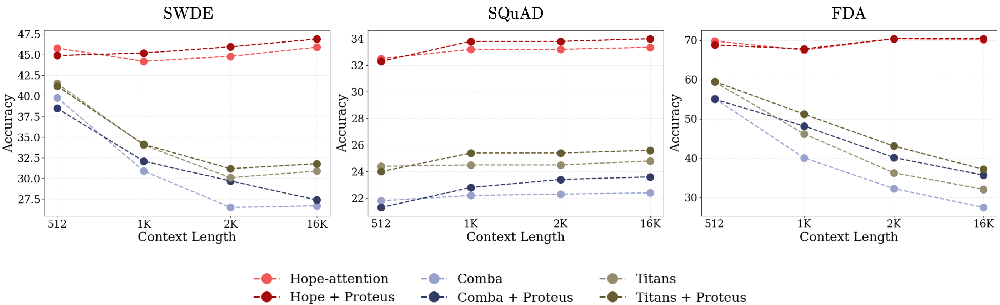

# Paper精读｜Proteus: Incremental Memory Activation for Long-Context Sequence Modeling

> [!abstract] 一句话结论
> 提出**增量记忆激活（Incremental Memory Activation）**新范式：现有记忆型序列模型（SWLA/Comba/Titans/Hope-Attention 等）在整个序列上暴露**静态记忆**——早期 token 没有压缩压力，占据过多自由度"污染"记忆状态，留给后续上下文的容量不足、新旧存储相互干扰。Proteus 让**记忆有效容量随上下文增长逐步解锁**：早期强制瓶颈（逼模型有效压缩历史），后期解锁新容量（减少覆盖与干扰、改善后续保留）。实现上只是一个**分块 + 确定性调度掩码**，零额外成本可插入任何神经记忆架构。四个 SOTA 记忆模型 × 两个规模（760M/1.3B）一致提升语言建模、常识推理、长上下文检索与理解，**增益随上下文变长而增大**。结论：静态记忆是次优的，而容量调度是此前记忆建模一直没碰的第三个维度。

> [!cite]- 论文信息（点开折叠）
> - **论文标题**：Proteus: Incremental Memory Activation for Long-Context Sequence Modeling
> - **arXiv**：2608.16844（cs.LG / cs.CL）
> - **链接**：[https://arxiv.org/abs/2608.16844](https://arxiv.org/abs/2608.16844)
> - **作者**：Reza Bayat†∗, Ali Behrouz‡∗, Vahab Mirrokni‡, Aaron Courville†（∗ 共同一作；† Mila/蒙特利尔大学；‡ Google Research）
> - **日期**：2026-08-17

---

## 1️⃣ 论文想解决什么问题

Transformer 的 softmax 注意力是无损记忆（缓存每个 token），但带来**二次方计算成本**，限制长上下文。为此记忆型循环模型（linear attention、SSM 系）把上下文压缩进紧凑状态，重新流行。但现有记忆模型有个共同盲点：

1. **早期 token 无压缩压力**：序列开头时记忆容量充足，模型把早期输入**记忆**而非**压缩**——占据过多自由度（degrees of freedom）

2. **污染效应**：早期"奢侈"存储污染了记忆状态，后续上下文容量被挤占

3. **新旧干扰**：后到信息与已存内容相互干扰（overwriting/interference），晚期信息保留差

**核心问题**：静态容量下"记忆早期输入"与"压缩早期输入"之间的张力无法调和——容量小则早期塞不下、容量大则早期过度拟合——能否通过**随时间调度有效容量**同时解决两端？

---

## 2️⃣ 核心洞察

> [!important] 核心洞察
> 1. **容量应跟踪上下文量**：活跃容量应该小（当只看到少量 token 时）并随更多 token 到达而增长——"effective capacity should track the amount of context observed"。固定在任何极端都次优：后期活跃容量太少浪费记忆、早期活跃容量太多让记忆过拟合已见的少量 token 而非压缩它们。
>
> 2. **早期瓶颈 = 更好的压缩**：强制早期在受限容量下写入，模型必须**总结**而非**背诵**早期上下文——压缩出来的状态更干净，即使训练窗口内（8K）也有收益。
>
> 3. **后期新容量 = 更少干扰**：随时间解锁未使用组件，新信息写入新鲜容量而非覆盖已有存储——长上下文的保留与检索跟着变好。
>
> 4. **单一在线轨迹，非逐步重优化**：这是关键设计——早期 token 压缩进当时活跃的组件，该压缩状态在后续组件解锁时**持续存在**，不是每步重新优化。
>
> 5. **零成本可插拔**：现代神经记忆把 M 参数化为线性映射或 MLP——**乘性门控（mask）就够了**，无需额外参数或计算；且训练窗口后全部激活，推理长度超过训练窗口时无任何门控开销。
>
> 6. **Nested Learning 视角统一记忆与参数**：MLP 块本身可视为把数据压缩进参数的联想记忆（Nested Learning）——同样的"调度哪些参数活跃"原则可推广到参数层面，从而覆盖 Hope-Attention 这类非显式记忆架构。

---

## 3️⃣ 方法解读

### 组件1：Capacity-Scheduled Associative Memory（§3 形式化）

Proteus 对标准在线联想记忆更新只动一处：加一个**激活算子 G_t**，控制每步暴露的记忆容量子集（定义 2）：

- M_t = M_{t-1} − θ_t·G_t(∇L̃(M_{t-1}(g), k_t, v_t))，且 (1−g_t)⊙M_t = (1−g_t)⊙M_{t-1}——**活跃集外的组件锁定**：既不写也不读，保持原值

- 读：y_t = Read(M_{t-1}(g), q_t)——只从活跃子空间读

- 恒等 G_t 退化为标准在线记忆；关键：**单一在线轨迹**，不是每步新优化

两个目标直接支撑：

- 上下文大部分时间活跃集是严格子集 → 有效容量受限 → **显式瓶颈强制压缩**

- 更多组件随后激活 → 新容量吸收新信息，不覆盖已存

### 组件2：Proteus 实例化（§4.1）——分块 + 确定性调度

**三个要素**：

1. **分块**：记忆参数分为 E 个等大小连续块（实验 E=16）

2. **门控算子**：G_t(M) = g_t ⊙ M——前缀掩码，活跃块参与读写，锁定块不参与（线性映射/MLP 参数化下乘性门控零成本）

3. **均匀调度**：Δ = max(1, ⌊N/E⌋)；第 t 步激活 k(t) = min(E, 1+⌊(t−1)/Δ⌋) 个块——**活跃比例以 E 个均匀增量增长**：tokens [1,Δ] 只用前 1/E 记忆、[Δ+1, 2Δ] 用前 2/E……直到全容量。N = 训练上下文（8K），评估时固定；超 N 后全记忆活跃——**推理超窗长度零门控开销**

### 组件3：扩展到 Hope/MLP 块（§4.2）

Nested Learning 视角：过参数化 MLP 训练早期容量充裕，会"拟合"而非"压缩"首批样本——对参数本身应用同样的"训练进程调度活跃参数"原则，把 Proteus 推广到 Hope-Attention 等非显式记忆架构（轻量扩展，非独立贡献）。

*Figure 1（机制）：Proteus 随上下文推进逐步扩展记忆状态的活跃子集——每步模型只读写当前激活块（连同先前已激活的"过去"块），其余块保持锁定（不参与检索或更新）；上下文增长时解锁新块，为后续 token 提供新鲜容量。早期容量瓶颈鼓励压缩初始上下文，随时间引入的新容量减少后续 token 的覆盖与干扰。*

### 组件4：实验设置（§5）

- **四个记忆家族**：Hope-Attention、SWLA（滑窗线性注意力）、Comba、Titans；参照 Transformer++/RetNet/DeltaNet

- **训练**：FineWeb、8K 上下文、760M（50B tokens）与 1.3B（100B tokens）、AdamW lr=4e-4、cosine、0.5M batch、wd=0.1

- **评测**：Wikitext/LAMBADA 困惑度 + 零样本常识（PIQA/HellaSwag/WinoGrande/ARC-e/ARC-c/SIQA/BoolQ）；NIAH（单针/多针 × 4K/8K/16K）；LongBench 六任务；SWDE/SQuAD/FDA 检索

---

## 4️⃣ 实验部分怎么读

### 语言建模与常识（Table 1）——全家族一致提升

| **760M** | **平均常识准确率** | **1.3B** | **平均常识准确率** |
| --- | --- | --- | --- |
| Hope-Attention → +Proteus | 53.15 → **53.99** | Titans → +Proteus | 58.00 最佳 |
| SWLA → +Proteus | 50.12 → 50.90 | — | — |
| Comba → +Proteus | 51.43 → 52.15 | — | — |
| Titans → +Proteus | 52.65 → 53.36 | — | — |

- 760M 最佳 = Hope-Attention+Proteus（Wiki 19.87 / LMB 19.72 / avg 53.99）；1.3B 最佳 = **Titans+Proteus**（Wiki 14.94 / LMB 13.03 / avg **58.00**）

- 对最强记忆模型提升最大；**对 Transformer++ 等注意力基线也保持优势**——收益不绑定特定架构，而是"上下文中的记忆管理方式"

### NIAH（Table 2）——增益集中在长上下文与难变体

- 短上下文饱和处（S-NIAH-1 近完美）Proteus 基本中性——**符合论文论点**

- 16K 处大幅提升：Titans S-NIAH-3（21.4→**29.8**）、S-NIAH-2（69.4→**74.2**）；Comba S-NIAH-2（13.4→**21.2**）

- 多针 16K：MK-NIAH-1（Titans 11.8→16.8）、MQ-NIAH（Hope-Attention 30.6→34.2）、MV-NIAH（Hope-Attention 23.0→25.8）

- **注意**：调度在 8K 训练窗内完成，16K 不再解锁新块——16K 的改进反映**早期瓶颈构建的更干净压缩状态**在超窗长度时退化更优雅

### 长上下文检索（Figure 2）——增益随长度增长

- SWDE/SQuAD/FDA 三个数据集 × Hope-Attention/Comba/Titans：Proteus 在长上下文更鲁棒、改善长度外推

- Comba/Titans 基线随上下文锐降，加上 Proteus 后曲线稳住了；Hope-Attention 全长度提升

- **关键模式：增益随上下文长度增长**——与 NIAH 一致

*Figure 2（长上下文检索）：SWDE/SQuAD/FDA 上准确率随上下文长度变化——Proteus 一致改善长上下文鲁棒性：Comba 与 Titans 基线的长度退化被 Proteus 压住了（Hope-Attention 也在全长度提升），且增益随上下文变长而增大。*

### LongBench（Table 3）——零成本全面提升

- 三个 backbone 平均分全部提升、多数单任务提升，**不增加参数与记忆**

---

## 5️⃣ 学术评价

**优点：**

1. **一个简单洞见、一套普适机制**：静态记忆的两个失败模式（早期记忆化 + 后期干扰）用"容量随位置增长"一个调度同时解决——原理清晰、实现极简（分块+掩码）、零额外成本

2. **与近期记忆建模主线形成对话**：Titans/Comba/Hope-Attention 都是"更好的记忆读写"；Proteus 回答的是被忽视的第三维——**记忆的容量调度**，与前两者正交可叠加

3. **严格对应"两目标 → 两收益"**：早期瓶颈 → 更干净压缩（8K 内即获益）；新鲜容量 → 更长保留（16K/超窗外推获益）——实验设计精确映射理论机制

4. **16K 结果的设计巧妙**：训练窗 8K、调度 8K 完成，16K 无新块解锁——排除"长上下文只是多给了容量"的平凡解释，证明收益来自**压缩质量**而非容量本身

5. **Nested Learning 推广**：把记忆调度升维到参数调度，覆盖非显式记忆架构——机制的可移植性说明

6. **实验覆盖面完整**：4 家族 × 2 规模 × 语言建模/常识/检索/理解四类任务 + NIAH 三难度

> [!ed-warning] 局限（风险与不确定性）
> 1. **"零成本"的真实性**：推理计算确实无额外开销，但训练时每个 token 只见部分记忆块——**训练效率/收敛速度的影响未报告**；掩码让部分参数在训练早期完全不更新，可能影响优化动力学
>
> 2. **调度超参数 E（块数）**：E=16 的消融在附录，但"均匀调度是最优调度吗"未深挖——位置相关（如对数增长）或任务自适应调度可能更好
>
> 3. **8K 训练窗口上限**：训练上下文只有 8K，长上下文结论（16K）依赖外推——更大训练窗（如 128K 系）下结论是否成立未验证
>
> 4. **扩展的"轻量"性质**：Hope/MLP 块的参数调度是"轻量扩展而非独立贡献"——对非记忆架构的实际收益证据较薄（主要结果集中在记忆架构）
>
> 5. **无与"显式记忆压缩损失"类方法的对比**：如加正则项鼓励压缩（类似 delta rule 的显式遗忘）——Proteus 的收益可能部分来自类似效应，需消融分离

---

## 6️⃣ 局限与可扩展方向

- **调度形状搜索**：均匀 vs 对数 vs 幂律 vs 任务自适应——容量释放节奏的优化空间

- **更大训练窗**：128K 级训练下 Proteus 的收益曲线；调度与训练窗的耦合

- **与显式压缩方法组合**：Proteus（容量调度）× delta rule/遗忘机制（写入强度）——两个正交杠杆

- **训练动力学分析**：掩码导致的参数更新稀疏性如何影响收敛；能否配学习率调度

- **更广架构覆盖**：Dense 注意力、混合架构（Hybrid）中的记忆块调度

- **与 MemHarness/记忆管理主题的类比**：agent 记忆层同样面临"早期信息污染容量"问题——容量调度思想可迁移到 agent 记忆管理

---

## 与其他论文的对话

| **相关工作** | **关系** | **差异** |
| --- | --- | --- |
| **Titans（Behrouz et al.）** | 直接 backbone | Titans 引入测试时深度神经记忆（写读机制）；Proteus 在它之上加**容量调度**——同组（Behrouz/Mirrokni）延续 |
| **Comba / SWLA** | 直接 backbone | 线性注意力系压缩方案；Proteus 以乘性门控无损叠加 |
| **Hope-Attention** | 直接 backbone + Nested Learning 推广 | 通过"MLP 即联想记忆"的 Nested Learning 视角把调度从记忆状态推广到参数 |
| **Transformer++ / RetNet / DeltaNet** | 基线 | Proteus 对注意力基线也保持优势——收益来自记忆管理而非架构 |
| **Delta Rule / 显式遗忘** | 机制邻居 | Delta rule 调度"写入强度"（哪些信息该记）；Proteus 调度"写入容量"（用多少空间记）——互补 |
| **MemHarness（2607.28272）** | agent 记忆主题 | 记忆型模型的状态污染 ↔ agent 记忆层的上下文污染——容量调度思想跨域可迁移 |
| **Proteus 命名（希腊神普罗透斯）** | 文化注脚 | 多变形态之神——记忆容量随上下文变形 |

---

## 7️⃣ 最后总结

Proteus 的全部机制就是**把记忆分块、按位置均匀解锁**，却同时按住了记忆型序列模型的两个系统性问题：早期 token 的"记忆化而非压缩"（污染）与后期信息的"覆盖与干扰"（遗忘）。理论形式化（Capacity-Scheduled Associative Memory）清楚、实现零成本可插拔、四个 SOTA 记忆家族一致验证，且 16K 结果巧妙排除了"多给容量"的平凡解释，证明收益来自早期瓶颈带来的压缩质量。它与 Titans/Comba 这类"更好的记忆读写"工作正交——补上了被忽视的**容量调度**维度。对做高效序列建模的人，这是一个"5 行代码换一致收益"的机制；对做 agent 记忆管理的人，这套容量调度的思想可以直接搬过去用（早期上下文污染是两类系统的共同病灶）。

---

## 8️⃣ 三句速记

> [!summary]- 点开展开
> 1. **静态记忆是次优的**：早期 token 无压缩压力"污染"记忆状态、后期信息被覆盖干扰——两个失败模式源于容量不随位置变化。
>
> 2. **容量随上下文增长**：Proteus = 记忆分 E 块 + 前缀掩码按位置均匀解锁——早期瓶颈逼压缩、后期新容量减干扰，零额外成本可插拔任何记忆架构。
>
> 3. **增益随长度增长**：四个家族（SWLA/Comba/Titans/Hope-Attention）× 两规模一致提升；16K 处 Titans NIAH 最高 +8.4pt，且 16K 收益纯来自压缩质量（调度在 8K 已完成）。
