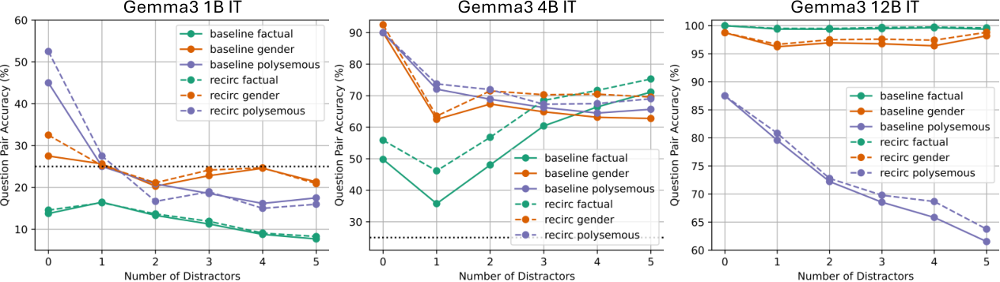

# Paper精读｜Recirculation

> [!abstract] 一句话结论
> **Recirculation（再循环）**：一个**推理时的架构增强**——运行 LLM 时每步把深层激活"泄漏"一小部分回浅层（source→destination 层对 + 混合系数 α），让前馈 Transformer 变成**动力系统**，能像 RNN/Kalman 滤波那样追踪信念状态。核心动机：**前馈 Transformer 的状态更新受模型深度限制**（一个 token 的信息要跨很多层才能影响后续处理），而 recirculation 让状态在同层内跨时间步更新。与 chain-of-thought（留给复杂推理）、looping（仅深度方向复用权重）、重训循环 Transformer（昂贵）区分。在 **Gemma3 家族**（1B/4B/12B）上：**困惑度平均降低 23%**、**GSM8k 准确率 +21%**、Racing Thoughts 等下游任务稳定提升；自适应变体（只学 α/β 系数、冻结原权重）效果最佳。**训练零成本**——纯推理时技术，且"让模型自己告诉我们架构怎么改"。

> [!cite]- 论文信息（点开折叠）
> - **论文标题**：Recirculation
> - **arXiv**：2608.17981（cs.LG / cs.CL）
> - **链接**：[https://arxiv.org/abs/2608.17981](https://arxiv.org/abs/2608.17981)
> - **作者**：Michael C. Mozer、Shoaib Ahmed Siddiqui、Danny Sawyer（Google DeepMind）、Sunny Sanyal（UT Austin）、Rosanne Liu（Google DeepMind；ML Collective 创始人）
> - **日期**：2026-08-18
> - **注**：Mozer 是认知科学/机器学习老牌学者（双向联想记忆 BAM、TD 学习等经典工作）；Rosanne Liu 是 ML Collective 发起人

---

## 1️⃣ 论文想解决什么问题

**状态追踪（state tracking）失败是 Transformer 架构的根本弱点**：

1. **并行性牺牲了状态追踪**：传统状态追踪（RNN、Kalman 滤波）靠潜变量的迭代顺序更新；Transformer 训练和 prefill 都完全并行，"无法以传统方式追踪状态"

2. **Transformer 用"巧妙技巧"弥补**：对有限序列长度，能学到各种近似状态追踪的方案——但会失败：

  - 多轮对话失去连贯性

  - 信息收集低效

  - 多 agent 场景沟通协作崩溃

  - 推理失败：工作记忆低效、心智理论（theory-of-mind）表征不稳定、缺乏鲁棒的内部世界模型

3. **典型症状——上下文化错误（contextualization error）**：Figure 1 的经典例子——"Fred 去钓鱼，开车到 bank（河岸）"之后，模型回答"bank（银行）里能找到 ATM 吗？"时**翻车**（Gemini 2.5 Flash 2025 年实测）：模型没有维护"bank=河岸"的信念状态，摇摆回默认解释且不自知

**根本限制**：前馈 Transformer 中状态更新受模型深度限制——一个 token 的信息要经过有限层数才能影响其他 token 的处理；**深度是状态传播的硬边界**。

---

## 2️⃣ 核心洞察

> [!important] 核心洞察
> 1. **深度不是唯一的方向，时间也是**：标准 Transformer 只有深度（层）一个传播维度；recirculation 引入**深度 × 时间步**两个维度的循环——状态 z(t+1) = f(z(t), x(t)) 中，同一层可以同时容纳 z(t) 和 z(t+1)。这是它与 looping 拉开差距的地方：**looping 的循环仅在深度方向**（z(t+1) 必须比 z(t) 深一层），recirculation 在深度和时间步都有投影。
>
> 2. **小混合系数即可**：α ∈ {0.04-0.16}——只需把深层激活的一小部分（~10%）回注浅层，困惑度就压得动；α 太大反而有害（更多 source-destination 对伤害性能）。
>
> 3. **模型自己告诉我们改哪**：超参扫描的热力图平滑且有系统模式（layer 4 是好的 destination，source 高 5-7 层）——**"由训练网络的性质引导架构演化，而非强加任意设计选择"**。
>
> 4. **状态追踪 ≠ CoT**：recirculation 解决的是"基本状态追踪"（保持连贯的信念状态），CoT 应留给复杂推理——两者正交。
>
> 5. **预填充串行、生成并行**：recirculation 需要 prefill 阶段串行处理（状态随时间步传播），但**生成阶段几乎无额外延迟**——这是实用的关键。
>
> 6. **早期 token 可能有害**：1B 模型上下文窗口开头的 token 再循环有害（没有状态可传播，还把表征推出分布）；4B/12B 无此问题——用 ramping（衰减前几个 token 的 α）解决。

---

## 3️⃣ 方法解读

### 组件1：动机——前馈深度限制（§1）

状态更新函数 z(t+1) = f(z(t), x(t)) 在标准 Transformer 里实现：z(t+1) 必须比 z(t) 深一层（因为信息只能沿深度方向流动）——等价于一张权重共享的更深前馈网络，状态传播被深度绑死。Recirculation 打破这个限制：**深度和步两个方向都有投影，同一层可同时持有 z(t) 和 z(t+1)**。

### 组件2：Recirculation 形式化（§2）

**单次迭代混合**（Equation 1）：

z(t+1,t,d) = α·f(z(t,t,s) | d,t) + β·z(t,t,d)

- t = 更新次序索引，s/d = source/destination 层索引

- α/β = 混合系数（凸混合 β ≡ 1−α）

- f(·) = 重归一化函数：把 source 激活缩放到与 destination 相同的 L2 范数（Equation 2）——残差流嵌入幅度随层增长，必须重归一化

**与 looping 的关键区别**：

- Looping：循环的是**整个残差流**，直接替代前一层的输入；循环**仅在深度方向**

- Recirculation：激活在 source 与 destination 层间**混合**；循环**在深度和时间步两个方向**

- 所有实验用"单额外迭代"变体；迭代次数无界时退化为真正的 RNN

### 组件3：自适应变体（§4.6，Figure 13）

- 不微调模型权重，只**学习 α/β 系数**（token 条件/无条件 × 标量/向量四种变体）

- **learned-conditional-vector 变体最佳**——甚至超过全模型微调（后者风险：过拟合、成本高）

- 轻量调超参 + 冻结原权重 = 训练零成本的自适应 recirculation

*（原图未能本地化：Figure 2: 处理 Figure 1 银行/河岸例子时 Transformer 激活的示意——层网格中状态传播的失败可视化；IMA 媒体接口没有可用媒体编号）*

*Figure 2（动机示意）：处理"bank=河岸/银行"例子时 Transformer 各层激活的可视化——状态信息未能在层间正确传播，导致上下文化错误。*

*（原图未能本地化：Figure 3/4: (a) 引入循环连接的 Transformer（layer 6 → layer 3）；(b) unrolled looped transformer——循环仅在深度方向、严格状态传播；(c)/(b') unrolled recirculation——深度与时间步双方向投影，同层可同时持有 z(t) 与 z(t+1)；IMA 媒体接口没有可用媒体编号）*

*Figure 3/4（核心机制对比）：上排 looping（循环仅深度方向，z(t+1) 必须比 z(t) 深一层）；下排 recirculation（深度与时间步双方向投影——同一层同时容纳 z(t) 与 z(t+1)，任意状态更新函数 f 可直接实现）。*

### 组件4：实验设置（§4）

- **模型**：Gemma3 1B/4B/12B PT（预训练）与 IT（指令微调）变体；扩展到 5 个模型家族验证普适性

- **超参**：α（混合系数）、s/d（source/destination 层）、归一化方案（L2 重归一化、非凸混合 β=1 等）、ramping

- **调参**：arXiv/C4/PG19 调优集（1.5M tokens）网格搜索 → 最优 s/d 对：1B {11,4}、4B {18,9}、12B {35,16}；α=0.15 评估

- **评测**：10 个语言建模数据集困惑度 + 8 个单 token 响应数据集 + Racing Thoughts（上下文化错误检测）+ GSM8k（pass@1/pass@128）+ 指令跟随

---

## 4️⃣ 实验部分怎么读

### 困惑度（Table 1）——一致且随规模增大

| **数据集** | **1B 降低** | **4B 降低** | **12B 降低** |
| --- | --- | --- | --- |
| arxiv | 13.99% | 11.26% | **25.20%** |
| pg19 | 14.41% | 15.72% | **35.40%** |
| booksum/book | 15.95% | 15.95% | **32.91%** |
| gov_report | 7.26% | 9.37% | **30.74%** |
| pubmed | 11.08% | 9.21% | **24.49%** |
| big_patent | 9.13% | 7.08% | **24.76%** |
| lambada | -0.72% | 0.53% | -2.81%（少数退化） |

- **12B 增益最大**（平均 ~23%）：更大的模型受益更多——状态追踪能力随规模释放

- lambada 是唯一退化数据集（短上下文单 token 预测，recirculation 无增益空间）

### 超参扫描（Figure 5/6）——"模型自己告诉我们改哪"

- 热力图平滑、有系统模式；α 增大放大效应但也让更多 s/d 对有害

- **layer 4 是理想 destination，source 高 5-7 层**；跨三个数据集平均最优降低 4.72%（调优集）

*（原图未能本地化：Figure 5: Gemma3 1B 超参扫描——α ∈ {0.04, 0.07, 0.10, 0.16} 的 source/destination 热力图；蓝=困惑度低于基线（16.6），红=高于；IMA 媒体接口没有可用媒体编号）*

*Figure 5（超参扫描）：Gemma3 1B 在 arXiv 上的 source/destination 层热力图（α=0.04/0.07/0.10/0.16）。热图平滑且有系统模式：layer 4 是好的 destination、source 高 5-7 层；α 越大效应越强但有害的 s/d 对越多——"由模型自身性质引导架构修改"。*

### Racing Thoughts（Figure 11）——状态追踪的直接检验

- 三个组件数据集（含"bank 河岸/银行"类上下文化错误）上，Gemma3 IT 模型 1B/4B/12B **全部提升准确率**——recirculation 确实修复状态追踪失败

### GSM8k（Figure 12）——能力锐化 + 扩展

- 4B PT 模型 pass@1 与 pass@128 **双双提升**（自适应变体增益最大，摘要称 +21%）

- pass@1 提升 = 能力锐化（正确回答在候选集中胜出）；pass@128 提升 = 能力扩展（候选集本身变大）——**两种机制都受益**

*Figure 11（Racing Thoughts）：Gemma3 IT 1B/4B/12B 在三组上下文化错误数据集上的准确率——recirculation 全部提升，直接证明状态追踪能力的修复。*

### 其他（Figure 7/8/13）

- **5 个模型家族普适**（Figure 7）：s/d 扫描显示鲁棒的收益区域

- **与 looping 对比**（Figure 8）：recirculation 优于 looped transformer

- **变体对比**（Figure 13）：learned-conditional-vector 自适应最佳，**超过全模型微调**；固定系数次之；comment 形状噪音无效

---

## 5️⃣ 学术评价

**优点：**

1. **直击架构级根本限制**：把"状态更新受深度限制"说清楚，并给出不重训的解法——对 off-the-shelf 模型纯推理时增强，工程上立即可用

2. **与 looping/CoT/循环 Transformer 的清晰区分**：深度循环 vs 深度×时间循环的对比（Figure 3/4）是全文最精华的洞见——**"同一层可同时持有 z(t) 和 z(t+1)"一句话点破要害**

3. **零训练成本 + 模型自指导**：自适应变体只学 α/β（冻结权重）就超过全量微调——「让网络告诉你怎么改架构」这条路子，比拍脑袋定层对可信得多

4. **增益随规模增长**：12B 平均降困惑度 23% vs 1B ~10%——与大模型更强的状态追踪需求一致，规模越大越划算

5. **Motivation 有真实案例**：Figure 1 的 bank 例子（Gemini 2.5 Flash 实测）让"状态追踪失败"具体可感

6. **归一化/ramping 等工程细节扎实**：L2 重归一化、非凸混合 β=1、早期 token ramping——处理了残差流幅度漂移等真实工程问题

> [!ed-warning] 局限（风险与不确定性）
> 1. **prefill 串行化的成本**：虽然生成阶段无额外延迟，但 prefill 必须串行——长上下文 prefill 的延迟代价未充分量化（对在线服务可能是实际障碍）
>
> 2. **超参依赖调优集**：s/d 对靠 arXiv/C4/PG19 调优集网格搜索——不同领域/任务分布的最优层对可能不同（好在 Figure 7 显示收益区域鲁棒）
>
> 3. **困惑度 ≠ 下游质量**：语言建模收益大，但单 token 响应数据集（Table 2）改进"modest"、lambada 甚至退化——收益分布不均衡
>
> 4. **Gemma3 家族为主**：跨 5 家族验证是"promising"（Figure 7），但详细实验集中在 Gemma3——闭源前沿模型（GPT/Claude）不可得，适用性未证明
>
> 5. **与 RNN 化训练的边界**：迭代次数无界即真 RNN——recirculation 与"训练循环架构"是连续谱，论文只取了单额外迭代这一端
>
> 6. **机制解释偏定性**：token 分析（Figure 9）显示早期 token 再循环有害等定性结论，但对"为什么 α~0.1 最优"缺乏理论解释

---

## 6️⃣ 局限与可扩展方向

- **prefill 加速**：串行 prefill 的并行化/近似（块级再循环、分层调度）——消解实际部署障碍

- **自适应调优的扩展**：α/β 之外学习 s/d 选择；每层/每 token 的条件混合

- **与 CoT/推理时扩展叠加**：recirculation（状态追踪）× CoT（复杂推理）× test-time compute——三个正交杠杆的组合

- **更大模型**：70B+ 规模下增益是否持续放大；训练时即带 recirculation 的收益

- **领域自适应**：不同任务分布的最优层对自动选择（可学习 s/d）

- **理论化**：为什么小 α 最优？与残差流子空间（residual stream 的低秩结构）的关系

---

## 与其他论文的对话

| **相关工作** | **关系** | **差异** |
| --- | --- | --- |
| **Looped Transformer（looping）** | 最接近的邻居 | 循环仅深度方向、整个残差流回环；recirculation 深度×时间双方向 + 混合（非替代）——Figure 4 的状态传播对比是核心区别 |
| **Recurrent Transformers（重训）** | 相关但昂贵 | recirculation 纯推理时、零训练——"训练循环架构"的免训练近似 |
| **Chain-of-Thought** | 正交互补 | CoT 留给复杂推理；recirculation 做基本状态追踪——论文明确划界 |
| **Kalman 滤波 / RNN 状态追踪** | 概念源头 | 传统顺序状态更新在 Transformer 并行架构上的重新引入 |
| **Residual Stream 研究（低秩、子空间）** | 机制相关 | α~0.1 的最优性可能源于残差流低秩结构——可联动理解 |
| **Proteus（2608.16844）** | 记忆/状态主题 | Proteus 调度记忆容量（长上下文压缩）；recirculation 调度层间状态传播（信念追踪）——"状态/记忆管理"浪潮的不同维度 |
| **Titans / 线性注意力** | 状态建模 | 显式记忆状态；recirculation 是隐式状态——前馈网络本身当动力系统 |
| **推理时计算（test-time compute）** | 广义范畴 | recirculation 属于"推理时增强"家族，但增加的是深度×时间计算而非采样/搜索 |

---

## 7️⃣ 最后总结

这篇论文两头都占，架构洞见和工程实用各占一头：它把 Transformer 状态追踪失败归因于**深度是状态传播的硬边界**，然后用一个极简的推理时机制（深层激活按 α 混合回浅层）让前馈网络变成动力系统——与 looping 的"深度方向循环"不同，recirculation 在**深度和时间步两个方向**投影，使同一层能同时持有前后时间步的状态。实证上 Gemma3 家族一致获益（12B 困惑度平均 -23%、GSM8k +21%、Racing Thoughts 全提升），自适应变体（只学混合系数、冻结权重）甚至超过全量微调，且 5 个模型家族显示普适性。最有哲学味道的贡献是"**让模型自己告诉我们架构怎么改**"——超参热力图的平滑系统性替代了强行设计。对做推理优化的人，这是即插即用的免费午餐（唯一代价是 prefill 串行）；对理解 Transformer 局限的人，它把"状态追踪"这个认知科学概念变成了可操作的架构指标。

---

## 8️⃣ 三句速记

> [!summary]- 点开展开
> 1. **深度是状态传播的硬边界**：前馈 Transformer 的状态更新受层数限制；recirculation 把深层激活按 α~0.1 混合回浅层，引入深度×时间双方向循环——同一层同时容纳 z(t) 与 z(t+1)。
>
> 2. **零训练、即插即用**：Gemma3 12B 困惑度平均 -23%、GSM8k +21%、Racing Thoughts 全提升；自适应变体只学 α/β 冻结权重，甚至超过全模型微调。
>
> 3. **与 looping/CoT 划清界限**：looping 仅深度循环、CoT 留给复杂推理、重训循环架构太贵——recirculation 是"状态追踪"任务的专用免训练方案；唯一代价是 prefill 串行（生成阶段零额外延迟）。
