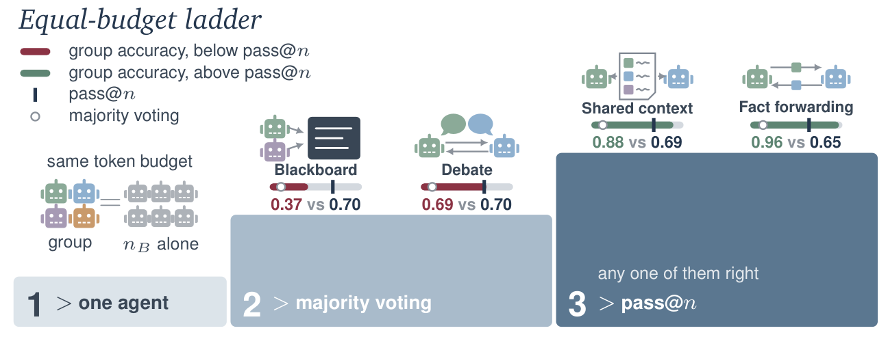
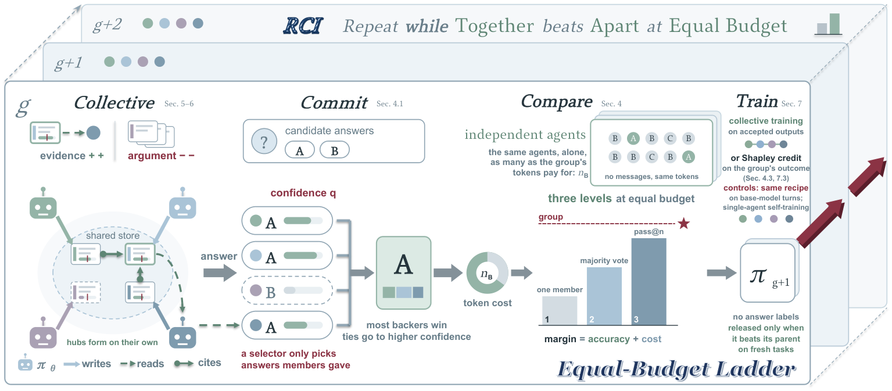
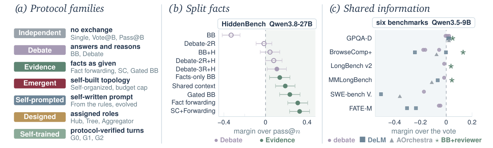
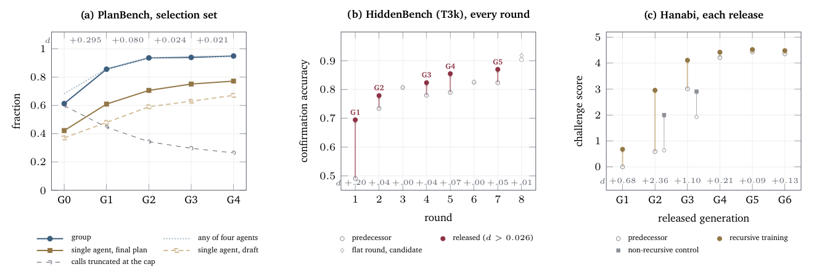
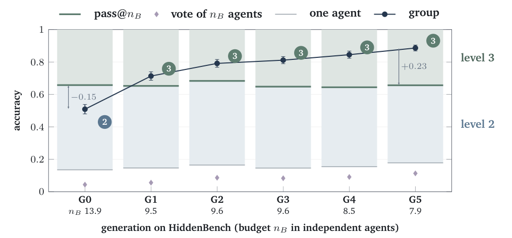

# Paper精读｜Recursive Collective Intelligence: Emergence on an Equal-Budget Ladder in Multi-Agent LLM Systems

> [!abstract] 一句话结论
> 这篇论文把"多智能体比单智能体强"从口号变成一个可证伪的测试：等预算阶梯要求团队在同 token 预算下依次超过单个智能体、多数投票和 pass@n，且 Proposition 1 证明 pass@n 封顶一切"从独立答案里挑"的规则——过第 3 级意味着交互真的创造了新答案。在此之上定义递归集体智能（RCI）：群体用自己协议验证过的输出、无教师无标签地训练下一代，在 PlanBench、HiddenBench、Hanabi 上每一代都胜过上一代，连续 4–6 个世代；HiddenBench 上群体对 pass@$n$ 的边际从 −0.15 爬到 +0.23。

> [!cite]- 论文信息（点开折叠）
> * 论文标题：Recursive Collective Intelligence: Emergence on an Equal-Budget Ladder in Multi-Agent LLM Systems
> * arXiv：2611.32606（v1）
> * 链接：[https://arxiv.org/abs/2611.32606](https://arxiv.org/abs/2611.32606)
> * 作者：Lixuan He, Shengqu Cai, Fang Wu, Shikang Zheng, Liwei Jiang, Manling Li, Yi Ma, Li Fei-Fei, Leonidas Guibas, Gordon Wetzstein, Yejin Choi, Yining Hong
> * 机构：Stanford University / UC Berkeley / NVIDIA / Northwestern University
> * 日期：2026-11-24
> * 阅读范围：正文 §1–§8 + 附录 B–M 全读（证明、协议定义、附加结果表、复现细节均已覆盖）
> * 项目主页：lixuan27.github.io/RCI § github.com/lixuan27/RCI-official

---

## 1️⃣ 论文想解决什么问题

这一节要回答：多智能体 LLM 系统的评测到底在哪里失真，以及为什么现有修补救不回来。

评测的惯性写法是：团队准确率 > 单个 agent 准确率，结论"协作有效"。但团队花的 token 通常是单个 agent 的好几倍，而对独立采样做一次多数投票（Self-Consistency 的基本盘）本来就能涨分——花的预算翻倍，就算零交互也该涨。多数投票之上还有 pass@$n$：只要 n 个独立答案里有一个对的，就算命中。不控制预算，"团队更强"这句话既可能是交互的功劳，也可能纯粹是算力的功劳，二者在报告里混为一谈。

失真到底长什么样？拿论文里贯穿使用的那个 HiddenBench 撤离决策任务当例子：四位成员各持一条私有事实，共享事实齐刷刷指向一个诱饵选项 Lunar Base，而四条私有事实拼起来才指向正确答案 West City（"West City is the only evacuation location still accessible" 这条关键事实只握在一位成员手里）。这个任务有两种失败模式，正好对应两种信息结构：

- **共享信息**（人人看全题，如 GPQA-Diamond）：消息大多在复读读者已经知道的东西；更糟的是投票会被高置信的错误答案压过——Figure 6a 里唯一答对的成员被其他三人用投票否决。此时加 agent 只是在同一分布上加采样，收益被 pass@$n$ 封顶。
- **分裂事实**（每人只握一块拼图，如 HiddenBench）：单干必错，pass@$n$ 极低；但 debate 类协议传的是"从局部事实推出的结论"，读者会把这些半成品结论当成事实采纳，照样掉进诱饵陷阱。论文的实测是：两轮 debate 在 HiddenBench 上准确率 0.688，仍卡在多数投票之上、pass@$n$ 之下（第 2 级）。

现有修补不够，原因在机制层面：给 debate 加轮数、加"事实可能是分裂的"提示（Debate-3R+H），能到 0.841 过第 3 级，但预算膨胀到 11.1 个独立 agent 的量；而既有 multi-agent 工作（Du et al. 的 debate、DeLM、AOrchestra）干脆不做等预算对照，论文重跑后它们在六个共享信息基准上全部不高于等预算投票。

第二个开放问题更少有人碰：群体能不能**用自己产出把下一代变聪明**——不靠教师、不靠外部标签。既有自改进方法（STaR、Self-Rewarding、SiriuS 等）要么依赖外部打分器，要么在隔离的单模型上评测；没有人把"群体交互的产物"当训练数据、再放回同一个等预算框架里验收。这篇论文用一套测量框架同时接住这两个问题。

---

## 2️⃣ 核心洞察

> [!important] 三条核心洞察
> 1. **把"集体智能"放进三层台阶**：level 1 胜单个智能体，level 2 胜等预算多数投票，level 3 胜等预算 pass@$n$。层级是累进的、按序检验的，不是并列的三个指标。
> 2. **pass@$n$ 是一切"选择规则"的天花板（Proposition 1(ii)）**：任何从 n 个独立答案里挑一个的规则——投票、置信度加权、verifier、judge——精度都不超过 pass@$n$。所以过 level 3 是交互创造新正确答案的充分证据；反过来，共享信息下过不了 level 3 也在预期内，因为那里 pass@$n$ 早就饱和。
> 3. **优势拆成 accuracy + cost 两条通道（式 1），RCI 在这个坐标系里定义**：群体的边际要么来自答得更准，要么来自花得更省；下一代只有在对全新任务的配对增益过门时才被释放。

*图注：Figure 2，等预算阶梯的定义与四个 27B 协议的落位。左：token 预算折算成 $n_B$ 个独立 agent，群体要依次超过"一个 agent → 多数投票 → pass@$n$"三级台阶。右：四种 Qwen3.8-27B 协议在 HiddenBench 上的实测位置——Fact forwarding 0.96 vs pass@$n$ 0.65 站上第 3 级；Debate 0.69 vs 0.70 与投票打平；Blackboard 0.37 掉到第 2 级以下；共享信息 + 事实转发混合协议 0.88 vs 0.69 同样过第 3 级。*

这三条不是并列的抽屉，是一条推理链：先把"集体智能"接到人类群体研究的老传统上（对照组是"同一批人分开干活"，最强对照是"任何人答对即算对"，对应 pass@$n$），再补上 LLM 特有的一维——token 成本；Proposition 1 保证第 3 级非平凡（选择规则永远够不着它）；式 1 把每一点优势拆开归因；最后 RCI 把这套测量原封不动地搬进训练循环，让"自我改进"也接受同一套审判。后面三组实验分别对应三个洞察：§5 验证什么时候交互有净收益，§6 验证组织能不能自己长出来，§7 验证下一代能不能更聪明。

> [!ed-quote] 这套框架真正的杀伤力
> 它对被测对象几乎无侵入——只要最终答案和 token 计数。任何"团队更强"的旧结论都可以被回溯重审：把团队预算折算成独立 agent 数，多数旧结论在等预算投票这一级就该止步。

---

## 3️⃣ 方法解读

这一节按三个组件拆：阶梯本身（测量装置）、协议族与黑板 harness（被测对象）、递归与 Shapley 信用（训练装置）。

*图注：Figure 3，一个世代 g 的完整循环。Collective：多份同一策略 $\pi_\theta$ 向共享黑板写、读、引用，读预算可转让所以 hub 会自己长出来，证据（++）帮助而论断（−−）误导；Commit：每人带置信度 $q$ 提交，多数支持者胜出、平票走高置信，选择器只能从成员给过的答案里挑；Compare：按完成 token 折算预算 $n_B$，让同款 agent 单独跑同样多的次数，分三级打分，边际拆成 accuracy + cost；Train：下一代在被协议接受的输出上训练（或按 Shapley 信用分账），只有在全新任务上胜过父代才释放，循环重复。*

### 组件 1：等预算阶梯（Equal-Budget Ladder）

**是什么。** 一把三级标尺，给任何"多份同一模型组成的、返回一个联合答案的群体"打分，唯一需要的输入是每个成员的最终答案和 token 数。

**为什么需要。** 不控制预算的对比会把算力红利记到交互头上；而"投票之上"这个弱标准又太容易达成。阶梯的第 3 级由 Proposition 1 撑腰：它是"选择规则"永远够不着的天花板，只有真的经由消息传递合成出新答案才可能越过。

**怎么做。** 一个群体跑一次花 $k$ 个完成 token，其预算折算为 $n_B = k / c_1$，其中 $c_1$ 是同一模型、同一协议族、同一平台上一个独立 agent 的平均完成 token 数。然后拿同一个模型单独跑出一个参考池（HiddenBench 每题 32 个成员），从池子里按席位分层抽 $n_B$ 个独立 agent，构造三条参考线：

$$T(n) = 1 - \mathbb{E}_x\left[(1-p_x)^n\right]$$

> 人话：$T(n)$ 就是 pass@$n$——n 个独立 agent 里至少一个答对的概率；$p_x$ 是单 agent 在题目 $x$ 上的答对率。式子对 $n$ 单调递增、凹（每加一个 agent 的增量 $p_x(1-p_x)^n$ 在缩小），且 $T(n) \le \min\{1,\ n\,V(1)\}$：单 agent 越弱，pass@$n$ 涨得越慢、越晚饱和。

三级分别是：level 1，群体准确率 $Y > V(1)$（单 agent）；level 2，$Y > V(n_B)$（等预算多数投票）；level 3，$Y > T(n_B)$（等预算 pass@$n$）。按序做单侧 0.025 配对检验（按题目聚类标准误），过 1 到 $k$ 才算到 $k$ 级；同任务内再过一遍 Benjamini–Hochberg 稳健性标注。Proposition 1(ii) 的证明很干净：任何"观察 n 个答案、提交其中一个"的规则，在某题上答对的前提是 n 个里至少有一个对的，所以其对率 ≤ $T(n)$——投票、置信加权、verifier、judge 全部被这一句话罩住。

再看边际的拆账。对同池打分的协议 $X$ 和参考 $R$：

$$\bigl[Y_X - T(n_X)\bigr] - \bigl[Y_R - T(n_R)\bigr] = \underbrace{(Y_X - Y_R)}_{\text{accuracy}} + \underbrace{\bigl[T(n_R) - T(n_X)\bigr]}_{\text{cost}}$$

> 人话：两个协议的边际之差，一半是"答得更准"（准确率直接相减），一半是"花得更省"（省下的 token 若换成独立 agent 能涨多少 pass@$n$，由 Proposition 1(iii) 的线性上界 $(n_R - n_X)V(1)$ 封顶）。判读规则：把 $X$ 放到 $R$ 的预算下重算边际，若仍确认为正，$X$ 的第 3 级靠的是 accuracy；若只在自家低预算下成立，就是 accuracy 和 cost 合力；两者都不成立就说明优势主要是"便宜"。

**代价。** 阶梯要为每个被测单元配一个独立参考池（预算大的协议要 68 成员/题的池），token 计数必须完整；它衡量的是"每块完成 token 买到了什么"，对协议在延迟、轮数之外的开销视而不见；且 Proposition 1 的独立性假设在"同一模型的多份拷贝错误相关"这个现实中只是近似——论文没有对相关性建模，靠实测的 A/A 检验兜底。

### 组件 2：组织协议族与共享黑板 harness

**是什么。** 被测对象本身。论文把所有组织方式按"成员交换什么、谁定组织"分成七族（Table 8）：Independent（不交换）、Debate（交换答案与理由：BB、Debate-2R/3R、+H 提示版）、Evidence（只传事实：Fact forwarding、Shared context、SC+Forwarding、Facts-only BB、Gated BB）、Emergent（成员自建拓扑：读预算可转让、预算上限禁单 hub、禁 relay）、Self-prompted（模型给自己群体写组织 prompt：从规则写出 / 四个世代演化）、Designed（人写角色：Hub、Tree、Aggregator）、Self-trained（协议验证轮次训练出的 G0/G1/G2）。

**为什么需要。** "组织"是多智能体文献里最常被事先固定的变量——辩论几轮、谁当协调者、黑板怎么挂都是人定的。分族之后才能问一个此前没法问的问题：同一批完全相同的 agent，自己能长出组织吗？长出来的组织在阶梯上值几级？

**怎么做。** 基础设施是 append-only 黑板：一条消息四个字段（子任务、结果、短理由、对前文或任务资源的引用），子任务+结果限 256 token（证明/代码任务 1024），引用构成只增长的有向无环图；检索按 BM25 相关性加消息权重 $\omega_m$（被引用一次 +0.3 增量、每步 ×0.98 衰减）排序。成员在全局步钟上异步行动，一次调用 = 一步 = 带工具调用的一回合。关键的两个机制开关：**forward 工具**只能逐字转发事实，host 逐行校验、非事实行直接拒收——这就是 Evidence 族和 Debate 族的分水岭（前者传证据，后者传论断）；**读预算**每人默认一条，可以转让给他人，攒够预算读完全部事实的人成为 hub，加个上限则逼出 relay。稀缺注意力版的 ground truth 由一个"structure reader"机械判定：星形、两级树、深层 relay、失败，各有定义。

**代价。** 校验事实逐字转发、分析必须读完全部事实才能发——这些 host 规则是假设而非成果：它们保证了 Evidence 协议里信息不失真，但也意味着"传事实"这一行为本身是免费被强制保真的，现实中的消息有噪声、有半真半假，这个协议族对此不设防。

### 组件 3：递归与 Shapley 信用（训练装置）

**是什么。** RCI 的训练侧。群体自己的产出、经过自家协议校验的轮次，拿来微调出下一代；外加一个给"只评群体总产出"的任务记账的信用规则。

**为什么需要。** 交互产生的轮次没有答案标签——没有人告诉成员"你这轮发言是对的"。要么协议能逐轮校验（用得上就 SFT），要么只能按群体总产出发奖励，此时怎么分账决定了模型学到什么。

**怎么做（逐轮验证路线）。** 一次递归要过三关：G1 胜 G0、G2 胜 G1、G2 胜一个"同配方但在 G0 轮次上训练"的对照。训练数据主要是**第一轮发言**——成员在还没读别人消息之前写的、必须覆盖自己全部私有事实的那一轮，协议能直接校验它。G2 对每个席位采 4 个候选、留最短过审的那个。训练是全参 SFT：batch 8、学习率 $2\times10^{-6}$、240 步（9B 标准辩论版 320 步外加 commit 轮骨架、损失权重 1/4）。长程递归走门控（Figure 4）：每轮用全新训练任务产出候选 → 在选择集上排名 → 过健康门（token 预算、答案格式、对照任务准确率不得劣化，锚定在基模型）→ 与现任在**从未用过的确认任务**上配对，$d \ge 1.645\,\mathrm{SE}$（PlanBench）才释放，否则该轮作废。确认任务每轮换新的，防的就是"在同一份考卷上选出来的噪音世代"。

**怎么做（群体产出路线 + Shapley）。** 当任务只给群体总交付打分（如矛盾审计的 F1），每个成员按 Shapley 份额分账：

$$\varphi_i = \sum_{S \subseteq \{1,\dots,N\}\setminus\{i\}} \frac{|S|!\,(N-|S|-1)!}{N!}\,\bigl(v(S\cup\{i\}) - v(S)\bigr)$$

> 人话：把每个成员的贡献定义成"有我时联盟得分 − 没我时联盟得分"对所有联盟规模的平均——多人重复上报同一条发现，价值在报告者之间均分；一条错误声明全额记在作者头上。这正好封死"抄别人已发布的发现"的搭便车动机（附录 K.1：blackboard 成员会趋同于先发布的内容，Shapley 让复制无利可图）。正份额的 $\gamma=0.5$ 部分沿引用链流给被引用者，成员实得 $r_i = \lambda R + (1-\lambda) N f_i$，$\lambda = 0.25$；训练用裁剪的组相对策略梯度。

配套的 Proposition 2 回答"多报一条声明值不值"：在 recall 下任何置信度 $q>0$ 都值得报；在 F1 下阈值是当前 F1 的一半（$q^* = F_1/2$）；在"对 +1/t、错 −c/t"的门控计分下阈值是 $c/(1+c)$。

> 人话：分数越偏 recall，越鼓励有枣没枣打一杆；F1 和门控分数则要求"我对这条有六成把握"以上才值得开口——这解释了后面 Table 5 里 GRPO（奖励个人成功）为什么把精确率打到 12.2：它的阈值低到鼓励瞎报。

**代价。** Shapley 是 $2^N$ 级的组合量，只能靠"每个声明独立博弈"的结构化分解精确算（附录 B 给了闭式：每条声明的收益在其报告者间均分）；这要求声明集合可枚举、得分对声明线性可加——脱离这类任务（如开放式写作）时整套信用无定义。递归侧的代价是任务供给：门控每轮吞一批全新任务，没有新题源就跑不长。

### 组件之间怎么连

拿贯穿例子走一遍端到端：撤离任务开局，四位 Qwen3.8-27B 成员各写第一轮发言（必须亮出自己的私有事实，这条轮次将来就是训练数据）。Evidence 协议下，各成员把各自事实逐字转发上黑板——host 校验每行都是事实，"West City is the only evacuation location still accessible"传到全员；每人带置信度 $q$ 提交，多数支持者胜出，群体答案 West City 正确。整个 record 的完成 token 除以 $c_1$ 得 $n_B = 6.2$；同一模型单独跑的 32 成员参考池给出 $V(6.2)$ 和 $T(6.2)$，群体 0.959 越过 $T(6.2) \approx 0.65$，第 3 级成立，边际 +0.310。训练侧，这批 record 里协议验证过的第一轮发言进入 SFT，产出 G1；G1 在全新确认任务上配对击败 G0 才被释放。每一步都能失败：若协议传的是论断而非事实，读者采纳半成品结论、群体掉进 Lunar Base 诱饵；若训练只让"单干能力"变强而群体边际不动（Table 10a 的 Individual 列），阶梯会如实告诉你这不是集体智能。

---

## 4️⃣ 实验部分怎么读

### 实验设置

**模型**：Qwen3.5-4B、Qwen3.5-9B、Qwen3.6-35B-A3B、Qwen3.8-27B 四款 Qwen，加 GLM-4.5-Air、gpt-oss-120b 两个外族；一律 vLLM 服务，一个群体用同一个模型。**三种信息结构**：共享信息（六基准：GPQA-Diamond 198 题、LongBench v2 503 题、MMLongBench-Doc 300 题、BrowseComp-Plus 100 题、SWE-bench Verified 100 题、FATE-M 100 题）；分裂事实（HiddenBench 官方 65 题，其中恰好四条私有事实的 56 题用于预算上限实验；自建 SplitBench 697 题 = 1500 候选中"必须拼事实才能解"的存活者，501 训练 / 196 留出，与 HiddenBench 最大词集 Jaccard 相似度 0.143，全信息成员共识对答案键 98.6% 一致）；共享语料（DocSweep 128 题、矛盾审计 16 个开源项目文档）。**统计**：每级是 0.025 单侧配对检验、按题聚类标准误、按序通过；参考池多数 32 成员/题（预算上限实验 68）；A/A 检查（池对半分、伪群体、新种子三式）。**训练**：全参 SFT batch 8、lr $2\times10^{-6}$、240 步起；27B 一代微调约 75 分钟（8×A800），阶梯推理一批 448 条 27B 记录约 9–26 小时（4×H200）。递归训练细节见附录 F/L：PlanBench 选择集 300 题、每轮确认切片 800 题且与官方题集去重（生成器排除官方 PlanBench 题至块重命名级）；HiddenBench 每轮新确认种子；Hanabi 每轮 600 副全新牌局。

### 核心结果：分裂事实下，传事实越过 pass@$n$；共享信息下，谁都过不了投票

*图注：Figure 5，七个协议族按"交换什么"着色。(b) 分裂事实（HiddenBench，Qwen3.8-27B）：Evidence 族整体越过 pass@$n$（实心点 = 过第 3 级，误差条 95%），Debate 族除带提示的三轮版外停在投票与 pass@$n$ 之间。(c) 共享信息（六基准，Qwen3.5-9B）：debate、DeLM、AOrchestra 对等预算投票的边际在零线上下挣扎，唯一稳定为正的是"27B reviewer 在 9B 成员答案里挑"的黑板+审阅者组合。*

Table 2（HiddenBench，4×Qwen3.8-27B，等预算边际对 pass@$n_B$）：

| 协议 | 准确率 | $n_B$ | 边际 | 级别 |
|---|---|---|---|---|
| Blackboard | 0.369 | 8.6 | −0.331 | 2 |
| Debate, 2 rounds | 0.688 | 8.8 | −0.015 | 2 |
| Debate, 3 rounds + hint | 0.841 | 11.1 | +0.109 | 3 |
| Shared context | 0.881 | 7.9 | +0.190 | 3 |
| **Fact forwarding** | **0.959** | 6.2 | **+0.310** | **3** |
| **SC + forwarding** | **0.972** | 6.0 | **+0.328** | **3** |
| 等预算全信息单 agent | 0.942 | – | – | – |

要点有三个。第一，事实转发 0.959 甚至高于等预算下能看到全部事实的单 agent（0.942）——拼图群体把局部信息用得比全信息独裁更好，因为共享 context 的自由评论会夹带误导论证（Figure 6b：全信息成员被"三人都独立得出 Lunar Base"的评论带偏，而纯转发事实的版本 4/4 全对）。第二，事实转发在 9B、27B、35B-A3B 三个规模都过第 3 级（Table 9：9B 边际 +0.160、27B +0.310、35B +0.181，各自的 Debate-2R+H 对照），"约三分之一"的口径就是 27B 这 +0.31。第三，Debate 族不是全灭而是贵的：三轮加提示能过第 3 级，但预算 11.1 个独立 agent，比事实转发（6.2）多花近八成。

共享信息一侧是清一色坏消息（Table 1 + Table 12）：GPQA-Diamond 上 27B 黑板 0.909、辩论 0.899，双双停在 level 0——连单个 agent 都打不过；Qwen3.5-9B 上 debate / DeLM / AOrchestra 在六个基准上全部 ≤ 等预算投票（SWE-bench 上 DeLM 甚至 −0.506）。唯一稳定越线的是共享语料场景 DocSweep：答案散落在没人读得完的文档堆里，自组织分工开文档能过投票（0.200，level 2），而自写 prompt（0.861，+0.706）和 designed aggregator（0.930，+0.759）双双过第 3 级——分工读文档制造的正是"每人独有的事实"，分裂信息的逻辑在共享语料里复活了。

### 消融与公平性：优势来自哪条通道

式 1 的拆账（Table 9 + Figure 9）把"过第 3 级"分成三种成色。**Evidence 族靠 accuracy**：把事实转发放到 Debate-2R+H 的预算下重算，边际仍确认为正（27B：+0.256 vs 自家预算下 +0.310），说明它的优势与预算无关、纯靠答得准。**Designed / Self-prompted 靠 accuracy + cost 合力**：designed hub 放到自组织群体的预算下只剩 +0.063，未过检验；只有在自家低预算下才过第 3 级——组织更省 token（hub 11.3 vs 自组织 21.3 个独立 agent），省下的预算换 pass@$n$ 涨幅这一半贡献是真实的。**Emergent 族两种预算下都过不了第 3 级**：自组织+规划在参考预算下的边际 +0.021、预算上限下 −0.017，都不显著——涌现组织赢了准确率、输在协调开销。

协调开销有多重？token 记账（附录 E + Table 9b）把每回合分类为等待/协商/工作：自组织群体的协调占比约 67%，其中等待就占 25.8%。把等待回合全部删掉重放，预算从 22.7 降到 16.9 个独立 agent、边际从 +0.066 升到 +0.100——一个机械上界，说明"hub 出分析前全员干等"是涌现组织的结构性税。对照最狠的一条：预算上限（禁止单 hub）下，自组织+规划的预算膨胀到 44.4 个独立 agent，比 designed tree（10.8）多花四倍，边际反而 −0.180。

公平性上要记一笔：涌现是 27B 独有的现象。Table 3b 里 Qwen3.5-4B/9B/35B-A3B、GLM-4.5-Air 的 hub 形成率全是 0.000，gpt-oss-120b 仅 0.045；允许转让预算后这些家族的准确率变化（+0.025/−0.001/+0.025/+0.036）都在噪声内。论文只拿 27B 讲"组织自发涌现"的故事，这个结论的外推边界就是这一个模型。

### 递归实验：两个世代爬阶梯，四个到六个世代续命

先看 SplitBench 上的标签自由递归（Table 4，196 留出任务，边际对基模型池的 pass@$n$）：

| 模型 / 辩论制 | G0 | G1 | G2 | G2 − 对照 |
|---|---|---|---|---|
| 9B, 3-step | −0.253 | −0.028 | +0.159 | +0.192 |
| 27B, 3-step | −0.009 | +0.201 | +0.284 | +0.268 |
| 9B, standard | −0.228 | −0.090 | +0.098 | +0.116（未决） |
| 4B, standard | −0.498 | −0.077 | +0.117 | 未设 |

9B 3-step 三关全过：G1 把边际拉 +0.225，G2 再 +0.187 首次越过 pass@$n$，且比"同配方喂 G0 轮次"的对照高 +0.192；在四个追加训练种子上池化后增益 +0.115、八个配对全正。27B 的第二步换了个来源——准确率不涨，预算从 9.6 降到 6.4 个独立 agent，靠 cost 通道过第 3 级（+0.083）。增益归属检查（Table 10）：9B 标准辩论的 G1 训练后成员单干准确率不变（0.927→0.926），群体在共同可解题上的准确率 +0.177——学到的是"拼事实"这个集体行为，不是解题能力。4B 一样两级全过（+0.421/+0.194）。

再看三个 benchmark 上的门控长程递归（每代都在全新确认任务上配对击败上一代才释放）：

- **PlanBench**（4×9B，生成器出题与官方集去重）：选择集群体准确率 0.613 → 0.857 → 0.937 → 0.940 → 0.950，四轮全释放，配对增益 +0.295 (SE 0.020) → +0.080 → +0.024 → +0.021，增益随逼近天花板单调收窄。截断率（触及 8192 token 上限的调用占比）从 0.598 降到 0.265——后期增益部分来自"想得更短"。
- **HiddenBench**（T3k，八个门控轮）：0.509 → 0.886，五轮释放、三轮作废（作废轮的 $d$ 低到 +0.001）。同预算上限的**单 agent 自训练也在涨**，但集体训练在每一代都远高于四个这样训练的独立 agent——事实分裂时，群体学到个体学不到的东西。
- **Hanabi**（4×9B 打合作牌局）：基模型每局输光生命、得分恒 0；六个释放世代把挑战分推到 4.523/25；非递归对照（训练数据固定在某个世代）两代后停在 2.907 附近。早期候选先学会"少出牌少丢命"——训练过滤器删掉了所有不确定出牌，这是论文自己点破的"更便宜行为冒充进步"案例。

*图注：Figure 10，门控递归全程。(a) PlanBench：群体、四 agent 之上限、单 agent 终稿与初稿、截断率，顶行是每代对上一代在新确认切片上的配对增益。(b) HiddenBench（T3k）八个门控轮：五行过门槛释放 G1–G5，三轮候选未过、现任保留——门控真的在挡噪音世代。(c) Hanabi：每个释放世代对上一代打 600 副全新牌局，递归训练的曲线压过非递归对照。*

最后把 HiddenBench 各代放回阶梯（Figure 12）：对每代模型用 24 个独立 agent（每席位 6 种子）重建参考线。基模型群体停在 level 2、对 pass@$n_B$ 差 0.15；从 G1 起每一代都过第 3 级，边际从 +0.06 涨到 +0.23，预算同时从 13.9 个独立 agent 压到 7.9。受训 agent 的 pass@$n$ 一直钉在 0.65 附近、单干不足 0.18——训练没有让个体变聪明，只是让群体更会拼图、更省钱地拼图。

*图注：Figure 12，HiddenBench 各世代在等预算阶梯上的位置。横轴是预算（折算独立 agent 数），纵轴是准确率；蓝色区 = level 2（过一个 agent 和投票），绿色区 = level 3（过 pass@$n_B$）。G0 在 level 2 且低于 pass@$n_B$ 0.15；G1–G5 全部进绿区，预算一路收缩。*

### 训练细节

全参 SFT，batch 8，学习率 $2\times10^{-6}$；G1 训 240 步（9B 标准辩论 320 步并加 commit 轮骨架、损失权重 1/4；4B 用自家 operator）。Shapley 信用实验（Table 5）训练 4B 共 40 步、每题 8 个 rollout、策略梯度裁剪 $\epsilon_{low}=0.2$、$\epsilon_{high}=0.28$、lr $10^{-6}$、4×H200。所有 run 从冻结代码快照执行，模型权重与基准数据 pin 到 revision 并核对内容哈希（附录 M）。复现最少要件：vLLM 服务、黑板 harness（附录 H 给了消息结构与限速表 Table 11）、独立参考池管线、门控脚本；SplitBench 任务构造 prompt 未随文公开（项目主页 github.com/lixuan27/RCI-official 承诺开源）。

---

## 5️⃣ 学术评价

**优点：**

1. **Proposition 1(ii) 是全文最硬的一块**：一句"提交答案必属 n 个之一"就把投票、置信度加权、verifier、judge 全部封在 pass@$n$ 之下，把"交互有没有净贡献"从语义之争变成一个可计算的单侧检验。这个上界只依赖答案与 token 计数，对任何模态的 agent 通用（论文顺手在页图 MMLongBench-Doc 上复用了它）。
2. 门控递归的对照设计是我见过最干净的自我改进实验之一：确认任务每轮全新、健康门锚定基模型、非递归对照固定训练数据、单 agent 自训练同帽对照——四层对照把"选出来的噪音世代"和"更便宜的行为"这两类假阳性提前挡在门外，而且论文自己示范了后者的存在（Hanabi 少出牌、PlanBench 截断率下降）。
3. 增益归因做得细：Table 10 用"单干准确率不变 + 共同可解题上群体 +0.177"把 G1 的收益钉在集体行为上；Figure 12 用每代自己的 24 agent 池重建参考线，而不是拿基模型的池偷懒。
4. 附录 L 的 Disclosures 一节主动交代了 T3/T3k/Hanabi 的设计读过早期 run——这种披露在自我改进类论文里很少见。

**局限：**

1. **"涌现组织"是单模型轶事**：hub 形成率在 27B 是 0.345，在其余五个模型上是 0.000–0.045，同帽实验里允许转让对这些家族的准确率无可检变化。标题里的 "emergence" 事实上只有一个模型撑着，论文没有解释为什么是 27B。
2. 自写 prompt 的第 3 级是**描述性比较**（Table 3a 明说 prompt 行用另一批的池、级别仅供描述），且预算上限下的树级别在多重校正前成立。论文在正文里每处都标注了，但摘要里 "reach level 3 at less than half the token budget in a descriptive comparison" 的分量读者容易低估。
3. DocSweep 的题目准入用 27B 自身行为筛选，论文自己承认题目集对该模型有选择性、外推受限；HiddenBench 递归（Figure 12）的参考答案是基模型全信息共识而非真值，且 200 题选择集在训练中用过——群体侧读数偏乐观、独立池全新，这个不对称论文标注了但没有量化。
4. PlanBench 没有单 agent 自训练对照（附录 L 披露），"集体 > 个体"在这条线上只能靠 HiddenBench 一处支撑；Proposition 1 的独立性假设与"同模型拷贝错误高度相关"的现实相悖，论文靠 A/A 检验兜底而非建模相关性。
5. 后期世代的增益收窄到 +0.021（PlanBench G4）且截断率在降——自我改进的上半程像是在收割"想得更短"和题库余量，论文用 margin/cost 拆账承认了这一点，但没做"固定 token 预算下 G4 是否还赢 G3"的终检。

> [!ed-warning] 我对 "emergence" 一词的保留
> 论文用"组织自发涌现"作为三大发现之二，但全部定量证据（Table 3b、Figure 8）显示这是 Qwen3.8-27B 的个例行为：GLM-4.5-Air 拒绝转让 4 次、gpt-oss-120b 拒绝 16 次，两者照样 4/4 答对。涌现的机制（为什么恰好这个模型愿意让渡读预算）论文完全没碰，这条发现目前停在"观测到一个模型的有趣行为"，离"规律"还有距离。

---

## 6️⃣ 局限与可扩展方向

1. **涌现的模型条件**。假设：hub 形成取决于模型而非任务。改变变量：在 ≥10 个中大型模型上复刻 Table 3b 的转让协议。看什么：hub 形成率、转让接受率、准确率增益。若所有模型都 <0.05 形成率，"emergence"应降级为 27B 的轶事；若与某种可测的指令跟随/置信度校准属性相关，才有规律可言。
2. **相关性下的 pass@$n$ 上界**。假设：成员错误独立。改变变量：估计同模型拷贝的错误相关性 ρ，推导 $T(n)$ 的相关版本。看什么：等预算边际在高 ρ 任务上缩水多少。若缩水过半，第 3 级的"含金量"需要重新标定。
3. **真值守门**。假设：基模型全信息共识 ≈ 真值（98.6% 一致）。改变变量：为 HiddenBench 世代评测引入人工标注的留出真值集。看什么：G1–G5 的 level 3 是否保持。若共识错了那 1.4% 恰好集中在递归收割的题目上，增益会被高估。
4. **单 agent 自训练补全**。假设：PlanBench 的集体优势与 HiddenBench 同源。改变变量：给 PlanBench 加同帽自训练 run。看什么：集体 vs 个体的差距是否复制；若复制，"集体学到个体学不到的东西"才有跨任务证据。
5. **题库耗尽曲线**。假设：增益收窄来自天花板而非任务供给。改变变量：在 G3 后注入自动生成的新难度层（更多块数的 Blocksworld、更深隐藏配置）。看什么：配对增益是否回升。若回升，"frontier 题源"论点坐实；若不回升，则收窄是能力瓶颈。

---

## 7️⃣ 最后总结

这篇论文真正立住的是测量装置而不是某个具体协议：等预算阶梯 + Proposition 1 让"多智能体有没有集体智能"第一次有了可证伪、可复算的判据，而且它对被测对象几乎无侵入——只要最终答案和 token 数。用这把尺子量出来的图景相当残酷：共享信息下现有 multi-agent 方法（debate、DeLM、AOrchestra）全军停在等预算投票之下；只有当信息真的分裂、且协议逐字转发事实时，交互才有净收益（27B 边际 +0.310，甚至高于等预算全信息单 agent）；自己长出来的组织赢了准确率却把 2/3 的 token 花在协调上。RCI 那一半——群体用自己的验证产出把下一代练得更会拼图，且门控能连续 4–6 代不注水——是真实的，但它的成立范围目前是"分裂事实类任务 + 一两款 Qwen"，组织涌现更是 27B 独家。我会把这篇当作用来给其他多智能体论文"过秤"的秤砣：以后任何"团队更强"的主张，先问一句它过没过等预算投票、敢不敢碰 pass@$n$。

---

## 8️⃣ 三句速记

> [!summary]- 点开展开
> 1. **阶梯判据**：同 token 预算下三级台阶（单 agent → 多数投票 → pass@$n$），Proposition 1 证明一切"挑答案"的规则被 pass@$n$ 封顶——过第 3 级才算交互创造了新答案；共享信息下 debate/DeLM/AOrchestra 全停在投票之下，分裂事实下逐字转发事实过线（27B +0.310，还高于等预算全信息单 agent 0.942）。
> 2. **涌现要交税**：完全相同的 27B 成员自发转让读预算长出 hub/relay，准确率 +18 个百分点，但协调吃掉约 67% 的 token，两种预算下都过不了第 3 级；且 hub 形成是 27B 独有，其余五个模型形成率近零。
> 3. **RCI 成立但边界清楚**：群体在自己协议验证的轮次上无标签训练，SplitBench 两个世代过三重对照（G2 胜 pass@$n$ 又胜对照 +0.192）；PlanBench/HiddenBench/Hanabi 门控递归连续 4–6 代每代胜前代，HiddenBench 世代从 −0.15 爬到 +0.23 过第 3 级、预算还减半——但增益部分来自"想得更短"，涌现与递归的证据都集中在 Qwen 系模型上。
