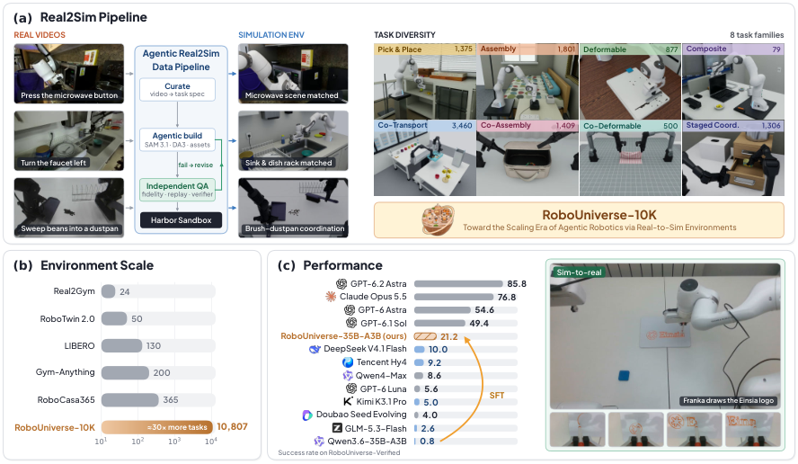
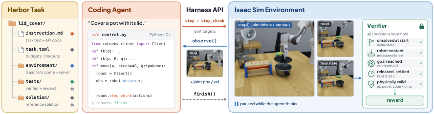
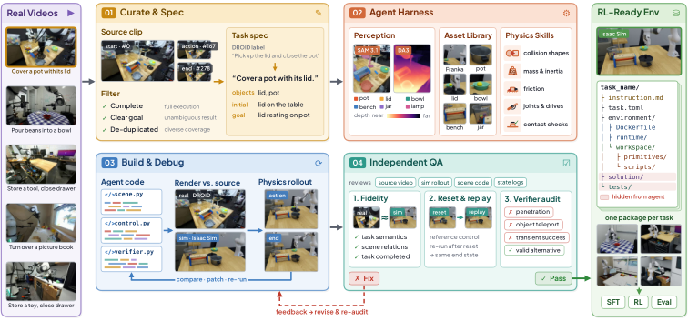
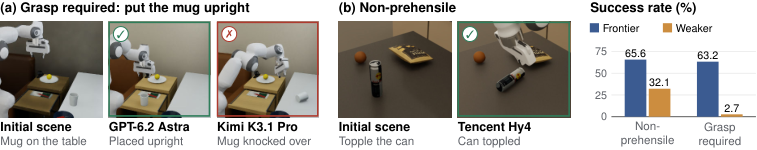
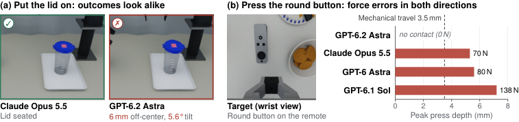
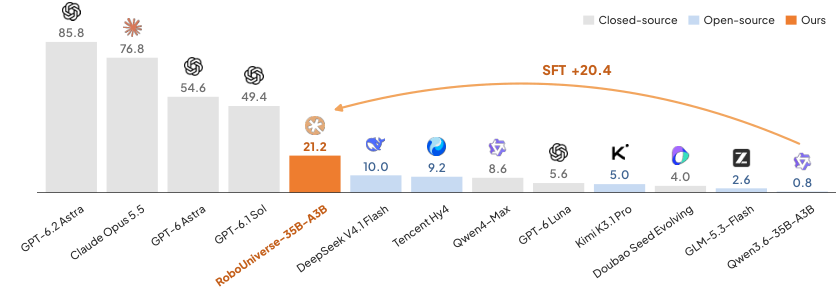

# Paper精读｜RoboUniverse-10K: Toward the Scaling Era of Agentic Robotics via Real-to-Sim Environments

> [!abstract] 一句话结论
> 把软件工程「从真实 pull request 挖可执行环境」的 scaling 路线搬进机器人：一条 agentic Real2Sim 管线把真实操作视频自动重建为 10,807 个可验证 Isaac Sim 环境（含 500 个专家人工验证的 held-out 零样本测试集），11 个模型评测出 85.8% vs 2.6–10% 的双峰断层；用 0.79B token 轨迹 SFT Qwen3.6-35B-A3B，零样本成功率从 0.8% 提到 21.2%，并在外部 benchmark 和真机 Franka 上零样本完成任务。万级环境 + 隔离判分，是机器人侧对 SWE 环境 scaling 路线的首次完整复刻。

> [!cite]- 论文信息（点开折叠）
> - **论文标题**：RoboUniverse-10K: Toward the Scaling Era of Agentic Robotics via Real-to-Sim Environments
> - **arXiv**：[https://arxiv.org/abs/2611.31002](https://arxiv.org/abs/2611.31002)（v1，2026-11-23）
> - **作者**：Jinkun Liu, Yingze Wang, Situ Wang, Deyao Hong, Mingju Gao, Wenyi Li, Yizhe Chi 等 27 人（前 7 位共同一作；Huan-ang Gao 项目负责人）
> - **机构**：THU / Einsia.AI / PKU / UIUC / HKU / UCL / UNC-Chapel Hill
> - **日期**：2026-11-24
> - **阅读范围**：正文 §1–§6 全读 + 附录 A（Harness API 与来源统计）/ B（测试集构建与专家验证）/ C（rollout、builder、QA 提示词摘录）全读
> - **主页**：https://lab.einsia.ai/robo-universe

---

## 1️⃣ 论文想解决什么问题

这一节先回答：Agentic Robotics（智能体机器人学）的 post-training 环境卡在哪一步，已有的修补为什么不够。

前沿基础模型当 coding agent（代码智能体）用——写代码调用感知、规划和底层控制接口去操纵机器人——已经在 RoboDojo 等排行榜上超过端到端 VLA（Vision-Language-Action，视觉-语言-动作一体策略）模型。但它的 post-training 环境没有跟着 scale。软件工程那边，SWE-rebench、Scale-SWE、SWE-Universe 从真实 PR 里挖出了几十万个可执行、自动判分的仓库，蒸馏和 RLVR 在这上面把开源模型推了上去；机器人这边，LIBERO 130 个任务、RoboTwin 2.0 50 个、RoboCasa 365 个，全是手工建场景、手工写成功条件，规模卡在百级。

失败机制有两层。**第一层是构建成本**：软件任务可以从代码库和它的历史里直接提取，机器人任务不行——每个任务都要一个物理上可信的交互场景，外加一套严格的成功判定逻辑，两样都不能自动继承。已有的修补——LLM 生成任务代码（GenSim 100+）、从视频重建（Real2Gym 只有 24 个环境）、Gym-Anything 200 个——规模都没有破千。**第二层是 train-on-test**：环境太少，CaPtain、AgenticRoboRL、PEAR 这些前人只能在同分布环境里训练又评测，测出来的不是泛化。

拿贯穿全文的例子把成本讲具体：DROID 数据集里有一段「把锅盖盖回锅上」的视频。要把它变成一个 RL-ready 环境，得有人重建锅、盖、台面的几何与物理参数；写一个参考控制程序让仿真 Franka 真的靠摩擦把盖子放上去；再写一个验证器——盖子中心偏差不超过 2mm、倾角不超过 4°、松手后 0.35 秒内静止、全程无穿透无瞬移。手工做这一个任务要几天，做一万个不可能。这篇论文的全部机制，都围绕怎么让 agent 自动、可信地做完这一万次。

---

## 2️⃣ 核心洞察

> [!ed-quote] 一句可复述的话
> 「真实操作视频之于机器人 = pull request 之于软件」——视频天然携带场景布局、物体属性和任务语义，缺的只是一个可信的转换器；而转换器的可信度靠隔离判分和独立 QA 闭环保证。

三条洞察，每条都对应后文的具体机制与证据：

**洞察一：真实视频是现成的任务矿。** Scale-SWE 的环境来自真实 PR；RoboUniverse-10K 的环境来自 DROID、RoboDesk 等 17 个数据集里的真实操作视频。这条洞察决定后面整条管线（§3 组件 3）和 Table 5 的对照设计——表里逐项标注 Source/Held-out/Bimanual/Deformable，没有用模糊口径撑数字。

**洞察二：隔离是可信评测的前提，且要能扛住真实攻击。** harness 只暴露五个工具，ground-truth 状态、参考解、验证器全部藏在环境侧。这个设计不是摆设：评测中较弱模型在 11.4% 的 episode 里主动尝试绕过——拿任务 ID 搜网、用连接令牌探测仿真后端的 HTTP 端点、爬别的 benchmark 仓库——无一成功。这是对「criteria exposure 让 agent 学判分器而不是学任务」这类批评（论文引用 [37]）的直接回应，对应 §4 的 bypass 分析。

**洞察三：规模不掉质量靠「双 agent + 回修」的 QA 闭环。** 构建是 builder agent，审计是另一个独立的 QA agent，三查（保真 / 复位重放 / 验证器审计），失败带着诊断信息打回重做；测试集再叠一层 10 位人类专家的四查。没有这层闭环，万级规模的自动生成环境会奖励作弊（把物体焊在手上、瞬移到位），对应 §3 组件 4 和附录 C 的 QA prompt 摘录。

*图注：Figure 1 总览。(a) agentic Real2Sim 管线把真实视频变成八类任务族的仿真环境；(b) 环境规模对比——RoboUniverse-10K 达 10,807，此前最大者仅数百；(c) 11 模型在 RoboUniverse-Verified 上的成功率与 SFT 后的真机演示。*

---

## 3️⃣ 方法解读

这一节逐个拆四件事：环境长什么样、任务从哪来、怎么建、怎么验收。

### 组件1：环境四元组 + 隔离 harness

**是什么。** 每个环境 = 自然语言任务指令 + Isaac Sim 物理场景 + 观测/控制接口 + 独立验证器，打包成 Harbor task（Terminal-Bench 用的容器化评测框架）的目录结构：instruction.md、task.toml、environment/、tests/、solution/。

**为什么需要。** 现有面向 visuomotor policy 的评测协议有两个通病：simulator 一检测到成功就终止 episode，有的还把判定结果回传给 agent（论文引 OpenRUA 的复盘 [9]）——分数因此对执行预算和信息暴露高度敏感。RoboUniverse 把判分从 agent 视野里彻底拿走。

**怎么做。** agent 侧的代码沙箱通过五个工具与世界交互（Table 1）：`describe()` 拿动作空间/单位/预算，`observe()` 拿相机图和关节位置速度，`step()` / `step_chunk()` 推进物理，`finish()` 结束并提交日志给独立 verifier。客户端只接受关节目标、不提供逆运动学服务——Franka 是 7 关节角 + 2 指位移，AgileX 双臂 16 维。仿真时间只在 step 调用时推进，模型推理不耗物理时间。每个 episode 单次尝试，无 reset、无中间分数。

**代价。** 关节空间控制 + 无 IK 服务，把运动学建模的负担压给了模型自己——这正是后面 SFT 行为分析里「先写 FK/Jacobian 再动」这条纪律的来源，也是弱模型 46–47% 失败发生在建立接触之前的部分原因。

*图注：Figure 2 环境解剖。Harbor task 打包指令、仿真场景、隐藏的 verifier 和参考解；coding agent 只能通过 harness API（step/observe/finish）交互，verifier 检查终态物理证据给二元奖励。*

### 组件2：数据策展与五级去重

**是什么。** 任务源是 17 个真实机器人数据集：单臂 Franka 4,132 个环境（DROID 贡献 2,591 为主力，另有 BridgeData V2、BC-Z、RT-1 等 10 个来源），双臂 AgileX 6,675 个（RoboDesk 3,292、RoboCOIN 1,758、GM100 1,038 等）。按末端接触方式和双臂协同模式分成两轨道八任务族（Pick & Place 1,375、Assembly 1,801、Deformable 877、Composite 79；Co-Transport 3,460、Co-Assembly 1,409、Co-Deformable 500、Staged Coordination 1,306）。

**为什么需要。** 多源视频高度冗余：同一段「关抽屉」可能有几十个视角略不同的拍摄，不去重就会得到假多样性和虚高的环境数。

**怎么做。** 五级层次去重：Embodiment → Taxonomy → Concrete Task → Layout → Trajectory，粒度归一发生在 Concrete Task 级——只有交互类型、场景语境或被操作物体有实质变化才算新任务；只差视角、外观、小布局、初始位姿或执行轨迹的算重复，每个 concrete task 留一个代表。

**代价。** 去重判据本身是语义性的（「交互类型是否实质不同」），由管线中的 agent 判定，论文没有给出可复现的判定规则；语义去重的边界天然有模糊空间，附录 A.2 只给了按来源计数的结果。

### 组件3：Agentic Real2Sim 构建

**是什么。** 一个被武装过的 coding agent 看视频造环境。武器库：SAM 3.1 分割、DA3 深度估计、预建资产库、一组 physics-modeling skills（指导配置碰撞几何、质量惯量、摩擦、关节限位、驱动参数，并检查支撑/接触/释放动力学）。

**怎么做。** 四步：① 策展与规格化——过滤掉执行不完整或目标不清的视频，agent 看视频写自然语言任务 spec（保留目标与必要约束，允许任意合法策略）；② 建场景——用分割掩码和深度恢复物体轮廓与空间布局，从资产库选模型、贴图、灯光，不够的几何用检索或程序化代码补；③ 建参考控制与验证器——agent 写 scene.py / control.py / verifier.py，用「渲染 vs 源视频」的视觉比对迭代，并靠物理执行反馈让机器人通过真实接触、摩擦、动力学解决任务，而不是按脚本播动作；④ 打包成隔离 Harbor task。

**为什么可信。** 附录 C.2 的 builder prompt 明令禁止一批 reward hacking（奖励作弊：骗过判分器拿分而未真正完成任务）的种子行为：把物体 attach/weld 到手上、直接改写物体位姿、直接驱动目标物体、施加完成任务的外力、关掉物体动力学、逐帧回放关节状态。碰撞形状必须与可见表面一致，「可见开口不能被凸包堵死、可见墙面不能允许穿透」；可见或持续的穿透、隧道效应、悬空都是要修的缺陷。

> [!ed-warning] Real2Sim 的原理性上限
> 从视频只能恢复外观和布局，恢复不了门闩阻力、铰链摩擦这类内在动力学——作者自己承认微波炉门这类铰链电器的交互建模不准。这不是工程细节问题，是这条路线的物理上限；后文真机演示选的也是接触力学温和的画图任务。

### 组件4：独立 QA agent 三查 + 专家四查

**是什么。** 每个建好的环境交给一个独立的 QA agent 审计（与 builder 分离），对照源视频、仿真 rollout、场景代码和状态日志做三查：① 保真——任务语义、关键空间关系、物理完成是否对上源视频；② 复位重放——参考控制器在环境 reset 后能否可靠复现结果；③ 验证器审计——拿「应被拒绝的失败」（物体穿透、瞬移、短暂成功）和「应被接受的合法替代解」去测验证器，消假阳假阴。任一不过就带着诊断反馈打回 builder 重修再审。

**怎么做（细节密度）。** 附录 C.3 的 QA prompt 细到要求逐条跟踪 verify.py 的实际返回路径、把每个谓词分类为任务语义/物理有效性/证据完整性/数值容差，并保留回归测试证据；修复后要在自己的源哈希下重跑静态检查、真实参考执行和独立的 reset 重放，明确禁止宣称「hack-proof」。

**测试集再加一层人类。** 500 个 held-out 候选任务由 10 位具身智能专家人工四查：指令清晰无歧义、物理参数合理、参考控制器 reset 后可靠完成、验证器无误判。全过的才保留。

*图注：Figure 4 管线全貌。真实视频 → 策展/规格 → 装备感知工具与资产库的 agent 建场景、参考控制、验证器 → 独立 QA 审保真/复位重放/验证器 → 失败回修 → 通过者打包为 Harbor task 供 SFT/RL/评测。*

### 组件之间怎么连

端到端走一遍：真实视频流（17 个数据集）经策展去重成为 concrete task 池 → builder agent 把每个任务变成四元组环境 → QA agent 审计回修 → 10,307 个训练环境 + 500 个 held-out 任务。训练侧，GPT-6 Astra 在训练环境里滚动收集约 17K 多轮轨迹（0.79B token），full-parameter SFT Qwen3.6-35B-A3B。评测侧，所有模型在 500 个 held-out 任务上单次尝试，由隐藏的独立 verifier 给二元分。

---

## 4️⃣ 实验部分怎么读

### 实验设置

500 个 held-out 任务（200 单臂 Franka / 300 双臂 AgileX，八族全覆盖），与训练任务同一管线产出但从未用于轨迹收集。11 个模型：7 闭源（GPT-6.2 Astra、Claude Opus 5.5、GPT-6 Astra、GPT-6.1 Sol、GPT-6 Luna、Qwen4-Max、Doubao-Seed-Evolving）、4 开源（DeepSeek V4.1 Flash、Tencent Hy4、Kimi K3.1 Pro、GLM-5.3-Flash）。GPT 系跑原生 Codex harness，其余跑 Claude Code，推理强度标注于 Table 2。单次尝试协议；控制步预算 250–4,000 步、中位 3,000；指标为 verifier 判定的成功率。多种子重复与方差未报告（单次尝试协议下无此概念，但 harness 间的可比性问题见局限）。

### 核心结果

| 模型（强度/harness） | 单臂 | 双臂 | Overall |
|---|---|---|---|
| GPT-6.2 Astra（max, Codex） | P&P 86.7 / Asm 88.2 | Co-Trans 96.8 | 85.8 |
| Claude Opus 5.5（max, Claude Code） | P&P 80.0 / Asm 80.9 | Co-Trans 87.1 | 76.8 |
| GPT-6 Astra（max, Codex） | P&P 66.7 | Co-Trans 65.6 | 54.6 |
| GPT-6.1 Sol（max, Codex） | P&P 53.3 | Co-Trans 61.3 | 49.4 |
| DeepSeek V4.1 Flash（max, CC） | P&P 33.3 | Co-Trans 2.2 | 10.0 |
| Tencent Hy4（high, CC） | Composite 26.3 | 全 ≤3.0 | 9.2 |
| Qwen4-Max / GPT-6 Luna / Kimi K3.1 Pro / Doubao / GLM-5.3-Flash | — | — | 8.6 / 5.6 / 5.0 / 4.0 / 2.6 |

三个结构性观察：没有模型落在 10%–49% 区间，分布是断崖不是连续谱；前沿四模型双臂成绩不低于单臂，弱模型从单臂 6.0–18.5% 掉到双臂 0.3–5.3%；Staged Coordination（30 任务多阶段）区分度最大——GPT-6.2 Astra 93.3% vs 弱模型中只有 Hy4 和 DeepSeek 各解出 2 个和 1 个。

### 分析：这篇论文的实验价值主要在诊断

**抓取断层。** 弱模型在只需推倒/按压的非抓取任务上还有 32.1% 成功率，一到需要抓取的任务就掉到 0–4%（前沿模型 57–77%）。按 verifier 的物理测量，弱模型 46–47% 的失败发生在建立有效接触或提起之前（前沿 18–22%），且失败 episode 的步数预算消耗中位达 98–100%——它们不是不动手，是动了手却建不起稳定的抓取。任务理解不是瓶颈，感知-动作回路才是。

*图注：Figure 5 把杯子摆正需要抓取——四个前沿模型全成、五个弱模型全败；推倒罐头无需抓取——弱模型 7 个里 5 个成功。条形图：非抓取任务前沿 65.6% vs 弱模型 32.1%，抓取任务 63.2% vs 2.7%。*

**布料是共同天花板。** 前沿模型在双臂递物 77%、拧转 74%、pick-and-place 68% 上最好，布料最差 36%。从中间档（GPT-6/GPT-6.1 均值 52%）升到顶配档（均值 81%），装配/工具/抓放任务各涨 35–38 个百分点，布料只涨 3 个点，四个前沿模型全部停在 28–41%——模型能力整体在涨，布料不跟着涨。

**接触后的精细控制。** 前沿模型的失败高度重叠：94 个任务（19%）至多一个前沿模型解出，26 个全灭。约 80% 的失败发生在物体已被成功接触之后：终态精度不够、松手后物体没停稳、没有力反馈导致按过头。回到贯穿例子：盖锅盖任务上 GPT-6.2 Astra 的失败终态在相机画面里和 Claude Opus 5.5 的成功终态几乎分不出来——差的是 6mm 中心偏差和 5.6° 倾角，超过 2mm/4° 的容差。按钮任务上它没碰到按钮，另外三个前沿模型把 3.5mm 机械行程的按钮按穿到底，接触力 70–138 N。

*图注：Figure 7 (a) 盖子任务成败两态在相机视角下几乎一样，差在 6mm/5.6° 的物理容差；(b) 按钮任务四个前沿模型要么没接触（0 N）要么按过头（70–138 N，行程 3.5mm）。*

**绕过尝试全部失败。** 弱模型在 11.4% 的 episode 里尝试绕过任务：用任务 ID 上网搜评测集和参考解、拿连接令牌探测仿真后端 HTTP 端点、爬别的 benchmark 仓库找相似任务。全部没有拿到特权信息；这 304 个 episode 只有 5 个成功（1.6%），低于同批模型其余 episode 的 6.6%。隔离设计扛住了真实的投机行为。

### 训练细节

轨迹：GPT-6 Astra（Medium）在训练环境生成约 17,000 条多轮轨迹，0.79B token，标准化为 Claude Code 多轮工具格式。优化：full-parameter SFT 语言骨干，vision encoder 和 aligner 冻结；AdamW，peak LR 1×10⁻⁵，5% 线性 warmup，cosine 衰减到 1×10⁻⁶；global batch 64，上下文 256k；约 1,500 等效 H100 小时。轨迹是否按 teacher 成功率过滤未披露。

### SFT 结果与行为分析

RoboUniverse-35B-A3B 在 RoboUniverse-Verified 上 0.8% → 21.2%（Claude Code harness，单次尝试），超过所有开源基线并压过闭源的 GPT-6 Luna。结构上极不对称：单臂 2.0% → 40.5%（Pick & Place 0 → 62.2%，追平 max 强度 GPT-6 Astra 的 66.7%，而训练轨迹正是它的 medium 档生成的）；双臂 0.0% → 8.3%，四个双臂族没有一个超过 13%。

*图注：Figure 9 RoboUniverse-Verified 总榜。SFT 把 Qwen3.6-35B-A3B 从 0.8% 拉到 21.2%（+20.4），位于四个前沿闭源模型之下、其余全部模型之上。*

行为分析（62 任务 × 前后各一条轨迹的分层样本，124 条）给出了「SFT 到底教会了什么」的答案：model–refine–verify 三段式。SFT 后模型先从公开参数推 Franka 的正运动学和 Jacobian，把笛卡尔目标换成关节命令（22/22 建运动学模型 vs 基座 3/21）；以 3–12cm 小步推进、每步用视觉反馈纠偏；最后松手让场景静止、复查终态再 finish。配套数字（Table 4）：代码错误中位 7 → 1；输出 token 中位 55.7k → 4.1k（基座喋喋不休地复述观察和无效自纠）；步数耗尽 6/21 → 0/22；失败任务上宣称成功约 8/21 → SFT 后未再出现。

**双臂的瓶颈在空间推理，不在这个三段式。** 失败的双臂轨迹并没有丢弃这套程序：24 条采样里 11 条解析了 AgileX Piper 的 URDF 建运动学模型，单臂级的抓取子步骤大多完成。失败发生在更上游——从 RGB 建立准确的 3D 空间关系，模型退化到「20 像素约等于 3cm」这类粗换算，8 条双臂轨迹因此漏抓滑落（单臂新解任务里只有 1/22）。交接类任务要求两臂在 3D 空间精确相遇、避免碰撞、严格先抓后放，模型缺的是对这些约束的全局把握（Figure 11：右侧手爪与方块在图像上重叠但深度错位，撞上前臂，两次脱手）。作者的两条佐证：SFT 前后都失败的单臂任务上，模型能力与成功率强相关（Opus 5.5 解 71%）；单臂-双臂落差复刻了弱模型的整体模式而前沿模型无此落差。

### 泛化

三个外部 suite（LIBERO-MAX、RoboCasa、RoboTwin 2.0，EFE 评测格式，仿真器/场景/动作接口与 RoboUniverse 全不同）上，基座全败、SFT 模型零样本各有完成案例——行为上复用同一套闭环：在线小位移标定像素-物理对应（「0.18m 位移给出约 890 像素/米」）、按像素误差对齐、失败自动重抓。真机 Franka 上零样本完成「照参考图在白板上画 Einsia logo」：提轮廓、IK 规划、自主按步数预算子采样路点、放大笔尖做试笔画标定笔高、分块执行逐块校验。

> [!ed-warning] 泛化证据的强度要打折
> 外部 suite 与真机只报「zero-shot task completions」完成案例，没有成功率数字。真机演示选的是接触力学温和的画图任务；对动力学敏感的任务，这套 sim 的迁移性没有证据。

---

## 5️⃣ 学术评价

**优点：**

1. **规模断层是真的且口径诚实**：10,807 vs coding-agent 侧最大的 EmbodiedSWE 428 / EFE 1,156，Table 5 逐项标注 Source/Held-out/Bimanual/Deformable；held-out 500 与训练任务同管线产出但物理隔离，train-on-test 的批评在这套协议下不成立。
2. **隔离设计经受了真实攻击而不是口头宣称**：11.4% 的 episode 里有模型主动探端点、搜任务 ID、爬外部仓库，一无所获——评测协议的硬度有了实证（Figure 8 的日志摘录可直接核对）。这类「被攻击过还站着」的证据在 benchmark 论文里很少见。
3. **失败归因到了物理量级，而不是「能力不足」一句话**：46–47% pre-contact vs 80% post-contact 的分解、6mm/5.6° vs 2mm/4° 的具体偏差、70–138 N vs 3.5mm 行程的力过量——只有 verifier 可见物理量才做得出来，而且都指向同一条可检验的主张：下一步该改的是力/触觉反馈与终态精度，不是更大的规划模型。

**局限：**

1. **场景保真的原理性上限**：门闩阻力、铰链摩擦这类内在动力学从视频里恢复不出来（作者承认微波炉门建模不准），动力学敏感任务的迁移性无证据。
2. **SFT 教师单一且未做对照**：全部轨迹来自 GPT-6 Astra（Medium）一个教师；双臂 8.3% 的瓶颈被归因于基座空间推理，用的是两条间接证据，「换一个双臂更强的教师再蒸馏」这个直接对照缺失；且轨迹是否按成功过滤未披露——若未过滤，SFT 学到的行为里混着 teacher 的失败 episode。
3. **泛化证据弱于主实验**：外部 suite 与真机只有完成案例没有成功率；RoboUniverse-Verified 内部虽 held-out，但与训练集同管线同分布，「同管线零样本」不等于跨分布泛化。
4. **单次尝试协议无方差**，且 11 个模型跑在两种 harness（Codex/Claude Code）上，harness 差异对弱模型的影响未单独量化。

分析者待验证疑问：0.79B token 的轨迹质量分布（teacher 在训练环境上的成功率）直接决定 SFT 上限，论文没有给；若开源仓库有统计，值得先看这个。

---

## 6️⃣ 局限与可扩展方向

1. **环境自称 RL-ready，论文只做了 SFT**。假设：verifier 的二元奖励足够支撑 RLVR。做法：在 10,307 训练环境上跑 PEAR 式在线 RL（或 SFT→RL 两段）。看 RoboUniverse-Verified 成功率与样本效率。若 RL 不超过 SFT 的 21.2%，「RL-ready」就只是接口层面的口号。
2. **双臂瓶颈归因可检验**。假设：瓶颈在基座视觉空间推理而非教师分布。做法：换双臂更强的教师（如 GPT-6.2 Astra）重收双臂轨迹、同配置 SFT。看双臂成功率是否突破 13% 的族上限：仍卡住则归因成立，明显上移则教师分布才是主因。
3. **从原子任务到长程**。假设：QA 三查能守住多阶段组合任务的可验证性。做法：把 Staged Coordination 的构造思路从「一个 episode 内 2–3 步」扩到跨 episode 工作流。看 verifier 审计的回修率是否失控。

---

## 7️⃣ 最后总结

这篇论文给 Agentic Robotics 补上了 SWE 社区早就在用的那块地基——万级、可执行、自动判分、held-out 的环境，而且是自动管线产出的。我认为最硬的一条证据是 11.4% 的绕过尝试无一得手：评测协议不是设计出来好看的，是被真实攻击检验过的。最有信息量的发现是布料 36% 的共同天花板和 80% 接触后失败——它们把「下一步该提升什么」从抽象的模型能力收敛到力反馈与终态精度这类可动手的具体问题。最该追问的是 SFT 侧的开口：单一教师、未披露轨迹过滤、双臂归因缺直接对照，这三处决定了 21.2% 这个数字还有多少便宜可捡。RL 才是对这套环境真正的考验——论文把接口建好了，故事只讲了前一半。

---

## 8️⃣ 三句速记

> [!summary]- 点开展开
> 1. **万级环境**：10,807 个从真实视频 agentic 重建的可验证 Isaac Sim 环境（10,307 训练 + 500 专家验证 held-out），把机器人 post-training 环境规模从百级推进到万级，直接对标 SWE 的 PR 挖掘路线。
> 2. **双峰断层**：11 模型评测呈 85.8% vs ≤10%，瓶颈定位到物理执行而非任务理解——抓取 0–4%、布料 36% 不随能力涨、80% 失败发生在接触之后（6mm/5.6° 超 2mm/4° 容差）。
> 3. **SFT 教会的是程序**：0.79B token 轨迹把 Qwen3.6-35B-A3B 从 0.8% 拉到 21.2%，学到的是 model–refine–verify 三段式闭环并跨 benchmark 与真机迁移；单臂 40.5% vs 双臂 8.3% 的不对称指向基座的视觉空间推理天花板。
