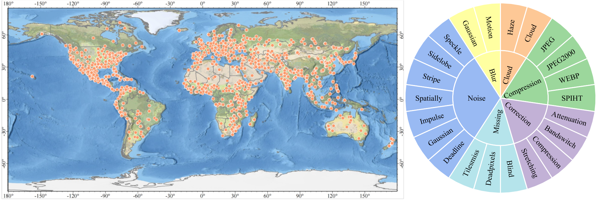
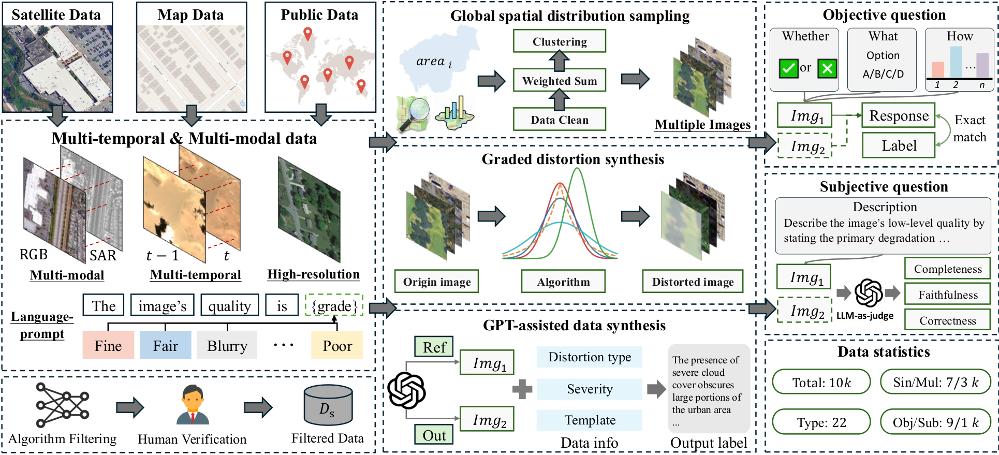
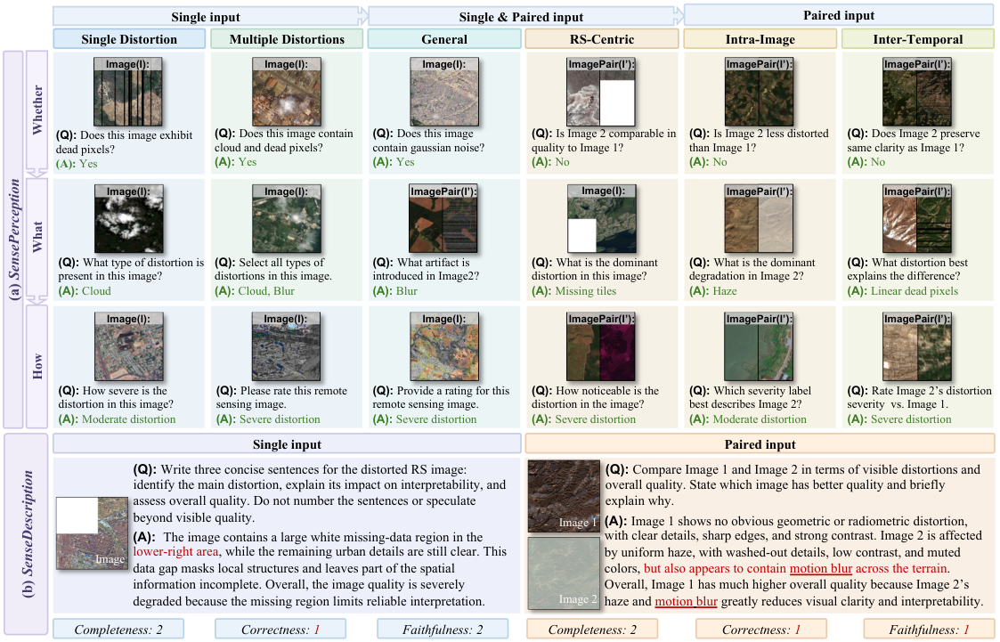
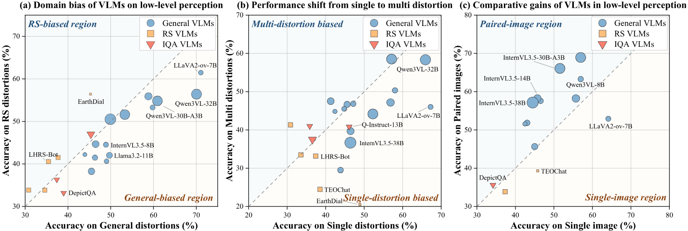

# Paper精读｜SenseBench: A Benchmark for Remote Sensing Low-Level Visual Perception and Description in Large Vision-Language Models

> [!abstract] 一句话结论
> 这是第一个专测遥感低层视觉（remote sensing low-level vision）的诊断型 benchmark：用物理驱动的 6 大类 ×22 细类畸变分类法造出 10,815 个可追溯样本，对 29 个 VLM 做零样本评测。结果不好看——单图感知最好的 Gemini-3.1-pro 也只有 75.75% 平均 EM（人类 89.82%），多畸变叠加时崩到 41.17%；而且模型"说得出"不等于"看得准"：配对描述任务上 InternVL3.5 系列的 Sum 分从 ~3.6 掉到 ~2.0。全文最有分量的证据是：没有任何模型落在"双域均衡"象限里。

> [!cite]- 论文信息（点开折叠）
> - **论文标题**：SenseBench: A Benchmark for Remote Sensing Low-Level Visual Perception and Description in Large Vision-Language Models
> - **arXiv**：[https://arxiv.org/abs/2605.10576](https://arxiv.org/abs/2605.10576)
> - **作者**：Chen Zhong*, Xiao An*, Jiaxing Sun*, Zihan Gui, Guangyi Yang, Wei He†（* 共同一作，† 通讯）
> - **机构**：Wuhan University / Shanghai Artificial Intelligence Laboratory
> - **日期**：2026-05-11（v1，cs.CV，NeurIPS 投稿格式）
> - **阅读范围**：正文 §1–§5 + 附录 A/B/C/D/E/F/G 全部（E 中 Table 11–16 按分析段落与代表行核对）

---

## 1️⃣ 论文想解决什么问题

先设定一个贯穿全文的例子：一张 512×512 的城市遥感瓦片，被管线注入了中等强度的霾（haze）——整幅图对比度衰减、光谱偏移。专家拿到它，要回答三个递进的问题：有没有畸变、是什么畸变、多严重；还要写一段能指导选图或复原的诊断语。旧方法的失败就发生在这条链的每一环。

传统的图像质量评估（IQA, Image Quality Assessment）在这里失败于两个具体步骤。第一步是表达能力：经典 IQA（MUSIQ、LIQE、CLIP-IQA 这一支）回归一个标量分数，0.7 分告诉了你"差"，但没告诉你是雾、是条带噪声还是波段错配——而遥感工作流要的恰是后者，才能决定是去雾、换传感器还是弃用这张图。第二步是域覆盖：这些方法的训练分布是地面自然摄影，遥感图的物理畸变（SAR 散斑、推扫条纹、下行丢块）在自然图像里根本没有对应物。

那 VLM 行不行？Q-Instruct、DepictQA 这类模型在自然图上已经能"检测伪影-推理严重度-输出语言诊断"，理论上正好补上 IQA 缺的解释性。但作者指出一个没人量化过的洞：这些模型的视觉先验锚定在地面视角，能不能跨越域差去感知并说出遥感特有的伪影，此前完全没被测过。已有的遥感 benchmark（LHRS-Bench、VRSBench、REOBench 等，Table 1 逐个对比）全在测高层语义理解，REOBench 甚至只把画质当混杂变量而不是评测对象。Q-Bench(+) 和 DepictQA-Wild 测了自然图的低层感知，但没有遥感物理畸变维度。

所以缺口是双重的：没有专门的评测集，也就没有答案。SenseBench 的目标就是把这个缺口变成可以量化的数字。

---

## 2️⃣ 核心洞察

作者的转向可以压缩成一句：别让模型给质量打分，让它像质检员一样走完"存在性→类型→严重度→书面诊断"的完整流程，并且每一环的标签都从合成参数数学投影出来。

这句话为什么成立，拆开看三层：

> [!important] 三条核心洞察
> 1. **标签的可追溯性来自合成而非人标。** 每个样本的畸变由参数 $s$ 控制注入，Whether/What/How 的答案直接从 $s$ 投影（§3.2），人只做校验不做裁决。这对应后文方法解读的"标签投影"组件——如果标签靠人拍脑袋，22 类细粒度畸变的 severity 分级根本不可能在 10K 样本上保持一致。
> 2. **感知和描述是两种能力，必须分开测。** MCQ 测"看得见看不见"，自由文本测"说不说得清"。对应实验部分的核心发现**感知-描述倒置（perception-description inversion）**——如果只测 MCQ，会误以为 InternVL3.5 是配对场景的优等生（Table 3 里它配对 EM 还不错），Table 4 一翻描述分就露馅。
> 3. **配对（全参考）设定不是锦上添花，是独立能力轴。** 真实遥感工作流里"多时相选优"和"复原算法评估"都是双图任务。对应 Figure 4(c) 的**锚定效应（anchoring effect）**分析——参考图把检测门槛"钉"低——和 E.3 的参考增益分解：cloud 类参考增益大（Qwen3VL-32B 从 0.588 到 0.803），blur 类几乎为零。

*图注：左图为按人口加权在全球六大洲采样的点位分布（橙点），右图为 6 大类 ×22 细类的层级畸变分类法——全文的组织骨架。*

---

## 3️⃣ 方法解读

这一节把 SenseBench 的构建管线拆成六个组件，每个走完"是什么 / 为什么需要 / 怎么做 / 代价"四层。

### 组件 1：层级畸变分类法（Hierarchical Distortion Taxonomy）

- **是什么**：一棵两层畸变树：L-1 六个大类（Noise / Blur / Cloud / Compression / Correction / Missing），L-2 共 22 个细类（如 Noise 下分 Gaussian、Impulse、Spatially Correlated、Stripe、Dead-line、Speckle、Sidelobe 七种）。锚定物理成像链和 ISO 19157-1:2023、GB/T 24356-2023 等遥感质量标准（附录 A）。
- **为什么需要**：没有细类，评测就退化成"有噪 vs 无噪"的二分，测不出模型能否把 SAR 散斑（乘性噪声）和高斯噪声（加性噪声）区分开——两者的复原手段完全不同。拿掉 L-2 这一层，Table 1 里那些 11 维、18 维的通用 benchmark 就够了，SenseBench 的 22 维细分类失去意义。
- **怎么做**：每类给出物理定义与合成公式。以贯穿例子霾为例，合成走标准大气散射模型（见下）。SAR 散斑、云遮挡这类合成不像的，改从真实数据集（如 RICE、Sentinel-2）采集。
- **代价**：分类法的完备性是作者自己的选择，不可能穷尽真实世界的所有畸变；附录 F.1 承认合成分布与真实分布有系统差，缓解手段是人审 + 真实样本补充，但差距无法归零。

### 组件 2：全球地理采样（Global Geospatial Curation）

- **是什么**：三阶段采样：Natural Earth 大洲边界定配额 → 人口加权抽 809 个城市（人口 <10 万的剔除）→ OSM 城市边界内随机打点、从 Google Earth 拉高清瓦片，统一裁到 512×512。共收 26,493 张，三重过滤（文件级/信息级/人工）后剩 19,768 张，剔除率 25.38%（附录 B）。
- **为什么需要**：已有遥感数据集的区域偏置是出了名的（欧洲+北美+少数城市反复用）。低层畸变的可感知性又和地物纹理强相关——雪原、海面这类低结构场景会让"纹理丢失"类畸变不可判——所以过滤阶段明确剔除海洋/积雪主导图。拿掉全球配额，后面所有"模型在 RS 子集上表现差"的结论都可能被"训练集恰好没见过这类地貌"污染。
- **怎么做**：Table 5 给出每细类严格配额：RGB 各畸变 155/155/155/60（Whether/What/How/Description 四种问题各 155、155、155、60 条），多畸变 300/300，SAR 两类各 200/200，总计 10,815。
- **代价**：Google Earth 采图受服务条款约束（作者声明仅限非商业学术用途）；512×512 统一尺寸方便合成与评测，但也意味着超大幅宽、多波段的原生分辨率多样性被牺牲了。

### 组件 3：物理合成 + 标签数学投影（Physics-Based Synthesis & Traceable Labeling）

- **是什么**：一个参数受控的畸变引擎：输入干净图，输出劣化图 + 结构化元数据（类别/细类/严重度 $s$）。
- **为什么需要**：这是全文方法上最硬的一环：任务标签不是人标的，是从合成参数数学投影出来的——Whether 的答案当且仅当 $s$ 超过经验校准的感知阈值时为"是"；What 的答案就是注入的那个类别；How 的答案把 $s$ 按畸变专属阈值离散成 No/Slight、Moderate、Severe 三档。反事实很直接：拿掉这个投影、改人工标注，22 细类 ×3 档 ×1 万样本的标注一致性没有可复现的根基，而且两类任务（感知与描述）会各自漂移——作者明确说感知 MCQ 的标签元数据同时驱动描述参考的生成，"结构性消除了两个任务之间的人为主观漂移"（§3.2）。
- **怎么做**：每张劣化图配一个信息文件（Image Address / L1 / L2 / Severity Level），B.3 里再细分到 L3 具体畸变类型；MCQ 题目由模板从元数据实例化，干扰项从其他畸变类型采样。
- **代价**：阈值（"感知可见性"）是经验校准的，论文未给出各畸变类型阈值的数值表——这是"未报告"项。合成参数的采样分布也没有完整披露（附录 B 只给了管线，参数表未随文发布，以代码仓库为准）。

大气散射模型（原文 Eq. 1，Haze 类的合成式）：

$$
I(x)=J(x)\,t(x)+A\bigl(1-t(x)\bigr)
$$

符号逐个说：$x$ 是像素坐标；$J(x)$ 是场景真实辐射（无雾的理想图）；$t(x)\in(0,1]$ 是透射图（transmission map），数值越小表示大气消光越重；$A$ 是全球大气光（airlight），代表雾的颜色/亮度；$I(x)$ 就是最终观测到的雾图。采样时 $t(x)$ 和 $A$ 在真实光学厚度范围内随机化，连续的 $s$ 就藏在这些参数里——$s$ 越大，$t$ 整体压得越低、$A$ 抬得越高。

> 人话：一张雾图 = 真实场景被"按比例调暗" + 天光被"按互补比例调亮"加回来。$t$ 是场景能透出来的比例，$1-t$ 就是雾掺进来的比例；把 $t$ 从 0.9 拧到 0.3，同一张城市瓦片就从薄雾变成中等霾——而 Whether/How 的标准答案就从这个拧的过程里算出来。

标签投影规则（§3.2，无编号公式，逻辑式）：

- Whether 为"是" ⟺ $s > s_{\text{vis}}$（感知可见性阈值，经验校准，逐畸变类型设定，数值未报告）；
- What = 注入的畸变类别（确定性映射）；
- How = 按 $s$ 所在区间离散到 {No/Slight, Moderate, Severe}（畸变专属阈值）。

> 人话：模型的"考卷答案"不是人拍的，是合成参数 $s$ 照着三张对照表算出来的。好处是 10,815 个样本的标签零漂移、完全可复现；风险是"感知阈值定得对不对"决定了考卷本身是否公平——阈值定太高，"是"的样本肉眼难辨，模型答"否"反而在理。这一层作者交给了 D.1 的人审兜底。

*图注：全球多源取图 → 分级畸变合成 + GPT 辅助的题目/描述生成 → 算法过滤与人工校验，产出感知与描述两套任务的样本。*

### 组件 4：SensePerception 双轴 MCQ 协议

- **是什么**：客观感知任务：2–4 选项的单选/多选，报告精确匹配（EM, Exact Match）准确率。
- **为什么需要**：题型轴（Whether/What/How）对应"从检出到诊断到标定"的能力阶梯；场景轴（General vs RS-Centric / Single vs Multi / Intra vs Inter-temporal）把"域偏置""鲁棒性崩塌""配对归因"三个假设变成可分别检验的分层。拿掉题型轴，你只知道模型差，不知道差在哪一环——E.1 的"感知层级"发现（Whether 87.17% → How 59.92%，Gemini 单图）正依赖这个设计。
- **怎么做**：统一提示模板：问题 + 图 token + 候选项；真值位置均匀随机化以中和位置先验，干扰项保持固定语义顺序；答案两段式解析（先正则抽字母，容错 "A."/"A)"/"The answer is A"，失败再和选项文本做内容级匹配），仍失败计错（附录 C.2，Table 8 给了 9 种容错样例）。
- **代价**：MCQ 有上限：模型可能靠排除法或表面相关猜对，测不出"说不说得清"——这正是需要组件 5 的理由。

### 组件 5：SenseDescription 约束驱动的参考生成

- **是什么**：开放式诊断报告任务：模型对单图或图对写恰好三句的质检报告；参考答案由 GPT-5.2 从 ⟨劣化图, 高质量参考图, 结构化元数据⟩ 三元组生成，再经人工闭环校验（§3.2、附录 B.3）。
- **为什么需要**：生成式 IQA 的难点是参考本身没有唯一解，BLEU/ROUGE 这类 n-gram 指标又测不出低层诊断的语义一致性。作者的两个约束原则值得单独说：感知可见性（只许描述看得见的现象，杜绝语义幻觉）和全覆盖（强制对齐分类法）；生成后参考图被严格扣留，参考文本必须自包含，防止推理时泄漏。拿掉人工校验这一环，GPT-5.2 的写作风格偏差会直接变成评测噪声——附录 F.2 作者自己承认这是主要风险之一。
- **怎么做**：三句式模板：第一句说畸变的可见特征和对人眼的影响，第二句说它如何削弱解译/分析价值（引用具体视觉后果），第三句总评质量。我们的贯穿例子（中等霾城市瓦片）的标准参考大致是：霾使建筑/道路边缘柔化、对比度衰减；这削弱了密集城区的纹理辨识；整体中等劣化、影响细节分析——附录 C.3 的 prompt 原文里恰好有这个真实样例。
- **代价**：参考文本由 GPT-5.2 生成，judge 打分的分布会受这套句式先验影响；判 0/1/2 的三档制也注定丢掉更细的差异（F.3 作者承认 judge 偏差不可归零）。

### 组件 6：评测与质控（Prometheus judge + 12 人四组审计）

- **是什么**：描述任务用 LLM-as-judge：开源评测专用模型 Prometheus 按 Completeness / Correctness / Faithfulness 三维各打 0/1/2 分，主表报均值与 $\{P_0,P_1,P_2\}$ 分布，Sum 为三维均值非加权和；与生成用的 GPT-5.2 架构不同以压自偏好（§3.3）。质控上 12 名遥感/CV 背景标注者分四组，样本须组内三人一致才通过，8% 分层抽样做感知审计，分歧由第三位专家仲裁（附录 D.1）。
- **为什么需要**：没有质控，"物理合成"只是好看的说法——D.1 的分组审计正是把合成样本的感知有效性（畸变是否真的看得出来、和元数据是否一致）落到人头。Judge 可靠性单独做了对齐实验：5 个代表模型 ×单/双图，与人评的 SRCC/PLCC 全部 ≥0.9，且模型排名与人评一致（Table 10）。
- **怎么做**：人类基线：每个畸变类抽 5% 构成人类评测子集，6 名标注者独立作答取均值；Table 2/3/4 的 HUMAN 行即此（单图 89.82%、配对 88.92%、描述 Sum 5.19）。
- **代价**：Prometheus 只在 5 个模型上验证过与人评的一致性，对新模型族的泛化未测；人工三审的成本在 10K 样本规模上已经被压到抽样审计，不可能全量。

评测侧的定义式（原文 §3.3，无编号）：judge 对每个维度独立打离散分——

$$
s_i^d \in \{0,1,2\},\quad d \in \{\text{Completeness},\ \text{Correctness},\ \text{Faithfulness}\};\qquad \text{Sum} = \bar{s}^{\text{comp}} + \bar{s}^{\text{corr}} + \bar{s}^{\text{faith}}
$$

符号说清：$i$ 是样本编号；$d$ 是三个评测维度之一；0/1/2 分别对应关键失败、部分对齐、完全对齐；$\bar{s}^d$ 是该维度在全部样本上的均值；Sum 是三个均值的非加权和，满分 6。作者刻意不加权，也不把三个维度压成一个标量——E.2 的"同 Sum 不同误差结构"正是这么设计的回报。

> 人话：三个维度各算各的平均分再直接相加，谁都别冒充谁——Correctness 塌了不会被 Faithfulness 的高分抹平，"看着流畅但诊断对象搞错了"这件事才在总分里留得下痕迹。

*图注：上半部分是 SensePerception 的任务分类（输入格式 ×畸变设定 ×三种题型），下半部分是 SenseDescription 的单图/配对样例及三维评分标准。*

### 组件之间怎么连

端到端数据流：干净瓦片（全球采样，组件 2）→ 畸变引擎注入参数 $s$（组件 3）→ 信息文件实例化出 MCQ 四件套（图、题、选项、答案，组件 4），同时同一元数据驱动 GPT-5.2 生成三句式诊断参考（组件 5）→ 双任务入库，12 人审计（组件 6）→ 推理期：29 个 VLM 零样本作答 → 感知任务走确定性解析计 EM，描述任务走 Prometheus 三维打分。同一张中等霾瓦片在这条流水线上同时产出 4 种问题（155/155/155/60 配额里的各一条）和 1 条参考描述，两个任务的标签同源于一份元数据——这是"感知分数高但描述塌"这类跨任务结论可比的前提。

---

## 4️⃣ 实验部分怎么读

benchmark 论文的"实验"就是模型评测结果本身 + 评测协议的公平性。按这个读法拆。

### 实验设置

29 个 VLM 全部零样本：主表报 22 个（14 通用含 GPT-5.4 与 Gemini-3.1-pro-preview 两个闭源、5 个遥感专用 RSVLM、3 个 IQA 专用），完整表在附录 E。生成配置统一：temperature=0.0、max_new_tokens=128、right 截断、关闭 thinking；每样本只评一次，无重复采样、无多种子（附录 C.1 原文 "Each sample is evaluated once"）。开源模型 ms-swift + vLLM 部署，最多 8×RTX 3090，每模型约 1.5 小时，合计约 34.5 小时推理。无多图接口的模型（Q-Instruct、GeoChat 等）配对任务计"–"。

### 核心结果

单图感知（Table 2，条件：零样本、temperature 0、单次评测、EM）：

| 指标 | 人类基线（5% 分层子集，6 人均值） | Gemini-3.1-pro | GPT-5.4 | Qwen3VL-32B | EarthDial（RS-VLM） | DepictQA（IQA-VLM） |
|---|---|---|---|---|---|---|
| 平均 EM | 89.82% | **75.75%** | 62.48% | 64.58% | 45.78% | 34.18% |
| General 子集 | 90.11% | 79.47% | 64.83% | 70.06% | 46.23% | 39.00% |
| RS 子集 | 89.32% | 80.06% | 62.87% | 56.40% | 52.87% | 33.20% |
| 多畸变子集 | 90.00% | **41.17%** | 41.50% | 58.33% | 20.50% | 41.00% |

三个读数值得停一下。第一，域偏置是双向的：Qwen3VL-32B 的 General(70.06%) − RS(56.40%) = 13.66 个百分点；EarthDial 反过来，RS(52.87%) > General(46.23%)，但两边都低。第二，多畸变崩塌是群体级的：Gemini 从 79.68%（单畸变）到 41.17%，EarthDial 从 48.89% 到 20.50%；作者还诚实地把弱模型"贴近对角线"解释为地板效应（floor effect）——近随机基线掩盖了复合难度——这个自我纠偏我看着很舒服。第三，IQA 专训没有红利：DepictQA/Q-Instruct 平均 34–46%，说明自然图质量先验到遥感域基本不迁移。

> [!ed-quote] 没有任何模型落在双域均衡象限
> Figure 4(a) 里没有模型进入右上象限——通用模型在对角线下方，遥感专用模型在上方但两边都低，"通用视觉能力不会自动迁移"这个判断有散点图直接支撑，也是全文最有分量的单点证据。

配对感知（Table 3）：整体上移到对角线之上（锚定效应），Qwen3VL-30B-A3B 的 Intra 66.60% → Inter 82.01%，KimiVL-A3B 54.95% → 71.19%——跨时相对比反而更容易，作者的解释是全局性变化（季节/场景）比细粒度劣化差异更好抓。RS-VLM 群体在给参考后反而回退（Figure 4(c)），这是"域内指令微调没练过双图空间对齐"假设的直接证据，但注意它是相关性证据，论文没有做控制变量的机制消融。

描述任务（Table 4，Prometheus 三维、满分每维 2）：

| 模型 | 单图 Sum | 配对 Sum | 备注 |
|---|---|---|---|
| Human | 5.19 | 4.79 | 6 人均值 |
| GPT-5.4 | 4.87 | 4.10 | 单图 Completeness 1.84 甚至高于人类 1.70 |
| Gemini-3.1-pro | 4.71 | 4.69 | 配对几乎不掉 |
| Qwen3VL-32B | 4.29 | 4.18 | 开源最佳 |
| InternVL3.5-8B | 3.78 | 1.92 | 配对崩塌 |
| EarthDial | 1.09 | 0.23 | 配对三维全 0.00/0.00/0.23 |

两个发现的名与实。流畅性错觉：各模型普遍 Faithfulness 高（说出来的事大多有依据）、Correctness 低（把 SAR 散斑说成高斯噪声、严重度标错）——报告读起来头头是道，细看诊断对象搞错了。E.2 的分布数据补充了这点：InternVL3.5-8B 单图 Completeness 落在 $P_1$ 的占 61.67%、$P_2$ 只有 28.83%，模型不是不会描述，是每次都只对一半。

> [!ed-warning] 感知-描述倒置（perception-description inversion）
> 感知榜的强者在配对描述上不一定强：InternVL3.5 系列 Sum 从 ~3.6 掉到 ~2.0，EarthDial 配对 Completeness 的 $P_0$ 接近 100%（§4.2 原文）。只测 MCQ 会把 InternVL3.5 误判成配对场景的优等生——Table 3 里它配对 EM 还不错，Table 4 一翻描述分就露馅。

GPT-5.4 和 Ovis2.5-9B 配对 Sum 相近（4.10 vs 4.21）但误差结构完全不同（E.2：GPT-5.4 靠 Completeness 的 $P_2$ 76.83%，Ovis2.5 靠 Faithfulness 的 $P_2$ 76.50% 而 Completeness $P_2$ 仅 36.39%）——单个 Sum 分确实会掩盖瓶颈差异，这为三维分布报告的必要性给了实例。

E.3 的分畸变分析是这套协议最能产出增量知识的部分：Qwen3VL-32B 配对后 cloud 从 0.588 → 0.803、missing 0.597 → 0.736、noise 0.689 → 0.792，但 blur 只从 0.718 → 0.727。我们的贯穿例子在这里第三次出现：中等霾瓦片配上无雾参考后，遮挡/对比度差异是空间上显式的，模型好抓；而 blur 的差异藏在边缘锐度和纹理细节里，参考图的增益就小。参考增益依赖畸变类型这个结论，直接推翻"配对设定普遍更容易"的粗读。

*图注：(a) General vs RS-Centric 准确率——通用模型在对角线下方、RS 模型在上方，无人进入右上象限；(b) 单畸变 vs 多畸变——整体低于对角线；(c) 无参考 vs 全参考——群体上移但 RS-VLM 回退。圆/方/三角分别为通用/遥感/IQA 模型，点大小为参数量。*

### 公平性审计

- **参数量/数据/算力是否对齐**：天然不对齐——这是评测 29 个异构模型的题中之义，论文的对策是全部零样本 + 统一提示/解析管线（附录 C.1），并把参数量作为 Figure 4 的 marker size 显式呈现而非隐藏。方向正确。
- **采样次数/随机种子**：每样本单次、temperature 0、无种子——确定性好，但 43–46% 这种量级的模型间差异没有误差条，好在差距都是十几个百分点级，单次评测不至于翻结论；差异在 2–3 个百分位的对比（如 E.2 里 GPT-5.4 vs Ovis2.5）就不敢当真了，作者也只是用它演示"分布不同"而非排名。
- **评测协议偏差**：三处都有交代：位置先验用真值随机化中和；judge 自偏好用架构异构（Prometheus vs GPT-5.2）缓解并以 SRCC/PLCC ≥0.9（Table 10）验证；人类基线用 6 人独立作答取均值。未报告的项：各畸变的感知阈值数值表、合成参数的完整分布、人类基线标注者间的方差、闭源模型的 API 端配置细节。
- **一个我看着不太舒服的设计**：Q-Instruct 和 GeoChat 这类无多图接口的模型在配对列直接计"–"缺席，这没错；但 Table 4 的行间比较里，"缺席模型"和"低分模型"视觉上都是数据缺失，读者容易把 TEOChat 配对 Sum 1.01 和 GeoChat 的"–"读成同一类信息。这是排版问题不是方法问题，但会影响跨模型横向读表的直觉。

---

## 5️⃣ 学术评价

先说作者处境：做一个"第一次"的诊断 benchmark，最大的难处是既要有规模（10K+）、又要有细粒度（22 类 ×3 档）、还要标签站得住——三者在纯人工标注下不可兼得。作者选了"合成 + 数学投影 + 人审兜底"的路线，我认为是当前约束下的合理解，LIVE/TID2013/KADID-10k 也都是这么走过来的（F.1 引证）。

**优点：**

1. **标签同源设计是全文最硬的一处**：感知 MCQ 与描述参考共用一份元数据（§3.2 明说），"感知-描述倒置"这类跨任务结论才不会因为两套标注各自漂移而失真。这个细节比"10K 样本"更值得学。
2. **每个核心发现都有分层设计直接对应**：域偏置→General/RS 分层；鲁棒性崩塌→Single/Multi 分层；锚定效应→配对协议 + Figure 4 三联图。假设-证据链是闭环的，不是"跑一个大表然后讲故事"。
3. **负结果诚实**：IQA-VLM 全军覆没（34–46%）、RS-VLM 有参考反而回退，这两个结论对作者推崇的"专域/专任务微调"叙事是不利的，论文原样报出并给出机制假设。
4. **质控成本交代到了人时**：34.5 GPU 小时、12 标注者、60 RMB/时、5% 人类子集——benchmark 论文很少把复现成本写到这个粒度（附录 C.1/D.4）。

**局限：**

1. **合成-真实分布差是结构性缺口**：缓解手段是抽样人审而非替代验证。10,815 个样本里真正来自真实劣化的只有云/SAR 两类（各 200/200 的 Whether/What），占比很小；对"模型在合成雾上的准确率"能否外推到真实大气条件，论文没有做任何合成 vs 真实的对照实验。F.1 承认了问题但没给量化。
2. **感知阈值 $s_{\text{vis}}$ 数值未报告**：整个标签投影的公平性押在这组阈值上，正文只说"经验校准"，D.1 的人审是唯一兜底。不放阈值表，别人无法独立审计"Whether=是"的样本是否真的肉眼可辨。
3. **单次评测无方差**：对 60–80% 区间的头部结论够用，对 E.2 里靠 1–2 分差异讲"误差结构"的段落，单次采样 + 三档制打分的分辨率其实撑不起那么细的叙事。
4. **机制解释停留在假设层**："多图空间对齐缺失""比较型指令微调稀缺"都是合理假设，但论文没有用一个受控微调实验去验证（比如拿一个模型补 1K 条配对比较数据再看是否回退）。对 benchmark 论文这不算失格，但读者要知道"倒置效应的成因"是未验证假设。

由本文证据直接暴露、作者未展开的问题：闭源 API 模型（GPT-5.4、Gemini、Qwen3.5-Plus）的输入预处理（分辨率压缩、JPEG 转码）不可见，而低层感知恰恰对预处理敏感——GPT-5.4 单图 62.48% 落后 Gemini 13 个百分点，有多少来自模型本身、多少来自 API 管线的图像劣化，无法区分。

> [!ed-warning] 一个待验证疑问
> Prometheus 的评分会不会系统性地奖励"三句式、与参考句式同构"的回答？GPT-5.4 在 Completeness 上拿到 1.84（高于人类 1.70），除了能力，也有可能与参考同为 GPT 家族的行文风格更易被 judge 识别为"覆盖完整"有关。Table 10 的对齐实验没有覆盖闭源模型，这个混杂没有被排除。

---

## 6️⃣ 局限与可扩展方向

按"假设 → 改变什么变量 → 看什么指标 → 什么结果推翻它"的格式：

1. **假设**：感知-描述倒置源于配对比较指令数据稀缺 → 给一个开源模型（如 Qwen3VL-8B）补 1–3K 条双图质量比较的 SFT 数据，其余不动 → 看 SenseBench 配对描述 Sum 与配对感知 EM 的相对变化 → 若描述恢复而感知不变，假设成立；若两者都不动，倒置另有成因（如图 token 对齐方式）。
2. **假设**：多畸变崩塌是"纠缠伪影理解"而非单纯难度上升 → 固定两个单畸变的各自难度，系统变化叠加方式（同类叠加 vs 跨类叠加）→ 看 Multi 子集 EM 沿叠加方式的变化曲线 → 若跨类叠加的崩塌远超同类叠加，"解纠缠"就是明确的训练目标；若无差别，崩塌只是任务变难的自然结果，"独立能力"的说法要收回。
3. **假设**：合成雾上的分数可外推到真实大气条件 → 从 Sentinel-2 真实云雾时相对里采配对样本，与同场景合成雾样本对比 → 看模型在两类样本上 Whether/How 的 EM 差 → 差距大，则 F.1 承认的合成偏差就是实打实的效度问题。
4. **阈值审计**：公布 $s_{\text{vis}}$ 与三档边界数值，配合 D.1 的人审通过率 → 看每个细类"Whether=是"样本的人审拒绝率 → 拒绝率高的类别，其 Whether 准确率数字应该打折扣读。
5. **扩展为生成式质检闭环**：现在只测"说"，不测"说对了之后能否指导行动"→ 把诊断报告接到下游复原模型选择/参数推荐 → 看诊断正确率与复原决策收益的相关性 → 这是把 benchmark 从评测推到"可操作诊断"的下一步。

---

## 7️⃣ 最后总结

SenseBench 的价值不在 10,815 这个数，而在两件此前没人做扎实的事：把遥感低层感知拆成"存在性-类型-严重度-书面诊断"四级可测的能力阶梯，以及让全部标签从合成参数数学投影、两套任务共享同一份元数据。它给出的答案也够直接：域偏置是双向且普遍的（最好的模型离人类还有 14 个百分点），多畸变叠加让头部模型掉 30+ 个百分点，而"说得流畅"与"看得准确"是两种能力——配对场景里感知榜的强者可以在描述上崩到 Sum 2.0。边界同样清楚：结论的效度受合成分布与真实劣化的差距约束，感知阈值未随文公开，机制归因（多图对齐缺失、比较指令稀缺）目前只是合理假设。我的判断：作为诊断工具，它已经够格成为遥感 VLM 的必测项；作为科学结论，"倒置效应的成因"和"合成效度"两块还欠一个受控实验。

---

## 8️⃣ 三句速记

> [!summary]- 点开展开
> 1. **首个遥感低层视觉诊断 benchmark**：6 大类 22 细类物理畸变、10,815 个标签可追溯样本，感知（MCQ/EM）与描述（三维 0–2 分）双协议，29 个 VLM 零样本全测。
> 2. **三大硬发现**：无模型双域均衡（Qwen3VL-32B RS 子集比 General 低 13.66 个百分点）；多畸变叠加崩塌（Gemini 79.68%→41.17%）；感知-描述倒置（InternVL3.5 配对描述 Sum ~3.6→~2.0，EarthDial 0.23）。
> 3. **最值得学的方法细节**：感知与描述两套任务的标签同源于一份合成元数据，跨任务结论因此可比；最该补的洞：感知阈值未公开 + 合成效度未对照验证。
