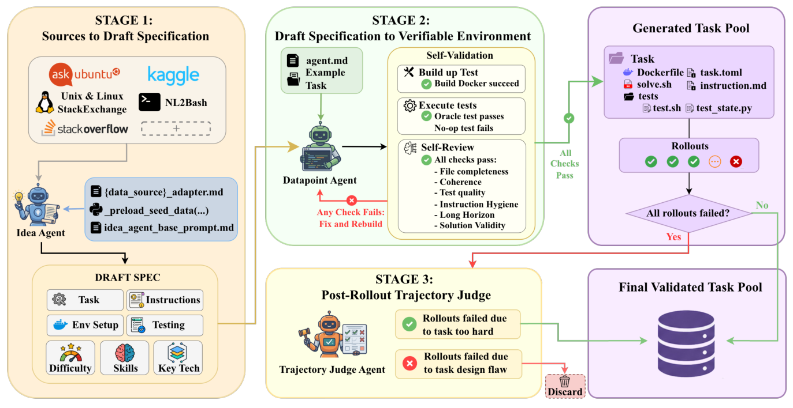
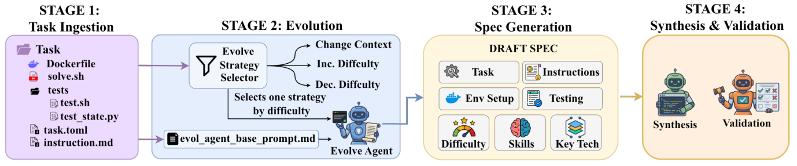
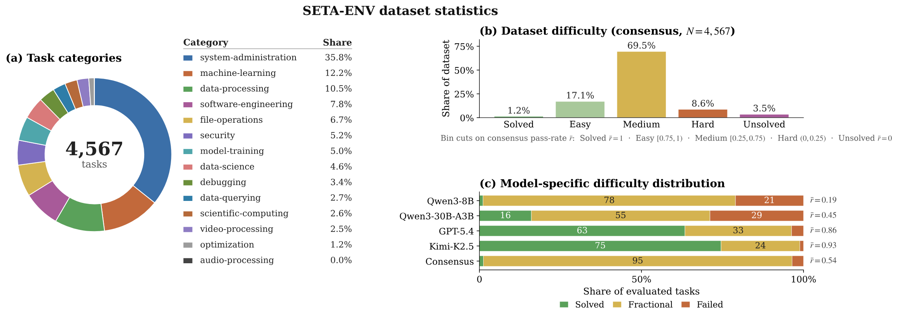
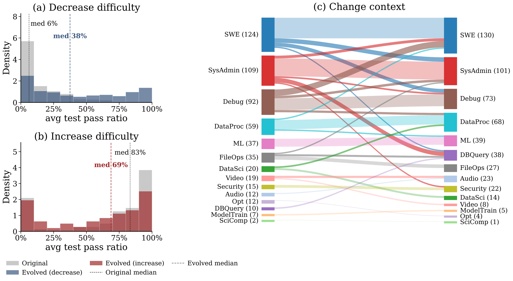
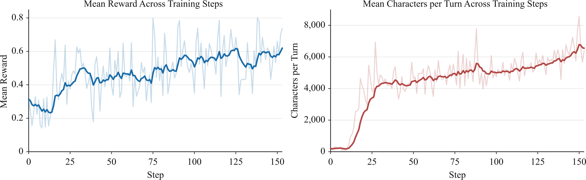

# Paper精读｜SETA: Scaling Environments for Terminal Agents

> [!abstract] 一句话结论
> SETA 把终端 Agent 的 RL 训练瓶颈从「缺环境」改造成「可流水线生产的环境」：**SETA-Synth** 把 Stack Overflow / Unix&Linux StackExchange / Kaggle / NL2Bash 这类**人验证过的问题–解对**经 Idea Agent + Datapoint Agent 双代理转成可执行、可验证的 Docker 环境，**SETA-Evol** 再按训练模型在每道题上的通过率自适应地加难、减难或换技术栈，两条管线共享同一套 no-op / oracle / 轨迹审计验证机制，产出 **SETA-Env**（4,567 个环境，当前最大开源可验证终端 RL 数据集）；用它以 **GRPO** 训练 Qwen3-8B，在 Terminal-Bench 2.0 上最佳 run 达 **12% pass@1**（8 次重复评估均值 10.7±1.3，基线 3.1±0.6，约 3.3 倍），是已报告的 8B 规模 RL 训练模型中的最好成绩，同一训练信号还把 DeepSeek-V4-Flash 的 pass@1 从 40% 提到 43.0±2.5%、pass@5 从 54% 提到 58%（同一 CAMEL 终端 Agent harness、500k token 上下文、最多 200 轮迭代）。

> [!cite]- 论文信息（点开折叠）
> - **论文标题**：SETA: Scaling Environments for Terminal Agents
> - **arXiv**：2607.10891（v2，2026-09-30 更新；首版 2026-07-12）
> - **链接**：[https://arxiv.org/abs/2607.10891](https://arxiv.org/abs/2607.10891)
> - **作者**：Qijia Shen, Zhiqi Huang, Vamsidhar Kamanuru, Aznaur Aliev, Jay Rainton, Ahmed Awelkair, Zhichen Zeng, Jiajun Li, Shi Dong, Yueming Yuan, Boyuan Ma, Qizheng Zhang, Jiwei Fu, Yuzhen Mao, Wendong Fan, Ping Nie, Philip Torr, Bernard Ghanem, Changran Hu, Jonathan Lingjie Li, Urmish Thakker, Guohao Li（22 人）
> - **机构**：CAMEL-AI.org / Eigent.AI / Imperial College London / University College London / SambaNova / KAUST / RadixArk / Stanford University / University of Oxford / University of Waterloo（以论文 v2 署名页脚注为准）
> - **日期**：2026-07-12（v1）；2026-09-30（v2）
> - **阅读范围**：正文 §1–§5 全部 + 附录 A.1–A.10 全部（A.2/A.4 为 prompt 原文，已通读；Tables 1–11 数字已逐表核对）
> - **代码/数据**：GitHub camel-ai/seta；HuggingFace camel-ai/SETA-Env 与 camel-ai/Qwen3-8B-SETA-Env-RL

---

## 1️⃣ 论文想解决什么问题

这一节要回答：终端 Agent 的 RL 训练卡在哪一步，为什么已有的修补都不够。

终端是文本界面里最通用的一种：系统运维、文件操作、数据处理、ML 流程都能通过命令行完成，而且天然适合沙箱化验证。但正因为终端环境是**有状态**的——每条命令都可能改变环境里不可见的部分（改了配置文件、装了包、起了进程），给终端 Agent 造训练数据比给推理模型造数学题难一个量级。数学题的验证器是一行代码；终端任务的验证器要求「先有一个能跑起来的环境，再有一套检查环境最终状态的测试」。作者指出的缺口有三层：

第一层是**没有天然的监督信号**。SWE-bench 一系（SWE-Gym、R2E-Gym、SWE-smith）能规模化，是因为 GitHub pull request 本身就是「问题描述 + 参考解 + 测试」的三元组；终端任务没有对应物，所以只能靠 LLM 凭空合成，而纯合成（TermiGen、Endless Terminals）又缺少人类验证过的现实性。第二层是**合成分布有偏**。LLM 从零合成会扎堆在自己熟悉的工具和任务形态上，论文的 Table 1 把这总结为四个维度：Grounded（来自真实数据而非凭空生成）、Executable（带可执行验证器 + 交互环境）、Adaptive Difficulty（难度随训练模型表现调节）、RL-Validated（已被证明能靠 RL 提升模型）。此前没有任何一个数据集四项全打勾——SETA 是第一个。第三层是**难度不可控**。GRPO 这类组内相对优势算法要求组内奖励有方差：全对或全错的任务梯度为零，等于白算。已有合成管线没有「按模型当前能力校准难度」的机制，产出的分布天然偏离有效训练区。

这里引入贯穿全文的例子（第一次出现，后文会再走三遍）。Stack Overflow 问题 5301226：一个 PHP 背景的 Java 新手想把字符串 `Mon Mar 14 16:02:37 GMT 2011` 解析成 Calendar 对象，采纳答案给出了 `SimpleDateFormat("EEE MMM dd HH:mm:ss z yyyy", Locale.ENGLISH)` 的写法；旁边还有三个 linked 问题，其中一个揭示 `Calendar.JANUARY` 是 0 起而不是 1 起。这是典型的人验证素材：问题真实、解法可信、坑点明确。但把它变成 RL 训练环境，中间隔着「环境里要预置一个带这两个 bug 的 Java 程序、指令要把任务讲清楚、测试要能机器判定对错」三座山——SETA 要解决的就是这一段从「素材」到「可训练环境」的自动化。

---

## 2️⃣ 核心洞察

用一句可复述的话概括：**环境可以像数据一样被工业化再生产——把人验证过的问题–解对当原材料，用解耦的双代理把它铸成可执行环境，再用以模型能力边界为反馈信号的进化算子循环扩产，而验证机制是唯一贯穿两条管线的部件。**

拆开看这句为什么成立：

**洞察一：合成要「接地」而不是「凭空」。** Idea Agent 的输入不是一句空泛的「请生成一个终端任务」，而是 Stack Overflow 帖子、Kaggle notebook、NL2Bash 命令对这类真实问题。之所以必须接地，是因为纯 LLM 合成的任务表面花哨但经常语义不成立（工具链配不起来、约束自相矛盾）；而 Stack Overflow 上有采纳答案和点赞数的帖子，等于已经有人替你做过一次「问题可解性」验证。这一洞察落到 §3.1 的源适配层（adapter prompt），对应例子就是上面那个 Java 日期解析帖子——它的 linked 问题被显式利用来叠加第二个 bug（0 起月份），让任务从单 bug 变成复合 bug。

**洞察二：格式适配和任务构建必须解耦。** 不同源的原始结构千差万别（帖子有标题/正文/采纳答案，notebook 有代码单元，NL2Bash 有 nl/bash 对），但构建任务需要的字段是一样的（目标、入口、验收标准、隐藏细节、测试意图）。SETA 把「怎么读这个源」塞进 per-source adapter prompt，把「任务长什么样」放进共享 base prompt，产出一个源无关的 draft_spec.md 中间格式。为什么这个解耦重要：接一个新源只需要写一个新 adapter，不用动管线其他部分——这是「可规模化」的工程前提，对应 §3.1 的 Idea Agent 设计。

**洞察三：同一代理自己写的题自己验不出来，要靠外部证据。** oracle 测试（跑一遍参考解，全过才算合格）表面上是金标准，但解和测试出自同一个 agent 手，会**共享未写进指令的隐含约定**——解当然能过自己的测试，可真正的训练对象（被训练模型）并不知道这些约定。A.3 的实例触目惊心：一个批量归档脚本任务，5 次 GPT-5.4 rollout 全部挂在同两个测试上，原因是指令只用自然语言描述了 JSON 报告，而测试锁死了四个字面量（`archived_successfully` 键名、`skipped_oversized` 键名、`"ok"` 状态值、`cli-tool.zip` 命名格式），5 个 rollout 各自选了不同写法——这证明错在测试而不是模型。作者的对策是 Trajectory Judge：只在「全 rollout 失败」时触发，用全新上下文加外部失败证据做仲裁。这一洞察对应 §3.1 的 post-rollout verification 和 A.3 整节。

*图注：Figure 1（原文 §3.1）。SETA-Synth 管线总览：多源数据（Stack Overflow / Unix&Linux SE / Kaggle / NL2Bash）经源适配 + Idea Agent 产出统一 draft spec，再由 Datapoint Agent 实例化成 Dockerfile + solve.sh + 测试套件 + instruction.md 的完整环境，最后经 no-op / oracle / post-rollout 三道验证入库。*

---

## 3️⃣ 方法解读

### 组件1：源适配层与 Idea Agent——把异构素材铸成统一规格

**是什么。** Idea Agent（点子代理）负责把一条源素材展开成 draft_spec.md——一个源无关的任务设计文档，包含任务目标、agent 可见的任务简报、入口文件、验收标准、环境约束、**Builder-Only 的隐藏细节**、测试意图、难度标签。

**为什么需要。** 源素材信息量不足以直接造环境：一个 Stack Overflow 帖子只给了问题和解法，没给环境假设（装哪个 JDK 版本、有没有网）、没给验收判据（怎么算修好了）、更没给「坑在哪」的结构化描述。没有这一层，Datapoint Agent 就要同时做任务设计和工程实现两件事，出错面太大。反事实很直接：把 adapter 拿掉、让 Idea Agent 直接吃原始 JSON，每种源都得为它改一遍任务设计逻辑，管线就退化成 N 条不共享代码的一次性脚本——「加源即加 adapter prompt」的扩展性正是这一层存在的理由。

**怎么做。** 输入是按源分组的种子文件夹（如 `stack_overflow/5301226/` 含 main.json + 三个 related_N.json）；引导是 base prompt（通用任务设计框架）+ adapter prompt（该源的字段结构、内容特征、可行性规则）。A.2 给了两个 adapter 的原文：NL2Bash adapter 规定「complexity 1–2 的种子只准出 medium 任务、3–5 出 hard，禁止把低复杂度种子吹成 hard」；Stack Overflow adapter 明确「有 related 帖子时要叠成复合故障——主帖给主要问题，related 帖给第二个交互性问题」。需要时 agent 可联网搜索补齐信息。输出是 draft_spec.md。拿贯穿例子走一遍：问题 5301226 的 main.json + linked 帖 3583384（月份 0 起）被 Idea Agent 合成出「修一个 Java 事件日志处理器」的任务草案——EventProcessor.java 被故意种入两个 bug（日期 pattern 用成 `MM/dd/yyyy HH:mm:ss` 而数据是 `EEE MMM dd HH:mm:ss z yyyy`；月份取 `cal.get(Calendar.MONTH)` 不加 1），两个 bug 被写进 Builder-Only 的 Hidden Details，测试意图（编译通过、report.txt 恰好 5 行、月份键 1 起、总数对）也在此定稿。

**代价。** 中间格式本身是新增的耦合面：所有下游能力上限被 draft_spec 的表达力封死；adapter 的「领域提示」（哪些工具族适合展开成什么任务）仍带人工先验；Idea Agent 可联网搜索意味着合成结果引入了外部网页的噪声。

### 组件2：Datapoint Agent 与环境实例化

**是什么。** Datapoint Agent（数据点代理）把 draft_spec.md 实例化成一个 Harbor 格式的完整任务包：`task.toml`（元数据）、`instruction.md`（agent 可见指令）、`environment/`（Dockerfile + 预置文件）、`solution/solve.sh`（参考解）、`tests/`（test.sh + pytest 测试）。

**为什么需要。** draft_spec 是纸面设计，RL 训练需要的是能在 Docker 里跑起来、可复位、可打分的实体。之所以单独设一个 agent 而不是让 Idea Agent 干到底，是因为设计（自然语言、结构化）和实现（Dockerfile、shell、pytest）的技能面不同，且实现阶段只需要读 spec 不需要读原始源——中间格式在这里兑现了「解耦」的收益。

**怎么做。** 以贯穿例子为例，最终包长这样：Dockerfile 基于 ubuntu:24.04，装 openjdk-17-jdk、tmux、uv；events.csv 预置 10 行跨 3 个月的事件；EventProcessor.java 预置含双 bug 的版本；instruction.md 只告诉 agent「修复日期处理 bug，使程序可编译运行并产出正确的月度汇总」，两个 bug 的存在性**不写进指令**——它们只活在 Builder-Only Notes 里；solve.sh 用两次字符串替换修 pattern 和 `month + 1`；test_outputs.py 用 pytest 断言 report.txt 存在、恰好 5 行、无 `YYYY-00` 键、`2011-04: 3` 计数正确、总数为 10、格式合法。每个测试都直接对应指令里写明的验收标准——这一点后来成为奖励函数合法性的根基（见「关键公式」节）。

**代价。** 全部生成物由 LLM 产出，Docker 构建可能失败、测试可能写错；组件3 的验证机制就是为这个代价买的保险。

### 组件3：统一验证机制——no-op、oracle、轨迹审计三道关

**是什么。** 一套三段式检查：① no-op 测试——不做任何 agent 动作直接跑测试套件，必须 0 个测试通过（否则任务「空壳可过」）；② oracle 测试——跑参考解 solve.sh，必须全过（否则任务不可解或验证器有错）；③ post-rollout 轨迹审计——对 rollout 全失败的任务派 Trajectory Judge 分类。

**为什么需要。** 前两道是 SWE-bench 式的标准件，防「假环境」；第三道是 SETA 的增量。为什么 oracle 不够：解和测试同出一个 agent 之手，共享隐含约定，oracle 只证明「两边一致」，不证明「指令把约定讲清楚了」——A.3 的四字面量案例（5 个 rollout 各自写出不同但同样合理的 JSON 键名，全部被判负）就是这条通路漏出去的假阴性。作者还试过让 Datapoint Agent 自查指令无歧义，但 agent 刚写完自己的测试，会把自己的约定当公理，自查稳定无效；Trajectory Judge 用两个手段绕开：全新上下文（不记得任务怎么造的）+ 外部证据（独立 rollout 的逐测试失败频率、终端日志）。

**怎么做。** Judge 只在 100% rollout 失败时触发，输入每测试失败频次、测试源码、指令、终端日志，输出 too_hard（保留）或 design_flaw（丢弃）。全程共判出 94 个设计缺陷任务（约占被审计任务的 2%）。这一道同时服务于两条管线——SETA-Evol 的每个变异体也要原样过 Docker 构建 + no-op + oracle + 自查，再回到训练模型上复测是否移入了有效区。

**代价。** Judge 本身是 LLM，误判率未量化；「全失败才触发」的策略只覆盖了最极端的失败模式——如果 30% rollout 通过的坏任务（测试锁了隐含约定但强度较弱），Judge 看不见它。

### 组件4：SETA-Evol——按模型能力边界自适应进化的算子

*图注：Figure 2（原文 §3.2）。SETA-Evol 从已有环境出发，按训练模型在各任务上的通过率选择进化算子：易题加难、中题换上下文、难题减难，变异体重走 SETA-Synth 的全套验证后再复测难度。*

**是什么。** 一个从现有环境池出发的进化框架：先测训练模型在每道题上的通过率 r，再按 r 落在哪一档选算子（原文 Table 2）：r>0.5 的易题走 Difficulty Increase（加约束、加边界情况、加多步依赖）；r∈(0,0.5] 的中题走 Context Shift（换领域/工具栈但保难度）；r=0 或只有部分通过的难题走 Difficulty Decrease（删步、预置脚手架、收窄范围）。

**为什么需要。** SETA-Synth 的难度分布被源数据塑形，天然偏斜；GRPO 的组内相对优势 A 只有在组内奖励有方差时才有信号，全对全错的任务贡献零梯度。之所以要「自适应」而不是像 Evol-Instruct 那样一律加难，是因为有效训练区随模型能力移动：对 8B 基线过难的任务对更强的模型可能恰好。反事实：拿掉自适应、统一加难，易题会被推离有效区造成浪费，难题会更不可学，分布整体向 r=0 塌缩——Figure 4(a,b) 正是「减难方向中位通过率从 6% 升到 38%、77% 的对朝声明方向移动」的正面证据。

**怎么做。** A.4 给出三个算子的完整 prompt：INCREASE 要求 ≥5 个实质步骤、禁止只加量（「复制 10 个文件而不是 3 个不算变难」）禁止换领域；CHANGE_CONTEXT 要求保结构复杂度、换真实可测的技术（nginx→apache2、pytorch→tensorflow、systemd→init.d/openrc），且强制 ≥5 步的 long-horizon 过滤；DECREASE 豁免 ≥5 步要求但仍要求 ≥2 步（单命令任务直接 FILTERED）。每个变异体重走组件3 全套验证后，再在训练模型上复测。

**代价。** 算子作用在任务文本和环境上，难度标注依赖 r 的测量噪声（见下面共识通过率的推导）；Context Shift 依赖 web 搜索找目标技术的真实文档，新技术的可测试性有先验风险。

### 组件5：SETA-Env 数据集刻画——产出长什么样

**是什么。** 两条管线的合计产出：4,567 个验证过的环境 = 3,255 个 SETA-Synth 合成 + 1,312 个 SETA-Evol 进化，覆盖 14 个技术栈类目。

**为什么需要刻画难度。** 训练前必须知道数据落在哪个难度区，否则无法判断「模型没学到」到底是数据太易还是太难。

**怎么做。** 类目分布由单标签 LLM 分类器给出：system-administration 35.8%、machine-learning 12.2%、data-processing 10.5%、software-engineering 7.8%。难度用**共识通过率**（consensus pass-rate）打分：4 个跨度很大的模型（Qwen3-8B、Qwen3-30B-A3B、GPT-5.4、Kimi-K2.5）各跑一遍，对未运行的 (task, model) 单元做逐任务均值插补后取 4 模型均值（公式见下节），再切成 Solved（r̄=1）/ Easy [0.75,1) / Medium [0.25,0.75) / Hard (0,0.25) / Unsolved（r̄=0）五档。分布居中且两端有质量，且这个形态从 8B 到 Kimi-K2.5 都成立——数据集对强模型也未饱和，说明它对不同能力档的模型都有学习信号。

*图注：Figure 3（原文 §3.3，原图为 SVG，已转换嵌入）。(a) 14 类目的任务份额，system-administration 占 35.8% 居首；(b) 共识通过率五档难度分布，重心落在 Medium；(c) 四个能力跨度极大的模型（Qwen3-8B 到 Kimi-K2.5）的通关份额与各自均值通过率——强模型也只解出其中一部分，数据集未饱和。*

进化本身的效果也有量化审计（Figure 4）：Qwen3-8B 在亲子对上的测试通过率，减难桶（n=505）中位数 6%→38%，77% 的对朝声明方向移动；加难桶（increase+slight_increase 合并，n=143）中位数 83%→69%，60% 朝声明方向移动；553 个换上下文对里 46.1% 跨类目，留下的 53.9% 中 91.3% 仍至少轮换了一个具体技术、55.4%（165/298）做了可判定的双侧 X→Y 交换（如 sklearn→caret、pytorch→tensorflow、systemd→init.d/openrc，A.5 逐轴列出，A.6 给四个逐字案例）。

*图注：Figure 4（原文 §3.3，原图为 SVG，已转换嵌入）。(a,b) 减难/加难方向的亲子任务 Qwen3-8B 通过率密度对比；(c) 换上下文对从父类目（左）流向进化类目（右）的 Sankey 图，对角线（同类目）淡化显示。*

**代价。** 14 类标签由 LLM 打，分布结论的可靠性等于该分类器的可靠性（原文未给分类器的一致性校验）；「3,255 个合成环境」与 Endless Terminals 数据集的 3,255 规模恰好相同，论文未说明两者关系（是否同一批环境的再验证再发布），这影响「相对已有工作的净新增量」的解读——此为分析者待验证疑问，非论文结论。

### 组件6：GRPO 训练与部分进度奖励

**是什么。** 训练侧的完整配置：Qwen3-8B（非思考模式）用 GRPO + DAPO 式动态采样（滤掉组内奖励一致的样本），奖励不是二值而是「通过测试比例 + 全过加成」。

**为什么需要部分进度奖励。** 二值奖励稀疏：一个 8 测试的任务只有 9 种奖励取值里的两个端点可用，大量 rollout 拿到 0 分但彼此实际差异很大（修对 1 个 bug 和什么都没做同分，梯度上无法区分）。换成比例制后，**提供有意义奖励方差的任务份额从 49% 升到 86%**（原文 §3.4）——这个数字是「为什么需要这个组件」的直接证据。之所以敢用比例制，是因为组件3 的验证纪律保证了每个单元测试都对应指令里写明的目标（写死隐含约定的测试在自查和轨迹审计中被剔除），否则「部分通过」可能只是部分迎合了测试的隐藏偏好。

**怎么做。** 贯穿例子第三次出现：EventProcessor 任务有约 10 个 pytest 测试（report 存在、行数、无 0 起月份、逐月计数、总数、格式……）。一个修对了 pattern 但没加 `month + 1` 的 rollout 会通过编译/行数/格式类测试、挂在计数测试上，拿到约 0.5 的奖励而不是 0——组内优势不再是零，梯度能流向「修第二个 bug」这个方向。训练框架：Qwen3-8B 跑在 AReal 上、单节点 8×H200；DeepSeek-V4-Flash 跑在 Miles 上、8×8 H200 集群。训练集从 4,567 里过滤掉基线模型完全解不动的环境后**均匀下采样到 560 个**——保持 RL 优化稳定、同时保留任务类型多样性。

**代价。** 非思考模式的 Qwen3-8B 是工程妥协：作者实测思考模式常在前几轮就超最大响应长度、作废大量轨迹，所以主结果全部用非思考模式取得——报告的成绩只对「8B + 无显式 CoT」这个具体配置成立，不能直接外推到思考模式。560 的下采样还带出另一个后果：4,567 的数据集容量并没有被这次主 run 消费掉，「数据规模带来收益」的完整曲线尚未测出。

### 组件之间怎么连

一个训练样本的端到端旅程：源帖子（含点赞/采纳信号过滤）→ Idea Agent（base + adapter prompt，可联网）→ draft_spec.md → Datapoint Agent → Harbor 任务包（Dockerfile / instruction.md / solve.sh / tests / task.toml）→ no-op + oracle 验证 → 入池 → 训练模型对每道题滚 n=16 条轨迹 → 计算通过率 r → SETA-Evol 按 r 选算子产变异体 → 变异体重走全套验证 + 复测 r → 有效区任务进入训练集 → GRPO 以部分进度奖励计算组内优势 → 更新策略。每一步的输入输出都是文件或统计量，唯一的「智能部件」是三个 LLM agent（Idea / Datapoint / Judge）加训练模型本身；验证机制是闭环上唯一不依赖任何模型善意的部件。

### 关键公式与推导

论文正文只给了两条式子加一个统计定义，但每条都值得拆。

**式（1）GRPO 目标（原文 §3.4）：**

$$\mathcal{J}(\theta) = \mathbb{E}_{(h,s,a,R)\sim\mathcal{D}}\Bigg[\min\Big(\tfrac{\pi_\theta(a\mid h,s)}{\pi_{\mathrm{old}}(a\mid h,s)}A,\ \operatorname{clip}\big(\tfrac{\pi_\theta(a\mid h,s)}{\pi_{\mathrm{old}}(a\mid h,s)},\,1-\epsilon_{\mathrm{low}},\,1+\epsilon_{\mathrm{high}}\big)A\Big)\Bigg] - \beta\,D_{\mathrm{KL}}\big(\pi_\theta(a\mid h,s)\,\big\|\,\pi_{\mathrm{ref}}(a\mid h,s)\big)$$

符号逐个说：h 是交互历史（此前各轮的命令与终端回显），s 是当前观测，a 是 agent 的动作（一次工具调用或一段文本），R 是这条轨迹拿到的部分进度奖励；A 是**组内相对优势**——同一环境上 n=16 条 rollout 的奖励减组均值再归一，因此任务的绝对难度被消掉，只留下「这条轨迹比同任务其他轨迹好多少」；ε_low/ε_high 是不对称裁剪界（DaGPO/DAPO 一系允许比率向下更宽松，防止负优势一步把策略剪死）。

> 人话：同一道题自己跟自己比——16 个自己里排位靠前就加强、靠后就削弱；裁剪限制每次加强/削弱的幅度。有个细节要单独拎出来：式子里带着 KL 惩罚项 −β·D_KL，但附录 Table 9 把 KL penalty（λ_KL）设为 **0.0**——实际训练中这一项是关掉的，式（1）在实现层面退化为纯裁剪目标。正文没有解释为什么关，这属于「公式与实现不一致、论文未 reconcile」的一处证据（另见下面奖励加成 0.2 vs +0.5 的矛盾）。

**式（2）部分进度奖励（原文 §3.4）：**

$$r=\frac{\#\ \text{tests passed}}{\#\ \text{total tests}}+0.2\cdot\Big[\frac{\#\ \text{tests passed}}{\#\ \text{total tests}}=1\Big]$$

前一项是测试通过比例（连续，[0,1]）；方括号是指示函数，全过时额外加 0.2，把满分奖励顶到 1.2，防止模型在 90% 通过后就失去把最后一步做完的动力。

> 人话：按修好多少给分，全修好再发一笔小额全勤奖。注意这里的全过加成是 **0.2**，而附录 Table 8 写的是「Pass bonus: +0.5（all tests pass）」、且另有 reward scaling 10.0 与 reward bias −0.5——两处加成数值不一致，论文没有说明哪个对应哪次 run（或是否 DeepSeek 与 Qwen 用了不同奖励配置）。复现者需要自己试验哪个才是主结果用的值；我按「正文公式为准、附录为另一次 run 的配置」理解，但这是分析者的猜测，论文未表态。

**式（3）共识通过率（原文 §3.3，Figure 3(b)）：**

$$\bar{r}_{t}=\tfrac{1}{4}\sum_{m}\tilde{r}_{t,m}$$

t 是任务，m 遍历 4 个评估模型（Qwen3-8B、Qwen3-30B-A3B、GPT-5.4、Kimi-K2.5），r̃_{t,m} 是模型 m 在任务 t 上的通过率，**未运行的 (t,m) 单元用该任务已运行单元的均值插补**。

> 人话：一道题的难度 = 四个强弱悬殊的模型解它的平均成功率。用四个模型而不是一个，是为了把「对 8B 难」和「对所有模型都难」区分开；代价是插补单元把测量噪声藏进了均值——论文没给插补占比，r̄ 的置信区间无从估计。难度分档的阈值（0.75 / 0.25）本身没有给出标定依据，属于设计选择而非推导结果。

---

## 4️⃣ 实验部分怎么读

### 实验设置

被训模型两个：Qwen3-8B（主结果，非思考模式）与 DeepSeek-V4-Flash（跨骨干检验）。训练用 GRPO + DAPO 式动态采样，Qwen3-8B 在 AReal 框架、单节点 8×H200 上训练；DeepSeek-V4-Flash 在 Miles 框架、8×8 H200 集群上训练（超参完整见 A.8：lr 1.70×10⁻⁵ 常数、batch 8、每任务 n=16 条轨迹、40 epochs、PPO clip 0.4、KL 置 0、采样温度 1.0、bf16；agent 每 episode 最多 30 轮迭代、上下文 28,672 token）。训练集是 4,567 环境过滤后均匀下采样的 560 个。评测主战场 Terminal-Bench 1.0 与 2.0，外加 CRUST-Bench（100 任务，C→安全 Rust 仓库级翻译）、CompileBench（15 任务，真实项目迭代编译修复）、QuixBugs（80 任务，小程序修复）三个邻近代码基准（pass@4）。Qwen3-8B 的 pass@1 数字是**同设置下重复 8 次评估**的均值±标准差，方差来自温度 1.0 的采样随机性；被训模型的训练种子数未报告。

### 核心结果

Terminal-Bench（pass@1，原文 Table 3）：

| 模型 | 规模 | TB 1.0 | TB 2.0 | 训练方法 |
|---|---|---|---|---|
| Qwen3-8B (base) | 8B | 7.8±1.2 | 3.1±0.6 | — |
| OpenThoughts-Agent-v1-RL | 8B | 未报告 | 4.9 | RL |
| Endless Terminals-8B | 8B | 未报告 | 6.7 | SFT+RL |
| Nemotron-Terminal-8B | 8B | 未报告 | 13.0±2.2 | SFT（254k+ 轨迹） |
| **SETA (RL)** | 8B | **17.8±1.2** | **10.7±1.3**（最佳 run 12） | RL（SETA-Env） |
| Qwen3-Coder | 480B | 39.0±0.4 | 23.9±2.8 | — |
| GPT-OSS-120B | 120B | 未报告 | 14.2±2.3 | — |

怎么读这张表：三个层次要分开。第一层，同骨干自比——Qwen3-8B 在 TB 2.0 从 3.1±0.6 到 10.7±1.3（8 次重复评估，均值提升约 7.6 个百分点、约 3.3 倍相对提升；正文引用的 12% 是**最佳单次 run**，与表格均值 10.7 并非同一个统计量，引用时要带条件）。第二层，同规模横比——超过同为 8B RL 的 OpenThoughts（4.9%）和 SFT+RL 的 Endless Terminals（6.7%），逼近 SFT 模型 Nemotron-Terminal-8B（13.0±2.2，用 254k+ 条教师轨迹蒸馏而来）；与 GPT-OSS-120B（14.2±2.3）尚差约 3.5 个百分点。第三层，跨骨干——DeepSeek-V4-Flash 在同一 CAMEL harness（500k token 上下文、最多 200 轮迭代）下 pass@1 从 40% 到 43.0±2.5%（+3.0 个百分点）、pass@5 从 54% 到 58%（+4 个百分点，标准差未报告）。之所以跨骨干实验重要：它排除了「SETA-Env 只是在教 Qwen 家族自己的 harness 习惯」这一替代解释——但 2 个百分点的相对增益也让结论强度有限，43.0±2.5 的 ± 区间与 40% 的距离不足一个标准差。

### 泛化到邻近代码基准

Terminal 训练能否外溢到代码任务，Table 4（pass@4）给了肯定但强度不均的证据：CRUST-Bench（100 任务）15%→24%（Qwen3-30B-A3B 基线为 28%）；CompileBench（15 任务）6.7%→40%——涨幅最大，但注意**这个基准只有 15 道题，6.7%→40% 换算过来是 1 道对到 6 道对**，单题波动就是 ±6.7 个百分点，结论要按小样本读；QuixBugs（80 任务）7.5%→15.0%（Qwen3-30B-A3B 基线 13.8%）。8B 的 RL 模型在 CompileBench 和 QuixBugs 上反超了 30B 基线，指向「终端 RL 提升的是迭代试错-修复的通用行为模式，而不是某个领域的知识」。CRUST 的相对小涨幅（+9 个百分点）与它在三个基准里最「仓库级」的形态一致——多文件翻译吃的是代码生成底力，终端训练补不了这块。

### RL 行为变化与案例研究

训练曲线（Figure 5）显示两件事同时发生：平均奖励上升；**每轮返回字符数上升**。后者的含义值得展开——基线模型倾向拿到提示就立即发命令、撞错、原样重试，每轮产出短；RL 之后模型先在行动前做结构化推理（读错误、定位根因、再动手），单轮变长但撞错率下降。之所以这个观察重要，是因为它把「能力提升」从分数落到了可解释的行为机制上。

*图注：Figure 5（原文 §4.4，原图为两张 SVG 拼图，已转换合并嵌入）。左：RL 训练期奖励曲线上升；右：每轮平均返回字符数同步上升——模型从「立即执行、撞错、重试」转向「先推理再执行」。*

nginx-request-logging 案例把这条曲线落到 token 级（Table 5，三模型见同一环境）：任务要求在 Docker 容器内装 nginx、配自定义日志格式、限速、404 页、8080 端口启动。SETA (RL) 15 轮、15,709 token、8/8 测试全过；Base（非思考）13 轮、678 token、1/8；Basethink（思考模式）7 轮、7,402 token（约 11 倍于 Base）、同样 1/8。A.10 的逐轮对照给出三个分岔点：① `sudo: command not found`——RL 模型当场推断出「Docker 容器里没有 sudo」，一条命令不带 sudo 装齐 sudo 和 nginx；Base 原样重试同一失败模式，Basethink 想明白了循环依赖却还是多花两轮。② 配置写错 `log_format not allowed here`——RL 模型连续两轮引用报错原文、指名根因（顶层不能放 log_format、缺 events 块）、定向修复到 `nginx -t` 通过；Basethink 高层规划写得漂亮但语法错到任务结束。③ `systemctl: command not found`——RL 模型识别出容器里没有 systemd，直接 `nginx` 启动并 curl 验证 200；Base 装 200+MB 的 systemd 无济于事。这张表的要害在于它否定了「RL 只是学会了多思考」：Basethink 的 11 倍 token 没换来任何一个额外测试，**起作用的是推理与观察的接地方式，不是推理的量**。

### 消融与公平性

严格意义上的「消融」（同预算下逐组件移除）这篇论文没有做，它做的是**组件级证据链**，读的时候要分清哪些主张到哪一层：

- 部分进度奖励：正文 §3.4 给出前后对比——有意义奖励方差的任务份额 49%→86%。这是机制级证据（该组件直接作用于奖励分布），但没有 paired 训练 run 证明「二值奖励训练出的模型差多少」，归因停留在「方差更多⇒信号更多」的推断层。
- SETA-Evol 算子有效性：Figure 4 的亲子通过率对比（减难 6%→38%、77% 朝声明方向）证明的是**算子移动了难度**，而「移进有效区的任务提升了 RL 收益」没有被单独实验隔离——主 run 的 560 环境里进化任务占多少、去掉它们成绩掉多少，未报告。
- 轨迹审计：94 个 design_flaw（约 2%）说明这道关真的拦了东西，但 Judge 的误杀率（把可学难题错判成缺陷）没有金标准对照。
- 公平性：同规模对比里，SETA (RL) 用 560 环境 RL 训练，Nemotron-Terminal-8B 用 254k+ 轨迹 SFT，两者训练预算完全不同量级，「RL 逼近 SFT」的表述要带着这个不对等读；跨骨干对比（DeepSeek 前后）同 harness 同预算设置，这一组内部是干净的。

### 训练细节与复现要件

已公开：代码（camel-ai/seta）、数据集（camel-ai/SETA-Env）、RL 模型（camel-ai/Qwen3-8B-SETA-Env-RL）、全套超参（A.8 Tables 8–9）。未披露/未对齐的部分：训练种子数与多次 RL run 的方差（表格里的 ± 全部来自评估侧温度采样，8 次重复评估；训练本身的随机性没有量化）；4,567→560 的过滤+下采样具体清单；Appendix Table 8 的 Pass bonus +0.5、reward scaling 10.0、reward bias −0.5 与正文式（2）的 0.2 加成未 reconcile；Table 2 里 Difficulty Increase 与 Difficulty Decrease 的算子代号都写作 d1（Context Shift 为 b1），疑似排版笔误；Table 3 把 Qwen3-30B-A3B 标成「Qwen3-32B (base) / 30B」。复现最小要件是 8×H200 级别的节点加 Docker 化的 rollout 基础设施（最大并发 8、队列 32），对学术组不算轻。

---

## 附录里影响结论的内容

按验收标准单列，这几条会改变对主文的理解：

- **A.3 假阴性案例**：post-rollout 验证存在的全部理由都在这里——oracle 结构性失明的机制（同源共谋）和判别证据（5 个 rollout 的字段选择彼此不同）。不看这一节，会以为 no-op + oracle 已经足够。
- **A.8 超参表的矛盾**：KL 置 0、Pass bonus +0.5 与正文公式不一致，直接决定你复现时的行为；「式（1）带 KL 但实现关闭」也意味着论文的公式不是实现的忠实描述。
- **A.9 SFT 附带结果**：用 Kimi-K2.5 当教师在 SETA-Env 上收 1,488 条轨迹、滤出 1,112 条满分轨迹做全参 SFT（4×A100、3 epochs），pass@16 从 TB 1.0 的 7.5% 到 31.3%、TB 2.0 的 2.25% 到 15.7%。注意两点：它与 RL 主结果是**不同采样预算**（pass@16 vs pass@1）不可直接比大小；它说明同一环境池既能出 RL 信号也能出 SFT 语料，1,112 条轨迹就到 6.3 倍提升，单样本信号密度高。
- **A.7 Harness 工程细节**：并行工具调用上限、截断参数的 JSON 哨兵处理、六种终止原因分类、终端输出 1000 字符截断（头 500+尾 500）——这些是「RL 训练稳定性」的真实来源，也是别人迁移 SETA 信号时最容易漏抄的部分。
- **A.10 逐轮分岔**：把 §4.4 的行为学主张落到三轮证据，是本文「RL 教会的是接地推理而非更多推理」结论的唯一直接支撑。

---

## 5️⃣ 学术评价

**优点：**

1. 验证机制的分层设计是全文最硬的部分：no-op 防空壳、oracle 防不可解、轨迹审计防「指令-测试鸿沟」，且 A.3 用一个可复现的失败案例把第三道关的必要性论证到位——这不是「我们做了很多检查」的口号，而是指名了每一道关防的具体失效模式。
2. 难度自适应进化有审计闭环：算子不是喊出来的，Figure 4 的亲子通过率迁移（77%/60% 朝声明方向）加上 A.6 的逐字案例，让「进化真的改变了任务分布」成为可核对的主张。
3. 主结果带完整的不确定性标注（8 次重复评估的 ±）并公开了代码/数据/模型三件套，复现门槛主要在算力而不在信息。
4. 行为学证据（Figure 5 + Table 5 + A.10）把「分数提升」翻译成了「行为变化」，Basethink 11 倍 token 零收益的对照尤其有说服力。

**局限（分三类）：**

作者承认的：只在两个骨干、两个规模上验证；只覆盖终端交互；未测更大训练预算下的行为（§5）。

由本文证据直接暴露的：① 主结果训练集只有 560 个环境，4,567 的数据集价值只被部分兑现，「scaling」的标题下没有 scaling 曲线；② 奖励配置两处矛盾（0.2 vs +0.5）与 KL 项「公式在、实现关」未 reconcile；③ 无组件级消融训练 run，SETA-Evol 与部分进度奖励各自的贡献没有隔离；④ 源数据（SO/SE/Kaggle）与 Terminal-Bench 2.0 的污染/重叠分析完全缺失——评测集是公开的，训练源也是公开的，论文没有检查过两者是否有任务级撞车；⑤ 类目分布靠单标签 LLM 分类器，分布结论无一致性校验；⑥ DeepSeek 增益（+3.0±2.5 个百分点）统计上偏弱，pass@5 的 58% 无标准差。

分析者的待验证疑问：① 3,255 与 Endless Terminals 的 3,255 是否同源（决定净新增量的解读）；② 部分进度奖励与二值奖励的 paired 对照会差多少；③ 共识难度里插补单元占比多大、r̄ 分档对阈值多敏感；④ Trajectory Judge 的误杀率；⑤ 思考模式的 Qwen3-8B 配合 SETA 训练是否能把「超长作废」问题用截断+续写解决掉。

---

## 6️⃣ 局限与可扩展方向

1. 假设「数据集越大训练越好」→ 改变训练环境数（560 → 全量 4,567）→ 看 TB 2.0 pass@1 的数据量响应曲线 → 若 4,567 与 560 差距在 ±1 个标准差内，则「Scaling Environments」的题眼目前只有管线意义、没有结果意义。
2. 假设「部分进度奖励是必要组件」→ 同 560 环境同预算跑二值奖励对照 → 比较 TB 2.0 与组内方差份额 → 若二值版本成绩相当，则 49%→86% 的方差改善并非因果通路。
3. 假设「接地合成优于纯合成」→ 用同量纯 LLM 凭空生成的 560 环境做对照训练 → 比较成对任务的质量审计与最终成绩 → 若纯合成打平，Table 1 里 Grounded 那一列的分量就要重估。
4. 假设「训练信号对更强模型仍然有效」→ 在 Qwen3-32B 级或 DeepSeek 满血版上重复跨骨干实验 → 看 pass@1 增益是否随基线能力衰减 → 若增益消失在某个能力阈值上，SETA-Env 的「未饱和」判断（基于评测而非训练）需要重新表述。
5. 污染检查：对 SETA-Env 与 Terminal-Bench 2.0 做任务文本+测试结构的相似度扫描 → 报告撞车清单 → 若存在显著重叠，12% 的部分功劳要重新归因。

---

## 7️⃣ 最后总结

SETA 的真正贡献不是那 12%，而是把「给终端 Agent 造 RL 环境」从手工工匠活变成了带质检的流水线：源接地保真实、双代理解耦保扩展、三道验证保可训练、自适应进化保难度分布贴着模型能力走。它的验证哲学值得单独记住——oracle 验证的是「出题人自洽」，轨迹审计验证的才是「题目对训练对象公平」。当前证据的边界也清楚：主 run 只消费了 4,567 里的 560 个环境，两个骨干、两个规模、一条奖励公式两处未对齐的配置；跨骨干 +3 个百分点的增益方向一致但强度有限。对要跟进这条线的人，最有价值的下一步不是再造一个更大的数据集，而是把上面第 1、2 条对照跑出来——那才是把「Scaling Environments」从管线宣言变成实证结论的临门一脚。

---

## 8️⃣ 三句速记

> [!summary]- 点开展开
> 1. SETA 用「源接地 + 双代理解耦 + 三道验证 + 按模型能力进化」四件套造出 4,567 个可验证终端 RL 环境（3,255 合成 + 1,312 进化，14 类技术栈），是首个在 Table 1 四个维度（Grounded/Executable/Adaptive/RL-Validated）全勾的开源终端数据集。
> 2. Qwen3-8B + GRPO 在 Terminal-Bench 2.0 拿到 10.7±1.3%（最佳 run 12%，基线 3.1±0.6，8 次重复评估），8B RL 最好成绩、逼近 GPT-OSS-120B 的 14.2±2.3%；DeepSeek-V4-Flash 同 harness 下 pass@1 40%→43.0±2.5%、pass@5 54%→58%。
> 3. 行为学证据（nginx 案例：Basethink 11 倍 token 零收益、RL 模型 15 轮 8/8 全过）说明 RL 学到的是与执行错误接地的推理方式，而不是更多推理——部分进度奖励把有方差任务份额从 49% 抬到 86% 是背后的机制杠杆。
