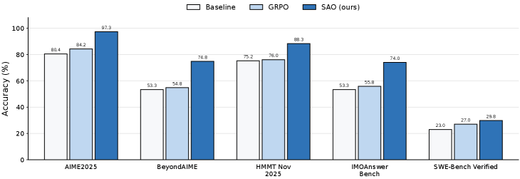
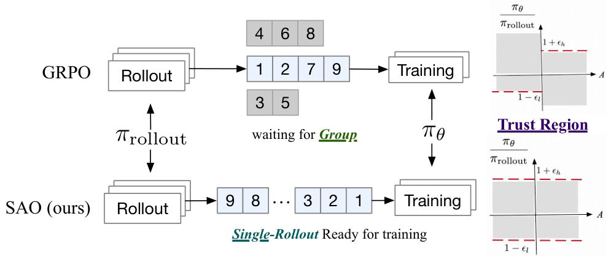

# Paper精读｜Single-Rollout Asynchronous Optimization for Agentic Reinforcement Learning

> [!abstract] 一句话结论
> 异步 agentic RL 的两个老大难——off-policy 漂移和训练不稳——**SAO (Single-rollout Asynchronous Optimization)** 一件一件对着解：**单次 rollout 采样**顶替 group-wise 采样，**双端 token-level clipping**管住 off-policy，**Skip-Observation GAE**甩掉 agentic 轨迹里 observation token 的噪声，换来千步稳定训练。

> [!cite]- 论文信息（点开折叠）
> - **论文标题**：Single-Rollout Asynchronous Optimization for Agentic Reinforcement Learning
> - **arXiv**：2607.07508
> - **链接**：[https://arxiv.org/abs/2607.07508](https://arxiv.org/abs/2607.07508)
> - **作者**：Zhenyu Hou, Yujiang Li, Jie Tang, Yuxiao Dong
> - **机构**：Tsinghua University
> - **日期**：2026-07-08

---

## 1️⃣ 论文想解决什么问题

LLM post-training RL 正在从同步流水线转向异步架构，以提升 GPU 利用率。然而，异步 RL 面临两个核心挑战：

1. **Policy lag（策略滞后）**：在 decoupled actor-learner 架构中，rollout 引擎可能使用多个不同版本的旧策略生成轨迹，导致 off-policy 程度不可控。标准 PPO 需要维护 $\pi_{\theta_{\text{old}}}$ 来计算 importance sampling ratio，但在异步场景下追踪精确的行为概率在计算上不可行。

2. **Group-wise 采样与异步训练不匹配**：GRPO 等主流方法对每个 prompt 采样一组 response，用组内归一化估计 advantage。但在异步训练中：

  - 组内最慢的样本成为瓶颈（straggler problem）

  - 等待期间策略已更新，引入额外的 off-policy

  - 在 agentic 场景中，环境通常只提供单条轨迹反馈，无法进行 group-wise 采样

---

## 2️⃣ 核心洞察

> [!important] 三条核心洞察
> 1. **单次 rollout 是 agentic RL 的天然选择**：在在线学习或复杂 agentic 环境中，每个 prompt 通常只能获得一条轨迹。用 value model 估计 advantage 比 group-wise baseline 更适合这种设定。
>
> 2. **直接双端重要性采样（DIS）简化 off-policy 修正**：放弃追踪 $\pi_{\theta_{\text{old}}}$，直接用 rollout log-probability 作为行为代理，并对超出信任区间的 token 进行 mask（而非 clip），实现更激进的 off-policy 控制。
>
> 3. **Agentic 轨迹需要 Skip-Observation GAE**：标准 GAE 在 action 和 observation token 边界处计算 value difference 会引入噪声（因为 observation 不是模型生成的）。跳过 observation token、只在 action 边界间估计 advantage，信号的噪声才真正压得下去。

*图1：SAO 在 4 个推理基准（带 Python 工具调用）和 SWE-Bench Verified 上的表现。推理基准基线为 Qwen3-30B-A3B SFT 模型，SWE-bench 基线为 Qwen3-30B-A3B。SAO 在所有 5 个基准上均优于基线和 GRPO。（来自 Figure 1）*

---

## 3️⃣ 方法解读

### 组件1：Direct Double-Sided Importance Sampling (DIS)

- 直接用 rollout log-prob 作为行为代理：$r_t(\theta) = \exp(\log \pi_\theta(a_t|s_t) - \log \pi_{\text{rollout}}(a_t|s_t))$

- 双端校准 mask：$f(x; \epsilon_\ell, \epsilon_h) = x$ 当 $1-\epsilon_\ell < x < 1+\epsilon_h$，否则为 0

- 超出信任区间的 token 被完全 mask 掉（不做梯度更新），而非像 PPO 那样 clip

- 优势：无需维护 $\pi_{\text{old}}}$ 模型，消除历史策略追踪的计算开销

### 组件2：Single-Rollout Sampling

- 每个 prompt 仅采样 1 条轨迹，生成后立即送入训练

- 消除 group-wise 采样的 straggler 问题

- 适配在线学习和 agentic 环境（单轨迹反馈场景）

- 为降低高方差，配合更强的 value model 训练策略

### 组件3：Value Model 训练优化

- **Faster Value Update**：每 batch 对 value network 做 K=2 次更新，policy 仅 1 次，确保 critic 跟上策略变化

- **Frozen-Attention**：冻结 value model 的 attention 参数，仅优化 MoE 投影层——减少梯度不稳定

- **Value Pretraining 扩量**：大规模 value 预训练数据解决 cold start 问题

### 组件4：Skip-Observation Token-level GAE

- Agentic 轨迹结构：$T = [a_0, o_0, a_1, o_1, \ldots]$，其中 $a_i$ 是模型 action，$o_i$ 是环境反馈

- 标准 GAE 在 $a_{i,\text{end}} \to o_{i,\text{start}}$ 边界处计算 value difference 会引入噪声

- 修正：$\hat{A}(a_{i,N}) = \delta + \gamma\lambda \hat{A}(a_{i+1,0})$，其中 $\delta = r_t + \gamma V(a_{i+1,0}) - V(a_{i,N})$

- 只在 action 边界间估计 advantage，完全跳过 observation token

### 优势估计

SAO 的核心优势：

- 千步稳定训练（GRPO 在 ~160 步崩溃）

- 适配在线/动态环境（单轨迹反馈即可更新）

- 在 math reasoning 和 coding agent 上全面超越 GRPO 及其变体

*图2：SAO 的单 rollout 设计总览。数字表示轨迹生成顺序。SAO 中每条轨迹生成完成后立即送入训练；而 GRPO 必须等待整组轨迹全部生成后才能开始训练。这种设计消除了 straggler 问题并降低了 off-policy 程度。（来自 Figure 2）*

---

## 4️⃣ 实验部分怎么读

### 实验设置

| **设置项** | **详情** |
| --- | --- |
| 基础模型 | Qwen3-30B-A3B-Thinking-2507 |
| 训练数据 | GPT-OSS-120B 生成的 TIR 数据（3 epochs SFT） |
| Batch size | 128, group size = 1 |
| 最大生成长度 | 128k tokens |
| Token clipping | $\epsilon_{\text{low}} = 0.3$, $\epsilon_{\text{high}} = 5.0$（TIR）；0.8/3.0（SWE） |
| GAE | Length-adaptive $\lambda = 1 - \frac{1}{\alpha l}$，$\alpha = 1.5$ |
| Critic 学习率 | $5 \times 10^{-6}$，$\lambda_{\text{critic}} = 1$，10-step warmup |
| 评估基准 | AIME2025, BeyondAIME, HMMT Nov 2025, IMOAnswerBench, SWE-bench Verified |

### 核心结果

**Math Reasoning（带 Python 工具调用）：**

| **模型** | **AIME2025** | **BeyondAIME** | **HMMT Nov 2025** | **IMOAnswerBench** |
| --- | --- | --- | --- | --- |
| Qwen3-30B-A3B SFT | 80.4 | 53.3 | 75.2 | 53.3 |
| GRPO (w/ DIS) | 93.5 | 70.8 | 84.0 | 70.0 |
| **SAO (ours)** | **97.3** | **74.8** | **88.3** | **74.0** |

**SWE-bench Verified：**

| **模型** | **Pass@1 (%)** |
| --- | --- |
| Qwen3-30B-A3B | 23.0 |
| + GRPO (w/ DIS) | 27.0 |
| **+ SAO (ours)** | **29.8** |

关键发现：

- SAO 在所有 benchmark 上全面超越 GRPO 及其增强变体

- 标准 GRPO 在 ~160 步后性能崩溃，GRPO + DIS 可稳定训练但性能不及 SAO

- SAO 在 ~400 步后与 GRPO + DIS 拉开明显差距

- 在线学习模拟中，SAO 能快速适应奖励偏好的动态切换

*（原图未能本地化：Figure 3: 训练过程性能对比；IMA 媒体接口没有可用媒体编号）*

*图3：SAO 与 GRPO (w/ DIS) 在训练过程中的性能对比。SAO 几乎在所有训练阶段都持续优于 GRPO。Vanilla GRPO 快速崩溃，GRPO + DIS 可稳定训练但性能不及 SAO。SAO 与 GRPO + DIS 在前 ~400 步性能接近，之后出现明显分化。（来自 Figure 3）*

### 训练细节

- 策略学习率 $1 \times 10^{-6}$

- Value model 每 batch 更新 2 次，policy 更新 1 次

- Frozen-Attention 策略：仅优化 MoE 层

- 16 次评估取均值（AIME/HMT/IMO），4 次取均值（BeyondAIME）

---

## 5️⃣ 学术评价

**优点：**

1. 问题定位准：GRPO 的 group-wise 采样和异步训练是结构性拧着的，不是调参能救的——SAO 直接把采样方式换掉

2. DIS 用 rollout log-prob 顶替 $\pi_{\text{old}}}$ 追踪，省掉一个要长期维护的旧策略模型，落地门槛低

3. Skip-Observation GAE 值得单独拆出来用——只要轨迹里混着环境反馈 token 就用得上，不止 SAO 受益

4. 在线学习模拟是单 rollout 设计最直接的背书：奖励偏好切换时，SAO 跟得上

5. 已被部署到 GLM-5.2 (750B-A40B) 的 agentic RL 管线

> [!ed-warning] 局限（风险与不确定性）
> 1. 依赖高质量的 value model 初始化，cold start 问题仍需大量预训练数据缓解
>
> 2. 实验主要集中在 Qwen3-30B-A3B 单一模型，未验证更大规模或不同架构
>
> 3. 在线学习模拟较为简化（写作风格切换），真实用户场景的适应性有待验证
>
> 4. Frozen-Attention 策略的通用性需要更多理论分析

---

## 6️⃣ 局限与可扩展方向

- 当前实验限于 math reasoning 和 coding agent，未涉及 web browsing、GUI agent 等更复杂的 agentic 场景

- Value model 的 cold start 问题仍是瓶颈，可探索更高效的初始化策略

- 可结合 CompactionRL 的上下文压缩思想，处理超长 agentic 轨迹

- 真实在线学习场景（非模拟）的部署需要更强的安全约束和监控机制

---

## 7️⃣ 最后总结

这篇最值钱的是问题定位：GRPO 的 group 采样和异步训练天生拧着，SAO 用 single-rollout + value model 把结解开了，还顺手拿到了在线学习设定——单轨迹反馈本来就是在线场景的常态。Skip-Observation GAE 和 Frozen-Attention 都是能单独拆走的零件。软肋也明摆着：value model 的 cold start 要靠大规模预训练数据喂。方法已经进了 GLM-5.2 (750B-A40B) 的 agentic RL 管线，实用性这块不是纸上谈兵。

---

## 8️⃣ 三句速记

> [!summary]- 点开展开
> 1. **SAO 用单次 rollout 替代 group-wise 采样**，配合 value model 估计 advantage，天然适配异步 agentic RL 和在线学习场景
>
> 2. **DIS（双端 token-level mask）+ Skip-Observation GAE** 解决了异步训练中的 off-policy 漂移和 agentic 轨迹信用分配问题
>
> 3. 在 Qwen3-30B-A3B 上实现 AIME2025 **97.3%**、SWE-bench Verified **29.8%**，千步稳定训练无崩溃
