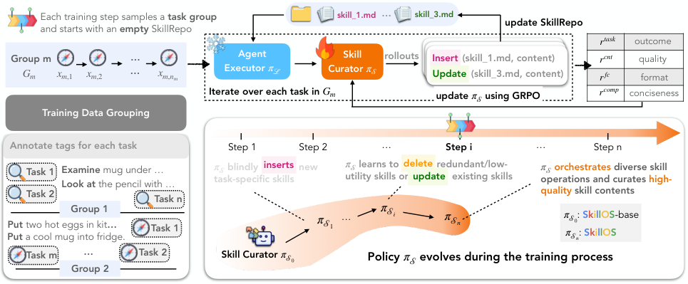
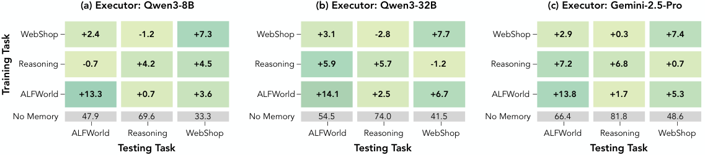

# Paper精读｜SkillOS: Learning Skill Curation for Self-Evolving Agents

> [!abstract] 一句话结论
> SkillOS 把技能库的管理权从人工编写和启发式规则手里接了过来：**用 GRPO 训出一个独立的 skill curator**，让它看着 agent 的过往经验决定 insert / update / delete，从轨迹里提取、更新、删除技能（skill）——executor 一个参数不动，agent <span class="mark-strong">在不重新训练 executor 的前提下实现自我进化</span>。

> [!cite]- 论文信息（点开折叠）
> - **论文标题**：SkillOS: Learning Skill Curation for Self-Evolving Agents
> - **arXiv**：2605.06614
> - **链接**：[https://arxiv.org/abs/2605.06614](https://arxiv.org/abs/2605.06614)
> - **作者**：Siru Ouyang (UIUC), Jun Yan†, Yanfei Chen, Rujun Han, Zifeng Wang, Bhavana Dalvi Mishra, Rui Meng, Chun-Liang Li (Google Cloud AI Research), Yizhu Jiao (UIUC), Kaiwen Zha, Maohao Shen (MIT), Jiawei Han (UIUC), Tomas Pfister, Chen-Yu Lee† (Google Cloud AI Research)
> - **日期**：2026-05-07
> - **标签**：#RL #Self-Evolving-Agent #Skill-Curation #Agent-Memory #GRPO

---

## 1️⃣ 论文想解决什么问题

LLM agent 处理流式任务（streaming tasks）的老毛病是每次都从零开始——做一次忘一次，经验攒不下来，后续任务沾不到光。现有方案两条路：要么人工写技能（如 Anthropic 的 skills repo），要么用启发式规则管记忆，但都缺**下游任务反馈闭环**——curator 做了一次策展决策，没有任何机制回来告诉它这步到底好不好。

核心痛点：**<span class="mark-strong">技能策展的反馈是间接且延迟的</span>**——你现在插入一条技能，要等后面好几个相关任务跑完，才知道它对不对。

---

## 2️⃣ 核心洞察

SkillOS 的判断是：技能策展不是提示词工程问题，是**<span class="mark-strong">长期信用分配问题</span>**（long-horizon credit assignment）——策展动作的回报，隔着好几个任务才回来。两个关键设计都是冲着这个难点去的：

> [!important] 核心洞察
> 1. **分组任务流（Grouped Task Streams）**：训练数据按技能依赖关系分组，组内任务顺序执行——先做的任务产生经验 → curator 更新 SkillRepo → 后续相关任务正好来验证这些更新灵不灵。**<span class="mark-strong">密集的、因果可追溯的学习信号</span>**不是等出来的，是这个流程造出来的。
>
> 2. **复合奖励函数（Composite Rewards）**：光看下游任务成功率不够，函数调用合法性、技能质量（外部 judge 打分）、技能库简洁度一并折进最终奖励——策展的每个侧面都有人盯着。

---

## 3️⃣ 方法解读

### 系统架构（双 Agent 设计）



*图 2｜SkillOS 的双智能体架构与技能库训练流程。 [来源](https://arxiv.org/html/2605.06614v1/#S3.F2)*


```
任务序列 → [Executor (冻结)] → 轨迹 → [Curator (可训练)] → 更新 SkillRepo
                 ↑                                      ↓
                 └──────── 检索相关技能 ←───────────────┘
```

- **Executor**（冻结的 Qwen3-8B）：只干活，不学习。开工前从 SkillRepo 里用 BM25 捞相关技能，注入上下文。

- **Curator**（可训练的 Qwen3-8B）：每轮任务后看轨迹 + 自判正确性 + 相关技能，然后出手：`insert_skill` / `update_skill` / `delete_skill`。

- **SkillRepo**：外部 Markdown 文件库，每篇 skill 含 YAML frontmatter（名称+描述）+ Markdown 指令体。

### 训练数据构造

1. **属性标注**：用 Gemini-2.5-Pro 给每个任务打标签——主题（Topic）、所需技能（Skill）、概念（Concept）、策略（Strategy）、常见陷阱（Pitfall）。

2. **分组算法**：基于 soft-Jaccard 相似度 + sentence embedding（all-MiniLM-L6-v2），确保组内任务：

  - 共享基础概念和技能

  - 不是近重复

  - 有难度递进关系

  - 引入新知识

### 策略优化

训练算法用的是 **GRPO**（Group Relative Policy Optimization）：

- 每个 group 采样 N 条 rollout，每条 rollout 独立演化 SkillRepo 历史——策展的好坏，就在这些不同演化路径之间比出来

- 优势函数：组内归一化（当前 reward - 组均值）

- 无 KL 项（鼓励探索）

- 训练成本：ALFWorld <span class="mark-number">~3天</span>，WebShop <span class="mark-number">~5天</span>，reasoning tasks <span class="mark-number">~2.5天</span>，16 × H100

---

## 4️⃣ 实验部分怎么读

### 主结果（Table 1 & 2）

| **发现** | **解读** |
| --- | --- |
| SkillOS 在 ALFWorld/WebShop/Reasoning 三个 benchmark 上全面超越 No Memory、ReasoningBank、MemP | RL 训出来的 curator 打启发式规则 + 静态技能库——策展这活儿是学出来的，不是规则凑出来的 |
| 训练好的 8B curator 甚至超过 Gemini-2.5-Pro 做 curator（SkillOS-gemini） | 针对 executor 对齐训练的小模型 > 大模型零样本策展 |
| 交互步数减少 2-3 步 | 好技能库让 agent 走直线，不用瞎摸 |

### 泛化性实验



*图 3｜不同模型上的跨任务泛化结果。 [来源](https://arxiv.org/html/2605.06614v1/#S4.F3)*


- **跨 executor**：训练时用 Qwen3-8B 做 executor，测试时换 Qwen3-32B、Gemini-2.5-Pro，均保持提升

- **跨任务域**：reasoning 任务上学到的 curator 搬到 agentic 任务照样好用（带过去的是抽象策略）；反过来就弱——agentic 技能绑在环境上

### 消融实验

| **消融项** | **性能下降** | **启示** |
| --- | --- | --- |
| 去掉 content quality reward | 61.2 → 58.6 | 中间监督信号重要 |
| 去掉 compression reward | 61.2 → 60.1 | 简洁库比冗余库好用 |
| 随机任务序列（w/o grouping） | 61.2 → 57.3 | 分组训练最关键——掉得最狠的一条 |

---

## 理论贡献 / 机制解释

1. **技能演化动力学**：训练早期 curator 疯狂 insert（填充库），中后期转向 update（精炼），delete 保持低频但持续增长——curator 从"收藏家"长成了"编辑/策展人"。

2. **技能结构进化**：早期技能是泛泛的 tips/建议，后期出现失败处理逻辑、条件分支、回退策略等**可操作的执行级知识**。

3. **元技能涌现**：仓库从窄领域技能逐步扩展出跨任务的元策略——验证策略、回退规划、系统搜索这类高层控制知识。

4. **对齐价值**：为什么小 curator 反而比大模型零样本好？大模型写的高层技能可能不在 executor 的能力射程内——读不懂、做不到。RL 训练让 curator 学会了**<span class="mark-strong">给这个具体的 executor 写技能</span>**。

---

## 5️⃣ 学术评价

| **维度** | **评价** |
| --- | --- |
| 问题定义 | 技能策展被形式化成 MDP，反馈延迟这个坑是正面迎上去的，不是绕着走 |
| 方法创新 | GRPO + 分组任务流 + 复合奖励的组合，是首次把 curator learning 当成正式学习问题系统性解决 |
| 实验设计 | 扎实——3 个 benchmark、多种 executor、消融和泛化都到位 |
| 分析深度 | 技能行为分布、技能结构演化这两块质化分析，多数同类论文不会做，做了就是加分项 |
| 写作质量 | 结构清楚、图表够用（6 figures, 3 tables） |

---

## 6️⃣ 局限与可扩展方向

- 检索机制简单（BM25）：更复杂的检索（dense/hybrid/learned retriever）可能进一步提升

- 技能表示单一（单 Markdown 文件）：不支持可执行脚本、不支持层级组合

- Executor 冻结：联合优化 executor 和 curator 可能有更好效果，但代价高

- 未处理多 Agent 共享记忆的信用分配问题

---

## 7️⃣ 最后总结

SkillOS 是一篇**工程控制论式的 agent 进化论文**——把技能策展这个看似模糊的问题拆成感知（trajectory + correctness）→ 决策（insert/update/delete）→ 执行（file I/O 操作）→ 评估（下游任务反馈），再用 RL 闭环优化整条策展策略。思路干净，验证扎实。全文最漂亮的一击是证明了**用一个 8B 的小模型专门学策展，比用一个超大模型零碎地策展效果更好**——这是模块化和专业化分工的胜利。下一步我最想看的是检索和技能表示升级之后还能涨多少：BM25 + 单 Markdown 文件，是现在最明显的两块天花板。

---

## 8️⃣ 三句速记

> [!summary]- 点开展开
> 1. SkillOS 用 GRPO 训练一个独立的 skill curator，分组任务流解决策展反馈延迟的问题。
>
> 2. 8B curator 经 RL 训练后策展能力超过 Gemini-2.5-Pro 零样本策展——<span class="mark-strong">对齐比规模更重要</span>。
>
> 3. 技能库在训练过程中自发长出元技能（元策略/回退/验证）——RL 驱动的结构涌现。
