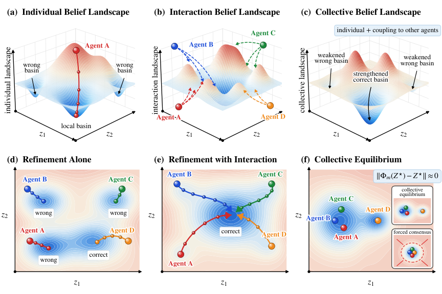
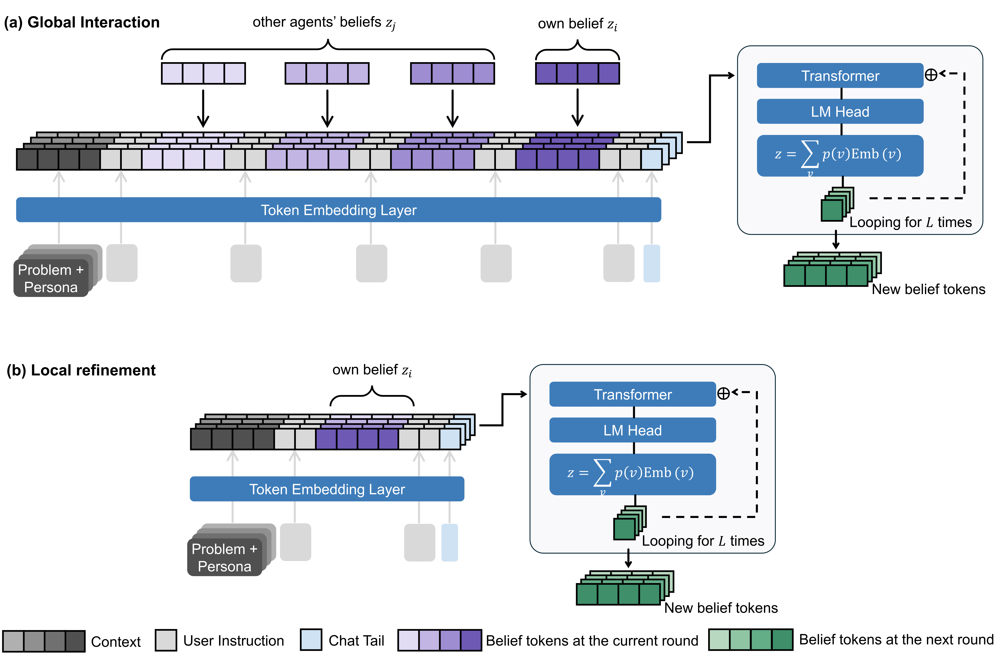
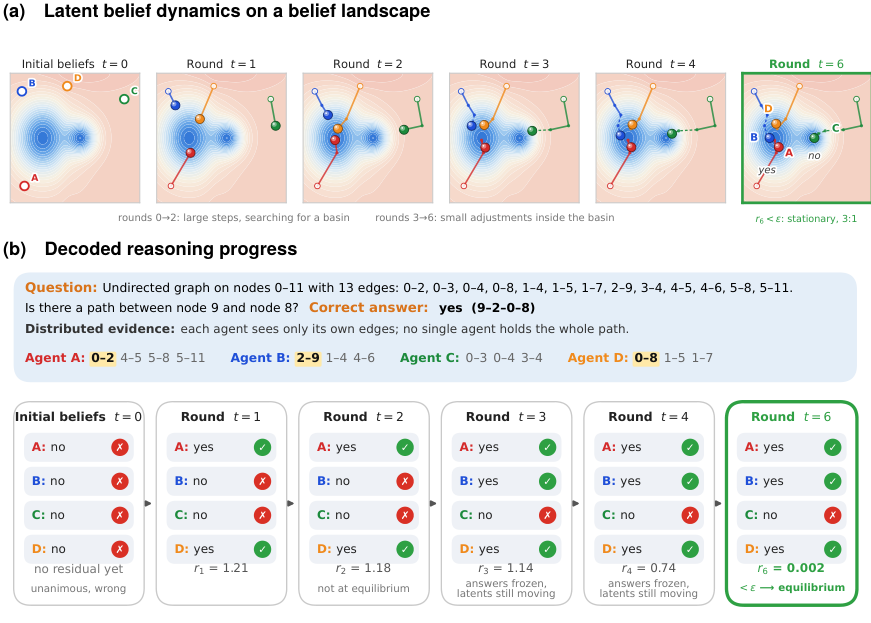
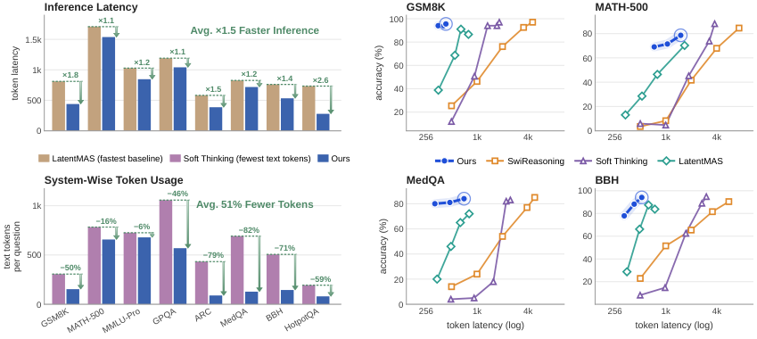
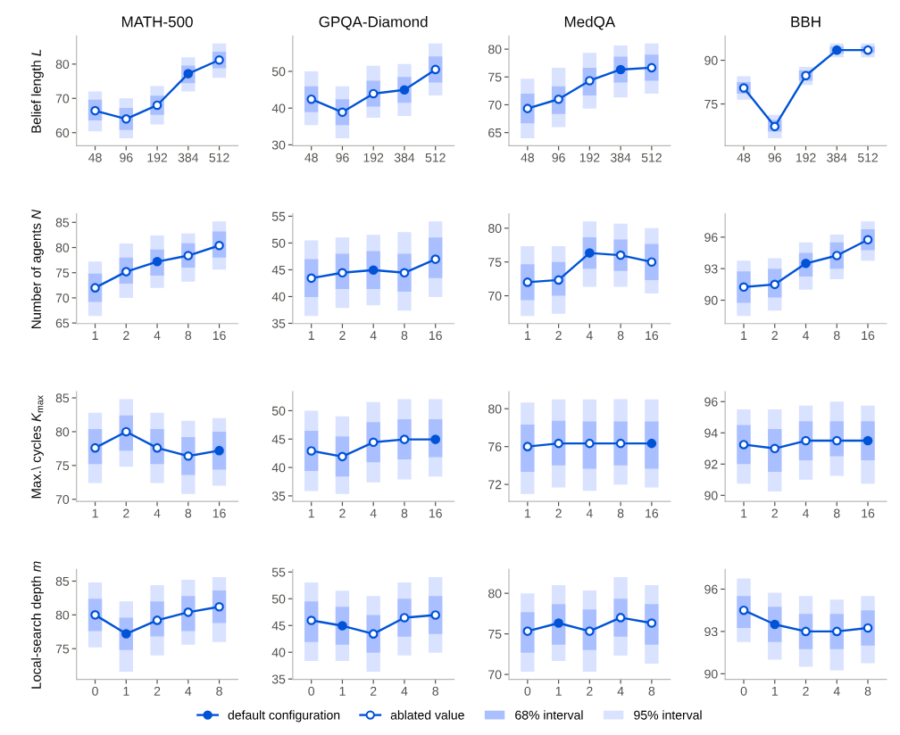

# Paper精读｜Stream of Belief: Eliciting Collective Intelligence through Latent Belief Dynamics

> [!abstract] 一句话结论
> 这篇论文把多智能体推理改造成**潜信念动力学**（latent belief dynamics）问题：N 个共享同一冻结模型的 agent 不再互发文本辩论，而是各自维护一段由**信念词元（belief token）**构成的连续潜信念，通过「全局交互 + 局部精炼」的**信念迭代（belief iteration）**把联合状态推向集体均衡点再解码答案。在 8 个基准 × 4 个模型族上（N=4、L=384、最多 16 轮），SoB 对最强 latent 基线最多拉开 **+15.7 个百分点**（Phi-4-mini MMLU-Pro：54.0 vs LatentMAS 38.3），文本 token 平均省 51%（对比文本用量最低的 Soft Thinking），顺序生成深度比最快的 LatentMAS 低 1.1–2.6 倍——但相对文本辩论（multi-agent debate）在多数单元格仍落后，例如 Qwen3-8B MATH-500 上 77.2 vs 辩论 86.4（−9.2 个百分点）。

> [!cite]- 论文信息（点开折叠）
> - **论文标题**：Stream of Belief: Eliciting Collective Intelligence through Latent Belief Dynamics
> - **arXiv**：2611.21250（v1，2026-11-16）
> - **链接**：[https://arxiv.org/abs/2611.21250](https://arxiv.org/abs/2611.21250)
> - **代码**：Embodied-Minds-Lab/Stream-of-Belief（GitHub）
> - **作者**：Yu Yao, Jiayi Dong, Yilun Du
> - **机构**：MIT / UCLA / Harvard（按署名页逐一对应：Yu Yao–MIT，Jiayi Dong–UCLA，Yilun Du–Harvard）
> - **日期**：2026-11-16
> - **阅读范围**：正文 §1–§6 + 致谢 + 附录 A（prompt 模板）+ 附录 B（基线实现细节）全部通读；Table 1 / Table 2 全部单元格数字已核对；图 1–9 的图注与对应正文段落已读。参考文献列表本身未逐条核读（不影响结论）。

---

## 1️⃣ 论文想解决什么问题

先把病灶钉死：现有多智能体协作到底卡在哪一步，已有的两条修补路线又各自缺了什么。

先看任务的输入输出：给定一个推理题 $x$（数学题、多跳问答、逻辑题等），系统要输出一个可解析的最终答案。旧范式的做法是让多个 LLM agent 用自然语言互相交换、批判、修订各自的推理链（multi-agent debate），最终投票。这条路坏在两个很具体的地方。一是通信被语言这个瓶颈卡住：一个 agent 内部本来是高维连续分布的计算，要传给同伴就必须先解码成离散文本、对方再编码回去，一来一回既慢（长推理链拉长顺序生成深度）又贵（文本 token 成倍生成），还把分布信息压缩成了几句话——论文用「 belief dynamics 」的视角重新命名这个问题：agent 之间交换的其实是「信念」，而文本只是信念的一种有损编码。二是什么时候停没有原则性答案：辩论通常固定轮数（如 Du et al. 的官方实现是 3 个 agent 两轮），轮数与「信息是否还在流动」无关，聊完了还在聊、聊不通也照停。

那已有修补为什么不够？第一条修补线是**潜推理（latent reasoning）**：单个模型把中间计算放进连续空间（循环反馈隐状态、或用概率加权词嵌入替代采样词元，如 Soft Thinking），省 token 但只有单模型、没有协作。第二条修补线是**潜通信（latent communication）**：让 agent 之间传激活、隐状态、KV cache（LatentMAS、ThoughtComm、Interlat 等），但这些方法的潜表示要么是任意连续向量、分布上偏离模型的原生输入分布（论文 §4.4 用能量距离实测了这一点），要么需要额外训练投影/接收器/自编码器，跨模型家族的免训练泛化受限。两条线各补了半截——一条只有「连续表示」没有协作，一条只管「agent 间传递」没管表示落在哪个分布——没有一个框架同时回答：**信念用什么连续对象表示？交互怎么更新它？迭代到什么时候算集体想清楚了？**

贯穿全文的例子从这里引出：论文 Figure 3(b) 用了一道**分布式证据的图连通性问题**（Qwen3-8B，N=4）：每个 agent 只能看到自己那份边，谁都没有完整信息。文本辩论需要各自写推理、互相贴长文；而 SoB 里每个 agent 把「我认为图长什么样」压成一段潜信念，全局交互轮把别人的信念块直接插进自己的输入嵌入里读一遍，边的信息就跨 agent 传播了。这道题在文中会反复出现：方法节用它演示信息怎么流，实验节用它演示「答案先稳定、信念后收敛」的均衡过程。

---

## 2️⃣ 核心洞察

作者的转向可以拆成四条，每条都能落到后文的机制或实验上：

1. 把「协作」重述为「求联合信念的均衡」，而不是「交换论证」。 一句可复述的话：多智能体推理 = 反复施加一个联合更新算子 $\Phi_m$，直到再施加一次也不产生有意义的信息传播为止。为什么成立？因为经典社会影响模型（opinion dynamics）早就表明：个体依局部规则更新信念时，系统会走向共识、极化或持久分歧的稳定态——稳定不要求所有人一致。作者把这个视角搬进 embedding 层：N 个 agent 的信念块 $Z=(z_1,\ldots,z_N)$ 是被冻结 LLM 驱动的非线性动力学系统状态，推理就是让 $Z$ 演化到吸引子。对应机制：§3 的式 (2)(3)(4) 与均衡定义；对应实验：Figure 3 的均衡演示（答案在第 3 轮稳定、信念到第 6 轮才让残差 $r_6<\epsilon$），以及 Figure 5 的 PCA 轨迹图。

*图注（原文 Figure 1）：把多智能体通信画成信念动力学——横纵轴是潜信念空间的两个坐标，每个 agent 的信念是面上一点，「盆地」是信念更新算子的吸引域；agent 通过交互互相把对方拉进（或推出）各自的盆地。*

2. 信念要有具体的载体：信念词元（belief token）是落在「词嵌入凸包」里的对象。 作者没有用任意连续向量当信念，而是沿用 Soft Thinking 的概率加权嵌入构造 $z_\ell=\sum_v p_\ell(v)E[v]$。关键差别在于：这个构造**天然落在模型原生输入分布附近**（词表嵌入的凸包内），因此不需要任何训练或投影就能直接喂给冻结模型。对应实验：§4.4 的能量距离测量——belief token 的分布与同模型文本 CoT 的输入嵌入分布距离最小（Figure 7/8），这解释了为什么免训练也能工作。

3. 「想清楚」的判据是信念不动了，而不是票数够了。 停机条件用两把尺子：潜空间里看相邻两轮的相对信念残差 $r_k$ 是否趋零（式 5），输出空间里看连续 P 轮的多数票 probe 是否不变（Algorithm 1 的 patience 规则）。对应机制：§3 的 Intermediate Decoding and Early Stopping；对应实验：Figure 3(b) 里答案在第 3 轮就稳定、但信念继续微调到第 6 轮——两把尺子不同步本身就是发现。

4. 均衡不等于共识。 这是全文最反直觉的一条：Figure 3(a) 里四个 agent 最终落在两个不同的盆地里（三个解为 yes、一个解为 no），系统照样稳定。这与经典影响模型「稳定态保留持久分歧」相呼应，也说明「迫使大家一致」（如每轮把信念替换成均值）不是该追求的目标——Figure 5 的 Forced consensus 对照显示强制共识反而破坏轨迹结构。

---

## 3️⃣ 方法解读

下面按组件拆。所有组件共享同一个冻结模型 $f_\theta$：不训练任何参数、不改模型内部，全部工作发生在输入嵌入层和推理循环的编排上。

### 组件1：信念词元（Belief Token）——信念的载体

**是什么。** 信念词元（belief token）是一个 $d$ 维连续向量，等于当前步下一词分布对全词表嵌入的加权求和（式 1）。一个 agent 的信念 $z_i$ 是连续自回归生成 $L$ 步得到的整块 $L\times d$ 矩阵，直接作为输入嵌入序列插进上下文。实现上 $p_\ell$ 只取 top-50 词元再归一化（论文脚注 1）。

**为什么需要。** 拿掉它会发生什么？退回离散采样，就是 Soft Thinking 之前的普通 CoT——一个 agent 在多候选摇摆时（比如答案 A/B 概率 0.55/0.30）必须立刻坍缩到单个词，等于把 45% 的概率质量扔掉；而 belief token 保留了「0.55 个 E[A] + 0.30 个 E[B] + 0.15 个 E[C]」这种叠加态，后续计算能同时受多个候选牵引（论文 §2 用这个四选一例子专门演示了表达力差异）。同时，因为它落在词表嵌入的凸包内，冻结模型无需任何适配就能读它——这是相对 Interlat（要训接收器）、ThoughtComm（要训自编码器和前缀适配器）的关键免训练优势。

**怎么做。** 见下节式 (1)。上下文拼接方式：文本问题用正常词嵌入，信念块按位置整段插入嵌入序列（附录 A 的 prompt 模板显示所有调用都是标准 chat 模板：系统轮放身份+人设，用户轮放问题和其他 agent 的信念，助手轮的位置上「生成」的就是 L 个 belief token）。

**代价。** 三个：①每步要对 top-50 词做加权求和，且 $L=384$ 的信念块比一句话长，计算量并不省——论文自己承认省的是顺序深度和文本量、不是总算力（§4.3 结尾原话）；②信念是定长的，复杂推理装不进 384 个混合词元时表达受限（作者在 Limitations 承认 fixed-length 是约束）；③中间过程不可读，调试和审计只能靠解码 probe。

### 组件2：全局交互（Global Interaction, G）——信息跨 agent 传播

**是什么。** 全局交互算子 $\mathsf{G}$：每个 agent 依据「问题 + 自己的旧信念 + 其他所有 agent 的旧信念」生成新信念（式 2）。

**为什么需要。** 反事实：拿掉 $\mathsf{G}$（即 Figure 5 的 No communication 对照），四个 agent 各自精炼、互不传递，分布式证据的图连通题永远拼不出全图——每个 agent 只能看到自己那份边，没有信息传播就没有集体智能。G 一步就把「通信」压成一次前向：别人的信念块以嵌入形式插进自己的上下文，读一遍就完成一轮传统辩论里的「看别人的答案+重想」。

**怎么做。** 附录 A 给了确切的用户轮模板：「Conclusions shared by other agents (in their own latent words): [Agent j]: ⟨z_j⟩（每个其他 agent 一行）+ Your previous conclusion: ⟨z_i⟩ + Reconsider the problem and the conclusions above...」。注意 $N=4$ 时每个 agent 一次要读 3 段别人的信念加自己 1 段，上下文里信念嵌入总量是 $N\times L\times d$。

**代价。** 所有 agent 同步更新、全连接拓扑（人人可见），agent 数变大时每轮前向的信念读入量线性增长；论文没有探索稀疏拓扑或异步更新，这是编排层面的简化假设。

### 组件3：局部精炼（Local Refinement, L）与信念迭代（Belief Iteration, Φ_m）

**是什么。** 局部精炼 $\mathsf{L}$：agent 只依据「问题 + 自己的旧信念」重生成信念（式 3），不接触任何人。一个周期 = 一次 G 后接 $m$ 次 L，联合起来是 $\Phi_m=\mathsf{L}^m\circ\mathsf{G}$（式 4），反复施加称为信念迭代。主协议取 $m=1$；$m=0$ 对应只交互不精炼。

**为什么需要。** 为什么要在两次交互之间插入独立思考？因为 G 之后 agent 拿到的是别人的结论，需要消化时间：把别人的信念和自己的证据做几步自主推理再拿出来交流，避免一轮轮只做「复读+对齐」。反事实在消融里有：增大 $m$（更深的独立精炼）并不带来一致收益（§4.5），说明 $m$ 的作用是「给够消化时间」而非「越多越好」——这直接支持了「容量比 deliberation 更重要」的 Observation 5。

**怎么做。** L 的用户轮模板极简：「Your previous conclusion: ⟨z_i⟩ + Reconsider the problem and your previous conclusion...」，其余与 G 完全相同——两个算子用同一个信念生成过程，只差上下文里有没有别人的信念，这让「信息可见性」成为唯一变量。

**代价。** 每轮 belief block 整块替换（状态大小固定 $L\times d$，不跨轮累积中间态），换来的是控制简单、但历史信息只能通过当前信念「有损压缩」传递——第 3 轮的 agent 看不到第 1 轮的原始信念，只有其演化产物。

*图注（原文 Figure 2，SVG 矢量图转 PNG）：(a) 全局交互——每个 agent 以自己的和其他 agent 的信念为条件；(b) 局部精炼——只以自己的信念为条件。两种操作都用式 (1) 的概率加权词嵌入自回归地生成 L 个连续 belief token，整块替换旧信念。*

### 组件4：集体均衡判定与早停——什么时候算「想清楚了」

**是什么。** 推理停机由两条独立判据控制：潜空间的**信念残差** $r_k$（式 5，衡量相邻两轮联合状态动了多少）和输出空间的 **probe 多数票**（每轮让每个 agent 从自己的信念解码一个约 24 token 的短答案，全员多数投票得 $\hat{y}^{(k)}$；连续 $P=2$ 轮不变即停，上限 $K_{\max}=16$ 轮）。probe 只用于停机监测、不回流进信念更新；停机后每个 agent 从最终信念解码最多 512 token 的完整解答，再对可解析答案做多数投票。

**为什么需要。** 没有 probe 停机，就必须跑满 16 轮、白付 8 轮以上的算力；没有残差 $r_k$，就没有「均衡」这个概念的定量刻画——Figure 3(b) 的图连通例子恰好显示两把尺子**不同步**：多数票答案第 3 轮就不再变，但信念残差直到第 6 轮才降到 $\epsilon$ 以下。作者拿这个时间差说明：答案稳定 ≠ 信念收敛，潜空间里的微调在答案不变之后仍在进行（后面 §4.4 会看到这段「多余」的微调其实在做分布锐化）。

**怎么做。** Algorithm 1（原文伪代码）：初始化 $z_i\leftarrow A_i(x)$；循环 $\{Z\leftarrow\Phi_m(Z)$；probe 解码+多数票；若已过 patience 且连续 P 轮答案相同则 break$\}$；返回全员解码的多数票。

*图注（原文 Figure 3）：(a) 四个 agent 的信念在二维信念地形上的移动轨迹（空心点为初始信念）；第 0–2 轮大步走向吸引子，第 3–6 轮在其盆地内微调；agent A、B、D 落在解码为 yes 的盆地、agent C 落在相邻的 no 盆地——均衡达成但共识未达成。(b) 分布式证据的图连通题（Qwen3-8B，N=4，各自只见自己的边）：逐轮显示解码答案与信念残差 $r_k$，答案自第 3 轮起不变，信念持续移动直到第 6 轮 $r_6<\epsilon$。*

**代价。** probe 每轮多出 $N$ 次短解码（约 24 token/agent/轮）——这是纯监测开销；patience 判据只看多数票、不看少数派信念是否还在漂移，极端情况下早停可能切掉还没完成的少数派修正（论文未讨论这个风险，属于分析者的待验证疑问）。

### 组件之间怎么连（端到端数据流）

一道题 $x$ 从进到出完整走一遍（以 Figure 3(b) 的图连通题、Qwen3-8B、N=4、L=384 为例）：

1. 初始化（k=0）：每个 agent 用「问题+人设」的 chat 模板自回归生成 384 个 belief token（每步一个 top-50 加权混合嵌入），得到 $Z^{(0)}=(z_1,\ldots,z_4)\in\mathbb{R}^{4\times384\times d}$。此时各自只消化了自己那份边。
2. 全局交互 G：每个 agent 的用户轮里插入其他 3 个 agent 的信念块+自己的旧信念块，重新生成整块新信念——别人的边信息此刻跨 agent 传播。
3. 局部精炼 L（m=1）：只看自己的信念再精炼一遍，把刚吸收的信息消化成自己的判断。
4. probe：每个 agent 以自己信念为前缀解码 24 token 短答案，多数票记录 $\hat{y}^{(1)}$。
5. 重复 2–4，直到多数票连续 2 轮不变（该例子中第 3 轮起答案不变，第 5 轮触发停机）或满 16 轮。
6. 最终解码：每个 agent 以自己最终信念为前缀写最多 512 token 的完整解法，多数票给出系统输出。

张量视角：全程唯一在变的状态是 $Z^{(k)}\in\mathbb{R}^{N\times L\times d}$；文本（问题、probe、最终解法）只在边界处出现，agent 间通信通道里流动的始终是 $L\times d$ 的连续块。

### 关键公式与推导

式 (1)–(6) 全部集中在方法与分布分析两处，挨个过一遍符号和含义。

$$z_{\ell}=\sum_{v\in\mathcal{V}}p_{\ell}(v)\,E[v]$$

式 (1)。$E[v]\in\mathbb{R}^d$ 是词表里词元 $v$ 的输入嵌入；$p_\ell$ 是第 $\ell$ 个生成步的下一词分布（实现上截到 top-50 再归一化）；$z_\ell$ 即 belief token。它必然落在词表嵌入的凸包内，因此可以直接当作输入嵌入序列喂给冻结模型、不需要投影层。

> 人话：把「我下一句想说什么」的全部概率质量按权重抹在所有候选词的嵌入上，得到一个「同时是很多个词」的连续向量；模型读它等于一次性读了所有候选的加权平均。

$$[\mathsf{G}(Z)]_{i}=A_{i}\bigl(x,z_{i},\{z_{j}\}_{j\neq i}\bigr),\qquad [\mathsf{L}(Z)]_{i}=A_{i}\bigl(x,z_{i}\bigr)$$

式 (2)(3)。$A_i(\cdot)$ 表示 agent $i$ 用冻结模型 $f_\theta$ 在给定上下文上自回归生成一整块 belief token 的操作；G 的上下文里含全部其他 agent 的信念，L 只含自己的。两者用同一个生成过程，唯一区别是可见信息量。

> 人话：G 是「开会」——人人把结论摆在桌上看完再改主意；L 是「回座位自己再想」——谁也不看，只对照自己的旧笔记。会议与独思交替，就是这套系统的全部节拍。

$$Z^{(k+1)}=\Phi_{m}\bigl(Z^{(k)}\bigr),\qquad \Phi_{m}=\mathsf{L}^{m}\circ\mathsf{G}$$

式 (4)。一个周期 = 1 次全局交互 + $m$ 次局部精炼；$m=0$ 时退化为纯交互。均衡点定义为不动点 $Z^\star=\Phi_m(Z^\star)$。

> 人话：多智能体推理被改写成一个反复施加的更新算子；「解出题」=「把联合状态迭代进某个吸引域，并在里面停住」。

$$r_{k}=\frac{\bigl\|Z^{(k+1)}-Z^{(k)}\bigr\|_{F}}{\bigl\|Z^{(k)}\bigr\|_{F}+\delta}$$

式 (5)。$\|\cdot\|_F$ 是把 $N\times L\times d$ 的张量摊平后的 Frobenius 范数；$\delta>0$ 只为分母不为零。这是「还有没有有意义的信息传播」的量化代理。

> 人话：本轮信念比上轮动了百分之几。数字趋零 = 再开一轮会也改不了什么了——这就是论文意义上的「集体想清楚了」。

$$\mathrm{ED}(X,Y)=2\,\mathbb{E}\|X-Y\|-\mathbb{E}\|X-X'\|-\mathbb{E}\|Y-Y'\|$$

式 (6)。$X,X'$ 是同一分布（某方法的潜输入）的两个独立样本，$Y,Y'$ 是同模型在同批题上文本 CoT 的词元嵌入分布的独立样本；论文用每分布 4,000 个向量在全嵌入空间估计。能量距离衡量两个分布的整体差异（0 为重合）。

> 人话：拿「这套方法实际喂给模型的向量」和「模型自己写文章时习惯吃的向量」比距离——距离小说明潜输入没有把模型带出它熟悉的输入分布，免训练地用冻结模型才站得住。

需要注意边界：这组式子是形式化框架而非定理。论文明确不给收敛性证明（§5 结尾原话：不假设经典收敛保证，改为实证研究信念是否稳定、交互如何重塑集体状态、均衡是否要求一致），式 (5) 的不动点也没有理论上界保证 $K_{\max}$ 内必达——这是「动力学视角」与「动力学理论」之间诚实的分界线。

---

## 4️⃣ 实验部分怎么读

### 实验设置

* 模型：四个家族各取一个指令模型做主表——Qwen3-8B（非 thinking 模式）、Llama-3.1-8B-Instruct、Gemma-3-4B-it、Phi-4-mini-instruct；规模实验另加 Qwen3 稠密系 0.6B→32B 和 Llama 系 1B/3B/8B/70B/405B。
* 基准：8 个——GSM8K、MATH-500、MMLU-Pro、GPQA-Diamond、ARC-Challenge、MedQA、BIG-Bench Hard（BBH）、HotpotQA，覆盖数学/科学/常识/逻辑/多跳。
* SoB 协议：N=4，L=384，每周期 1 次 G + 1 次 L（m=1），$K_{\max}=16$，patience P=2，最终解码上限 512 token，对可解析答案多数投票。所有 agent 共享同一冻结模型，靠 8 个轮换人设（「多疑、排除错误选项」等一句话 system prompt，附录 A）区分。
* 基线（附录 B 逐一给出实现）：文本辩论用 Du et al. 官方实现默认配置（3 agent、2 轮）；LatentMAS 官方顺序 agent 配置（每 agent 40 个潜步，温度 0.6、top-p 0.95）；ThoughtComm 3 agent、2 轮 256-token 通信，SAE/前缀适配器在每模型 300 道留出题上训练；Interlat 按 sender–receiver 流程，4,000 道 MATH 训练题训 rank-64 LoRA 接收器；SoftCoT 在 GSM8K 上训 3 epoch 投影；SwiReasoning 与 Soft Thinking 免训练，且顺序解码预算被对齐到 SoB 在同基准同模型上的平均顺序步数——这一条是论文做的最关键的预算公平化。
* 指标：准确率（±值论文标为标准差，但运行次数/随机种子数未报告）；token latency 定义为顺序生成深度（含潜与文本）；文本 token 按所有 agent 求和。硬件环境未报告。

### 核心结果

Table 1 的关键行重建如下（均为 %，±为论文标注的标准差，运行次数未报告）：

| 模型 | 基准 | 最强 latent 基线（值） | SoB（值） | 差值 | 位置 |
|---|---|---|---|---|---|
| Qwen3-8B | GPQA-D | LatentMAS 34.3±3.4 | 44.9±3.6 | +10.6 pts | Table 1 |
| Qwen3-8B | MATH-500 | LatentMAS 65.6±3.1 | 77.2±2.7 | +11.6 pts | Table 1 |
| Phi-4-mini | MMLU-Pro | LatentMAS 38.3±2.7 | 54.0±2.9 | +15.7 pts（论文声称的最大增益） | Table 1 |
| Qwen3-8B | MATH-500 | 文本辩论 86.4±2.2 | 77.2±2.7 | **−9.2 pts** | Table 1 |
| Llama-3.1-8B | GSM8K | SwiReasoning 87.0±2.3 | 84.0±2.6 | **−3.0 pts** | Table 1 |
| Gemma-3-4B | HotpotQA | SwiReasoning 63.3±4.1 | 33.3±3.8 | **−30.0 pts** | Table 1 |

这张表要拆成三层读。对 latent 家族，优势是全面且大的：64 个（4 模型×8 基准，去掉辩论行）单元格里 SoB 绝大多数领先最强 latent 基线，最大 +15.7 个百分点（Phi-4-mini MMLU-Pro，LatentMAS 38.3→54.0）。但**对文本辩论则互有胜负**：Qwen3-8B 上辩论在 GSM8K/MATH-500/GPQA-D 等推理重头戏明显更强（如 MATH-500 领先 SoB 9.2 个百分点，辩论预算为 3 agent×2 轮），而 SoB 在 Phi-4-mini 的 GSM8K/ARC-C（91.0/90.5 vs 辩论 88.5/87.0）和 Llama 的 MMLU-Pro（47.7 vs 47.7 打平、GPQA-D 31.8 vs 30.3）等格子反超——论文自己的措辞也是「与文本辩论有竞争力」（competitive），没敢说「超过」。有无收益的子集要写明：Gemma-3-4B 的 HotpotQA 上 SoB（33.3±3.8）比 SwiReasoning（63.3±4.1）低 30.0 个百分点、比辩论（54.0）也低 20.7 个百分点，是全表最重的退步；Llama 家族 GSM8K（−3.0 pts）、Qwen3-8B GSM8K 对辩论（−2.0 pts）为小幅退步。多跳/开放域检索类（HotpotQA）恰是「证据拼接」最依赖显式文本的状态，这个模式值得记下。

规模实验（Table 2 + Figure 4）：协议不变扫 Qwen3 0.6B→32B 与 Llama 1B→405B。小模型上 SoB 常反超辩论（Llama-3.2-1B：MedQA 42.7 vs 辩论 26.3、BBH 29.5 vs 26.2；Qwen3-0.6B BBH 43.0 vs LatentMAS 43.5 基本打平但远低于辩论 35.2 之上的部分由辩论保持），大模型上差距收窄但不反转（Qwen3-32B MATH-500：SoB 82.0±2.4 vs 辩论 88.4±2.0，仍落后 6.4 个百分点）。作者由此主张 latent 协作能吃到更强底模型的红利（Observation 2），但「随规模反超辩论」并未发生。

### 效率

*图注（原文 Figure 6，Qwen3-8B）：左上为 token latency（答案前逐个生成的 token 数）；左下为每题文本 token 总量（对所有 agent 求和）；右侧为准确率–延迟权衡曲线。SoB 取 L∈{96,192,384}（圈标 L=384），SwiReasoning/Soft Thinking 预算 512–8192 token，LatentMAS judger 上限 256/512/1024。*

效率这块，得把「省了什么、没省什么」分开算。**顺序延迟**：SoB 的 token latency 比最快的基线 LatentMAS 低 1.1–2.6 倍（8 个基准平均 1.5 倍，Qwen3-8B，L∈{96,192,384}；LatentMAS 为 3 agent 顺序链+judger cap 256/512/1024）——原因是结构性的：SoB 把计算摊到 N 条并行信念轨迹上（4 个 agent 可并行前向），而不是拉长单条推理链。**文本量**：对比文本用量最低的基线 Soft Thinking，SoB 平均少 51% 文本 token、单基准最高少 82%（Qwen3-8B，8 基准均值），因为 agent 间通信走嵌入、文本只留给 probe 与最终解码。**没省的**：论文自己点明这两个数字「反映的是顺序深度与文本通信的减少，而非总算力的减少」——每轮 G 要读 4 段信念块、L=384 也不小，并行化只是换了一种花算力的方式。这条诚实声明很重要：如果有人的部署瓶颈是 GPU 总吞吐而非用户侧延迟，收益就要重新算。

### 潜表示的分布分析（最意外的发现）

§4.4 观察到一种「自发锐化」（spontaneous sharpening）：belief token 按构造是多个词嵌入的混合，但随着信念迭代推进，它们**自己**越来越像单个词嵌入——belief token 到最近词表嵌入的平均余弦距离（1−cos）从第 0 轮的 0.020 降到第 16 轮的约 3×10⁻⁴，特征时间尺度 τ≈1.9 轮（Qwen3-8B，N=4，L=192，BBH logical-deduction 题）。——「多候选叠加」只在早期成立，系统在迭代中自发走向「词级承诺」，一次显式离散化都不需要。这正好解释了 Figure 3(b) 的另一个细节：均衡过程的后期（第 3–6 轮）答案已定、信念仍在微调，这段微调在分布层面做的就是锐化。配套的分布相容性测量（式 6 能量距离，每分布 4,000 向量）显示 SoB 的潜输入分布比所有 latent 基线都更贴近同模型文本 CoT 的原生嵌入分布（Figure 7/8）——ThoughtComm/Interlat 等方法的隐状态远离模型平时「吃」的输入流，而 belief token 因为凸包构造天然贴着分布走，这是其免训练跨 4 个模型族可用最合理的解释机制。

### 消融与公平性

*图注（原文 Figure 9，SVG 转 PNG，Qwen3-8B）：对信念容量 L、agent 数 N、交互周期数、局部精炼深度 m 的消融；深/浅箱分别为 68%/95% bootstrap 区间。*

Figure 9 扫了四个因素，结论层次分明：信念容量 L 的影响最强且方向一致——L 越大准确率越高，说明「每个 agent 能把多复杂的信念装进定长块里」是主瓶颈；agent 数 N 的收益是任务依赖的——加人不必然涨分，呼应经典社会影响文献里「群体规模≠群体智能」；加大交互周期或 m 都没有一致收益，尽管每次都实打实多花算力。这组消融只改变单一因素、用 bootstrap 区间报不确定性，能支持的结论是「容量因素与准确率的相关性远强于 deliberation 因素」；要说「容量导致准确率」的因果归因，还缺一个把容量固定、只动信念内容信息量的对照，这一点论文没有做。

公平性审计（结合附录 B）：参数量对齐（同底模型）、免训练对齐（对比训练基线时 SoB 零训练 vs ThoughtComm/Interlat/SoftCoT 有训练，这是 SoB 占优的设定而非缺陷，但解读「更强」时要记得基线是把方法迁到新模型上的迁移成本更高）；顺序预算对齐是论文做得最到位的一条——SwiReasoning 和 Soft Thinking 的顺序解码预算被压到 SoB 在同基准同模型的平均顺序步数。相对文本辩论的对比则未做预算对齐（3 agent×2 轮的辩论与 N=4×最多 16 周期的 SoB，文本量天差地别），所以「SoB 与辩论互有胜负」的读法应理解为「效率-精度曲线上各有占优区间」（Figure 6 右图正是这条曲线），而不是同预算下的胜负。未报告的：随机种子数、显著性检验、硬件与吞吐的绝对值。

### 训练细节

无可训练参数——整篇方法零训练。复现需要的要件：冻结底模型 + 附录 A 的完整 prompt 模板（系统轮身份与 8 个人设、G/L/probe/final 四种用户轮原文都在）+ 协议超参（N=4，L=384，m=1，K_max=16，P=2，top-50 截断，probe 24 token，final 512 token）。GitHub 仓库（Embodied-Minds-Lab/Stream-of-Belief）给出官方实现；附录 B 里 6 个基线的官方配置也逐项列出，可复核性在同类论文里算好的。缺失部分：bootstrap 的重采样次数、题目的采样与切分方式（各基准用多少题未报告）、运行次数。

---

## 5️⃣ 学术评价

优点、局限、外加几条我自己的待验证疑问，分开写。

**优点：**

1. 免训练跨模型族的泛化有直接证据：Table 1 四个异构家族（Qwen3/Llama/Gemma/Phi，1B 量级到 405B）全部零训练跑通，且在 64 个 latent 对比格中绝大多数领先；相比每个新模型都要重训 LoRA 接收器的 Interlat（附录 B：rank-64 LoRA + 输入嵌入训练）或重训 SAE 的 ThoughtComm，这个对比把「凸包构造天然贴分布」的论点落到了实处。
2. 停机判据的诚实设计：probe（输出空间）与信念残差（潜空间）两把尺子并置，Figure 3(b) 直接展示二者不同步（答案第 3 轮稳定、信念第 6 轮才达 $r_6<\epsilon$），没有把「票数稳定」偷换成「已收敛」。
3. 效率主张带边界声明：明确写出省的是顺序深度与文本量而非总算力（§4.3 结尾），并对最快基线 LatentMAS 与最低文本基线 Soft Thinking 分别对标，避免了「什么都省」式的过度声明。
4. 自发锐化是一个超出方法本身的现象级观察：0.020→3×10⁻⁴ 的余弦距离衰减（τ≈1.9 轮，Qwen3-8B，N=4，L=192，BBH logical deduction）指向「离散化可以从连续动力学中自发涌现」，这给 latent reasoning 社区一个此前没有的实证锚点。

> [!ed-warning] 局限（风险与不确定性）
> 1. 对文本辩论没有净优势，且部分格子大幅退步：Gemma-3-4B HotpotQA 上比 SwiReasoning 低 30.0 个百分点（33.3 vs 63.3）、比辩论低 20.7 个百分点；Qwen3-8B MATH-500 比辩论低 9.2 个百分点（77.2 vs 86.4）。论文摘要层面只说「泛化」，可这些反例摆在这儿：「latent 协作全面可替辩论」目前不成立，适用域更像是「延迟/文本量受限、且任务不太依赖长程证据拼接」的场景。
> 2. 运行次数与显著性未报告：Table 1 全表 ±1–4 的标准差，但既没说跑了几个种子也没做显著性检验；+15.7 pts 的最大增益（Phi-4-mini MMLU-Pro，38.3→54.0）标准差 ±2.7/±2.9，量级远超噪声，方向上可信，但小差距格（如 Llama MedQA 的 69.3 vs 68.3，±2.7）在多种子下是否稳定无法判定。
> 3. 复杂度/吞吐的绝对成本未量化：每轮全局交互要读 N 段 L×d 的信念块，并行化的前提是硬件真能并行 4 个 agent 的前向；论文没有任何端到端 wall-clock/吞吐数字，「1.5× 平均延迟降低」只在「顺序生成深度」这一定义下成立。
> 4. 动力学只有现象学、没有理论：不动点存在性、收敛性、$K_{\max}=16$ 够不够全部没有刻画（作者在 §5 承认是实证研究而非经典保证）；如果某任务的 $\Phi_m$ 是振荡或混沌的，patience 判据会在错误答案上提前停机——论文没有讨论这类失败模式。

**分析者的待验证疑问（非论文内容）：** ①早停的多数票会不会系统性压制「慢热的少数派正确答案」（Figure 3 里 agent C 停在了 no 的盆地——如果它是唯一对的，probe 停机会把集体锁死在错误共识上）？②人设只有 8 个一句话模板，persona 对结果的贡献是否被低估（对人设的消融论文没做）？③Gemma 上 HotpotQA 的大退步是否说明「多跳证据拼接」必须走显式文本——值得单独做一个「任务类型 × 通信介质」的二维度实验。

---

## 6️⃣ 局限与可扩展方向

每条按「假设 → 改什么变量 → 看什么指标 → 什么结果推翻它」写。

1. 假设：信念容量是主瓶颈（Observation 5）。 改变 L（96/192/384/768）并固定其余协议，看准确率–L 曲线是否饱和；若 768 与 384 无差，则「容量论」被推翻，瓶颈移到别处（比如更新算子 G 的表达力）。另一个刁钻对照：给 agent 同样多**文本** token 的独思预算再迭代，看容量增益是否只是「更多计算」的别名。
2. 假设：潜通信足以承载多跳证据。 在 HotpotQA 上把 G 的信息量逐步降级（只传信念块的前 k 个 token / 只传均值 / 传解码后的摘要），看 33.3% 这个低谷能否被局部修复——若任何降级都无所谓，说明 Gemma 的失败根本不在通信带宽而在别处。
3. 假设：均衡是吸引子而非振荡假象。 对 16 轮跑满（关闭早停）的样本统计 $r_k$ 的轨迹形态：单调趋零的比例 vs 振荡不趋零的比例；若后者可观，patience 早停的「稳定」实为截断，需要在报告里区分「均衡停机」与「预算耗尽停机」。
4. 假设：自发锐化是动力学的普遍性质。 换 4 个家族的底模型重复 Figure 8 的余弦距离衰减测量；若某家族不锐化而准确率相当，「锐化=承诺形成=推理完成」的解读就要降级为相关而非因果。
5. 扩展方向（论文自己点到的）：从「定长信念块」到可变长/分层信念；从全连接同步更新到稀疏/异步拓扑（呼应 social learning 文献「结构决定结论」）；把式 (5) 的残差信号用于自适应分配谁在何时发言，而不是全员同步硬更新。

---

## 7️⃣ 最后总结

这篇论文的贡献不是又一个更强的辩论框架，而是给「多智能体推理」换了一套状态变量和停机语言：agent 的可交互对象从文本换成落在词嵌入凸包内的 belief token 块，协作从「多轮对话」换成施加算子 $\Phi_m=\mathsf{L}^m\circ\mathsf{G}$，完成从「固定轮数」换成「残差趋零+多数票稳定」。代价与收益同样清楚：它免训练地在 4 个模型族上压住了所有 latent 基线（最大 +15.7 个百分点，Phi-4-mini MMLU-Pro 54.0 vs LatentMAS 38.3），顺序延迟与文本量同时大降（vs LatentMAS 1.1–2.6 倍、vs Soft Thinking 平均 51% 文本），但面对文本辩论时仍是互有胜负、在多跳检索上还有 30 个百分点级别的塌陷格。方法之外最有长期价值的观察是自发锐化——连续信念在迭代中自发趋近单个词嵌入（余弦距离 0.020→约 3×10⁻⁴，τ≈1.9 轮）——它把「离散化要不要显式设计」这个问题变成了一个可以测量的经验现象。框架目前是现象学的：没有收敛理论、没有种子数、没有吞吐绝对值，读它时应把它当作一个视角的可行性证明，而不是可部署的最终形态。

---

## 8️⃣ 三句速记

> [!summary]- 点开展开
> 1. SoB 把多智能体推理改写成潜信念动力学：N=4 个冻结模型 agent 各持 L=384 个 belief token 的连续信念，靠「全局交互+局部精炼」迭代到均衡再多数票解码，全程零训练。
> 2. 对 latent 基线全面占优（最大 +15.7 pts，Phi-4-mini MMLU-Pro 54.0 vs LatentMAS 38.3）且顺序延迟比最快基线低 1.1–2.6 倍、文本量平均省 51%，但对文本辩论互有胜负、Gemma-3-4B HotpotQA 上落后最强 latent 基线 30.0 pts——潜通信不是辩论的全面替代，是有明确适用域的互补品。
> 3. 最反直觉的发现是自发锐化：混合态 belief token 在约 τ≈1.9 轮内自发趋近单个词嵌入（余弦距离 0.020→3×10⁻⁴），说明词级承诺可以从连续集体动力学中涌现，无需显式离散化。
