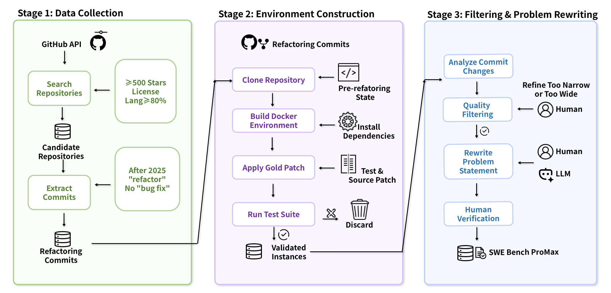
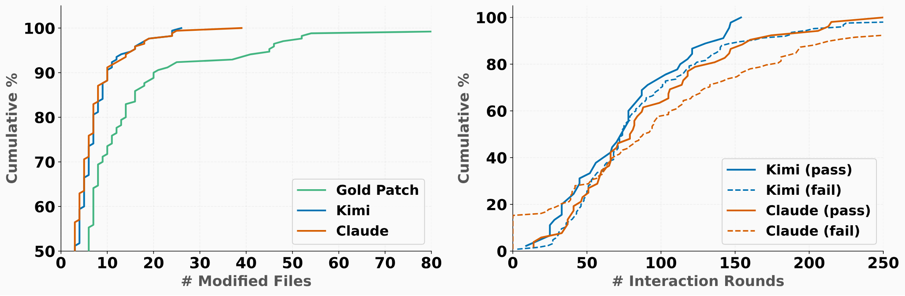

# Paper精读｜SWE-Bench ProMax: Benchmarking Agents on Large-Scale Multilingual Code Refactoring

> [!abstract] 一句话结论
> **SWE-Bench ProMax** 把**重构**（跨多文件、保持行为不变的结构性变更）立成编码 agent 评测的难度轴：首个专家策展的**多语言大规模重构基准**，170 个实例全部来自 7 种语言（Python/Java/TypeScript/Go/C/C++/Rust）的真实 refactor commit，平均 **11.4 个修改文件、261.6 行代码**——对比之下，86% 的 SWE-bench Verified 只改 1 个文件，量级完全不在一个档。选题直接对着现有基准的两桩质检丑案：约 60% 的 SWE-bench Verified 未解实例含缺陷测试（过窄测试拒绝正确解 / 过宽测试检查未声明需求）+ 前沿模型可从训练数据逐字复现 gold patch。对策也下得够重：29,782 个候选 commit 多阶段严筛到只剩 **170 个**，问题描述从头改写成精确无歧义规范、测试套件人工审查去窄去宽。结果给六款前沿模型（GPT-5.2/Claude Sonnet 4.6/Gemini-3-Pro/GLM-5/Kimi-K2.5/Qwen3.5）× 两个 scaffold（mini-swe-agent/OpenHands）泼了盆冷水：**最佳仅 41.2%**（GPT-5.2 @ OpenHands），远低于 SWE-bench Verified 的 75%+——重构这块硬骨头还远没被啃下来。

> [!cite]- 论文信息（点开折叠）
> - **论文标题**：SWE-Bench ProMax: Benchmarking Agents on Large-Scale Multilingual Code Refactoring
> - **arXiv**：2608.09802
> - **链接**：[https://arxiv.org/abs/2608.09802](https://arxiv.org/abs/2608.09802)
> - **作者**：Yuling Shi, Jinghan Xu, Kelin Fu, Wenhao Zeng, Shilin He, Lei Zhang, Yue Liu, Zelin Zhao, Terry Yue Zhuo, Jialun Cao, Siyu Ye, Tianyu Liu, Kai Cai, Shing-Chi Cheung, Xiaodong Gu
> - **机构**：香港科技大学（HKUST）等
> - **日期**：2026-08-10
> - **数据**：[https://huggingface.co/datasets/swe-bench-promax/SWE-Bench-ProMax](https://huggingface.co/datasets/swe-bench-promax/SWE-Bench-ProMax)

---

## 1️⃣ 论文想解决什么问题

AI 编码 agent 的评测正面临双重危机：

1. 基准饱和 + 评测质量存疑：SWE-bench Verified 上前沿 agent 已超 75%——分数上升究竟反映真实软件工程能力，还是触及了当前基准设计的测量上限？近期审计发现：

  - 近 60% 的未解 SWE-bench Verified 实例含缺陷测试——过窄测试（拒绝正确解）或过宽测试（检查未声明需求）

  - 前沿模型可从训练数据逐字复现 gold patch（数据污染/记忆）

2. 重构（refactoring）作为基准域被忽视：

  - 重构是专业开发中最频繁的活动之一、管理技术债的关键机制

  - OpenAI 把"project-scale refactors"列为持续多上下文窗口 agent 的首要用例；Cursor 报告真实开发任务日益跨多文件多工具

  - 但现有基准主要测孤立的 bug 修复与功能实现；少数重构基准规模有限或限单语言

**核心需求**：一个任务分布贴近真实长时程工作、评测质量经得起审计、且当前 agent 尚未饱和的重构基准。

---

## 2️⃣ 核心洞察

> [!important] 核心洞察
> 1. 重构 = 更难的"真实"测试：重构要求跨多文件协调的、保持行为不变的改动——理解大型代码库、在多文件间传播变更、保持微妙的行为不变量。比"单 issue bug 修复"（当前评测主流）更接近真实的长时程 agent 工作，且更难。
>
> 2. **质量由 curation 决定，不由规模决定**：29,782 → 170（保留 0.57%）——"基准的质量由评测可靠性决定，而非大小"。专家多阶段策展直接针对已知缺陷（过窄/过宽测试、模糊描述、污染）。
>
> 3. 问题描述必须"必要且充分"：专家从头改写 issue description，验证其同时是 gold patch 的必要与充分条件——正确解应满足描述、描述不应容纳非预期解——"测试-描述-补丁"三件套被锁死在同一个一致性要求里。
>
> 4. 失败模式不是"找不到文件"而是"改不全"：agent 常能正确定位并修改核心文件，但停止在外围调用点、文档、配置文件、测试固件的传播——部分覆盖导致下游依赖不一致、测试失败。主导失败模式是 **incomplete refactoring（未完成的重构）**。
>
> 5. **瓶颈不是推理能力本身，而是跨文件保持连贯计划的能力**：成功的 agent 聚焦、少轮完成；失败的 agent 陷入**无产出循环**（反复读文件、试编辑、遇测试失败、回滚）——消费大量轮次却不扩大修改范围。
>
> 6. scaffold 选择影响巨大：除 Gemini-3-Pro 外，所有模型从 mini-swe-agent 换到 OpenHands 显著提升（GPT-5.2 21.8%→41.2%）——**更丰富的运行时工具对大规模重构特别有益**。

---

## 3️⃣ 方法解读

### 组件1：任务形式化（§3.1）

每个实例四组件：① 预配置 Docker 环境（重构前 commit + 依赖全装）；② 精确自然语言的 issue description；③ 验证重构正确性的测试套件；④ gold patch（开发者原始解）。agent 自主修改仓库使全部测试通过即 resolve——结果驱动（评估最终仓库状态，不管具体命令/中间步骤）。

### 组件2：三阶段构建管线（§3.2 + Figure 3）

**Stage 1 数据收集**：

- GitHub API 选候选仓库：≥500 stars、获批开源许可、主语言（占代码库 ≥80%）∈ 7 目标语言

- 提取 2025-01 后、commit message 含 "refactor" 不含 "bug fix"、且同时修改测试与非测试文件的 commit

- 得到 29,782 个初始候选

**Stage 2 环境构建**：

- 每个候选 commit 构建隔离 Docker 环境（重构前状态 + 依赖，SWE-Factory 等自动化工具）

- 应用 gold patch → 跑全测试套件 → 剔除无法建环境/测试不过的实例

**Stage 3 过滤与问题重写**（专家 + LLM 辅助，四步）：

1. Commit 分析：专家分析 diff（LLM 辅助总结变更、识别受影响组件），理解重构的范围/意图/结构影响

2. 质量过滤：剔除单文件/过少代码行/过于简单模式的实例；人工审查测试套件——移除过窄测试（强制实现细节而非行为结果）与过宽测试（检查超出重构范围的行为）

3. 问题描述重写：commit message 太简略/含糊/含内部上下文——专家从头改写为精确、自包含的规范：哪些组件应变更、期望什么变换、必须保持哪些行为不变量；验证描述是 gold patch 的必要且充分条件

4. 人工验证：最终专家审查——描述完整指定重构、测试当且仅当重构正确应用时通过、无未声明需求

### 组件3：基准构成（§3.3）

- 170 实例，平均：Issue 685 tokens、Gold Patch 11.4 文件/261.6 行/8,180 tokens、Test Patch 4.5 文件/185.5 行、Total 15.9 文件（max 244 文件）

- 7 语言覆盖不同范式：动态类型（Python）、静态类型+GC（Java/Go）、渐进类型（TS）、系统语言（C/C++/Rust）

- 30% 实例改 >10 文件、32% 改 >200 行（vs SWE-bench Verified 86% 只改 1 文件）

*Figure 3（三阶段管线）：Stage 1 GitHub API 自动收集重构 commit（7 语言、≥500 stars、2025-01 后）；Stage 2 Docker 环境构建与验证（gold patch 应用 + 全测试套件执行）；Stage 3 专家四步策展（commit 分析、质量过滤去窄去宽测试、问题描述从头重写、人工验证）——29,782 候选仅保留 170。*

### 组件4：实验设置（§4）

- 两个 scaffold：mini-swe-agent（SWE-agent 最小复刻，observe-think-act 循环）+ OpenHands（富运行时：沙箱命令执行、结构化文件编辑工具）

- 步数上限 300、成本上限 \$10/实例（大规模重构补丁所需）；所有模型同 scaffold 同限制保证公平

- 六模型：闭源 Gemini-3-Pro / Claude Sonnet 4.6 / GPT-5.2；开源 GLM-5 / Kimi-K2.5 / Qwen3.5

- 指标：resolve rate (Pass@1)、每语言 resolve rate、平均成本/实例

---

## 4️⃣ 实验部分怎么读

### 核心结果（Table 3）

**主结果——未饱和的真挑战**：

| **模型** | **mini-swe-agent** | **OpenHands** |
| --- | --- | --- |
| GPT-5.2 | 21.8% | **41.2%** |
| Claude Sonnet 4.6 | 30.6% | 38.8% |
| Gemini-3-Pro | 26.5% | 19.4% |
| GLM-5 | 22.9% | 36.5% |
| Kimi-K2.5 | 26.5% | 32.9% |
| Qwen3.5 | 20.6% | 36.5% |

- 最佳 GPT-5.2 仅 **41.2%**——远低于 SWE-bench Verified 的 75%+：重构仍是未解难题

- 开源模型以零头成本逼近闭源：OpenHands 下 GLM-5/Qwen3.5（36.5%）与 Kimi-K2.5（32.9%）距 GPT-5.2（41.2%）仅几分，成本却低一个数量级（\$0.24/\$0.78/\$0.72 vs\$3.60/\$4.77）

- scaffold 效应巨大：除 Gemini-3-Pro 外全部模型在 OpenHands 大幅提升——富运行时工具对大规模重构特别有益（GPT-5.2 +19.4pt）

- 语言表现高度分散：无模型通吃所有语言——Claude Sonnet 4.6 领先 TS（53.6%）与 Rust（63.6%）、GLM-5 领先 Java（34.6%）、GPT-5.2 领先 Python（48.3%）与 C（75.0%）、Kimi-K2.5 领先 Go（43.5%）、Qwen3.5 领先 C++（54.5%）——不同架构/训练数据构成互补的语言级优势

- TS/Rust 方差惊人：Claude Sonnet 4.6 在 TS/Rust 高分（53.6%/63.6%），Gemini-3-Pro 在 TS 0.0%、Kimi-K2.5 在 Rust 18.2%——可能是语言特定训练数据差异而非语言本身难度

### Agent 行为分析（Figure 5）——两个互补失败模式

*图 5｜智能体修改文件数量与失败模式分析。 [来源](https://arxiv.org/html/2608.09802v1/#S5.F5)*

1. 不完整重构是主导失败模式：小改动（~5 文件）agent 紧贴 gold patch 分布；大补丁严重发散——gold 90% 分位在 ~20 文件，agent 在 ~10 文件就到 90%。**agent 识别并修改部分受影响文件，但未把变换传播到所有需要协调更新的位置**——外围调用点、文档、配置文件、测试固件。核心逻辑改对了但下游依赖不一致 → 测试失败

2. 无产出循环消耗轮次：失败实例的交互轮次显著多于成功实例（成功曲线陡升早平台，失败曲线右移平缓）——agent 反复读文件/试编辑/遇测试失败/回滚，不扩大修改范围。成功 agent 表现出聚焦行为：高效识别并修改完整文件集

**关键结论**：瓶颈不是推理能力本身，而是在大量文件间维持连贯计划、挺过大规模结构变更级联后果的能力。

### 成本分析

- 闭源模型成本 \$0.19-\$4.77/实例；开源 \$0.10-\$0.93——OpenHands 下开源模型以 1/10 成本达到近闭源水平

- mini-swe-agent 下 GPT-5.2 成本最低（\$0.19）但 resolve 也最低之一——低成本 ≠ 高效

---

## 5️⃣ 学术评价

**优点：**

1. 填补真实空白：重构是"project-scale refactor"级长时程任务的代表（OpenAI 官方点名的 agent 用例），但基准域一直空置——这是首个多语言大规模重构基准

2. 直接回应质检危机：60% 缺陷测试 + 记忆污染的审计结论 → ProMax 用专家人工审查测试套件（去窄去宽）+ 描述重写（必要充分条件）正面回应——"基准质量由评测可靠性决定"的立场清晰

3. 规模是刻意设计的：平均 11.4 文件/261.6 行、最大 244 文件——把"跨文件协调"作为核心难度轴，而非堆任务数量

4. 失败模式分析有实操价值："改不全而非找不到" + "无产出循环"——直接指出 agent 在大规模任务上的能力缺口，为 harness/agent 设计提供明确方向

5. 双 scaffold × 6 模型 × 7 语言的完整矩阵：语言级互补优势与 scaffold 效应都是可迁移的工程结论

6. 开源发布：数据集 + Docker 环境全开放，可复现可审计

> [!ed-warning] 局限（风险与不确定性）
> 1. 规模小（170 实例）：7 语言 × 每语言仅 ~20-30 实例——每语言的统计功效有限，语言级结论需谨慎
>
> 2. 重构 ≠ 全部工程：只测"行为保持的代码重构"——不覆盖新功能开发、性能优化、架构演进等其他长时程任务形态
>
> 3. **gold patch 偏置**：以真实开发者的单次重构为 gold——其他同样合法（甚至更好）的重构路径会被判失败；“必要且充分”的描述尽力缓解但无法消除
>
> 4. **commit message 关键词过滤**：只含 "refactor" 的 commit——可能遗漏用其他措辞的重构、混入误标 commit
>
> 5. **成本上限 \$10 的影响**：300 步/\$10 限制对大规模任务可能截断某些模型（Qwen3.5 平均 155 步逼近上限）——性能部分反映预算而非能力

---

## 6️⃣ 局限与可扩展方向

- **扩大实例数**：170 → 每语言 50+，提升统计功效

- **多 gold 路径评估**：接受行为等价的不同重构方案（等价性检查而非逐测试匹配）

- **扩展任务形态**：功能开发 + 重构混合、性能重构、API 演进

- **与 WorkBuddy Bench 的互补**：ProMax 测"多文件行为保持重构"、WorkBuddy 测"四域真实工作流"——agent 评测的"难度轴"与"广度轴"

- **污染审计**：对重构类任务的记忆/污染评估（ProMax 从 2025-01 后 commit 构建，天然降低预印本污染风险，但需持续版本化）

---

## 与其他论文的对话

| **相关工作** | **关系** | **差异** |
| --- | --- | --- |
| **SWE-bench / SWE-bench Verified** | 直接前身 | 单 issue bug 修复（86% 改 1 文件）；ProMax 多文件重构（平均 11.4 文件）——并正面回应其 60% 缺陷测试与记忆污染问题 |
| **SWE-bench Pro** | 更难的 SWE 变体 | Pro 仍以 bug 修复为主；ProMax 转向重构这一未开发域 |
| **RefactorBench / SWE-Refactor** | 现存重构基准 | 规模有限或单语言；ProMax 多语言 × 170 实例 × 专家策展 |
| **Multi-SWE-bench / SWE-PolyBench** | 多语言基准 | 多语言但不聚焦重构；ProMax = 多语言 × 重构 × 大规模补丁 |
| **SWE-EVO** | 动态/演进基准 | 侧重时间演化；ProMax 侧重跨文件协调的复杂度轴 |
| **WorkBuddy Bench（2607.20911）** | 同日期的 agent 评测 | WorkBuddy 抗污染构建（反向工程+改写）+ 四域；ProMax 专家策展 + 重构难度轴——"评测方法论"浪潮的两种解法 |
| **Terminal-Bench / OpenHands** | 评测与执行 | ProMax 直接用 OpenHands 作 scaffold 之一——评测与执行生态结合 |
| **Tencent WorkBuddy / PrimeAgent 系** | 编码 agent 能力 | ProMax 是"这些 agent 在重构上有多强"的度量尺 |

---

## 7️⃣ 最后总结

SWE-Bench ProMax 的核心贡献是把**重构**（跨多文件、行为保持的结构性变更）确立为编码 agent 评测的难度轴：平均 11.4 文件/261.6 行、最大 244 文件的规模远超现有基准，而专家策展（29,782→170）正面回应了 SWE-bench Verified 的质检危机（60% 缺陷测试、记忆污染）。实证最有价值的发现是**失败模式诊断**：agent 的主要问题不是"找不到要改的文件"，而是"改不全"——核心逻辑改对但停止在传播阶段，加上失败时的无产出循环；瓶颈是跨文件维持连贯计划的能力，而非推理本身。同时，开源模型以 1/10 成本逼近闭源、scaffold 选择带来 ±19 点的差异，都是工程上可迁移的结论。对做 agent 评测或编码 agent 系统的人，这是重构域的标准尺；对理解"当前 agent 在真实长时程工程任务上的真实水位"，41.2% 的榜首数字本身就是重要信息。

---

## 8️⃣ 三句速记

> [!summary]- 点开展开
> 1. **重构 = 未饱和的真挑战**：170 实例、平均 11.4 文件/261.6 行（最大 244 文件）、7 语言——最佳模型 GPT-5.2 仅 41.2%，远低于 SWE-bench Verified 的 75%+。
>
> 2. **主导失败模式 = 改不全**：agent 找得到核心文件但停止在传播（外围调用点/文档/配置/固件）——跨文件维持连贯计划是瓶颈，不是推理能力。
>
> 3. **scaffold 效应 ±19pt、开源 1/10 成本逼近闭源**：OpenHands 下 GPT-5.2 21.8%→41.2%；GLM-5/Qwen3.5 36.5% 距榜首仅 4.7pt 而成本低一个数量级。
